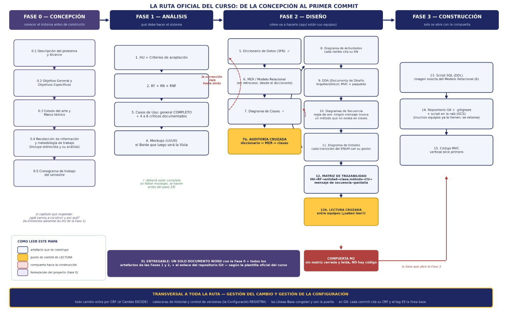
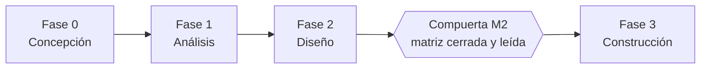

# Documentación — Mesa de Ayuda TI (Nexa Servicios)

La documentación está organizada por fases según la guía oficial del curso **«La ruta oficial del curso: de la concepción al primer commit»**.

| Fase | Pregunta que responde | Carpeta |
|---|---|---|
| **Fase 0 — Concepción** | Conocer el sistema antes de construirlo | [fase_0](fase_0/README.md) |
| **Fase 1 — Análisis** | Qué debe hacer el sistema | [fase_1](fase_1/README.md) |
| **Fase 2 — Diseño** | Cómo va a hacerlo | [fase_2](fase_2/README.md) |
| **Fase 3 — Construcción** | Solo se abre con la Compuerta M2 | [fase_3](fase_3/README.md) |

**🧭 Punto central de navegación:** [apoyo/matriz_trazabilidad.md](apoyo/matriz_trazabilidad.md): matriz de trazabilidad general (problema → HU → CA → RF → RN → CU → actor → MK → diseño → evidencias).

**Entregable del curso:** un solo documento Word con la Fase 0 y todos los artefactos de las Fases 1 y 2, más el enlace del repositorio Git, según la plantilla oficial.

**Fuente de toda la documentación:** documento Word *Proyecto.docx* (Fase 0, Fase 1 y artefactos de la Fase 2). Referencias bibliográficas: [referencias.md](referencias.md).

**Transversal a toda la ruta — gestión del cambio y de la configuración:** todo cambio entra por CRF (el Cambio DECIDE) · cabeceras de historial y control de versiones (la Configuración REGISTRA) · las Líneas Base congelan y son la puerta · en Git, cada commit cita su CRF y el tag es la línea base.
Registro de cambios: [gestion-del-cambio/](gestion-del-cambio/crf-002-fase-1.md) (CRF-002 de la Fase 1).
