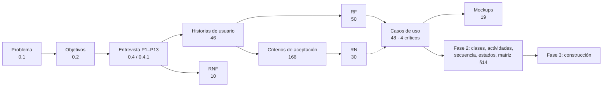
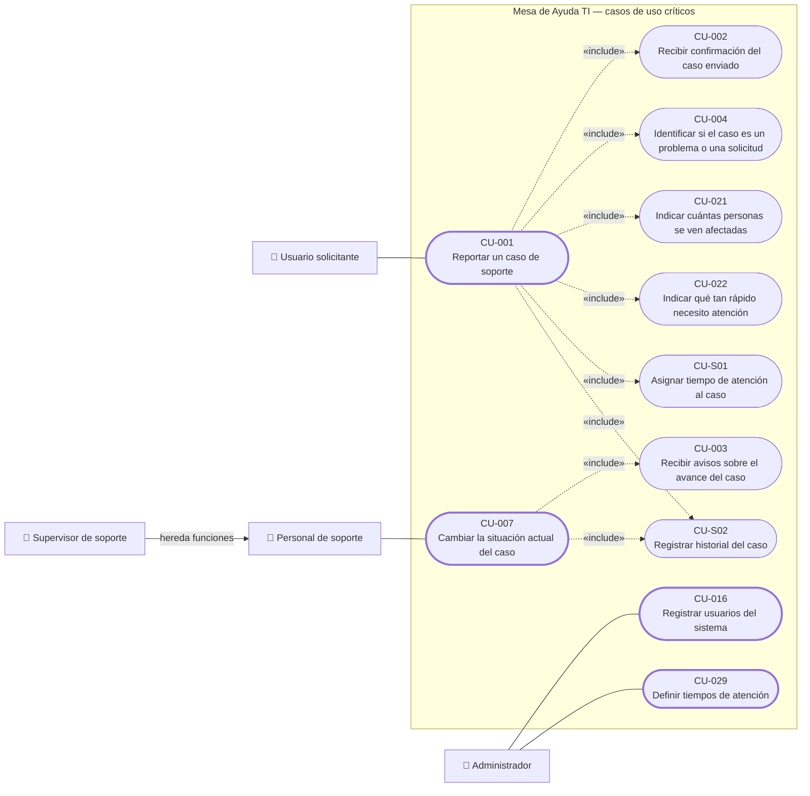

# Matriz de trazabilidad general

> **Carpeta de apoyo** · Documento transversal para revisión, auditoría académica, seguimiento y sustentación. Es el punto central de navegación de toda la documentación.
>
> **Regla de construcción:** cada relación de esta matriz está escrita de forma explícita en *Proyecto.docx* (fichas de HU, RF, RN y CU, procedencia de los CU, cobertura §4.4, fichas de mockup y matrices §5 y §14). No se dedujo ninguna relación.

## Contenido

1. [Cadena general del proyecto](#1-cadena-general-del-proyecto)
2. [Matriz principal por historia de usuario](#2-matriz-principal-por-historia-de-usuario)
3. [Casos de uso críticos](#3-casos-de-uso-críticos)
4. [Reglas de negocio](#4-reglas-de-negocio)
5. [Requisitos funcionales](#5-requisitos-funcionales)
6. [Requisitos no funcionales](#6-requisitos-no-funcionales)
7. [Casos de uso](#7-casos-de-uso)
8. [Mockups](#8-mockups)
9. [Diseño e implementación](#9-diseño-e-implementación)
10. [Base de datos (Fase 3)](#10-base-de-datos-fase-3)
11. [Pruebas del DDL](#11-pruebas-del-ddl)

## 1. Cadena general del proyecto

El documento enlaza el problema con los requisitos a través de la entrevista: según la sección 0.4, *cada necesidad expresada por los usuarios pudo trasladarse a una historia de usuario y, posteriormente, a requerimientos funcionales verificables*. Por eso el problema y los objetivos se presentan aquí como el inicio de la cadena, y cada HU se conecta con la pregunta de la entrevista que la origina.

| Elemento | Documento | Relación documentada |
|---|---|---|
| Problema identificado | [0.1 Descripción del problema y alcance](../fase_0/0.1-descripcion-del-problema-y-alcance.md) | Origen de los objetivos y de la pregunta de investigación |
| Objetivos | [0.2 Objetivos](../fase_0/0.2-objetivos.md) | Responden al problema (0.1) |
| Recolección de información | [0.4 Metodología](../fase_0/0.4-recoleccion-de-informacion-y-metodologia.md) · [0.4.1 Entrevista](../fase_0/0.4.1-entrevista-resultados.md) | Cada pregunta P se cita como «Origen de la necesidad» de las HU |
| Guía del curso | [Ruta oficial](../README.md) | Ubica cada artefacto en su fase |

## 2. Matriz principal por historia de usuario

Fuentes por columna: *Origen* = «Origen de la necesidad» de la HU · *CA* y *RF* = ficha de la HU · *RN*, *CU* y *Mockup* = matriz §5 · *Actor* = ficha de los CU de la fila · *Clase.Método* = matriz §14. El problema y los objetivos que dan inicio a la cadena están en la [sección 1](#1-cadena-general-del-proyecto).

| Origen (entrevista) | HU | CA | RF | RN | CU | Actor(es) | Mockup | Clase.Método (§14) | Tablas (BD) | Ubicación |
|---|---|---|---|---|---|---|---|---|---|---|
| [P2](../fase_0/0.4.1-entrevista-resultados.md#p2), [P9](../fase_0/0.4.1-entrevista-resultados.md#p9) | [HU-001](../fase_1/1-historias-de-usuario.md#hu-001) Reportar un caso de soporte | [CA-1](../fase_1/1-historias-de-usuario.md#hu-001-ca-1), [CA-2](../fase_1/1-historias-de-usuario.md#hu-001-ca-2), [CA-3](../fase_1/1-historias-de-usuario.md#hu-001-ca-3), [CA-4](../fase_1/1-historias-de-usuario.md#hu-001-ca-4), [CA-5](../fase_1/1-historias-de-usuario.md#hu-001-ca-5) | [RF-01](../fase_1/2-reglas-de-negocio-y-requisitos.md#rf-01), [RF-02](../fase_1/2-reglas-de-negocio-y-requisitos.md#rf-02), [RF-18](../fase_1/2-reglas-de-negocio-y-requisitos.md#rf-18) | [RN-01](../fase_1/2-reglas-de-negocio-y-requisitos.md#rn-01), [RN-02](../fase_1/2-reglas-de-negocio-y-requisitos.md#rn-02), [RN-23](../fase_1/2-reglas-de-negocio-y-requisitos.md#rn-23), [RN-25](../fase_1/2-reglas-de-negocio-y-requisitos.md#rn-25) | [CU-001](../fase_1/3-casos-de-uso.md#cu-001), [CU-004](../fase_1/3-casos-de-uso.md#cu-004), [CU-021](../fase_1/3-casos-de-uso.md#cu-021), [CU-022](../fase_1/3-casos-de-uso.md#cu-022), [CU-S01](../fase_1/3-casos-de-uso.md#cu-s01), [CU-S02](../fase_1/3-casos-de-uso.md#cu-s02) | Usuario solicitante | [MK-02](../fase_1/4-mockups.md#mk-02), [MK-06](../fase_1/4-mockups.md#mk-06) | [CasoSoporte.crearCaso();  HistorialCaso.registrarHistorial();  TiempoAtencionSLA.obtenerSLA();  Activo.obtenerActivo()](../fase_2/12-matriz-de-trazabilidad.md#m14-hu-001) | [`caso_soporte`](../fase_3/13-script-sql-ddl.md#tabla-caso-soporte), [`historial_caso`](../fase_3/13-script-sql-ddl.md#tabla-historial-caso), [`tiempo_atencion_sla`](../fase_3/13-script-sql-ddl.md#tabla-tiempo-atencion-sla), [`activo`](../fase_3/13-script-sql-ddl.md#tabla-activo) | [Fase 1 §1](../fase_1/1-historias-de-usuario.md#hu-001) · [§5](../fase_1/5-matriz-de-trazabilidad-analisis.md#m5-hu-001) · [§14](../fase_2/12-matriz-de-trazabilidad.md#m14-hu-001) |
| [P3](../fase_0/0.4.1-entrevista-resultados.md#p3) | [HU-002](../fase_1/1-historias-de-usuario.md#hu-002) Recibir confirmación del caso enviado | [CA-1](../fase_1/1-historias-de-usuario.md#hu-002-ca-1), [CA-2](../fase_1/1-historias-de-usuario.md#hu-002-ca-2), [CA-3](../fase_1/1-historias-de-usuario.md#hu-002-ca-3), [CA-4](../fase_1/1-historias-de-usuario.md#hu-002-ca-4), [CA-5](../fase_1/1-historias-de-usuario.md#hu-002-ca-5), [CA-6](../fase_1/1-historias-de-usuario.md#hu-002-ca-6) | [RF-01](../fase_1/2-reglas-de-negocio-y-requisitos.md#rf-01), [RF-03](../fase_1/2-reglas-de-negocio-y-requisitos.md#rf-03), [RF-05](../fase_1/2-reglas-de-negocio-y-requisitos.md#rf-05) | [RN-02](../fase_1/2-reglas-de-negocio-y-requisitos.md#rn-02), [RN-15](../fase_1/2-reglas-de-negocio-y-requisitos.md#rn-15), [RN-16](../fase_1/2-reglas-de-negocio-y-requisitos.md#rn-16), [RN-17](../fase_1/2-reglas-de-negocio-y-requisitos.md#rn-17) | [CU-002](../fase_1/3-casos-de-uso.md#cu-002), [CU-003](../fase_1/3-casos-de-uso.md#cu-003) | Usuario solicitante; Usuario solicitante (la dispara CU-001) | [MK-03](../fase_1/4-mockups.md#mk-03), [MK-09](../fase_1/4-mockups.md#mk-09) | [Aviso.crearAviso(), actualizarEstadoEnvio(), reintentarEnvio();  CasoSoporte.crearCaso()](../fase_2/12-matriz-de-trazabilidad.md#m14-hu-002) | [`caso_soporte`](../fase_3/13-script-sql-ddl.md#tabla-caso-soporte), [`aviso`](../fase_3/13-script-sql-ddl.md#tabla-aviso) | [Fase 1 §1](../fase_1/1-historias-de-usuario.md#hu-002) · [§5](../fase_1/5-matriz-de-trazabilidad-analisis.md#m5-hu-002) · [§14](../fase_2/12-matriz-de-trazabilidad.md#m14-hu-002) |
| [P3](../fase_0/0.4.1-entrevista-resultados.md#p3), [P10](../fase_0/0.4.1-entrevista-resultados.md#p10) | [HU-003](../fase_1/1-historias-de-usuario.md#hu-003) Recibir avisos sobre el avance del caso | [CA-1](../fase_1/1-historias-de-usuario.md#hu-003-ca-1), [CA-2](../fase_1/1-historias-de-usuario.md#hu-003-ca-2), [CA-3](../fase_1/1-historias-de-usuario.md#hu-003-ca-3), [CA-4](../fase_1/1-historias-de-usuario.md#hu-003-ca-4) | [RF-04](../fase_1/2-reglas-de-negocio-y-requisitos.md#rf-04), [RF-05](../fase_1/2-reglas-de-negocio-y-requisitos.md#rf-05), [RF-06](../fase_1/2-reglas-de-negocio-y-requisitos.md#rf-06) | [RN-15](../fase_1/2-reglas-de-negocio-y-requisitos.md#rn-15), [RN-16](../fase_1/2-reglas-de-negocio-y-requisitos.md#rn-16) | [CU-003](../fase_1/3-casos-de-uso.md#cu-003) | Usuario solicitante | [MK-09](../fase_1/4-mockups.md#mk-09) | [Aviso.crearAviso(), obtenerAviso(), actualizarEstadoEnvio(), reintentarEnvio(), marcarLeido()](../fase_2/12-matriz-de-trazabilidad.md#m14-hu-003) | [`aviso`](../fase_3/13-script-sql-ddl.md#tabla-aviso) | [Fase 1 §1](../fase_1/1-historias-de-usuario.md#hu-003) · [§5](../fase_1/5-matriz-de-trazabilidad-analisis.md#m5-hu-003) · [§14](../fase_2/12-matriz-de-trazabilidad.md#m14-hu-003) |
| [P11](../fase_0/0.4.1-entrevista-resultados.md#p11), [P12](../fase_0/0.4.1-entrevista-resultados.md#p12) | [HU-004](../fase_1/1-historias-de-usuario.md#hu-004) Identificar si el caso es un problema o una solicitud | [CA-1](../fase_1/1-historias-de-usuario.md#hu-004-ca-1), [CA-2](../fase_1/1-historias-de-usuario.md#hu-004-ca-2), [CA-3](../fase_1/1-historias-de-usuario.md#hu-004-ca-3), [CA-4](../fase_1/1-historias-de-usuario.md#hu-004-ca-4) | [RF-02](../fase_1/2-reglas-de-negocio-y-requisitos.md#rf-02), [RF-07](../fase_1/2-reglas-de-negocio-y-requisitos.md#rf-07) | [RN-03](../fase_1/2-reglas-de-negocio-y-requisitos.md#rn-03) | [CU-001](../fase_1/3-casos-de-uso.md#cu-001), [CU-004](../fase_1/3-casos-de-uso.md#cu-004) | Usuario solicitante | [MK-02](../fase_1/4-mockups.md#mk-02) | [CasoSoporte.crearCaso()](../fase_2/12-matriz-de-trazabilidad.md#m14-hu-004) | [`caso_soporte`](../fase_3/13-script-sql-ddl.md#tabla-caso-soporte) | [Fase 1 §1](../fase_1/1-historias-de-usuario.md#hu-004) · [§5](../fase_1/5-matriz-de-trazabilidad-analisis.md#m5-hu-004) · [§14](../fase_2/12-matriz-de-trazabilidad.md#m14-hu-004) |
| [P3](../fase_0/0.4.1-entrevista-resultados.md#p3), [P9](../fase_0/0.4.1-entrevista-resultados.md#p9) | [HU-005](../fase_1/1-historias-de-usuario.md#hu-005) Consultar casos anteriores | [CA-1](../fase_1/1-historias-de-usuario.md#hu-005-ca-1), [CA-2](../fase_1/1-historias-de-usuario.md#hu-005-ca-2), [CA-3](../fase_1/1-historias-de-usuario.md#hu-005-ca-3), [CA-4](../fase_1/1-historias-de-usuario.md#hu-005-ca-4) | [RF-09](../fase_1/2-reglas-de-negocio-y-requisitos.md#rf-09), [RF-10](../fase_1/2-reglas-de-negocio-y-requisitos.md#rf-10) | [RN-06](../fase_1/2-reglas-de-negocio-y-requisitos.md#rn-06) | [CU-005](../fase_1/3-casos-de-uso.md#cu-005) | Usuario solicitante | [MK-04](../fase_1/4-mockups.md#mk-04) | [CasoSoporte.obtenerCaso()](../fase_2/12-matriz-de-trazabilidad.md#m14-hu-005) | [`caso_soporte`](../fase_3/13-script-sql-ddl.md#tabla-caso-soporte) | [Fase 1 §1](../fase_1/1-historias-de-usuario.md#hu-005) · [§5](../fase_1/5-matriz-de-trazabilidad-analisis.md#m5-hu-005) · [§14](../fase_2/12-matriz-de-trazabilidad.md#m14-hu-005) |
| [P4](../fase_0/0.4.1-entrevista-resultados.md#p4), [P10](../fase_0/0.4.1-entrevista-resultados.md#p10) | [HU-006](../fase_1/1-historias-de-usuario.md#hu-006) Revisar casos pendientes | [CA-1](../fase_1/1-historias-de-usuario.md#hu-006-ca-1), [CA-2](../fase_1/1-historias-de-usuario.md#hu-006-ca-2), [CA-3](../fase_1/1-historias-de-usuario.md#hu-006-ca-3), [CA-4](../fase_1/1-historias-de-usuario.md#hu-006-ca-4), [CA-5](../fase_1/1-historias-de-usuario.md#hu-006-ca-5) | [RF-11](../fase_1/2-reglas-de-negocio-y-requisitos.md#rf-11) | [RN-05](../fase_1/2-reglas-de-negocio-y-requisitos.md#rn-05), [RN-23](../fase_1/2-reglas-de-negocio-y-requisitos.md#rn-23) | [CU-006](../fase_1/3-casos-de-uso.md#cu-006) | Personal de soporte | [MK-07](../fase_1/4-mockups.md#mk-07) | [CasoSoporte.obtenerCaso();  TablaImportancia.calcularResultadoImportancia()](../fase_2/12-matriz-de-trazabilidad.md#m14-hu-006) | [`caso_soporte`](../fase_3/13-script-sql-ddl.md#tabla-caso-soporte), [`tabla_importancia`](../fase_3/13-script-sql-ddl.md#tabla-tabla-importancia) | [Fase 1 §1](../fase_1/1-historias-de-usuario.md#hu-006) · [§5](../fase_1/5-matriz-de-trazabilidad-analisis.md#m5-hu-006) · [§14](../fase_2/12-matriz-de-trazabilidad.md#m14-hu-006) |
| [P3](../fase_0/0.4.1-entrevista-resultados.md#p3), [P10](../fase_0/0.4.1-entrevista-resultados.md#p10) | [HU-007](../fase_1/1-historias-de-usuario.md#hu-007) Cambiar la situación actual del caso | [CA-1](../fase_1/1-historias-de-usuario.md#hu-007-ca-1), [CA-2](../fase_1/1-historias-de-usuario.md#hu-007-ca-2), [CA-3](../fase_1/1-historias-de-usuario.md#hu-007-ca-3), [CA-4](../fase_1/1-historias-de-usuario.md#hu-007-ca-4), [CA-5](../fase_1/1-historias-de-usuario.md#hu-007-ca-5) | [RF-12](../fase_1/2-reglas-de-negocio-y-requisitos.md#rf-12), [RF-13](../fase_1/2-reglas-de-negocio-y-requisitos.md#rf-13), [RF-49](../fase_1/2-reglas-de-negocio-y-requisitos.md#rf-49), [RF-50](../fase_1/2-reglas-de-negocio-y-requisitos.md#rf-50) | [RN-06](../fase_1/2-reglas-de-negocio-y-requisitos.md#rn-06), [RN-07](../fase_1/2-reglas-de-negocio-y-requisitos.md#rn-07), [RN-08](../fase_1/2-reglas-de-negocio-y-requisitos.md#rn-08), [RN-14](../fase_1/2-reglas-de-negocio-y-requisitos.md#rn-14), [RN-23](../fase_1/2-reglas-de-negocio-y-requisitos.md#rn-23) | [CU-003](../fase_1/3-casos-de-uso.md#cu-003), [CU-007](../fase_1/3-casos-de-uso.md#cu-007), [CU-010](../fase_1/3-casos-de-uso.md#cu-010), [CU-S02](../fase_1/3-casos-de-uso.md#cu-s02) | Personal de soporte; Usuario solicitante | [MK-05](../fase_1/4-mockups.md#mk-05), [MK-06](../fase_1/4-mockups.md#mk-06) | [CasoSoporte.actualizarCaso(), registrarPrimeraRespuesta(), marcarSolucionado();  HistorialCaso.registrarHistorial();  TransicionEstadoCaso.esTransicionValida()](../fase_2/12-matriz-de-trazabilidad.md#m14-hu-007) | [`caso_soporte`](../fase_3/13-script-sql-ddl.md#tabla-caso-soporte), [`historial_caso`](../fase_3/13-script-sql-ddl.md#tabla-historial-caso), [`transicion_estado_caso`](../fase_3/13-script-sql-ddl.md#tabla-transicion-estado-caso) | [Fase 1 §1](../fase_1/1-historias-de-usuario.md#hu-007) · [§5](../fase_1/5-matriz-de-trazabilidad-analisis.md#m5-hu-007) · [§14](../fase_2/12-matriz-de-trazabilidad.md#m14-hu-007) |
| [P10](../fase_0/0.4.1-entrevista-resultados.md#p10) | [HU-008](../fase_1/1-historias-de-usuario.md#hu-008) Asignar una persona encargada del caso | [CA-1](../fase_1/1-historias-de-usuario.md#hu-008-ca-1), [CA-2](../fase_1/1-historias-de-usuario.md#hu-008-ca-2), [CA-3](../fase_1/1-historias-de-usuario.md#hu-008-ca-3), [CA-4](../fase_1/1-historias-de-usuario.md#hu-008-ca-4) | [RF-14](../fase_1/2-reglas-de-negocio-y-requisitos.md#rf-14), [RF-49](../fase_1/2-reglas-de-negocio-y-requisitos.md#rf-49) | [RN-08](../fase_1/2-reglas-de-negocio-y-requisitos.md#rn-08), [RN-09](../fase_1/2-reglas-de-negocio-y-requisitos.md#rn-09) | [CU-008](../fase_1/3-casos-de-uso.md#cu-008), [CU-S02](../fase_1/3-casos-de-uso.md#cu-s02) | Personal de soporte (supervisor) | [MK-06](../fase_1/4-mockups.md#mk-06) | [CasoSoporte.actualizarCaso();  HistorialCaso.registrarHistorial()](../fase_2/12-matriz-de-trazabilidad.md#m14-hu-008) | [`caso_soporte`](../fase_3/13-script-sql-ddl.md#tabla-caso-soporte), [`historial_caso`](../fase_3/13-script-sql-ddl.md#tabla-historial-caso) | [Fase 1 §1](../fase_1/1-historias-de-usuario.md#hu-008) · [§5](../fase_1/5-matriz-de-trazabilidad-analisis.md#m5-hu-008) · [§14](../fase_2/12-matriz-de-trazabilidad.md#m14-hu-008) |
| [P6](../fase_0/0.4.1-entrevista-resultados.md#p6) | [HU-009](../fase_1/1-historias-de-usuario.md#hu-009) Agregar comentarios al caso | [CA-1](../fase_1/1-historias-de-usuario.md#hu-009-ca-1), [CA-2](../fase_1/1-historias-de-usuario.md#hu-009-ca-2), [CA-3](../fase_1/1-historias-de-usuario.md#hu-009-ca-3), [CA-4](../fase_1/1-historias-de-usuario.md#hu-009-ca-4) | [RF-16](../fase_1/2-reglas-de-negocio-y-requisitos.md#rf-16), [RF-17](../fase_1/2-reglas-de-negocio-y-requisitos.md#rf-17) | [RN-08](../fase_1/2-reglas-de-negocio-y-requisitos.md#rn-08), [RN-10](../fase_1/2-reglas-de-negocio-y-requisitos.md#rn-10) | [CU-009](../fase_1/3-casos-de-uso.md#cu-009) | Personal de soporte | [MK-05](../fase_1/4-mockups.md#mk-05), [MK-06](../fase_1/4-mockups.md#mk-06) | [ComentarioCaso.registrarComentario(), listarComentarios()](../fase_2/12-matriz-de-trazabilidad.md#m14-hu-009) | [`comentario_caso`](../fase_3/13-script-sql-ddl.md#tabla-comentario-caso) | [Fase 1 §1](../fase_1/1-historias-de-usuario.md#hu-009) · [§5](../fase_1/5-matriz-de-trazabilidad-analisis.md#m5-hu-009) · [§14](../fase_2/12-matriz-de-trazabilidad.md#m14-hu-009) |
| [P4](../fase_0/0.4.1-entrevista-resultados.md#p4), [P13](../fase_0/0.4.1-entrevista-resultados.md#p13) | [HU-010](../fase_1/1-historias-de-usuario.md#hu-010) Ver tiempo aproximado de atención | [CA-1](../fase_1/1-historias-de-usuario.md#hu-010-ca-1), [CA-2](../fase_1/1-historias-de-usuario.md#hu-010-ca-2), [CA-3](../fase_1/1-historias-de-usuario.md#hu-010-ca-3), [CA-4](../fase_1/1-historias-de-usuario.md#hu-010-ca-4) | [RF-13](../fase_1/2-reglas-de-negocio-y-requisitos.md#rf-13), [RF-20](../fase_1/2-reglas-de-negocio-y-requisitos.md#rf-20) | [RN-06](../fase_1/2-reglas-de-negocio-y-requisitos.md#rn-06), [RN-13](../fase_1/2-reglas-de-negocio-y-requisitos.md#rn-13), [RN-14](../fase_1/2-reglas-de-negocio-y-requisitos.md#rn-14) | [CU-010](../fase_1/3-casos-de-uso.md#cu-010), [CU-S01](../fase_1/3-casos-de-uso.md#cu-s01) | Usuario solicitante | [MK-05](../fase_1/4-mockups.md#mk-05) | [CasoSoporte.cumpleSLA();  TiempoAtencionSLA.obtenerSLA()](../fase_2/12-matriz-de-trazabilidad.md#m14-hu-010) | [`caso_soporte`](../fase_3/13-script-sql-ddl.md#tabla-caso-soporte), [`tiempo_atencion_sla`](../fase_3/13-script-sql-ddl.md#tabla-tiempo-atencion-sla) | [Fase 1 §1](../fase_1/1-historias-de-usuario.md#hu-010) · [§5](../fase_1/5-matriz-de-trazabilidad-analisis.md#m5-hu-010) · [§14](../fase_2/12-matriz-de-trazabilidad.md#m14-hu-010) |
| [P4](../fase_0/0.4.1-entrevista-resultados.md#p4), [P10](../fase_0/0.4.1-entrevista-resultados.md#p10) | [HU-011](../fase_1/1-historias-de-usuario.md#hu-011) Revisar resumen general de atención | [CA-1](../fase_1/1-historias-de-usuario.md#hu-011-ca-1), [CA-2](../fase_1/1-historias-de-usuario.md#hu-011-ca-2), [CA-3](../fase_1/1-historias-de-usuario.md#hu-011-ca-3), [CA-4](../fase_1/1-historias-de-usuario.md#hu-011-ca-4) | [RF-21](../fase_1/2-reglas-de-negocio-y-requisitos.md#rf-21) | [RN-14](../fase_1/2-reglas-de-negocio-y-requisitos.md#rn-14), [RN-29](../fase_1/2-reglas-de-negocio-y-requisitos.md#rn-29) | [CU-011](../fase_1/3-casos-de-uso.md#cu-011) | Supervisor de soporte | [MK-10](../fase_1/4-mockups.md#mk-10) | [CasoSoporte.cumpleSLA(), obtenerCaso(), registrarPrimeraRespuesta()](../fase_2/12-matriz-de-trazabilidad.md#m14-hu-011) | [`caso_soporte`](../fase_3/13-script-sql-ddl.md#tabla-caso-soporte) | [Fase 1 §1](../fase_1/1-historias-de-usuario.md#hu-011) · [§5](../fase_1/5-matriz-de-trazabilidad-analisis.md#m5-hu-011) · [§14](../fase_2/12-matriz-de-trazabilidad.md#m14-hu-011) |
| [P4](../fase_0/0.4.1-entrevista-resultados.md#p4) | [HU-012](../fase_1/1-historias-de-usuario.md#hu-012) Revisar resumen por periodo | [CA-1](../fase_1/1-historias-de-usuario.md#hu-012-ca-1), [CA-2](../fase_1/1-historias-de-usuario.md#hu-012-ca-2) | [RF-22](../fase_1/2-reglas-de-negocio-y-requisitos.md#rf-22) | [RN-29](../fase_1/2-reglas-de-negocio-y-requisitos.md#rn-29) | [CU-012](../fase_1/3-casos-de-uso.md#cu-012) | Supervisor de soporte | [MK-10](../fase_1/4-mockups.md#mk-10) | [CasoSoporte.obtenerResumenAtencion()](../fase_2/12-matriz-de-trazabilidad.md#m14-hu-012) | [`caso_soporte`](../fase_3/13-script-sql-ddl.md#tabla-caso-soporte) | [Fase 1 §1](../fase_1/1-historias-de-usuario.md#hu-012) · [§5](../fase_1/5-matriz-de-trazabilidad-analisis.md#m5-hu-012) · [§14](../fase_2/12-matriz-de-trazabilidad.md#m14-hu-012) |
| [P3](../fase_0/0.4.1-entrevista-resultados.md#p3) | [HU-013](../fase_1/1-historias-de-usuario.md#hu-013) Reabrir un caso | [CA-1](../fase_1/1-historias-de-usuario.md#hu-013-ca-1), [CA-2](../fase_1/1-historias-de-usuario.md#hu-013-ca-2), [CA-3](../fase_1/1-historias-de-usuario.md#hu-013-ca-3), [CA-4](../fase_1/1-historias-de-usuario.md#hu-013-ca-4), [CA-5](../fase_1/1-historias-de-usuario.md#hu-013-ca-5) | [RF-23](../fase_1/2-reglas-de-negocio-y-requisitos.md#rf-23) | [RN-08](../fase_1/2-reglas-de-negocio-y-requisitos.md#rn-08), [RN-11](../fase_1/2-reglas-de-negocio-y-requisitos.md#rn-11) | [CU-013](../fase_1/3-casos-de-uso.md#cu-013) | Usuario solicitante | [MK-05](../fase_1/4-mockups.md#mk-05) | [CasoSoporte.reabrirCaso()](../fase_2/12-matriz-de-trazabilidad.md#m14-hu-013) | [`caso_soporte`](../fase_3/13-script-sql-ddl.md#tabla-caso-soporte) | [Fase 1 §1](../fase_1/1-historias-de-usuario.md#hu-013) · [§5](../fase_1/5-matriz-de-trazabilidad-analisis.md#m5-hu-013) · [§14](../fase_2/12-matriz-de-trazabilidad.md#m14-hu-013) |
| [P8](../fase_0/0.4.1-entrevista-resultados.md#p8) | [HU-015](../fase_1/1-historias-de-usuario.md#hu-015) Consultar información del personal de soporte | [CA-1](../fase_1/1-historias-de-usuario.md#hu-015-ca-1), [CA-2](../fase_1/1-historias-de-usuario.md#hu-015-ca-2), [CA-3](../fase_1/1-historias-de-usuario.md#hu-015-ca-3) | [RF-24](../fase_1/2-reglas-de-negocio-y-requisitos.md#rf-24) | [RN-28](../fase_1/2-reglas-de-negocio-y-requisitos.md#rn-28) | [CU-015](../fase_1/3-casos-de-uso.md#cu-015) | Supervisor de soporte | [MK-11](../fase_1/4-mockups.md#mk-11) | [InfoPersonalSoporte.obtenerInfoSoporte()](../fase_2/12-matriz-de-trazabilidad.md#m14-hu-015) | [`info_personal_soporte`](../fase_3/13-script-sql-ddl.md#tabla-info-personal-soporte) | [Fase 1 §1](../fase_1/1-historias-de-usuario.md#hu-015) · [§5](../fase_1/5-matriz-de-trazabilidad-analisis.md#m5-hu-015) · [§14](../fase_2/12-matriz-de-trazabilidad.md#m14-hu-015) |
| — | [HU-016](../fase_1/1-historias-de-usuario.md#hu-016) Registrar usuarios del sistema | [CA-1](../fase_1/1-historias-de-usuario.md#hu-016-ca-1), [CA-2](../fase_1/1-historias-de-usuario.md#hu-016-ca-2), [CA-3](../fase_1/1-historias-de-usuario.md#hu-016-ca-3), [CA-4](../fase_1/1-historias-de-usuario.md#hu-016-ca-4) | [RF-26](../fase_1/2-reglas-de-negocio-y-requisitos.md#rf-26) | [RN-17](../fase_1/2-reglas-de-negocio-y-requisitos.md#rn-17), [RN-18](../fase_1/2-reglas-de-negocio-y-requisitos.md#rn-18), [RN-19](../fase_1/2-reglas-de-negocio-y-requisitos.md#rn-19) | [CU-016](../fase_1/3-casos-de-uso.md#cu-016) | Administrador | [MK-14](../fase_1/4-mockups.md#mk-14) | [Usuario.crearUsuario(), encriptarContrasena(), validarCorreoUnico();  Catalogo.obtener()](../fase_2/12-matriz-de-trazabilidad.md#m14-hu-016) | [`usuario`](../fase_3/13-script-sql-ddl.md#tabla-usuario) | [Fase 1 §1](../fase_1/1-historias-de-usuario.md#hu-016) · [§5](../fase_1/5-matriz-de-trazabilidad-analisis.md#m5-hu-016) · [§14](../fase_2/12-matriz-de-trazabilidad.md#m14-hu-016) |
| [P1](../fase_0/0.4.1-entrevista-resultados.md#p1) | [HU-017](../fase_1/1-historias-de-usuario.md#hu-017) Consultar usuarios registrados | [CA-1](../fase_1/1-historias-de-usuario.md#hu-017-ca-1), [CA-2](../fase_1/1-historias-de-usuario.md#hu-017-ca-2), [CA-3](../fase_1/1-historias-de-usuario.md#hu-017-ca-3) | [RF-27](../fase_1/2-reglas-de-negocio-y-requisitos.md#rf-27) | [RN-23](../fase_1/2-reglas-de-negocio-y-requisitos.md#rn-23) | [CU-017](../fase_1/3-casos-de-uso.md#cu-017) | Personal de soporte | [MK-13](../fase_1/4-mockups.md#mk-13) | [Usuario.obtenerUsuario()](../fase_2/12-matriz-de-trazabilidad.md#m14-hu-017) | [`usuario`](../fase_3/13-script-sql-ddl.md#tabla-usuario) | [Fase 1 §1](../fase_1/1-historias-de-usuario.md#hu-017) · [§5](../fase_1/5-matriz-de-trazabilidad-analisis.md#m5-hu-017) · [§14](../fase_2/12-matriz-de-trazabilidad.md#m14-hu-017) |
| [P11](../fase_0/0.4.1-entrevista-resultados.md#p11), [P12](../fase_0/0.4.1-entrevista-resultados.md#p12) | [HU-018](../fase_1/1-historias-de-usuario.md#hu-018) Indicar tipo de problema | [CA-1](../fase_1/1-historias-de-usuario.md#hu-018-ca-1), [CA-2](../fase_1/1-historias-de-usuario.md#hu-018-ca-2), [CA-3](../fase_1/1-historias-de-usuario.md#hu-018-ca-3) | [RF-31](../fase_1/2-reglas-de-negocio-y-requisitos.md#rf-31) | [RN-03](../fase_1/2-reglas-de-negocio-y-requisitos.md#rn-03), [RN-04](../fase_1/2-reglas-de-negocio-y-requisitos.md#rn-04) | [CU-018](../fase_1/3-casos-de-uso.md#cu-018) | Usuario solicitante | [MK-02](../fase_1/4-mockups.md#mk-02) | [Catalogo.obtener()](../fase_2/12-matriz-de-trazabilidad.md#m14-hu-018) | [`tipo_problema`](../fase_3/13-script-sql-ddl.md#tabla-tipo-problema) | [Fase 1 §1](../fase_1/1-historias-de-usuario.md#hu-018) · [§5](../fase_1/5-matriz-de-trazabilidad-analisis.md#m5-hu-018) · [§14](../fase_2/12-matriz-de-trazabilidad.md#m14-hu-018) |
| [P11](../fase_0/0.4.1-entrevista-resultados.md#p11), [P12](../fase_0/0.4.1-entrevista-resultados.md#p12) | [HU-019](../fase_1/1-historias-de-usuario.md#hu-019) Indicar tipo de solicitud | [CA-1](../fase_1/1-historias-de-usuario.md#hu-019-ca-1), [CA-2](../fase_1/1-historias-de-usuario.md#hu-019-ca-2), [CA-3](../fase_1/1-historias-de-usuario.md#hu-019-ca-3) | [RF-32](../fase_1/2-reglas-de-negocio-y-requisitos.md#rf-32) | [RN-03](../fase_1/2-reglas-de-negocio-y-requisitos.md#rn-03), [RN-04](../fase_1/2-reglas-de-negocio-y-requisitos.md#rn-04) | [CU-019](../fase_1/3-casos-de-uso.md#cu-019) | Usuario solicitante | [MK-02](../fase_1/4-mockups.md#mk-02) | [Catalogo.obtener()](../fase_2/12-matriz-de-trazabilidad.md#m14-hu-019) | [`tipo_solicitud`](../fase_3/13-script-sql-ddl.md#tabla-tipo-solicitud) | [Fase 1 §1](../fase_1/1-historias-de-usuario.md#hu-019) · [§5](../fase_1/5-matriz-de-trazabilidad-analisis.md#m5-hu-019) · [§14](../fase_2/12-matriz-de-trazabilidad.md#m14-hu-019) |
| [P12](../fase_0/0.4.1-entrevista-resultados.md#p12) | [HU-020](../fase_1/1-historias-de-usuario.md#hu-020) Indicar clase de solicitud | [CA-1](../fase_1/1-historias-de-usuario.md#hu-020-ca-1), [CA-2](../fase_1/1-historias-de-usuario.md#hu-020-ca-2), [CA-3](../fase_1/1-historias-de-usuario.md#hu-020-ca-3) | [RF-33](../fase_1/2-reglas-de-negocio-y-requisitos.md#rf-33) | [RN-03](../fase_1/2-reglas-de-negocio-y-requisitos.md#rn-03) | [CU-020](../fase_1/3-casos-de-uso.md#cu-020) | Usuario solicitante | [MK-02](../fase_1/4-mockups.md#mk-02) | [CasoSoporte.crearCaso()](../fase_2/12-matriz-de-trazabilidad.md#m14-hu-020) |  | [Fase 1 §1](../fase_1/1-historias-de-usuario.md#hu-020) · [§5](../fase_1/5-matriz-de-trazabilidad-analisis.md#m5-hu-020) · [§14](../fase_2/12-matriz-de-trazabilidad.md#m14-hu-020) |
| [P12](../fase_0/0.4.1-entrevista-resultados.md#p12) | [HU-021](../fase_1/1-historias-de-usuario.md#hu-021) Indicar cuántas personas se ven afectadas | [CA-1](../fase_1/1-historias-de-usuario.md#hu-021-ca-1), [CA-2](../fase_1/1-historias-de-usuario.md#hu-021-ca-2), [CA-3](../fase_1/1-historias-de-usuario.md#hu-021-ca-3) | [RF-18](../fase_1/2-reglas-de-negocio-y-requisitos.md#rf-18), [RF-19](../fase_1/2-reglas-de-negocio-y-requisitos.md#rf-19) | [RN-01](../fase_1/2-reglas-de-negocio-y-requisitos.md#rn-01), [RN-05](../fase_1/2-reglas-de-negocio-y-requisitos.md#rn-05) | [CU-021](../fase_1/3-casos-de-uso.md#cu-021), [CU-022](../fase_1/3-casos-de-uso.md#cu-022) | Usuario solicitante | [MK-02](../fase_1/4-mockups.md#mk-02) | [TablaImportancia.calcularResultadoImportancia()](../fase_2/12-matriz-de-trazabilidad.md#m14-hu-021) | [`tabla_importancia`](../fase_3/13-script-sql-ddl.md#tabla-tabla-importancia) | [Fase 1 §1](../fase_1/1-historias-de-usuario.md#hu-021) · [§5](../fase_1/5-matriz-de-trazabilidad-analisis.md#m5-hu-021) · [§14](../fase_2/12-matriz-de-trazabilidad.md#m14-hu-021) |
| [P12](../fase_0/0.4.1-entrevista-resultados.md#p12), [P13](../fase_0/0.4.1-entrevista-resultados.md#p13) | [HU-022](../fase_1/1-historias-de-usuario.md#hu-022) Indicar qué tan rápido necesito atención | [CA-1](../fase_1/1-historias-de-usuario.md#hu-022-ca-1), [CA-2](../fase_1/1-historias-de-usuario.md#hu-022-ca-2), [CA-3](../fase_1/1-historias-de-usuario.md#hu-022-ca-3) | [RF-18](../fase_1/2-reglas-de-negocio-y-requisitos.md#rf-18), [RF-19](../fase_1/2-reglas-de-negocio-y-requisitos.md#rf-19) | [RN-01](../fase_1/2-reglas-de-negocio-y-requisitos.md#rn-01), [RN-05](../fase_1/2-reglas-de-negocio-y-requisitos.md#rn-05) | [CU-021](../fase_1/3-casos-de-uso.md#cu-021), [CU-022](../fase_1/3-casos-de-uso.md#cu-022) | Usuario solicitante | [MK-02](../fase_1/4-mockups.md#mk-02) | [TablaImportancia.calcularResultadoImportancia()](../fase_2/12-matriz-de-trazabilidad.md#m14-hu-022) | [`tabla_importancia`](../fase_3/13-script-sql-ddl.md#tabla-tabla-importancia) | [Fase 1 §1](../fase_1/1-historias-de-usuario.md#hu-022) · [§5](../fase_1/5-matriz-de-trazabilidad-analisis.md#m5-hu-022) · [§14](../fase_2/12-matriz-de-trazabilidad.md#m14-hu-022) |
| — | [HU-023](../fase_1/1-historias-de-usuario.md#hu-023) Iniciar sesión | [CA-1](../fase_1/1-historias-de-usuario.md#hu-023-ca-1), [CA-2](../fase_1/1-historias-de-usuario.md#hu-023-ca-2), [CA-3](../fase_1/1-historias-de-usuario.md#hu-023-ca-3), [CA-4](../fase_1/1-historias-de-usuario.md#hu-023-ca-4) | [RF-34](../fase_1/2-reglas-de-negocio-y-requisitos.md#rf-34) | [RN-20](../fase_1/2-reglas-de-negocio-y-requisitos.md#rn-20), [RN-21](../fase_1/2-reglas-de-negocio-y-requisitos.md#rn-21), [RN-23](../fase_1/2-reglas-de-negocio-y-requisitos.md#rn-23) | [CU-023](../fase_1/3-casos-de-uso.md#cu-023) | Usuario solicitante, Personal de soporte, Supervisor de soporte o Administrador | [MK-01](../fase_1/4-mockups.md#mk-01) | [Usuario.autenticar(), registrarIntentoFallido(), resetearIntentosFallidos(), bloquearCuenta()](../fase_2/12-matriz-de-trazabilidad.md#m14-hu-023) | [`usuario`](../fase_3/13-script-sql-ddl.md#tabla-usuario) | [Fase 1 §1](../fase_1/1-historias-de-usuario.md#hu-023) · [§5](../fase_1/5-matriz-de-trazabilidad-analisis.md#m5-hu-023) · [§14](../fase_2/12-matriz-de-trazabilidad.md#m14-hu-023) |
| — | [HU-024](../fase_1/1-historias-de-usuario.md#hu-024) Recuperar contraseña | [CA-1](../fase_1/1-historias-de-usuario.md#hu-024-ca-1), [CA-2](../fase_1/1-historias-de-usuario.md#hu-024-ca-2), [CA-3](../fase_1/1-historias-de-usuario.md#hu-024-ca-3), [CA-4](../fase_1/1-historias-de-usuario.md#hu-024-ca-4) | [RF-35](../fase_1/2-reglas-de-negocio-y-requisitos.md#rf-35) | [RN-19](../fase_1/2-reglas-de-negocio-y-requisitos.md#rn-19), [RN-22](../fase_1/2-reglas-de-negocio-y-requisitos.md#rn-22) | [CU-024](../fase_1/3-casos-de-uso.md#cu-024) | Usuario solicitante, Personal de soporte, Supervisor de soporte o Administrador | [MK-01](../fase_1/4-mockups.md#mk-01), [MK-19](../fase_1/4-mockups.md#mk-19) | [Usuario.generarTokenRecuperacion(), encriptarContrasena(), enviarEnlaceRecuperacion(), restablecerContrasena();  TokenRecuperacion.esValido(), marcarUsado(), revocar()](../fase_2/12-matriz-de-trazabilidad.md#m14-hu-024) | [`usuario`](../fase_3/13-script-sql-ddl.md#tabla-usuario), [`token_recuperacion`](../fase_3/13-script-sql-ddl.md#tabla-token-recuperacion) | [Fase 1 §1](../fase_1/1-historias-de-usuario.md#hu-024) · [§5](../fase_1/5-matriz-de-trazabilidad-analisis.md#m5-hu-024) · [§14](../fase_2/12-matriz-de-trazabilidad.md#m14-hu-024) |
| — | [HU-025](../fase_1/1-historias-de-usuario.md#hu-025) Cerrar sesión | [CA-1](../fase_1/1-historias-de-usuario.md#hu-025-ca-1), [CA-2](../fase_1/1-historias-de-usuario.md#hu-025-ca-2) | [RF-36](../fase_1/2-reglas-de-negocio-y-requisitos.md#rf-36) | [RN-23](../fase_1/2-reglas-de-negocio-y-requisitos.md#rn-23) | [CU-025](../fase_1/3-casos-de-uso.md#cu-025) | Usuario solicitante, Personal de soporte, Supervisor de soporte o Administrador | [MK-04](../fase_1/4-mockups.md#mk-04) | [Usuario.cerrarSesion()](../fase_2/12-matriz-de-trazabilidad.md#m14-hu-025) | [`usuario`](../fase_3/13-script-sql-ddl.md#tabla-usuario) | [Fase 1 §1](../fase_1/1-historias-de-usuario.md#hu-025) · [§5](../fase_1/5-matriz-de-trazabilidad-analisis.md#m5-hu-025) · [§14](../fase_2/12-matriz-de-trazabilidad.md#m14-hu-025) |
| [P8](../fase_0/0.4.1-entrevista-resultados.md#p8), [P10](../fase_0/0.4.1-entrevista-resultados.md#p10) | [HU-026](../fase_1/1-historias-de-usuario.md#hu-026) Pasar un caso a otra persona de soporte | [CA-1](../fase_1/1-historias-de-usuario.md#hu-026-ca-1), [CA-2](../fase_1/1-historias-de-usuario.md#hu-026-ca-2), [CA-3](../fase_1/1-historias-de-usuario.md#hu-026-ca-3) | [RF-15](../fase_1/2-reglas-de-negocio-y-requisitos.md#rf-15), [RF-49](../fase_1/2-reglas-de-negocio-y-requisitos.md#rf-49) | [RN-08](../fase_1/2-reglas-de-negocio-y-requisitos.md#rn-08), [RN-09](../fase_1/2-reglas-de-negocio-y-requisitos.md#rn-09) | [CU-026](../fase_1/3-casos-de-uso.md#cu-026), [CU-S02](../fase_1/3-casos-de-uso.md#cu-s02) | Personal de soporte | [MK-06](../fase_1/4-mockups.md#mk-06) | [CasoSoporte.actualizarCaso();  HistorialCaso.registrarHistorial()](../fase_2/12-matriz-de-trazabilidad.md#m14-hu-026) | [`caso_soporte`](../fase_3/13-script-sql-ddl.md#tabla-caso-soporte), [`historial_caso`](../fase_3/13-script-sql-ddl.md#tabla-historial-caso) | [Fase 1 §1](../fase_1/1-historias-de-usuario.md#hu-026) · [§5](../fase_1/5-matriz-de-trazabilidad-analisis.md#m5-hu-026) · [§14](../fase_2/12-matriz-de-trazabilidad.md#m14-hu-026) |
| [P3](../fase_0/0.4.1-entrevista-resultados.md#p3), [P10](../fase_0/0.4.1-entrevista-resultados.md#p10) | [HU-028](../fase_1/1-historias-de-usuario.md#hu-028) Cerrar casos sin respuesta del usuario | [CA-1](../fase_1/1-historias-de-usuario.md#hu-028-ca-1), [CA-2](../fase_1/1-historias-de-usuario.md#hu-028-ca-2), [CA-3](../fase_1/1-historias-de-usuario.md#hu-028-ca-3) | [RF-37](../fase_1/2-reglas-de-negocio-y-requisitos.md#rf-37) | [RN-08](../fase_1/2-reglas-de-negocio-y-requisitos.md#rn-08), [RN-12](../fase_1/2-reglas-de-negocio-y-requisitos.md#rn-12), [RN-15](../fase_1/2-reglas-de-negocio-y-requisitos.md#rn-15) | [CU-028](../fase_1/3-casos-de-uso.md#cu-028) | Sistema (proceso automático) | [MK-09](../fase_1/4-mockups.md#mk-09) | [CasoSoporte.cerrarCaso();  Aviso.crearAviso()](../fase_2/12-matriz-de-trazabilidad.md#m14-hu-028) | [`caso_soporte`](../fase_3/13-script-sql-ddl.md#tabla-caso-soporte), [`aviso`](../fase_3/13-script-sql-ddl.md#tabla-aviso) | [Fase 1 §1](../fase_1/1-historias-de-usuario.md#hu-028) · [§5](../fase_1/5-matriz-de-trazabilidad-analisis.md#m5-hu-028) · [§14](../fase_2/12-matriz-de-trazabilidad.md#m14-hu-028) |
| [P4](../fase_0/0.4.1-entrevista-resultados.md#p4), [P13](../fase_0/0.4.1-entrevista-resultados.md#p13) | [HU-029](../fase_1/1-historias-de-usuario.md#hu-029) Definir tiempos de atención | [CA-1](../fase_1/1-historias-de-usuario.md#hu-029-ca-1), [CA-2](../fase_1/1-historias-de-usuario.md#hu-029-ca-2), [CA-3](../fase_1/1-historias-de-usuario.md#hu-029-ca-3), [CA-4](../fase_1/1-historias-de-usuario.md#hu-029-ca-4) | [RF-38](../fase_1/2-reglas-de-negocio-y-requisitos.md#rf-38) | [RN-13](../fase_1/2-reglas-de-negocio-y-requisitos.md#rn-13) | [CU-029](../fase_1/3-casos-de-uso.md#cu-029) | Administrador | [MK-12](../fase_1/4-mockups.md#mk-12) | [TiempoAtencionSLA.crearSLA(), obtenerSLA(), actualizarSLA(), inactivarSLA()](../fase_2/12-matriz-de-trazabilidad.md#m14-hu-029) | [`tiempo_atencion_sla`](../fase_3/13-script-sql-ddl.md#tabla-tiempo-atencion-sla) | [Fase 1 §1](../fase_1/1-historias-de-usuario.md#hu-029) · [§5](../fase_1/5-matriz-de-trazabilidad-analisis.md#m5-hu-029) · [§14](../fase_2/12-matriz-de-trazabilidad.md#m14-hu-029) |
| [P4](../fase_0/0.4.1-entrevista-resultados.md#p4), [P10](../fase_0/0.4.1-entrevista-resultados.md#p10) | [HU-030](../fase_1/1-historias-de-usuario.md#hu-030) Descargar reportes de atención | [CA-1](../fase_1/1-historias-de-usuario.md#hu-030-ca-1), [CA-2](../fase_1/1-historias-de-usuario.md#hu-030-ca-2) | [RF-40](../fase_1/2-reglas-de-negocio-y-requisitos.md#rf-40) | [RN-29](../fase_1/2-reglas-de-negocio-y-requisitos.md#rn-29) | [CU-030](../fase_1/3-casos-de-uso.md#cu-030) | Supervisor de soporte | [MK-10](../fase_1/4-mockups.md#mk-10) | [CasoSoporte.generarReporte()](../fase_2/12-matriz-de-trazabilidad.md#m14-hu-030) | [`caso_soporte`](../fase_3/13-script-sql-ddl.md#tabla-caso-soporte) | [Fase 1 §1](../fase_1/1-historias-de-usuario.md#hu-030) · [§5](../fase_1/5-matriz-de-trazabilidad-analisis.md#m5-hu-030) · [§14](../fase_2/12-matriz-de-trazabilidad.md#m14-hu-030) |
| — | [HU-031](../fase_1/1-historias-de-usuario.md#hu-031) Actualizar la información de un usuario registrado | [CA-1](../fase_1/1-historias-de-usuario.md#hu-031-ca-1), [CA-2](../fase_1/1-historias-de-usuario.md#hu-031-ca-2), [CA-3](../fase_1/1-historias-de-usuario.md#hu-031-ca-3) | [RF-28](../fase_1/2-reglas-de-negocio-y-requisitos.md#rf-28) | [RN-17](../fase_1/2-reglas-de-negocio-y-requisitos.md#rn-17), [RN-18](../fase_1/2-reglas-de-negocio-y-requisitos.md#rn-18) | [CU-031](../fase_1/3-casos-de-uso.md#cu-031) | Administrador | [MK-13](../fase_1/4-mockups.md#mk-13), [MK-14](../fase_1/4-mockups.md#mk-14) | [Usuario.validarCorreoUnico(), actualizarUsuario()](../fase_2/12-matriz-de-trazabilidad.md#m14-hu-031) | [`usuario`](../fase_3/13-script-sql-ddl.md#tabla-usuario) | [Fase 1 §1](../fase_1/1-historias-de-usuario.md#hu-031) · [§5](../fase_1/5-matriz-de-trazabilidad-analisis.md#m5-hu-031) · [§14](../fase_2/12-matriz-de-trazabilidad.md#m14-hu-031) |
| — | [HU-032](../fase_1/1-historias-de-usuario.md#hu-032) Inactivar un usuario que ya no debe tener acceso | [CA-1](../fase_1/1-historias-de-usuario.md#hu-032-ca-1), [CA-2](../fase_1/1-historias-de-usuario.md#hu-032-ca-2), [CA-3](../fase_1/1-historias-de-usuario.md#hu-032-ca-3), [CA-4](../fase_1/1-historias-de-usuario.md#hu-032-ca-4) | [RF-29](../fase_1/2-reglas-de-negocio-y-requisitos.md#rf-29), [RF-34](../fase_1/2-reglas-de-negocio-y-requisitos.md#rf-34) | [RN-21](../fase_1/2-reglas-de-negocio-y-requisitos.md#rn-21) | [CU-032](../fase_1/3-casos-de-uso.md#cu-032) | Administrador | [MK-13](../fase_1/4-mockups.md#mk-13) | [Usuario.inactivarUsuario(), actualizarUsuario()](../fase_2/12-matriz-de-trazabilidad.md#m14-hu-032) | [`usuario`](../fase_3/13-script-sql-ddl.md#tabla-usuario) | [Fase 1 §1](../fase_1/1-historias-de-usuario.md#hu-032) · [§5](../fase_1/5-matriz-de-trazabilidad-analisis.md#m5-hu-032) · [§14](../fase_2/12-matriz-de-trazabilidad.md#m14-hu-032) |
| — | [HU-033](../fase_1/1-historias-de-usuario.md#hu-033) Desbloquear una cuenta de usuario | [CA-1](../fase_1/1-historias-de-usuario.md#hu-033-ca-1), [CA-2](../fase_1/1-historias-de-usuario.md#hu-033-ca-2), [CA-3](../fase_1/1-historias-de-usuario.md#hu-033-ca-3) | [RF-30](../fase_1/2-reglas-de-negocio-y-requisitos.md#rf-30) | [RN-20](../fase_1/2-reglas-de-negocio-y-requisitos.md#rn-20), [RN-23](../fase_1/2-reglas-de-negocio-y-requisitos.md#rn-23) | [CU-033](../fase_1/3-casos-de-uso.md#cu-033) | Administrador | [MK-15](../fase_1/4-mockups.md#mk-15) | [Usuario.desbloquearCuenta(), resetearIntentosFallidos()](../fase_2/12-matriz-de-trazabilidad.md#m14-hu-033) | [`usuario`](../fase_3/13-script-sql-ddl.md#tabla-usuario) | [Fase 1 §1](../fase_1/1-historias-de-usuario.md#hu-033) · [§5](../fase_1/5-matriz-de-trazabilidad-analisis.md#m5-hu-033) · [§14](../fase_2/12-matriz-de-trazabilidad.md#m14-hu-033) |
| [P8](../fase_0/0.4.1-entrevista-resultados.md#p8) | [HU-034](../fase_1/1-historias-de-usuario.md#hu-034) Actualizar mi disponibilidad para recibir casos | [CA-1](../fase_1/1-historias-de-usuario.md#hu-034-ca-1), [CA-2](../fase_1/1-historias-de-usuario.md#hu-034-ca-2), [CA-3](../fase_1/1-historias-de-usuario.md#hu-034-ca-3) | [RF-25](../fase_1/2-reglas-de-negocio-y-requisitos.md#rf-25) | [RN-23](../fase_1/2-reglas-de-negocio-y-requisitos.md#rn-23), [RN-28](../fase_1/2-reglas-de-negocio-y-requisitos.md#rn-28) | [CU-034](../fase_1/3-casos-de-uso.md#cu-034) | Personal de soporte | [MK-11](../fase_1/4-mockups.md#mk-11) | [InfoPersonalSoporte.actualizarDisponibilidad()](../fase_2/12-matriz-de-trazabilidad.md#m14-hu-034) | [`info_personal_soporte`](../fase_3/13-script-sql-ddl.md#tabla-info-personal-soporte) | [Fase 1 §1](../fase_1/1-historias-de-usuario.md#hu-034) · [§5](../fase_1/5-matriz-de-trazabilidad-analisis.md#m5-hu-034) · [§14](../fase_2/12-matriz-de-trazabilidad.md#m14-hu-034) |
| [P11](../fase_0/0.4.1-entrevista-resultados.md#p11) | [HU-035](../fase_1/1-historias-de-usuario.md#hu-035) Registrar un activo tecnológico de la empresa | [CA-1](../fase_1/1-historias-de-usuario.md#hu-035-ca-1), [CA-2](../fase_1/1-historias-de-usuario.md#hu-035-ca-2), [CA-3](../fase_1/1-historias-de-usuario.md#hu-035-ca-3), [CA-4](../fase_1/1-historias-de-usuario.md#hu-035-ca-4) | [RF-44](../fase_1/2-reglas-de-negocio-y-requisitos.md#rf-44) | [RN-24](../fase_1/2-reglas-de-negocio-y-requisitos.md#rn-24) | [CU-035](../fase_1/3-casos-de-uso.md#cu-035) | Administrador | [MK-17](../fase_1/4-mockups.md#mk-17) | [Activo.crearActivo()](../fase_2/12-matriz-de-trazabilidad.md#m14-hu-035) | [`activo`](../fase_3/13-script-sql-ddl.md#tabla-activo) | [Fase 1 §1](../fase_1/1-historias-de-usuario.md#hu-035) · [§5](../fase_1/5-matriz-de-trazabilidad-analisis.md#m5-hu-035) · [§14](../fase_2/12-matriz-de-trazabilidad.md#m14-hu-035) |
| [P11](../fase_0/0.4.1-entrevista-resultados.md#p11) | [HU-036](../fase_1/1-historias-de-usuario.md#hu-036) Consultar los activos tecnológicos registrados | [CA-1](../fase_1/1-historias-de-usuario.md#hu-036-ca-1), [CA-2](../fase_1/1-historias-de-usuario.md#hu-036-ca-2), [CA-3](../fase_1/1-historias-de-usuario.md#hu-036-ca-3) | [RF-45](../fase_1/2-reglas-de-negocio-y-requisitos.md#rf-45) | [RN-23](../fase_1/2-reglas-de-negocio-y-requisitos.md#rn-23) | [CU-036](../fase_1/3-casos-de-uso.md#cu-036) | Personal de soporte | [MK-16](../fase_1/4-mockups.md#mk-16) | [Activo.obtenerActivo()](../fase_2/12-matriz-de-trazabilidad.md#m14-hu-036) | [`activo`](../fase_3/13-script-sql-ddl.md#tabla-activo) | [Fase 1 §1](../fase_1/1-historias-de-usuario.md#hu-036) · [§5](../fase_1/5-matriz-de-trazabilidad-analisis.md#m5-hu-036) · [§14](../fase_2/12-matriz-de-trazabilidad.md#m14-hu-036) |
| [P11](../fase_0/0.4.1-entrevista-resultados.md#p11) | [HU-037](../fase_1/1-historias-de-usuario.md#hu-037) Actualizar la información de un activo tecnológico | [CA-1](../fase_1/1-historias-de-usuario.md#hu-037-ca-1), [CA-2](../fase_1/1-historias-de-usuario.md#hu-037-ca-2) | [RF-46](../fase_1/2-reglas-de-negocio-y-requisitos.md#rf-46) | [RN-24](../fase_1/2-reglas-de-negocio-y-requisitos.md#rn-24) | [CU-037](../fase_1/3-casos-de-uso.md#cu-037) | Administrador | [MK-16](../fase_1/4-mockups.md#mk-16), [MK-17](../fase_1/4-mockups.md#mk-17) | [Activo.actualizarActivo()](../fase_2/12-matriz-de-trazabilidad.md#m14-hu-037) | [`activo`](../fase_3/13-script-sql-ddl.md#tabla-activo) | [Fase 1 §1](../fase_1/1-historias-de-usuario.md#hu-037) · [§5](../fase_1/5-matriz-de-trazabilidad-analisis.md#m5-hu-037) · [§14](../fase_2/12-matriz-de-trazabilidad.md#m14-hu-037) |
| [P11](../fase_0/0.4.1-entrevista-resultados.md#p11) | [HU-038](../fase_1/1-historias-de-usuario.md#hu-038) Dar de baja un activo tecnológico | [CA-1](../fase_1/1-historias-de-usuario.md#hu-038-ca-1), [CA-2](../fase_1/1-historias-de-usuario.md#hu-038-ca-2), [CA-3](../fase_1/1-historias-de-usuario.md#hu-038-ca-3) | [RF-47](../fase_1/2-reglas-de-negocio-y-requisitos.md#rf-47) | [RN-25](../fase_1/2-reglas-de-negocio-y-requisitos.md#rn-25) | [CU-038](../fase_1/3-casos-de-uso.md#cu-038) | Administrador | [MK-16](../fase_1/4-mockups.md#mk-16) | [Activo.darDeBajaActivo()](../fase_2/12-matriz-de-trazabilidad.md#m14-hu-038) | [`activo`](../fase_3/13-script-sql-ddl.md#tabla-activo) | [Fase 1 §1](../fase_1/1-historias-de-usuario.md#hu-038) · [§5](../fase_1/5-matriz-de-trazabilidad-analisis.md#m5-hu-038) · [§14](../fase_2/12-matriz-de-trazabilidad.md#m14-hu-038) |
| [P4](../fase_0/0.4.1-entrevista-resultados.md#p4), [P13](../fase_0/0.4.1-entrevista-resultados.md#p13) | [HU-040](../fase_1/1-historias-de-usuario.md#hu-040) Consultar las reglas de tiempos de atención configuradas | [CA-1](../fase_1/1-historias-de-usuario.md#hu-040-ca-1), [CA-2](../fase_1/1-historias-de-usuario.md#hu-040-ca-2), [CA-3](../fase_1/1-historias-de-usuario.md#hu-040-ca-3) | [RF-39](../fase_1/2-reglas-de-negocio-y-requisitos.md#rf-39) | [RN-13](../fase_1/2-reglas-de-negocio-y-requisitos.md#rn-13) | [CU-040](../fase_1/3-casos-de-uso.md#cu-040) | Supervisor de soporte | [MK-12](../fase_1/4-mockups.md#mk-12) | [TiempoAtencionSLA.obtenerSLA()](../fase_2/12-matriz-de-trazabilidad.md#m14-hu-040) | [`tiempo_atencion_sla`](../fase_3/13-script-sql-ddl.md#tabla-tiempo-atencion-sla) | [Fase 1 §1](../fase_1/1-historias-de-usuario.md#hu-040) · [§5](../fase_1/5-matriz-de-trazabilidad-analisis.md#m5-hu-040) · [§14](../fase_2/12-matriz-de-trazabilidad.md#m14-hu-040) |
| [P10](../fase_0/0.4.1-entrevista-resultados.md#p10) | [HU-041](../fase_1/1-historias-de-usuario.md#hu-041) Consultar el historial de cambios de un caso | [CA-1](../fase_1/1-historias-de-usuario.md#hu-041-ca-1), [CA-2](../fase_1/1-historias-de-usuario.md#hu-041-ca-2), [CA-3](../fase_1/1-historias-de-usuario.md#hu-041-ca-3) | [RF-41](../fase_1/2-reglas-de-negocio-y-requisitos.md#rf-41), [RF-49](../fase_1/2-reglas-de-negocio-y-requisitos.md#rf-49) | [RN-08](../fase_1/2-reglas-de-negocio-y-requisitos.md#rn-08) | [CU-041](../fase_1/3-casos-de-uso.md#cu-041), [CU-S02](../fase_1/3-casos-de-uso.md#cu-s02) | Supervisor de soporte | [MK-08](../fase_1/4-mockups.md#mk-08) | [HistorialCaso.listarHistorial(), registrarHistorial()](../fase_2/12-matriz-de-trazabilidad.md#m14-hu-041) | [`historial_caso`](../fase_3/13-script-sql-ddl.md#tabla-historial-caso) | [Fase 1 §1](../fase_1/1-historias-de-usuario.md#hu-041) · [§5](../fase_1/5-matriz-de-trazabilidad-analisis.md#m5-hu-041) · [§14](../fase_2/12-matriz-de-trazabilidad.md#m14-hu-041) |
| [P6](../fase_0/0.4.1-entrevista-resultados.md#p6) | [HU-042](../fase_1/1-historias-de-usuario.md#hu-042) Adjuntar y consultar evidencias de un caso | [CA-1](../fase_1/1-historias-de-usuario.md#hu-042-ca-1), [CA-2](../fase_1/1-historias-de-usuario.md#hu-042-ca-2), [CA-3](../fase_1/1-historias-de-usuario.md#hu-042-ca-3), [CA-4](../fase_1/1-historias-de-usuario.md#hu-042-ca-4), [CA-5](../fase_1/1-historias-de-usuario.md#hu-042-ca-5) | [RF-42](../fase_1/2-reglas-de-negocio-y-requisitos.md#rf-42), [RF-43](../fase_1/2-reglas-de-negocio-y-requisitos.md#rf-43) | [RN-08](../fase_1/2-reglas-de-negocio-y-requisitos.md#rn-08), [RN-27](../fase_1/2-reglas-de-negocio-y-requisitos.md#rn-27) | [CU-042](../fase_1/3-casos-de-uso.md#cu-042) | Usuario solicitante y Personal de soporte | [MK-02](../fase_1/4-mockups.md#mk-02), [MK-05](../fase_1/4-mockups.md#mk-05), [MK-06](../fase_1/4-mockups.md#mk-06) | [AdjuntoCaso.cargarAdjunto(), obtenerAdjunto(), listarAdjuntos(), eliminarAdjunto()](../fase_2/12-matriz-de-trazabilidad.md#m14-hu-042) | [`adjunto_caso`](../fase_3/13-script-sql-ddl.md#tabla-adjunto-caso) | [Fase 1 §1](../fase_1/1-historias-de-usuario.md#hu-042) · [§5](../fase_1/5-matriz-de-trazabilidad-analisis.md#m5-hu-042) · [§14](../fase_2/12-matriz-de-trazabilidad.md#m14-hu-042) |
| [P1](../fase_0/0.4.1-entrevista-resultados.md#p1) | [HU-043](../fase_1/1-historias-de-usuario.md#hu-043) Administrar las áreas | [CA-1](../fase_1/1-historias-de-usuario.md#hu-043-ca-1), [CA-2](../fase_1/1-historias-de-usuario.md#hu-043-ca-2), [CA-3](../fase_1/1-historias-de-usuario.md#hu-043-ca-3), [CA-4](../fase_1/1-historias-de-usuario.md#hu-043-ca-4) | [RF-48](../fase_1/2-reglas-de-negocio-y-requisitos.md#rf-48) | [RN-26](../fase_1/2-reglas-de-negocio-y-requisitos.md#rn-26), [RN-30](../fase_1/2-reglas-de-negocio-y-requisitos.md#rn-30) | [CU-043](../fase_1/3-casos-de-uso.md#cu-043) | Administrador | [MK-18](../fase_1/4-mockups.md#mk-18) | [Catalogo.crear(), obtener(), actualizar(), inactivar()](../fase_2/12-matriz-de-trazabilidad.md#m14-hu-043) | [`area`](../fase_3/13-script-sql-ddl.md#tabla-area) | [Fase 1 §1](../fase_1/1-historias-de-usuario.md#hu-043) · [§5](../fase_1/5-matriz-de-trazabilidad-analisis.md#m5-hu-043) · [§14](../fase_2/12-matriz-de-trazabilidad.md#m14-hu-043) |
| [P1](../fase_0/0.4.1-entrevista-resultados.md#p1) | [HU-044](../fase_1/1-historias-de-usuario.md#hu-044) Administrar los cargos | [CA-1](../fase_1/1-historias-de-usuario.md#hu-044-ca-1), [CA-2](../fase_1/1-historias-de-usuario.md#hu-044-ca-2), [CA-3](../fase_1/1-historias-de-usuario.md#hu-044-ca-3), [CA-4](../fase_1/1-historias-de-usuario.md#hu-044-ca-4) | [RF-48](../fase_1/2-reglas-de-negocio-y-requisitos.md#rf-48) | [RN-26](../fase_1/2-reglas-de-negocio-y-requisitos.md#rn-26), [RN-30](../fase_1/2-reglas-de-negocio-y-requisitos.md#rn-30) | [CU-044](../fase_1/3-casos-de-uso.md#cu-044) | Administrador | [MK-18](../fase_1/4-mockups.md#mk-18) | [Catalogo.crear(), obtener(), actualizar(), inactivar()](../fase_2/12-matriz-de-trazabilidad.md#m14-hu-044) | [`cargo`](../fase_3/13-script-sql-ddl.md#tabla-cargo) | [Fase 1 §1](../fase_1/1-historias-de-usuario.md#hu-044) · [§5](../fase_1/5-matriz-de-trazabilidad-analisis.md#m5-hu-044) · [§14](../fase_2/12-matriz-de-trazabilidad.md#m14-hu-044) |
| [P1](../fase_0/0.4.1-entrevista-resultados.md#p1) | [HU-045](../fase_1/1-historias-de-usuario.md#hu-045) Administrar los roles de empleado | [CA-1](../fase_1/1-historias-de-usuario.md#hu-045-ca-1), [CA-2](../fase_1/1-historias-de-usuario.md#hu-045-ca-2), [CA-3](../fase_1/1-historias-de-usuario.md#hu-045-ca-3), [CA-4](../fase_1/1-historias-de-usuario.md#hu-045-ca-4) | [RF-48](../fase_1/2-reglas-de-negocio-y-requisitos.md#rf-48) | [RN-26](../fase_1/2-reglas-de-negocio-y-requisitos.md#rn-26), [RN-30](../fase_1/2-reglas-de-negocio-y-requisitos.md#rn-30) | [CU-045](../fase_1/3-casos-de-uso.md#cu-045) | Administrador | [MK-18](../fase_1/4-mockups.md#mk-18) | [Catalogo.crear(), obtener(), actualizar(), inactivar()](../fase_2/12-matriz-de-trazabilidad.md#m14-hu-045) | [`rol_empleado`](../fase_3/13-script-sql-ddl.md#tabla-rol-empleado) | [Fase 1 §1](../fase_1/1-historias-de-usuario.md#hu-045) · [§5](../fase_1/5-matriz-de-trazabilidad-analisis.md#m5-hu-045) · [§14](../fase_2/12-matriz-de-trazabilidad.md#m14-hu-045) |
| [P11](../fase_0/0.4.1-entrevista-resultados.md#p11) | [HU-046](../fase_1/1-historias-de-usuario.md#hu-046) Administrar los tipos de activo | [CA-1](../fase_1/1-historias-de-usuario.md#hu-046-ca-1), [CA-2](../fase_1/1-historias-de-usuario.md#hu-046-ca-2), [CA-3](../fase_1/1-historias-de-usuario.md#hu-046-ca-3), [CA-4](../fase_1/1-historias-de-usuario.md#hu-046-ca-4) | [RF-48](../fase_1/2-reglas-de-negocio-y-requisitos.md#rf-48) | [RN-26](../fase_1/2-reglas-de-negocio-y-requisitos.md#rn-26), [RN-30](../fase_1/2-reglas-de-negocio-y-requisitos.md#rn-30) | [CU-046](../fase_1/3-casos-de-uso.md#cu-046) | Administrador | [MK-18](../fase_1/4-mockups.md#mk-18) | [Catalogo.crear(), obtener(), actualizar(), inactivar()](../fase_2/12-matriz-de-trazabilidad.md#m14-hu-046) | [`tipo_activo`](../fase_3/13-script-sql-ddl.md#tabla-tipo-activo) | [Fase 1 §1](../fase_1/1-historias-de-usuario.md#hu-046) · [§5](../fase_1/5-matriz-de-trazabilidad-analisis.md#m5-hu-046) · [§14](../fase_2/12-matriz-de-trazabilidad.md#m14-hu-046) |
| [P11](../fase_0/0.4.1-entrevista-resultados.md#p11), [P12](../fase_0/0.4.1-entrevista-resultados.md#p12) | [HU-047](../fase_1/1-historias-de-usuario.md#hu-047) Administrar los tipos de problema | [CA-1](../fase_1/1-historias-de-usuario.md#hu-047-ca-1), [CA-2](../fase_1/1-historias-de-usuario.md#hu-047-ca-2), [CA-3](../fase_1/1-historias-de-usuario.md#hu-047-ca-3), [CA-4](../fase_1/1-historias-de-usuario.md#hu-047-ca-4) | [RF-48](../fase_1/2-reglas-de-negocio-y-requisitos.md#rf-48) | [RN-04](../fase_1/2-reglas-de-negocio-y-requisitos.md#rn-04), [RN-26](../fase_1/2-reglas-de-negocio-y-requisitos.md#rn-26), [RN-30](../fase_1/2-reglas-de-negocio-y-requisitos.md#rn-30) | [CU-047](../fase_1/3-casos-de-uso.md#cu-047) | Administrador | [MK-18](../fase_1/4-mockups.md#mk-18) | [Catalogo.crear(), obtener(), actualizar(), inactivar()](../fase_2/12-matriz-de-trazabilidad.md#m14-hu-047) | [`tipo_problema`](../fase_3/13-script-sql-ddl.md#tabla-tipo-problema) | [Fase 1 §1](../fase_1/1-historias-de-usuario.md#hu-047) · [§5](../fase_1/5-matriz-de-trazabilidad-analisis.md#m5-hu-047) · [§14](../fase_2/12-matriz-de-trazabilidad.md#m14-hu-047) |
| [P11](../fase_0/0.4.1-entrevista-resultados.md#p11), [P12](../fase_0/0.4.1-entrevista-resultados.md#p12) | [HU-048](../fase_1/1-historias-de-usuario.md#hu-048) Administrar los tipos de solicitud | [CA-1](../fase_1/1-historias-de-usuario.md#hu-048-ca-1), [CA-2](../fase_1/1-historias-de-usuario.md#hu-048-ca-2), [CA-3](../fase_1/1-historias-de-usuario.md#hu-048-ca-3), [CA-4](../fase_1/1-historias-de-usuario.md#hu-048-ca-4) | [RF-48](../fase_1/2-reglas-de-negocio-y-requisitos.md#rf-48) | [RN-04](../fase_1/2-reglas-de-negocio-y-requisitos.md#rn-04), [RN-26](../fase_1/2-reglas-de-negocio-y-requisitos.md#rn-26), [RN-30](../fase_1/2-reglas-de-negocio-y-requisitos.md#rn-30) | [CU-048](../fase_1/3-casos-de-uso.md#cu-048) | Administrador | [MK-18](../fase_1/4-mockups.md#mk-18) | [Catalogo.crear(), obtener(), actualizar(), inactivar()](../fase_2/12-matriz-de-trazabilidad.md#m14-hu-048) | [`tipo_solicitud`](../fase_3/13-script-sql-ddl.md#tabla-tipo-solicitud) | [Fase 1 §1](../fase_1/1-historias-de-usuario.md#hu-048) · [§5](../fase_1/5-matriz-de-trazabilidad-analisis.md#m5-hu-048) · [§14](../fase_2/12-matriz-de-trazabilidad.md#m14-hu-048) |
| [P12](../fase_0/0.4.1-entrevista-resultados.md#p12) | [HU-049](../fase_1/1-historias-de-usuario.md#hu-049) Corregir la clasificación de un caso | [CA-1](../fase_1/1-historias-de-usuario.md#hu-049-ca-1), [CA-2](../fase_1/1-historias-de-usuario.md#hu-049-ca-2), [CA-3](../fase_1/1-historias-de-usuario.md#hu-049-ca-3) | [RF-08](../fase_1/2-reglas-de-negocio-y-requisitos.md#rf-08), [RF-49](../fase_1/2-reglas-de-negocio-y-requisitos.md#rf-49) | [RN-03](../fase_1/2-reglas-de-negocio-y-requisitos.md#rn-03), [RN-08](../fase_1/2-reglas-de-negocio-y-requisitos.md#rn-08), [RN-23](../fase_1/2-reglas-de-negocio-y-requisitos.md#rn-23) | [CU-049](../fase_1/3-casos-de-uso.md#cu-049), [CU-S02](../fase_1/3-casos-de-uso.md#cu-s02) | Personal de soporte | [MK-06](../fase_1/4-mockups.md#mk-06) | [CasoSoporte.actualizarCaso();  HistorialCaso.registrarHistorial()](../fase_2/12-matriz-de-trazabilidad.md#m14-hu-049) | [`caso_soporte`](../fase_3/13-script-sql-ddl.md#tabla-caso-soporte), [`historial_caso`](../fase_3/13-script-sql-ddl.md#tabla-historial-caso) | [Fase 1 §1](../fase_1/1-historias-de-usuario.md#hu-049) · [§5](../fase_1/5-matriz-de-trazabilidad-analisis.md#m5-hu-049) · [§14](../fase_2/12-matriz-de-trazabilidad.md#m14-hu-049) |

## 3. Casos de uso críticos

Los cuatro casos de uso críticos seleccionados en el documento (§3.2) son la referencia principal de la documentación funcional: dos transaccionales (CU-001 y CU-007) y dos maestros (CU-016 y CU-029).

### 3.1 Diagrama general de casos de uso (críticos)

Construido solo con los actores de la Tabla 191 y las relaciones «include» escritas en los flujos de cada caso de uso crítico. La figura original está en [Fase 1 §3.2.2](../fase_1/3-casos-de-uso.md#322-diagrama-de-casos-de-uso-críticos).

### 3.2 Trazabilidad de los casos de uso críticos

| CU | Actor | Nace de | CA que implementa | RF (§4.4) | RN aplicadas | Mockups | «include» | Diseño (Fase 2) |
|---|---|---|---|---|---|---|---|---|
| [CU-001](../fase_1/3-casos-de-uso.md#cu-001) [ficha](../fase_1/3-casos-de-uso.md#cu-001-critico) | Usuario solicitante | [HU-001](../fase_1/1-historias-de-usuario.md#hu-001) | [CA-1](../fase_1/1-historias-de-usuario.md#hu-001-ca-1), [CA-2](../fase_1/1-historias-de-usuario.md#hu-001-ca-2), [CA-3](../fase_1/1-historias-de-usuario.md#hu-001-ca-3), [CA-5](../fase_1/1-historias-de-usuario.md#hu-001-ca-5) | [RF-01](../fase_1/2-reglas-de-negocio-y-requisitos.md#rf-01), [RF-02](../fase_1/2-reglas-de-negocio-y-requisitos.md#rf-02) | [RN-01](../fase_1/2-reglas-de-negocio-y-requisitos.md#rn-01), [RN-02](../fase_1/2-reglas-de-negocio-y-requisitos.md#rn-02), [RN-05](../fase_1/2-reglas-de-negocio-y-requisitos.md#rn-05), [RN-13](../fase_1/2-reglas-de-negocio-y-requisitos.md#rn-13), [RN-23](../fase_1/2-reglas-de-negocio-y-requisitos.md#rn-23), [RN-25](../fase_1/2-reglas-de-negocio-y-requisitos.md#rn-25) | [MK-01](../fase_1/4-mockups.md#mk-01), [MK-02](../fase_1/4-mockups.md#mk-02) | [CU-002](../fase_1/3-casos-de-uso.md#cu-002), [CU-004](../fase_1/3-casos-de-uso.md#cu-004), [CU-021](../fase_1/3-casos-de-uso.md#cu-021), [CU-022](../fase_1/3-casos-de-uso.md#cu-022), [CU-S01](../fase_1/3-casos-de-uso.md#cu-s01), [CU-S02](../fase_1/3-casos-de-uso.md#cu-s02) | [Actividades](../fase_2/8-diagrama-de-actividades.md#act-cu-001) · [Secuencia](../fase_2/10-diagramas-de-secuencia.md#seq-cu-001) |
| [CU-007](../fase_1/3-casos-de-uso.md#cu-007) [ficha](../fase_1/3-casos-de-uso.md#cu-007-critico) | Personal de soporte | [HU-007](../fase_1/1-historias-de-usuario.md#hu-007) | [CA-1](../fase_1/1-historias-de-usuario.md#hu-007-ca-1), [CA-2](../fase_1/1-historias-de-usuario.md#hu-007-ca-2), [CA-3](../fase_1/1-historias-de-usuario.md#hu-007-ca-3) | [RF-12](../fase_1/2-reglas-de-negocio-y-requisitos.md#rf-12), [RF-50](../fase_1/2-reglas-de-negocio-y-requisitos.md#rf-50) | [RN-07](../fase_1/2-reglas-de-negocio-y-requisitos.md#rn-07), [RN-08](../fase_1/2-reglas-de-negocio-y-requisitos.md#rn-08), [RN-14](../fase_1/2-reglas-de-negocio-y-requisitos.md#rn-14), [RN-23](../fase_1/2-reglas-de-negocio-y-requisitos.md#rn-23) | [MK-06](../fase_1/4-mockups.md#mk-06) | [CU-003](../fase_1/3-casos-de-uso.md#cu-003), [CU-S02](../fase_1/3-casos-de-uso.md#cu-s02) | [Actividades](../fase_2/8-diagrama-de-actividades.md#act-cu-007) · [Secuencia](../fase_2/10-diagramas-de-secuencia.md#seq-cu-007) |
| [CU-016](../fase_1/3-casos-de-uso.md#cu-016) [ficha](../fase_1/3-casos-de-uso.md#cu-016-critico) | Administrador | [HU-016](../fase_1/1-historias-de-usuario.md#hu-016) | [CA-1](../fase_1/1-historias-de-usuario.md#hu-016-ca-1), [CA-2](../fase_1/1-historias-de-usuario.md#hu-016-ca-2), [CA-3](../fase_1/1-historias-de-usuario.md#hu-016-ca-3), [CA-4](../fase_1/1-historias-de-usuario.md#hu-016-ca-4) | [RF-26](../fase_1/2-reglas-de-negocio-y-requisitos.md#rf-26) | [RN-17](../fase_1/2-reglas-de-negocio-y-requisitos.md#rn-17), [RN-18](../fase_1/2-reglas-de-negocio-y-requisitos.md#rn-18), [RN-19](../fase_1/2-reglas-de-negocio-y-requisitos.md#rn-19) | [MK-14](../fase_1/4-mockups.md#mk-14) | — | [Actividades](../fase_2/8-diagrama-de-actividades.md#act-cu-016) · [Secuencia](../fase_2/10-diagramas-de-secuencia.md#seq-cu-016) |
| [CU-029](../fase_1/3-casos-de-uso.md#cu-029) [ficha](../fase_1/3-casos-de-uso.md#cu-029-critico) | Administrador | [HU-029](../fase_1/1-historias-de-usuario.md#hu-029) | [CA-1](../fase_1/1-historias-de-usuario.md#hu-029-ca-1), [CA-2](../fase_1/1-historias-de-usuario.md#hu-029-ca-2), [CA-3](../fase_1/1-historias-de-usuario.md#hu-029-ca-3), [CA-4](../fase_1/1-historias-de-usuario.md#hu-029-ca-4) | [RF-38](../fase_1/2-reglas-de-negocio-y-requisitos.md#rf-38) | [RN-13](../fase_1/2-reglas-de-negocio-y-requisitos.md#rn-13) | [MK-12](../fase_1/4-mockups.md#mk-12) | — | [Actividades](../fase_2/8-diagrama-de-actividades.md#act-cu-029) · [Secuencia](../fase_2/10-diagramas-de-secuencia.md#seq-cu-029) |

## 4. Reglas de negocio

| RN | Regla | Nace de (CA) | RF que la vigilan | CU que la aplican | Mockups | Origen (entrevista) |
|---|---|---|---|---|---|---|
| [RN-01](../fase_1/2-reglas-de-negocio-y-requisitos.md#rn-01) | Datos mínimos del caso | [HU-001 CA-2](../fase_1/1-historias-de-usuario.md#hu-001-ca-2), [HU-021 CA-2](../fase_1/1-historias-de-usuario.md#hu-021-ca-2), [HU-022 CA-3](../fase_1/1-historias-de-usuario.md#hu-022-ca-3) | [RF-01](../fase_1/2-reglas-de-negocio-y-requisitos.md#rf-01), [RF-18](../fase_1/2-reglas-de-negocio-y-requisitos.md#rf-18) | [CU-001](../fase_1/3-casos-de-uso.md#cu-001), [CU-021](../fase_1/3-casos-de-uso.md#cu-021), [CU-022](../fase_1/3-casos-de-uso.md#cu-022) | [MK-02](../fase_1/4-mockups.md#mk-02) | [P6](../fase_0/0.4.1-entrevista-resultados.md#p6) |
| [RN-02](../fase_1/2-reglas-de-negocio-y-requisitos.md#rn-02) | Número de seguimiento único | [HU-001 CA-1](../fase_1/1-historias-de-usuario.md#hu-001-ca-1), [HU-002 CA-3](../fase_1/1-historias-de-usuario.md#hu-002-ca-3) | [RF-01](../fase_1/2-reglas-de-negocio-y-requisitos.md#rf-01), [RF-03](../fase_1/2-reglas-de-negocio-y-requisitos.md#rf-03) | [CU-001](../fase_1/3-casos-de-uso.md#cu-001), [CU-002](../fase_1/3-casos-de-uso.md#cu-002) | [MK-03](../fase_1/4-mockups.md#mk-03) | [P3](../fase_0/0.4.1-entrevista-resultados.md#p3) |
| [RN-03](../fase_1/2-reglas-de-negocio-y-requisitos.md#rn-03) | Un caso es problema o solicitud, nunca ambos | [HU-004 CA-1](../fase_1/1-historias-de-usuario.md#hu-004-ca-1), [HU-004 CA-2](../fase_1/1-historias-de-usuario.md#hu-004-ca-2), [HU-004 CA-3](../fase_1/1-historias-de-usuario.md#hu-004-ca-3), [HU-020 CA-2](../fase_1/1-historias-de-usuario.md#hu-020-ca-2), [HU-020 CA-3](../fase_1/1-historias-de-usuario.md#hu-020-ca-3), [HU-049 CA-2](../fase_1/1-historias-de-usuario.md#hu-049-ca-2) | [RF-07](../fase_1/2-reglas-de-negocio-y-requisitos.md#rf-07), [RF-08](../fase_1/2-reglas-de-negocio-y-requisitos.md#rf-08), [RF-31](../fase_1/2-reglas-de-negocio-y-requisitos.md#rf-31), [RF-32](../fase_1/2-reglas-de-negocio-y-requisitos.md#rf-32), [RF-33](../fase_1/2-reglas-de-negocio-y-requisitos.md#rf-33) | [CU-004](../fase_1/3-casos-de-uso.md#cu-004), [CU-020](../fase_1/3-casos-de-uso.md#cu-020), [CU-049](../fase_1/3-casos-de-uso.md#cu-049) | [MK-02](../fase_1/4-mockups.md#mk-02), [MK-06](../fase_1/4-mockups.md#mk-06) | [P11](../fase_0/0.4.1-entrevista-resultados.md#p11) |
| [RN-04](../fase_1/2-reglas-de-negocio-y-requisitos.md#rn-04) | Clasificación solo con opciones activas | [HU-018 CA-2](../fase_1/1-historias-de-usuario.md#hu-018-ca-2), [HU-018 CA-3](../fase_1/1-historias-de-usuario.md#hu-018-ca-3), [HU-019 CA-2](../fase_1/1-historias-de-usuario.md#hu-019-ca-2), [HU-019 CA-3](../fase_1/1-historias-de-usuario.md#hu-019-ca-3), [HU-047 CA-4](../fase_1/1-historias-de-usuario.md#hu-047-ca-4), [HU-048 CA-4](../fase_1/1-historias-de-usuario.md#hu-048-ca-4) | [RF-31](../fase_1/2-reglas-de-negocio-y-requisitos.md#rf-31), [RF-32](../fase_1/2-reglas-de-negocio-y-requisitos.md#rf-32), [RF-48](../fase_1/2-reglas-de-negocio-y-requisitos.md#rf-48) | [CU-018](../fase_1/3-casos-de-uso.md#cu-018), [CU-019](../fase_1/3-casos-de-uso.md#cu-019) | [MK-02](../fase_1/4-mockups.md#mk-02), [MK-18](../fase_1/4-mockups.md#mk-18) | — |
| [RN-05](../fase_1/2-reglas-de-negocio-y-requisitos.md#rn-05) | Importancia calculada y fija | [HU-022 CA-1](../fase_1/1-historias-de-usuario.md#hu-022-ca-1), [HU-022 CA-2](../fase_1/1-historias-de-usuario.md#hu-022-ca-2), [HU-021 CA-3](../fase_1/1-historias-de-usuario.md#hu-021-ca-3), [HU-006 CA-2](../fase_1/1-historias-de-usuario.md#hu-006-ca-2) | [RF-11](../fase_1/2-reglas-de-negocio-y-requisitos.md#rf-11), [RF-19](../fase_1/2-reglas-de-negocio-y-requisitos.md#rf-19) | [CU-001](../fase_1/3-casos-de-uso.md#cu-001), [CU-006](../fase_1/3-casos-de-uso.md#cu-006), [CU-022](../fase_1/3-casos-de-uso.md#cu-022) | [MK-02](../fase_1/4-mockups.md#mk-02), [MK-07](../fase_1/4-mockups.md#mk-07) | [P12](../fase_0/0.4.1-entrevista-resultados.md#p12), [P13](../fase_0/0.4.1-entrevista-resultados.md#p13) |
| [RN-06](../fase_1/2-reglas-de-negocio-y-requisitos.md#rn-06) | Visibilidad de los casos propios | [HU-005 CA-2](../fase_1/1-historias-de-usuario.md#hu-005-ca-2), [HU-009 CA-4](../fase_1/1-historias-de-usuario.md#hu-009-ca-4), [HU-010 CA-4](../fase_1/1-historias-de-usuario.md#hu-010-ca-4) | [RF-09](../fase_1/2-reglas-de-negocio-y-requisitos.md#rf-09), [RF-10](../fase_1/2-reglas-de-negocio-y-requisitos.md#rf-10), [RF-13](../fase_1/2-reglas-de-negocio-y-requisitos.md#rf-13) | [CU-005](../fase_1/3-casos-de-uso.md#cu-005), [CU-010](../fase_1/3-casos-de-uso.md#cu-010) | [MK-04](../fase_1/4-mockups.md#mk-04) | — |
| [RN-07](../fase_1/2-reglas-de-negocio-y-requisitos.md#rn-07) | Cambios de situación permitidos por perfil | [HU-007 CA-2](../fase_1/1-historias-de-usuario.md#hu-007-ca-2), [HU-007 CA-3](../fase_1/1-historias-de-usuario.md#hu-007-ca-3) | [RF-12](../fase_1/2-reglas-de-negocio-y-requisitos.md#rf-12) | [CU-007](../fase_1/3-casos-de-uso.md#cu-007) | [MK-06](../fase_1/4-mockups.md#mk-06) | — |
| [RN-08](../fase_1/2-reglas-de-negocio-y-requisitos.md#rn-08) | Historial inmutable de cambios | [HU-049 CA-1](../fase_1/1-historias-de-usuario.md#hu-049-ca-1), [HU-007 CA-1](../fase_1/1-historias-de-usuario.md#hu-007-ca-1), [HU-008 CA-1](../fase_1/1-historias-de-usuario.md#hu-008-ca-1), [HU-026 CA-1](../fase_1/1-historias-de-usuario.md#hu-026-ca-1), [HU-041 CA-1](../fase_1/1-historias-de-usuario.md#hu-041-ca-1), [HU-041 CA-3](../fase_1/1-historias-de-usuario.md#hu-041-ca-3), [HU-042 CA-5](../fase_1/1-historias-de-usuario.md#hu-042-ca-5) | [RF-08](../fase_1/2-reglas-de-negocio-y-requisitos.md#rf-08), [RF-12](../fase_1/2-reglas-de-negocio-y-requisitos.md#rf-12), [RF-14](../fase_1/2-reglas-de-negocio-y-requisitos.md#rf-14), [RF-15](../fase_1/2-reglas-de-negocio-y-requisitos.md#rf-15), [RF-16](../fase_1/2-reglas-de-negocio-y-requisitos.md#rf-16), [RF-23](../fase_1/2-reglas-de-negocio-y-requisitos.md#rf-23), [RF-37](../fase_1/2-reglas-de-negocio-y-requisitos.md#rf-37), [RF-41](../fase_1/2-reglas-de-negocio-y-requisitos.md#rf-41), [RF-42](../fase_1/2-reglas-de-negocio-y-requisitos.md#rf-42), [RF-43](../fase_1/2-reglas-de-negocio-y-requisitos.md#rf-43), [RF-49](../fase_1/2-reglas-de-negocio-y-requisitos.md#rf-49) | [CU-007](../fase_1/3-casos-de-uso.md#cu-007), [CU-008](../fase_1/3-casos-de-uso.md#cu-008), [CU-026](../fase_1/3-casos-de-uso.md#cu-026), [CU-041](../fase_1/3-casos-de-uso.md#cu-041), [CU-049](../fase_1/3-casos-de-uso.md#cu-049), [CU-S02](../fase_1/3-casos-de-uso.md#cu-s02) | [MK-06](../fase_1/4-mockups.md#mk-06), [MK-08](../fase_1/4-mockups.md#mk-08) | [P10](../fase_0/0.4.1-entrevista-resultados.md#p10) |
| [RN-09](../fase_1/2-reglas-de-negocio-y-requisitos.md#rn-09) | Responsable con perfil de soporte | [HU-008 CA-2](../fase_1/1-historias-de-usuario.md#hu-008-ca-2), [HU-026 CA-2](../fase_1/1-historias-de-usuario.md#hu-026-ca-2) | [RF-14](../fase_1/2-reglas-de-negocio-y-requisitos.md#rf-14), [RF-15](../fase_1/2-reglas-de-negocio-y-requisitos.md#rf-15) | [CU-008](../fase_1/3-casos-de-uso.md#cu-008), [CU-026](../fase_1/3-casos-de-uso.md#cu-026) | [MK-06](../fase_1/4-mockups.md#mk-06) | — |
| [RN-10](../fase_1/2-reglas-de-negocio-y-requisitos.md#rn-10) | Comentarios no vacíos y con visibilidad | [HU-009 CA-2](../fase_1/1-historias-de-usuario.md#hu-009-ca-2), [HU-009 CA-3](../fase_1/1-historias-de-usuario.md#hu-009-ca-3), [HU-009 CA-4](../fase_1/1-historias-de-usuario.md#hu-009-ca-4) | [RF-16](../fase_1/2-reglas-de-negocio-y-requisitos.md#rf-16), [RF-17](../fase_1/2-reglas-de-negocio-y-requisitos.md#rf-17) | [CU-009](../fase_1/3-casos-de-uso.md#cu-009) | [MK-05](../fase_1/4-mockups.md#mk-05), [MK-06](../fase_1/4-mockups.md#mk-06) | [P6](../fase_0/0.4.1-entrevista-resultados.md#p6) |
| [RN-11](../fase_1/2-reglas-de-negocio-y-requisitos.md#rn-11) | Reapertura condicionada | [HU-013 CA-2](../fase_1/1-historias-de-usuario.md#hu-013-ca-2), [HU-013 CA-3](../fase_1/1-historias-de-usuario.md#hu-013-ca-3), [HU-013 CA-4](../fase_1/1-historias-de-usuario.md#hu-013-ca-4), [HU-013 CA-1](../fase_1/1-historias-de-usuario.md#hu-013-ca-1), [HU-013 CA-5](../fase_1/1-historias-de-usuario.md#hu-013-ca-5) | [RF-23](../fase_1/2-reglas-de-negocio-y-requisitos.md#rf-23) | [CU-013](../fase_1/3-casos-de-uso.md#cu-013) | [MK-05](../fase_1/4-mockups.md#mk-05) | — |
| [RN-12](../fase_1/2-reglas-de-negocio-y-requisitos.md#rn-12) | Cierre automático por vencimiento | [HU-028 CA-1](../fase_1/1-historias-de-usuario.md#hu-028-ca-1), [HU-028 CA-3](../fase_1/1-historias-de-usuario.md#hu-028-ca-3) | [RF-37](../fase_1/2-reglas-de-negocio-y-requisitos.md#rf-37) | [CU-028](../fase_1/3-casos-de-uso.md#cu-028) | — | — |
| [RN-13](../fase_1/2-reglas-de-negocio-y-requisitos.md#rn-13) | Tiempos de atención versionados | [HU-029 CA-2](../fase_1/1-historias-de-usuario.md#hu-029-ca-2), [HU-029 CA-3](../fase_1/1-historias-de-usuario.md#hu-029-ca-3), [HU-010 CA-2](../fase_1/1-historias-de-usuario.md#hu-010-ca-2), [HU-040 CA-2](../fase_1/1-historias-de-usuario.md#hu-040-ca-2) | [RF-20](../fase_1/2-reglas-de-negocio-y-requisitos.md#rf-20), [RF-38](../fase_1/2-reglas-de-negocio-y-requisitos.md#rf-38), [RF-39](../fase_1/2-reglas-de-negocio-y-requisitos.md#rf-39) | [CU-001](../fase_1/3-casos-de-uso.md#cu-001), [CU-010](../fase_1/3-casos-de-uso.md#cu-010), [CU-029](../fase_1/3-casos-de-uso.md#cu-029), [CU-040](../fase_1/3-casos-de-uso.md#cu-040), [CU-S01](../fase_1/3-casos-de-uso.md#cu-s01) | [MK-05](../fase_1/4-mockups.md#mk-05), [MK-12](../fase_1/4-mockups.md#mk-12) | [P13](../fase_0/0.4.1-entrevista-resultados.md#p13) |
| [RN-14](../fase_1/2-reglas-de-negocio-y-requisitos.md#rn-14) | Caso atrasado por superar el tiempo definido | [HU-011 CA-2](../fase_1/1-historias-de-usuario.md#hu-011-ca-2), [HU-011 CA-3](../fase_1/1-historias-de-usuario.md#hu-011-ca-3), [HU-010 CA-3](../fase_1/1-historias-de-usuario.md#hu-010-ca-3), [HU-007 CA-5](../fase_1/1-historias-de-usuario.md#hu-007-ca-5) | [RF-20](../fase_1/2-reglas-de-negocio-y-requisitos.md#rf-20), [RF-21](../fase_1/2-reglas-de-negocio-y-requisitos.md#rf-21), [RF-50](../fase_1/2-reglas-de-negocio-y-requisitos.md#rf-50) | [CU-007](../fase_1/3-casos-de-uso.md#cu-007), [CU-010](../fase_1/3-casos-de-uso.md#cu-010), [CU-011](../fase_1/3-casos-de-uso.md#cu-011) | [MK-05](../fase_1/4-mockups.md#mk-05), [MK-10](../fase_1/4-mockups.md#mk-10) | [P4](../fase_0/0.4.1-entrevista-resultados.md#p4) |
| [RN-15](../fase_1/2-reglas-de-negocio-y-requisitos.md#rn-15) | Avisos por cambio de situación y reintento | [HU-003 CA-1](../fase_1/1-historias-de-usuario.md#hu-003-ca-1), [HU-003 CA-2](../fase_1/1-historias-de-usuario.md#hu-003-ca-2), [HU-003 CA-3](../fase_1/1-historias-de-usuario.md#hu-003-ca-3), [HU-002 CA-4](../fase_1/1-historias-de-usuario.md#hu-002-ca-4), [HU-028 CA-2](../fase_1/1-historias-de-usuario.md#hu-028-ca-2) | [RF-04](../fase_1/2-reglas-de-negocio-y-requisitos.md#rf-04), [RF-05](../fase_1/2-reglas-de-negocio-y-requisitos.md#rf-05), [RF-37](../fase_1/2-reglas-de-negocio-y-requisitos.md#rf-37) | [CU-003](../fase_1/3-casos-de-uso.md#cu-003) | [MK-09](../fase_1/4-mockups.md#mk-09) | [P10](../fase_0/0.4.1-entrevista-resultados.md#p10) |
| [RN-16](../fase_1/2-reglas-de-negocio-y-requisitos.md#rn-16) | El registro del caso no depende del correo | [HU-002 CA-2](../fase_1/1-historias-de-usuario.md#hu-002-ca-2), [HU-002 CA-4](../fase_1/1-historias-de-usuario.md#hu-002-ca-4) | [RF-03](../fase_1/2-reglas-de-negocio-y-requisitos.md#rf-03), [RF-05](../fase_1/2-reglas-de-negocio-y-requisitos.md#rf-05) | [CU-002](../fase_1/3-casos-de-uso.md#cu-002) | [MK-03](../fase_1/4-mockups.md#mk-03), [MK-09](../fase_1/4-mockups.md#mk-09) | — |
| [RN-17](../fase_1/2-reglas-de-negocio-y-requisitos.md#rn-17) | Correo de usuario único | [HU-016 CA-2](../fase_1/1-historias-de-usuario.md#hu-016-ca-2), [HU-031 CA-2](../fase_1/1-historias-de-usuario.md#hu-031-ca-2), [HU-002 CA-5](../fase_1/1-historias-de-usuario.md#hu-002-ca-5) | [RF-03](../fase_1/2-reglas-de-negocio-y-requisitos.md#rf-03), [RF-26](../fase_1/2-reglas-de-negocio-y-requisitos.md#rf-26), [RF-28](../fase_1/2-reglas-de-negocio-y-requisitos.md#rf-28) | [CU-002](../fase_1/3-casos-de-uso.md#cu-002), [CU-016](../fase_1/3-casos-de-uso.md#cu-016), [CU-031](../fase_1/3-casos-de-uso.md#cu-031) | [MK-14](../fase_1/4-mockups.md#mk-14) | — |
| [RN-18](../fase_1/2-reglas-de-negocio-y-requisitos.md#rn-18) | Área obligatoria para solicitantes | [HU-016 CA-4](../fase_1/1-historias-de-usuario.md#hu-016-ca-4), [HU-031 CA-3](../fase_1/1-historias-de-usuario.md#hu-031-ca-3) | [RF-26](../fase_1/2-reglas-de-negocio-y-requisitos.md#rf-26), [RF-28](../fase_1/2-reglas-de-negocio-y-requisitos.md#rf-28) | [CU-016](../fase_1/3-casos-de-uso.md#cu-016), [CU-031](../fase_1/3-casos-de-uso.md#cu-031) | [MK-14](../fase_1/4-mockups.md#mk-14) | — |
| [RN-19](../fase_1/2-reglas-de-negocio-y-requisitos.md#rn-19) | Contraseña protegida | [HU-016 CA-1](../fase_1/1-historias-de-usuario.md#hu-016-ca-1), [HU-024 CA-2](../fase_1/1-historias-de-usuario.md#hu-024-ca-2) | [RF-26](../fase_1/2-reglas-de-negocio-y-requisitos.md#rf-26), [RF-35](../fase_1/2-reglas-de-negocio-y-requisitos.md#rf-35) | [CU-016](../fase_1/3-casos-de-uso.md#cu-016), [CU-024](../fase_1/3-casos-de-uso.md#cu-024) | [MK-19](../fase_1/4-mockups.md#mk-19), [MK-14](../fase_1/4-mockups.md#mk-14) | — |
| [RN-20](../fase_1/2-reglas-de-negocio-y-requisitos.md#rn-20) | Bloqueo por intentos fallidos | [HU-023 CA-2](../fase_1/1-historias-de-usuario.md#hu-023-ca-2), [HU-023 CA-3](../fase_1/1-historias-de-usuario.md#hu-023-ca-3), [HU-033 CA-2](../fase_1/1-historias-de-usuario.md#hu-033-ca-2) | [RF-30](../fase_1/2-reglas-de-negocio-y-requisitos.md#rf-30), [RF-34](../fase_1/2-reglas-de-negocio-y-requisitos.md#rf-34) | [CU-023](../fase_1/3-casos-de-uso.md#cu-023), [CU-033](../fase_1/3-casos-de-uso.md#cu-033) | [MK-01](../fase_1/4-mockups.md#mk-01), [MK-15](../fase_1/4-mockups.md#mk-15) | — |
| [RN-21](../fase_1/2-reglas-de-negocio-y-requisitos.md#rn-21) | Usuario inactivo sin acceso | [HU-032 CA-2](../fase_1/1-historias-de-usuario.md#hu-032-ca-2), [HU-032 CA-3](../fase_1/1-historias-de-usuario.md#hu-032-ca-3), [HU-032 CA-4](../fase_1/1-historias-de-usuario.md#hu-032-ca-4) | [RF-29](../fase_1/2-reglas-de-negocio-y-requisitos.md#rf-29), [RF-34](../fase_1/2-reglas-de-negocio-y-requisitos.md#rf-34) | [CU-023](../fase_1/3-casos-de-uso.md#cu-023), [CU-032](../fase_1/3-casos-de-uso.md#cu-032) | [MK-01](../fase_1/4-mockups.md#mk-01), [MK-13](../fase_1/4-mockups.md#mk-13) | — |
| [RN-22](../fase_1/2-reglas-de-negocio-y-requisitos.md#rn-22) | Enlace de recuperación temporal y de un solo uso | [HU-024 CA-3](../fase_1/1-historias-de-usuario.md#hu-024-ca-3), [HU-024 CA-4](../fase_1/1-historias-de-usuario.md#hu-024-ca-4), [HU-024 CA-2](../fase_1/1-historias-de-usuario.md#hu-024-ca-2) | [RF-35](../fase_1/2-reglas-de-negocio-y-requisitos.md#rf-35) | [CU-024](../fase_1/3-casos-de-uso.md#cu-024) | [MK-01](../fase_1/4-mockups.md#mk-01), [MK-19](../fase_1/4-mockups.md#mk-19) | — |
| [RN-23](../fase_1/2-reglas-de-negocio-y-requisitos.md#rn-23) | Acceso según perfil y sesión | [HU-001 CA-5](../fase_1/1-historias-de-usuario.md#hu-001-ca-5), [HU-023 CA-4](../fase_1/1-historias-de-usuario.md#hu-023-ca-4), [HU-025 CA-2](../fase_1/1-historias-de-usuario.md#hu-025-ca-2), [HU-007 CA-3](../fase_1/1-historias-de-usuario.md#hu-007-ca-3), [HU-006 CA-5](../fase_1/1-historias-de-usuario.md#hu-006-ca-5), [HU-033 CA-3](../fase_1/1-historias-de-usuario.md#hu-033-ca-3), [HU-034 CA-3](../fase_1/1-historias-de-usuario.md#hu-034-ca-3), [HU-049 CA-3](../fase_1/1-historias-de-usuario.md#hu-049-ca-3) | [RF-01](../fase_1/2-reglas-de-negocio-y-requisitos.md#rf-01), [RF-08](../fase_1/2-reglas-de-negocio-y-requisitos.md#rf-08), [RF-11](../fase_1/2-reglas-de-negocio-y-requisitos.md#rf-11), [RF-12](../fase_1/2-reglas-de-negocio-y-requisitos.md#rf-12), [RF-25](../fase_1/2-reglas-de-negocio-y-requisitos.md#rf-25), [RF-27](../fase_1/2-reglas-de-negocio-y-requisitos.md#rf-27), [RF-30](../fase_1/2-reglas-de-negocio-y-requisitos.md#rf-30), [RF-34](../fase_1/2-reglas-de-negocio-y-requisitos.md#rf-34), [RF-36](../fase_1/2-reglas-de-negocio-y-requisitos.md#rf-36), [RF-45](../fase_1/2-reglas-de-negocio-y-requisitos.md#rf-45) | [CU-001](../fase_1/3-casos-de-uso.md#cu-001), [CU-006](../fase_1/3-casos-de-uso.md#cu-006), [CU-007](../fase_1/3-casos-de-uso.md#cu-007), [CU-023](../fase_1/3-casos-de-uso.md#cu-023), [CU-025](../fase_1/3-casos-de-uso.md#cu-025), [CU-033](../fase_1/3-casos-de-uso.md#cu-033), [CU-034](../fase_1/3-casos-de-uso.md#cu-034), [CU-049](../fase_1/3-casos-de-uso.md#cu-049) | [MK-04](../fase_1/4-mockups.md#mk-04) | — |
| [RN-24](../fase_1/2-reglas-de-negocio-y-requisitos.md#rn-24) | Número de serie de activo único | [HU-035 CA-2](../fase_1/1-historias-de-usuario.md#hu-035-ca-2), [HU-035 CA-4](../fase_1/1-historias-de-usuario.md#hu-035-ca-4), [HU-037 CA-2](../fase_1/1-historias-de-usuario.md#hu-037-ca-2), [HU-035 CA-3](../fase_1/1-historias-de-usuario.md#hu-035-ca-3) | [RF-44](../fase_1/2-reglas-de-negocio-y-requisitos.md#rf-44), [RF-46](../fase_1/2-reglas-de-negocio-y-requisitos.md#rf-46) | [CU-035](../fase_1/3-casos-de-uso.md#cu-035), [CU-037](../fase_1/3-casos-de-uso.md#cu-037) | [MK-17](../fase_1/4-mockups.md#mk-17) | — |
| [RN-25](../fase_1/2-reglas-de-negocio-y-requisitos.md#rn-25) | Activo dado de baja no seleccionable | [HU-038 CA-2](../fase_1/1-historias-de-usuario.md#hu-038-ca-2), [HU-038 CA-3](../fase_1/1-historias-de-usuario.md#hu-038-ca-3), [HU-001 CA-3](../fase_1/1-historias-de-usuario.md#hu-001-ca-3) | [RF-01](../fase_1/2-reglas-de-negocio-y-requisitos.md#rf-01), [RF-47](../fase_1/2-reglas-de-negocio-y-requisitos.md#rf-47) | [CU-001](../fase_1/3-casos-de-uso.md#cu-001), [CU-038](../fase_1/3-casos-de-uso.md#cu-038) | [MK-02](../fase_1/4-mockups.md#mk-02), [MK-16](../fase_1/4-mockups.md#mk-16) | — |
| [RN-26](../fase_1/2-reglas-de-negocio-y-requisitos.md#rn-26) | Nombre único dentro de cada catálogo | [HU-043 CA-2](../fase_1/1-historias-de-usuario.md#hu-043-ca-2), [HU-044 CA-2](../fase_1/1-historias-de-usuario.md#hu-044-ca-2), [HU-045 CA-2](../fase_1/1-historias-de-usuario.md#hu-045-ca-2), [HU-046 CA-2](../fase_1/1-historias-de-usuario.md#hu-046-ca-2), [HU-047 CA-2](../fase_1/1-historias-de-usuario.md#hu-047-ca-2), [HU-048 CA-2](../fase_1/1-historias-de-usuario.md#hu-048-ca-2) | [RF-48](../fase_1/2-reglas-de-negocio-y-requisitos.md#rf-48) | [CU-043](../fase_1/3-casos-de-uso.md#cu-043), [CU-044](../fase_1/3-casos-de-uso.md#cu-044), [CU-045](../fase_1/3-casos-de-uso.md#cu-045), [CU-046](../fase_1/3-casos-de-uso.md#cu-046), [CU-047](../fase_1/3-casos-de-uso.md#cu-047), [CU-048](../fase_1/3-casos-de-uso.md#cu-048) | [MK-18](../fase_1/4-mockups.md#mk-18) | — |
| [RN-27](../fase_1/2-reglas-de-negocio-y-requisitos.md#rn-27) | Adjuntos permitidos | [HU-042 CA-2](../fase_1/1-historias-de-usuario.md#hu-042-ca-2), [HU-042 CA-3](../fase_1/1-historias-de-usuario.md#hu-042-ca-3), [HU-042 CA-1](../fase_1/1-historias-de-usuario.md#hu-042-ca-1), [HU-042 CA-5](../fase_1/1-historias-de-usuario.md#hu-042-ca-5) | [RF-42](../fase_1/2-reglas-de-negocio-y-requisitos.md#rf-42), [RF-43](../fase_1/2-reglas-de-negocio-y-requisitos.md#rf-43) | [CU-042](../fase_1/3-casos-de-uso.md#cu-042) | [MK-02](../fase_1/4-mockups.md#mk-02), [MK-05](../fase_1/4-mockups.md#mk-05) | [P6](../fase_0/0.4.1-entrevista-resultados.md#p6) |
| [RN-28](../fase_1/2-reglas-de-negocio-y-requisitos.md#rn-28) | Disponibilidad vigente del personal de soporte | [HU-034 CA-2](../fase_1/1-historias-de-usuario.md#hu-034-ca-2), [HU-015 CA-3](../fase_1/1-historias-de-usuario.md#hu-015-ca-3) | [RF-24](../fase_1/2-reglas-de-negocio-y-requisitos.md#rf-24), [RF-25](../fase_1/2-reglas-de-negocio-y-requisitos.md#rf-25) | [CU-015](../fase_1/3-casos-de-uso.md#cu-015), [CU-034](../fase_1/3-casos-de-uso.md#cu-034) | [MK-11](../fase_1/4-mockups.md#mk-11) | [P8](../fase_0/0.4.1-entrevista-resultados.md#p8) |
| [RN-29](../fase_1/2-reglas-de-negocio-y-requisitos.md#rn-29) | Periodos sin información | [HU-011 CA-4](../fase_1/1-historias-de-usuario.md#hu-011-ca-4), [HU-012 CA-2](../fase_1/1-historias-de-usuario.md#hu-012-ca-2), [HU-030 CA-2](../fase_1/1-historias-de-usuario.md#hu-030-ca-2) | [RF-21](../fase_1/2-reglas-de-negocio-y-requisitos.md#rf-21), [RF-22](../fase_1/2-reglas-de-negocio-y-requisitos.md#rf-22), [RF-40](../fase_1/2-reglas-de-negocio-y-requisitos.md#rf-40) | [CU-011](../fase_1/3-casos-de-uso.md#cu-011), [CU-012](../fase_1/3-casos-de-uso.md#cu-012), [CU-030](../fase_1/3-casos-de-uso.md#cu-030) | [MK-10](../fase_1/4-mockups.md#mk-10) | — |
| [RN-30](../fase_1/2-reglas-de-negocio-y-requisitos.md#rn-30) | Inactivación de valores de catálogo | [HU-043 CA-4](../fase_1/1-historias-de-usuario.md#hu-043-ca-4), [HU-044 CA-4](../fase_1/1-historias-de-usuario.md#hu-044-ca-4), [HU-045 CA-4](../fase_1/1-historias-de-usuario.md#hu-045-ca-4), [HU-046 CA-4](../fase_1/1-historias-de-usuario.md#hu-046-ca-4), [HU-047 CA-4](../fase_1/1-historias-de-usuario.md#hu-047-ca-4), [HU-048 CA-4](../fase_1/1-historias-de-usuario.md#hu-048-ca-4) | [RF-48](../fase_1/2-reglas-de-negocio-y-requisitos.md#rf-48) | [CU-043](../fase_1/3-casos-de-uso.md#cu-043), [CU-044](../fase_1/3-casos-de-uso.md#cu-044), [CU-045](../fase_1/3-casos-de-uso.md#cu-045), [CU-046](../fase_1/3-casos-de-uso.md#cu-046), [CU-047](../fase_1/3-casos-de-uso.md#cu-047), [CU-048](../fase_1/3-casos-de-uso.md#cu-048) | [MK-18](../fase_1/4-mockups.md#mk-18) | — |

## 5. Requisitos funcionales

| RF | Nombre | HU de origen | RN que hace cumplir | CU que lo implementan (§4.4) | Mockups donde aterriza (§4.4) |
|---|---|---|---|---|---|
| [RF-01](../fase_1/2-reglas-de-negocio-y-requisitos.md#rf-01) | Registrar caso de soporte | [HU-001](../fase_1/1-historias-de-usuario.md#hu-001), [HU-002](../fase_1/1-historias-de-usuario.md#hu-002) | [RN-01](../fase_1/2-reglas-de-negocio-y-requisitos.md#rn-01), [RN-02](../fase_1/2-reglas-de-negocio-y-requisitos.md#rn-02), [RN-23](../fase_1/2-reglas-de-negocio-y-requisitos.md#rn-23), [RN-25](../fase_1/2-reglas-de-negocio-y-requisitos.md#rn-25) | [CU-001](../fase_1/3-casos-de-uso.md#cu-001) | [MK-02](../fase_1/4-mockups.md#mk-02) |
| [RF-02](../fase_1/2-reglas-de-negocio-y-requisitos.md#rf-02) | Mostrar ejemplos junto a las preguntas | [HU-001](../fase_1/1-historias-de-usuario.md#hu-001), [HU-004](../fase_1/1-historias-de-usuario.md#hu-004) | — | [CU-001](../fase_1/3-casos-de-uso.md#cu-001), [CU-004](../fase_1/3-casos-de-uso.md#cu-004) | [MK-02](../fase_1/4-mockups.md#mk-02) |
| [RF-03](../fase_1/2-reglas-de-negocio-y-requisitos.md#rf-03) | Confirmar el caso en pantalla y por correo | [HU-002](../fase_1/1-historias-de-usuario.md#hu-002) | [RN-02](../fase_1/2-reglas-de-negocio-y-requisitos.md#rn-02), [RN-16](../fase_1/2-reglas-de-negocio-y-requisitos.md#rn-16), [RN-17](../fase_1/2-reglas-de-negocio-y-requisitos.md#rn-17) | [CU-002](../fase_1/3-casos-de-uso.md#cu-002) | [MK-03](../fase_1/4-mockups.md#mk-03) |
| [RF-04](../fase_1/2-reglas-de-negocio-y-requisitos.md#rf-04) | Generar avisos por cambio de situación | [HU-003](../fase_1/1-historias-de-usuario.md#hu-003) | [RN-15](../fase_1/2-reglas-de-negocio-y-requisitos.md#rn-15) | [CU-003](../fase_1/3-casos-de-uso.md#cu-003) | [MK-09](../fase_1/4-mockups.md#mk-09) |
| [RF-05](../fase_1/2-reglas-de-negocio-y-requisitos.md#rf-05) | Reintentar el envío de avisos fallidos | [HU-002](../fase_1/1-historias-de-usuario.md#hu-002), [HU-003](../fase_1/1-historias-de-usuario.md#hu-003) | [RN-15](../fase_1/2-reglas-de-negocio-y-requisitos.md#rn-15), [RN-16](../fase_1/2-reglas-de-negocio-y-requisitos.md#rn-16) | [CU-003](../fase_1/3-casos-de-uso.md#cu-003) | [MK-09](../fase_1/4-mockups.md#mk-09) |
| [RF-06](../fase_1/2-reglas-de-negocio-y-requisitos.md#rf-06) | Consultar y leer avisos | [HU-003](../fase_1/1-historias-de-usuario.md#hu-003) | — | [CU-003](../fase_1/3-casos-de-uso.md#cu-003) | [MK-09](../fase_1/4-mockups.md#mk-09) |
| [RF-07](../fase_1/2-reglas-de-negocio-y-requisitos.md#rf-07) | Clasificar el caso como problema o solicitud | [HU-004](../fase_1/1-historias-de-usuario.md#hu-004) | [RN-03](../fase_1/2-reglas-de-negocio-y-requisitos.md#rn-03) | [CU-004](../fase_1/3-casos-de-uso.md#cu-004) | [MK-02](../fase_1/4-mockups.md#mk-02) |
| [RF-08](../fase_1/2-reglas-de-negocio-y-requisitos.md#rf-08) | Corregir la clasificación de un caso | [HU-049](../fase_1/1-historias-de-usuario.md#hu-049) | [RN-03](../fase_1/2-reglas-de-negocio-y-requisitos.md#rn-03), [RN-08](../fase_1/2-reglas-de-negocio-y-requisitos.md#rn-08), [RN-23](../fase_1/2-reglas-de-negocio-y-requisitos.md#rn-23) | [CU-049](../fase_1/3-casos-de-uso.md#cu-049) | [MK-06](../fase_1/4-mockups.md#mk-06) |
| [RF-09](../fase_1/2-reglas-de-negocio-y-requisitos.md#rf-09) | Listar los casos del solicitante | [HU-005](../fase_1/1-historias-de-usuario.md#hu-005) | [RN-06](../fase_1/2-reglas-de-negocio-y-requisitos.md#rn-06) | [CU-005](../fase_1/3-casos-de-uso.md#cu-005) | [MK-04](../fase_1/4-mockups.md#mk-04) |
| [RF-10](../fase_1/2-reglas-de-negocio-y-requisitos.md#rf-10) | Buscar casos por filtros | [HU-005](../fase_1/1-historias-de-usuario.md#hu-005) | [RN-06](../fase_1/2-reglas-de-negocio-y-requisitos.md#rn-06) | [CU-005](../fase_1/3-casos-de-uso.md#cu-005) | [MK-04](../fase_1/4-mockups.md#mk-04) |
| [RF-11](../fase_1/2-reglas-de-negocio-y-requisitos.md#rf-11) | Listar casos pendientes | [HU-006](../fase_1/1-historias-de-usuario.md#hu-006) | [RN-05](../fase_1/2-reglas-de-negocio-y-requisitos.md#rn-05), [RN-23](../fase_1/2-reglas-de-negocio-y-requisitos.md#rn-23) | [CU-006](../fase_1/3-casos-de-uso.md#cu-006) | [MK-07](../fase_1/4-mockups.md#mk-07) |
| [RF-12](../fase_1/2-reglas-de-negocio-y-requisitos.md#rf-12) | Cambiar la situación del caso | [HU-007](../fase_1/1-historias-de-usuario.md#hu-007) | [RN-07](../fase_1/2-reglas-de-negocio-y-requisitos.md#rn-07), [RN-08](../fase_1/2-reglas-de-negocio-y-requisitos.md#rn-08), [RN-23](../fase_1/2-reglas-de-negocio-y-requisitos.md#rn-23) | [CU-007](../fase_1/3-casos-de-uso.md#cu-007) | [MK-06](../fase_1/4-mockups.md#mk-06) |
| [RF-13](../fase_1/2-reglas-de-negocio-y-requisitos.md#rf-13) | Consultar el detalle del caso | [HU-007](../fase_1/1-historias-de-usuario.md#hu-007), [HU-010](../fase_1/1-historias-de-usuario.md#hu-010) | [RN-06](../fase_1/2-reglas-de-negocio-y-requisitos.md#rn-06) | [CU-010](../fase_1/3-casos-de-uso.md#cu-010) | [MK-05](../fase_1/4-mockups.md#mk-05) |
| [RF-14](../fase_1/2-reglas-de-negocio-y-requisitos.md#rf-14) | Asignar responsable del caso | [HU-008](../fase_1/1-historias-de-usuario.md#hu-008) | [RN-08](../fase_1/2-reglas-de-negocio-y-requisitos.md#rn-08), [RN-09](../fase_1/2-reglas-de-negocio-y-requisitos.md#rn-09) | [CU-008](../fase_1/3-casos-de-uso.md#cu-008) | [MK-06](../fase_1/4-mockups.md#mk-06) |
| [RF-15](../fase_1/2-reglas-de-negocio-y-requisitos.md#rf-15) | Pasar un caso a otra persona de soporte | [HU-026](../fase_1/1-historias-de-usuario.md#hu-026) | [RN-08](../fase_1/2-reglas-de-negocio-y-requisitos.md#rn-08), [RN-09](../fase_1/2-reglas-de-negocio-y-requisitos.md#rn-09) | [CU-026](../fase_1/3-casos-de-uso.md#cu-026) | [MK-06](../fase_1/4-mockups.md#mk-06) |
| [RF-16](../fase_1/2-reglas-de-negocio-y-requisitos.md#rf-16) | Registrar comentarios del caso | [HU-009](../fase_1/1-historias-de-usuario.md#hu-009) | [RN-08](../fase_1/2-reglas-de-negocio-y-requisitos.md#rn-08), [RN-10](../fase_1/2-reglas-de-negocio-y-requisitos.md#rn-10) | [CU-009](../fase_1/3-casos-de-uso.md#cu-009) | [MK-05](../fase_1/4-mockups.md#mk-05), [MK-06](../fase_1/4-mockups.md#mk-06) |
| [RF-17](../fase_1/2-reglas-de-negocio-y-requisitos.md#rf-17) | Listar comentarios según visibilidad | [HU-009](../fase_1/1-historias-de-usuario.md#hu-009) | [RN-10](../fase_1/2-reglas-de-negocio-y-requisitos.md#rn-10) | [CU-009](../fase_1/3-casos-de-uso.md#cu-009) | [MK-05](../fase_1/4-mockups.md#mk-05), [MK-06](../fase_1/4-mockups.md#mk-06) |
| [RF-18](../fase_1/2-reglas-de-negocio-y-requisitos.md#rf-18) | Indicar afectación y urgencia | [HU-001](../fase_1/1-historias-de-usuario.md#hu-001), [HU-021](../fase_1/1-historias-de-usuario.md#hu-021), [HU-022](../fase_1/1-historias-de-usuario.md#hu-022) | [RN-01](../fase_1/2-reglas-de-negocio-y-requisitos.md#rn-01) | [CU-021](../fase_1/3-casos-de-uso.md#cu-021), [CU-022](../fase_1/3-casos-de-uso.md#cu-022) | [MK-02](../fase_1/4-mockups.md#mk-02) |
| [RF-19](../fase_1/2-reglas-de-negocio-y-requisitos.md#rf-19) | Calcular la importancia del caso | [HU-021](../fase_1/1-historias-de-usuario.md#hu-021), [HU-022](../fase_1/1-historias-de-usuario.md#hu-022) | [RN-05](../fase_1/2-reglas-de-negocio-y-requisitos.md#rn-05) | [CU-022](../fase_1/3-casos-de-uso.md#cu-022) | [MK-02](../fase_1/4-mockups.md#mk-02) |
| [RF-20](../fase_1/2-reglas-de-negocio-y-requisitos.md#rf-20) | Asignar el tiempo de atención al caso | [HU-010](../fase_1/1-historias-de-usuario.md#hu-010) | [RN-13](../fase_1/2-reglas-de-negocio-y-requisitos.md#rn-13), [RN-14](../fase_1/2-reglas-de-negocio-y-requisitos.md#rn-14) | [CU-S01](../fase_1/3-casos-de-uso.md#cu-s01) | [MK-05](../fase_1/4-mockups.md#mk-05) |
| [RF-21](../fase_1/2-reglas-de-negocio-y-requisitos.md#rf-21) | Resumen general de atención | [HU-011](../fase_1/1-historias-de-usuario.md#hu-011) | [RN-14](../fase_1/2-reglas-de-negocio-y-requisitos.md#rn-14), [RN-29](../fase_1/2-reglas-de-negocio-y-requisitos.md#rn-29) | [CU-011](../fase_1/3-casos-de-uso.md#cu-011) | [MK-10](../fase_1/4-mockups.md#mk-10) |
| [RF-22](../fase_1/2-reglas-de-negocio-y-requisitos.md#rf-22) | Resumen de atención por periodo | [HU-012](../fase_1/1-historias-de-usuario.md#hu-012) | [RN-29](../fase_1/2-reglas-de-negocio-y-requisitos.md#rn-29) | [CU-012](../fase_1/3-casos-de-uso.md#cu-012) | [MK-10](../fase_1/4-mockups.md#mk-10) |
| [RF-23](../fase_1/2-reglas-de-negocio-y-requisitos.md#rf-23) | Reabrir un caso resuelto | [HU-013](../fase_1/1-historias-de-usuario.md#hu-013) | [RN-08](../fase_1/2-reglas-de-negocio-y-requisitos.md#rn-08), [RN-11](../fase_1/2-reglas-de-negocio-y-requisitos.md#rn-11) | [CU-013](../fase_1/3-casos-de-uso.md#cu-013) | [MK-05](../fase_1/4-mockups.md#mk-05) |
| [RF-24](../fase_1/2-reglas-de-negocio-y-requisitos.md#rf-24) | Consultar disponibilidad del personal de soporte | [HU-015](../fase_1/1-historias-de-usuario.md#hu-015) | [RN-28](../fase_1/2-reglas-de-negocio-y-requisitos.md#rn-28) | [CU-015](../fase_1/3-casos-de-uso.md#cu-015) | [MK-11](../fase_1/4-mockups.md#mk-11) |
| [RF-25](../fase_1/2-reglas-de-negocio-y-requisitos.md#rf-25) | Actualizar mi disponibilidad | [HU-034](../fase_1/1-historias-de-usuario.md#hu-034) | [RN-23](../fase_1/2-reglas-de-negocio-y-requisitos.md#rn-23), [RN-28](../fase_1/2-reglas-de-negocio-y-requisitos.md#rn-28) | [CU-034](../fase_1/3-casos-de-uso.md#cu-034) | [MK-11](../fase_1/4-mockups.md#mk-11) |
| [RF-26](../fase_1/2-reglas-de-negocio-y-requisitos.md#rf-26) | Registrar usuario | [HU-016](../fase_1/1-historias-de-usuario.md#hu-016) | [RN-17](../fase_1/2-reglas-de-negocio-y-requisitos.md#rn-17), [RN-18](../fase_1/2-reglas-de-negocio-y-requisitos.md#rn-18), [RN-19](../fase_1/2-reglas-de-negocio-y-requisitos.md#rn-19) | [CU-016](../fase_1/3-casos-de-uso.md#cu-016) | [MK-14](../fase_1/4-mockups.md#mk-14) |
| [RF-27](../fase_1/2-reglas-de-negocio-y-requisitos.md#rf-27) | Consultar usuarios | [HU-017](../fase_1/1-historias-de-usuario.md#hu-017) | [RN-23](../fase_1/2-reglas-de-negocio-y-requisitos.md#rn-23) | [CU-017](../fase_1/3-casos-de-uso.md#cu-017) | [MK-13](../fase_1/4-mockups.md#mk-13) |
| [RF-28](../fase_1/2-reglas-de-negocio-y-requisitos.md#rf-28) | Actualizar usuario | [HU-031](../fase_1/1-historias-de-usuario.md#hu-031) | [RN-17](../fase_1/2-reglas-de-negocio-y-requisitos.md#rn-17), [RN-18](../fase_1/2-reglas-de-negocio-y-requisitos.md#rn-18) | [CU-031](../fase_1/3-casos-de-uso.md#cu-031) | [MK-13](../fase_1/4-mockups.md#mk-13), [MK-14](../fase_1/4-mockups.md#mk-14) |
| [RF-29](../fase_1/2-reglas-de-negocio-y-requisitos.md#rf-29) | Inactivar y reactivar usuario | [HU-032](../fase_1/1-historias-de-usuario.md#hu-032) | [RN-21](../fase_1/2-reglas-de-negocio-y-requisitos.md#rn-21) | [CU-032](../fase_1/3-casos-de-uso.md#cu-032) | [MK-13](../fase_1/4-mockups.md#mk-13) |
| [RF-30](../fase_1/2-reglas-de-negocio-y-requisitos.md#rf-30) | Listar y desbloquear cuentas | [HU-033](../fase_1/1-historias-de-usuario.md#hu-033) | [RN-20](../fase_1/2-reglas-de-negocio-y-requisitos.md#rn-20), [RN-23](../fase_1/2-reglas-de-negocio-y-requisitos.md#rn-23) | [CU-033](../fase_1/3-casos-de-uso.md#cu-033) | [MK-15](../fase_1/4-mockups.md#mk-15) |
| [RF-31](../fase_1/2-reglas-de-negocio-y-requisitos.md#rf-31) | Seleccionar tipo de problema | [HU-018](../fase_1/1-historias-de-usuario.md#hu-018) | [RN-03](../fase_1/2-reglas-de-negocio-y-requisitos.md#rn-03), [RN-04](../fase_1/2-reglas-de-negocio-y-requisitos.md#rn-04) | [CU-018](../fase_1/3-casos-de-uso.md#cu-018) | [MK-02](../fase_1/4-mockups.md#mk-02) |
| [RF-32](../fase_1/2-reglas-de-negocio-y-requisitos.md#rf-32) | Seleccionar tipo de solicitud | [HU-019](../fase_1/1-historias-de-usuario.md#hu-019) | [RN-03](../fase_1/2-reglas-de-negocio-y-requisitos.md#rn-03), [RN-04](../fase_1/2-reglas-de-negocio-y-requisitos.md#rn-04) | [CU-019](../fase_1/3-casos-de-uso.md#cu-019) | [MK-02](../fase_1/4-mockups.md#mk-02) |
| [RF-33](../fase_1/2-reglas-de-negocio-y-requisitos.md#rf-33) | Indicar clase de solicitud | [HU-020](../fase_1/1-historias-de-usuario.md#hu-020) | [RN-03](../fase_1/2-reglas-de-negocio-y-requisitos.md#rn-03) | [CU-020](../fase_1/3-casos-de-uso.md#cu-020) | [MK-02](../fase_1/4-mockups.md#mk-02) |
| [RF-34](../fase_1/2-reglas-de-negocio-y-requisitos.md#rf-34) | Iniciar sesión | [HU-023](../fase_1/1-historias-de-usuario.md#hu-023), [HU-032](../fase_1/1-historias-de-usuario.md#hu-032) | [RN-20](../fase_1/2-reglas-de-negocio-y-requisitos.md#rn-20), [RN-21](../fase_1/2-reglas-de-negocio-y-requisitos.md#rn-21), [RN-23](../fase_1/2-reglas-de-negocio-y-requisitos.md#rn-23) | [CU-023](../fase_1/3-casos-de-uso.md#cu-023) | [MK-01](../fase_1/4-mockups.md#mk-01) |
| [RF-35](../fase_1/2-reglas-de-negocio-y-requisitos.md#rf-35) | Recuperar contraseña | [HU-024](../fase_1/1-historias-de-usuario.md#hu-024) | [RN-19](../fase_1/2-reglas-de-negocio-y-requisitos.md#rn-19), [RN-22](../fase_1/2-reglas-de-negocio-y-requisitos.md#rn-22) | [CU-024](../fase_1/3-casos-de-uso.md#cu-024) | [MK-01](../fase_1/4-mockups.md#mk-01) |
| [RF-36](../fase_1/2-reglas-de-negocio-y-requisitos.md#rf-36) | Cerrar sesión | [HU-025](../fase_1/1-historias-de-usuario.md#hu-025) | [RN-23](../fase_1/2-reglas-de-negocio-y-requisitos.md#rn-23) | [CU-025](../fase_1/3-casos-de-uso.md#cu-025) | [MK-04](../fase_1/4-mockups.md#mk-04) |
| [RF-37](../fase_1/2-reglas-de-negocio-y-requisitos.md#rf-37) | Cerrar automáticamente casos resueltos vencidos | [HU-028](../fase_1/1-historias-de-usuario.md#hu-028) | [RN-08](../fase_1/2-reglas-de-negocio-y-requisitos.md#rn-08), [RN-12](../fase_1/2-reglas-de-negocio-y-requisitos.md#rn-12), [RN-15](../fase_1/2-reglas-de-negocio-y-requisitos.md#rn-15) | [CU-028](../fase_1/3-casos-de-uso.md#cu-028) | [MK-08](../fase_1/4-mockups.md#mk-08), [MK-09](../fase_1/4-mockups.md#mk-09) |
| [RF-38](../fase_1/2-reglas-de-negocio-y-requisitos.md#rf-38) | Definir reglas de tiempos de atención | [HU-029](../fase_1/1-historias-de-usuario.md#hu-029) | [RN-13](../fase_1/2-reglas-de-negocio-y-requisitos.md#rn-13) | [CU-029](../fase_1/3-casos-de-uso.md#cu-029) | [MK-12](../fase_1/4-mockups.md#mk-12) |
| [RF-39](../fase_1/2-reglas-de-negocio-y-requisitos.md#rf-39) | Consultar reglas de tiempos de atención | [HU-040](../fase_1/1-historias-de-usuario.md#hu-040) | [RN-13](../fase_1/2-reglas-de-negocio-y-requisitos.md#rn-13) | [CU-040](../fase_1/3-casos-de-uso.md#cu-040) | [MK-12](../fase_1/4-mockups.md#mk-12) |
| [RF-40](../fase_1/2-reglas-de-negocio-y-requisitos.md#rf-40) | Descargar reportes de atención | [HU-030](../fase_1/1-historias-de-usuario.md#hu-030) | [RN-29](../fase_1/2-reglas-de-negocio-y-requisitos.md#rn-29) | [CU-030](../fase_1/3-casos-de-uso.md#cu-030) | [MK-10](../fase_1/4-mockups.md#mk-10) |
| [RF-41](../fase_1/2-reglas-de-negocio-y-requisitos.md#rf-41) | Consultar el historial del caso | [HU-041](../fase_1/1-historias-de-usuario.md#hu-041) | [RN-08](../fase_1/2-reglas-de-negocio-y-requisitos.md#rn-08) | [CU-041](../fase_1/3-casos-de-uso.md#cu-041) | [MK-08](../fase_1/4-mockups.md#mk-08) |
| [RF-42](../fase_1/2-reglas-de-negocio-y-requisitos.md#rf-42) | Adjuntar archivos al caso | [HU-042](../fase_1/1-historias-de-usuario.md#hu-042) | [RN-08](../fase_1/2-reglas-de-negocio-y-requisitos.md#rn-08), [RN-27](../fase_1/2-reglas-de-negocio-y-requisitos.md#rn-27) | [CU-042](../fase_1/3-casos-de-uso.md#cu-042) | [MK-02](../fase_1/4-mockups.md#mk-02), [MK-05](../fase_1/4-mockups.md#mk-05), [MK-06](../fase_1/4-mockups.md#mk-06) |
| [RF-43](../fase_1/2-reglas-de-negocio-y-requisitos.md#rf-43) | Consultar y eliminar adjuntos | [HU-042](../fase_1/1-historias-de-usuario.md#hu-042) | [RN-08](../fase_1/2-reglas-de-negocio-y-requisitos.md#rn-08), [RN-27](../fase_1/2-reglas-de-negocio-y-requisitos.md#rn-27) | [CU-042](../fase_1/3-casos-de-uso.md#cu-042) | [MK-02](../fase_1/4-mockups.md#mk-02), [MK-05](../fase_1/4-mockups.md#mk-05), [MK-06](../fase_1/4-mockups.md#mk-06) |
| [RF-44](../fase_1/2-reglas-de-negocio-y-requisitos.md#rf-44) | Registrar activo tecnológico | [HU-035](../fase_1/1-historias-de-usuario.md#hu-035) | [RN-24](../fase_1/2-reglas-de-negocio-y-requisitos.md#rn-24) | [CU-035](../fase_1/3-casos-de-uso.md#cu-035) | [MK-17](../fase_1/4-mockups.md#mk-17) |
| [RF-45](../fase_1/2-reglas-de-negocio-y-requisitos.md#rf-45) | Consultar activos tecnológicos | [HU-036](../fase_1/1-historias-de-usuario.md#hu-036) | [RN-23](../fase_1/2-reglas-de-negocio-y-requisitos.md#rn-23) | [CU-036](../fase_1/3-casos-de-uso.md#cu-036) | [MK-16](../fase_1/4-mockups.md#mk-16) |
| [RF-46](../fase_1/2-reglas-de-negocio-y-requisitos.md#rf-46) | Actualizar activo tecnológico | [HU-037](../fase_1/1-historias-de-usuario.md#hu-037) | [RN-24](../fase_1/2-reglas-de-negocio-y-requisitos.md#rn-24) | [CU-037](../fase_1/3-casos-de-uso.md#cu-037) | [MK-16](../fase_1/4-mockups.md#mk-16), [MK-17](../fase_1/4-mockups.md#mk-17) |
| [RF-47](../fase_1/2-reglas-de-negocio-y-requisitos.md#rf-47) | Dar de baja un activo tecnológico | [HU-038](../fase_1/1-historias-de-usuario.md#hu-038) | [RN-25](../fase_1/2-reglas-de-negocio-y-requisitos.md#rn-25) | [CU-038](../fase_1/3-casos-de-uso.md#cu-038) | [MK-16](../fase_1/4-mockups.md#mk-16) |
| [RF-48](../fase_1/2-reglas-de-negocio-y-requisitos.md#rf-48) | Administrar catálogos de clasificación | [HU-043](../fase_1/1-historias-de-usuario.md#hu-043), [HU-048](../fase_1/1-historias-de-usuario.md#hu-048) | [RN-04](../fase_1/2-reglas-de-negocio-y-requisitos.md#rn-04), [RN-26](../fase_1/2-reglas-de-negocio-y-requisitos.md#rn-26), [RN-30](../fase_1/2-reglas-de-negocio-y-requisitos.md#rn-30) | [CU-043](../fase_1/3-casos-de-uso.md#cu-043), [CU-044](../fase_1/3-casos-de-uso.md#cu-044), [CU-045](../fase_1/3-casos-de-uso.md#cu-045), [CU-046](../fase_1/3-casos-de-uso.md#cu-046), [CU-047](../fase_1/3-casos-de-uso.md#cu-047), [CU-048](../fase_1/3-casos-de-uso.md#cu-048) | [MK-18](../fase_1/4-mockups.md#mk-18) |
| [RF-49](../fase_1/2-reglas-de-negocio-y-requisitos.md#rf-49) | Registrar automáticamente el historial del caso | [HU-007](../fase_1/1-historias-de-usuario.md#hu-007), [HU-008](../fase_1/1-historias-de-usuario.md#hu-008), [HU-026](../fase_1/1-historias-de-usuario.md#hu-026), [HU-041](../fase_1/1-historias-de-usuario.md#hu-041), [HU-049](../fase_1/1-historias-de-usuario.md#hu-049) | [RN-08](../fase_1/2-reglas-de-negocio-y-requisitos.md#rn-08) | [CU-049](../fase_1/3-casos-de-uso.md#cu-049), [CU-S02](../fase_1/3-casos-de-uso.md#cu-s02) | [MK-06](../fase_1/4-mockups.md#mk-06), [MK-08](../fase_1/4-mockups.md#mk-08) |
| [RF-50](../fase_1/2-reglas-de-negocio-y-requisitos.md#rf-50) | Registrar la primera respuesta del caso | [HU-007](../fase_1/1-historias-de-usuario.md#hu-007) | [RN-14](../fase_1/2-reglas-de-negocio-y-requisitos.md#rn-14) | [CU-007](../fase_1/3-casos-de-uso.md#cu-007) | [MK-06](../fase_1/4-mockups.md#mk-06) |

## 6. Requisitos no funcionales

Cada RNF se relaciona con las preguntas de la entrevista que lo originan; dos de ellos aparecen además en las notas del script DDL.

| RNF | Categoría | Origen (entrevista) | Base de datos (notas del DDL) |
|---|---|---|---|
| [RNF-01](../fase_1/2-reglas-de-negocio-y-requisitos.md#rnf-01) | Rendimiento | [P4](../fase_0/0.4.1-entrevista-resultados.md#p4), [P10](../fase_0/0.4.1-entrevista-resultados.md#p10) |  |
| [RNF-02](../fase_1/2-reglas-de-negocio-y-requisitos.md#rnf-02) | Disponibilidad | [P9](../fase_0/0.4.1-entrevista-resultados.md#p9) |  |
| [RNF-03](../fase_1/2-reglas-de-negocio-y-requisitos.md#rnf-03) | Usabilidad | [P2](../fase_0/0.4.1-entrevista-resultados.md#p2) |  |
| [RNF-04](../fase_1/2-reglas-de-negocio-y-requisitos.md#rnf-04) | Usabilidad | [P2](../fase_0/0.4.1-entrevista-resultados.md#p2), [P10](../fase_0/0.4.1-entrevista-resultados.md#p10) |  |
| [RNF-05](../fase_1/2-reglas-de-negocio-y-requisitos.md#rnf-05) | Comunicación | [P3](../fase_0/0.4.1-entrevista-resultados.md#p3) |  |
| [RNF-06](../fase_1/2-reglas-de-negocio-y-requisitos.md#rnf-06) | Comunicación | [P10](../fase_0/0.4.1-entrevista-resultados.md#p10) | [`aviso`](../fase_3/13-script-sql-ddl.md#tabla-aviso): reintento del envío hasta 3 veces con 5 minutos entre intentos (nota RN-15 del script, línea 567) |
| [RNF-07](../fase_1/2-reglas-de-negocio-y-requisitos.md#rnf-07) | Tiempos de respuesta | [P13](../fase_0/0.4.1-entrevista-resultados.md#p13) |  |
| [RNF-08](../fase_1/2-reglas-de-negocio-y-requisitos.md#rnf-08) | Seguimiento | [P3](../fase_0/0.4.1-entrevista-resultados.md#p3), [P10](../fase_0/0.4.1-entrevista-resultados.md#p10) |  |
| [RNF-09](../fase_1/2-reglas-de-negocio-y-requisitos.md#rnf-09) | Centralización | [P9](../fase_0/0.4.1-entrevista-resultados.md#p9) |  |
| [RNF-10](../fase_1/2-reglas-de-negocio-y-requisitos.md#rnf-10) | Seguridad | — | [`token_recuperacion`](../fase_3/13-script-sql-ddl.md#tabla-token-recuperacion): vencimiento del enlace de recuperación en máximo 30 minutos (nota RN-22 del script, línea 193) |

## 7. Casos de uso

| CU | Nombre | Actor | Nace de (HU) | RF (§4.4) | Mockups (§4.4) | Crítico |
|---|---|---|---|---|---|:---:|
| [CU-001](../fase_1/3-casos-de-uso.md#cu-001) | Reportar un caso de soporte | Usuario solicitante | [HU-001](../fase_1/1-historias-de-usuario.md#hu-001) | [RF-01](../fase_1/2-reglas-de-negocio-y-requisitos.md#rf-01), [RF-02](../fase_1/2-reglas-de-negocio-y-requisitos.md#rf-02) | [MK-02](../fase_1/4-mockups.md#mk-02) | ✅ |
| [CU-002](../fase_1/3-casos-de-uso.md#cu-002) | Recibir confirmación del caso enviado | Usuario solicitante (la dispara CU-001) | [HU-002](../fase_1/1-historias-de-usuario.md#hu-002) | [RF-03](../fase_1/2-reglas-de-negocio-y-requisitos.md#rf-03) | [MK-03](../fase_1/4-mockups.md#mk-03) |  |
| [CU-003](../fase_1/3-casos-de-uso.md#cu-003) | Recibir avisos sobre el avance del caso | Usuario solicitante | [HU-003](../fase_1/1-historias-de-usuario.md#hu-003) | [RF-04](../fase_1/2-reglas-de-negocio-y-requisitos.md#rf-04), [RF-05](../fase_1/2-reglas-de-negocio-y-requisitos.md#rf-05), [RF-06](../fase_1/2-reglas-de-negocio-y-requisitos.md#rf-06) | [MK-09](../fase_1/4-mockups.md#mk-09) |  |
| [CU-004](../fase_1/3-casos-de-uso.md#cu-004) | Identificar si el caso es un problema o una solicitud | Usuario solicitante | [HU-004](../fase_1/1-historias-de-usuario.md#hu-004) | [RF-02](../fase_1/2-reglas-de-negocio-y-requisitos.md#rf-02), [RF-07](../fase_1/2-reglas-de-negocio-y-requisitos.md#rf-07) | [MK-02](../fase_1/4-mockups.md#mk-02) |  |
| [CU-005](../fase_1/3-casos-de-uso.md#cu-005) | Consultar casos anteriores | Usuario solicitante | [HU-005](../fase_1/1-historias-de-usuario.md#hu-005) | [RF-09](../fase_1/2-reglas-de-negocio-y-requisitos.md#rf-09), [RF-10](../fase_1/2-reglas-de-negocio-y-requisitos.md#rf-10) | [MK-04](../fase_1/4-mockups.md#mk-04) |  |
| [CU-006](../fase_1/3-casos-de-uso.md#cu-006) | Revisar casos pendientes | Personal de soporte | [HU-006](../fase_1/1-historias-de-usuario.md#hu-006) | [RF-11](../fase_1/2-reglas-de-negocio-y-requisitos.md#rf-11) | [MK-07](../fase_1/4-mockups.md#mk-07) |  |
| [CU-007](../fase_1/3-casos-de-uso.md#cu-007) | Cambiar la situación actual del caso | Personal de soporte | [HU-007](../fase_1/1-historias-de-usuario.md#hu-007) | [RF-12](../fase_1/2-reglas-de-negocio-y-requisitos.md#rf-12), [RF-50](../fase_1/2-reglas-de-negocio-y-requisitos.md#rf-50) | [MK-06](../fase_1/4-mockups.md#mk-06) | ✅ |
| [CU-008](../fase_1/3-casos-de-uso.md#cu-008) | Asignar una persona encargada del caso | Personal de soporte (supervisor) | [HU-008](../fase_1/1-historias-de-usuario.md#hu-008) | [RF-14](../fase_1/2-reglas-de-negocio-y-requisitos.md#rf-14) | [MK-06](../fase_1/4-mockups.md#mk-06) |  |
| [CU-009](../fase_1/3-casos-de-uso.md#cu-009) | Agregar comentarios al caso | Personal de soporte | [HU-009](../fase_1/1-historias-de-usuario.md#hu-009) | [RF-16](../fase_1/2-reglas-de-negocio-y-requisitos.md#rf-16), [RF-17](../fase_1/2-reglas-de-negocio-y-requisitos.md#rf-17) | [MK-05](../fase_1/4-mockups.md#mk-05), [MK-06](../fase_1/4-mockups.md#mk-06) |  |
| [CU-010](../fase_1/3-casos-de-uso.md#cu-010) | Ver tiempo aproximado de atención | Usuario solicitante | [HU-010](../fase_1/1-historias-de-usuario.md#hu-010) | [RF-13](../fase_1/2-reglas-de-negocio-y-requisitos.md#rf-13) | [MK-05](../fase_1/4-mockups.md#mk-05) |  |
| [CU-011](../fase_1/3-casos-de-uso.md#cu-011) | Revisar resumen general de atención | Supervisor de soporte | [HU-011](../fase_1/1-historias-de-usuario.md#hu-011) | [RF-21](../fase_1/2-reglas-de-negocio-y-requisitos.md#rf-21) | [MK-10](../fase_1/4-mockups.md#mk-10) |  |
| [CU-012](../fase_1/3-casos-de-uso.md#cu-012) | Revisar resumen por periodo | Supervisor de soporte | [HU-012](../fase_1/1-historias-de-usuario.md#hu-012) | [RF-22](../fase_1/2-reglas-de-negocio-y-requisitos.md#rf-22) | [MK-10](../fase_1/4-mockups.md#mk-10) |  |
| [CU-013](../fase_1/3-casos-de-uso.md#cu-013) | Reabrir un caso | Usuario solicitante | [HU-013](../fase_1/1-historias-de-usuario.md#hu-013) | [RF-23](../fase_1/2-reglas-de-negocio-y-requisitos.md#rf-23) | [MK-05](../fase_1/4-mockups.md#mk-05) |  |
| [CU-015](../fase_1/3-casos-de-uso.md#cu-015) | Consultar información del personal de soporte | Supervisor de soporte | [HU-015](../fase_1/1-historias-de-usuario.md#hu-015) | [RF-24](../fase_1/2-reglas-de-negocio-y-requisitos.md#rf-24) | [MK-11](../fase_1/4-mockups.md#mk-11) |  |
| [CU-016](../fase_1/3-casos-de-uso.md#cu-016) | Registrar usuarios del sistema | Administrador | [HU-016](../fase_1/1-historias-de-usuario.md#hu-016) | [RF-26](../fase_1/2-reglas-de-negocio-y-requisitos.md#rf-26) | [MK-14](../fase_1/4-mockups.md#mk-14) | ✅ |
| [CU-017](../fase_1/3-casos-de-uso.md#cu-017) | Consultar usuarios registrados | Personal de soporte | [HU-017](../fase_1/1-historias-de-usuario.md#hu-017) | [RF-27](../fase_1/2-reglas-de-negocio-y-requisitos.md#rf-27) | [MK-13](../fase_1/4-mockups.md#mk-13) |  |
| [CU-018](../fase_1/3-casos-de-uso.md#cu-018) | Indicar tipo de problema | Usuario solicitante | [HU-018](../fase_1/1-historias-de-usuario.md#hu-018) | [RF-31](../fase_1/2-reglas-de-negocio-y-requisitos.md#rf-31) | [MK-02](../fase_1/4-mockups.md#mk-02) |  |
| [CU-019](../fase_1/3-casos-de-uso.md#cu-019) | Indicar tipo de solicitud | Usuario solicitante | [HU-019](../fase_1/1-historias-de-usuario.md#hu-019) | [RF-32](../fase_1/2-reglas-de-negocio-y-requisitos.md#rf-32) | [MK-02](../fase_1/4-mockups.md#mk-02) |  |
| [CU-020](../fase_1/3-casos-de-uso.md#cu-020) | Indicar clase de solicitud | Usuario solicitante | [HU-020](../fase_1/1-historias-de-usuario.md#hu-020) | [RF-33](../fase_1/2-reglas-de-negocio-y-requisitos.md#rf-33) | [MK-02](../fase_1/4-mockups.md#mk-02) |  |
| [CU-021](../fase_1/3-casos-de-uso.md#cu-021) | Indicar cuántas personas se ven afectadas | Usuario solicitante | [HU-021](../fase_1/1-historias-de-usuario.md#hu-021) | [RF-18](../fase_1/2-reglas-de-negocio-y-requisitos.md#rf-18) | [MK-02](../fase_1/4-mockups.md#mk-02) |  |
| [CU-022](../fase_1/3-casos-de-uso.md#cu-022) | Indicar qué tan rápido necesito atención | Usuario solicitante | [HU-022](../fase_1/1-historias-de-usuario.md#hu-022) | [RF-18](../fase_1/2-reglas-de-negocio-y-requisitos.md#rf-18), [RF-19](../fase_1/2-reglas-de-negocio-y-requisitos.md#rf-19) | [MK-02](../fase_1/4-mockups.md#mk-02) |  |
| [CU-023](../fase_1/3-casos-de-uso.md#cu-023) | Iniciar sesión | Usuario solicitante, Personal de soporte, Supervisor de soporte o Administrador | [HU-023](../fase_1/1-historias-de-usuario.md#hu-023) | [RF-34](../fase_1/2-reglas-de-negocio-y-requisitos.md#rf-34) | [MK-01](../fase_1/4-mockups.md#mk-01) |  |
| [CU-024](../fase_1/3-casos-de-uso.md#cu-024) | Recuperar contraseña | Usuario solicitante, Personal de soporte, Supervisor de soporte o Administrador | [HU-024](../fase_1/1-historias-de-usuario.md#hu-024) | [RF-35](../fase_1/2-reglas-de-negocio-y-requisitos.md#rf-35) | [MK-01](../fase_1/4-mockups.md#mk-01) |  |
| [CU-025](../fase_1/3-casos-de-uso.md#cu-025) | Cerrar sesión | Usuario solicitante, Personal de soporte, Supervisor de soporte o Administrador | [HU-025](../fase_1/1-historias-de-usuario.md#hu-025) | [RF-36](../fase_1/2-reglas-de-negocio-y-requisitos.md#rf-36) | [MK-04](../fase_1/4-mockups.md#mk-04) |  |
| [CU-026](../fase_1/3-casos-de-uso.md#cu-026) | Pasar un caso a otra persona de soporte | Personal de soporte | [HU-026](../fase_1/1-historias-de-usuario.md#hu-026) | [RF-15](../fase_1/2-reglas-de-negocio-y-requisitos.md#rf-15) | [MK-06](../fase_1/4-mockups.md#mk-06) |  |
| [CU-028](../fase_1/3-casos-de-uso.md#cu-028) | Cerrar casos sin respuesta del usuario | Sistema (proceso automático) | [HU-028](../fase_1/1-historias-de-usuario.md#hu-028) | [RF-37](../fase_1/2-reglas-de-negocio-y-requisitos.md#rf-37) | [MK-08](../fase_1/4-mockups.md#mk-08), [MK-09](../fase_1/4-mockups.md#mk-09) |  |
| [CU-029](../fase_1/3-casos-de-uso.md#cu-029) | Definir tiempos de atención | Administrador | [HU-029](../fase_1/1-historias-de-usuario.md#hu-029) | [RF-38](../fase_1/2-reglas-de-negocio-y-requisitos.md#rf-38) | [MK-12](../fase_1/4-mockups.md#mk-12) | ✅ |
| [CU-030](../fase_1/3-casos-de-uso.md#cu-030) | Descargar reportes de atención | Supervisor de soporte | [HU-030](../fase_1/1-historias-de-usuario.md#hu-030) | [RF-40](../fase_1/2-reglas-de-negocio-y-requisitos.md#rf-40) | [MK-10](../fase_1/4-mockups.md#mk-10) |  |
| [CU-031](../fase_1/3-casos-de-uso.md#cu-031) | Actualizar la información de un usuario registrado | Administrador | [HU-031](../fase_1/1-historias-de-usuario.md#hu-031) | [RF-28](../fase_1/2-reglas-de-negocio-y-requisitos.md#rf-28) | [MK-13](../fase_1/4-mockups.md#mk-13), [MK-14](../fase_1/4-mockups.md#mk-14) |  |
| [CU-032](../fase_1/3-casos-de-uso.md#cu-032) | Inactivar un usuario que ya no debe tener acceso | Administrador | [HU-032](../fase_1/1-historias-de-usuario.md#hu-032) | [RF-29](../fase_1/2-reglas-de-negocio-y-requisitos.md#rf-29) | [MK-13](../fase_1/4-mockups.md#mk-13) |  |
| [CU-033](../fase_1/3-casos-de-uso.md#cu-033) | Desbloquear una cuenta de usuario | Administrador | [HU-033](../fase_1/1-historias-de-usuario.md#hu-033) | [RF-30](../fase_1/2-reglas-de-negocio-y-requisitos.md#rf-30) | [MK-15](../fase_1/4-mockups.md#mk-15) |  |
| [CU-034](../fase_1/3-casos-de-uso.md#cu-034) | Actualizar mi disponibilidad para recibir casos | Personal de soporte | [HU-034](../fase_1/1-historias-de-usuario.md#hu-034) | [RF-25](../fase_1/2-reglas-de-negocio-y-requisitos.md#rf-25) | [MK-11](../fase_1/4-mockups.md#mk-11) |  |
| [CU-035](../fase_1/3-casos-de-uso.md#cu-035) | Registrar un activo tecnológico de la empresa | Administrador | [HU-035](../fase_1/1-historias-de-usuario.md#hu-035) | [RF-44](../fase_1/2-reglas-de-negocio-y-requisitos.md#rf-44) | [MK-17](../fase_1/4-mockups.md#mk-17) |  |
| [CU-036](../fase_1/3-casos-de-uso.md#cu-036) | Consultar los activos tecnológicos registrados | Personal de soporte | [HU-036](../fase_1/1-historias-de-usuario.md#hu-036) | [RF-45](../fase_1/2-reglas-de-negocio-y-requisitos.md#rf-45) | [MK-16](../fase_1/4-mockups.md#mk-16) |  |
| [CU-037](../fase_1/3-casos-de-uso.md#cu-037) | Actualizar la información de un activo tecnológico | Administrador | [HU-037](../fase_1/1-historias-de-usuario.md#hu-037) | [RF-46](../fase_1/2-reglas-de-negocio-y-requisitos.md#rf-46) | [MK-16](../fase_1/4-mockups.md#mk-16), [MK-17](../fase_1/4-mockups.md#mk-17) |  |
| [CU-038](../fase_1/3-casos-de-uso.md#cu-038) | Dar de baja un activo tecnológico | Administrador | [HU-038](../fase_1/1-historias-de-usuario.md#hu-038) | [RF-47](../fase_1/2-reglas-de-negocio-y-requisitos.md#rf-47) | [MK-16](../fase_1/4-mockups.md#mk-16) |  |
| [CU-040](../fase_1/3-casos-de-uso.md#cu-040) | Consultar las reglas de tiempos de atención configuradas | Supervisor de soporte | [HU-040](../fase_1/1-historias-de-usuario.md#hu-040) | [RF-39](../fase_1/2-reglas-de-negocio-y-requisitos.md#rf-39) | [MK-12](../fase_1/4-mockups.md#mk-12) |  |
| [CU-041](../fase_1/3-casos-de-uso.md#cu-041) | Consultar el historial de cambios de un caso | Supervisor de soporte | [HU-041](../fase_1/1-historias-de-usuario.md#hu-041) | [RF-41](../fase_1/2-reglas-de-negocio-y-requisitos.md#rf-41) | [MK-08](../fase_1/4-mockups.md#mk-08) |  |
| [CU-042](../fase_1/3-casos-de-uso.md#cu-042) | Adjuntar y consultar evidencias de un caso | Usuario solicitante y Personal de soporte | [HU-042](../fase_1/1-historias-de-usuario.md#hu-042) | [RF-42](../fase_1/2-reglas-de-negocio-y-requisitos.md#rf-42), [RF-43](../fase_1/2-reglas-de-negocio-y-requisitos.md#rf-43) | [MK-02](../fase_1/4-mockups.md#mk-02), [MK-05](../fase_1/4-mockups.md#mk-05), [MK-06](../fase_1/4-mockups.md#mk-06) |  |
| [CU-043](../fase_1/3-casos-de-uso.md#cu-043) | Administrar las áreas | Administrador | [HU-043](../fase_1/1-historias-de-usuario.md#hu-043) | [RF-48](../fase_1/2-reglas-de-negocio-y-requisitos.md#rf-48) | [MK-18](../fase_1/4-mockups.md#mk-18) |  |
| [CU-044](../fase_1/3-casos-de-uso.md#cu-044) | Administrar los cargos | Administrador | [HU-044](../fase_1/1-historias-de-usuario.md#hu-044) | [RF-48](../fase_1/2-reglas-de-negocio-y-requisitos.md#rf-48) | [MK-18](../fase_1/4-mockups.md#mk-18) |  |
| [CU-045](../fase_1/3-casos-de-uso.md#cu-045) | Administrar los roles de empleado | Administrador | [HU-045](../fase_1/1-historias-de-usuario.md#hu-045) | [RF-48](../fase_1/2-reglas-de-negocio-y-requisitos.md#rf-48) | [MK-18](../fase_1/4-mockups.md#mk-18) |  |
| [CU-046](../fase_1/3-casos-de-uso.md#cu-046) | Administrar los tipos de activo | Administrador | [HU-046](../fase_1/1-historias-de-usuario.md#hu-046) | [RF-48](../fase_1/2-reglas-de-negocio-y-requisitos.md#rf-48) | [MK-18](../fase_1/4-mockups.md#mk-18) |  |
| [CU-047](../fase_1/3-casos-de-uso.md#cu-047) | Administrar los tipos de problema | Administrador | [HU-047](../fase_1/1-historias-de-usuario.md#hu-047) | [RF-48](../fase_1/2-reglas-de-negocio-y-requisitos.md#rf-48) | [MK-18](../fase_1/4-mockups.md#mk-18) |  |
| [CU-048](../fase_1/3-casos-de-uso.md#cu-048) | Administrar los tipos de solicitud | Administrador | [HU-048](../fase_1/1-historias-de-usuario.md#hu-048) | [RF-48](../fase_1/2-reglas-de-negocio-y-requisitos.md#rf-48) | [MK-18](../fase_1/4-mockups.md#mk-18) |  |
| [CU-049](../fase_1/3-casos-de-uso.md#cu-049) | Corregir la clasificación de un caso | Personal de soporte | [HU-049](../fase_1/1-historias-de-usuario.md#hu-049) | [RF-08](../fase_1/2-reglas-de-negocio-y-requisitos.md#rf-08), [RF-49](../fase_1/2-reglas-de-negocio-y-requisitos.md#rf-49) | [MK-06](../fase_1/4-mockups.md#mk-06) |  |
| [CU-S01](../fase_1/3-casos-de-uso.md#cu-s01) | Asignar tiempo de atención al caso | — (incluido por CU-001; sin actor) | [HU-010](../fase_1/1-historias-de-usuario.md#hu-010) | [RF-20](../fase_1/2-reglas-de-negocio-y-requisitos.md#rf-20) | [MK-05](../fase_1/4-mockups.md#mk-05) |  |
| [CU-S02](../fase_1/3-casos-de-uso.md#cu-s02) | Registrar historial del caso | — (incluido por CU-001, CU-007, CU-008, CU-013, CU-026, CU-028, CU-042 y CU-049; sin actor) | [HU-041](../fase_1/1-historias-de-usuario.md#hu-041) | [RF-49](../fase_1/2-reglas-de-negocio-y-requisitos.md#rf-49) | [MK-08](../fase_1/4-mockups.md#mk-08) |  |

## 8. Mockups

| Mockup | Pantalla | CU que atiende | RF (botones) | RN visibles | HU (§5) |
|---|---|---|---|---|---|
| [MK-01](../fase_1/4-mockups.md#mk-01) | Inicio de sesión y recuperación de contraseña | [CU-023](../fase_1/3-casos-de-uso.md#cu-023), [CU-024](../fase_1/3-casos-de-uso.md#cu-024) | [RF-34](../fase_1/2-reglas-de-negocio-y-requisitos.md#rf-34), [RF-35](../fase_1/2-reglas-de-negocio-y-requisitos.md#rf-35) | [RN-20](../fase_1/2-reglas-de-negocio-y-requisitos.md#rn-20), [RN-21](../fase_1/2-reglas-de-negocio-y-requisitos.md#rn-21), [RN-22](../fase_1/2-reglas-de-negocio-y-requisitos.md#rn-22) | [HU-023](../fase_1/1-historias-de-usuario.md#hu-023), [HU-024](../fase_1/1-historias-de-usuario.md#hu-024) |
| [MK-02](../fase_1/4-mockups.md#mk-02) | Reportar un caso | [CU-001](../fase_1/3-casos-de-uso.md#cu-001), [CU-004](../fase_1/3-casos-de-uso.md#cu-004), [CU-018](../fase_1/3-casos-de-uso.md#cu-018), [CU-019](../fase_1/3-casos-de-uso.md#cu-019), [CU-020](../fase_1/3-casos-de-uso.md#cu-020), [CU-021](../fase_1/3-casos-de-uso.md#cu-021), [CU-022](../fase_1/3-casos-de-uso.md#cu-022), [CU-042](../fase_1/3-casos-de-uso.md#cu-042) | [RF-01](../fase_1/2-reglas-de-negocio-y-requisitos.md#rf-01), [RF-18](../fase_1/2-reglas-de-negocio-y-requisitos.md#rf-18), [RF-19](../fase_1/2-reglas-de-negocio-y-requisitos.md#rf-19), [RF-20](../fase_1/2-reglas-de-negocio-y-requisitos.md#rf-20), [RF-42](../fase_1/2-reglas-de-negocio-y-requisitos.md#rf-42) | [RN-01](../fase_1/2-reglas-de-negocio-y-requisitos.md#rn-01), [RN-03](../fase_1/2-reglas-de-negocio-y-requisitos.md#rn-03), [RN-04](../fase_1/2-reglas-de-negocio-y-requisitos.md#rn-04), [RN-05](../fase_1/2-reglas-de-negocio-y-requisitos.md#rn-05), [RN-25](../fase_1/2-reglas-de-negocio-y-requisitos.md#rn-25), [RN-27](../fase_1/2-reglas-de-negocio-y-requisitos.md#rn-27) | [HU-001](../fase_1/1-historias-de-usuario.md#hu-001), [HU-004](../fase_1/1-historias-de-usuario.md#hu-004), [HU-018](../fase_1/1-historias-de-usuario.md#hu-018), [HU-019](../fase_1/1-historias-de-usuario.md#hu-019), [HU-020](../fase_1/1-historias-de-usuario.md#hu-020), [HU-021](../fase_1/1-historias-de-usuario.md#hu-021), [HU-022](../fase_1/1-historias-de-usuario.md#hu-022), [HU-042](../fase_1/1-historias-de-usuario.md#hu-042) |
| [MK-03](../fase_1/4-mockups.md#mk-03) | Caso registrado (confirmación) | [CU-002](../fase_1/3-casos-de-uso.md#cu-002) | [RF-13](../fase_1/2-reglas-de-negocio-y-requisitos.md#rf-13) | [RN-02](../fase_1/2-reglas-de-negocio-y-requisitos.md#rn-02), [RN-16](../fase_1/2-reglas-de-negocio-y-requisitos.md#rn-16) | [HU-002](../fase_1/1-historias-de-usuario.md#hu-002) |
| [MK-04](../fase_1/4-mockups.md#mk-04) | Mis casos — listado y búsqueda | [CU-005](../fase_1/3-casos-de-uso.md#cu-005), [CU-025](../fase_1/3-casos-de-uso.md#cu-025) | [RF-10](../fase_1/2-reglas-de-negocio-y-requisitos.md#rf-10), [RF-13](../fase_1/2-reglas-de-negocio-y-requisitos.md#rf-13), [RF-36](../fase_1/2-reglas-de-negocio-y-requisitos.md#rf-36) | [RN-06](../fase_1/2-reglas-de-negocio-y-requisitos.md#rn-06), [RN-23](../fase_1/2-reglas-de-negocio-y-requisitos.md#rn-23) | [HU-005](../fase_1/1-historias-de-usuario.md#hu-005), [HU-025](../fase_1/1-historias-de-usuario.md#hu-025) |
| [MK-05](../fase_1/4-mockups.md#mk-05) | Detalle del caso (solicitante) | [CU-009](../fase_1/3-casos-de-uso.md#cu-009), [CU-010](../fase_1/3-casos-de-uso.md#cu-010), [CU-013](../fase_1/3-casos-de-uso.md#cu-013), [CU-042](../fase_1/3-casos-de-uso.md#cu-042) | [RF-23](../fase_1/2-reglas-de-negocio-y-requisitos.md#rf-23), [RF-42](../fase_1/2-reglas-de-negocio-y-requisitos.md#rf-42), [RF-43](../fase_1/2-reglas-de-negocio-y-requisitos.md#rf-43) | [RN-10](../fase_1/2-reglas-de-negocio-y-requisitos.md#rn-10), [RN-11](../fase_1/2-reglas-de-negocio-y-requisitos.md#rn-11), [RN-13](../fase_1/2-reglas-de-negocio-y-requisitos.md#rn-13), [RN-14](../fase_1/2-reglas-de-negocio-y-requisitos.md#rn-14), [RN-27](../fase_1/2-reglas-de-negocio-y-requisitos.md#rn-27) | [HU-007](../fase_1/1-historias-de-usuario.md#hu-007), [HU-009](../fase_1/1-historias-de-usuario.md#hu-009), [HU-010](../fase_1/1-historias-de-usuario.md#hu-010), [HU-013](../fase_1/1-historias-de-usuario.md#hu-013), [HU-042](../fase_1/1-historias-de-usuario.md#hu-042) |
| [MK-09](../fase_1/4-mockups.md#mk-09) | Avisos | [CU-003](../fase_1/3-casos-de-uso.md#cu-003) | [RF-04](../fase_1/2-reglas-de-negocio-y-requisitos.md#rf-04), [RF-06](../fase_1/2-reglas-de-negocio-y-requisitos.md#rf-06) | [RN-15](../fase_1/2-reglas-de-negocio-y-requisitos.md#rn-15), [RN-16](../fase_1/2-reglas-de-negocio-y-requisitos.md#rn-16) | [HU-002](../fase_1/1-historias-de-usuario.md#hu-002), [HU-003](../fase_1/1-historias-de-usuario.md#hu-003), [HU-028](../fase_1/1-historias-de-usuario.md#hu-028) |
| [MK-19](../fase_1/4-mockups.md#mk-19) | Establecer nueva contraseña | [CU-024](../fase_1/3-casos-de-uso.md#cu-024) | [RF-35](../fase_1/2-reglas-de-negocio-y-requisitos.md#rf-35) | [RN-19](../fase_1/2-reglas-de-negocio-y-requisitos.md#rn-19), [RN-22](../fase_1/2-reglas-de-negocio-y-requisitos.md#rn-22) | [HU-024](../fase_1/1-historias-de-usuario.md#hu-024) |
| [MK-06](../fase_1/4-mockups.md#mk-06) | Gestión del caso (soporte) | [CU-007](../fase_1/3-casos-de-uso.md#cu-007), [CU-008](../fase_1/3-casos-de-uso.md#cu-008), [CU-009](../fase_1/3-casos-de-uso.md#cu-009), [CU-026](../fase_1/3-casos-de-uso.md#cu-026), [CU-042](../fase_1/3-casos-de-uso.md#cu-042), [CU-049](../fase_1/3-casos-de-uso.md#cu-049) | [RF-08](../fase_1/2-reglas-de-negocio-y-requisitos.md#rf-08), [RF-12](../fase_1/2-reglas-de-negocio-y-requisitos.md#rf-12), [RF-14](../fase_1/2-reglas-de-negocio-y-requisitos.md#rf-14), [RF-15](../fase_1/2-reglas-de-negocio-y-requisitos.md#rf-15), [RF-16](../fase_1/2-reglas-de-negocio-y-requisitos.md#rf-16) | [RN-03](../fase_1/2-reglas-de-negocio-y-requisitos.md#rn-03), [RN-07](../fase_1/2-reglas-de-negocio-y-requisitos.md#rn-07), [RN-08](../fase_1/2-reglas-de-negocio-y-requisitos.md#rn-08), [RN-09](../fase_1/2-reglas-de-negocio-y-requisitos.md#rn-09), [RN-10](../fase_1/2-reglas-de-negocio-y-requisitos.md#rn-10) | [HU-001](../fase_1/1-historias-de-usuario.md#hu-001), [HU-007](../fase_1/1-historias-de-usuario.md#hu-007), [HU-008](../fase_1/1-historias-de-usuario.md#hu-008), [HU-009](../fase_1/1-historias-de-usuario.md#hu-009), [HU-026](../fase_1/1-historias-de-usuario.md#hu-026), [HU-042](../fase_1/1-historias-de-usuario.md#hu-042), [HU-049](../fase_1/1-historias-de-usuario.md#hu-049) |
| [MK-07](../fase_1/4-mockups.md#mk-07) | Casos pendientes | [CU-006](../fase_1/3-casos-de-uso.md#cu-006) | [RF-11](../fase_1/2-reglas-de-negocio-y-requisitos.md#rf-11) | [RN-05](../fase_1/2-reglas-de-negocio-y-requisitos.md#rn-05) | [HU-006](../fase_1/1-historias-de-usuario.md#hu-006) |
| [MK-08](../fase_1/4-mockups.md#mk-08) | Historial del caso | [CU-041](../fase_1/3-casos-de-uso.md#cu-041) | [RF-41](../fase_1/2-reglas-de-negocio-y-requisitos.md#rf-41) | [RN-08](../fase_1/2-reglas-de-negocio-y-requisitos.md#rn-08) | [HU-041](../fase_1/1-historias-de-usuario.md#hu-041) |
| [MK-10](../fase_1/4-mockups.md#mk-10) | Resumen de atención y reportes | [CU-011](../fase_1/3-casos-de-uso.md#cu-011), [CU-012](../fase_1/3-casos-de-uso.md#cu-012), [CU-030](../fase_1/3-casos-de-uso.md#cu-030) | [RF-22](../fase_1/2-reglas-de-negocio-y-requisitos.md#rf-22), [RF-40](../fase_1/2-reglas-de-negocio-y-requisitos.md#rf-40) | [RN-14](../fase_1/2-reglas-de-negocio-y-requisitos.md#rn-14), [RN-29](../fase_1/2-reglas-de-negocio-y-requisitos.md#rn-29) | [HU-011](../fase_1/1-historias-de-usuario.md#hu-011), [HU-012](../fase_1/1-historias-de-usuario.md#hu-012), [HU-030](../fase_1/1-historias-de-usuario.md#hu-030) |
| [MK-11](../fase_1/4-mockups.md#mk-11) | Disponibilidad del personal de soporte | [CU-015](../fase_1/3-casos-de-uso.md#cu-015), [CU-034](../fase_1/3-casos-de-uso.md#cu-034) | [RF-24](../fase_1/2-reglas-de-negocio-y-requisitos.md#rf-24), [RF-25](../fase_1/2-reglas-de-negocio-y-requisitos.md#rf-25) | [RN-28](../fase_1/2-reglas-de-negocio-y-requisitos.md#rn-28) | [HU-015](../fase_1/1-historias-de-usuario.md#hu-015), [HU-034](../fase_1/1-historias-de-usuario.md#hu-034) |
| [MK-12](../fase_1/4-mockups.md#mk-12) | Reglas de tiempos de atención | [CU-029](../fase_1/3-casos-de-uso.md#cu-029), [CU-040](../fase_1/3-casos-de-uso.md#cu-040) | [RF-38](../fase_1/2-reglas-de-negocio-y-requisitos.md#rf-38), [RF-39](../fase_1/2-reglas-de-negocio-y-requisitos.md#rf-39) | [RN-13](../fase_1/2-reglas-de-negocio-y-requisitos.md#rn-13) | [HU-029](../fase_1/1-historias-de-usuario.md#hu-029), [HU-040](../fase_1/1-historias-de-usuario.md#hu-040) |
| [MK-13](../fase_1/4-mockups.md#mk-13) | Usuarios — listado y búsqueda | [CU-016](../fase_1/3-casos-de-uso.md#cu-016), [CU-017](../fase_1/3-casos-de-uso.md#cu-017), [CU-031](../fase_1/3-casos-de-uso.md#cu-031), [CU-032](../fase_1/3-casos-de-uso.md#cu-032) | [RF-26](../fase_1/2-reglas-de-negocio-y-requisitos.md#rf-26), [RF-27](../fase_1/2-reglas-de-negocio-y-requisitos.md#rf-27), [RF-28](../fase_1/2-reglas-de-negocio-y-requisitos.md#rf-28), [RF-29](../fase_1/2-reglas-de-negocio-y-requisitos.md#rf-29) | [RN-21](../fase_1/2-reglas-de-negocio-y-requisitos.md#rn-21) | [HU-017](../fase_1/1-historias-de-usuario.md#hu-017), [HU-031](../fase_1/1-historias-de-usuario.md#hu-031), [HU-032](../fase_1/1-historias-de-usuario.md#hu-032) |
| [MK-14](../fase_1/4-mockups.md#mk-14) | Registrar / actualizar usuario | [CU-016](../fase_1/3-casos-de-uso.md#cu-016), [CU-031](../fase_1/3-casos-de-uso.md#cu-031) | [RF-26](../fase_1/2-reglas-de-negocio-y-requisitos.md#rf-26), [RF-28](../fase_1/2-reglas-de-negocio-y-requisitos.md#rf-28) | [RN-17](../fase_1/2-reglas-de-negocio-y-requisitos.md#rn-17), [RN-18](../fase_1/2-reglas-de-negocio-y-requisitos.md#rn-18), [RN-19](../fase_1/2-reglas-de-negocio-y-requisitos.md#rn-19) | [HU-016](../fase_1/1-historias-de-usuario.md#hu-016), [HU-031](../fase_1/1-historias-de-usuario.md#hu-031) |
| [MK-15](../fase_1/4-mockups.md#mk-15) | Cuentas bloqueadas | [CU-033](../fase_1/3-casos-de-uso.md#cu-033) | [RF-30](../fase_1/2-reglas-de-negocio-y-requisitos.md#rf-30) | [RN-20](../fase_1/2-reglas-de-negocio-y-requisitos.md#rn-20) | [HU-033](../fase_1/1-historias-de-usuario.md#hu-033) |
| [MK-16](../fase_1/4-mockups.md#mk-16) | Activos — listado y búsqueda | [CU-035](../fase_1/3-casos-de-uso.md#cu-035), [CU-036](../fase_1/3-casos-de-uso.md#cu-036), [CU-037](../fase_1/3-casos-de-uso.md#cu-037), [CU-038](../fase_1/3-casos-de-uso.md#cu-038) | [RF-44](../fase_1/2-reglas-de-negocio-y-requisitos.md#rf-44), [RF-45](../fase_1/2-reglas-de-negocio-y-requisitos.md#rf-45), [RF-46](../fase_1/2-reglas-de-negocio-y-requisitos.md#rf-46), [RF-47](../fase_1/2-reglas-de-negocio-y-requisitos.md#rf-47) | [RN-25](../fase_1/2-reglas-de-negocio-y-requisitos.md#rn-25) | [HU-036](../fase_1/1-historias-de-usuario.md#hu-036), [HU-037](../fase_1/1-historias-de-usuario.md#hu-037), [HU-038](../fase_1/1-historias-de-usuario.md#hu-038) |
| [MK-17](../fase_1/4-mockups.md#mk-17) | Registrar / actualizar activo | [CU-035](../fase_1/3-casos-de-uso.md#cu-035), [CU-037](../fase_1/3-casos-de-uso.md#cu-037) | [RF-44](../fase_1/2-reglas-de-negocio-y-requisitos.md#rf-44), [RF-46](../fase_1/2-reglas-de-negocio-y-requisitos.md#rf-46) | [RN-24](../fase_1/2-reglas-de-negocio-y-requisitos.md#rn-24) | [HU-035](../fase_1/1-historias-de-usuario.md#hu-035), [HU-037](../fase_1/1-historias-de-usuario.md#hu-037) |
| [MK-18](../fase_1/4-mockups.md#mk-18) | Catálogos de clasificación | [CU-043](../fase_1/3-casos-de-uso.md#cu-043), [CU-044](../fase_1/3-casos-de-uso.md#cu-044), [CU-045](../fase_1/3-casos-de-uso.md#cu-045), [CU-046](../fase_1/3-casos-de-uso.md#cu-046), [CU-047](../fase_1/3-casos-de-uso.md#cu-047), [CU-048](../fase_1/3-casos-de-uso.md#cu-048) | [RF-48](../fase_1/2-reglas-de-negocio-y-requisitos.md#rf-48) | [RN-04](../fase_1/2-reglas-de-negocio-y-requisitos.md#rn-04), [RN-26](../fase_1/2-reglas-de-negocio-y-requisitos.md#rn-26), [RN-30](../fase_1/2-reglas-de-negocio-y-requisitos.md#rn-30) | [HU-043](../fase_1/1-historias-de-usuario.md#hu-043), [HU-044](../fase_1/1-historias-de-usuario.md#hu-044), [HU-045](../fase_1/1-historias-de-usuario.md#hu-045), [HU-046](../fase_1/1-historias-de-usuario.md#hu-046), [HU-047](../fase_1/1-historias-de-usuario.md#hu-047), [HU-048](../fase_1/1-historias-de-usuario.md#hu-048) |

## 9. Diseño e implementación

Artefactos de la Fase 2 (diseño) y de la [Fase 3 — Construcción](../fase_3/README.md) que materializan los requisitos:

| Artefacto | Documento |
|---|---|
| Diccionario de datos | [Fase 2 · 5](../fase_2/5-diccionario-de-datos.md) |
| MER | [Fase 2 · 6](../fase_2/6-mer-modelo-relacional.md) |
| Diagrama de clases (57 métodos) | [Fase 2 · 7](../fase_2/7-diagrama-de-clases.md) |
| Auditoría cruzada | [Fase 2 · 7b](../fase_2/7b-auditoria-cruzada.md) |
| Diagramas de actividades (4 CU críticos) | [Fase 2 · 8](../fase_2/8-diagrama-de-actividades.md) |
| DDA (paquetes MVC) | [Fase 2 · 9](../fase_2/9-dda-diagrama-de-paquetes.md) |
| Diagramas de secuencia (4 CU críticos) | [Fase 2 · 10](../fase_2/10-diagramas-de-secuencia.md) |
| Diagramas de estados | [Fase 2 · 11](../fase_2/11-diagramas-de-estados.md) |
| Matriz HU → RF → entidad → clase.método → CU → mensaje → MK → RN | [Fase 2 · 12](../fase_2/12-matriz-de-trazabilidad.md) |
| Script SQL (DDL) — base `mesa_ayuda_ti` | [Fase 3 · 13](../fase_3/13-script-sql-ddl.md) · [archivo .sql](../fase_3/sql/mesa_ayuda_ti_ddl.sql) |
| Pruebas del DDL en MySQL 8.0.46 | [Fase 3 · 13.1](../fase_3/13.1-pruebas-ddl.md) |
| Gestión del cambio | [CRF-001](../gestion-del-cambio/crf-001-historias-de-usuario.md) · [CRF-002](../gestion-del-cambio/crf-002-fase-1.md) |

## 10. Base de datos (Fase 3)

Cada tabla del script DDL con los artefactos que la respaldan. *Clase*: Tabla 246 (§9.3.2) · *RN*: comentarios `-- RN-xx` del script · *HU, RF, CU*: columna Entidad de la matriz §14 · *CU críticos*: mensajes de secuencia de §14 · *Mockups*: campos ↔ diccionario de cada ficha.

| Tabla | Clase | RN | HU | RF | CU | CU críticos (secuencia) | Mockups |
|---|---|---|---|---|---|---|---|
| [`area`](../fase_3/13-script-sql-ddl.md#tabla-area) | `Area` | [RN-18](../fase_1/2-reglas-de-negocio-y-requisitos.md#rn-18), [RN-26](../fase_1/2-reglas-de-negocio-y-requisitos.md#rn-26), [RN-30](../fase_1/2-reglas-de-negocio-y-requisitos.md#rn-30) | [HU-043](../fase_1/1-historias-de-usuario.md#hu-043) | [RF-48](../fase_1/2-reglas-de-negocio-y-requisitos.md#rf-48) | [CU-043](../fase_1/3-casos-de-uso.md#cu-043) |  | [MK-18](../fase_1/4-mockups.md#mk-18) |
| [`cargo`](../fase_3/13-script-sql-ddl.md#tabla-cargo) | `Cargo` | [RN-26](../fase_1/2-reglas-de-negocio-y-requisitos.md#rn-26), [RN-30](../fase_1/2-reglas-de-negocio-y-requisitos.md#rn-30) | [HU-044](../fase_1/1-historias-de-usuario.md#hu-044) | [RF-48](../fase_1/2-reglas-de-negocio-y-requisitos.md#rf-48) | [CU-044](../fase_1/3-casos-de-uso.md#cu-044) |  | [MK-18](../fase_1/4-mockups.md#mk-18) |
| [`rol_empleado`](../fase_3/13-script-sql-ddl.md#tabla-rol-empleado) | `RolEmpleado` | [RN-26](../fase_1/2-reglas-de-negocio-y-requisitos.md#rn-26), [RN-30](../fase_1/2-reglas-de-negocio-y-requisitos.md#rn-30) | [HU-045](../fase_1/1-historias-de-usuario.md#hu-045) | [RF-48](../fase_1/2-reglas-de-negocio-y-requisitos.md#rf-48) | [CU-045](../fase_1/3-casos-de-uso.md#cu-045) |  | [MK-18](../fase_1/4-mockups.md#mk-18) |
| [`usuario`](../fase_3/13-script-sql-ddl.md#tabla-usuario) | `Usuario` | [RN-01](../fase_1/2-reglas-de-negocio-y-requisitos.md#rn-01), [RN-17](../fase_1/2-reglas-de-negocio-y-requisitos.md#rn-17), [RN-18](../fase_1/2-reglas-de-negocio-y-requisitos.md#rn-18), [RN-19](../fase_1/2-reglas-de-negocio-y-requisitos.md#rn-19), [RN-20](../fase_1/2-reglas-de-negocio-y-requisitos.md#rn-20), [RN-21](../fase_1/2-reglas-de-negocio-y-requisitos.md#rn-21), [RN-22](../fase_1/2-reglas-de-negocio-y-requisitos.md#rn-22), [RN-23](../fase_1/2-reglas-de-negocio-y-requisitos.md#rn-23), [RN-30](../fase_1/2-reglas-de-negocio-y-requisitos.md#rn-30) | [HU-016](../fase_1/1-historias-de-usuario.md#hu-016), [HU-017](../fase_1/1-historias-de-usuario.md#hu-017), [HU-023](../fase_1/1-historias-de-usuario.md#hu-023), [HU-024](../fase_1/1-historias-de-usuario.md#hu-024), [HU-025](../fase_1/1-historias-de-usuario.md#hu-025), [HU-031](../fase_1/1-historias-de-usuario.md#hu-031), [HU-032](../fase_1/1-historias-de-usuario.md#hu-032), [HU-033](../fase_1/1-historias-de-usuario.md#hu-033) | [RF-26](../fase_1/2-reglas-de-negocio-y-requisitos.md#rf-26), [RF-27](../fase_1/2-reglas-de-negocio-y-requisitos.md#rf-27), [RF-28](../fase_1/2-reglas-de-negocio-y-requisitos.md#rf-28), [RF-29](../fase_1/2-reglas-de-negocio-y-requisitos.md#rf-29), [RF-30](../fase_1/2-reglas-de-negocio-y-requisitos.md#rf-30), [RF-34](../fase_1/2-reglas-de-negocio-y-requisitos.md#rf-34), [RF-35](../fase_1/2-reglas-de-negocio-y-requisitos.md#rf-35), [RF-36](../fase_1/2-reglas-de-negocio-y-requisitos.md#rf-36) | [CU-016](../fase_1/3-casos-de-uso.md#cu-016), [CU-017](../fase_1/3-casos-de-uso.md#cu-017), [CU-023](../fase_1/3-casos-de-uso.md#cu-023), [CU-024](../fase_1/3-casos-de-uso.md#cu-024), [CU-025](../fase_1/3-casos-de-uso.md#cu-025), [CU-031](../fase_1/3-casos-de-uso.md#cu-031), [CU-032](../fase_1/3-casos-de-uso.md#cu-032), [CU-033](../fase_1/3-casos-de-uso.md#cu-033) | [CU-016](../fase_1/3-casos-de-uso.md#cu-016): crearUsuario(), encriptarContrasena(), validarCorreoUnico() | [MK-01](../fase_1/4-mockups.md#mk-01), [MK-02](../fase_1/4-mockups.md#mk-02), [MK-13](../fase_1/4-mockups.md#mk-13), [MK-14](../fase_1/4-mockups.md#mk-14), [MK-15](../fase_1/4-mockups.md#mk-15), [MK-19](../fase_1/4-mockups.md#mk-19) |
| [`token_recuperacion`](../fase_3/13-script-sql-ddl.md#tabla-token-recuperacion) | `TokenRecuperacion` | [RN-19](../fase_1/2-reglas-de-negocio-y-requisitos.md#rn-19), [RN-22](../fase_1/2-reglas-de-negocio-y-requisitos.md#rn-22) | [HU-024](../fase_1/1-historias-de-usuario.md#hu-024) | [RF-35](../fase_1/2-reglas-de-negocio-y-requisitos.md#rf-35) | [CU-024](../fase_1/3-casos-de-uso.md#cu-024) |  | [MK-19](../fase_1/4-mockups.md#mk-19) |
| [`info_personal_soporte`](../fase_3/13-script-sql-ddl.md#tabla-info-personal-soporte) | `InfoPersonalSoporte` | [RN-28](../fase_1/2-reglas-de-negocio-y-requisitos.md#rn-28) | [HU-015](../fase_1/1-historias-de-usuario.md#hu-015), [HU-034](../fase_1/1-historias-de-usuario.md#hu-034) | [RF-24](../fase_1/2-reglas-de-negocio-y-requisitos.md#rf-24), [RF-25](../fase_1/2-reglas-de-negocio-y-requisitos.md#rf-25) | [CU-015](../fase_1/3-casos-de-uso.md#cu-015), [CU-034](../fase_1/3-casos-de-uso.md#cu-034) |  | [MK-11](../fase_1/4-mockups.md#mk-11) |
| [`tipo_activo`](../fase_3/13-script-sql-ddl.md#tabla-tipo-activo) | `TipoActivo` | [RN-24](../fase_1/2-reglas-de-negocio-y-requisitos.md#rn-24), [RN-26](../fase_1/2-reglas-de-negocio-y-requisitos.md#rn-26), [RN-30](../fase_1/2-reglas-de-negocio-y-requisitos.md#rn-30) | [HU-046](../fase_1/1-historias-de-usuario.md#hu-046) | [RF-48](../fase_1/2-reglas-de-negocio-y-requisitos.md#rf-48) | [CU-046](../fase_1/3-casos-de-uso.md#cu-046) |  | — |
| [`tipo_problema`](../fase_3/13-script-sql-ddl.md#tabla-tipo-problema) | `TipoProblema` | [RN-04](../fase_1/2-reglas-de-negocio-y-requisitos.md#rn-04), [RN-26](../fase_1/2-reglas-de-negocio-y-requisitos.md#rn-26), [RN-30](../fase_1/2-reglas-de-negocio-y-requisitos.md#rn-30) | [HU-018](../fase_1/1-historias-de-usuario.md#hu-018), [HU-047](../fase_1/1-historias-de-usuario.md#hu-047) | [RF-31](../fase_1/2-reglas-de-negocio-y-requisitos.md#rf-31), [RF-48](../fase_1/2-reglas-de-negocio-y-requisitos.md#rf-48) | [CU-018](../fase_1/3-casos-de-uso.md#cu-018), [CU-047](../fase_1/3-casos-de-uso.md#cu-047) |  | — |
| [`tipo_solicitud`](../fase_3/13-script-sql-ddl.md#tabla-tipo-solicitud) | `TipoSolicitud` | [RN-04](../fase_1/2-reglas-de-negocio-y-requisitos.md#rn-04), [RN-26](../fase_1/2-reglas-de-negocio-y-requisitos.md#rn-26), [RN-30](../fase_1/2-reglas-de-negocio-y-requisitos.md#rn-30) | [HU-019](../fase_1/1-historias-de-usuario.md#hu-019), [HU-048](../fase_1/1-historias-de-usuario.md#hu-048) | [RF-32](../fase_1/2-reglas-de-negocio-y-requisitos.md#rf-32), [RF-48](../fase_1/2-reglas-de-negocio-y-requisitos.md#rf-48) | [CU-019](../fase_1/3-casos-de-uso.md#cu-019), [CU-048](../fase_1/3-casos-de-uso.md#cu-048) |  | — |
| [`tabla_importancia`](../fase_3/13-script-sql-ddl.md#tabla-tabla-importancia) | `TablaImportancia` | [RN-05](../fase_1/2-reglas-de-negocio-y-requisitos.md#rn-05) | [HU-006](../fase_1/1-historias-de-usuario.md#hu-006), [HU-021](../fase_1/1-historias-de-usuario.md#hu-021), [HU-022](../fase_1/1-historias-de-usuario.md#hu-022) | [RF-11](../fase_1/2-reglas-de-negocio-y-requisitos.md#rf-11), [RF-18](../fase_1/2-reglas-de-negocio-y-requisitos.md#rf-18), [RF-19](../fase_1/2-reglas-de-negocio-y-requisitos.md#rf-19) | [CU-006](../fase_1/3-casos-de-uso.md#cu-006), [CU-021](../fase_1/3-casos-de-uso.md#cu-021), [CU-022](../fase_1/3-casos-de-uso.md#cu-022) | [CU-001](../fase_1/3-casos-de-uso.md#cu-001): calcularResultadoImportancia() | [MK-02](../fase_1/4-mockups.md#mk-02), [MK-03](../fase_1/4-mockups.md#mk-03), [MK-04](../fase_1/4-mockups.md#mk-04), [MK-05](../fase_1/4-mockups.md#mk-05), [MK-07](../fase_1/4-mockups.md#mk-07) |
| [`activo`](../fase_3/13-script-sql-ddl.md#tabla-activo) | `Activo` | [RN-24](../fase_1/2-reglas-de-negocio-y-requisitos.md#rn-24), [RN-25](../fase_1/2-reglas-de-negocio-y-requisitos.md#rn-25) | [HU-001](../fase_1/1-historias-de-usuario.md#hu-001), [HU-035](../fase_1/1-historias-de-usuario.md#hu-035), [HU-036](../fase_1/1-historias-de-usuario.md#hu-036), [HU-037](../fase_1/1-historias-de-usuario.md#hu-037), [HU-038](../fase_1/1-historias-de-usuario.md#hu-038) | [RF-01](../fase_1/2-reglas-de-negocio-y-requisitos.md#rf-01), [RF-02](../fase_1/2-reglas-de-negocio-y-requisitos.md#rf-02), [RF-18](../fase_1/2-reglas-de-negocio-y-requisitos.md#rf-18), [RF-44](../fase_1/2-reglas-de-negocio-y-requisitos.md#rf-44), [RF-45](../fase_1/2-reglas-de-negocio-y-requisitos.md#rf-45), [RF-46](../fase_1/2-reglas-de-negocio-y-requisitos.md#rf-46), [RF-47](../fase_1/2-reglas-de-negocio-y-requisitos.md#rf-47) | [CU-001](../fase_1/3-casos-de-uso.md#cu-001), [CU-004](../fase_1/3-casos-de-uso.md#cu-004), [CU-021](../fase_1/3-casos-de-uso.md#cu-021), [CU-022](../fase_1/3-casos-de-uso.md#cu-022), [CU-035](../fase_1/3-casos-de-uso.md#cu-035), [CU-036](../fase_1/3-casos-de-uso.md#cu-036), [CU-037](../fase_1/3-casos-de-uso.md#cu-037), [CU-038](../fase_1/3-casos-de-uso.md#cu-038), [CU-S01](../fase_1/3-casos-de-uso.md#cu-s01), [CU-S02](../fase_1/3-casos-de-uso.md#cu-s02) | [CU-001](../fase_1/3-casos-de-uso.md#cu-001): obtenerActivo() | [MK-16](../fase_1/4-mockups.md#mk-16), [MK-17](../fase_1/4-mockups.md#mk-17) |
| [`tiempo_atencion_sla`](../fase_3/13-script-sql-ddl.md#tabla-tiempo-atencion-sla) | `TiempoAtencionSLA` | [RN-13](../fase_1/2-reglas-de-negocio-y-requisitos.md#rn-13), [RN-14](../fase_1/2-reglas-de-negocio-y-requisitos.md#rn-14) | [HU-001](../fase_1/1-historias-de-usuario.md#hu-001), [HU-010](../fase_1/1-historias-de-usuario.md#hu-010), [HU-029](../fase_1/1-historias-de-usuario.md#hu-029), [HU-040](../fase_1/1-historias-de-usuario.md#hu-040) | [RF-01](../fase_1/2-reglas-de-negocio-y-requisitos.md#rf-01), [RF-02](../fase_1/2-reglas-de-negocio-y-requisitos.md#rf-02), [RF-13](../fase_1/2-reglas-de-negocio-y-requisitos.md#rf-13), [RF-18](../fase_1/2-reglas-de-negocio-y-requisitos.md#rf-18), [RF-20](../fase_1/2-reglas-de-negocio-y-requisitos.md#rf-20), [RF-38](../fase_1/2-reglas-de-negocio-y-requisitos.md#rf-38), [RF-39](../fase_1/2-reglas-de-negocio-y-requisitos.md#rf-39) | [CU-001](../fase_1/3-casos-de-uso.md#cu-001), [CU-004](../fase_1/3-casos-de-uso.md#cu-004), [CU-010](../fase_1/3-casos-de-uso.md#cu-010), [CU-021](../fase_1/3-casos-de-uso.md#cu-021), [CU-022](../fase_1/3-casos-de-uso.md#cu-022), [CU-029](../fase_1/3-casos-de-uso.md#cu-029), [CU-040](../fase_1/3-casos-de-uso.md#cu-040), [CU-S01](../fase_1/3-casos-de-uso.md#cu-s01), [CU-S02](../fase_1/3-casos-de-uso.md#cu-s02) | [CU-001](../fase_1/3-casos-de-uso.md#cu-001): obtenerSLA(); [CU-029](../fase_1/3-casos-de-uso.md#cu-029): actualizarSLA(), crearSLA(), inactivarSLA(), obtenerSLA() | [MK-03](../fase_1/4-mockups.md#mk-03), [MK-05](../fase_1/4-mockups.md#mk-05), [MK-12](../fase_1/4-mockups.md#mk-12) |
| [`caso_soporte`](../fase_3/13-script-sql-ddl.md#tabla-caso-soporte) | `CasoSoporte` | [RN-01](../fase_1/2-reglas-de-negocio-y-requisitos.md#rn-01), [RN-02](../fase_1/2-reglas-de-negocio-y-requisitos.md#rn-02), [RN-03](../fase_1/2-reglas-de-negocio-y-requisitos.md#rn-03), [RN-04](../fase_1/2-reglas-de-negocio-y-requisitos.md#rn-04), [RN-05](../fase_1/2-reglas-de-negocio-y-requisitos.md#rn-05), [RN-06](../fase_1/2-reglas-de-negocio-y-requisitos.md#rn-06), [RN-07](../fase_1/2-reglas-de-negocio-y-requisitos.md#rn-07), [RN-08](../fase_1/2-reglas-de-negocio-y-requisitos.md#rn-08), [RN-09](../fase_1/2-reglas-de-negocio-y-requisitos.md#rn-09), [RN-10](../fase_1/2-reglas-de-negocio-y-requisitos.md#rn-10), [RN-11](../fase_1/2-reglas-de-negocio-y-requisitos.md#rn-11), [RN-12](../fase_1/2-reglas-de-negocio-y-requisitos.md#rn-12), [RN-13](../fase_1/2-reglas-de-negocio-y-requisitos.md#rn-13), [RN-14](../fase_1/2-reglas-de-negocio-y-requisitos.md#rn-14), [RN-25](../fase_1/2-reglas-de-negocio-y-requisitos.md#rn-25) | [HU-001](../fase_1/1-historias-de-usuario.md#hu-001), [HU-002](../fase_1/1-historias-de-usuario.md#hu-002), [HU-004](../fase_1/1-historias-de-usuario.md#hu-004), [HU-005](../fase_1/1-historias-de-usuario.md#hu-005), [HU-006](../fase_1/1-historias-de-usuario.md#hu-006), [HU-007](../fase_1/1-historias-de-usuario.md#hu-007), [HU-008](../fase_1/1-historias-de-usuario.md#hu-008), [HU-010](../fase_1/1-historias-de-usuario.md#hu-010), [HU-011](../fase_1/1-historias-de-usuario.md#hu-011), [HU-012](../fase_1/1-historias-de-usuario.md#hu-012), [HU-013](../fase_1/1-historias-de-usuario.md#hu-013), [HU-026](../fase_1/1-historias-de-usuario.md#hu-026), [HU-028](../fase_1/1-historias-de-usuario.md#hu-028), [HU-030](../fase_1/1-historias-de-usuario.md#hu-030), [HU-049](../fase_1/1-historias-de-usuario.md#hu-049) | [RF-01](../fase_1/2-reglas-de-negocio-y-requisitos.md#rf-01), [RF-02](../fase_1/2-reglas-de-negocio-y-requisitos.md#rf-02), [RF-03](../fase_1/2-reglas-de-negocio-y-requisitos.md#rf-03), [RF-05](../fase_1/2-reglas-de-negocio-y-requisitos.md#rf-05), [RF-07](../fase_1/2-reglas-de-negocio-y-requisitos.md#rf-07), [RF-08](../fase_1/2-reglas-de-negocio-y-requisitos.md#rf-08), [RF-09](../fase_1/2-reglas-de-negocio-y-requisitos.md#rf-09), [RF-10](../fase_1/2-reglas-de-negocio-y-requisitos.md#rf-10), [RF-11](../fase_1/2-reglas-de-negocio-y-requisitos.md#rf-11), [RF-12](../fase_1/2-reglas-de-negocio-y-requisitos.md#rf-12), [RF-13](../fase_1/2-reglas-de-negocio-y-requisitos.md#rf-13), [RF-14](../fase_1/2-reglas-de-negocio-y-requisitos.md#rf-14), [RF-15](../fase_1/2-reglas-de-negocio-y-requisitos.md#rf-15), [RF-18](../fase_1/2-reglas-de-negocio-y-requisitos.md#rf-18), [RF-20](../fase_1/2-reglas-de-negocio-y-requisitos.md#rf-20), [RF-21](../fase_1/2-reglas-de-negocio-y-requisitos.md#rf-21), [RF-22](../fase_1/2-reglas-de-negocio-y-requisitos.md#rf-22), [RF-23](../fase_1/2-reglas-de-negocio-y-requisitos.md#rf-23), [RF-37](../fase_1/2-reglas-de-negocio-y-requisitos.md#rf-37), [RF-40](../fase_1/2-reglas-de-negocio-y-requisitos.md#rf-40), [RF-49](../fase_1/2-reglas-de-negocio-y-requisitos.md#rf-49), [RF-50](../fase_1/2-reglas-de-negocio-y-requisitos.md#rf-50) | [CU-001](../fase_1/3-casos-de-uso.md#cu-001), [CU-002](../fase_1/3-casos-de-uso.md#cu-002), [CU-003](../fase_1/3-casos-de-uso.md#cu-003), [CU-004](../fase_1/3-casos-de-uso.md#cu-004), [CU-005](../fase_1/3-casos-de-uso.md#cu-005), [CU-006](../fase_1/3-casos-de-uso.md#cu-006), [CU-007](../fase_1/3-casos-de-uso.md#cu-007), [CU-008](../fase_1/3-casos-de-uso.md#cu-008), [CU-010](../fase_1/3-casos-de-uso.md#cu-010), [CU-011](../fase_1/3-casos-de-uso.md#cu-011), [CU-012](../fase_1/3-casos-de-uso.md#cu-012), [CU-013](../fase_1/3-casos-de-uso.md#cu-013), [CU-021](../fase_1/3-casos-de-uso.md#cu-021), [CU-022](../fase_1/3-casos-de-uso.md#cu-022), [CU-026](../fase_1/3-casos-de-uso.md#cu-026), [CU-028](../fase_1/3-casos-de-uso.md#cu-028), [CU-030](../fase_1/3-casos-de-uso.md#cu-030), [CU-049](../fase_1/3-casos-de-uso.md#cu-049), [CU-S01](../fase_1/3-casos-de-uso.md#cu-s01), [CU-S02](../fase_1/3-casos-de-uso.md#cu-s02) | [CU-001](../fase_1/3-casos-de-uso.md#cu-001): crearCaso(); [CU-007](../fase_1/3-casos-de-uso.md#cu-007): actualizarCaso(), marcarSolucionado(), registrarPrimeraRespuesta() | [MK-02](../fase_1/4-mockups.md#mk-02), [MK-03](../fase_1/4-mockups.md#mk-03), [MK-04](../fase_1/4-mockups.md#mk-04), [MK-05](../fase_1/4-mockups.md#mk-05), [MK-06](../fase_1/4-mockups.md#mk-06), [MK-07](../fase_1/4-mockups.md#mk-07), [MK-10](../fase_1/4-mockups.md#mk-10) |
| [`comentario_caso`](../fase_3/13-script-sql-ddl.md#tabla-comentario-caso) | `ComentarioCaso` | [RN-06](../fase_1/2-reglas-de-negocio-y-requisitos.md#rn-06), [RN-10](../fase_1/2-reglas-de-negocio-y-requisitos.md#rn-10) | [HU-009](../fase_1/1-historias-de-usuario.md#hu-009) | [RF-16](../fase_1/2-reglas-de-negocio-y-requisitos.md#rf-16), [RF-17](../fase_1/2-reglas-de-negocio-y-requisitos.md#rf-17) | [CU-009](../fase_1/3-casos-de-uso.md#cu-009) |  | [MK-06](../fase_1/4-mockups.md#mk-06) |
| [`historial_caso`](../fase_3/13-script-sql-ddl.md#tabla-historial-caso) | `HistorialCaso` | [RN-08](../fase_1/2-reglas-de-negocio-y-requisitos.md#rn-08) | [HU-001](../fase_1/1-historias-de-usuario.md#hu-001), [HU-007](../fase_1/1-historias-de-usuario.md#hu-007), [HU-008](../fase_1/1-historias-de-usuario.md#hu-008), [HU-026](../fase_1/1-historias-de-usuario.md#hu-026), [HU-041](../fase_1/1-historias-de-usuario.md#hu-041), [HU-049](../fase_1/1-historias-de-usuario.md#hu-049) | [RF-01](../fase_1/2-reglas-de-negocio-y-requisitos.md#rf-01), [RF-02](../fase_1/2-reglas-de-negocio-y-requisitos.md#rf-02), [RF-08](../fase_1/2-reglas-de-negocio-y-requisitos.md#rf-08), [RF-12](../fase_1/2-reglas-de-negocio-y-requisitos.md#rf-12), [RF-13](../fase_1/2-reglas-de-negocio-y-requisitos.md#rf-13), [RF-14](../fase_1/2-reglas-de-negocio-y-requisitos.md#rf-14), [RF-15](../fase_1/2-reglas-de-negocio-y-requisitos.md#rf-15), [RF-18](../fase_1/2-reglas-de-negocio-y-requisitos.md#rf-18), [RF-41](../fase_1/2-reglas-de-negocio-y-requisitos.md#rf-41), [RF-49](../fase_1/2-reglas-de-negocio-y-requisitos.md#rf-49), [RF-50](../fase_1/2-reglas-de-negocio-y-requisitos.md#rf-50) | [CU-001](../fase_1/3-casos-de-uso.md#cu-001), [CU-003](../fase_1/3-casos-de-uso.md#cu-003), [CU-004](../fase_1/3-casos-de-uso.md#cu-004), [CU-007](../fase_1/3-casos-de-uso.md#cu-007), [CU-008](../fase_1/3-casos-de-uso.md#cu-008), [CU-010](../fase_1/3-casos-de-uso.md#cu-010), [CU-021](../fase_1/3-casos-de-uso.md#cu-021), [CU-022](../fase_1/3-casos-de-uso.md#cu-022), [CU-026](../fase_1/3-casos-de-uso.md#cu-026), [CU-041](../fase_1/3-casos-de-uso.md#cu-041), [CU-049](../fase_1/3-casos-de-uso.md#cu-049), [CU-S01](../fase_1/3-casos-de-uso.md#cu-s01), [CU-S02](../fase_1/3-casos-de-uso.md#cu-s02) | [CU-001](../fase_1/3-casos-de-uso.md#cu-001): registrarHistorial(); [CU-007](../fase_1/3-casos-de-uso.md#cu-007): registrarHistorial() | [MK-08](../fase_1/4-mockups.md#mk-08) |
| [`adjunto_caso`](../fase_3/13-script-sql-ddl.md#tabla-adjunto-caso) | `AdjuntoCaso` | [RN-27](../fase_1/2-reglas-de-negocio-y-requisitos.md#rn-27) | [HU-042](../fase_1/1-historias-de-usuario.md#hu-042) | [RF-42](../fase_1/2-reglas-de-negocio-y-requisitos.md#rf-42), [RF-43](../fase_1/2-reglas-de-negocio-y-requisitos.md#rf-43) | [CU-042](../fase_1/3-casos-de-uso.md#cu-042) |  | — |
| [`aviso`](../fase_3/13-script-sql-ddl.md#tabla-aviso) | `Aviso` | [RN-15](../fase_1/2-reglas-de-negocio-y-requisitos.md#rn-15), [RN-16](../fase_1/2-reglas-de-negocio-y-requisitos.md#rn-16) | [HU-002](../fase_1/1-historias-de-usuario.md#hu-002), [HU-003](../fase_1/1-historias-de-usuario.md#hu-003), [HU-028](../fase_1/1-historias-de-usuario.md#hu-028) | [RF-01](../fase_1/2-reglas-de-negocio-y-requisitos.md#rf-01), [RF-03](../fase_1/2-reglas-de-negocio-y-requisitos.md#rf-03), [RF-04](../fase_1/2-reglas-de-negocio-y-requisitos.md#rf-04), [RF-05](../fase_1/2-reglas-de-negocio-y-requisitos.md#rf-05), [RF-06](../fase_1/2-reglas-de-negocio-y-requisitos.md#rf-06), [RF-37](../fase_1/2-reglas-de-negocio-y-requisitos.md#rf-37) | [CU-002](../fase_1/3-casos-de-uso.md#cu-002), [CU-003](../fase_1/3-casos-de-uso.md#cu-003), [CU-028](../fase_1/3-casos-de-uso.md#cu-028) | [CU-007](../fase_1/3-casos-de-uso.md#cu-007): crearAviso() | [MK-09](../fase_1/4-mockups.md#mk-09) |
| [`transicion_estado_caso`](../fase_3/13-script-sql-ddl.md#tabla-transicion-estado-caso) | `TransicionEstadoCaso` | [RN-07](../fase_1/2-reglas-de-negocio-y-requisitos.md#rn-07) | [HU-007](../fase_1/1-historias-de-usuario.md#hu-007) | [RF-12](../fase_1/2-reglas-de-negocio-y-requisitos.md#rf-12), [RF-13](../fase_1/2-reglas-de-negocio-y-requisitos.md#rf-13), [RF-49](../fase_1/2-reglas-de-negocio-y-requisitos.md#rf-49), [RF-50](../fase_1/2-reglas-de-negocio-y-requisitos.md#rf-50) | [CU-003](../fase_1/3-casos-de-uso.md#cu-003), [CU-007](../fase_1/3-casos-de-uso.md#cu-007), [CU-010](../fase_1/3-casos-de-uso.md#cu-010), [CU-S02](../fase_1/3-casos-de-uso.md#cu-s02) | [CU-007](../fase_1/3-casos-de-uso.md#cu-007): esTransicionValida() | — |

## 11. Pruebas del DDL

El script se ejecutó en MySQL 8.0.46: creó las 18 tablas y sus restricciones sin errores, y los 31 INSERT inválidos de su sección 5 fueron rechazados. Detalle en [13.1 Pruebas del DDL](../fase_3/13.1-pruebas-ddl.md).

| Prueba | RN verificada | Tabla | Resultado |
|---|---|---|:---:|
| [5.1](../fase_3/13.1-pruebas-ddl.md#prueba-5-1) | [RN-17](../fase_1/2-reglas-de-negocio-y-requisitos.md#rn-17) | [`usuario`](../fase_3/13-script-sql-ddl.md#tabla-usuario) | ✅ rechazado |
| [5.2](../fase_3/13.1-pruebas-ddl.md#prueba-5-2) | [RN-17](../fase_1/2-reglas-de-negocio-y-requisitos.md#rn-17) | [`usuario`](../fase_3/13-script-sql-ddl.md#tabla-usuario) | ✅ rechazado |
| [5.3](../fase_3/13.1-pruebas-ddl.md#prueba-5-3) | [RN-23](../fase_1/2-reglas-de-negocio-y-requisitos.md#rn-23) | [`usuario`](../fase_3/13-script-sql-ddl.md#tabla-usuario) | ✅ rechazado |
| [5.4](../fase_3/13.1-pruebas-ddl.md#prueba-5-4) | [RN-26](../fase_1/2-reglas-de-negocio-y-requisitos.md#rn-26) | [`area`](../fase_3/13-script-sql-ddl.md#tabla-area) | ✅ rechazado |
| [5.5](../fase_3/13.1-pruebas-ddl.md#prueba-5-5) | [RN-30](../fase_1/2-reglas-de-negocio-y-requisitos.md#rn-30) | [`area`](../fase_3/13-script-sql-ddl.md#tabla-area) | ✅ rechazado |
| [5.6](../fase_3/13.1-pruebas-ddl.md#prueba-5-6) | [RN-24](../fase_1/2-reglas-de-negocio-y-requisitos.md#rn-24) | [`activo`](../fase_3/13-script-sql-ddl.md#tabla-activo) | ✅ rechazado |
| [5.7](../fase_3/13.1-pruebas-ddl.md#prueba-5-7) | [RN-24](../fase_1/2-reglas-de-negocio-y-requisitos.md#rn-24) | [`activo`](../fase_3/13-script-sql-ddl.md#tabla-activo) | ✅ rechazado |
| [5.8](../fase_3/13.1-pruebas-ddl.md#prueba-5-8) | [RN-25](../fase_1/2-reglas-de-negocio-y-requisitos.md#rn-25) | [`activo`](../fase_3/13-script-sql-ddl.md#tabla-activo) | ✅ rechazado |
| [5.9](../fase_3/13.1-pruebas-ddl.md#prueba-5-9) | [RN-02](../fase_1/2-reglas-de-negocio-y-requisitos.md#rn-02) | [`caso_soporte`](../fase_3/13-script-sql-ddl.md#tabla-caso-soporte) | ✅ rechazado |
| [5.10](../fase_3/13.1-pruebas-ddl.md#prueba-5-10) | [RN-02](../fase_1/2-reglas-de-negocio-y-requisitos.md#rn-02) | [`caso_soporte`](../fase_3/13-script-sql-ddl.md#tabla-caso-soporte) | ✅ rechazado |
| [5.11](../fase_3/13.1-pruebas-ddl.md#prueba-5-11) | [RN-03](../fase_1/2-reglas-de-negocio-y-requisitos.md#rn-03) | [`caso_soporte`](../fase_3/13-script-sql-ddl.md#tabla-caso-soporte) | ✅ rechazado |
| [5.12](../fase_3/13.1-pruebas-ddl.md#prueba-5-12) | [RN-03](../fase_1/2-reglas-de-negocio-y-requisitos.md#rn-03) | [`caso_soporte`](../fase_3/13-script-sql-ddl.md#tabla-caso-soporte) | ✅ rechazado |
| [5.13](../fase_3/13.1-pruebas-ddl.md#prueba-5-13) | [RN-07](../fase_1/2-reglas-de-negocio-y-requisitos.md#rn-07) | [`caso_soporte`](../fase_3/13-script-sql-ddl.md#tabla-caso-soporte) | ✅ rechazado |
| [5.14](../fase_3/13.1-pruebas-ddl.md#prueba-5-14) | [RN-14](../fase_1/2-reglas-de-negocio-y-requisitos.md#rn-14) | [`caso_soporte`](../fase_3/13-script-sql-ddl.md#tabla-caso-soporte) | ✅ rechazado |
| [5.15](../fase_3/13.1-pruebas-ddl.md#prueba-5-15) | [RN-11](../fase_1/2-reglas-de-negocio-y-requisitos.md#rn-11) | [`caso_soporte`](../fase_3/13-script-sql-ddl.md#tabla-caso-soporte) | ✅ rechazado |
| [5.16](../fase_3/13.1-pruebas-ddl.md#prueba-5-16) | [RN-01](../fase_1/2-reglas-de-negocio-y-requisitos.md#rn-01) | [`caso_soporte`](../fase_3/13-script-sql-ddl.md#tabla-caso-soporte) | ✅ rechazado |
| [5.17](../fase_3/13.1-pruebas-ddl.md#prueba-5-17) | [RN-05](../fase_1/2-reglas-de-negocio-y-requisitos.md#rn-05) | [`tabla_importancia`](../fase_3/13-script-sql-ddl.md#tabla-tabla-importancia) | ✅ rechazado |
| [5.18](../fase_3/13.1-pruebas-ddl.md#prueba-5-18) | [RN-13](../fase_1/2-reglas-de-negocio-y-requisitos.md#rn-13) | [`tiempo_atencion_sla`](../fase_3/13-script-sql-ddl.md#tabla-tiempo-atencion-sla) | ✅ rechazado |
| [5.19](../fase_3/13.1-pruebas-ddl.md#prueba-5-19) | [RN-13](../fase_1/2-reglas-de-negocio-y-requisitos.md#rn-13) | [`tiempo_atencion_sla`](../fase_3/13-script-sql-ddl.md#tabla-tiempo-atencion-sla) | ✅ rechazado |
| [5.20](../fase_3/13.1-pruebas-ddl.md#prueba-5-20) | [RN-10](../fase_1/2-reglas-de-negocio-y-requisitos.md#rn-10) | [`comentario_caso`](../fase_3/13-script-sql-ddl.md#tabla-comentario-caso) | ✅ rechazado |
| [5.21](../fase_3/13.1-pruebas-ddl.md#prueba-5-21) | [RN-10](../fase_1/2-reglas-de-negocio-y-requisitos.md#rn-10) | [`comentario_caso`](../fase_3/13-script-sql-ddl.md#tabla-comentario-caso) | ✅ rechazado |
| [5.22](../fase_3/13.1-pruebas-ddl.md#prueba-5-22) | [RN-08](../fase_1/2-reglas-de-negocio-y-requisitos.md#rn-08) | [`historial_caso`](../fase_3/13-script-sql-ddl.md#tabla-historial-caso) | ✅ rechazado |
| [5.23](../fase_3/13.1-pruebas-ddl.md#prueba-5-23) | [RN-27](../fase_1/2-reglas-de-negocio-y-requisitos.md#rn-27) | [`adjunto_caso`](../fase_3/13-script-sql-ddl.md#tabla-adjunto-caso) | ✅ rechazado |
| [5.24](../fase_3/13.1-pruebas-ddl.md#prueba-5-24) | [RN-27](../fase_1/2-reglas-de-negocio-y-requisitos.md#rn-27) | [`adjunto_caso`](../fase_3/13-script-sql-ddl.md#tabla-adjunto-caso) | ✅ rechazado |
| [5.25](../fase_3/13.1-pruebas-ddl.md#prueba-5-25) | [RN-22](../fase_1/2-reglas-de-negocio-y-requisitos.md#rn-22) | [`token_recuperacion`](../fase_3/13-script-sql-ddl.md#tabla-token-recuperacion) | ✅ rechazado |
| [5.26](../fase_3/13.1-pruebas-ddl.md#prueba-5-26) | [RN-22](../fase_1/2-reglas-de-negocio-y-requisitos.md#rn-22) | [`token_recuperacion`](../fase_3/13-script-sql-ddl.md#tabla-token-recuperacion) | ✅ rechazado |
| [5.27](../fase_3/13.1-pruebas-ddl.md#prueba-5-27) | [RN-28](../fase_1/2-reglas-de-negocio-y-requisitos.md#rn-28) | [`info_personal_soporte`](../fase_3/13-script-sql-ddl.md#tabla-info-personal-soporte) | ✅ rechazado |
| [5.28](../fase_3/13.1-pruebas-ddl.md#prueba-5-28) | [RN-28](../fase_1/2-reglas-de-negocio-y-requisitos.md#rn-28) | [`info_personal_soporte`](../fase_3/13-script-sql-ddl.md#tabla-info-personal-soporte) | ✅ rechazado |
| [5.29](../fase_3/13.1-pruebas-ddl.md#prueba-5-29) | [RN-15](../fase_1/2-reglas-de-negocio-y-requisitos.md#rn-15) | [`aviso`](../fase_3/13-script-sql-ddl.md#tabla-aviso) | ✅ rechazado |
| [5.30](../fase_3/13.1-pruebas-ddl.md#prueba-5-30) | [RN-07](../fase_1/2-reglas-de-negocio-y-requisitos.md#rn-07) | [`transicion_estado_caso`](../fase_3/13-script-sql-ddl.md#tabla-transicion-estado-caso) | ✅ rechazado |
| [5.31](../fase_3/13.1-pruebas-ddl.md#prueba-5-31) | [RN-06](../fase_1/2-reglas-de-negocio-y-requisitos.md#rn-06) | [`caso_soporte`](../fase_3/13-script-sql-ddl.md#tabla-caso-soporte) | ✅ rechazado |
