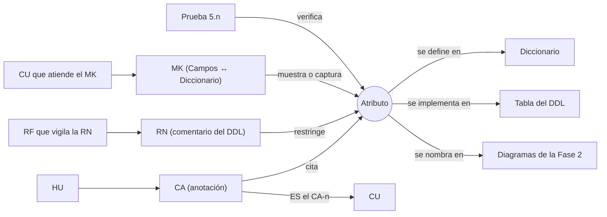

# Trazabilidad de atributos y campos

> Parte de la carpeta de apoyo. Vuelve a la [matriz de trazabilidad general](matriz_trazabilidad.md) o al [índice de la documentación](../README.md).

Este catálogo reúne los **161 atributos** (columnas) de la base `mesa_ayuda_ti`, tal como quedaron en el [script DDL](../fase_3/13-script-sql-ddl.md) y en el [diccionario de datos](../fase_2/5-diccionario-de-datos.md). Por cada atributo indica qué lo origina, qué lo valida, qué lo usa y dónde está probado. Cada nombre de atributo que aparece en el diccionario, en las fichas de tablas del DDL, en los mockups, en los criterios de aceptación, en las reglas de negocio, en las pruebas y en los diagramas enlaza a su fila de este catálogo, y desde aquí se vuelve a cada uno de ellos.

## Cómo se obtuvo cada relación

Solo se registran relaciones que están escritas en una fuente del repositorio. Ninguna se deduce por el significado del nombre.

| Columna del catálogo | Evidencia | Dónde se lee |
|---|---|---|
| Diccionario · DDL | El atributo existe como campo de la entidad y como columna de la tabla | [Diccionario de datos](../fase_2/5-diccionario-de-datos.md) y [13. Script SQL (DDL)](../fase_3/13-script-sql-ddl.md) |
| CA → HU · CU | El nombre de la columna aparece en la anotación técnica del criterio de aceptación (texto en cursiva bajo el escenario). El CU es el que declara «ES el CA-n» de esa HU en su procedencia | [Historias de usuario](../fase_1/1-historias-de-usuario.md), [Casos de uso](../fase_1/3-casos-de-uso.md) |
| RN → RF | La columna está en una restricción (CHECK, UNIQUE, FK, NOT NULL) que el script marca con un comentario `-- RN-xx`. El RF es el que la ficha de esa RN declara en «RF que la vigilan» | Script DDL y [Reglas de negocio y requisitos](../fase_1/2-reglas-de-negocio-y-requisitos.md) |
| MK → CU | La columna aparece en la fila «Campos ↔ Diccionario» de la ficha del mockup. El CU es el que la ficha declara en «Atiende (CU)» | [Mockups](../fase_1/4-mockups.md) |
| Diagramas | La columna se nombra en la sección del diagrama de clases, la auditoría cruzada, los diagramas de estados o la matriz §14 | [Fase 2](../fase_2/README.md) |
| Pruebas | La columna aparece en el error que devolvió MySQL al rechazar la sentencia inválida, o en la restricción que la rechazó | [13.1 Pruebas del DDL](../fase_3/13.1-pruebas-ddl.md) |

**Alcance de la evidencia.** Los textos de las reglas de negocio, de los requisitos funcionales y de los flujos de los casos de uso en Proyecto.docx describen datos en lenguaje de negocio («el número de seguimiento», «la urgencia») y no nombran columnas. Por eso un RF o un CU llega a un atributo solo a través de un CA, una RN o un mockup que sí lo nombra; la columna correspondiente indica por cuál. Los requisitos no funcionales que el script menciona (RNF-10 y RNF-06) se refieren a la tabla completa y se anotan en el encabezado de esa tabla.

**Cobertura.** De los 161 atributos, 18 se citan en criterios de aceptación, 101 están en restricciones con regla de negocio, 55 aparecen en mockups, 42 se nombran en diagramas y 38 se usan en pruebas. Los 45 restantes están documentados en el diccionario y en el DDL, y ninguna otra fuente los nombra; en su fila se indica así.

## Índice por tabla

[`area`](#atributos-de-area) · [`cargo`](#atributos-de-cargo) · [`rol_empleado`](#atributos-de-rol-empleado) · [`usuario`](#atributos-de-usuario) · [`token_recuperacion`](#atributos-de-token-recuperacion) · [`info_personal_soporte`](#atributos-de-info-personal-soporte) · [`tipo_activo`](#atributos-de-tipo-activo) · [`tipo_problema`](#atributos-de-tipo-problema) · [`tipo_solicitud`](#atributos-de-tipo-solicitud) · [`tabla_importancia`](#atributos-de-tabla-importancia) · [`activo`](#atributos-de-activo) · [`tiempo_atencion_sla`](#atributos-de-tiempo-atencion-sla) · [`caso_soporte`](#atributos-de-caso-soporte) · [`comentario_caso`](#atributos-de-comentario-caso) · [`historial_caso`](#atributos-de-historial-caso) · [`adjunto_caso`](#atributos-de-adjunto-caso) · [`aviso`](#atributos-de-aviso) · [`transicion_estado_caso`](#atributos-de-transicion-estado-caso)

### `area`

Tabla del DDL: [`area`](../fase_3/13-script-sql-ddl.md#tabla-area) · Diccionario: [entidad `area`](../fase_2/5-diccionario-de-datos.md#dic-area) · Clase: `Area` (Tabla 246, §9.3.2)

| Atributo | Tipo · clave | Se documenta en | CA que lo citan → CU | RN que lo restringen → RF | Mockups → CU | Diagramas | Pruebas |
|---|---|---|---|---|---|---|---|
| `id_area` | `int` · PK | [Diccionario](../fase_2/5-diccionario-de-datos.md#dic-area-id-area) · [DDL](../fase_3/13-script-sql-ddl.md#bd-area-id-area) | *Solo documentado en el diccionario y el DDL* |  |  |  |  |
| `nombre_area` | `varchar(100)` · UQ | [Diccionario](../fase_2/5-diccionario-de-datos.md#dic-area-nombre-area) · [DDL](../fase_3/13-script-sql-ddl.md#bd-area-nombre-area) |  | [RN-26](../fase_1/2-reglas-de-negocio-y-requisitos.md#rn-26) → [RF-48](../fase_1/2-reglas-de-negocio-y-requisitos.md#rf-48) | [MK-18](../fase_1/4-mockups.md#mk-18) → [CU-043](../fase_1/3-casos-de-uso.md#cu-043), [CU-044](../fase_1/3-casos-de-uso.md#cu-044), [CU-045](../fase_1/3-casos-de-uso.md#cu-045), [CU-046](../fase_1/3-casos-de-uso.md#cu-046), [CU-047](../fase_1/3-casos-de-uso.md#cu-047), [CU-048](../fase_1/3-casos-de-uso.md#cu-048) | [Diagrama de clases — 9.3.5 Diferencias encontradas](../fase_2/7-diagrama-de-clases.md#935-diferencias-encontradas) [Auditoría cruzada — 6. Auditoría cruzada](../fase_2/7b-auditoria-cruzada.md#6-auditoría-cruzada) | [5.4](../fase_3/13.1-pruebas-ddl.md#prueba-5-4) |
| `estado` | `enum('activo','inactivo')` | [Diccionario](../fase_2/5-diccionario-de-datos.md#dic-area-estado) · [DDL](../fase_3/13-script-sql-ddl.md#bd-area-estado) |  | [RN-30](../fase_1/2-reglas-de-negocio-y-requisitos.md#rn-30) → [RF-48](../fase_1/2-reglas-de-negocio-y-requisitos.md#rf-48) |  |  | [5.5](../fase_3/13.1-pruebas-ddl.md#prueba-5-5) |
| `fecha_creacion` | `datetime` | [Diccionario](../fase_2/5-diccionario-de-datos.md#dic-area-fecha-creacion) · [DDL](../fase_3/13-script-sql-ddl.md#bd-area-fecha-creacion) | *Solo documentado en el diccionario y el DDL* |  |  |  |  |
| `fecha_actualizacion` | `datetime` | [Diccionario](../fase_2/5-diccionario-de-datos.md#dic-area-fecha-actualizacion) · [DDL](../fase_3/13-script-sql-ddl.md#bd-area-fecha-actualizacion) | *Solo documentado en el diccionario y el DDL* |  |  |  |  |
| `id_usuario_modificacion` | `int` · FK | [Diccionario](../fase_2/5-diccionario-de-datos.md#dic-area-id-usuario-modificacion) · [DDL](../fase_3/13-script-sql-ddl.md#bd-area-id-usuario-modificacion) |  | [RN-30](../fase_1/2-reglas-de-negocio-y-requisitos.md#rn-30) → [RF-48](../fase_1/2-reglas-de-negocio-y-requisitos.md#rf-48) |  |  |  |

### `cargo`

Tabla del DDL: [`cargo`](../fase_3/13-script-sql-ddl.md#tabla-cargo) · Diccionario: [entidad `cargo`](../fase_2/5-diccionario-de-datos.md#dic-cargo) · Clase: `Cargo` (Tabla 246, §9.3.2)

| Atributo | Tipo · clave | Se documenta en | CA que lo citan → CU | RN que lo restringen → RF | Mockups → CU | Diagramas | Pruebas |
|---|---|---|---|---|---|---|---|
| `id_cargo` | `int` · PK | [Diccionario](../fase_2/5-diccionario-de-datos.md#dic-cargo-id-cargo) · [DDL](../fase_3/13-script-sql-ddl.md#bd-cargo-id-cargo) | *Solo documentado en el diccionario y el DDL* |  |  |  |  |
| `nombre_cargo` | `varchar(100)` · UQ | [Diccionario](../fase_2/5-diccionario-de-datos.md#dic-cargo-nombre-cargo) · [DDL](../fase_3/13-script-sql-ddl.md#bd-cargo-nombre-cargo) |  | [RN-26](../fase_1/2-reglas-de-negocio-y-requisitos.md#rn-26) → [RF-48](../fase_1/2-reglas-de-negocio-y-requisitos.md#rf-48) | [MK-18](../fase_1/4-mockups.md#mk-18) → [CU-043](../fase_1/3-casos-de-uso.md#cu-043), [CU-044](../fase_1/3-casos-de-uso.md#cu-044), [CU-045](../fase_1/3-casos-de-uso.md#cu-045), [CU-046](../fase_1/3-casos-de-uso.md#cu-046), [CU-047](../fase_1/3-casos-de-uso.md#cu-047), [CU-048](../fase_1/3-casos-de-uso.md#cu-048) | [Diagrama de clases — 9.3.5 Diferencias encontradas](../fase_2/7-diagrama-de-clases.md#935-diferencias-encontradas) [Auditoría cruzada — 6. Auditoría cruzada](../fase_2/7b-auditoria-cruzada.md#6-auditoría-cruzada) |  |
| `estado` | `enum('activo','inactivo')` | [Diccionario](../fase_2/5-diccionario-de-datos.md#dic-cargo-estado) · [DDL](../fase_3/13-script-sql-ddl.md#bd-cargo-estado) |  | [RN-30](../fase_1/2-reglas-de-negocio-y-requisitos.md#rn-30) → [RF-48](../fase_1/2-reglas-de-negocio-y-requisitos.md#rf-48) |  |  |  |
| `fecha_creacion` | `datetime` | [Diccionario](../fase_2/5-diccionario-de-datos.md#dic-cargo-fecha-creacion) · [DDL](../fase_3/13-script-sql-ddl.md#bd-cargo-fecha-creacion) | *Solo documentado en el diccionario y el DDL* |  |  |  |  |
| `fecha_actualizacion` | `datetime` | [Diccionario](../fase_2/5-diccionario-de-datos.md#dic-cargo-fecha-actualizacion) · [DDL](../fase_3/13-script-sql-ddl.md#bd-cargo-fecha-actualizacion) | *Solo documentado en el diccionario y el DDL* |  |  |  |  |
| `id_usuario_modificacion` | `int` · FK | [Diccionario](../fase_2/5-diccionario-de-datos.md#dic-cargo-id-usuario-modificacion) · [DDL](../fase_3/13-script-sql-ddl.md#bd-cargo-id-usuario-modificacion) |  | [RN-30](../fase_1/2-reglas-de-negocio-y-requisitos.md#rn-30) → [RF-48](../fase_1/2-reglas-de-negocio-y-requisitos.md#rf-48) |  |  |  |

### `rol_empleado`

Tabla del DDL: [`rol_empleado`](../fase_3/13-script-sql-ddl.md#tabla-rol-empleado) · Diccionario: [entidad `rol_empleado`](../fase_2/5-diccionario-de-datos.md#dic-rol-empleado) · Clase: `RolEmpleado` (Tabla 246, §9.3.2)

| Atributo | Tipo · clave | Se documenta en | CA que lo citan → CU | RN que lo restringen → RF | Mockups → CU | Diagramas | Pruebas |
|---|---|---|---|---|---|---|---|
| `id_rol_empleado` | `int` · PK | [Diccionario](../fase_2/5-diccionario-de-datos.md#dic-rol-empleado-id-rol-empleado) · [DDL](../fase_3/13-script-sql-ddl.md#bd-rol-empleado-id-rol-empleado) | *Solo documentado en el diccionario y el DDL* |  |  |  |  |
| `nombre_rol` | `varchar(100)` · UQ | [Diccionario](../fase_2/5-diccionario-de-datos.md#dic-rol-empleado-nombre-rol) · [DDL](../fase_3/13-script-sql-ddl.md#bd-rol-empleado-nombre-rol) |  | [RN-26](../fase_1/2-reglas-de-negocio-y-requisitos.md#rn-26) → [RF-48](../fase_1/2-reglas-de-negocio-y-requisitos.md#rf-48) | [MK-18](../fase_1/4-mockups.md#mk-18) → [CU-043](../fase_1/3-casos-de-uso.md#cu-043), [CU-044](../fase_1/3-casos-de-uso.md#cu-044), [CU-045](../fase_1/3-casos-de-uso.md#cu-045), [CU-046](../fase_1/3-casos-de-uso.md#cu-046), [CU-047](../fase_1/3-casos-de-uso.md#cu-047), [CU-048](../fase_1/3-casos-de-uso.md#cu-048) | [Diagrama de clases — 9.3.5 Diferencias encontradas](../fase_2/7-diagrama-de-clases.md#935-diferencias-encontradas) [Auditoría cruzada — 6. Auditoría cruzada](../fase_2/7b-auditoria-cruzada.md#6-auditoría-cruzada) |  |
| `estado` | `enum('activo','inactivo')` | [Diccionario](../fase_2/5-diccionario-de-datos.md#dic-rol-empleado-estado) · [DDL](../fase_3/13-script-sql-ddl.md#bd-rol-empleado-estado) |  | [RN-30](../fase_1/2-reglas-de-negocio-y-requisitos.md#rn-30) → [RF-48](../fase_1/2-reglas-de-negocio-y-requisitos.md#rf-48) |  |  |  |
| `fecha_creacion` | `datetime` | [Diccionario](../fase_2/5-diccionario-de-datos.md#dic-rol-empleado-fecha-creacion) · [DDL](../fase_3/13-script-sql-ddl.md#bd-rol-empleado-fecha-creacion) | *Solo documentado en el diccionario y el DDL* |  |  |  |  |
| `fecha_actualizacion` | `datetime` | [Diccionario](../fase_2/5-diccionario-de-datos.md#dic-rol-empleado-fecha-actualizacion) · [DDL](../fase_3/13-script-sql-ddl.md#bd-rol-empleado-fecha-actualizacion) | *Solo documentado en el diccionario y el DDL* |  |  |  |  |
| `id_usuario_modificacion` | `int` · FK | [Diccionario](../fase_2/5-diccionario-de-datos.md#dic-rol-empleado-id-usuario-modificacion) · [DDL](../fase_3/13-script-sql-ddl.md#bd-rol-empleado-id-usuario-modificacion) |  | [RN-30](../fase_1/2-reglas-de-negocio-y-requisitos.md#rn-30) → [RF-48](../fase_1/2-reglas-de-negocio-y-requisitos.md#rf-48) |  |  |  |

### `usuario`

Tabla del DDL: [`usuario`](../fase_3/13-script-sql-ddl.md#tabla-usuario) · Diccionario: [entidad `usuario`](../fase_2/5-diccionario-de-datos.md#dic-usuario) · Clase: `Usuario` (Tabla 246, §9.3.2)

| Atributo | Tipo · clave | Se documenta en | CA que lo citan → CU | RN que lo restringen → RF | Mockups → CU | Diagramas | Pruebas |
|---|---|---|---|---|---|---|---|
| `id_usuario` | `int` · PK | [Diccionario](../fase_2/5-diccionario-de-datos.md#dic-usuario-id-usuario) · [DDL](../fase_3/13-script-sql-ddl.md#bd-usuario-id-usuario) | *Solo documentado en el diccionario y el DDL* |  |  |  |  |
| `nombre` | `varchar(120)` | [Diccionario](../fase_2/5-diccionario-de-datos.md#dic-usuario-nombre) · [DDL](../fase_3/13-script-sql-ddl.md#bd-usuario-nombre) | *Solo documentado en el diccionario y el DDL* |  |  |  |  |
| `correo` | `varchar(150)` · UQ | [Diccionario](../fase_2/5-diccionario-de-datos.md#dic-usuario-correo) · [DDL](../fase_3/13-script-sql-ddl.md#bd-usuario-correo) | [HU-016 CA-2](../fase_1/1-historias-de-usuario.md#hu-016-ca-2) → [CU-016](../fase_1/3-casos-de-uso.md#cu-016) | [RN-17](../fase_1/2-reglas-de-negocio-y-requisitos.md#rn-17) → [RF-03](../fase_1/2-reglas-de-negocio-y-requisitos.md#rf-03), [RF-26](../fase_1/2-reglas-de-negocio-y-requisitos.md#rf-26), [RF-28](../fase_1/2-reglas-de-negocio-y-requisitos.md#rf-28) | [MK-01](../fase_1/4-mockups.md#mk-01) → [CU-023](../fase_1/3-casos-de-uso.md#cu-023), [CU-024](../fase_1/3-casos-de-uso.md#cu-024); [MK-02](../fase_1/4-mockups.md#mk-02) → [CU-001](../fase_1/3-casos-de-uso.md#cu-001), [CU-004](../fase_1/3-casos-de-uso.md#cu-004), [CU-018](../fase_1/3-casos-de-uso.md#cu-018), [CU-019](../fase_1/3-casos-de-uso.md#cu-019), [CU-020](../fase_1/3-casos-de-uso.md#cu-020), [CU-021](../fase_1/3-casos-de-uso.md#cu-021), [CU-022](../fase_1/3-casos-de-uso.md#cu-022), [CU-042](../fase_1/3-casos-de-uso.md#cu-042); [MK-13](../fase_1/4-mockups.md#mk-13) → [CU-016](../fase_1/3-casos-de-uso.md#cu-016), [CU-017](../fase_1/3-casos-de-uso.md#cu-017), [CU-031](../fase_1/3-casos-de-uso.md#cu-031), [CU-032](../fase_1/3-casos-de-uso.md#cu-032); [MK-14](../fase_1/4-mockups.md#mk-14) → [CU-016](../fase_1/3-casos-de-uso.md#cu-016), [CU-031](../fase_1/3-casos-de-uso.md#cu-031); [MK-15](../fase_1/4-mockups.md#mk-15) → [CU-033](../fase_1/3-casos-de-uso.md#cu-033) |  | [5.1](../fase_3/13.1-pruebas-ddl.md#prueba-5-1), [5.2](../fase_3/13.1-pruebas-ddl.md#prueba-5-2) |
| `telefono` | `varchar(20)` | [Diccionario](../fase_2/5-diccionario-de-datos.md#dic-usuario-telefono) · [DDL](../fase_3/13-script-sql-ddl.md#bd-usuario-telefono) |  | [RN-01](../fase_1/2-reglas-de-negocio-y-requisitos.md#rn-01) → [RF-01](../fase_1/2-reglas-de-negocio-y-requisitos.md#rf-01), [RF-18](../fase_1/2-reglas-de-negocio-y-requisitos.md#rf-18) | [MK-02](../fase_1/4-mockups.md#mk-02) → [CU-001](../fase_1/3-casos-de-uso.md#cu-001), [CU-004](../fase_1/3-casos-de-uso.md#cu-004), [CU-018](../fase_1/3-casos-de-uso.md#cu-018), [CU-019](../fase_1/3-casos-de-uso.md#cu-019), [CU-020](../fase_1/3-casos-de-uso.md#cu-020), [CU-021](../fase_1/3-casos-de-uso.md#cu-021), [CU-022](../fase_1/3-casos-de-uso.md#cu-022), [CU-042](../fase_1/3-casos-de-uso.md#cu-042); [MK-14](../fase_1/4-mockups.md#mk-14) → [CU-016](../fase_1/3-casos-de-uso.md#cu-016), [CU-031](../fase_1/3-casos-de-uso.md#cu-031) |  |  |
| `contrasena_hash` | `varchar(255)` | [Diccionario](../fase_2/5-diccionario-de-datos.md#dic-usuario-contrasena-hash) · [DDL](../fase_3/13-script-sql-ddl.md#bd-usuario-contrasena-hash) |  | [RN-19](../fase_1/2-reglas-de-negocio-y-requisitos.md#rn-19) → [RF-26](../fase_1/2-reglas-de-negocio-y-requisitos.md#rf-26), [RF-35](../fase_1/2-reglas-de-negocio-y-requisitos.md#rf-35) | [MK-01](../fase_1/4-mockups.md#mk-01) → [CU-023](../fase_1/3-casos-de-uso.md#cu-023), [CU-024](../fase_1/3-casos-de-uso.md#cu-024); [MK-14](../fase_1/4-mockups.md#mk-14) → [CU-016](../fase_1/3-casos-de-uso.md#cu-016), [CU-031](../fase_1/3-casos-de-uso.md#cu-031); [MK-19](../fase_1/4-mockups.md#mk-19) → [CU-024](../fase_1/3-casos-de-uso.md#cu-024) |  |  |
| `intentos_fallidos` | `int` | [Diccionario](../fase_2/5-diccionario-de-datos.md#dic-usuario-intentos-fallidos) · [DDL](../fase_3/13-script-sql-ddl.md#bd-usuario-intentos-fallidos) |  | [RN-20](../fase_1/2-reglas-de-negocio-y-requisitos.md#rn-20) → [RF-30](../fase_1/2-reglas-de-negocio-y-requisitos.md#rf-30), [RF-34](../fase_1/2-reglas-de-negocio-y-requisitos.md#rf-34) | [MK-15](../fase_1/4-mockups.md#mk-15) → [CU-033](../fase_1/3-casos-de-uso.md#cu-033) |  |  |
| `fecha_bloqueo` | `datetime` | [Diccionario](../fase_2/5-diccionario-de-datos.md#dic-usuario-fecha-bloqueo) · [DDL](../fase_3/13-script-sql-ddl.md#bd-usuario-fecha-bloqueo) |  | [RN-20](../fase_1/2-reglas-de-negocio-y-requisitos.md#rn-20) → [RF-30](../fase_1/2-reglas-de-negocio-y-requisitos.md#rf-30), [RF-34](../fase_1/2-reglas-de-negocio-y-requisitos.md#rf-34) | [MK-15](../fase_1/4-mockups.md#mk-15) → [CU-033](../fase_1/3-casos-de-uso.md#cu-033) |  |  |
| `id_cargo` | `int` · FK | [Diccionario](../fase_2/5-diccionario-de-datos.md#dic-usuario-id-cargo) · [DDL](../fase_3/13-script-sql-ddl.md#bd-usuario-id-cargo) |  | [RN-30](../fase_1/2-reglas-de-negocio-y-requisitos.md#rn-30) → [RF-48](../fase_1/2-reglas-de-negocio-y-requisitos.md#rf-48) | [MK-14](../fase_1/4-mockups.md#mk-14) → [CU-016](../fase_1/3-casos-de-uso.md#cu-016), [CU-031](../fase_1/3-casos-de-uso.md#cu-031) | [Diagrama de clases — 9.3.3 Relaciones](../fase_2/7-diagrama-de-clases.md#933-relaciones) |  |
| `id_area` | `int` · FK | [Diccionario](../fase_2/5-diccionario-de-datos.md#dic-usuario-id-area) · [DDL](../fase_3/13-script-sql-ddl.md#bd-usuario-id-area) |  | [RN-18](../fase_1/2-reglas-de-negocio-y-requisitos.md#rn-18) → [RF-26](../fase_1/2-reglas-de-negocio-y-requisitos.md#rf-26), [RF-28](../fase_1/2-reglas-de-negocio-y-requisitos.md#rf-28) |  | [Diagrama de clases — 9.3.3 Relaciones](../fase_2/7-diagrama-de-clases.md#933-relaciones) |  |
| `id_rol_organizacional` | `int` · FK | [Diccionario](../fase_2/5-diccionario-de-datos.md#dic-usuario-id-rol-organizacional) · [DDL](../fase_3/13-script-sql-ddl.md#bd-usuario-id-rol-organizacional) |  | [RN-30](../fase_1/2-reglas-de-negocio-y-requisitos.md#rn-30) → [RF-48](../fase_1/2-reglas-de-negocio-y-requisitos.md#rf-48) | [MK-14](../fase_1/4-mockups.md#mk-14) → [CU-016](../fase_1/3-casos-de-uso.md#cu-016), [CU-031](../fase_1/3-casos-de-uso.md#cu-031) | [Diagrama de clases — 9.3.3 Relaciones](../fase_2/7-diagrama-de-clases.md#933-relaciones) |  |
| `perfil_acceso` | `enum('solicitante','soporte','supervisor','administrador')` | [Diccionario](../fase_2/5-diccionario-de-datos.md#dic-usuario-perfil-acceso) · [DDL](../fase_3/13-script-sql-ddl.md#bd-usuario-perfil-acceso) | [HU-008 CA-2](../fase_1/1-historias-de-usuario.md#hu-008-ca-2) → [CU-008](../fase_1/3-casos-de-uso.md#cu-008); [HU-016 CA-4](../fase_1/1-historias-de-usuario.md#hu-016-ca-4) → [CU-016](../fase_1/3-casos-de-uso.md#cu-016) | [RN-23](../fase_1/2-reglas-de-negocio-y-requisitos.md#rn-23) → [RF-01](../fase_1/2-reglas-de-negocio-y-requisitos.md#rf-01), [RF-08](../fase_1/2-reglas-de-negocio-y-requisitos.md#rf-08), [RF-11](../fase_1/2-reglas-de-negocio-y-requisitos.md#rf-11), [RF-12](../fase_1/2-reglas-de-negocio-y-requisitos.md#rf-12), [RF-25](../fase_1/2-reglas-de-negocio-y-requisitos.md#rf-25), [RF-27](../fase_1/2-reglas-de-negocio-y-requisitos.md#rf-27), [RF-30](../fase_1/2-reglas-de-negocio-y-requisitos.md#rf-30), [RF-34](../fase_1/2-reglas-de-negocio-y-requisitos.md#rf-34), [RF-36](../fase_1/2-reglas-de-negocio-y-requisitos.md#rf-36), [RF-45](../fase_1/2-reglas-de-negocio-y-requisitos.md#rf-45) | [MK-13](../fase_1/4-mockups.md#mk-13) → [CU-016](../fase_1/3-casos-de-uso.md#cu-016), [CU-017](../fase_1/3-casos-de-uso.md#cu-017), [CU-031](../fase_1/3-casos-de-uso.md#cu-031), [CU-032](../fase_1/3-casos-de-uso.md#cu-032); [MK-14](../fase_1/4-mockups.md#mk-14) → [CU-016](../fase_1/3-casos-de-uso.md#cu-016), [CU-031](../fase_1/3-casos-de-uso.md#cu-031) | [Auditoría cruzada — 6. Auditoría cruzada](../fase_2/7b-auditoria-cruzada.md#6-auditoría-cruzada) | [5.3](../fase_3/13.1-pruebas-ddl.md#prueba-5-3) |
| `estado_usuario` | `enum('activo','inactivo')` | [Diccionario](../fase_2/5-diccionario-de-datos.md#dic-usuario-estado-usuario) · [DDL](../fase_3/13-script-sql-ddl.md#bd-usuario-estado-usuario) | [HU-032 CA-4](../fase_1/1-historias-de-usuario.md#hu-032-ca-4) → [CU-032](../fase_1/3-casos-de-uso.md#cu-032) | [RN-21](../fase_1/2-reglas-de-negocio-y-requisitos.md#rn-21) → [RF-29](../fase_1/2-reglas-de-negocio-y-requisitos.md#rf-29), [RF-34](../fase_1/2-reglas-de-negocio-y-requisitos.md#rf-34) | [MK-13](../fase_1/4-mockups.md#mk-13) → [CU-016](../fase_1/3-casos-de-uso.md#cu-016), [CU-017](../fase_1/3-casos-de-uso.md#cu-017), [CU-031](../fase_1/3-casos-de-uso.md#cu-031), [CU-032](../fase_1/3-casos-de-uso.md#cu-032) | [Auditoría cruzada — 6. Auditoría cruzada](../fase_2/7b-auditoria-cruzada.md#6-auditoría-cruzada) |  |
| `fecha_registro` | `date` | [Diccionario](../fase_2/5-diccionario-de-datos.md#dic-usuario-fecha-registro) · [DDL](../fase_3/13-script-sql-ddl.md#bd-usuario-fecha-registro) | *Solo documentado en el diccionario y el DDL* |  |  |  |  |
| `fecha_actualizacion` | `datetime` | [Diccionario](../fase_2/5-diccionario-de-datos.md#dic-usuario-fecha-actualizacion) · [DDL](../fase_3/13-script-sql-ddl.md#bd-usuario-fecha-actualizacion) |  |  |  | [Diagrama de clases — 9.1 Elementos agregados al diagrama y su respaldo](../fase_2/7-diagrama-de-clases.md#91-elementos-agregados-al-diagrama-y-su-respaldo) [Diagrama de clases — 9.3.4 Elementos incorporados recientemente](../fase_2/7-diagrama-de-clases.md#934-elementos-incorporados-recientemente) |  |
| `id_usuario_modificacion` | `int` · FK | [Diccionario](../fase_2/5-diccionario-de-datos.md#dic-usuario-id-usuario-modificacion) · [DDL](../fase_3/13-script-sql-ddl.md#bd-usuario-id-usuario-modificacion) |  | [RN-21](../fase_1/2-reglas-de-negocio-y-requisitos.md#rn-21) → [RF-29](../fase_1/2-reglas-de-negocio-y-requisitos.md#rf-29), [RF-34](../fase_1/2-reglas-de-negocio-y-requisitos.md#rf-34) |  | [Diagrama de clases — 9.1 Elementos agregados al diagrama y su respaldo](../fase_2/7-diagrama-de-clases.md#91-elementos-agregados-al-diagrama-y-su-respaldo) [Diagrama de clases — 9.3.4 Elementos incorporados recientemente](../fase_2/7-diagrama-de-clases.md#934-elementos-incorporados-recientemente) |  |

### `token_recuperacion`

Tabla del DDL: [`token_recuperacion`](../fase_3/13-script-sql-ddl.md#tabla-token-recuperacion) · Diccionario: [entidad `token_recuperacion`](../fase_2/5-diccionario-de-datos.md#dic-token-recuperacion) · Clase: `TokenRecuperacion` (Tabla 246, §9.3.2). Requisito no funcional de la tabla: [RNF-10](../fase_1/2-reglas-de-negocio-y-requisitos.md#rnf-10), vencimiento del enlace de recuperación en máximo 30 minutos (nota RN-22 del script, línea 193)

| Atributo | Tipo · clave | Se documenta en | CA que lo citan → CU | RN que lo restringen → RF | Mockups → CU | Diagramas | Pruebas |
|---|---|---|---|---|---|---|---|
| `id_token` | `int` · PK | [Diccionario](../fase_2/5-diccionario-de-datos.md#dic-token-recuperacion-id-token) · [DDL](../fase_3/13-script-sql-ddl.md#bd-token-recuperacion-id-token) | *Solo documentado en el diccionario y el DDL* |  |  |  |  |
| `id_usuario` | `int` · FK | [Diccionario](../fase_2/5-diccionario-de-datos.md#dic-token-recuperacion-id-usuario) · [DDL](../fase_3/13-script-sql-ddl.md#bd-token-recuperacion-id-usuario) |  | [RN-22](../fase_1/2-reglas-de-negocio-y-requisitos.md#rn-22) → [RF-35](../fase_1/2-reglas-de-negocio-y-requisitos.md#rf-35) |  | [Diagrama de clases — 9.3.3 Relaciones](../fase_2/7-diagrama-de-clases.md#933-relaciones) [Auditoría cruzada — 6. Auditoría cruzada](../fase_2/7b-auditoria-cruzada.md#6-auditoría-cruzada) |  |
| `token_hash` | `varchar(255)` · UQ | [Diccionario](../fase_2/5-diccionario-de-datos.md#dic-token-recuperacion-token-hash) · [DDL](../fase_3/13-script-sql-ddl.md#bd-token-recuperacion-token-hash) |  | [RN-19](../fase_1/2-reglas-de-negocio-y-requisitos.md#rn-19) → [RF-26](../fase_1/2-reglas-de-negocio-y-requisitos.md#rf-26), [RF-35](../fase_1/2-reglas-de-negocio-y-requisitos.md#rf-35); [RN-22](../fase_1/2-reglas-de-negocio-y-requisitos.md#rn-22) → [RF-35](../fase_1/2-reglas-de-negocio-y-requisitos.md#rf-35) | [MK-19](../fase_1/4-mockups.md#mk-19) → [CU-024](../fase_1/3-casos-de-uso.md#cu-024) | [Diagrama de clases — 9.1 Elementos agregados al diagrama y su respaldo](../fase_2/7-diagrama-de-clases.md#91-elementos-agregados-al-diagrama-y-su-respaldo) |  |
| `fecha_generacion` | `datetime` | [Diccionario](../fase_2/5-diccionario-de-datos.md#dic-token-recuperacion-fecha-generacion) · [DDL](../fase_3/13-script-sql-ddl.md#bd-token-recuperacion-fecha-generacion) |  | [RN-22](../fase_1/2-reglas-de-negocio-y-requisitos.md#rn-22) → [RF-35](../fase_1/2-reglas-de-negocio-y-requisitos.md#rf-35) |  |  | [5.25](../fase_3/13.1-pruebas-ddl.md#prueba-5-25) |
| `fecha_expiracion` | `datetime` | [Diccionario](../fase_2/5-diccionario-de-datos.md#dic-token-recuperacion-fecha-expiracion) · [DDL](../fase_3/13-script-sql-ddl.md#bd-token-recuperacion-fecha-expiracion) |  | [RN-22](../fase_1/2-reglas-de-negocio-y-requisitos.md#rn-22) → [RF-35](../fase_1/2-reglas-de-negocio-y-requisitos.md#rf-35) | [MK-19](../fase_1/4-mockups.md#mk-19) → [CU-024](../fase_1/3-casos-de-uso.md#cu-024) | [Diagrama de clases — 9.1 Elementos agregados al diagrama y su respaldo](../fase_2/7-diagrama-de-clases.md#91-elementos-agregados-al-diagrama-y-su-respaldo) | [5.25](../fase_3/13.1-pruebas-ddl.md#prueba-5-25) |
| `fecha_uso` | `datetime` | [Diccionario](../fase_2/5-diccionario-de-datos.md#dic-token-recuperacion-fecha-uso) · [DDL](../fase_3/13-script-sql-ddl.md#bd-token-recuperacion-fecha-uso) |  | [RN-22](../fase_1/2-reglas-de-negocio-y-requisitos.md#rn-22) → [RF-35](../fase_1/2-reglas-de-negocio-y-requisitos.md#rf-35) | [MK-19](../fase_1/4-mockups.md#mk-19) → [CU-024](../fase_1/3-casos-de-uso.md#cu-024) |  |  |
| `estado_token` | `enum('vigente','usado','revocado')` | [Diccionario](../fase_2/5-diccionario-de-datos.md#dic-token-recuperacion-estado-token) · [DDL](../fase_3/13-script-sql-ddl.md#bd-token-recuperacion-estado-token) |  | [RN-22](../fase_1/2-reglas-de-negocio-y-requisitos.md#rn-22) → [RF-35](../fase_1/2-reglas-de-negocio-y-requisitos.md#rf-35) | [MK-19](../fase_1/4-mockups.md#mk-19) → [CU-024](../fase_1/3-casos-de-uso.md#cu-024) | [Diagrama de clases — 9.1 Elementos agregados al diagrama y su respaldo](../fase_2/7-diagrama-de-clases.md#91-elementos-agregados-al-diagrama-y-su-respaldo) | [5.26](../fase_3/13.1-pruebas-ddl.md#prueba-5-26) |

### `info_personal_soporte`

Tabla del DDL: [`info_personal_soporte`](../fase_3/13-script-sql-ddl.md#tabla-info-personal-soporte) · Diccionario: [entidad `info_personal_soporte`](../fase_2/5-diccionario-de-datos.md#dic-info-personal-soporte) · Clase: `InfoPersonalSoporte` (Tabla 246, §9.3.2)

| Atributo | Tipo · clave | Se documenta en | CA que lo citan → CU | RN que lo restringen → RF | Mockups → CU | Diagramas | Pruebas |
|---|---|---|---|---|---|---|---|
| `id_info_soporte` | `int` · PK | [Diccionario](../fase_2/5-diccionario-de-datos.md#dic-info-personal-soporte-id-info-soporte) · [DDL](../fase_3/13-script-sql-ddl.md#bd-info-personal-soporte-id-info-soporte) | *Solo documentado en el diccionario y el DDL* |  |  |  |  |
| `id_usuario_soporte` | `int` · UQ | [Diccionario](../fase_2/5-diccionario-de-datos.md#dic-info-personal-soporte-id-usuario-soporte) · [DDL](../fase_3/13-script-sql-ddl.md#bd-info-personal-soporte-id-usuario-soporte) |  | [RN-28](../fase_1/2-reglas-de-negocio-y-requisitos.md#rn-28) → [RF-24](../fase_1/2-reglas-de-negocio-y-requisitos.md#rf-24), [RF-25](../fase_1/2-reglas-de-negocio-y-requisitos.md#rf-25) |  | [Diagrama de clases — 9.3.3 Relaciones](../fase_2/7-diagrama-de-clases.md#933-relaciones) [Diagrama de clases — 9.3.5 Diferencias encontradas](../fase_2/7-diagrama-de-clases.md#935-diferencias-encontradas) [Auditoría cruzada — 6. Auditoría cruzada](../fase_2/7b-auditoria-cruzada.md#6-auditoría-cruzada) | [5.28](../fase_3/13.1-pruebas-ddl.md#prueba-5-28) |
| `disponibilidad` | `enum('disponible','ocupado','ausente')` | [Diccionario](../fase_2/5-diccionario-de-datos.md#dic-info-personal-soporte-disponibilidad) · [DDL](../fase_3/13-script-sql-ddl.md#bd-info-personal-soporte-disponibilidad) |  | [RN-28](../fase_1/2-reglas-de-negocio-y-requisitos.md#rn-28) → [RF-24](../fase_1/2-reglas-de-negocio-y-requisitos.md#rf-24), [RF-25](../fase_1/2-reglas-de-negocio-y-requisitos.md#rf-25) | [MK-11](../fase_1/4-mockups.md#mk-11) → [CU-015](../fase_1/3-casos-de-uso.md#cu-015), [CU-034](../fase_1/3-casos-de-uso.md#cu-034) |  | [5.27](../fase_3/13.1-pruebas-ddl.md#prueba-5-27) |
| `fecha_actualizacion` | `datetime` | [Diccionario](../fase_2/5-diccionario-de-datos.md#dic-info-personal-soporte-fecha-actualizacion) · [DDL](../fase_3/13-script-sql-ddl.md#bd-info-personal-soporte-fecha-actualizacion) | *Solo documentado en el diccionario y el DDL* |  |  |  |  |

### `tipo_activo`

Tabla del DDL: [`tipo_activo`](../fase_3/13-script-sql-ddl.md#tabla-tipo-activo) · Diccionario: [entidad `tipo_activo`](../fase_2/5-diccionario-de-datos.md#dic-tipo-activo) · Clase: `TipoActivo` (Tabla 246, §9.3.2)

| Atributo | Tipo · clave | Se documenta en | CA que lo citan → CU | RN que lo restringen → RF | Mockups → CU | Diagramas | Pruebas |
|---|---|---|---|---|---|---|---|
| `id_tipo_activo` | `int` · PK | [Diccionario](../fase_2/5-diccionario-de-datos.md#dic-tipo-activo-id-tipo-activo) · [DDL](../fase_3/13-script-sql-ddl.md#bd-tipo-activo-id-tipo-activo) | *Solo documentado en el diccionario y el DDL* |  |  |  |  |
| `nombre` | `varchar(100)` · UQ | [Diccionario](../fase_2/5-diccionario-de-datos.md#dic-tipo-activo-nombre) · [DDL](../fase_3/13-script-sql-ddl.md#bd-tipo-activo-nombre) |  | [RN-24](../fase_1/2-reglas-de-negocio-y-requisitos.md#rn-24) → [RF-44](../fase_1/2-reglas-de-negocio-y-requisitos.md#rf-44), [RF-46](../fase_1/2-reglas-de-negocio-y-requisitos.md#rf-46); [RN-26](../fase_1/2-reglas-de-negocio-y-requisitos.md#rn-26) → [RF-48](../fase_1/2-reglas-de-negocio-y-requisitos.md#rf-48) | [MK-16](../fase_1/4-mockups.md#mk-16) → [CU-035](../fase_1/3-casos-de-uso.md#cu-035), [CU-036](../fase_1/3-casos-de-uso.md#cu-036), [CU-037](../fase_1/3-casos-de-uso.md#cu-037), [CU-038](../fase_1/3-casos-de-uso.md#cu-038) |  |  |
| `descripcion` | `text` | [Diccionario](../fase_2/5-diccionario-de-datos.md#dic-tipo-activo-descripcion) · [DDL](../fase_3/13-script-sql-ddl.md#bd-tipo-activo-descripcion) | *Solo documentado en el diccionario y el DDL* |  |  |  |  |
| `estado` | `enum('activo','inactivo')` | [Diccionario](../fase_2/5-diccionario-de-datos.md#dic-tipo-activo-estado) · [DDL](../fase_3/13-script-sql-ddl.md#bd-tipo-activo-estado) |  | [RN-30](../fase_1/2-reglas-de-negocio-y-requisitos.md#rn-30) → [RF-48](../fase_1/2-reglas-de-negocio-y-requisitos.md#rf-48) | [MK-16](../fase_1/4-mockups.md#mk-16) → [CU-035](../fase_1/3-casos-de-uso.md#cu-035), [CU-036](../fase_1/3-casos-de-uso.md#cu-036), [CU-037](../fase_1/3-casos-de-uso.md#cu-037), [CU-038](../fase_1/3-casos-de-uso.md#cu-038) |  |  |
| `fecha_creacion` | `datetime` | [Diccionario](../fase_2/5-diccionario-de-datos.md#dic-tipo-activo-fecha-creacion) · [DDL](../fase_3/13-script-sql-ddl.md#bd-tipo-activo-fecha-creacion) | *Solo documentado en el diccionario y el DDL* |  |  |  |  |
| `fecha_actualizacion` | `datetime` | [Diccionario](../fase_2/5-diccionario-de-datos.md#dic-tipo-activo-fecha-actualizacion) · [DDL](../fase_3/13-script-sql-ddl.md#bd-tipo-activo-fecha-actualizacion) | *Solo documentado en el diccionario y el DDL* |  |  |  |  |
| `id_usuario_modificacion` | `int` · FK | [Diccionario](../fase_2/5-diccionario-de-datos.md#dic-tipo-activo-id-usuario-modificacion) · [DDL](../fase_3/13-script-sql-ddl.md#bd-tipo-activo-id-usuario-modificacion) |  | [RN-30](../fase_1/2-reglas-de-negocio-y-requisitos.md#rn-30) → [RF-48](../fase_1/2-reglas-de-negocio-y-requisitos.md#rf-48) |  |  |  |

### `tipo_problema`

Tabla del DDL: [`tipo_problema`](../fase_3/13-script-sql-ddl.md#tabla-tipo-problema) · Diccionario: [entidad `tipo_problema`](../fase_2/5-diccionario-de-datos.md#dic-tipo-problema) · Clase: `TipoProblema` (Tabla 246, §9.3.2)

| Atributo | Tipo · clave | Se documenta en | CA que lo citan → CU | RN que lo restringen → RF | Mockups → CU | Diagramas | Pruebas |
|---|---|---|---|---|---|---|---|
| `id_tipo_problema` | `int` · PK | [Diccionario](../fase_2/5-diccionario-de-datos.md#dic-tipo-problema-id-tipo-problema) · [DDL](../fase_3/13-script-sql-ddl.md#bd-tipo-problema-id-tipo-problema) | *Solo documentado en el diccionario y el DDL* |  |  |  |  |
| `nombre` | `varchar(100)` · UQ | [Diccionario](../fase_2/5-diccionario-de-datos.md#dic-tipo-problema-nombre) · [DDL](../fase_3/13-script-sql-ddl.md#bd-tipo-problema-nombre) |  | [RN-26](../fase_1/2-reglas-de-negocio-y-requisitos.md#rn-26) → [RF-48](../fase_1/2-reglas-de-negocio-y-requisitos.md#rf-48) |  |  |  |
| `descripcion` | `text` | [Diccionario](../fase_2/5-diccionario-de-datos.md#dic-tipo-problema-descripcion) · [DDL](../fase_3/13-script-sql-ddl.md#bd-tipo-problema-descripcion) | *Solo documentado en el diccionario y el DDL* |  |  |  |  |
| `estado` | `enum('activo','inactivo')` | [Diccionario](../fase_2/5-diccionario-de-datos.md#dic-tipo-problema-estado) · [DDL](../fase_3/13-script-sql-ddl.md#bd-tipo-problema-estado) | [HU-018 CA-2](../fase_1/1-historias-de-usuario.md#hu-018-ca-2) | [RN-04](../fase_1/2-reglas-de-negocio-y-requisitos.md#rn-04) → [RF-31](../fase_1/2-reglas-de-negocio-y-requisitos.md#rf-31), [RF-32](../fase_1/2-reglas-de-negocio-y-requisitos.md#rf-32), [RF-48](../fase_1/2-reglas-de-negocio-y-requisitos.md#rf-48); [RN-30](../fase_1/2-reglas-de-negocio-y-requisitos.md#rn-30) → [RF-48](../fase_1/2-reglas-de-negocio-y-requisitos.md#rf-48) |  |  |  |
| `fecha_creacion` | `datetime` | [Diccionario](../fase_2/5-diccionario-de-datos.md#dic-tipo-problema-fecha-creacion) · [DDL](../fase_3/13-script-sql-ddl.md#bd-tipo-problema-fecha-creacion) | *Solo documentado en el diccionario y el DDL* |  |  |  |  |
| `fecha_actualizacion` | `datetime` | [Diccionario](../fase_2/5-diccionario-de-datos.md#dic-tipo-problema-fecha-actualizacion) · [DDL](../fase_3/13-script-sql-ddl.md#bd-tipo-problema-fecha-actualizacion) | *Solo documentado en el diccionario y el DDL* |  |  |  |  |
| `id_usuario_modificacion` | `int` · FK | [Diccionario](../fase_2/5-diccionario-de-datos.md#dic-tipo-problema-id-usuario-modificacion) · [DDL](../fase_3/13-script-sql-ddl.md#bd-tipo-problema-id-usuario-modificacion) |  | [RN-30](../fase_1/2-reglas-de-negocio-y-requisitos.md#rn-30) → [RF-48](../fase_1/2-reglas-de-negocio-y-requisitos.md#rf-48) |  |  |  |

### `tipo_solicitud`

Tabla del DDL: [`tipo_solicitud`](../fase_3/13-script-sql-ddl.md#tabla-tipo-solicitud) · Diccionario: [entidad `tipo_solicitud`](../fase_2/5-diccionario-de-datos.md#dic-tipo-solicitud) · Clase: `TipoSolicitud` (Tabla 246, §9.3.2)

| Atributo | Tipo · clave | Se documenta en | CA que lo citan → CU | RN que lo restringen → RF | Mockups → CU | Diagramas | Pruebas |
|---|---|---|---|---|---|---|---|
| `id_tipo_solicitud` | `int` · PK | [Diccionario](../fase_2/5-diccionario-de-datos.md#dic-tipo-solicitud-id-tipo-solicitud) · [DDL](../fase_3/13-script-sql-ddl.md#bd-tipo-solicitud-id-tipo-solicitud) | *Solo documentado en el diccionario y el DDL* |  |  |  |  |
| `nombre` | `varchar(100)` · UQ | [Diccionario](../fase_2/5-diccionario-de-datos.md#dic-tipo-solicitud-nombre) · [DDL](../fase_3/13-script-sql-ddl.md#bd-tipo-solicitud-nombre) |  | [RN-26](../fase_1/2-reglas-de-negocio-y-requisitos.md#rn-26) → [RF-48](../fase_1/2-reglas-de-negocio-y-requisitos.md#rf-48) |  |  |  |
| `descripcion` | `text` | [Diccionario](../fase_2/5-diccionario-de-datos.md#dic-tipo-solicitud-descripcion) · [DDL](../fase_3/13-script-sql-ddl.md#bd-tipo-solicitud-descripcion) | *Solo documentado en el diccionario y el DDL* |  |  |  |  |
| `estado` | `enum('activo','inactivo')` | [Diccionario](../fase_2/5-diccionario-de-datos.md#dic-tipo-solicitud-estado) · [DDL](../fase_3/13-script-sql-ddl.md#bd-tipo-solicitud-estado) |  | [RN-04](../fase_1/2-reglas-de-negocio-y-requisitos.md#rn-04) → [RF-31](../fase_1/2-reglas-de-negocio-y-requisitos.md#rf-31), [RF-32](../fase_1/2-reglas-de-negocio-y-requisitos.md#rf-32), [RF-48](../fase_1/2-reglas-de-negocio-y-requisitos.md#rf-48); [RN-30](../fase_1/2-reglas-de-negocio-y-requisitos.md#rn-30) → [RF-48](../fase_1/2-reglas-de-negocio-y-requisitos.md#rf-48) |  |  |  |
| `fecha_creacion` | `datetime` | [Diccionario](../fase_2/5-diccionario-de-datos.md#dic-tipo-solicitud-fecha-creacion) · [DDL](../fase_3/13-script-sql-ddl.md#bd-tipo-solicitud-fecha-creacion) | *Solo documentado en el diccionario y el DDL* |  |  |  |  |
| `fecha_actualizacion` | `datetime` | [Diccionario](../fase_2/5-diccionario-de-datos.md#dic-tipo-solicitud-fecha-actualizacion) · [DDL](../fase_3/13-script-sql-ddl.md#bd-tipo-solicitud-fecha-actualizacion) | *Solo documentado en el diccionario y el DDL* |  |  |  |  |
| `id_usuario_modificacion` | `int` · FK | [Diccionario](../fase_2/5-diccionario-de-datos.md#dic-tipo-solicitud-id-usuario-modificacion) · [DDL](../fase_3/13-script-sql-ddl.md#bd-tipo-solicitud-id-usuario-modificacion) |  | [RN-30](../fase_1/2-reglas-de-negocio-y-requisitos.md#rn-30) → [RF-48](../fase_1/2-reglas-de-negocio-y-requisitos.md#rf-48) |  |  |  |

### `tabla_importancia`

Tabla del DDL: [`tabla_importancia`](../fase_3/13-script-sql-ddl.md#tabla-tabla-importancia) · Diccionario: [entidad `tabla_importancia`](../fase_2/5-diccionario-de-datos.md#dic-tabla-importancia) · Clase: `TablaImportancia` (Tabla 246, §9.3.2)

| Atributo | Tipo · clave | Se documenta en | CA que lo citan → CU | RN que lo restringen → RF | Mockups → CU | Diagramas | Pruebas |
|---|---|---|---|---|---|---|---|
| `id_tabla_importancia` | `int` · PK | [Diccionario](../fase_2/5-diccionario-de-datos.md#dic-tabla-importancia-id-tabla-importancia) · [DDL](../fase_3/13-script-sql-ddl.md#bd-tabla-importancia-id-tabla-importancia) | *Solo documentado en el diccionario y el DDL* |  |  |  |  |
| `afectacion` | `enum('usuario','area','empresa')` · índice | [Diccionario](../fase_2/5-diccionario-de-datos.md#dic-tabla-importancia-afectacion) · [DDL](../fase_3/13-script-sql-ddl.md#bd-tabla-importancia-afectacion) | [HU-021 CA-1](../fase_1/1-historias-de-usuario.md#hu-021-ca-1) → [CU-021](../fase_1/3-casos-de-uso.md#cu-021) | [RN-05](../fase_1/2-reglas-de-negocio-y-requisitos.md#rn-05) → [RF-11](../fase_1/2-reglas-de-negocio-y-requisitos.md#rf-11), [RF-19](../fase_1/2-reglas-de-negocio-y-requisitos.md#rf-19) | [MK-02](../fase_1/4-mockups.md#mk-02) → [CU-001](../fase_1/3-casos-de-uso.md#cu-001), [CU-004](../fase_1/3-casos-de-uso.md#cu-004), [CU-018](../fase_1/3-casos-de-uso.md#cu-018), [CU-019](../fase_1/3-casos-de-uso.md#cu-019), [CU-020](../fase_1/3-casos-de-uso.md#cu-020), [CU-021](../fase_1/3-casos-de-uso.md#cu-021), [CU-022](../fase_1/3-casos-de-uso.md#cu-022), [CU-042](../fase_1/3-casos-de-uso.md#cu-042); [MK-05](../fase_1/4-mockups.md#mk-05) → [CU-009](../fase_1/3-casos-de-uso.md#cu-009), [CU-010](../fase_1/3-casos-de-uso.md#cu-010), [CU-013](../fase_1/3-casos-de-uso.md#cu-013), [CU-042](../fase_1/3-casos-de-uso.md#cu-042) |  | [5.17](../fase_3/13.1-pruebas-ddl.md#prueba-5-17) |
| `urgencia` | `enum('baja','media','alta','critica')` | [Diccionario](../fase_2/5-diccionario-de-datos.md#dic-tabla-importancia-urgencia) · [DDL](../fase_3/13-script-sql-ddl.md#bd-tabla-importancia-urgencia) |  | [RN-05](../fase_1/2-reglas-de-negocio-y-requisitos.md#rn-05) → [RF-11](../fase_1/2-reglas-de-negocio-y-requisitos.md#rf-11), [RF-19](../fase_1/2-reglas-de-negocio-y-requisitos.md#rf-19) | [MK-02](../fase_1/4-mockups.md#mk-02) → [CU-001](../fase_1/3-casos-de-uso.md#cu-001), [CU-004](../fase_1/3-casos-de-uso.md#cu-004), [CU-018](../fase_1/3-casos-de-uso.md#cu-018), [CU-019](../fase_1/3-casos-de-uso.md#cu-019), [CU-020](../fase_1/3-casos-de-uso.md#cu-020), [CU-021](../fase_1/3-casos-de-uso.md#cu-021), [CU-022](../fase_1/3-casos-de-uso.md#cu-022), [CU-042](../fase_1/3-casos-de-uso.md#cu-042); [MK-05](../fase_1/4-mockups.md#mk-05) → [CU-009](../fase_1/3-casos-de-uso.md#cu-009), [CU-010](../fase_1/3-casos-de-uso.md#cu-010), [CU-013](../fase_1/3-casos-de-uso.md#cu-013), [CU-042](../fase_1/3-casos-de-uso.md#cu-042) |  | [5.17](../fase_3/13.1-pruebas-ddl.md#prueba-5-17) |
| `resultado_importancia` | `enum('P1','P2','P3','P4')` | [Diccionario](../fase_2/5-diccionario-de-datos.md#dic-tabla-importancia-resultado-importancia) · [DDL](../fase_3/13-script-sql-ddl.md#bd-tabla-importancia-resultado-importancia) | [HU-022 CA-2](../fase_1/1-historias-de-usuario.md#hu-022-ca-2) | [RN-05](../fase_1/2-reglas-de-negocio-y-requisitos.md#rn-05) → [RF-11](../fase_1/2-reglas-de-negocio-y-requisitos.md#rf-11), [RF-19](../fase_1/2-reglas-de-negocio-y-requisitos.md#rf-19) | [MK-03](../fase_1/4-mockups.md#mk-03) → [CU-002](../fase_1/3-casos-de-uso.md#cu-002); [MK-04](../fase_1/4-mockups.md#mk-04) → [CU-005](../fase_1/3-casos-de-uso.md#cu-005), [CU-025](../fase_1/3-casos-de-uso.md#cu-025); [MK-07](../fase_1/4-mockups.md#mk-07) → [CU-006](../fase_1/3-casos-de-uso.md#cu-006) |  |  |
| `estado` | `enum('activo','inactivo')` | [Diccionario](../fase_2/5-diccionario-de-datos.md#dic-tabla-importancia-estado) · [DDL](../fase_3/13-script-sql-ddl.md#bd-tabla-importancia-estado) |  | [RN-05](../fase_1/2-reglas-de-negocio-y-requisitos.md#rn-05) → [RF-11](../fase_1/2-reglas-de-negocio-y-requisitos.md#rf-11), [RF-19](../fase_1/2-reglas-de-negocio-y-requisitos.md#rf-19) |  |  |  |
| `fecha_creacion` | `datetime` | [Diccionario](../fase_2/5-diccionario-de-datos.md#dic-tabla-importancia-fecha-creacion) · [DDL](../fase_3/13-script-sql-ddl.md#bd-tabla-importancia-fecha-creacion) | *Solo documentado en el diccionario y el DDL* |  |  |  |  |
| `fecha_actualizacion` | `datetime` | [Diccionario](../fase_2/5-diccionario-de-datos.md#dic-tabla-importancia-fecha-actualizacion) · [DDL](../fase_3/13-script-sql-ddl.md#bd-tabla-importancia-fecha-actualizacion) | *Solo documentado en el diccionario y el DDL* |  |  |  |  |
| `id_usuario_modificacion` | `int` · FK | [Diccionario](../fase_2/5-diccionario-de-datos.md#dic-tabla-importancia-id-usuario-modificacion) · [DDL](../fase_3/13-script-sql-ddl.md#bd-tabla-importancia-id-usuario-modificacion) |  | [RN-05](../fase_1/2-reglas-de-negocio-y-requisitos.md#rn-05) → [RF-11](../fase_1/2-reglas-de-negocio-y-requisitos.md#rf-11), [RF-19](../fase_1/2-reglas-de-negocio-y-requisitos.md#rf-19) |  |  |  |

### `activo`

Tabla del DDL: [`activo`](../fase_3/13-script-sql-ddl.md#tabla-activo) · Diccionario: [entidad `activo`](../fase_2/5-diccionario-de-datos.md#dic-activo) · Clase: `Activo` (Tabla 246, §9.3.2)

| Atributo | Tipo · clave | Se documenta en | CA que lo citan → CU | RN que lo restringen → RF | Mockups → CU | Diagramas | Pruebas |
|---|---|---|---|---|---|---|---|
| `id_activo` | `int` · PK | [Diccionario](../fase_2/5-diccionario-de-datos.md#dic-activo-id-activo) · [DDL](../fase_3/13-script-sql-ddl.md#bd-activo-id-activo) | *Solo documentado en el diccionario y el DDL* |  |  |  |  |
| `nombre` | `varchar(100)` | [Diccionario](../fase_2/5-diccionario-de-datos.md#dic-activo-nombre) · [DDL](../fase_3/13-script-sql-ddl.md#bd-activo-nombre) |  | [RN-24](../fase_1/2-reglas-de-negocio-y-requisitos.md#rn-24) → [RF-44](../fase_1/2-reglas-de-negocio-y-requisitos.md#rf-44), [RF-46](../fase_1/2-reglas-de-negocio-y-requisitos.md#rf-46) | [MK-18](../fase_1/4-mockups.md#mk-18) → [CU-043](../fase_1/3-casos-de-uso.md#cu-043), [CU-044](../fase_1/3-casos-de-uso.md#cu-044), [CU-045](../fase_1/3-casos-de-uso.md#cu-045), [CU-046](../fase_1/3-casos-de-uso.md#cu-046), [CU-047](../fase_1/3-casos-de-uso.md#cu-047), [CU-048](../fase_1/3-casos-de-uso.md#cu-048) |  |  |
| `id_tipo_activo` | `int` · FK | [Diccionario](../fase_2/5-diccionario-de-datos.md#dic-activo-id-tipo-activo) · [DDL](../fase_3/13-script-sql-ddl.md#bd-activo-id-tipo-activo) |  | [RN-24](../fase_1/2-reglas-de-negocio-y-requisitos.md#rn-24) → [RF-44](../fase_1/2-reglas-de-negocio-y-requisitos.md#rf-44), [RF-46](../fase_1/2-reglas-de-negocio-y-requisitos.md#rf-46) | [MK-17](../fase_1/4-mockups.md#mk-17) → [CU-035](../fase_1/3-casos-de-uso.md#cu-035), [CU-037](../fase_1/3-casos-de-uso.md#cu-037) | [Diagrama de clases — 9.3.3 Relaciones](../fase_2/7-diagrama-de-clases.md#933-relaciones) | [5.7](../fase_3/13.1-pruebas-ddl.md#prueba-5-7) |
| `marca` | `varchar(60)` | [Diccionario](../fase_2/5-diccionario-de-datos.md#dic-activo-marca) · [DDL](../fase_3/13-script-sql-ddl.md#bd-activo-marca) |  |  | [MK-17](../fase_1/4-mockups.md#mk-17) → [CU-035](../fase_1/3-casos-de-uso.md#cu-035), [CU-037](../fase_1/3-casos-de-uso.md#cu-037) |  |  |
| `modelo` | `varchar(60)` | [Diccionario](../fase_2/5-diccionario-de-datos.md#dic-activo-modelo) · [DDL](../fase_3/13-script-sql-ddl.md#bd-activo-modelo) |  |  | [MK-17](../fase_1/4-mockups.md#mk-17) → [CU-035](../fase_1/3-casos-de-uso.md#cu-035), [CU-037](../fase_1/3-casos-de-uso.md#cu-037) |  |  |
| `numero_serie` | `varchar(60)` · UQ | [Diccionario](../fase_2/5-diccionario-de-datos.md#dic-activo-numero-serie) · [DDL](../fase_3/13-script-sql-ddl.md#bd-activo-numero-serie) | [HU-035 CA-2](../fase_1/1-historias-de-usuario.md#hu-035-ca-2) → [CU-035](../fase_1/3-casos-de-uso.md#cu-035) | [RN-24](../fase_1/2-reglas-de-negocio-y-requisitos.md#rn-24) → [RF-44](../fase_1/2-reglas-de-negocio-y-requisitos.md#rf-44), [RF-46](../fase_1/2-reglas-de-negocio-y-requisitos.md#rf-46) | [MK-16](../fase_1/4-mockups.md#mk-16) → [CU-035](../fase_1/3-casos-de-uso.md#cu-035), [CU-036](../fase_1/3-casos-de-uso.md#cu-036), [CU-037](../fase_1/3-casos-de-uso.md#cu-037), [CU-038](../fase_1/3-casos-de-uso.md#cu-038); [MK-17](../fase_1/4-mockups.md#mk-17) → [CU-035](../fase_1/3-casos-de-uso.md#cu-035), [CU-037](../fase_1/3-casos-de-uso.md#cu-037) |  | [5.6](../fase_3/13.1-pruebas-ddl.md#prueba-5-6) |
| `id_area` | `int` · FK | [Diccionario](../fase_2/5-diccionario-de-datos.md#dic-activo-id-area) · [DDL](../fase_3/13-script-sql-ddl.md#bd-activo-id-area) |  | [RN-24](../fase_1/2-reglas-de-negocio-y-requisitos.md#rn-24) → [RF-44](../fase_1/2-reglas-de-negocio-y-requisitos.md#rf-44), [RF-46](../fase_1/2-reglas-de-negocio-y-requisitos.md#rf-46) |  | [Diagrama de clases — 9.3.3 Relaciones](../fase_2/7-diagrama-de-clases.md#933-relaciones) |  |
| `estado` | `enum('activo','en_reparacion','dado_de_baja')` | [Diccionario](../fase_2/5-diccionario-de-datos.md#dic-activo-estado) · [DDL](../fase_3/13-script-sql-ddl.md#bd-activo-estado) |  | [RN-25](../fase_1/2-reglas-de-negocio-y-requisitos.md#rn-25) → [RF-01](../fase_1/2-reglas-de-negocio-y-requisitos.md#rf-01), [RF-47](../fase_1/2-reglas-de-negocio-y-requisitos.md#rf-47) | [MK-18](../fase_1/4-mockups.md#mk-18) → [CU-043](../fase_1/3-casos-de-uso.md#cu-043), [CU-044](../fase_1/3-casos-de-uso.md#cu-044), [CU-045](../fase_1/3-casos-de-uso.md#cu-045), [CU-046](../fase_1/3-casos-de-uso.md#cu-046), [CU-047](../fase_1/3-casos-de-uso.md#cu-047), [CU-048](../fase_1/3-casos-de-uso.md#cu-048) |  | [5.8](../fase_3/13.1-pruebas-ddl.md#prueba-5-8) |
| `fecha_adquisicion` | `date` | [Diccionario](../fase_2/5-diccionario-de-datos.md#dic-activo-fecha-adquisicion) · [DDL](../fase_3/13-script-sql-ddl.md#bd-activo-fecha-adquisicion) |  |  | [MK-17](../fase_1/4-mockups.md#mk-17) → [CU-035](../fase_1/3-casos-de-uso.md#cu-035), [CU-037](../fase_1/3-casos-de-uso.md#cu-037) |  |  |
| `fecha_creacion` | `datetime` | [Diccionario](../fase_2/5-diccionario-de-datos.md#dic-activo-fecha-creacion) · [DDL](../fase_3/13-script-sql-ddl.md#bd-activo-fecha-creacion) |  |  |  | [Diagrama de clases — 9.1 Elementos agregados al diagrama y su respaldo](../fase_2/7-diagrama-de-clases.md#91-elementos-agregados-al-diagrama-y-su-respaldo) [Diagrama de clases — 9.3.4 Elementos incorporados recientemente](../fase_2/7-diagrama-de-clases.md#934-elementos-incorporados-recientemente) |  |
| `fecha_actualizacion` | `datetime` | [Diccionario](../fase_2/5-diccionario-de-datos.md#dic-activo-fecha-actualizacion) · [DDL](../fase_3/13-script-sql-ddl.md#bd-activo-fecha-actualizacion) |  |  |  | [Diagrama de clases — 9.1 Elementos agregados al diagrama y su respaldo](../fase_2/7-diagrama-de-clases.md#91-elementos-agregados-al-diagrama-y-su-respaldo) [Diagrama de clases — 9.3.4 Elementos incorporados recientemente](../fase_2/7-diagrama-de-clases.md#934-elementos-incorporados-recientemente) |  |
| `id_usuario_modificacion` | `int` · FK | [Diccionario](../fase_2/5-diccionario-de-datos.md#dic-activo-id-usuario-modificacion) · [DDL](../fase_3/13-script-sql-ddl.md#bd-activo-id-usuario-modificacion) |  | [RN-24](../fase_1/2-reglas-de-negocio-y-requisitos.md#rn-24) → [RF-44](../fase_1/2-reglas-de-negocio-y-requisitos.md#rf-44), [RF-46](../fase_1/2-reglas-de-negocio-y-requisitos.md#rf-46) |  | [Diagrama de clases — 9.1 Elementos agregados al diagrama y su respaldo](../fase_2/7-diagrama-de-clases.md#91-elementos-agregados-al-diagrama-y-su-respaldo) [Diagrama de clases — 9.3.4 Elementos incorporados recientemente](../fase_2/7-diagrama-de-clases.md#934-elementos-incorporados-recientemente) |  |

### `tiempo_atencion_sla`

Tabla del DDL: [`tiempo_atencion_sla`](../fase_3/13-script-sql-ddl.md#tabla-tiempo-atencion-sla) · Diccionario: [entidad `tiempo_atencion_sla`](../fase_2/5-diccionario-de-datos.md#dic-tiempo-atencion-sla) · Clase: `TiempoAtencionSLA` (Tabla 246, §9.3.2)

| Atributo | Tipo · clave | Se documenta en | CA que lo citan → CU | RN que lo restringen → RF | Mockups → CU | Diagramas | Pruebas |
|---|---|---|---|---|---|---|---|
| `id_tiempo_atencion` | `int` · PK | [Diccionario](../fase_2/5-diccionario-de-datos.md#dic-tiempo-atencion-sla-id-tiempo-atencion) · [DDL](../fase_3/13-script-sql-ddl.md#bd-tiempo-atencion-sla-id-tiempo-atencion) | *Solo documentado en el diccionario y el DDL* |  |  |  |  |
| `id_tabla_importancia` | `int` · FK | [Diccionario](../fase_2/5-diccionario-de-datos.md#dic-tiempo-atencion-sla-id-tabla-importancia) · [DDL](../fase_3/13-script-sql-ddl.md#bd-tiempo-atencion-sla-id-tabla-importancia) |  | [RN-13](../fase_1/2-reglas-de-negocio-y-requisitos.md#rn-13) → [RF-20](../fase_1/2-reglas-de-negocio-y-requisitos.md#rf-20), [RF-38](../fase_1/2-reglas-de-negocio-y-requisitos.md#rf-38), [RF-39](../fase_1/2-reglas-de-negocio-y-requisitos.md#rf-39) |  | [Diagrama de clases — 9.3.3 Relaciones](../fase_2/7-diagrama-de-clases.md#933-relaciones) | [5.18](../fase_3/13.1-pruebas-ddl.md#prueba-5-18) |
| `tipo_caso` | `enum('problema','solicitud')` | [Diccionario](../fase_2/5-diccionario-de-datos.md#dic-tiempo-atencion-sla-tipo-caso) · [DDL](../fase_3/13-script-sql-ddl.md#bd-tiempo-atencion-sla-tipo-caso) |  | [RN-13](../fase_1/2-reglas-de-negocio-y-requisitos.md#rn-13) → [RF-20](../fase_1/2-reglas-de-negocio-y-requisitos.md#rf-20), [RF-38](../fase_1/2-reglas-de-negocio-y-requisitos.md#rf-38), [RF-39](../fase_1/2-reglas-de-negocio-y-requisitos.md#rf-39) |  |  | [5.18](../fase_3/13.1-pruebas-ddl.md#prueba-5-18) |
| `fecha_inicio_vigencia` | `date` | [Diccionario](../fase_2/5-diccionario-de-datos.md#dic-tiempo-atencion-sla-fecha-inicio-vigencia) · [DDL](../fase_3/13-script-sql-ddl.md#bd-tiempo-atencion-sla-fecha-inicio-vigencia) |  | [RN-13](../fase_1/2-reglas-de-negocio-y-requisitos.md#rn-13) → [RF-20](../fase_1/2-reglas-de-negocio-y-requisitos.md#rf-20), [RF-38](../fase_1/2-reglas-de-negocio-y-requisitos.md#rf-38), [RF-39](../fase_1/2-reglas-de-negocio-y-requisitos.md#rf-39) | [MK-12](../fase_1/4-mockups.md#mk-12) → [CU-029](../fase_1/3-casos-de-uso.md#cu-029), [CU-040](../fase_1/3-casos-de-uso.md#cu-040) |  | [5.18](../fase_3/13.1-pruebas-ddl.md#prueba-5-18), [5.19](../fase_3/13.1-pruebas-ddl.md#prueba-5-19) |
| `fecha_fin_vigencia` | `date` | [Diccionario](../fase_2/5-diccionario-de-datos.md#dic-tiempo-atencion-sla-fecha-fin-vigencia) · [DDL](../fase_3/13-script-sql-ddl.md#bd-tiempo-atencion-sla-fecha-fin-vigencia) |  | [RN-13](../fase_1/2-reglas-de-negocio-y-requisitos.md#rn-13) → [RF-20](../fase_1/2-reglas-de-negocio-y-requisitos.md#rf-20), [RF-38](../fase_1/2-reglas-de-negocio-y-requisitos.md#rf-38), [RF-39](../fase_1/2-reglas-de-negocio-y-requisitos.md#rf-39) |  |  | [5.19](../fase_3/13.1-pruebas-ddl.md#prueba-5-19) |
| `tiempo_respuesta` | `int` | [Diccionario](../fase_2/5-diccionario-de-datos.md#dic-tiempo-atencion-sla-tiempo-respuesta) · [DDL](../fase_3/13-script-sql-ddl.md#bd-tiempo-atencion-sla-tiempo-respuesta) |  | [RN-13](../fase_1/2-reglas-de-negocio-y-requisitos.md#rn-13) → [RF-20](../fase_1/2-reglas-de-negocio-y-requisitos.md#rf-20), [RF-38](../fase_1/2-reglas-de-negocio-y-requisitos.md#rf-38), [RF-39](../fase_1/2-reglas-de-negocio-y-requisitos.md#rf-39) | [MK-03](../fase_1/4-mockups.md#mk-03) → [CU-002](../fase_1/3-casos-de-uso.md#cu-002); [MK-05](../fase_1/4-mockups.md#mk-05) → [CU-009](../fase_1/3-casos-de-uso.md#cu-009), [CU-010](../fase_1/3-casos-de-uso.md#cu-010), [CU-013](../fase_1/3-casos-de-uso.md#cu-013), [CU-042](../fase_1/3-casos-de-uso.md#cu-042); [MK-12](../fase_1/4-mockups.md#mk-12) → [CU-029](../fase_1/3-casos-de-uso.md#cu-029), [CU-040](../fase_1/3-casos-de-uso.md#cu-040) |  |  |
| `tiempo_solucion` | `int` | [Diccionario](../fase_2/5-diccionario-de-datos.md#dic-tiempo-atencion-sla-tiempo-solucion) · [DDL](../fase_3/13-script-sql-ddl.md#bd-tiempo-atencion-sla-tiempo-solucion) |  | [RN-13](../fase_1/2-reglas-de-negocio-y-requisitos.md#rn-13) → [RF-20](../fase_1/2-reglas-de-negocio-y-requisitos.md#rf-20), [RF-38](../fase_1/2-reglas-de-negocio-y-requisitos.md#rf-38), [RF-39](../fase_1/2-reglas-de-negocio-y-requisitos.md#rf-39) | [MK-05](../fase_1/4-mockups.md#mk-05) → [CU-009](../fase_1/3-casos-de-uso.md#cu-009), [CU-010](../fase_1/3-casos-de-uso.md#cu-010), [CU-013](../fase_1/3-casos-de-uso.md#cu-013), [CU-042](../fase_1/3-casos-de-uso.md#cu-042); [MK-12](../fase_1/4-mockups.md#mk-12) → [CU-029](../fase_1/3-casos-de-uso.md#cu-029), [CU-040](../fase_1/3-casos-de-uso.md#cu-040) |  |  |
| `estado` | `enum('activo','inactivo')` | [Diccionario](../fase_2/5-diccionario-de-datos.md#dic-tiempo-atencion-sla-estado) · [DDL](../fase_3/13-script-sql-ddl.md#bd-tiempo-atencion-sla-estado) |  | [RN-13](../fase_1/2-reglas-de-negocio-y-requisitos.md#rn-13) → [RF-20](../fase_1/2-reglas-de-negocio-y-requisitos.md#rf-20), [RF-38](../fase_1/2-reglas-de-negocio-y-requisitos.md#rf-38), [RF-39](../fase_1/2-reglas-de-negocio-y-requisitos.md#rf-39) |  |  |  |
| `fecha_creacion` | `datetime` | [Diccionario](../fase_2/5-diccionario-de-datos.md#dic-tiempo-atencion-sla-fecha-creacion) · [DDL](../fase_3/13-script-sql-ddl.md#bd-tiempo-atencion-sla-fecha-creacion) | *Solo documentado en el diccionario y el DDL* |  |  |  |  |
| `fecha_actualizacion` | `datetime` | [Diccionario](../fase_2/5-diccionario-de-datos.md#dic-tiempo-atencion-sla-fecha-actualizacion) · [DDL](../fase_3/13-script-sql-ddl.md#bd-tiempo-atencion-sla-fecha-actualizacion) | *Solo documentado en el diccionario y el DDL* |  |  |  |  |
| `id_usuario_modificacion` | `int` · FK | [Diccionario](../fase_2/5-diccionario-de-datos.md#dic-tiempo-atencion-sla-id-usuario-modificacion) · [DDL](../fase_3/13-script-sql-ddl.md#bd-tiempo-atencion-sla-id-usuario-modificacion) |  | [RN-13](../fase_1/2-reglas-de-negocio-y-requisitos.md#rn-13) → [RF-20](../fase_1/2-reglas-de-negocio-y-requisitos.md#rf-20), [RF-38](../fase_1/2-reglas-de-negocio-y-requisitos.md#rf-38), [RF-39](../fase_1/2-reglas-de-negocio-y-requisitos.md#rf-39) |  |  |  |

### `caso_soporte`

Tabla del DDL: [`caso_soporte`](../fase_3/13-script-sql-ddl.md#tabla-caso-soporte) · Diccionario: [entidad `caso_soporte`](../fase_2/5-diccionario-de-datos.md#dic-caso-soporte) · Clase: `CasoSoporte` (Tabla 246, §9.3.2)

| Atributo | Tipo · clave | Se documenta en | CA que lo citan → CU | RN que lo restringen → RF | Mockups → CU | Diagramas | Pruebas |
|---|---|---|---|---|---|---|---|
| `id_caso` | `int` · PK | [Diccionario](../fase_2/5-diccionario-de-datos.md#dic-caso-soporte-id-caso) · [DDL](../fase_3/13-script-sql-ddl.md#bd-caso-soporte-id-caso) | *Solo documentado en el diccionario y el DDL* |  |  |  |  |
| `numero_seguimiento` | `varchar(30)` · UQ | [Diccionario](../fase_2/5-diccionario-de-datos.md#dic-caso-soporte-numero-seguimiento) · [DDL](../fase_3/13-script-sql-ddl.md#bd-caso-soporte-numero-seguimiento) | [HU-002 CA-3](../fase_1/1-historias-de-usuario.md#hu-002-ca-3) | [RN-02](../fase_1/2-reglas-de-negocio-y-requisitos.md#rn-02) → [RF-01](../fase_1/2-reglas-de-negocio-y-requisitos.md#rf-01), [RF-03](../fase_1/2-reglas-de-negocio-y-requisitos.md#rf-03) | [MK-03](../fase_1/4-mockups.md#mk-03) → [CU-002](../fase_1/3-casos-de-uso.md#cu-002); [MK-04](../fase_1/4-mockups.md#mk-04) → [CU-005](../fase_1/3-casos-de-uso.md#cu-005), [CU-025](../fase_1/3-casos-de-uso.md#cu-025); [MK-07](../fase_1/4-mockups.md#mk-07) → [CU-006](../fase_1/3-casos-de-uso.md#cu-006) | [Auditoría cruzada — 6. Auditoría cruzada](../fase_2/7b-auditoria-cruzada.md#6-auditoría-cruzada) | [5.10](../fase_3/13.1-pruebas-ddl.md#prueba-5-10), [5.9](../fase_3/13.1-pruebas-ddl.md#prueba-5-9) |
| `titulo` | `varchar(150)` | [Diccionario](../fase_2/5-diccionario-de-datos.md#dic-caso-soporte-titulo) · [DDL](../fase_3/13-script-sql-ddl.md#bd-caso-soporte-titulo) |  | [RN-01](../fase_1/2-reglas-de-negocio-y-requisitos.md#rn-01) → [RF-01](../fase_1/2-reglas-de-negocio-y-requisitos.md#rf-01), [RF-18](../fase_1/2-reglas-de-negocio-y-requisitos.md#rf-18) | [MK-02](../fase_1/4-mockups.md#mk-02) → [CU-001](../fase_1/3-casos-de-uso.md#cu-001), [CU-004](../fase_1/3-casos-de-uso.md#cu-004), [CU-018](../fase_1/3-casos-de-uso.md#cu-018), [CU-019](../fase_1/3-casos-de-uso.md#cu-019), [CU-020](../fase_1/3-casos-de-uso.md#cu-020), [CU-021](../fase_1/3-casos-de-uso.md#cu-021), [CU-022](../fase_1/3-casos-de-uso.md#cu-022), [CU-042](../fase_1/3-casos-de-uso.md#cu-042); [MK-03](../fase_1/4-mockups.md#mk-03) → [CU-002](../fase_1/3-casos-de-uso.md#cu-002); [MK-04](../fase_1/4-mockups.md#mk-04) → [CU-005](../fase_1/3-casos-de-uso.md#cu-005), [CU-025](../fase_1/3-casos-de-uso.md#cu-025) |  |  |
| `descripcion` | `text` | [Diccionario](../fase_2/5-diccionario-de-datos.md#dic-caso-soporte-descripcion) · [DDL](../fase_3/13-script-sql-ddl.md#bd-caso-soporte-descripcion) |  | [RN-01](../fase_1/2-reglas-de-negocio-y-requisitos.md#rn-01) → [RF-01](../fase_1/2-reglas-de-negocio-y-requisitos.md#rf-01), [RF-18](../fase_1/2-reglas-de-negocio-y-requisitos.md#rf-18) |  |  |  |
| `lugar` | `varchar(120)` | [Diccionario](../fase_2/5-diccionario-de-datos.md#dic-caso-soporte-lugar) · [DDL](../fase_3/13-script-sql-ddl.md#bd-caso-soporte-lugar) |  | [RN-01](../fase_1/2-reglas-de-negocio-y-requisitos.md#rn-01) → [RF-01](../fase_1/2-reglas-de-negocio-y-requisitos.md#rf-01), [RF-18](../fase_1/2-reglas-de-negocio-y-requisitos.md#rf-18) | [MK-02](../fase_1/4-mockups.md#mk-02) → [CU-001](../fase_1/3-casos-de-uso.md#cu-001), [CU-004](../fase_1/3-casos-de-uso.md#cu-004), [CU-018](../fase_1/3-casos-de-uso.md#cu-018), [CU-019](../fase_1/3-casos-de-uso.md#cu-019), [CU-020](../fase_1/3-casos-de-uso.md#cu-020), [CU-021](../fase_1/3-casos-de-uso.md#cu-021), [CU-022](../fase_1/3-casos-de-uso.md#cu-022), [CU-042](../fase_1/3-casos-de-uso.md#cu-042); [MK-03](../fase_1/4-mockups.md#mk-03) → [CU-002](../fase_1/3-casos-de-uso.md#cu-002); [MK-05](../fase_1/4-mockups.md#mk-05) → [CU-009](../fase_1/3-casos-de-uso.md#cu-009), [CU-010](../fase_1/3-casos-de-uso.md#cu-010), [CU-013](../fase_1/3-casos-de-uso.md#cu-013), [CU-042](../fase_1/3-casos-de-uso.md#cu-042) |  | [5.16](../fase_3/13.1-pruebas-ddl.md#prueba-5-16) |
| `estado_caso` | `enum('recibido','en_revision','en_atencion','resuelto','cerrado','reabierto')` · índice | [Diccionario](../fase_2/5-diccionario-de-datos.md#dic-caso-soporte-estado-caso) · [DDL](../fase_3/13-script-sql-ddl.md#bd-caso-soporte-estado-caso) | [HU-003 CA-1](../fase_1/1-historias-de-usuario.md#hu-003-ca-1) → [CU-003](../fase_1/3-casos-de-uso.md#cu-003); [HU-006 CA-1](../fase_1/1-historias-de-usuario.md#hu-006-ca-1) → [CU-006](../fase_1/3-casos-de-uso.md#cu-006); [HU-011 CA-1](../fase_1/1-historias-de-usuario.md#hu-011-ca-1) → [CU-011](../fase_1/3-casos-de-uso.md#cu-011) | [RN-07](../fase_1/2-reglas-de-negocio-y-requisitos.md#rn-07) → [RF-12](../fase_1/2-reglas-de-negocio-y-requisitos.md#rf-12) | [MK-03](../fase_1/4-mockups.md#mk-03) → [CU-002](../fase_1/3-casos-de-uso.md#cu-002); [MK-04](../fase_1/4-mockups.md#mk-04) → [CU-005](../fase_1/3-casos-de-uso.md#cu-005), [CU-025](../fase_1/3-casos-de-uso.md#cu-025); [MK-06](../fase_1/4-mockups.md#mk-06) → [CU-007](../fase_1/3-casos-de-uso.md#cu-007), [CU-008](../fase_1/3-casos-de-uso.md#cu-008), [CU-009](../fase_1/3-casos-de-uso.md#cu-009), [CU-026](../fase_1/3-casos-de-uso.md#cu-026), [CU-042](../fase_1/3-casos-de-uso.md#cu-042), [CU-049](../fase_1/3-casos-de-uso.md#cu-049); [MK-07](../fase_1/4-mockups.md#mk-07) → [CU-006](../fase_1/3-casos-de-uso.md#cu-006); [MK-10](../fase_1/4-mockups.md#mk-10) → [CU-011](../fase_1/3-casos-de-uso.md#cu-011), [CU-012](../fase_1/3-casos-de-uso.md#cu-012), [CU-030](../fase_1/3-casos-de-uso.md#cu-030) | [Diagrama de clases — 9.1 Elementos agregados al diagrama y su respaldo](../fase_2/7-diagrama-de-clases.md#91-elementos-agregados-al-diagrama-y-su-respaldo) [Auditoría cruzada — 6. Auditoría cruzada](../fase_2/7b-auditoria-cruzada.md#6-auditoría-cruzada) | [5.13](../fase_3/13.1-pruebas-ddl.md#prueba-5-13) |
| `id_usuario_solicitante` | `int` · FK | [Diccionario](../fase_2/5-diccionario-de-datos.md#dic-caso-soporte-id-usuario-solicitante) · [DDL](../fase_3/13-script-sql-ddl.md#bd-caso-soporte-id-usuario-solicitante) |  | [RN-06](../fase_1/2-reglas-de-negocio-y-requisitos.md#rn-06) → [RF-09](../fase_1/2-reglas-de-negocio-y-requisitos.md#rf-09), [RF-10](../fase_1/2-reglas-de-negocio-y-requisitos.md#rf-10), [RF-13](../fase_1/2-reglas-de-negocio-y-requisitos.md#rf-13) |  | [Diagrama de clases — 9.3.3 Relaciones](../fase_2/7-diagrama-de-clases.md#933-relaciones) | [5.31](../fase_3/13.1-pruebas-ddl.md#prueba-5-31) |
| `id_personal_asignado` | `int` · FK | [Diccionario](../fase_2/5-diccionario-de-datos.md#dic-caso-soporte-id-personal-asignado) · [DDL](../fase_3/13-script-sql-ddl.md#bd-caso-soporte-id-personal-asignado) |  | [RN-09](../fase_1/2-reglas-de-negocio-y-requisitos.md#rn-09) → [RF-14](../fase_1/2-reglas-de-negocio-y-requisitos.md#rf-14), [RF-15](../fase_1/2-reglas-de-negocio-y-requisitos.md#rf-15) | [MK-06](../fase_1/4-mockups.md#mk-06) → [CU-007](../fase_1/3-casos-de-uso.md#cu-007), [CU-008](../fase_1/3-casos-de-uso.md#cu-008), [CU-009](../fase_1/3-casos-de-uso.md#cu-009), [CU-026](../fase_1/3-casos-de-uso.md#cu-026), [CU-042](../fase_1/3-casos-de-uso.md#cu-042), [CU-049](../fase_1/3-casos-de-uso.md#cu-049) | [Diagrama de clases — 9.3.3 Relaciones](../fase_2/7-diagrama-de-clases.md#933-relaciones) |  |
| `id_activo` | `int` · FK | [Diccionario](../fase_2/5-diccionario-de-datos.md#dic-caso-soporte-id-activo) · [DDL](../fase_3/13-script-sql-ddl.md#bd-caso-soporte-id-activo) | [HU-001 CA-3](../fase_1/1-historias-de-usuario.md#hu-001-ca-3) → [CU-001](../fase_1/3-casos-de-uso.md#cu-001) | [RN-25](../fase_1/2-reglas-de-negocio-y-requisitos.md#rn-25) → [RF-01](../fase_1/2-reglas-de-negocio-y-requisitos.md#rf-01), [RF-47](../fase_1/2-reglas-de-negocio-y-requisitos.md#rf-47) | [MK-02](../fase_1/4-mockups.md#mk-02) → [CU-001](../fase_1/3-casos-de-uso.md#cu-001), [CU-004](../fase_1/3-casos-de-uso.md#cu-004), [CU-018](../fase_1/3-casos-de-uso.md#cu-018), [CU-019](../fase_1/3-casos-de-uso.md#cu-019), [CU-020](../fase_1/3-casos-de-uso.md#cu-020), [CU-021](../fase_1/3-casos-de-uso.md#cu-021), [CU-022](../fase_1/3-casos-de-uso.md#cu-022), [CU-042](../fase_1/3-casos-de-uso.md#cu-042); [MK-05](../fase_1/4-mockups.md#mk-05) → [CU-009](../fase_1/3-casos-de-uso.md#cu-009), [CU-010](../fase_1/3-casos-de-uso.md#cu-010), [CU-013](../fase_1/3-casos-de-uso.md#cu-013), [CU-042](../fase_1/3-casos-de-uso.md#cu-042) | [Diagrama de clases — 9.3.3 Relaciones](../fase_2/7-diagrama-de-clases.md#933-relaciones) |  |
| `id_tabla_importancia` | `int` · FK | [Diccionario](../fase_2/5-diccionario-de-datos.md#dic-caso-soporte-id-tabla-importancia) · [DDL](../fase_3/13-script-sql-ddl.md#bd-caso-soporte-id-tabla-importancia) |  | [RN-01](../fase_1/2-reglas-de-negocio-y-requisitos.md#rn-01) → [RF-01](../fase_1/2-reglas-de-negocio-y-requisitos.md#rf-01), [RF-18](../fase_1/2-reglas-de-negocio-y-requisitos.md#rf-18); [RN-05](../fase_1/2-reglas-de-negocio-y-requisitos.md#rn-05) → [RF-11](../fase_1/2-reglas-de-negocio-y-requisitos.md#rf-11), [RF-19](../fase_1/2-reglas-de-negocio-y-requisitos.md#rf-19) |  | [Diagrama de clases — 9.3.3 Relaciones](../fase_2/7-diagrama-de-clases.md#933-relaciones) |  |
| `id_tiempo_atencion` | `int` · FK | [Diccionario](../fase_2/5-diccionario-de-datos.md#dic-caso-soporte-id-tiempo-atencion) · [DDL](../fase_3/13-script-sql-ddl.md#bd-caso-soporte-id-tiempo-atencion) |  | [RN-13](../fase_1/2-reglas-de-negocio-y-requisitos.md#rn-13) → [RF-20](../fase_1/2-reglas-de-negocio-y-requisitos.md#rf-20), [RF-38](../fase_1/2-reglas-de-negocio-y-requisitos.md#rf-38), [RF-39](../fase_1/2-reglas-de-negocio-y-requisitos.md#rf-39) |  | [Diagrama de clases — 9.3.3 Relaciones](../fase_2/7-diagrama-de-clases.md#933-relaciones) |  |
| `tipo_caso` | `enum('problema','solicitud')` | [Diccionario](../fase_2/5-diccionario-de-datos.md#dic-caso-soporte-tipo-caso) · [DDL](../fase_3/13-script-sql-ddl.md#bd-caso-soporte-tipo-caso) | [HU-004 CA-1](../fase_1/1-historias-de-usuario.md#hu-004-ca-1) → [CU-004](../fase_1/3-casos-de-uso.md#cu-004); [HU-004 CA-2](../fase_1/1-historias-de-usuario.md#hu-004-ca-2) | [RN-03](../fase_1/2-reglas-de-negocio-y-requisitos.md#rn-03) → [RF-07](../fase_1/2-reglas-de-negocio-y-requisitos.md#rf-07), [RF-08](../fase_1/2-reglas-de-negocio-y-requisitos.md#rf-08), [RF-31](../fase_1/2-reglas-de-negocio-y-requisitos.md#rf-31), [RF-32](../fase_1/2-reglas-de-negocio-y-requisitos.md#rf-32), [RF-33](../fase_1/2-reglas-de-negocio-y-requisitos.md#rf-33) |  |  | [5.11](../fase_3/13.1-pruebas-ddl.md#prueba-5-11), [5.12](../fase_3/13.1-pruebas-ddl.md#prueba-5-12) |
| `id_tipo_problema` | `int` · FK | [Diccionario](../fase_2/5-diccionario-de-datos.md#dic-caso-soporte-id-tipo-problema) · [DDL](../fase_3/13-script-sql-ddl.md#bd-caso-soporte-id-tipo-problema) |  | [RN-03](../fase_1/2-reglas-de-negocio-y-requisitos.md#rn-03) → [RF-07](../fase_1/2-reglas-de-negocio-y-requisitos.md#rf-07), [RF-08](../fase_1/2-reglas-de-negocio-y-requisitos.md#rf-08), [RF-31](../fase_1/2-reglas-de-negocio-y-requisitos.md#rf-31), [RF-32](../fase_1/2-reglas-de-negocio-y-requisitos.md#rf-32), [RF-33](../fase_1/2-reglas-de-negocio-y-requisitos.md#rf-33); [RN-04](../fase_1/2-reglas-de-negocio-y-requisitos.md#rn-04) → [RF-31](../fase_1/2-reglas-de-negocio-y-requisitos.md#rf-31), [RF-32](../fase_1/2-reglas-de-negocio-y-requisitos.md#rf-32), [RF-48](../fase_1/2-reglas-de-negocio-y-requisitos.md#rf-48) | [MK-02](../fase_1/4-mockups.md#mk-02) → [CU-001](../fase_1/3-casos-de-uso.md#cu-001), [CU-004](../fase_1/3-casos-de-uso.md#cu-004), [CU-018](../fase_1/3-casos-de-uso.md#cu-018), [CU-019](../fase_1/3-casos-de-uso.md#cu-019), [CU-020](../fase_1/3-casos-de-uso.md#cu-020), [CU-021](../fase_1/3-casos-de-uso.md#cu-021), [CU-022](../fase_1/3-casos-de-uso.md#cu-022), [CU-042](../fase_1/3-casos-de-uso.md#cu-042) | [Diagrama de clases — 9.3.3 Relaciones](../fase_2/7-diagrama-de-clases.md#933-relaciones) | [5.11](../fase_3/13.1-pruebas-ddl.md#prueba-5-11), [5.12](../fase_3/13.1-pruebas-ddl.md#prueba-5-12) |
| `id_tipo_solicitud` | `int` · FK | [Diccionario](../fase_2/5-diccionario-de-datos.md#dic-caso-soporte-id-tipo-solicitud) · [DDL](../fase_3/13-script-sql-ddl.md#bd-caso-soporte-id-tipo-solicitud) |  | [RN-03](../fase_1/2-reglas-de-negocio-y-requisitos.md#rn-03) → [RF-07](../fase_1/2-reglas-de-negocio-y-requisitos.md#rf-07), [RF-08](../fase_1/2-reglas-de-negocio-y-requisitos.md#rf-08), [RF-31](../fase_1/2-reglas-de-negocio-y-requisitos.md#rf-31), [RF-32](../fase_1/2-reglas-de-negocio-y-requisitos.md#rf-32), [RF-33](../fase_1/2-reglas-de-negocio-y-requisitos.md#rf-33); [RN-04](../fase_1/2-reglas-de-negocio-y-requisitos.md#rn-04) → [RF-31](../fase_1/2-reglas-de-negocio-y-requisitos.md#rf-31), [RF-32](../fase_1/2-reglas-de-negocio-y-requisitos.md#rf-32), [RF-48](../fase_1/2-reglas-de-negocio-y-requisitos.md#rf-48) | [MK-02](../fase_1/4-mockups.md#mk-02) → [CU-001](../fase_1/3-casos-de-uso.md#cu-001), [CU-004](../fase_1/3-casos-de-uso.md#cu-004), [CU-018](../fase_1/3-casos-de-uso.md#cu-018), [CU-019](../fase_1/3-casos-de-uso.md#cu-019), [CU-020](../fase_1/3-casos-de-uso.md#cu-020), [CU-021](../fase_1/3-casos-de-uso.md#cu-021), [CU-022](../fase_1/3-casos-de-uso.md#cu-022), [CU-042](../fase_1/3-casos-de-uso.md#cu-042) | [Diagrama de clases — 9.3.3 Relaciones](../fase_2/7-diagrama-de-clases.md#933-relaciones) | [5.11](../fase_3/13.1-pruebas-ddl.md#prueba-5-11), [5.12](../fase_3/13.1-pruebas-ddl.md#prueba-5-12) |
| `clase_solicitud` | `enum('nuevo','cambio','consulta')` | [Diccionario](../fase_2/5-diccionario-de-datos.md#dic-caso-soporte-clase-solicitud) · [DDL](../fase_3/13-script-sql-ddl.md#bd-caso-soporte-clase-solicitud) | [HU-020 CA-1](../fase_1/1-historias-de-usuario.md#hu-020-ca-1) → [CU-020](../fase_1/3-casos-de-uso.md#cu-020); [HU-020 CA-2](../fase_1/1-historias-de-usuario.md#hu-020-ca-2) | [RN-03](../fase_1/2-reglas-de-negocio-y-requisitos.md#rn-03) → [RF-07](../fase_1/2-reglas-de-negocio-y-requisitos.md#rf-07), [RF-08](../fase_1/2-reglas-de-negocio-y-requisitos.md#rf-08), [RF-31](../fase_1/2-reglas-de-negocio-y-requisitos.md#rf-31), [RF-32](../fase_1/2-reglas-de-negocio-y-requisitos.md#rf-32), [RF-33](../fase_1/2-reglas-de-negocio-y-requisitos.md#rf-33) | [MK-02](../fase_1/4-mockups.md#mk-02) → [CU-001](../fase_1/3-casos-de-uso.md#cu-001), [CU-004](../fase_1/3-casos-de-uso.md#cu-004), [CU-018](../fase_1/3-casos-de-uso.md#cu-018), [CU-019](../fase_1/3-casos-de-uso.md#cu-019), [CU-020](../fase_1/3-casos-de-uso.md#cu-020), [CU-021](../fase_1/3-casos-de-uso.md#cu-021), [CU-022](../fase_1/3-casos-de-uso.md#cu-022), [CU-042](../fase_1/3-casos-de-uso.md#cu-042) | [Matriz §14 — 14. Matriz de trazabilidad](../fase_2/12-matriz-de-trazabilidad.md#14-matriz-de-trazabilidad) [Auditoría cruzada — 6. Auditoría cruzada](../fase_2/7b-auditoria-cruzada.md#6-auditoría-cruzada) | [5.11](../fase_3/13.1-pruebas-ddl.md#prueba-5-11), [5.12](../fase_3/13.1-pruebas-ddl.md#prueba-5-12) |
| `fecha_creacion` | `datetime` · índice | [Diccionario](../fase_2/5-diccionario-de-datos.md#dic-caso-soporte-fecha-creacion) · [DDL](../fase_3/13-script-sql-ddl.md#bd-caso-soporte-fecha-creacion) | [HU-005 CA-1](../fase_1/1-historias-de-usuario.md#hu-005-ca-1) → [CU-005](../fase_1/3-casos-de-uso.md#cu-005) | [RN-14](../fase_1/2-reglas-de-negocio-y-requisitos.md#rn-14) → [RF-20](../fase_1/2-reglas-de-negocio-y-requisitos.md#rf-20), [RF-21](../fase_1/2-reglas-de-negocio-y-requisitos.md#rf-21), [RF-50](../fase_1/2-reglas-de-negocio-y-requisitos.md#rf-50) |  | [Diagrama de clases — 9.1 Elementos agregados al diagrama y su respaldo](../fase_2/7-diagrama-de-clases.md#91-elementos-agregados-al-diagrama-y-su-respaldo) | [5.14](../fase_3/13.1-pruebas-ddl.md#prueba-5-14) |
| `fecha_primera_respuesta` | `datetime` | [Diccionario](../fase_2/5-diccionario-de-datos.md#dic-caso-soporte-fecha-primera-respuesta) · [DDL](../fase_3/13-script-sql-ddl.md#bd-caso-soporte-fecha-primera-respuesta) |  | [RN-14](../fase_1/2-reglas-de-negocio-y-requisitos.md#rn-14) → [RF-20](../fase_1/2-reglas-de-negocio-y-requisitos.md#rf-20), [RF-21](../fase_1/2-reglas-de-negocio-y-requisitos.md#rf-21), [RF-50](../fase_1/2-reglas-de-negocio-y-requisitos.md#rf-50) |  |  | [5.14](../fase_3/13.1-pruebas-ddl.md#prueba-5-14) |
| `fecha_solucion` | `datetime` | [Diccionario](../fase_2/5-diccionario-de-datos.md#dic-caso-soporte-fecha-solucion) · [DDL](../fase_3/13-script-sql-ddl.md#bd-caso-soporte-fecha-solucion) |  | [RN-12](../fase_1/2-reglas-de-negocio-y-requisitos.md#rn-12) → [RF-37](../fase_1/2-reglas-de-negocio-y-requisitos.md#rf-37); [RN-14](../fase_1/2-reglas-de-negocio-y-requisitos.md#rn-14) → [RF-20](../fase_1/2-reglas-de-negocio-y-requisitos.md#rf-20), [RF-21](../fase_1/2-reglas-de-negocio-y-requisitos.md#rf-21), [RF-50](../fase_1/2-reglas-de-negocio-y-requisitos.md#rf-50) |  |  |  |
| `fecha_cierre` | `datetime` | [Diccionario](../fase_2/5-diccionario-de-datos.md#dic-caso-soporte-fecha-cierre) · [DDL](../fase_3/13-script-sql-ddl.md#bd-caso-soporte-fecha-cierre) |  | [RN-12](../fase_1/2-reglas-de-negocio-y-requisitos.md#rn-12) → [RF-37](../fase_1/2-reglas-de-negocio-y-requisitos.md#rf-37) |  | [Diagrama de clases — 9.1 Elementos agregados al diagrama y su respaldo](../fase_2/7-diagrama-de-clases.md#91-elementos-agregados-al-diagrama-y-su-respaldo) |  |
| `contador_reaperturas` | `int` | [Diccionario](../fase_2/5-diccionario-de-datos.md#dic-caso-soporte-contador-reaperturas) · [DDL](../fase_3/13-script-sql-ddl.md#bd-caso-soporte-contador-reaperturas) |  | [RN-11](../fase_1/2-reglas-de-negocio-y-requisitos.md#rn-11) → [RF-23](../fase_1/2-reglas-de-negocio-y-requisitos.md#rf-23) |  |  | [5.15](../fase_3/13.1-pruebas-ddl.md#prueba-5-15) |
| `motivo_reapertura` | `text` | [Diccionario](../fase_2/5-diccionario-de-datos.md#dic-caso-soporte-motivo-reapertura) · [DDL](../fase_3/13-script-sql-ddl.md#bd-caso-soporte-motivo-reapertura) |  | [RN-11](../fase_1/2-reglas-de-negocio-y-requisitos.md#rn-11) → [RF-23](../fase_1/2-reglas-de-negocio-y-requisitos.md#rf-23) | [MK-05](../fase_1/4-mockups.md#mk-05) → [CU-009](../fase_1/3-casos-de-uso.md#cu-009), [CU-010](../fase_1/3-casos-de-uso.md#cu-010), [CU-013](../fase_1/3-casos-de-uso.md#cu-013), [CU-042](../fase_1/3-casos-de-uso.md#cu-042) |  |  |

### `comentario_caso`

Tabla del DDL: [`comentario_caso`](../fase_3/13-script-sql-ddl.md#tabla-comentario-caso) · Diccionario: [entidad `comentario_caso`](../fase_2/5-diccionario-de-datos.md#dic-comentario-caso) · Clase: `ComentarioCaso` (Tabla 246, §9.3.2)

| Atributo | Tipo · clave | Se documenta en | CA que lo citan → CU | RN que lo restringen → RF | Mockups → CU | Diagramas | Pruebas |
|---|---|---|---|---|---|---|---|
| `id_comentario` | `int` · PK | [Diccionario](../fase_2/5-diccionario-de-datos.md#dic-comentario-caso-id-comentario) · [DDL](../fase_3/13-script-sql-ddl.md#bd-comentario-caso-id-comentario) | *Solo documentado en el diccionario y el DDL* |  |  |  |  |
| `id_caso` | `int` · FK | [Diccionario](../fase_2/5-diccionario-de-datos.md#dic-comentario-caso-id-caso) · [DDL](../fase_3/13-script-sql-ddl.md#bd-comentario-caso-id-caso) |  | [RN-10](../fase_1/2-reglas-de-negocio-y-requisitos.md#rn-10) → [RF-16](../fase_1/2-reglas-de-negocio-y-requisitos.md#rf-16), [RF-17](../fase_1/2-reglas-de-negocio-y-requisitos.md#rf-17) |  | [Diagrama de clases — 9.3.3 Relaciones](../fase_2/7-diagrama-de-clases.md#933-relaciones) |  |
| `id_usuario_autor` | `int` · FK | [Diccionario](../fase_2/5-diccionario-de-datos.md#dic-comentario-caso-id-usuario-autor) · [DDL](../fase_3/13-script-sql-ddl.md#bd-comentario-caso-id-usuario-autor) |  | [RN-10](../fase_1/2-reglas-de-negocio-y-requisitos.md#rn-10) → [RF-16](../fase_1/2-reglas-de-negocio-y-requisitos.md#rf-16), [RF-17](../fase_1/2-reglas-de-negocio-y-requisitos.md#rf-17) |  | [Diagrama de clases — 9.3.3 Relaciones](../fase_2/7-diagrama-de-clases.md#933-relaciones) |  |
| `comentario` | `text` | [Diccionario](../fase_2/5-diccionario-de-datos.md#dic-comentario-caso-comentario) · [DDL](../fase_3/13-script-sql-ddl.md#bd-comentario-caso-comentario) |  | [RN-10](../fase_1/2-reglas-de-negocio-y-requisitos.md#rn-10) → [RF-16](../fase_1/2-reglas-de-negocio-y-requisitos.md#rf-16), [RF-17](../fase_1/2-reglas-de-negocio-y-requisitos.md#rf-17) | [MK-06](../fase_1/4-mockups.md#mk-06) → [CU-007](../fase_1/3-casos-de-uso.md#cu-007), [CU-008](../fase_1/3-casos-de-uso.md#cu-008), [CU-009](../fase_1/3-casos-de-uso.md#cu-009), [CU-026](../fase_1/3-casos-de-uso.md#cu-026), [CU-042](../fase_1/3-casos-de-uso.md#cu-042), [CU-049](../fase_1/3-casos-de-uso.md#cu-049) |  | [5.20](../fase_3/13.1-pruebas-ddl.md#prueba-5-20) |
| `visibilidad` | `enum('usuario','interno_soporte')` | [Diccionario](../fase_2/5-diccionario-de-datos.md#dic-comentario-caso-visibilidad) · [DDL](../fase_3/13-script-sql-ddl.md#bd-comentario-caso-visibilidad) | [HU-009 CA-1](../fase_1/1-historias-de-usuario.md#hu-009-ca-1) → [CU-009](../fase_1/3-casos-de-uso.md#cu-009); [HU-009 CA-2](../fase_1/1-historias-de-usuario.md#hu-009-ca-2) | [RN-06](../fase_1/2-reglas-de-negocio-y-requisitos.md#rn-06) → [RF-09](../fase_1/2-reglas-de-negocio-y-requisitos.md#rf-09), [RF-10](../fase_1/2-reglas-de-negocio-y-requisitos.md#rf-10), [RF-13](../fase_1/2-reglas-de-negocio-y-requisitos.md#rf-13); [RN-10](../fase_1/2-reglas-de-negocio-y-requisitos.md#rn-10) → [RF-16](../fase_1/2-reglas-de-negocio-y-requisitos.md#rf-16), [RF-17](../fase_1/2-reglas-de-negocio-y-requisitos.md#rf-17) | [MK-06](../fase_1/4-mockups.md#mk-06) → [CU-007](../fase_1/3-casos-de-uso.md#cu-007), [CU-008](../fase_1/3-casos-de-uso.md#cu-008), [CU-009](../fase_1/3-casos-de-uso.md#cu-009), [CU-026](../fase_1/3-casos-de-uso.md#cu-026), [CU-042](../fase_1/3-casos-de-uso.md#cu-042), [CU-049](../fase_1/3-casos-de-uso.md#cu-049) |  | [5.21](../fase_3/13.1-pruebas-ddl.md#prueba-5-21) |
| `fecha_comentario` | `datetime` | [Diccionario](../fase_2/5-diccionario-de-datos.md#dic-comentario-caso-fecha-comentario) · [DDL](../fase_3/13-script-sql-ddl.md#bd-comentario-caso-fecha-comentario) | *Solo documentado en el diccionario y el DDL* |  |  |  |  |

### `historial_caso`

Tabla del DDL: [`historial_caso`](../fase_3/13-script-sql-ddl.md#tabla-historial-caso) · Diccionario: [entidad `historial_caso`](../fase_2/5-diccionario-de-datos.md#dic-historial-caso) · Clase: `HistorialCaso` (Tabla 246, §9.3.2)

| Atributo | Tipo · clave | Se documenta en | CA que lo citan → CU | RN que lo restringen → RF | Mockups → CU | Diagramas | Pruebas |
|---|---|---|---|---|---|---|---|
| `id_historial` | `int` · PK | [Diccionario](../fase_2/5-diccionario-de-datos.md#dic-historial-caso-id-historial) · [DDL](../fase_3/13-script-sql-ddl.md#bd-historial-caso-id-historial) | *Solo documentado en el diccionario y el DDL* |  |  |  |  |
| `id_caso` | `int` · FK | [Diccionario](../fase_2/5-diccionario-de-datos.md#dic-historial-caso-id-caso) · [DDL](../fase_3/13-script-sql-ddl.md#bd-historial-caso-id-caso) |  | [RN-08](../fase_1/2-reglas-de-negocio-y-requisitos.md#rn-08) → [RF-08](../fase_1/2-reglas-de-negocio-y-requisitos.md#rf-08), [RF-12](../fase_1/2-reglas-de-negocio-y-requisitos.md#rf-12), [RF-14](../fase_1/2-reglas-de-negocio-y-requisitos.md#rf-14), [RF-15](../fase_1/2-reglas-de-negocio-y-requisitos.md#rf-15), [RF-16](../fase_1/2-reglas-de-negocio-y-requisitos.md#rf-16), [RF-23](../fase_1/2-reglas-de-negocio-y-requisitos.md#rf-23), [RF-37](../fase_1/2-reglas-de-negocio-y-requisitos.md#rf-37), [RF-41](../fase_1/2-reglas-de-negocio-y-requisitos.md#rf-41), [RF-42](../fase_1/2-reglas-de-negocio-y-requisitos.md#rf-42), [RF-43](../fase_1/2-reglas-de-negocio-y-requisitos.md#rf-43), [RF-49](../fase_1/2-reglas-de-negocio-y-requisitos.md#rf-49) |  | [Diagrama de clases — 9.3.3 Relaciones](../fase_2/7-diagrama-de-clases.md#933-relaciones) |  |
| `id_usuario_accion` | `int` · FK | [Diccionario](../fase_2/5-diccionario-de-datos.md#dic-historial-caso-id-usuario-accion) · [DDL](../fase_3/13-script-sql-ddl.md#bd-historial-caso-id-usuario-accion) |  | [RN-08](../fase_1/2-reglas-de-negocio-y-requisitos.md#rn-08) → [RF-08](../fase_1/2-reglas-de-negocio-y-requisitos.md#rf-08), [RF-12](../fase_1/2-reglas-de-negocio-y-requisitos.md#rf-12), [RF-14](../fase_1/2-reglas-de-negocio-y-requisitos.md#rf-14), [RF-15](../fase_1/2-reglas-de-negocio-y-requisitos.md#rf-15), [RF-16](../fase_1/2-reglas-de-negocio-y-requisitos.md#rf-16), [RF-23](../fase_1/2-reglas-de-negocio-y-requisitos.md#rf-23), [RF-37](../fase_1/2-reglas-de-negocio-y-requisitos.md#rf-37), [RF-41](../fase_1/2-reglas-de-negocio-y-requisitos.md#rf-41), [RF-42](../fase_1/2-reglas-de-negocio-y-requisitos.md#rf-42), [RF-43](../fase_1/2-reglas-de-negocio-y-requisitos.md#rf-43), [RF-49](../fase_1/2-reglas-de-negocio-y-requisitos.md#rf-49) | [MK-08](../fase_1/4-mockups.md#mk-08) → [CU-041](../fase_1/3-casos-de-uso.md#cu-041) | [Diagrama de clases — 9.3.3 Relaciones](../fase_2/7-diagrama-de-clases.md#933-relaciones) |  |
| `accion` | `enum('creacion','cambio_estado','reasignacion','comentario','adjunto','cierre','reapertura','cambio_clasificacion')` | [Diccionario](../fase_2/5-diccionario-de-datos.md#dic-historial-caso-accion) · [DDL](../fase_3/13-script-sql-ddl.md#bd-historial-caso-accion) |  |  | [MK-08](../fase_1/4-mockups.md#mk-08) → [CU-041](../fase_1/3-casos-de-uso.md#cu-041) |  | [5.22](../fase_3/13.1-pruebas-ddl.md#prueba-5-22) |
| `campo_modificado` | `varchar(60)` | [Diccionario](../fase_2/5-diccionario-de-datos.md#dic-historial-caso-campo-modificado) · [DDL](../fase_3/13-script-sql-ddl.md#bd-historial-caso-campo-modificado) |  |  | [MK-08](../fase_1/4-mockups.md#mk-08) → [CU-041](../fase_1/3-casos-de-uso.md#cu-041) |  |  |
| `valor_anterior` | `text` | [Diccionario](../fase_2/5-diccionario-de-datos.md#dic-historial-caso-valor-anterior) · [DDL](../fase_3/13-script-sql-ddl.md#bd-historial-caso-valor-anterior) |  |  | [MK-08](../fase_1/4-mockups.md#mk-08) → [CU-041](../fase_1/3-casos-de-uso.md#cu-041) |  |  |
| `valor_nuevo` | `text` | [Diccionario](../fase_2/5-diccionario-de-datos.md#dic-historial-caso-valor-nuevo) · [DDL](../fase_3/13-script-sql-ddl.md#bd-historial-caso-valor-nuevo) |  |  | [MK-08](../fase_1/4-mockups.md#mk-08) → [CU-041](../fase_1/3-casos-de-uso.md#cu-041) |  |  |
| `motivo` | `varchar(255)` | [Diccionario](../fase_2/5-diccionario-de-datos.md#dic-historial-caso-motivo) · [DDL](../fase_3/13-script-sql-ddl.md#bd-historial-caso-motivo) |  |  |  | [Diagrama de clases — 9.1 Elementos agregados al diagrama y su respaldo](../fase_2/7-diagrama-de-clases.md#91-elementos-agregados-al-diagrama-y-su-respaldo) [Diagrama de clases — 9.3.4 Elementos incorporados recientemente](../fase_2/7-diagrama-de-clases.md#934-elementos-incorporados-recientemente) |  |
| `fecha_accion` | `datetime` | [Diccionario](../fase_2/5-diccionario-de-datos.md#dic-historial-caso-fecha-accion) · [DDL](../fase_3/13-script-sql-ddl.md#bd-historial-caso-fecha-accion) |  |  | [MK-08](../fase_1/4-mockups.md#mk-08) → [CU-041](../fase_1/3-casos-de-uso.md#cu-041) |  |  |

### `adjunto_caso`

Tabla del DDL: [`adjunto_caso`](../fase_3/13-script-sql-ddl.md#tabla-adjunto-caso) · Diccionario: [entidad `adjunto_caso`](../fase_2/5-diccionario-de-datos.md#dic-adjunto-caso) · Clase: `AdjuntoCaso` (Tabla 246, §9.3.2)

| Atributo | Tipo · clave | Se documenta en | CA que lo citan → CU | RN que lo restringen → RF | Mockups → CU | Diagramas | Pruebas |
|---|---|---|---|---|---|---|---|
| `id_adjunto` | `int` · PK | [Diccionario](../fase_2/5-diccionario-de-datos.md#dic-adjunto-caso-id-adjunto) · [DDL](../fase_3/13-script-sql-ddl.md#bd-adjunto-caso-id-adjunto) | *Solo documentado en el diccionario y el DDL* |  |  |  |  |
| `id_caso` | `int` · FK | [Diccionario](../fase_2/5-diccionario-de-datos.md#dic-adjunto-caso-id-caso) · [DDL](../fase_3/13-script-sql-ddl.md#bd-adjunto-caso-id-caso) |  | [RN-27](../fase_1/2-reglas-de-negocio-y-requisitos.md#rn-27) → [RF-42](../fase_1/2-reglas-de-negocio-y-requisitos.md#rf-42), [RF-43](../fase_1/2-reglas-de-negocio-y-requisitos.md#rf-43) |  | [Diagrama de clases — 9.3.3 Relaciones](../fase_2/7-diagrama-de-clases.md#933-relaciones) |  |
| `id_usuario_autor` | `int` · FK | [Diccionario](../fase_2/5-diccionario-de-datos.md#dic-adjunto-caso-id-usuario-autor) · [DDL](../fase_3/13-script-sql-ddl.md#bd-adjunto-caso-id-usuario-autor) |  | [RN-27](../fase_1/2-reglas-de-negocio-y-requisitos.md#rn-27) → [RF-42](../fase_1/2-reglas-de-negocio-y-requisitos.md#rf-42), [RF-43](../fase_1/2-reglas-de-negocio-y-requisitos.md#rf-43) |  | [Diagrama de clases — 9.3.3 Relaciones](../fase_2/7-diagrama-de-clases.md#933-relaciones) |  |
| `nombre_archivo` | `varchar(150)` | [Diccionario](../fase_2/5-diccionario-de-datos.md#dic-adjunto-caso-nombre-archivo) · [DDL](../fase_3/13-script-sql-ddl.md#bd-adjunto-caso-nombre-archivo) | *Solo documentado en el diccionario y el DDL* |  |  |  |  |
| `tipo_archivo` | `varchar(50)` | [Diccionario](../fase_2/5-diccionario-de-datos.md#dic-adjunto-caso-tipo-archivo) · [DDL](../fase_3/13-script-sql-ddl.md#bd-adjunto-caso-tipo-archivo) | [HU-042 CA-1](../fase_1/1-historias-de-usuario.md#hu-042-ca-1) → [CU-042](../fase_1/3-casos-de-uso.md#cu-042) | [RN-27](../fase_1/2-reglas-de-negocio-y-requisitos.md#rn-27) → [RF-42](../fase_1/2-reglas-de-negocio-y-requisitos.md#rf-42), [RF-43](../fase_1/2-reglas-de-negocio-y-requisitos.md#rf-43) |  |  | [5.23](../fase_3/13.1-pruebas-ddl.md#prueba-5-23) |
| `ruta_almacenamiento` | `varchar(255)` | [Diccionario](../fase_2/5-diccionario-de-datos.md#dic-adjunto-caso-ruta-almacenamiento) · [DDL](../fase_3/13-script-sql-ddl.md#bd-adjunto-caso-ruta-almacenamiento) | *Solo documentado en el diccionario y el DDL* |  |  |  |  |
| `tamano_kb` | `int` | [Diccionario](../fase_2/5-diccionario-de-datos.md#dic-adjunto-caso-tamano-kb) · [DDL](../fase_3/13-script-sql-ddl.md#bd-adjunto-caso-tamano-kb) | [HU-042 CA-2](../fase_1/1-historias-de-usuario.md#hu-042-ca-2) → [CU-042](../fase_1/3-casos-de-uso.md#cu-042) | [RN-27](../fase_1/2-reglas-de-negocio-y-requisitos.md#rn-27) → [RF-42](../fase_1/2-reglas-de-negocio-y-requisitos.md#rf-42), [RF-43](../fase_1/2-reglas-de-negocio-y-requisitos.md#rf-43) |  |  | [5.24](../fase_3/13.1-pruebas-ddl.md#prueba-5-24) |
| `fecha_carga` | `datetime` | [Diccionario](../fase_2/5-diccionario-de-datos.md#dic-adjunto-caso-fecha-carga) · [DDL](../fase_3/13-script-sql-ddl.md#bd-adjunto-caso-fecha-carga) |  | [RN-27](../fase_1/2-reglas-de-negocio-y-requisitos.md#rn-27) → [RF-42](../fase_1/2-reglas-de-negocio-y-requisitos.md#rf-42), [RF-43](../fase_1/2-reglas-de-negocio-y-requisitos.md#rf-43) |  |  |  |
| `estado_adjunto` | `enum('activo','eliminado')` | [Diccionario](../fase_2/5-diccionario-de-datos.md#dic-adjunto-caso-estado-adjunto) · [DDL](../fase_3/13-script-sql-ddl.md#bd-adjunto-caso-estado-adjunto) |  | [RN-27](../fase_1/2-reglas-de-negocio-y-requisitos.md#rn-27) → [RF-42](../fase_1/2-reglas-de-negocio-y-requisitos.md#rf-42), [RF-43](../fase_1/2-reglas-de-negocio-y-requisitos.md#rf-43) |  |  |  |
| `fecha_eliminacion` | `datetime` | [Diccionario](../fase_2/5-diccionario-de-datos.md#dic-adjunto-caso-fecha-eliminacion) · [DDL](../fase_3/13-script-sql-ddl.md#bd-adjunto-caso-fecha-eliminacion) |  | [RN-27](../fase_1/2-reglas-de-negocio-y-requisitos.md#rn-27) → [RF-42](../fase_1/2-reglas-de-negocio-y-requisitos.md#rf-42), [RF-43](../fase_1/2-reglas-de-negocio-y-requisitos.md#rf-43) |  |  |  |

### `aviso`

Tabla del DDL: [`aviso`](../fase_3/13-script-sql-ddl.md#tabla-aviso) · Diccionario: [entidad `aviso`](../fase_2/5-diccionario-de-datos.md#dic-aviso) · Clase: `Aviso` (Tabla 246, §9.3.2). Requisito no funcional de la tabla: [RNF-06](../fase_1/2-reglas-de-negocio-y-requisitos.md#rnf-06), reintento del envío hasta 3 veces con 5 minutos entre intentos (nota RN-15 del script, línea 567)

| Atributo | Tipo · clave | Se documenta en | CA que lo citan → CU | RN que lo restringen → RF | Mockups → CU | Diagramas | Pruebas |
|---|---|---|---|---|---|---|---|
| `id_aviso` | `int` · PK | [Diccionario](../fase_2/5-diccionario-de-datos.md#dic-aviso-id-aviso) · [DDL](../fase_3/13-script-sql-ddl.md#bd-aviso-id-aviso) | *Solo documentado en el diccionario y el DDL* |  |  |  |  |
| `id_caso` | `int` · FK | [Diccionario](../fase_2/5-diccionario-de-datos.md#dic-aviso-id-caso) · [DDL](../fase_3/13-script-sql-ddl.md#bd-aviso-id-caso) |  | [RN-15](../fase_1/2-reglas-de-negocio-y-requisitos.md#rn-15) → [RF-04](../fase_1/2-reglas-de-negocio-y-requisitos.md#rf-04), [RF-05](../fase_1/2-reglas-de-negocio-y-requisitos.md#rf-05), [RF-37](../fase_1/2-reglas-de-negocio-y-requisitos.md#rf-37) |  | [Diagrama de clases — 9.3.3 Relaciones](../fase_2/7-diagrama-de-clases.md#933-relaciones) |  |
| `id_usuario_destino` | `int` · FK | [Diccionario](../fase_2/5-diccionario-de-datos.md#dic-aviso-id-usuario-destino) · [DDL](../fase_3/13-script-sql-ddl.md#bd-aviso-id-usuario-destino) |  | [RN-15](../fase_1/2-reglas-de-negocio-y-requisitos.md#rn-15) → [RF-04](../fase_1/2-reglas-de-negocio-y-requisitos.md#rf-04), [RF-05](../fase_1/2-reglas-de-negocio-y-requisitos.md#rf-05), [RF-37](../fase_1/2-reglas-de-negocio-y-requisitos.md#rf-37) |  | [Diagrama de clases — 9.3.3 Relaciones](../fase_2/7-diagrama-de-clases.md#933-relaciones) |  |
| `canal` | `enum('correo','aviso_emergente','detalle_del_caso')` | [Diccionario](../fase_2/5-diccionario-de-datos.md#dic-aviso-canal) · [DDL](../fase_3/13-script-sql-ddl.md#bd-aviso-canal) | [HU-002 CA-2](../fase_1/1-historias-de-usuario.md#hu-002-ca-2) | [RN-15](../fase_1/2-reglas-de-negocio-y-requisitos.md#rn-15) → [RF-04](../fase_1/2-reglas-de-negocio-y-requisitos.md#rf-04), [RF-05](../fase_1/2-reglas-de-negocio-y-requisitos.md#rf-05), [RF-37](../fase_1/2-reglas-de-negocio-y-requisitos.md#rf-37) | [MK-09](../fase_1/4-mockups.md#mk-09) → [CU-003](../fase_1/3-casos-de-uso.md#cu-003) |  | [5.29](../fase_3/13.1-pruebas-ddl.md#prueba-5-29) |
| `mensaje` | `text` | [Diccionario](../fase_2/5-diccionario-de-datos.md#dic-aviso-mensaje) · [DDL](../fase_3/13-script-sql-ddl.md#bd-aviso-mensaje) |  |  | [MK-09](../fase_1/4-mockups.md#mk-09) → [CU-003](../fase_1/3-casos-de-uso.md#cu-003) |  |  |
| `fecha_envio` | `datetime` | [Diccionario](../fase_2/5-diccionario-de-datos.md#dic-aviso-fecha-envio) · [DDL](../fase_3/13-script-sql-ddl.md#bd-aviso-fecha-envio) |  |  | [MK-09](../fase_1/4-mockups.md#mk-09) → [CU-003](../fase_1/3-casos-de-uso.md#cu-003) |  |  |
| `estado_envio` | `enum('enviado','pendiente','fallido')` | [Diccionario](../fase_2/5-diccionario-de-datos.md#dic-aviso-estado-envio) · [DDL](../fase_3/13-script-sql-ddl.md#bd-aviso-estado-envio) |  | [RN-15](../fase_1/2-reglas-de-negocio-y-requisitos.md#rn-15) → [RF-04](../fase_1/2-reglas-de-negocio-y-requisitos.md#rf-04), [RF-05](../fase_1/2-reglas-de-negocio-y-requisitos.md#rf-05), [RF-37](../fase_1/2-reglas-de-negocio-y-requisitos.md#rf-37) | [MK-09](../fase_1/4-mockups.md#mk-09) → [CU-003](../fase_1/3-casos-de-uso.md#cu-003) |  |  |
| `intentos` | `int` | [Diccionario](../fase_2/5-diccionario-de-datos.md#dic-aviso-intentos) · [DDL](../fase_3/13-script-sql-ddl.md#bd-aviso-intentos) |  | [RN-15](../fase_1/2-reglas-de-negocio-y-requisitos.md#rn-15) → [RF-04](../fase_1/2-reglas-de-negocio-y-requisitos.md#rf-04), [RF-05](../fase_1/2-reglas-de-negocio-y-requisitos.md#rf-05), [RF-37](../fase_1/2-reglas-de-negocio-y-requisitos.md#rf-37) |  |  |  |
| `fecha_ultimo_intento` | `datetime` | [Diccionario](../fase_2/5-diccionario-de-datos.md#dic-aviso-fecha-ultimo-intento) · [DDL](../fase_3/13-script-sql-ddl.md#bd-aviso-fecha-ultimo-intento) |  | [RN-15](../fase_1/2-reglas-de-negocio-y-requisitos.md#rn-15) → [RF-04](../fase_1/2-reglas-de-negocio-y-requisitos.md#rf-04), [RF-05](../fase_1/2-reglas-de-negocio-y-requisitos.md#rf-05), [RF-37](../fase_1/2-reglas-de-negocio-y-requisitos.md#rf-37) |  |  |  |
| `motivo_fallo` | `varchar(255)` | [Diccionario](../fase_2/5-diccionario-de-datos.md#dic-aviso-motivo-fallo) · [DDL](../fase_3/13-script-sql-ddl.md#bd-aviso-motivo-fallo) |  | [RN-15](../fase_1/2-reglas-de-negocio-y-requisitos.md#rn-15) → [RF-04](../fase_1/2-reglas-de-negocio-y-requisitos.md#rf-04), [RF-05](../fase_1/2-reglas-de-negocio-y-requisitos.md#rf-05), [RF-37](../fase_1/2-reglas-de-negocio-y-requisitos.md#rf-37) |  |  |  |
| `fecha_lectura` | `datetime` | [Diccionario](../fase_2/5-diccionario-de-datos.md#dic-aviso-fecha-lectura) · [DDL](../fase_3/13-script-sql-ddl.md#bd-aviso-fecha-lectura) |  |  | [MK-09](../fase_1/4-mockups.md#mk-09) → [CU-003](../fase_1/3-casos-de-uso.md#cu-003) |  |  |

### `transicion_estado_caso`

Tabla del DDL: [`transicion_estado_caso`](../fase_3/13-script-sql-ddl.md#tabla-transicion-estado-caso) · Diccionario: [entidad `transicion_estado_caso`](../fase_2/5-diccionario-de-datos.md#dic-transicion-estado-caso) · Clase: `TransicionEstadoCaso` (Tabla 246, §9.3.2)

| Atributo | Tipo · clave | Se documenta en | CA que lo citan → CU | RN que lo restringen → RF | Mockups → CU | Diagramas | Pruebas |
|---|---|---|---|---|---|---|---|
| `id_transicion` | `int` · PK | [Diccionario](../fase_2/5-diccionario-de-datos.md#dic-transicion-estado-caso-id-transicion) · [DDL](../fase_3/13-script-sql-ddl.md#bd-transicion-estado-caso-id-transicion) | *Solo documentado en el diccionario y el DDL* |  |  |  |  |
| `estado_origen` | `enum('recibido','en_revision','en_atencion','resuelto','cerrado','reabierto')` · índice | [Diccionario](../fase_2/5-diccionario-de-datos.md#dic-transicion-estado-caso-estado-origen) · [DDL](../fase_3/13-script-sql-ddl.md#bd-transicion-estado-caso-estado-origen) |  | [RN-07](../fase_1/2-reglas-de-negocio-y-requisitos.md#rn-07) → [RF-12](../fase_1/2-reglas-de-negocio-y-requisitos.md#rf-12) |  |  | [5.30](../fase_3/13.1-pruebas-ddl.md#prueba-5-30) |
| `estado_destino` | `enum('recibido','en_revision','en_atencion','resuelto','cerrado','reabierto')` | [Diccionario](../fase_2/5-diccionario-de-datos.md#dic-transicion-estado-caso-estado-destino) · [DDL](../fase_3/13-script-sql-ddl.md#bd-transicion-estado-caso-estado-destino) |  | [RN-07](../fase_1/2-reglas-de-negocio-y-requisitos.md#rn-07) → [RF-12](../fase_1/2-reglas-de-negocio-y-requisitos.md#rf-12) |  |  | [5.30](../fase_3/13.1-pruebas-ddl.md#prueba-5-30) |
| `perfil_autorizado` | `enum('solicitante','soporte','supervisor','administrador')` | [Diccionario](../fase_2/5-diccionario-de-datos.md#dic-transicion-estado-caso-perfil-autorizado) · [DDL](../fase_3/13-script-sql-ddl.md#bd-transicion-estado-caso-perfil-autorizado) | [HU-007 CA-3](../fase_1/1-historias-de-usuario.md#hu-007-ca-3) → [CU-007](../fase_1/3-casos-de-uso.md#cu-007) | [RN-07](../fase_1/2-reglas-de-negocio-y-requisitos.md#rn-07) → [RF-12](../fase_1/2-reglas-de-negocio-y-requisitos.md#rf-12) |  |  | [5.30](../fase_3/13.1-pruebas-ddl.md#prueba-5-30) |
| `estado` | `enum('activo','inactivo')` | [Diccionario](../fase_2/5-diccionario-de-datos.md#dic-transicion-estado-caso-estado) · [DDL](../fase_3/13-script-sql-ddl.md#bd-transicion-estado-caso-estado) |  | [RN-07](../fase_1/2-reglas-de-negocio-y-requisitos.md#rn-07) → [RF-12](../fase_1/2-reglas-de-negocio-y-requisitos.md#rf-12) |  |  |  |
| `fecha_creacion` | `datetime` | [Diccionario](../fase_2/5-diccionario-de-datos.md#dic-transicion-estado-caso-fecha-creacion) · [DDL](../fase_3/13-script-sql-ddl.md#bd-transicion-estado-caso-fecha-creacion) | *Solo documentado en el diccionario y el DDL* |  |  |  |  |
| `fecha_actualizacion` | `datetime` | [Diccionario](../fase_2/5-diccionario-de-datos.md#dic-transicion-estado-caso-fecha-actualizacion) · [DDL](../fase_3/13-script-sql-ddl.md#bd-transicion-estado-caso-fecha-actualizacion) | *Solo documentado en el diccionario y el DDL* |  |  |  |  |
| `id_usuario_modificacion` | `int` · FK | [Diccionario](../fase_2/5-diccionario-de-datos.md#dic-transicion-estado-caso-id-usuario-modificacion) · [DDL](../fase_3/13-script-sql-ddl.md#bd-transicion-estado-caso-id-usuario-modificacion) |  | [RN-07](../fase_1/2-reglas-de-negocio-y-requisitos.md#rn-07) → [RF-12](../fase_1/2-reglas-de-negocio-y-requisitos.md#rf-12) |  |  |  |

## Atributos solo documentados en el diccionario y el DDL

Ninguna HU, CA, RN, mockup, diagrama ni prueba los nombra. Son, en su mayoría, identificadores y campos de auditoría (D23) definidos en el diccionario.

[`area.id_area`](#atr-area-id-area), [`area.fecha_creacion`](#atr-area-fecha-creacion), [`area.fecha_actualizacion`](#atr-area-fecha-actualizacion), [`cargo.id_cargo`](#atr-cargo-id-cargo), [`cargo.fecha_creacion`](#atr-cargo-fecha-creacion), [`cargo.fecha_actualizacion`](#atr-cargo-fecha-actualizacion), [`rol_empleado.id_rol_empleado`](#atr-rol-empleado-id-rol-empleado), [`rol_empleado.fecha_creacion`](#atr-rol-empleado-fecha-creacion), [`rol_empleado.fecha_actualizacion`](#atr-rol-empleado-fecha-actualizacion), [`usuario.id_usuario`](#atr-usuario-id-usuario), [`usuario.nombre`](#atr-usuario-nombre), [`usuario.fecha_registro`](#atr-usuario-fecha-registro), [`token_recuperacion.id_token`](#atr-token-recuperacion-id-token), [`info_personal_soporte.id_info_soporte`](#atr-info-personal-soporte-id-info-soporte), [`info_personal_soporte.fecha_actualizacion`](#atr-info-personal-soporte-fecha-actualizacion), [`tipo_activo.id_tipo_activo`](#atr-tipo-activo-id-tipo-activo), [`tipo_activo.descripcion`](#atr-tipo-activo-descripcion), [`tipo_activo.fecha_creacion`](#atr-tipo-activo-fecha-creacion), [`tipo_activo.fecha_actualizacion`](#atr-tipo-activo-fecha-actualizacion), [`tipo_problema.id_tipo_problema`](#atr-tipo-problema-id-tipo-problema), [`tipo_problema.descripcion`](#atr-tipo-problema-descripcion), [`tipo_problema.fecha_creacion`](#atr-tipo-problema-fecha-creacion), [`tipo_problema.fecha_actualizacion`](#atr-tipo-problema-fecha-actualizacion), [`tipo_solicitud.id_tipo_solicitud`](#atr-tipo-solicitud-id-tipo-solicitud), [`tipo_solicitud.descripcion`](#atr-tipo-solicitud-descripcion), [`tipo_solicitud.fecha_creacion`](#atr-tipo-solicitud-fecha-creacion), [`tipo_solicitud.fecha_actualizacion`](#atr-tipo-solicitud-fecha-actualizacion), [`tabla_importancia.id_tabla_importancia`](#atr-tabla-importancia-id-tabla-importancia), [`tabla_importancia.fecha_creacion`](#atr-tabla-importancia-fecha-creacion), [`tabla_importancia.fecha_actualizacion`](#atr-tabla-importancia-fecha-actualizacion), [`activo.id_activo`](#atr-activo-id-activo), [`tiempo_atencion_sla.id_tiempo_atencion`](#atr-tiempo-atencion-sla-id-tiempo-atencion), [`tiempo_atencion_sla.fecha_creacion`](#atr-tiempo-atencion-sla-fecha-creacion), [`tiempo_atencion_sla.fecha_actualizacion`](#atr-tiempo-atencion-sla-fecha-actualizacion), [`caso_soporte.id_caso`](#atr-caso-soporte-id-caso), [`comentario_caso.id_comentario`](#atr-comentario-caso-id-comentario), [`comentario_caso.fecha_comentario`](#atr-comentario-caso-fecha-comentario), [`historial_caso.id_historial`](#atr-historial-caso-id-historial), [`adjunto_caso.id_adjunto`](#atr-adjunto-caso-id-adjunto), [`adjunto_caso.nombre_archivo`](#atr-adjunto-caso-nombre-archivo), [`adjunto_caso.ruta_almacenamiento`](#atr-adjunto-caso-ruta-almacenamiento), [`aviso.id_aviso`](#atr-aviso-id-aviso), [`transicion_estado_caso.id_transicion`](#atr-transicion-estado-caso-id-transicion), [`transicion_estado_caso.fecha_creacion`](#atr-transicion-estado-caso-fecha-creacion), [`transicion_estado_caso.fecha_actualizacion`](#atr-transicion-estado-caso-fecha-actualizacion)
