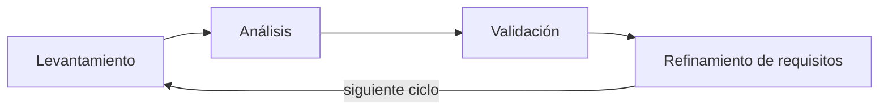
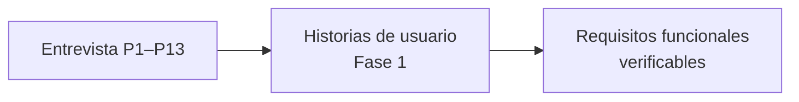

# 0.4 Recolección de información y metodología de trabajo

> **Guía de seguimiento:** Fase 0 — actividad *0.4 Recolección de información y metodología de trabajo (incluye entrevista y su análisis)*.
>
> **Fuente:** documento *Fase 0* (PDF), sección 0.4. Los resultados por pregunta están en [0.4.1 Entrevista — resultados por pregunta](0.4.1-entrevista-resultados.md).

## Metodología de trabajo

El desarrollo de la Mesa de Ayuda TI se organizó bajo una **metodología ágil**, que permite trabajar de manera iterativa e incremental. En lugar de definir todo el sistema desde el comienzo y validarlo solo al final, el equipo avanzó por ciclos sucesivos de levantamiento, análisis, validación y refinamiento de requisitos. Este enfoque favoreció la participación continua de los usuarios y la adaptación del proyecto a las necesidades que se identificaban durante su construcción. También permitió que los artefactos del proyecto, como las historias de usuario, los requerimientos funcionales y los casos de uso, se ajustaran a medida que mejoraba el entendimiento del problema.

## Instrumento de recolección: la entrevista

El proceso de recolección de información partió de la realización de entrevistas a los usuarios que interactúan con los servicios de soporte tecnológico de la organización. La entrevista se eligió porque permite conocer de primera mano cómo se solicita ayuda en la práctica, qué dificultades se presentan y qué expectativas existen frente a una solución.

El instrumento abordó **trece aspectos**:

| # | Aspecto |
|---|---------|
| P1 | Rol de cada participante |
| P2 | Claridad del proceso para pedir ayuda |
| P3 | Confirmación de las solicitudes |
| P4 | Tiempos de respuesta |
| P5 | Uso de múltiples canales |
| P6 | Calidad de la información suministrada |
| P7 | Canal más usado |
| P8 | Acciones ante la falta de respuesta |
| P9 | Canal ideal |
| P10 | Dificultades actuales |
| P11 | Tipo de solicitudes |
| P12 | Clasificación de las solicitudes |
| P13 | Tiempo de respuesta esperado |

Estas respuestas constituyeron la base del levantamiento de requisitos, pues cada necesidad expresada por los usuarios pudo trasladarse a una historia de usuario y, posteriormente, a requerimientos funcionales verificables.

## Análisis de los resultados

**Participantes.** Según las respuestas a la primera pregunta, la mayoría actúa como usuario que solicita ayuda, aunque también participaron personal de TI y roles de coordinación. Esta composición permitió contrastar la perspectiva de quienes reciben el servicio con la de quienes lo prestan y lo supervisan, y orientó el diseño de un sistema con funciones diferenciadas para cada tipo de usuario.

**Forma de solicitar ayuda.** Los resultados mostraron falta de claridad y desorden. Algunos usuarios saben cómo pedir ayuda, pero muchos no tienen claridad total sobre el proceso. Los medios más usados son WhatsApp y el correo electrónico, a los que se suma la comunicación verbal, y la mayoría considera que usar varios canales genera desorden. Esto explica que la información de las solicitudes se disperse y que, según las respuestas sobre la calidad de la información, muchos usuarios deban complementar después los datos que enviaron. Esta situación aportó una necesidad directa: contar con un **formulario estructurado** que guíe al solicitante y obtenga desde el inicio la información necesaria para atender el caso. Al preguntar por el canal ideal, la mayoría prefirió un único sistema o formulario centralizado.

**Seguimiento y comunicación.** En varios casos los usuarios no saben si su solicitud fue recibida o atendida, y cuando no obtienen respuesta suelen volver a escribir, recurrir a otro medio o consultar a otra persona de TI. Esta conducta evidencia la ausencia de confirmación y de visibilidad del estado de los casos, y genera duplicidad de esfuerzos y sobrecarga para el personal de soporte. Así se identificó la necesidad de **confirmar la recepción** de cada solicitud, asignarle un **número de seguimiento** y mantener informado al solicitante sobre los cambios de situación de su caso.

**Tiempos de atención.** En muchos casos las respuestas se demoran más de lo esperado, mientras que la mayoría espera respuestas rápidas, desde menos de una hora hasta el mismo día. La distancia entre lo esperado y lo recibido es un problema de servicio que el sistema debe atender mediante la **priorización** de los casos y la definición de **tiempos de atención medibles**. La naturaleza de las solicitudes refuerza esta necesidad, ya que los usuarios reportan tanto incidentes urgentes como solicitudes de nuevos servicios, que requieren tratamientos distintos. Además, muchos usuarios prefieren describir el problema y que el sistema o el área de TI realice la clasificación correspondiente, lo que apunta a que la clasificación y la priorización recaigan en el propio sistema y en el personal de soporte, y no en el solicitante.

## Síntesis: necesidades, problemas y oportunidades de mejora

| Categoría | Hallazgos |
|-----------|-----------|
| **Necesidades** | Registrar las solicitudes en un único punto; recibir confirmación de su recepción; consultar el estado de cada caso. |
| **Problemas** | Uso de múltiples canales sin control; falta de seguimiento oportuno; poca claridad del proceso de atención; demoras en las respuestas; información incompleta en las solicitudes. |
| **Oportunidades de mejora** | Centralizar la gestión; estandarizar la captura de datos; clasificar y priorizar los casos de forma ordenada; ofrecer trazabilidad completa sobre cada solicitud. |

En el marco de la metodología ágil, estos resultados no se trataron como un insumo cerrado, sino como un punto de partida que se validó y refinó de forma continua. A medida que el proyecto avanzó y el equipo comprendió mejor el sistema, las historias de usuario se ajustaron y se complementaron con otros fundamentos de análisis y diseño, con el fin de que los requisitos reflejaran con mayor precisión lo que el sistema debía hacer. De este modo, las entrevistas sirvieron de base para el levantamiento de requisitos y el trabajo iterativo permitió afinarlos progresivamente.

## Conclusión

El análisis permite concluir que existen problemas importantes en la gestión de solicitudes de TI, derivados del uso de múltiples canales de comunicación, la falta de seguimiento oportuno y la poca claridad en los procesos de atención. Los usuarios requieren un sistema centralizado que les permita registrar solicitudes, recibir confirmación de recepción y hacer seguimiento del estado de sus casos. Estos hallazgos justifican la implementación de una Mesa de Ayuda TI orientada a mejorar la organización, la comunicación, el control y los tiempos de respuesta. Al reemplazar los canales dispersos por un único punto de atención con registro estructurado, seguimiento, priorización y trazabilidad, el sistema propuesto responde de manera directa a las necesidades expresadas por los usuarios y contribuye a que el soporte tecnológico sea más ordenado, transparente y eficiente.
