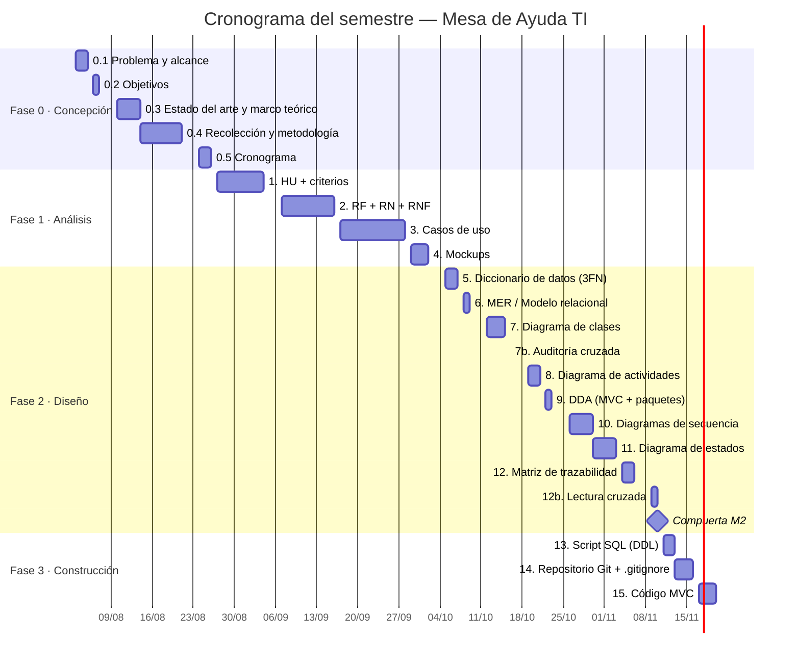

# 0.5 Cronograma de trabajo del semestre

> **Guía de seguimiento:** Fase 0 — actividad *0.5 Cronograma de trabajo del semestre*.
>
> **Fuente:** documento *Fase 0* (PDF), sección 0.5.

**Semestre 2026 · 03/08/2026 al 21/11/2026 · Clases los viernes**

## 0.5.1 Parámetros del cronograma

- **Clase:** 4 horas semanales. Trabajo adicional: 2 horas por cada hora de clase (8 h). Total semanal: 12 horas.
- **Duración:** 16 semanas, para un total de 192 horas distribuidas entre las 22 actividades del proyecto.
- Las 192 horas incluyen las Fases 0 y 1, que al 07/10/2026 ya estaban terminadas (108 h ejecutadas, 84 h pendientes).
- **Ritmo semanal** usado para calcular fechas: lunes a jueves 2 h por día y viernes 4 h (clase). Una actividad puede terminar a mitad de semana y la siguiente continúa ese mismo día o el siguiente.
- La **Compuerta M2** es un hito de control con 0 horas; solo después de ella arranca la Fase 3. El entregable final (documento Word único) consolida los artefactos y no tiene horas propias.

## 0.5.2 Cronograma de actividades

| Fase | Actividad | Fecha inicio | Fecha fin | Horas |
|:---:|-----------|:---:|:---:|:---:|
| 0 | 0.1 Descripción del problema y Alcance | 03/08/2026 | 05/08/2026 | 6 |
| 0 | 0.2 Objetivo General y Específicos | 06/08/2026 | 07/08/2026 | 6 |
| 0 | 0.3 Estado del arte y Marco teórico | 10/08/2026 | 14/08/2026 | 10 |
| 0 | 0.4 Recolección de información y metodología (incluye entrevista) | 14/08/2026 | 21/08/2026 | 14 |
| 0 | 0.5 Cronograma de trabajo del semestre | 24/08/2026 | 26/08/2026 | 6 |
| 1 | 1. HU + Criterios de aceptación | 27/08/2026 | 04/09/2026 | 18 |
| 1 | 2. RF + RN + RNF | 07/09/2026 | 16/09/2026 | 18 |
| 1 | 3. Casos de Uso (general completo + 4 a 6 críticos) | 17/09/2026 | 28/09/2026 | 20 |
| 1 | 4. Mockups (UI/UX) | 29/09/2026 | 02/10/2026 | 10 |
| 2 | 5. Diccionario de Datos (3FN) | 05/10/2026 | 07/10/2026 | 6 |
| 2 | 6. MER / Modelo Relacional | 08/10/2026 | 09/10/2026 | 6 |
| 2 | 7. Diagrama de Clases | 12/10/2026 | 15/10/2026 | 8 |
| 2 | 7b. Auditoría cruzada (diccionario ↔ MER ↔ clases) | 16/10/2026 | 16/10/2026 | 4 |
| 2 | 8. Diagrama de Actividades | 19/10/2026 | 21/10/2026 | 6 |
| 2 | 9. DDA (MVC + paquetes) | 22/10/2026 | 23/10/2026 | 6 |
| 2 | 10. Diagramas de Secuencia | 26/10/2026 | 30/10/2026 | 10 |
| 2 | 11. Diagrama de Estados | 30/10/2026 | 03/11/2026 | 6 |
| 2 | 12. Matriz de Trazabilidad | 04/11/2026 | 06/11/2026 | 8 |
| 2 | 12b. Lectura cruzada entre equipos | 09/11/2026 | 10/11/2026 | 4 |
| — | Compuerta M2 (matriz cerrada y leída) | 10/11/2026 | 10/11/2026 | 0 |
| 3 | 13. Script SQL (DDL) | 11/11/2026 | 13/11/2026 | 6 |
| 3 | 14. Repositorio Git + .gitignore + script | 13/11/2026 | 16/11/2026 | 4 |
| 3 | 15. Código MVC (vertical slice primero) | 17/11/2026 | 20/11/2026 | 10 |
| | **TOTAL (22 actividades)** | **03/08/2026** | **20/11/2026** | **192** |

### Diagrama de Gantt

## 0.5.3 Resumen de la distribución de horas

| Fase | Actividades | Horas | % del total | Semanas |
|------|:---:|:---:|:---:|:---:|
| Fase 0: Concepción | 5 | 42 | 21,9 % | 1 a 4 |
| Fase 1: Análisis | 4 | 66 | 34,4 % | 4 a 9 |
| Fase 2: Diseño | 10 | 64 | 33,3 % | 10 a 15 |
| Fase 3: Construcción | 3 | 20 | 10,4 % | 15 a 16 |
| **Total** | **22** | **192** | **100 %** | **16** |
