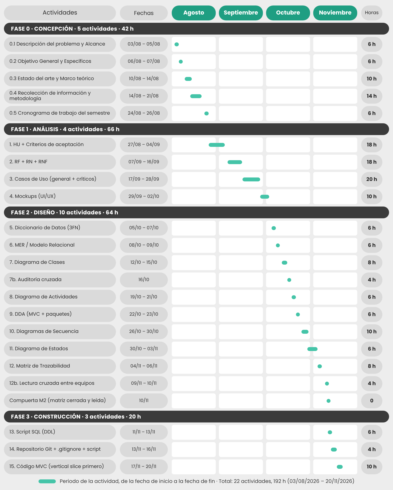

# 0.5 Cronograma de trabajo del semestre

> **Guía de seguimiento:** Fase 0 — actividad *0.5 Cronograma de trabajo del semestre*.
>
> **Fuente:** documento Word *Proyecto.docx* — «Mesa de Ayuda TI de Nexa Servicios» (F. J. Motta Quintero y E. Vásquez Valencia · Ingeniería de Software II · Docente: Lora Patiño Gloria Amparo · Octubre de 2026), sección 0.5.

Semestre 2026 · 03/08/2026 al 21/11/2026 · Clases los viernes

## 0.5.2 Cronograma de actividades

**Tabla 2**  
*Cronograma de actividades*

*Nota. Elaboración propia, a partir del cronograma de actividades del semestre. Cada barra ubica la actividad entre su fecha de inicio y su fecha de fin; la columna Horas indica las horas de cada actividad.*

## 0.5.3 Resumen de la distribución de horas

**Tabla 3**  
*Resumen de la distribución de horas*

| **Fase**             | **Actividades** | **Horas** | **% del total** | **Semanas** |
|----------------------|-----------------|-----------|-----------------|-------------|
| Fase 0: Concepción   | 5               | 42        | 21,9 %          | 1 a 4       |
| Fase 1: Análisis     | 4               | 66        | 34,4 %          | 4 a 9       |
| Fase 2: Diseño       | 10              | 64        | 33,3 %          | 10 a 15     |
| Fase 3: Construcción | 3               | 20        | 10,4 %          | 15 a 16     |
| Total                | 22              | 192       | 100 %           | 16          |
