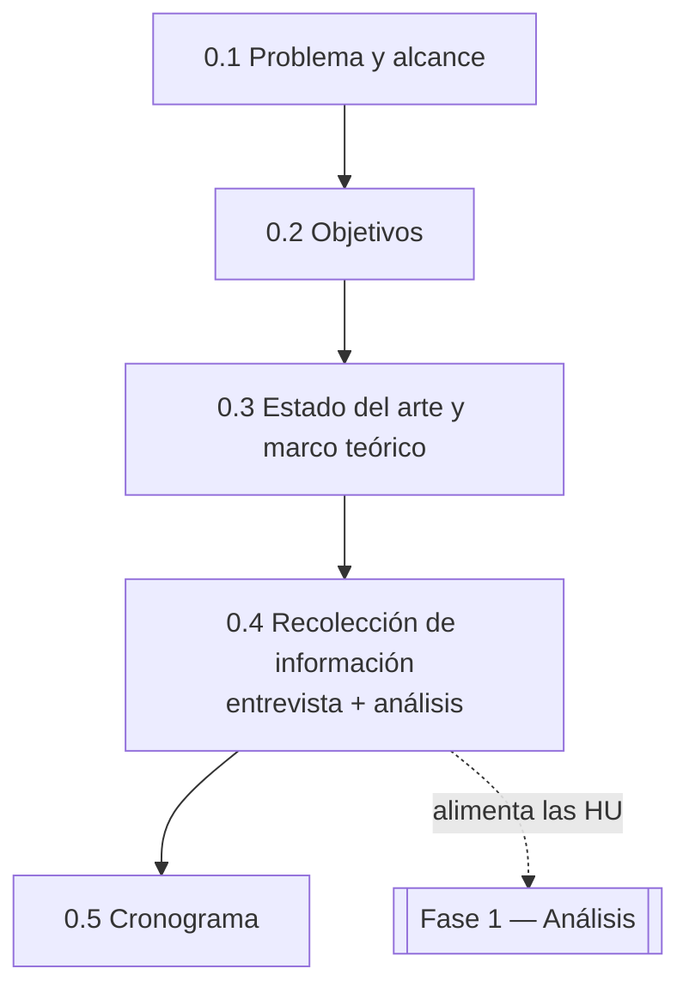

# Fase 0 — Concepción

> *Conocer el sistema antes de construirlo.* Es el capítulo que responde: **¿qué vamos a construir y por qué?** La entrevista alimenta las historias de usuario de la [Fase 1](../fase_1/README.md).

**Fuente principal:** documento *Fase 0 — Descripción del problema, objetivos, estado del arte, marco teórico, metodología y cronograma* (Corporación Universitaria Remington, Medellín · Mesa de Ayuda TI — Nexa Servicios · Elaborado por Francisco Javier Motta Quintero y Esteban Vásquez Valencia · Docente: Lora Patiño Gloria Amparo · Octubre de 2026).

## Trazabilidad con la guía de seguimiento

| Actividad de la guía | Documento | Estado |
|---|---|:---:|
| 0.1 Descripción del problema y Alcance | [0.1-descripcion-del-problema-y-alcance.md](0.1-descripcion-del-problema-y-alcance.md) | ✅ |
| 0.2 Objetivo General y Objetivos Específicos | [0.2-objetivos.md](0.2-objetivos.md) | ✅ |
| 0.3 Estado del arte y Marco teórico | [0.3.1-estado-del-arte.md](0.3.1-estado-del-arte.md) · [0.3.2-marco-teorico.md](0.3.2-marco-teorico.md) | ✅ |
| 0.4 Recolección de información y metodología de trabajo (incluye entrevista y su análisis) | [0.4-recoleccion-de-informacion-y-metodologia.md](0.4-recoleccion-de-informacion-y-metodologia.md) · [0.4.1-entrevista-resultados.md](0.4.1-entrevista-resultados.md) | ✅ |
| 0.5 Cronograma de trabajo del semestre | [0.5-cronograma-del-semestre.md](0.5-cronograma-del-semestre.md) | ✅ |

