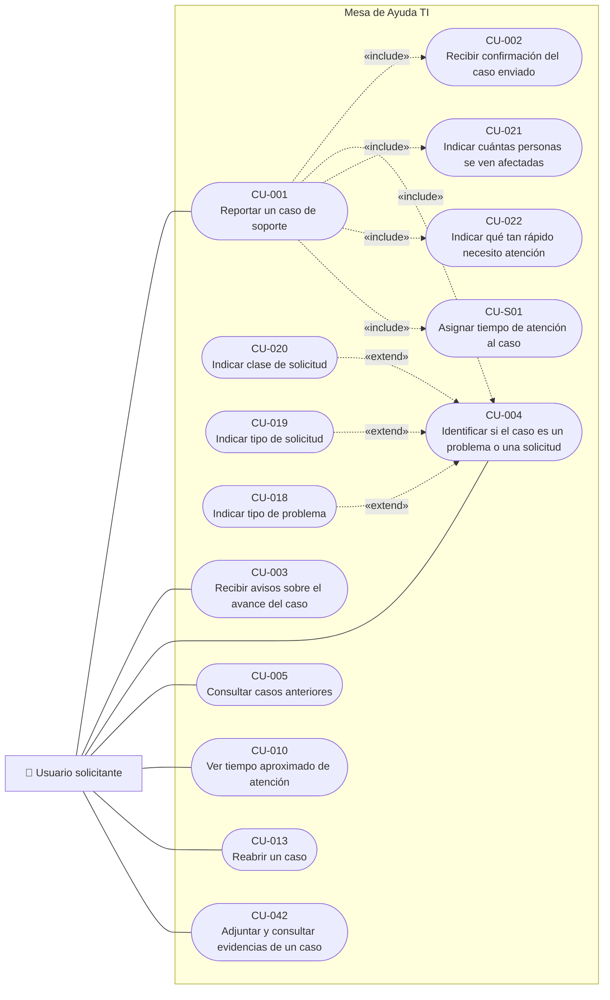
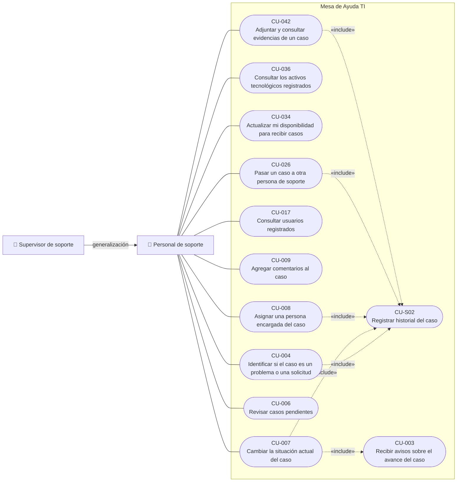
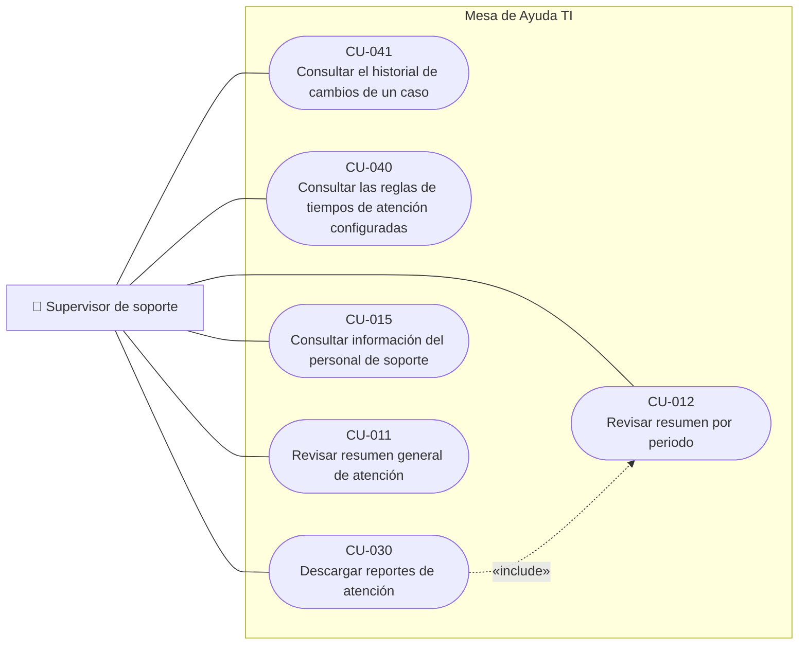
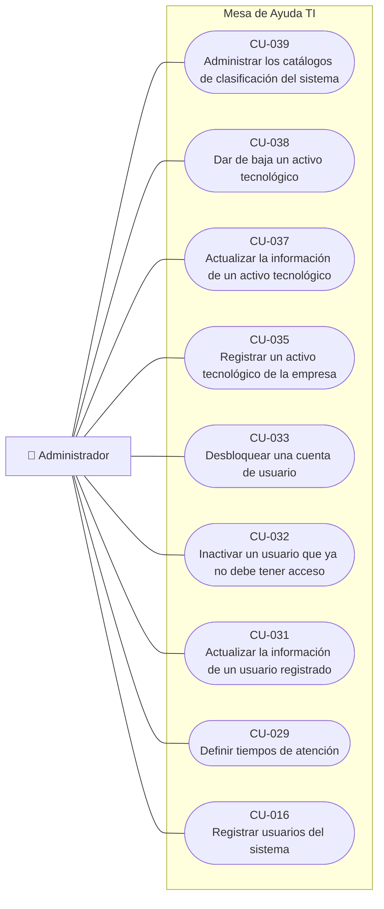
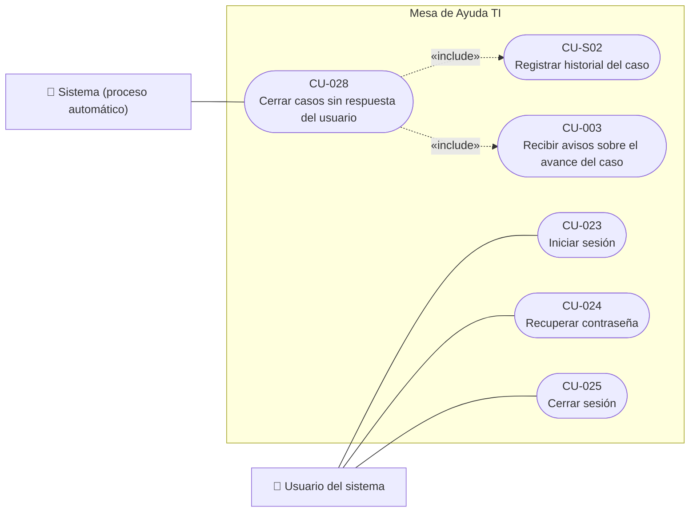

# 3. Casos de uso

> **Guía de seguimiento:** Fase 1 — actividad *3. Casos de Uso: general COMPLETO + 4 a 6 críticos documentados*.
>
> **Fuente:** documento Word *Fase 1 — Historias de Usuario y Criterios de Aceptación, Reglas de Negocio, Requisitos Funcionales y No Funcionales, Casos de Uso, Mockups y Matriz de Trazabilidad* (F. J. Motta Quintero y E. Vásquez Valencia · Docente: Lora Patiño Gloria Amparo · Octubre de 2026).

## 3.1 Los diagramas generales (UML)

Un caso de uso por cada historia (CU-0XX = HU-0XX), los actores de las historias y los «include» / «extend» que comparten varios casos de uso. Dos casos de uso de apoyo, sin actor, nacen de RF compartidos: CU-S01 (RF-20) y CU-S02 (RF-49). No se dibuja «iniciar sesión» como precondición de los demás (es la HU-023) ni los flujos alternativos, que viven en la documentación. Se separan en cinco diagramas por actor para que se lean bien; el Supervisor hereda las funciones del Personal de soporte.

> **Nota de conversión:** las cinco figuras del documento Word son imágenes UML. Aquí se representan en Mermaid a partir de los actores, relaciones «include»/«extend» y generalización descritos en el propio documento (pies de figura y flujos de la sección 3.2). Las imágenes originales se agregan en [`img/`](img/) cuando se suba el archivo Word original.

### Figura 1. Casos de uso del Usuario solicitante

*«include»: CU-001 usa CU-002, CU-021, CU-022 y CU-S01; «extend»: CU-018, CU-019 y CU-020 amplían CU-004.*

### Figura 2. Casos de uso del Personal de soporte y del Supervisor (generalización de actor)

*CU-S02 es el «include» de historial.*

### Figura 3. Casos de uso del Supervisor de soporte

*CU-030 «include» CU-012.*

### Figura 4. Casos de uso del Administrador

### Figura 5. Acceso (Usuario del sistema) y proceso automático de cierre (Sistema)

### Resumen de casos de uso

| Caso de uso | Nombre | Nace de | Implementa |
|---|---|---|---|
| [CU-001](#cu-001) | Reportar un caso de soporte | [HU-001](1-historias-de-usuario.md#hu-001) | [RF-01](2.2-requisitos-funcionales.md#rf-01), [RF-02](2.2-requisitos-funcionales.md#rf-02) |
| [CU-002](#cu-002) | Recibir confirmación del caso enviado | [HU-002](1-historias-de-usuario.md#hu-002) | [RF-03](2.2-requisitos-funcionales.md#rf-03) |
| [CU-003](#cu-003) | Recibir avisos sobre el avance del caso | [HU-003](1-historias-de-usuario.md#hu-003) | [RF-04](2.2-requisitos-funcionales.md#rf-04), [RF-05](2.2-requisitos-funcionales.md#rf-05), [RF-06](2.2-requisitos-funcionales.md#rf-06) |
| [CU-004](#cu-004) | Identificar si el caso es un problema o una solicitud | [HU-004](1-historias-de-usuario.md#hu-004) | [RF-02](2.2-requisitos-funcionales.md#rf-02), [RF-07](2.2-requisitos-funcionales.md#rf-07), [RF-08](2.2-requisitos-funcionales.md#rf-08) |
| [CU-005](#cu-005) | Consultar casos anteriores | [HU-005](1-historias-de-usuario.md#hu-005) | [RF-09](2.2-requisitos-funcionales.md#rf-09), [RF-10](2.2-requisitos-funcionales.md#rf-10) |
| [CU-006](#cu-006) | Revisar casos pendientes | [HU-006](1-historias-de-usuario.md#hu-006) | [RF-11](2.2-requisitos-funcionales.md#rf-11) |
| [CU-007](#cu-007) | Cambiar la situación actual del caso | [HU-007](1-historias-de-usuario.md#hu-007) | [RF-12](2.2-requisitos-funcionales.md#rf-12) |
| [CU-008](#cu-008) | Asignar una persona encargada del caso | [HU-008](1-historias-de-usuario.md#hu-008) | [RF-14](2.2-requisitos-funcionales.md#rf-14) |
| [CU-009](#cu-009) | Agregar comentarios al caso | [HU-009](1-historias-de-usuario.md#hu-009) | [RF-16](2.2-requisitos-funcionales.md#rf-16), [RF-17](2.2-requisitos-funcionales.md#rf-17) |
| [CU-010](#cu-010) | Ver tiempo aproximado de atención | [HU-010](1-historias-de-usuario.md#hu-010) | [RF-13](2.2-requisitos-funcionales.md#rf-13) |
| [CU-011](#cu-011) | Revisar resumen general de atención | [HU-011](1-historias-de-usuario.md#hu-011) | [RF-21](2.2-requisitos-funcionales.md#rf-21) |
| [CU-012](#cu-012) | Revisar resumen por periodo | [HU-012](1-historias-de-usuario.md#hu-012) | [RF-22](2.2-requisitos-funcionales.md#rf-22) |
| [CU-013](#cu-013) | Reabrir un caso | [HU-013](1-historias-de-usuario.md#hu-013) | [RF-23](2.2-requisitos-funcionales.md#rf-23) |
| [CU-015](#cu-015) | Consultar información del personal de soporte | [HU-015](1-historias-de-usuario.md#hu-015) | [RF-24](2.2-requisitos-funcionales.md#rf-24) |
| [CU-016](#cu-016) | Registrar usuarios del sistema | [HU-016](1-historias-de-usuario.md#hu-016) | [RF-26](2.2-requisitos-funcionales.md#rf-26) |
| [CU-017](#cu-017) | Consultar usuarios registrados | [HU-017](1-historias-de-usuario.md#hu-017) | [RF-27](2.2-requisitos-funcionales.md#rf-27) |
| [CU-018](#cu-018) | Indicar tipo de problema | [HU-018](1-historias-de-usuario.md#hu-018) | [RF-31](2.2-requisitos-funcionales.md#rf-31) |
| [CU-019](#cu-019) | Indicar tipo de solicitud | [HU-019](1-historias-de-usuario.md#hu-019) | [RF-32](2.2-requisitos-funcionales.md#rf-32) |
| [CU-020](#cu-020) | Indicar clase de solicitud | [HU-020](1-historias-de-usuario.md#hu-020) | [RF-33](2.2-requisitos-funcionales.md#rf-33) |
| [CU-021](#cu-021) | Indicar cuántas personas se ven afectadas | [HU-021](1-historias-de-usuario.md#hu-021) | [RF-18](2.2-requisitos-funcionales.md#rf-18) |
| [CU-022](#cu-022) | Indicar qué tan rápido necesito atención | [HU-022](1-historias-de-usuario.md#hu-022) | [RF-18](2.2-requisitos-funcionales.md#rf-18), [RF-19](2.2-requisitos-funcionales.md#rf-19) |
| [CU-023](#cu-023) | Iniciar sesión | [HU-023](1-historias-de-usuario.md#hu-023) | [RF-34](2.2-requisitos-funcionales.md#rf-34) |
| [CU-024](#cu-024) | Recuperar contraseña | [HU-024](1-historias-de-usuario.md#hu-024) | [RF-35](2.2-requisitos-funcionales.md#rf-35) |
| [CU-025](#cu-025) | Cerrar sesión | [HU-025](1-historias-de-usuario.md#hu-025) | [RF-36](2.2-requisitos-funcionales.md#rf-36) |
| [CU-026](#cu-026) | Pasar un caso a otra persona de soporte | [HU-026](1-historias-de-usuario.md#hu-026) | [RF-15](2.2-requisitos-funcionales.md#rf-15) |
| [CU-028](#cu-028) | Cerrar casos sin respuesta del usuario | [HU-028](1-historias-de-usuario.md#hu-028) | [RF-37](2.2-requisitos-funcionales.md#rf-37) |
| [CU-029](#cu-029) | Definir tiempos de atención | [HU-029](1-historias-de-usuario.md#hu-029) | [RF-38](2.2-requisitos-funcionales.md#rf-38) |
| [CU-030](#cu-030) | Descargar reportes de atención | [HU-030](1-historias-de-usuario.md#hu-030) | [RF-40](2.2-requisitos-funcionales.md#rf-40) |
| [CU-031](#cu-031) | Actualizar la información de un usuario registrado | [HU-031](1-historias-de-usuario.md#hu-031) | [RF-28](2.2-requisitos-funcionales.md#rf-28) |
| [CU-032](#cu-032) | Inactivar un usuario que ya no debe tener acceso | [HU-032](1-historias-de-usuario.md#hu-032) | [RF-29](2.2-requisitos-funcionales.md#rf-29) |
| [CU-033](#cu-033) | Desbloquear una cuenta de usuario | [HU-033](1-historias-de-usuario.md#hu-033) | [RF-30](2.2-requisitos-funcionales.md#rf-30) |
| [CU-034](#cu-034) | Actualizar mi disponibilidad para recibir casos | [HU-034](1-historias-de-usuario.md#hu-034) | [RF-25](2.2-requisitos-funcionales.md#rf-25) |
| [CU-035](#cu-035) | Registrar un activo tecnológico de la empresa | [HU-035](1-historias-de-usuario.md#hu-035) | [RF-44](2.2-requisitos-funcionales.md#rf-44) |
| [CU-036](#cu-036) | Consultar los activos tecnológicos registrados | [HU-036](1-historias-de-usuario.md#hu-036) | [RF-45](2.2-requisitos-funcionales.md#rf-45) |
| [CU-037](#cu-037) | Actualizar la información de un activo tecnológico | [HU-037](1-historias-de-usuario.md#hu-037) | [RF-46](2.2-requisitos-funcionales.md#rf-46) |
| [CU-038](#cu-038) | Dar de baja un activo tecnológico | [HU-038](1-historias-de-usuario.md#hu-038) | [RF-47](2.2-requisitos-funcionales.md#rf-47) |
| [CU-039](#cu-039) | Administrar los catálogos de clasificación del sistema | [HU-039](1-historias-de-usuario.md#hu-039) | [RF-48](2.2-requisitos-funcionales.md#rf-48) |
| [CU-040](#cu-040) | Consultar las reglas de tiempos de atención configuradas | [HU-040](1-historias-de-usuario.md#hu-040) | [RF-39](2.2-requisitos-funcionales.md#rf-39) |
| [CU-041](#cu-041) | Consultar el historial de cambios de un caso | [HU-041](1-historias-de-usuario.md#hu-041) | [RF-41](2.2-requisitos-funcionales.md#rf-41) |
| [CU-042](#cu-042) | Adjuntar y consultar evidencias de un caso | [HU-042](1-historias-de-usuario.md#hu-042) | [RF-42](2.2-requisitos-funcionales.md#rf-42), [RF-43](2.2-requisitos-funcionales.md#rf-43) |
| [CU-S01 (incluido)](#cu-s01) | Asignar tiempo de atención al caso | HU-010 CA-1 y CA-2 | [RF-20](2.2-requisitos-funcionales.md#rf-20) |
| [CU-S02 (incluido)](#cu-s02) | Registrar historial del caso | HU-041 CA-1 (y HU-007, HU-008, HU-026) | [RF-49](2.2-requisitos-funcionales.md#rf-49) |

*De dónde nace:* los códigos de los CU coinciden con los de las HU porque cada historia es un caso de uso. Los óvalos incluidos no tienen actor: los ejecutan otros casos de uso. Los CU de apoyo S01 y S02 nacen de RF que repiten varios criterios.

## 3.2 Los casos de uso documentados: cómo los CA se vuelven pasos y flujos

Cada CU se documenta con la plantilla del curso. Los Antecedentes de la HU son la precondición; el CA de éxito dicta el final del flujo básico y la poscondición; cada CA de rechazo es un flujo alternativo que cita su RN.

### CU-001 — Reportar un caso de soporte

| Elemento | Contenido | Procedencia |
|---|---|---|
| **Actor** | Usuario solicitante | *El rol de la HU-001* |
| **Precondición** | El solicitante ha iniciado sesión. | *Antecedentes de la HU-001* |
| **Poscondición** | El caso queda registrado en situación «recibido» con número de seguimiento único, con o sin activo asociado. | *CA-1* |

**Flujo básico (Evento / Respuesta)** — *Último paso: ES el CA-1 (RF-01, RF-02). Los pasos intermedios preparan las validaciones de los CA de rechazo.*

| # | Evento del actor | Respuesta del sistema |
|:---:|---|---|
| 1 | El solicitante solicita reportar un caso. | El sistema presenta el formulario con un ejemplo junto a cada pregunta (MK-02, RF-02). |
| 2 | El solicitante indica qué necesita, dónde ocurre, el tipo de caso, a quiénes afecta, qué tan urgente es y cómo contactarlo; opcionalmente elige un equipo o programa. | El sistema recibe los datos («include» CU-004, CU-021 y CU-022). |
| 3 | — | El sistema verifica que estén los datos obligatorios (RN-01). |
| 4 | — | El sistema calcula la importancia («include» CU-022, RN-05) y asigna el tiempo de atención vigente («include» CU-S01, RN-13). |
| 5 | — | El sistema registra el caso en situación «recibido», genera el número MA-AAAA-NNNNNN único (RN-02) y guarda la fecha y hora de creación. |
| 6 | — | El sistema guarda el historial («include» CU-S02) y muestra la confirmación («include» CU-002). |

**Flujos alternativos**

| Flujo | Descripción | Procedencia |
|:---:|---|---|
| 3a | Falta un dato obligatorio: el sistema no registra y señala el campo con su mensaje. Vuelve al paso 2. (Valida la RN-01) | *ES el CA-2* |
| 2a | No se seleccionó equipo o programa: el caso se registra igual, sin activo asociado. (RN-25) | *ES el CA-3* |

### CU-002 — Recibir confirmación del caso enviado

| Elemento | Contenido | Procedencia |
|---|---|---|
| **Actor** | Usuario solicitante (la dispara CU-001) | *El rol de la HU-002* |
| **Precondición** | El solicitante ha enviado un caso válido. | *Antecedentes de la HU-002* |
| **Poscondición** | El solicitante conoce el número de su caso; el caso sigue registrado sin importar el resultado del correo. | *CA-1* |

**Flujo básico (Evento / Respuesta)** — *Último paso: ES el CA-1 (RF-03). Los pasos intermedios preparan las validaciones de los CA de rechazo.*

| # | Evento del actor | Respuesta del sistema |
|:---:|---|---|
| 1 | — | El sistema muestra en pantalla el número de seguimiento generado, por ejemplo MA-2026-000145, distinto al de cualquier otro caso (MK-03, RN-02). |
| 2 | — | El sistema envía al correo registrado del solicitante el número de seguimiento y el resumen del caso (RN-16). |

**Flujos alternativos**

| Flujo | Descripción | Procedencia |
|:---:|---|---|
| 2a | Falla el envío del correo: el sistema reintenta automáticamente y el caso permanece registrado con su número. (Valida la RN-16) | *ES el CA-4* |

### CU-003 — Recibir avisos sobre el avance del caso

| Elemento | Contenido | Procedencia |
|---|---|---|
| **Actor** | Usuario solicitante | *El rol de la HU-003* |
| **Precondición** | El solicitante tiene un caso registrado. | *Antecedentes de la HU-003* |
| **Poscondición** | Cada cambio de situación queda informado por los tres medios y el aviso leído queda registrado. | *CA-1* |

**Flujo básico (Evento / Respuesta)** — *Último paso: ES el CA-1 (RF-04, RF-05, RF-06). Los pasos intermedios preparan las validaciones de los CA de rechazo.*

| # | Evento del actor | Respuesta del sistema |
|:---:|---|---|
| 1 | — | El caso cambia de situación (CU-007, CU-013 o CU-028) y el sistema genera un aviso por correo, aviso emergente y detalle del caso (RN-15). |
| 2 | El solicitante abre el aviso desde el sistema (MK-09). | El sistema muestra el contenido completo del aviso. |
| 3 | — | El sistema registra el aviso como leído, con fecha y hora. |

**Flujos alternativos**

| Flujo | Descripción | Procedencia |
|:---:|---|---|
| 1a | Falla el envío del aviso por correo: el sistema guarda el motivo del fallo y reintenta automáticamente. (Valida la RN-15) | *ES el CA-3* |

### CU-004 — Identificar si el caso es un problema o una solicitud

| Elemento | Contenido | Procedencia |
|---|---|---|
| **Actor** | Usuario solicitante y Personal de soporte | *El rol de la HU-004* |
| **Precondición** | El solicitante ha iniciado sesión y está reportando un caso nuevo (CU-001). | *Antecedentes de la HU-004* |
| **Poscondición** | El caso queda clasificado con datos coherentes con su tipo. | *CA-1* |

**Flujo básico (Evento / Respuesta)** — *Último paso: ES el CA-1 (RF-02, RF-07, RF-08). Los pasos intermedios preparan las validaciones de los CA de rechazo.*

| # | Evento del actor | Respuesta del sistema |
|:---:|---|---|
| 1 | El solicitante duda entre problema y solicitud. | El sistema muestra ejemplos claros de cada uno (MK-02, RF-02). |
| 2 | El solicitante indica si algo no funciona (problema) o si necesita algo nuevo (solicitud). | El sistema recibe la elección. |
| 3 | — | Si es problema, pide el tipo de problema («extend» CU-018) y no pide la clase de solicitud. Si es solicitud, pide el tipo y la clase («extend» CU-019 y CU-020) y no pide el tipo de problema (RN-03). |
| 4 | — | El sistema guarda el tipo de caso. |

**Flujos alternativos**

| Flujo | Descripción | Procedencia |
|:---:|---|---|
| 3a | El solicitante eligió problema e intenta además elegir tipo o clase de solicitud: el formulario no se lo permite. (Valida la RN-03) | *ES el CA-3* |
| 2a | El personal de soporte corrige el tipo de caso desde MK-06 indicando el motivo: el sistema guarda el nuevo tipo y registra quién, cuándo y por qué («include» CU-S02, RN-08). | *ES el CA-4* |

### CU-005 — Consultar casos anteriores

| Elemento | Contenido | Procedencia |
|---|---|---|
| **Actor** | Usuario solicitante | *El rol de la HU-005* |
| **Precondición** | El solicitante ha iniciado sesión. | *Antecedentes de la HU-005* |
| **Poscondición** | Ninguna modificación: la consulta no cambia datos. | *CA-1* |

**Flujo básico (Evento / Respuesta)** — *Último paso: ES el CA-1 (RF-09, RF-10). Los pasos intermedios preparan las validaciones de los CA de rechazo.*

| # | Evento del actor | Respuesta del sistema |
|:---:|---|---|
| 1 | El solicitante accede a Mis casos. | El sistema lista únicamente sus casos, del más reciente al más antiguo (MK-04, RN-06). |
| 2 | El solicitante busca por fecha, situación, tipo o palabra clave. | El sistema muestra únicamente los casos que cumplen el filtro. |

**Flujos alternativos**

| Flujo | Descripción | Procedencia |
|:---:|---|---|
| 2a | Ningún caso coincide: el sistema informa que no encontró casos, sin mostrar registros que no correspondan. | *ES el CA-4* |

### CU-006 — Revisar casos pendientes

| Elemento | Contenido | Procedencia |
|---|---|---|
| **Actor** | Personal de soporte | *El rol de la HU-006* |
| **Precondición** | El técnico ha iniciado sesión como personal de soporte. | *Antecedentes de la HU-006* |
| **Poscondición** | Ninguna modificación: la consulta no cambia datos. | *CA-1* |

**Flujo básico (Evento / Respuesta)** — *Último paso: ES el CA-1 (RF-11). Los pasos intermedios preparan las validaciones de los CA de rechazo.*

| # | Evento del actor | Respuesta del sistema |
|:---:|---|---|
| 1 | El técnico abre la pantalla de casos pendientes. | El sistema lista los casos no cerrados con número, situación e importancia (MK-07). |
| 2 | El técnico ordena por importancia, fecha o tipo de problema. | El sistema reordena la lista; P1 es la prioridad más alta (RN-05). |

**Flujos alternativos**

| Flujo | Descripción | Procedencia |
|:---:|---|---|
| 1a | Todos los casos están cerrados: el sistema indica claramente que no hay casos pendientes. | *ES el CA-4* |

### CU-007 — Cambiar la situación actual del caso

| Elemento | Contenido | Procedencia |
|---|---|---|
| **Actor** | Personal de soporte | *El rol de la HU-007* |
| **Precondición** | El técnico ha iniciado sesión y el caso existe. | *Antecedentes de la HU-007* |
| **Poscondición** | La situación queda actualizada, con historial del cambio y aviso al solicitante. | *CA-1* |

**Flujo básico (Evento / Respuesta)** — *Último paso: ES el CA-1 (RF-12). Los pasos intermedios preparan las validaciones de los CA de rechazo.*

| # | Evento del actor | Respuesta del sistema |
|:---:|---|---|
| 1 | El técnico abre el caso (MK-06) y elige la nueva situación. | El sistema verifica que la transición esté permitida para su perfil (RN-07, RN-23). |
| 2 | — | El sistema actualiza la situación y, si es «resuelto», guarda la fecha de solución. |
| 3 | — | El sistema guarda quién y cuándo hizo el cambio («include» CU-S02, RN-08) y avisa al solicitante («include» CU-003). |
| 4 | — | El solicitante ve la nueva situación al consultar su caso. |

**Flujos alternativos**

| Flujo | Descripción | Procedencia |
|:---:|---|---|
| 1a | La transición no está permitida (por ejemplo, de recibido a cerrado): el sistema rechaza, explica el motivo y conserva la situación. (Valida la RN-07) | *ES el CA-2* |
| 1b | Un usuario con perfil solicitante intenta cambiar la situación: el sistema lo impide y conserva la anterior. (Valida la RN-23) | *ES el CA-3* |

### CU-008 — Asignar una persona encargada del caso

| Elemento | Contenido | Procedencia |
|---|---|---|
| **Actor** | Personal de soporte (supervisor) | *El rol de la HU-008* |
| **Precondición** | El supervisor ha iniciado sesión y el caso existe. | *Antecedentes de la HU-008* |
| **Poscondición** | El caso queda con su nuevo responsable; un caso recién recibido se muestra sin responsable, sin impedir su consulta. | *CA-1* |

**Flujo básico (Evento / Respuesta)** — *Último paso: ES el CA-1 (RF-14). Los pasos intermedios preparan las validaciones de los CA de rechazo.*

| # | Evento del actor | Respuesta del sistema |
|:---:|---|---|
| 1 | El supervisor abre el caso (MK-06) y selecciona a la persona responsable. | El sistema verifica que tenga perfil de soporte (RN-09). |
| 2 | — | El sistema registra a la persona como responsable y guarda en el historial quién asignó, cuándo y quién era el responsable anterior («include» CU-S02, RN-08). |

**Flujos alternativos**

| Flujo | Descripción | Procedencia |
|:---:|---|---|
| 1a | La persona elegida tiene perfil de solicitante: el sistema no permite la asignación. (Valida la RN-09) | *ES el CA-2* |

### CU-009 — Agregar comentarios al caso

| Elemento | Contenido | Procedencia |
|---|---|---|
| **Actor** | Personal de soporte | *El rol de la HU-009* |
| **Precondición** | El técnico ha iniciado sesión y atiende el caso. | *Antecedentes de la HU-009* |
| **Poscondición** | El comentario queda guardado y visible según su visibilidad. | *CA-1* |

**Flujo básico (Evento / Respuesta)** — *Último paso: ES el CA-1 (RF-16, RF-17). Los pasos intermedios preparan las validaciones de los CA de rechazo.*

| # | Evento del actor | Respuesta del sistema |
|:---:|---|---|
| 1 | El técnico escribe el comentario y lo marca visible o interno (MK-06). | El sistema recibe el comentario. |
| 2 | — | El sistema verifica que no esté vacío (RN-10). |
| 3 | — | El sistema guarda el comentario con su autor y fecha. |
| 4 | El técnico o el solicitante abre el hilo del caso (MK-05, MK-06). | El sistema muestra todos los comentarios al técnico y solo los visibles al solicitante (RN-10). |

**Flujos alternativos**

| Flujo | Descripción | Procedencia |
|:---:|---|---|
| 2a | El comentario está vacío: el sistema no lo registra. (Valida la RN-10) | *ES el CA-3* |

### CU-010 — Ver tiempo aproximado de atención

| Elemento | Contenido | Procedencia |
|---|---|---|
| **Actor** | Usuario solicitante | *El rol de la HU-010* |
| **Precondición** | El solicitante ha iniciado sesión y tiene un caso registrado. | *Antecedentes de la HU-010* |
| **Poscondición** | Ninguna modificación: la consulta no cambia datos. | *CA-1* |

**Flujo básico (Evento / Respuesta)** — *Último paso: ES el CA-1 (RF-13). Los pasos intermedios preparan las validaciones de los CA de rechazo.*

| # | Evento del actor | Respuesta del sistema |
|:---:|---|---|
| 1 | El solicitante abre el detalle de su caso (MK-05). | El sistema muestra los tiempos máximos de respuesta y de solución de la regla vigente al crear el caso (RN-13). |
| 2 | — | Si ya hubo primera respuesta, el sistema indica si se dio dentro del tiempo definido (RN-14). |

**Flujos alternativos**

| Flujo | Descripción | Procedencia |
|:---:|---|---|
| 1a | La regla se modificó después de crear el caso: el sistema sigue mostrando la regla vigente cuando se creó. (Valida la RN-13) | *ES el CA-2* |

### CU-011 — Revisar resumen general de atención

| Elemento | Contenido | Procedencia |
|---|---|---|
| **Actor** | Supervisor de soporte | *El rol de la HU-011* |
| **Precondición** | El supervisor ha iniciado sesión. | *Antecedentes de la HU-011* |
| **Poscondición** | Ninguna modificación: la consulta no cambia datos. | *CA-1* |

**Flujo básico (Evento / Respuesta)** — *Último paso: ES el CA-1 (RF-21). Los pasos intermedios preparan las validaciones de los CA de rechazo.*

| # | Evento del actor | Respuesta del sistema |
|:---:|---|---|
| 1 | El supervisor abre el resumen general de atención (MK-10). | El sistema muestra la cantidad de casos recibidos, en atención, resueltos y cerrados. |
| 2 | — | El sistema muestra cuántos casos cumplen el tiempo de atención y cuántos están atrasados (RN-14). |

**Flujos alternativos**

| Flujo | Descripción | Procedencia |
|:---:|---|---|
| 1a | No hay casos en el periodo: el sistema lo indica claramente. (Valida la RN-29) | *ES el CA-4* |

### CU-012 — Revisar resumen por periodo

| Elemento | Contenido | Procedencia |
|---|---|---|
| **Actor** | Supervisor de soporte | *El rol de la HU-012* |
| **Precondición** | El supervisor ha iniciado sesión. | *Antecedentes de la HU-012* |
| **Poscondición** | Ninguna modificación: la consulta no cambia datos. | *CA-1* |

**Flujo básico (Evento / Respuesta)** — *Último paso: ES el CA-1 (RF-22). Los pasos intermedios preparan las validaciones de los CA de rechazo.*

| # | Evento del actor | Respuesta del sistema |
|:---:|---|---|
| 1 | El supervisor elige el periodo: hoy, esta semana, este mes o un rango de fechas (MK-10). | El sistema recalcula el resumen con los casos de ese periodo. |

**Flujos alternativos**

| Flujo | Descripción | Procedencia |
|:---:|---|---|
| 1a | El periodo no tiene casos: el sistema lo indica claramente. (Valida la RN-29) | *ES el CA-2* |

### CU-013 — Reabrir un caso

| Elemento | Contenido | Procedencia |
|---|---|---|
| **Actor** | Usuario solicitante | *El rol de la HU-013* |
| **Precondición** | El solicitante ha iniciado sesión y tiene un caso resuelto. | *Antecedentes de la HU-013* |
| **Poscondición** | El caso queda reabierto con el mismo número, su historial, comentarios y adjuntos. | *CA-1* |

**Flujo básico (Evento / Respuesta)** — *Último paso: ES el CA-1 (RF-23). Los pasos intermedios preparan las validaciones de los CA de rechazo.*

| # | Evento del actor | Respuesta del sistema |
|:---:|---|---|
| 1 | El solicitante selecciona Reabrir en el caso (MK-05). | El sistema solicita el motivo. |
| 2 | El solicitante escribe el motivo y confirma. | El sistema verifica que el caso esté resuelto, dentro de 5 días hábiles y con motivo (RN-11). |
| 3 | — | El sistema reabre el caso con el mismo número, conserva historial, comentarios y adjuntos, suma una reapertura y guarda el motivo. |
| 4 | — | El sistema guarda el historial («include» CU-S02) y avisa al solicitante («include» CU-003). |

**Flujos alternativos**

| Flujo | Descripción | Procedencia |
|:---:|---|---|
| 2a | Pasaron más de 5 días hábiles: el sistema no permite reabrir y explica que el plazo venció. (Valida la RN-11) | *ES el CA-2* |
| 2b | No se escribió motivo: el sistema no permite continuar. (Valida la RN-11) | *ES el CA-3* |
| 2c | El caso no está resuelto: el sistema no permite reabrirlo. (Valida la RN-11) | *ES el CA-4* |

### CU-015 — Consultar información del personal de soporte

| Elemento | Contenido | Procedencia |
|---|---|---|
| **Actor** | Supervisor de soporte | *El rol de la HU-015* |
| **Precondición** | El supervisor ha iniciado sesión. | *Antecedentes de la HU-015* |
| **Poscondición** | Ninguna modificación: la consulta no cambia datos. | *CA-1* |

**Flujo básico (Evento / Respuesta)** — *Último paso: ES el CA-1 (RF-24). Los pasos intermedios preparan las validaciones de los CA de rechazo.*

| # | Evento del actor | Respuesta del sistema |
|:---:|---|---|
| 1 | El supervisor abre la disponibilidad del personal (MK-11). | El sistema muestra a cada persona de soporte como disponible, ocupado o ausente (RN-28). |
| 2 | El supervisor selecciona a una persona. | El sistema muestra su disponibilidad más reciente. |

**Flujos alternativos**

| Flujo | Descripción | Procedencia |
|:---:|---|---|
| 2a | La persona nunca registró disponibilidad: el sistema indica que no hay información registrada. (Valida la RN-28) | *ES el CA-3* |

### CU-016 — Registrar usuarios del sistema

| Elemento | Contenido | Procedencia |
|---|---|---|
| **Actor** | Administrador | *El rol de la HU-016* |
| **Precondición** | El administrador ha iniciado sesión. | *Antecedentes de la HU-016* |
| **Poscondición** | El usuario queda registrado, activo y con la contraseña protegida. | *CA-1* |

**Flujo básico (Evento / Respuesta)** — *Último paso: ES el CA-1 (RF-26). Los pasos intermedios preparan las validaciones de los CA de rechazo.*

| # | Evento del actor | Respuesta del sistema |
|:---:|---|---|
| 1 | El administrador solicita registrar un usuario. | El sistema presenta el formulario (MK-14). |
| 2 | El administrador ingresa nombre, correo, cargo, área, rol organizacional y perfil de acceso. | El sistema recibe los datos. |
| 3 | — | El sistema verifica los datos obligatorios y el área si el perfil es solicitante (RN-18). |
| 4 | — | El sistema verifica que el correo sea único (RN-17). |
| 5 | — | El sistema registra al usuario como activo y guarda su contraseña inicial protegida (RN-19). |

**Flujos alternativos**

| Flujo | Descripción | Procedencia |
|:---:|---|---|
| 3a | Falta nombre, correo o perfil: el sistema no registra y señala el campo con su mensaje. Vuelve al paso 2. | *ES el CA-3* |
| 3b | Perfil solicitante sin área: el sistema no permite completar el registro. (Valida la RN-18) | *ES el CA-4* |
| 4a | El correo ya existe: el sistema no registra y explica que está en uso. (Valida la RN-17) | *ES el CA-2* |

### CU-017 — Consultar usuarios registrados

| Elemento | Contenido | Procedencia |
|---|---|---|
| **Actor** | Personal de soporte | *El rol de la HU-017* |
| **Precondición** | El técnico ha iniciado sesión. | *Antecedentes de la HU-017* |
| **Poscondición** | Ninguna modificación: la consulta no cambia datos. | *CA-1* |

**Flujo básico (Evento / Respuesta)** — *Último paso: ES el CA-1 (RF-27). Los pasos intermedios preparan las validaciones de los CA de rechazo.*

| # | Evento del actor | Respuesta del sistema |
|:---:|---|---|
| 1 | El técnico abre el listado de usuarios (MK-13). | El sistema muestra nombre, cargo, área y rol de cada usuario. |
| 2 | El técnico busca por nombre o correo. | El sistema muestra a los usuarios que coinciden. |

**Flujos alternativos**

| Flujo | Descripción | Procedencia |
|:---:|---|---|
| 2a | Ningún usuario coincide: el sistema indica que no encontró resultados, sin mostrar registros que no correspondan. | *ES el CA-3* |

### CU-018 — Indicar tipo de problema

| Elemento | Contenido | Procedencia |
|---|---|---|
| **Actor** | Usuario solicitante | *El rol de la HU-018* |
| **Precondición** | El solicitante está reportando un problema (CU-004). | *Antecedentes de la HU-018* |
| **Poscondición** | El caso queda asociado a un tipo de problema activo. «extend» de CU-004. | *CA-1* |

**Flujo básico (Evento / Respuesta)** — *Último paso: ES el CA-1 (RF-31). Los pasos intermedios preparan las validaciones de los CA de rechazo.*

| # | Evento del actor | Respuesta del sistema |
|:---:|---|---|
| 1 | — | El sistema muestra solo los tipos de problema activos (MK-02, RN-04). |
| 2 | El solicitante selecciona un tipo de problema. | El sistema asocia el tipo al caso. |

**Flujos alternativos**

| Flujo | Descripción | Procedencia |
|:---:|---|---|
| 2a | El solicitante intenta escribir un tipo que no está en la lista: el sistema no se lo permite. (Valida la RN-04) | *ES el CA-3* |

### CU-019 — Indicar tipo de solicitud

| Elemento | Contenido | Procedencia |
|---|---|---|
| **Actor** | Usuario solicitante | *El rol de la HU-019* |
| **Precondición** | El solicitante está haciendo una solicitud (CU-004). | *Antecedentes de la HU-019* |
| **Poscondición** | El caso queda asociado a un tipo de solicitud activo. «extend» de CU-004. | *CA-1* |

**Flujo básico (Evento / Respuesta)** — *Último paso: ES el CA-1 (RF-32). Los pasos intermedios preparan las validaciones de los CA de rechazo.*

| # | Evento del actor | Respuesta del sistema |
|:---:|---|---|
| 1 | — | El sistema muestra solo los tipos de solicitud activos (MK-02, RN-04). |
| 2 | El solicitante selecciona un tipo de solicitud. | El sistema asocia el tipo al caso. |

**Flujos alternativos**

| Flujo | Descripción | Procedencia |
|:---:|---|---|
| 2a | El solicitante intenta escribir un tipo que no está en la lista: el sistema no se lo permite. (Valida la RN-04) | *ES el CA-3* |

### CU-020 — Indicar clase de solicitud

| Elemento | Contenido | Procedencia |
|---|---|---|
| **Actor** | Usuario solicitante | *El rol de la HU-020* |
| **Precondición** | El solicitante está registrando una solicitud, no un problema (CU-004). | *Antecedentes de la HU-020* |
| **Poscondición** | El caso queda asociado a una clase de solicitud. «extend» de CU-004. | *CA-1* |

**Flujo básico (Evento / Respuesta)** — *Último paso: ES el CA-1 (RF-33). Los pasos intermedios preparan las validaciones de los CA de rechazo.*

| # | Evento del actor | Respuesta del sistema |
|:---:|---|---|
| 1 | — | El sistema muestra las clases nuevo, cambio y consulta (MK-02, RN-03). |
| 2 | El solicitante selecciona la clase. | El sistema la asocia al caso. |

**Flujos alternativos**

| Flujo | Descripción | Procedencia |
|:---:|---|---|
| 2a | No se eligió ninguna clase: el sistema no permite continuar. (Valida la RN-03) | *ES el CA-3* |

### CU-021 — Indicar cuántas personas se ven afectadas

| Elemento | Contenido | Procedencia |
|---|---|---|
| **Actor** | Usuario solicitante | *El rol de la HU-021* |
| **Precondición** | El solicitante está registrando un caso (CU-001). | *Antecedentes de la HU-021* |
| **Poscondición** | La afectación queda guardada y se combina con la urgencia en CU-022. | *CA-1* |

**Flujo básico (Evento / Respuesta)** — *Último paso: ES el CA-1 (RF-18). Los pasos intermedios preparan las validaciones de los CA de rechazo.*

| # | Evento del actor | Respuesta del sistema |
|:---:|---|---|
| 1 | — | El sistema ofrece las opciones: solo a mí (usuario), a mi área o a toda la empresa, con un ejemplo (MK-02). |
| 2 | El solicitante selecciona una opción. | El sistema guarda la afectación del caso. |

**Flujos alternativos**

| Flujo | Descripción | Procedencia |
|:---:|---|---|
| 2a | No se indicó a quién afecta: el sistema no permite continuar. (Valida la RN-01) | *ES el CA-2* |

### CU-022 — Indicar qué tan rápido necesito atención

| Elemento | Contenido | Procedencia |
|---|---|---|
| **Actor** | Usuario solicitante | *El rol de la HU-022* |
| **Precondición** | El solicitante está registrando un caso y ya indicó la afectación (CU-021). | *Antecedentes de la HU-022* |
| **Poscondición** | La importancia queda calculada y fija, aunque el administrador cambie después las reglas de prioridad. | *CA-1* |

**Flujo básico (Evento / Respuesta)** — *Último paso: ES el CA-1 (RF-18, RF-19). Los pasos intermedios preparan las validaciones de los CA de rechazo.*

| # | Evento del actor | Respuesta del sistema |
|:---:|---|---|
| 1 | El solicitante elige la urgencia: baja, media, alta o crítica (MK-02). | El sistema recibe la urgencia. |
| 2 | — | El sistema calcula la importancia P1 a P4 combinando afectación y urgencia (RF-19, RN-05). |
| 3 | — | El sistema fija la importancia del caso, sin recalcularla después. |

**Flujos alternativos**

| Flujo | Descripción | Procedencia |
|:---:|---|---|
| 1a | No se indicó la urgencia: el sistema no permite continuar. (Valida la RN-01) | *ES el CA-3* |

### CU-023 — Iniciar sesión

| Elemento | Contenido | Procedencia |
|---|---|---|
| **Actor** | Usuario del sistema | *El rol de la HU-023* |
| **Precondición** | El usuario está registrado y su cuenta está activa. | *Antecedentes de la HU-023* |
| **Poscondición** | La sesión queda iniciada con las funciones del perfil del usuario. | *CA-1* |

**Flujo básico (Evento / Respuesta)** — *Último paso: ES el CA-1 (RF-34). Los pasos intermedios preparan las validaciones de los CA de rechazo.*

| # | Evento del actor | Respuesta del sistema |
|:---:|---|---|
| 1 | El usuario ingresa su correo y contraseña (MK-01). | El sistema recibe los datos. |
| 2 | — | El sistema valida las credenciales y que la cuenta esté activa y sin bloqueo (RN-20, RN-21). |
| 3 | — | El sistema concede acceso solo a las funciones de su perfil (RN-23) y reinicia el contador de intentos fallidos. |

**Flujos alternativos**

| Flujo | Descripción | Procedencia |
|:---:|---|---|
| 2a | Datos incorrectos: el sistema rechaza el ingreso con un mensaje genérico y aumenta el contador de intentos. (Valida la RN-20) | *ES el CA-2* |
| 2b | Se alcanza el límite de intentos de la política de seguridad: el sistema bloquea la cuenta temporalmente e informa. (Valida la RN-20) | *ES el CA-3* |
| 2c | La cuenta está inactiva: el sistema no permite el ingreso. (Valida la RN-21) | *ES el CA-2* |

### CU-024 — Recuperar contraseña

| Elemento | Contenido | Procedencia |
|---|---|---|
| **Actor** | Usuario del sistema | *El rol de la HU-024* |
| **Precondición** | El usuario está registrado con un correo válido. | *Antecedentes de la HU-024* |
| **Poscondición** | La contraseña queda actualizada y el enlace consumido no vuelve a servir. | *CA-2* |

**Flujo básico (Evento / Respuesta)** — *Último paso: ES el CA-2 (RF-35). Los pasos intermedios preparan las validaciones de los CA de rechazo.*

| # | Evento del actor | Respuesta del sistema |
|:---:|---|---|
| 1 | El usuario solicita recuperar su contraseña indicando su correo (MK-01). | El sistema genera un enlace temporal protegido, invalida los anteriores y lo envía al correo (RN-22). |
| 2 | El usuario abre el enlace y define una nueva contraseña. | El sistema verifica que el enlace esté vigente y sin usar (RN-22). |
| 3 | — | El sistema actualiza la contraseña protegida (RN-19), marca el enlace como usado y permite ingresar. |

**Flujos alternativos**

| Flujo | Descripción | Procedencia |
|:---:|---|---|
| 2a | El enlace ya se usó o venció: el sistema rechaza el restablecimiento y explica que debe solicitar uno nuevo. (Valida la RN-22) | *ES el CA-3* |
| 1a | El usuario solicita un enlace nuevo teniendo uno sin usar: el anterior queda invalidado. (Valida la RN-22) | *ES el CA-4* |

### CU-025 — Cerrar sesión

| Elemento | Contenido | Procedencia |
|---|---|---|
| **Actor** | Usuario del sistema | *El rol de la HU-025* |
| **Precondición** | El usuario tiene una sesión abierta. | *Antecedentes de la HU-025* |
| **Poscondición** | La sesión queda cerrada y las funciones bloqueadas. | *CA-1* |

**Flujo básico (Evento / Respuesta)** — *Último paso: ES el CA-1 (RF-36). Los pasos intermedios preparan las validaciones de los CA de rechazo.*

| # | Evento del actor | Respuesta del sistema |
|:---:|---|---|
| 1 | El usuario selecciona Cerrar sesión en el encabezado (MK-04). | El sistema cierra la sesión y devuelve al usuario a la pantalla de ingreso (MK-01). |
| 2 | El usuario intenta volver a una pantalla sin iniciar sesión. | El sistema no permite el acceso hasta que vuelva a ingresar (RN-23). |

### CU-026 — Pasar un caso a otra persona de soporte

| Elemento | Contenido | Procedencia |
|---|---|---|
| **Actor** | Personal de soporte | *El rol de la HU-026* |
| **Precondición** | El técnico ha iniciado sesión y tiene asignado el caso. | *Antecedentes de la HU-026* |
| **Poscondición** | El caso queda con su nuevo responsable y su historial intacto. | *CA-1* |

**Flujo básico (Evento / Respuesta)** — *Último paso: ES el CA-1 (RF-15). Los pasos intermedios preparan las validaciones de los CA de rechazo.*

| # | Evento del actor | Respuesta del sistema |
|:---:|---|---|
| 1 | El técnico selecciona Pasar caso y elige a otra persona de soporte (MK-06). | El sistema verifica que tenga perfil de soporte (RN-09). |
| 2 | — | El sistema deja a la nueva persona como responsable y guarda quién hizo el cambio, a quién y cuándo («include» CU-S02, RN-08). |
| 3 | La nueva persona abre el caso. | El sistema le muestra el historial y los comentarios previos. |

**Flujos alternativos**

| Flujo | Descripción | Procedencia |
|:---:|---|---|
| 1a | La persona elegida es un solicitante: el sistema no permite la reasignación. (Valida la RN-09) | *ES el CA-2* |

### CU-028 — Cerrar casos sin respuesta del usuario

| Elemento | Contenido | Procedencia |
|---|---|---|
| **Actor** | Sistema (proceso automático) | *El rol de la HU-028* |
| **Precondición** | Existen casos en situación «resuelto». | *Antecedentes de la HU-028* |
| **Poscondición** | Los casos vencidos quedan cerrados, con historial y aviso al solicitante. | *CA-1* |

**Flujo básico (Evento / Respuesta)** — *Último paso: ES el CA-1 (RF-37). Los pasos intermedios preparan las validaciones de los CA de rechazo.*

| # | Evento del actor | Respuesta del sistema |
|:---:|---|---|
| 1 | Llega la hora programada de revisión. | El sistema revisa los casos resueltos y cuenta los días hábiles transcurridos. |
| 2 | — | Para cada caso con 5 días hábiles sin respuesta ni reapertura, el sistema lo cambia a «cerrado» (RN-12). |
| 3 | — | El sistema registra que el cierre fue automático («include» CU-S02) y avisa al solicitante («include» CU-003). |

**Flujos alternativos**

| Flujo | Descripción | Procedencia |
|:---:|---|---|
| 2a | El caso se resolvió hace menos de 5 días hábiles: el sistema lo deja en «resuelto». (Valida la RN-12) | *ES el CA-3* |

### CU-029 — Definir tiempos de atención

| Elemento | Contenido | Procedencia |
|---|---|---|
| **Actor** | Administrador | *El rol de la HU-029* |
| **Precondición** | El administrador ha iniciado sesión. | *Antecedentes de la HU-029* |
| **Poscondición** | La regla queda vigente para los casos nuevos. | *CA-1* |

**Flujo básico (Evento / Respuesta)** — *Último paso: ES el CA-1 (RF-38). Los pasos intermedios preparan las validaciones de los CA de rechazo.*

| # | Evento del actor | Respuesta del sistema |
|:---:|---|---|
| 1 | El administrador solicita crear una regla de tiempos (MK-12). | El sistema presenta el formulario. |
| 2 | El administrador indica importancia, tipo de caso y tiempos de respuesta y solución en minutos. | El sistema recibe los datos. |
| 3 | — | El sistema verifica que no exista otra regla activa para la misma combinación (RN-13). |
| 4 | — | El sistema guarda la regla como vigente para los casos nuevos. |

**Flujos alternativos**

| Flujo | Descripción | Procedencia |
|:---:|---|---|
| 3a | Ya existe una regla activa para esa combinación: el sistema no lo permite. (Valida la RN-13) | *ES el CA-2* |
| 2a | El administrador edita una regla: los casos nuevos usan el nuevo valor y los casos ya creados conservan su referencia original. (RN-13) | *ES el CA-3* |
| 2b | El administrador desactiva una regla: deja de aplicarse a los casos nuevos. | *ES el CA-4* |

### CU-030 — Descargar reportes de atención

| Elemento | Contenido | Procedencia |
|---|---|---|
| **Actor** | Supervisor de soporte | *El rol de la HU-030* |
| **Precondición** | El supervisor ha iniciado sesión. | *Antecedentes de la HU-030* |
| **Poscondición** | El reporte queda descargado en el formato elegido. | *CA-1* |

**Flujo básico (Evento / Respuesta)** — *Último paso: ES el CA-1 (RF-40). Los pasos intermedios preparan las validaciones de los CA de rechazo.*

| # | Evento del actor | Respuesta del sistema |
|:---:|---|---|
| 1 | El supervisor elige periodo y formato PDF o Excel (MK-10). | El sistema consulta el resumen del periodo («include» CU-012). |
| 2 | — | El sistema genera el archivo con la misma información del resumen y lo descarga. |

**Flujos alternativos**

| Flujo | Descripción | Procedencia |
|:---:|---|---|
| 2a | El periodo no tiene casos: el sistema informa que no hay información, sin generar un archivo vacío. (Valida la RN-29) | *ES el CA-2* |

### CU-031 — Actualizar la información de un usuario registrado

| Elemento | Contenido | Procedencia |
|---|---|---|
| **Actor** | Administrador | *El rol de la HU-031* |
| **Precondición** | El administrador ha iniciado sesión y el usuario existe. | *Antecedentes de la HU-031* |
| **Poscondición** | Los datos del usuario quedan actualizados. | *CA-1* |

**Flujo básico (Evento / Respuesta)** — *Último paso: ES el CA-1 (RF-28). Los pasos intermedios preparan las validaciones de los CA de rechazo.*

| # | Evento del actor | Respuesta del sistema |
|:---:|---|---|
| 1 | El administrador selecciona al usuario y Editar (MK-13). | El sistema presenta el formulario con los datos actuales (MK-14). |
| 2 | El administrador modifica cargo, área, rol, perfil, correo o estado. | El sistema recibe los cambios. |
| 3 | — | El sistema verifica el correo único (RN-17) y el área si el perfil es solicitante (RN-18). |
| 4 | — | El sistema guarda los cambios con la fecha y quién los hizo. |

**Flujos alternativos**

| Flujo | Descripción | Procedencia |
|:---:|---|---|
| 3a | El correo ya pertenece a otro usuario: el sistema no guarda y conserva el anterior. (Valida la RN-17) | *ES el CA-2* |
| 3b | Perfil solicitante sin área: el sistema no guarda hasta que se indique. (Valida la RN-18) | *ES el CA-3* |

### CU-032 — Inactivar un usuario que ya no debe tener acceso

| Elemento | Contenido | Procedencia |
|---|---|---|
| **Actor** | Administrador | *El rol de la HU-032* |
| **Precondición** | El administrador ha iniciado sesión y el usuario está activo. | *Antecedentes de la HU-032* |
| **Poscondición** | El usuario queda inactivo y su información histórica se conserva. | *CA-1* |

**Flujo básico (Evento / Respuesta)** — *Último paso: ES el CA-1 (RF-29). Los pasos intermedios preparan las validaciones de los CA de rechazo.*

| # | Evento del actor | Respuesta del sistema |
|:---:|---|---|
| 1 | El administrador selecciona Inactivar en la fila del usuario (MK-13). | El sistema marca al usuario como inactivo; sus casos y comentarios se conservan (RN-21). |
| 2 | El usuario inactivo intenta iniciar sesión. | El sistema no le permite ingresar (RN-21). |

**Flujos alternativos**

| Flujo | Descripción | Procedencia |
|:---:|---|---|
| 1a | El administrador reactiva al usuario: vuelve a poder iniciar sesión normalmente. | *ES el CA-4* |

### CU-033 — Desbloquear una cuenta de usuario

| Elemento | Contenido | Procedencia |
|---|---|---|
| **Actor** | Administrador | *El rol de la HU-033* |
| **Precondición** | El administrador ha iniciado sesión y existe una cuenta bloqueada. | *Antecedentes de la HU-033* |
| **Poscondición** | El usuario puede volver a iniciar sesión con sus datos correctos. | *CA-2* |

**Flujo básico (Evento / Respuesta)** — *Último paso: ES el CA-2 (RF-30). Los pasos intermedios preparan las validaciones de los CA de rechazo.*

| # | Evento del actor | Respuesta del sistema |
|:---:|---|---|
| 1 | El administrador abre la lista de cuentas bloqueadas (MK-15). | El sistema muestra las cuentas bloqueadas. |
| 2 | El administrador selecciona una cuenta y Desbloquear. | El sistema reinicia el contador de intentos fallidos y retira el bloqueo (RN-20). |

### CU-034 — Actualizar mi disponibilidad para recibir casos

| Elemento | Contenido | Procedencia |
|---|---|---|
| **Actor** | Personal de soporte | *El rol de la HU-034* |
| **Precondición** | El técnico ha iniciado sesión. | *Antecedentes de la HU-034* |
| **Poscondición** | La disponibilidad más reciente queda visible para el supervisor. | *CA-1* |

**Flujo básico (Evento / Respuesta)** — *Último paso: ES el CA-1 (RF-25). Los pasos intermedios preparan las validaciones de los CA de rechazo.*

| # | Evento del actor | Respuesta del sistema |
|:---:|---|---|
| 1 | El técnico elige su disponibilidad: disponible, ocupado o ausente (MK-11). | El sistema guarda el estado con la fecha y hora del cambio (RN-28). |
| 2 | El supervisor consulta la disponibilidad del técnico. | El sistema muestra el estado más reciente. |

### CU-035 — Registrar un activo tecnológico de la empresa

| Elemento | Contenido | Procedencia |
|---|---|---|
| **Actor** | Administrador | *El rol de la HU-035* |
| **Precondición** | El administrador ha iniciado sesión. | *Antecedentes de la HU-035* |
| **Poscondición** | El activo queda registrado y disponible para asociarse a casos. | *CA-1* |

**Flujo básico (Evento / Respuesta)** — *Último paso: ES el CA-1 (RF-44). Los pasos intermedios preparan las validaciones de los CA de rechazo.*

| # | Evento del actor | Respuesta del sistema |
|:---:|---|---|
| 1 | El administrador solicita registrar un activo. | El sistema presenta el formulario (MK-17). |
| 2 | El administrador ingresa nombre, tipo, marca, modelo, número de serie y área. | El sistema recibe los datos. |
| 3 | — | El sistema verifica que nombre y tipo estén completos. |
| 4 | — | El sistema verifica que el número de serie, si se indicó, no esté repetido (RN-24). |
| 5 | — | El sistema registra el activo y lo deja disponible para asociarse a casos. |

**Flujos alternativos**

| Flujo | Descripción | Procedencia |
|:---:|---|---|
| 3a | Falta el nombre o el tipo: el sistema no registra hasta que se completen. (Valida la RN-24) | *ES el CA-4* |
| 4a | El número de serie ya existe: el sistema no lo permite. (Valida la RN-24) | *ES el CA-2* |
| 4b | No se indica número de serie: el sistema registra el activo igual. | *ES el CA-3* |

### CU-036 — Consultar los activos tecnológicos registrados

| Elemento | Contenido | Procedencia |
|---|---|---|
| **Actor** | Personal de soporte | *El rol de la HU-036* |
| **Precondición** | El técnico ha iniciado sesión. | *Antecedentes de la HU-036* |
| **Poscondición** | Ninguna modificación: la consulta no cambia datos. | *CA-1* |

**Flujo básico (Evento / Respuesta)** — *Último paso: ES el CA-1 (RF-45). Los pasos intermedios preparan las validaciones de los CA de rechazo.*

| # | Evento del actor | Respuesta del sistema |
|:---:|---|---|
| 1 | El técnico abre el listado de activos (MK-16). | El sistema muestra nombre, tipo, estado y área de cada activo. |
| 2 | El técnico busca por nombre, número de serie o área. | El sistema muestra los activos que coinciden. |

**Flujos alternativos**

| Flujo | Descripción | Procedencia |
|:---:|---|---|
| 2a | Ningún activo coincide: el sistema indica que no encontró resultados. | *ES el CA-3* |

### CU-037 — Actualizar la información de un activo tecnológico

| Elemento | Contenido | Procedencia |
|---|---|---|
| **Actor** | Administrador | *El rol de la HU-037* |
| **Precondición** | El administrador ha iniciado sesión y el activo existe. | *Antecedentes de la HU-037* |
| **Poscondición** | Los datos del activo quedan actualizados. | *CA-1* |

**Flujo básico (Evento / Respuesta)** — *Último paso: ES el CA-1 (RF-46). Los pasos intermedios preparan las validaciones de los CA de rechazo.*

| # | Evento del actor | Respuesta del sistema |
|:---:|---|---|
| 1 | El administrador selecciona el activo y Editar (MK-16). | El sistema presenta el formulario con los datos actuales (MK-17). |
| 2 | El administrador modifica marca, modelo, ubicación o estado. | El sistema recibe los cambios. |
| 3 | — | El sistema verifica que el número de serie no pertenezca a otro activo (RN-24). |
| 4 | — | El sistema guarda la nueva ubicación y el nuevo estado. |

**Flujos alternativos**

| Flujo | Descripción | Procedencia |
|:---:|---|---|
| 3a | El número de serie ya pertenece a otro activo: el sistema no guarda y conserva el anterior. (Valida la RN-24) | *ES el CA-2* |

### CU-038 — Dar de baja un activo tecnológico

| Elemento | Contenido | Procedencia |
|---|---|---|
| **Actor** | Administrador | *El rol de la HU-038* |
| **Precondición** | El administrador ha iniciado sesión y el activo está activo. | *Antecedentes de la HU-038* |
| **Poscondición** | El activo queda dado de baja y los casos anteriores conservan su relación con él. | *CA-1* |

**Flujo básico (Evento / Respuesta)** — *Último paso: ES el CA-1 (RF-47). Los pasos intermedios preparan las validaciones de los CA de rechazo.*

| # | Evento del actor | Respuesta del sistema |
|:---:|---|---|
| 1 | El administrador selecciona Dar de baja en la fila del activo (MK-16). | El sistema marca el activo como «dado de baja» (RN-25). |
| 2 | Un solicitante abre las opciones de activo de un caso nuevo. | El sistema no ofrece el activo dado de baja (RN-25). |

### CU-039 — Administrar los catálogos de clasificación del sistema

| Elemento | Contenido | Procedencia |
|---|---|---|
| **Actor** | Administrador | *El rol de la HU-039* |
| **Precondición** | El administrador ha iniciado sesión. | *Antecedentes de la HU-039* |
| **Poscondición** | El catálogo queda actualizado. | *CA-1* |

**Flujo básico (Evento / Respuesta)** — *Último paso: ES el CA-1 (RF-48). Los pasos intermedios preparan las validaciones de los CA de rechazo.*

| # | Evento del actor | Respuesta del sistema |
|:---:|---|---|
| 1 | El administrador elige un catálogo (áreas, cargos, roles, tipos de activo, de problema o de solicitud) (MK-18). | El sistema muestra sus valores. |
| 2 | El administrador crea o edita un valor. | El sistema recibe el nombre. |
| 3 | — | El sistema verifica que el nombre no esté repetido en el mismo catálogo (RN-26). |
| 4 | — | El sistema guarda el valor y lo deja disponible como opción para los demás usuarios. |

**Flujos alternativos**

| Flujo | Descripción | Procedencia |
|:---:|---|---|
| 3a | El nombre ya existe en ese catálogo: el sistema no lo permite. (Valida la RN-26) | *ES el CA-2* |
| 2a | El administrador inactiva un valor usado: deja de ofrecerse y los casos anteriores lo conservan. (RN-04) | *ES el CA-4* |

### CU-040 — Consultar las reglas de tiempos de atención configuradas

| Elemento | Contenido | Procedencia |
|---|---|---|
| **Actor** | Supervisor de soporte | *El rol de la HU-040* |
| **Precondición** | El supervisor ha iniciado sesión. | *Antecedentes de la HU-040* |
| **Poscondición** | Ninguna modificación: la consulta no cambia datos. | *CA-1* |

**Flujo básico (Evento / Respuesta)** — *Último paso: ES el CA-1 (RF-39). Los pasos intermedios preparan las validaciones de los CA de rechazo.*

| # | Evento del actor | Respuesta del sistema |
|:---:|---|---|
| 1 | El supervisor abre las reglas de tiempos (MK-12). | El sistema muestra cada regla con importancia, tipo de caso, tiempo de respuesta y de solución. |
| 2 | — | El sistema distingue la regla vigente de las versiones anteriores (RN-13). |

**Flujos alternativos**

| Flujo | Descripción | Procedencia |
|:---:|---|---|
| 1a | Una combinación no tiene regla: el sistema indica que no hay una regla definida. | *ES el CA-3* |

### CU-041 — Consultar el historial de cambios de un caso

| Elemento | Contenido | Procedencia |
|---|---|---|
| **Actor** | Supervisor de soporte | *El rol de la HU-041* |
| **Precondición** | El supervisor ha iniciado sesión y el caso tiene cambios. | *Antecedentes de la HU-041* |
| **Poscondición** | Ninguna modificación: la consulta no cambia datos. | *CA-2* |

**Flujo básico (Evento / Respuesta)** — *Último paso: ES el CA-2 (RF-41). Los pasos intermedios preparan las validaciones de los CA de rechazo.*

| # | Evento del actor | Respuesta del sistema |
|:---:|---|---|
| 1 | El supervisor abre el historial del caso (MK-08). | El sistema muestra los cambios del más antiguo al más reciente, con qué cambió, valor anterior, valor nuevo, quién y cuándo. |

**Flujos alternativos**

| Flujo | Descripción | Procedencia |
|:---:|---|---|
| 1a | Alguien intenta modificar o borrar un registro del historial: el sistema no se lo permite. (Valida la RN-08) | *ES el CA-3* |

### CU-042 — Adjuntar y consultar evidencias de un caso

| Elemento | Contenido | Procedencia |
|---|---|---|
| **Actor** | Usuario solicitante y Personal de soporte | *El rol de la HU-042* |
| **Precondición** | El solicitante ha iniciado sesión y su caso está abierto. | *Antecedentes de la HU-042* |
| **Poscondición** | El adjunto queda asociado al caso y consultable por soporte. | *CA-1* |

**Flujo básico (Evento / Respuesta)** — *Último paso: ES el CA-1 (RF-42, RF-43). Los pasos intermedios preparan las validaciones de los CA de rechazo.*

| # | Evento del actor | Respuesta del sistema |
|:---:|---|---|
| 1 | El solicitante selecciona un archivo y lo adjunta (MK-02, MK-05). | El sistema verifica el tipo y el tamaño del archivo (RN-27). |
| 2 | — | El sistema guarda el archivo asociado al caso, con quién lo cargó y la fecha («include» CU-S02). |
| 3 | El técnico abre el caso (MK-06). | El sistema muestra el listado de adjuntos y permite abrir cada uno. |

**Flujos alternativos**

| Flujo | Descripción | Procedencia |
|:---:|---|---|
| 1a | El archivo supera los 10 MB: el sistema lo rechaza y explica el tamaño máximo. (Valida la RN-27) | *ES el CA-2* |
| 1b | El tipo de archivo no está permitido: el sistema lo rechaza y explica qué tipos sí se admiten. (Valida la RN-27) | *ES el CA-3* |
| 3a | El solicitante elimina un adjunto cargado por error: deja de mostrarse y el historial conserva el registro. (Valida la RN-27) | *ES el CA-5* |

### CU-S01 — Asignar tiempo de atención al caso

| Elemento | Contenido | Procedencia |
|---|---|---|
| **Actor** | — (incluido por CU-001; sin actor) | *El rol de la HU-010* |
| **Precondición** | Se está registrando un caso con su importancia ya calculada. | *Antecedentes de la HU-010* |
| **Poscondición** | El caso queda con su regla de tiempos de respuesta y solución. | *HU-010 CA-1 y CA-2* |

**Flujo básico (Evento / Respuesta)** — *Último paso: ES el HU-010 CA-1 y CA-2 (RF-20). Los pasos intermedios preparan las validaciones de los CA de rechazo.*

| # | Evento del actor | Respuesta del sistema |
|:---:|---|---|
| 1 | — | El sistema busca la regla activa de tiempos para la importancia y el tipo del caso (RN-13). |
| 2 | — | El sistema asocia al caso esa versión de la regla, que no cambia aunque la regla se edite después. |

### CU-S02 — Registrar historial del caso

| Elemento | Contenido | Procedencia |
|---|---|---|
| **Actor** | — (incluido por CU-001, CU-004, CU-007, CU-008, CU-013, CU-026, CU-028 y CU-042; sin actor) | *El rol de la HU-041* |
| **Precondición** | Un caso cambia de situación, responsable, clasificación, comentario, adjunto, cierre o reapertura. | *Antecedentes de la HU-041* |
| **Poscondición** | El cambio queda en el historial, consultable desde CU-041. | *HU-041 CA-1* |

**Flujo básico (Evento / Respuesta)** — *Último paso: ES el HU-041 CA-1 (RF-49). Los pasos intermedios preparan las validaciones de los CA de rechazo.*

| # | Evento del actor | Respuesta del sistema |
|:---:|---|---|
| 1 | — | El sistema recibe del caso de uso que lo incluye la acción, el campo, el valor anterior, el valor nuevo y el usuario. |
| 2 | — | El sistema guarda el registro con fecha automática, sin posibilidad de modificarlo o borrarlo (RN-08). |

*De dónde nace:* la verificación va en ambos sentidos: todo CA de una HU puede señalarse en un paso o en un flujo de estos casos de uso, y ningún flujo alternativo existe sin un CA o una RN que lo respalde. Los casos de uso sin flujos alternativos (CU-025, CU-033, CU-034, CU-038, CU-S01, CU-S02) corresponden a historias cuyos criterios son todos de éxito.
