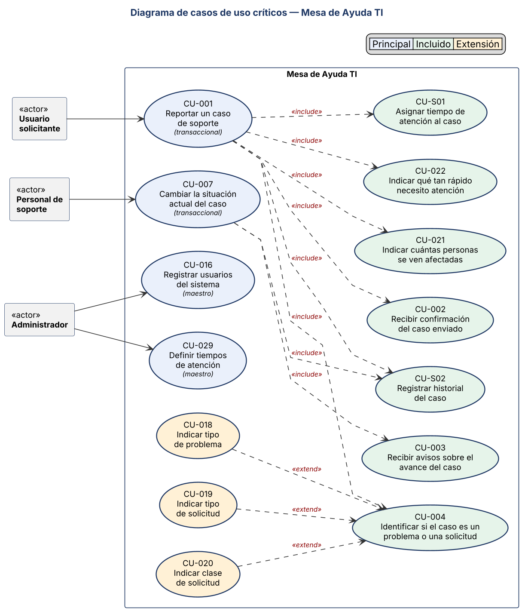
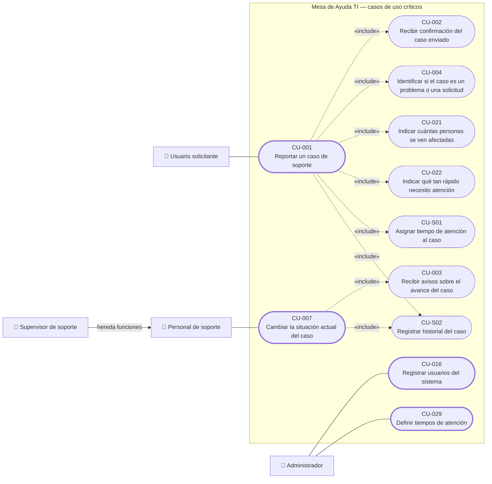

# 3. Casos de Uso

> **Guía de seguimiento:** Fase 1 — actividad *3. Casos de Uso: general COMPLETO + 4 a 6 críticos documentados*.
>
> **Fuente:** documento Word *Proyecto.docx* — «Mesa de Ayuda TI de Nexa Servicios» (F. J. Motta Quintero y E. Vásquez Valencia · Ingeniería de Software II · Docente: Lora Patiño Gloria Amparo · Octubre de 2026), sección 3.

## 3.1 Los casos de uso documentados: cómo los CA se vuelven pasos y flujos

Cada CU se documenta con la plantilla del curso. Los Antecedentes de la HU son la precondición; el CA de éxito dicta el final del flujo básico y la poscondición; cada CA de rechazo es un flujo alternativo que cita su RN.

**Tabla 143**  

*Caso de uso CU-001: Reportar un caso de soporte (procedencia de los criterios de aceptación)*

| **CU-001**                            | **Reportar un caso de soporte**                                                                                                                                                                                                                                                                                                                                                                                                                                                                                                                                                                                                                                                                                                                                                                                                                                                                      | **Procedencia**                                                                                                   |
|---------------------------------------|------------------------------------------------------------------------------------------------------------------------------------------------------------------------------------------------------------------------------------------------------------------------------------------------------------------------------------------------------------------------------------------------------------------------------------------------------------------------------------------------------------------------------------------------------------------------------------------------------------------------------------------------------------------------------------------------------------------------------------------------------------------------------------------------------------------------------------------------------------------------------------------------------|-------------------------------------------------------------------------------------------------------------------|
| **Actor**                             | Usuario solicitante                                                                                                                                                                                                                                                                                                                                                                                                                                                                                                                                                                                                                                                                                                                                                                                                                                                                                  | *El rol de la HU-001*                                                                                             |
| **Precondición**                      | El solicitante ha iniciado sesión.                                                                                                                                                                                                                                                                                                                                                                                                                                                                                                                                                                                                                                                                                                                                                                                                                                                                   | *Antecedentes de la HU-001*                                                                                       |
| **Flujo básico (Evento / Respuesta)** | **1.** El solicitante solicita reportar un caso. ▸ El sistema presenta el formulario con un ejemplo junto a cada pregunta (MK-02, RF-02). **2.** El solicitante indica qué necesita, dónde ocurre, el tipo de caso, a quiénes afecta, qué tan urgente es (el contacto es el registrado en su usuario); opcionalmente elige un equipo o programa. ▸ El sistema recibe los datos («include» CU-004, CU-021 y CU-022). **3.** — ▸ El sistema verifica que estén los datos obligatorios (RN-01). **4.** — ▸ El sistema calcula la importancia («include» CU-022, RN-05) y asigna el tiempo de atención vigente («include» CU-S01, RN-13). **5.** — ▸ El sistema registra el caso en situación «recibido», genera el número MA-AAAA-NNNNNN único (RN-02) y guarda la fecha y hora de creación. **6.** — ▸ El sistema guarda el historial («include» CU-S02) y muestra la confirmación («include» CU-002). | *Último paso: ES el CA-1 (RF-01, RF-02).* *Los pasos intermedios preparan las validaciones de los CA de rechazo.* |
| **Flujo alternativo 3a**              | 3a. Falta un dato obligatorio: el sistema no registra y señala el campo con su mensaje. Vuelve al paso 2. (Valida la RN-01)                                                                                                                                                                                                                                                                                                                                                                                                                                                                                                                                                                                                                                                                                                                                                                          | *ES el CA-2*                                                                                                      |
| **Flujo alternativo 2a**              | 2a. No se seleccionó equipo o programa: el caso se registra igual, sin activo asociado. (RN-25)                                                                                                                                                                                                                                                                                                                                                                                                                                                                                                                                                                                                                                                                                                                                                                                                      | *ES el CA-3*                                                                                                      |
| **Flujo alternativo 1a**              | 1a. Quien intenta reportar no es un usuario registrado o no ha iniciado sesión: el sistema no registra el caso y lo lleva a iniciar sesión (MK-01). (RN-23)                                                                                                                                                                                                                                                                                                                                                                                                                                                                                                                                                                                                                                                                                                                                          | *ES el CA-5*                                                                                                      |
| **Poscondición**                      | El caso queda registrado en situación «recibido» con número de seguimiento único, con o sin activo asociado.                                                                                                                                                                                                                                                                                                                                                                                                                                                                                                                                                                                                                                                                                                                                                                                         | *CA-1*                                                                                                            |

> **🔗 Trazabilidad de CU-001**
>
> | Relación | Elementos | Fuente en el documento |
> |---|---|---|
> | Actor | Usuario solicitante | Ficha del CU |
> | Nace de (HU) | [HU-001](1-historias-de-usuario.md#hu-001) | Procedencia («El rol de la HU») |
> | Criterios de aceptación que implementa | [HU-001 CA-1](1-historias-de-usuario.md#hu-001-ca-1), [HU-001 CA-2](1-historias-de-usuario.md#hu-001-ca-2), [HU-001 CA-3](1-historias-de-usuario.md#hu-001-ca-3), [HU-001 CA-5](1-historias-de-usuario.md#hu-001-ca-5) | Procedencia («ES el CA») |
> | RF que implementa | [RF-01](2-reglas-de-negocio-y-requisitos.md#rf-01), [RF-02](2-reglas-de-negocio-y-requisitos.md#rf-02) | Cobertura §4.4 |
> | RN que aplica | [RN-01](2-reglas-de-negocio-y-requisitos.md#rn-01), [RN-02](2-reglas-de-negocio-y-requisitos.md#rn-02), [RN-05](2-reglas-de-negocio-y-requisitos.md#rn-05), [RN-13](2-reglas-de-negocio-y-requisitos.md#rn-13), [RN-23](2-reglas-de-negocio-y-requisitos.md#rn-23), [RN-25](2-reglas-de-negocio-y-requisitos.md#rn-25) | Flujos del CU |
> | Mockups | [MK-01](4-mockups.md#mk-01), [MK-02](4-mockups.md#mk-02) | Cobertura §4.4 y flujos del CU |
> | «include» | [CU-002](#cu-002), [CU-004](#cu-004), [CU-021](#cu-021), [CU-022](#cu-022), [CU-S01](#cu-s01), [CU-S02](#cu-s02) | Flujos del CU |
> | Aparece en la cadena de | [HU-001](1-historias-de-usuario.md#hu-001), [HU-004](1-historias-de-usuario.md#hu-004) | Matriz §5 |
> | Tablas de la base de datos | [`caso_soporte`](../fase_3/13-script-sql-ddl.md#tabla-caso-soporte), [`historial_caso`](../fase_3/13-script-sql-ddl.md#tabla-historial-caso), [`tiempo_atencion_sla`](../fase_3/13-script-sql-ddl.md#tabla-tiempo-atencion-sla), [`activo`](../fase_3/13-script-sql-ddl.md#tabla-activo) | Matriz §14 → tabla (Tabla 246) → DDL |
> | Tablas que usa su diagrama de secuencia | [`caso_soporte`](../fase_3/13-script-sql-ddl.md#tabla-caso-soporte) (`CasoSoporte.crearCaso()`); [`historial_caso`](../fase_3/13-script-sql-ddl.md#tabla-historial-caso) (`HistorialCaso.registrarHistorial()`); [`tiempo_atencion_sla`](../fase_3/13-script-sql-ddl.md#tabla-tiempo-atencion-sla) (`TiempoAtencionSLA.obtenerSLA()`); [`activo`](../fase_3/13-script-sql-ddl.md#tabla-activo) (`Activo.obtenerActivo()`); [`tabla_importancia`](../fase_3/13-script-sql-ddl.md#tabla-tabla-importancia) (`TablaImportancia.calcularResultadoImportancia()`) | Mensajes de secuencia (§14) → clase → tabla |
> | Caso de uso crítico | [Ficha de CU crítico (§3.2.3)](#cu-001-critico) · [Diagrama de actividades](../fase_2/8-diagrama-de-actividades.md#act-cu-001) · [Diagrama de secuencia](../fase_2/10-diagramas-de-secuencia.md#seq-cu-001) | §3.2, §10, §12 |

**Tabla 144**  

*Caso de uso CU-002: Recibir confirmación del caso enviado (procedencia de los criterios de aceptación)*

| **CU-002**                            | **Recibir confirmación del caso enviado**                                                                                                                                                                                                                                            | **Procedencia**                                                                                            |
|---------------------------------------|--------------------------------------------------------------------------------------------------------------------------------------------------------------------------------------------------------------------------------------------------------------------------------------|------------------------------------------------------------------------------------------------------------|
| **Actor**                             | Usuario solicitante (la dispara CU-001)                                                                                                                                                                                                                                              | *El rol de la HU-002*                                                                                      |
| **Precondición**                      | El solicitante ha enviado un caso válido.                                                                                                                                                                                                                                            | *Antecedentes de la HU-002*                                                                                |
| **Flujo básico (Evento / Respuesta)** | **1.** — ▸ El sistema muestra en pantalla el número de seguimiento generado, por ejemplo MA-2026-000145, distinto al de cualquier otro caso (MK-03, RN-02). **2.** — ▸ El sistema envía al correo registrado del solicitante el número de seguimiento y el resumen del caso (RN-16). | *Último paso: ES el CA-1 (RF-03).* *Los pasos intermedios preparan las validaciones de los CA de rechazo.* |
| **Flujo alternativo 2a**              | 2a. Falla el envío del correo: el sistema reintenta automáticamente y el caso permanece registrado con su número. (Valida la RN-16)                                                                                                                                                  | *ES el CA-4*                                                                                               |
| **Flujo alternativo 1a**              | 1a. El correo de contacto tiene un formato no válido: el sistema no registra el caso ni envía la confirmación y pide corregirlo antes de continuar. (RN-17)                                                                                                                          | *ES el CA-5*                                                                                               |
| **Flujo alternativo 2b**              | 2b. El correo no pudo entregarse tras el reintento: el sistema muestra un aviso con el número de seguimiento y las acciones para reintentar. (RN-16)                                                                                                                                 | *ES el CA-6*                                                                                               |
| **Poscondición**                      | El solicitante conoce el número de su caso; el caso sigue registrado sin importar el resultado del correo.                                                                                                                                                                           | *CA-1*                                                                                                     |

> **🔗 Trazabilidad de CU-002**
>
> | Relación | Elementos | Fuente en el documento |
> |---|---|---|
> | Actor | Usuario solicitante (la dispara CU-001) | Ficha del CU |
> | Nace de (HU) | [HU-002](1-historias-de-usuario.md#hu-002) | Procedencia («El rol de la HU») |
> | Criterios de aceptación que implementa | [HU-002 CA-1](1-historias-de-usuario.md#hu-002-ca-1), [HU-002 CA-4](1-historias-de-usuario.md#hu-002-ca-4), [HU-002 CA-5](1-historias-de-usuario.md#hu-002-ca-5), [HU-002 CA-6](1-historias-de-usuario.md#hu-002-ca-6) | Procedencia («ES el CA») |
> | RF que implementa | [RF-03](2-reglas-de-negocio-y-requisitos.md#rf-03) | Cobertura §4.4 |
> | RN que aplica | [RN-02](2-reglas-de-negocio-y-requisitos.md#rn-02), [RN-16](2-reglas-de-negocio-y-requisitos.md#rn-16), [RN-17](2-reglas-de-negocio-y-requisitos.md#rn-17) | Flujos del CU |
> | Mockups | [MK-03](4-mockups.md#mk-03) | Cobertura §4.4 y flujos del CU |
> | Aparece en la cadena de | [HU-002](1-historias-de-usuario.md#hu-002) | Matriz §5 |
> | Tablas de la base de datos | [`caso_soporte`](../fase_3/13-script-sql-ddl.md#tabla-caso-soporte), [`aviso`](../fase_3/13-script-sql-ddl.md#tabla-aviso) | Matriz §14 → tabla (Tabla 246) → DDL |

**Tabla 145**  

*Caso de uso CU-003: Recibir avisos sobre el avance del caso (procedencia de los criterios de aceptación)*

| **CU-003**                            | **Recibir avisos sobre el avance del caso**                                                                                                                                                                                                                                                                                                     | **Procedencia**                                                                                                          |
|---------------------------------------|-------------------------------------------------------------------------------------------------------------------------------------------------------------------------------------------------------------------------------------------------------------------------------------------------------------------------------------------------|--------------------------------------------------------------------------------------------------------------------------|
| **Actor**                             | Usuario solicitante                                                                                                                                                                                                                                                                                                                             | *El rol de la HU-003*                                                                                                    |
| **Precondición**                      | El solicitante tiene un caso registrado.                                                                                                                                                                                                                                                                                                        | *Antecedentes de la HU-003*                                                                                              |
| **Flujo básico (Evento / Respuesta)** | **1.** — ▸ El caso cambia de situación (CU-007, CU-013 o CU-028) y el sistema genera un aviso por correo, aviso emergente y detalle del caso (RN-15). **2.** El solicitante abre el aviso desde el sistema (MK-09). ▸ El sistema muestra el contenido completo del aviso. **3.** — ▸ El sistema registra el aviso como leído, con fecha y hora. | *Último paso: ES el CA-1 (RF-04, RF-05, RF-06).* *Los pasos intermedios preparan las validaciones de los CA de rechazo.* |
| **Flujo alternativo 1a**              | 1a. Falla el envío del aviso por correo: el sistema guarda el motivo del fallo y reintenta automáticamente. (Valida la RN-15)                                                                                                                                                                                                                   | *ES el CA-3*                                                                                                             |
| **Poscondición**                      | Cada cambio de situación queda informado por los tres medios y el aviso leído queda registrado.                                                                                                                                                                                                                                                 | *CA-1*                                                                                                                   |

> **🔗 Trazabilidad de CU-003**
>
> | Relación | Elementos | Fuente en el documento |
> |---|---|---|
> | Actor | Usuario solicitante | Ficha del CU |
> | Nace de (HU) | [HU-003](1-historias-de-usuario.md#hu-003) | Procedencia («El rol de la HU») |
> | Criterios de aceptación que implementa | [HU-003 CA-1](1-historias-de-usuario.md#hu-003-ca-1), [HU-003 CA-3](1-historias-de-usuario.md#hu-003-ca-3) | Procedencia («ES el CA») |
> | RF que implementa | [RF-04](2-reglas-de-negocio-y-requisitos.md#rf-04), [RF-05](2-reglas-de-negocio-y-requisitos.md#rf-05), [RF-06](2-reglas-de-negocio-y-requisitos.md#rf-06) | Cobertura §4.4 |
> | RN que aplica | [RN-15](2-reglas-de-negocio-y-requisitos.md#rn-15) | Flujos del CU |
> | Mockups | [MK-09](4-mockups.md#mk-09) | Cobertura §4.4 y flujos del CU |
> | Aparece en la cadena de | [HU-002](1-historias-de-usuario.md#hu-002), [HU-003](1-historias-de-usuario.md#hu-003), [HU-007](1-historias-de-usuario.md#hu-007) | Matriz §5 |
> | Tablas de la base de datos | [`caso_soporte`](../fase_3/13-script-sql-ddl.md#tabla-caso-soporte), [`historial_caso`](../fase_3/13-script-sql-ddl.md#tabla-historial-caso), [`aviso`](../fase_3/13-script-sql-ddl.md#tabla-aviso), [`transicion_estado_caso`](../fase_3/13-script-sql-ddl.md#tabla-transicion-estado-caso) | Matriz §14 → tabla (Tabla 246) → DDL |

**Tabla 146**  

*Caso de uso CU-004: Identificar si el caso es un problema o una solicitud (procedencia de los criterios de aceptación)*

| **CU-004**                            | **Identificar si el caso es un problema o una solicitud**                                                                                                                                                                                                                                                                                                                                                                                                                                                                  | **Procedencia**                                                                                                   |
|---------------------------------------|----------------------------------------------------------------------------------------------------------------------------------------------------------------------------------------------------------------------------------------------------------------------------------------------------------------------------------------------------------------------------------------------------------------------------------------------------------------------------------------------------------------------------|-------------------------------------------------------------------------------------------------------------------|
| **Actor**                             | Usuario solicitante                                                                                                                                                                                                                                                                                                                                                                                                                                                                                                        | *El rol de la HU-004*                                                                                             |
| **Precondición**                      | El solicitante ha iniciado sesión y está reportando un caso nuevo (CU-001).                                                                                                                                                                                                                                                                                                                                                                                                                                                | *Antecedentes de la HU-004*                                                                                       |
| **Flujo básico (Evento / Respuesta)** | **1.** El solicitante duda entre problema y solicitud. ▸ El sistema muestra ejemplos claros de cada uno (MK-02, RF-02). **2.** El solicitante indica si algo no funciona (problema) o si necesita algo nuevo (solicitud). ▸ El sistema recibe la elección. **3.** — ▸ Si es problema, pide el tipo de problema («extend» CU-018) y no pide la clase de solicitud. Si es solicitud, pide el tipo y la clase («extend» CU-019 y CU-020) y no pide el tipo de problema (RN-03). **4.** — ▸ El sistema guarda el tipo de caso. | *Último paso: ES el CA-1 (RF-02, RF-07).* *Los pasos intermedios preparan las validaciones de los CA de rechazo.* |
| **Flujo alternativo 3a**              | 3a. El solicitante eligió problema e intenta además elegir tipo o clase de solicitud: el formulario no se lo permite. (Valida la RN-03)                                                                                                                                                                                                                                                                                                                                                                                    | *ES el CA-3*                                                                                                      |
| **Poscondición**                      | El caso queda clasificado con datos coherentes con su tipo.                                                                                                                                                                                                                                                                                                                                                                                                                                                                | *CA-1*                                                                                                            |

> **🔗 Trazabilidad de CU-004**
>
> | Relación | Elementos | Fuente en el documento |
> |---|---|---|
> | Actor | Usuario solicitante | Ficha del CU |
> | Nace de (HU) | [HU-004](1-historias-de-usuario.md#hu-004) | Procedencia («El rol de la HU») |
> | Criterios de aceptación que implementa | [HU-004 CA-1](1-historias-de-usuario.md#hu-004-ca-1), [HU-004 CA-3](1-historias-de-usuario.md#hu-004-ca-3) | Procedencia («ES el CA») |
> | RF que implementa | [RF-02](2-reglas-de-negocio-y-requisitos.md#rf-02), [RF-07](2-reglas-de-negocio-y-requisitos.md#rf-07) | Cobertura §4.4 |
> | RN que aplica | [RN-03](2-reglas-de-negocio-y-requisitos.md#rn-03) | Flujos del CU |
> | Mockups | [MK-02](4-mockups.md#mk-02) | Cobertura §4.4 y flujos del CU |
> | Aparece en la cadena de | [HU-001](1-historias-de-usuario.md#hu-001), [HU-004](1-historias-de-usuario.md#hu-004) | Matriz §5 |
> | Tablas de la base de datos | [`caso_soporte`](../fase_3/13-script-sql-ddl.md#tabla-caso-soporte), [`historial_caso`](../fase_3/13-script-sql-ddl.md#tabla-historial-caso), [`tiempo_atencion_sla`](../fase_3/13-script-sql-ddl.md#tabla-tiempo-atencion-sla), [`activo`](../fase_3/13-script-sql-ddl.md#tabla-activo) | Matriz §14 → tabla (Tabla 246) → DDL |

**Tabla 147**  

*Caso de uso CU-005: Consultar casos anteriores (procedencia de los criterios de aceptación)*

| **CU-005**                            | **Consultar casos anteriores**                                                                                                                                                                                                                                              | **Procedencia**                                                                                                   |
|---------------------------------------|-----------------------------------------------------------------------------------------------------------------------------------------------------------------------------------------------------------------------------------------------------------------------------|-------------------------------------------------------------------------------------------------------------------|
| **Actor**                             | Usuario solicitante                                                                                                                                                                                                                                                         | *El rol de la HU-005*                                                                                             |
| **Precondición**                      | El solicitante ha iniciado sesión.                                                                                                                                                                                                                                          | *Antecedentes de la HU-005*                                                                                       |
| **Flujo básico (Evento / Respuesta)** | **1.** El solicitante accede a Mis casos. ▸ El sistema lista únicamente sus casos, del más reciente al más antiguo (MK-04, RN-06). **2.** El solicitante busca por fecha, situación, tipo o palabra clave. ▸ El sistema muestra únicamente los casos que cumplen el filtro. | *Último paso: ES el CA-1 (RF-09, RF-10).* *Los pasos intermedios preparan las validaciones de los CA de rechazo.* |
| **Flujo alternativo 2a**              | 2a. Ningún caso coincide: el sistema informa que no encontró casos, sin mostrar registros que no correspondan.                                                                                                                                                              | *ES el CA-4*                                                                                                      |
| **Poscondición**                      | Ninguna modificación: la consulta no cambia datos.                                                                                                                                                                                                                          | *CA-1*                                                                                                            |

> **🔗 Trazabilidad de CU-005**
>
> | Relación | Elementos | Fuente en el documento |
> |---|---|---|
> | Actor | Usuario solicitante | Ficha del CU |
> | Nace de (HU) | [HU-005](1-historias-de-usuario.md#hu-005) | Procedencia («El rol de la HU») |
> | Criterios de aceptación que implementa | [HU-005 CA-1](1-historias-de-usuario.md#hu-005-ca-1), [HU-005 CA-4](1-historias-de-usuario.md#hu-005-ca-4) | Procedencia («ES el CA») |
> | RF que implementa | [RF-09](2-reglas-de-negocio-y-requisitos.md#rf-09), [RF-10](2-reglas-de-negocio-y-requisitos.md#rf-10) | Cobertura §4.4 |
> | RN que aplica | [RN-06](2-reglas-de-negocio-y-requisitos.md#rn-06) | Flujos del CU |
> | Mockups | [MK-04](4-mockups.md#mk-04) | Cobertura §4.4 y flujos del CU |
> | Aparece en la cadena de | [HU-005](1-historias-de-usuario.md#hu-005) | Matriz §5 |
> | Tablas de la base de datos | [`caso_soporte`](../fase_3/13-script-sql-ddl.md#tabla-caso-soporte) | Matriz §14 → tabla (Tabla 246) → DDL |

**Tabla 148**  

*Caso de uso CU-006: Revisar casos pendientes (procedencia de los criterios de aceptación)*

| **CU-006**                            | **Revisar casos pendientes**                                                                                                                                                                                                                                                           | **Procedencia**                                                                                            |
|---------------------------------------|----------------------------------------------------------------------------------------------------------------------------------------------------------------------------------------------------------------------------------------------------------------------------------------|------------------------------------------------------------------------------------------------------------|
| **Actor**                             | Personal de soporte                                                                                                                                                                                                                                                                    | *El rol de la HU-006*                                                                                      |
| **Precondición**                      | El técnico ha iniciado sesión como personal de soporte.                                                                                                                                                                                                                                | *Antecedentes de la HU-006*                                                                                |
| **Flujo básico (Evento / Respuesta)** | **1.** El técnico abre la pantalla de casos pendientes. ▸ El sistema lista los casos no cerrados con número, situación e importancia (MK-07). **2.** El técnico ordena por importancia, fecha o tipo de problema. ▸ El sistema reordena la lista; P1 es la prioridad más alta (RN-05). | *Último paso: ES el CA-1 (RF-11).* *Los pasos intermedios preparan las validaciones de los CA de rechazo.* |
| **Flujo alternativo 1a**              | 1a. Todos los casos están cerrados: el sistema indica claramente que no hay casos pendientes.                                                                                                                                                                                          | *ES el CA-4*                                                                                               |
| **Flujo alternativo 1b**              | 1b. Un usuario con perfil solicitante intenta abrir la pantalla de casos pendientes: el sistema no se lo permite. (Valida la RN-23)                                                                                                                                                    | *ES el CA-5*                                                                                               |
| **Poscondición**                      | Ninguna modificación: la consulta no cambia datos.                                                                                                                                                                                                                                     | *CA-1*                                                                                                     |

> **🔗 Trazabilidad de CU-006**
>
> | Relación | Elementos | Fuente en el documento |
> |---|---|---|
> | Actor | Personal de soporte | Ficha del CU |
> | Nace de (HU) | [HU-006](1-historias-de-usuario.md#hu-006) | Procedencia («El rol de la HU») |
> | Criterios de aceptación que implementa | [HU-006 CA-1](1-historias-de-usuario.md#hu-006-ca-1), [HU-006 CA-4](1-historias-de-usuario.md#hu-006-ca-4), [HU-006 CA-5](1-historias-de-usuario.md#hu-006-ca-5) | Procedencia («ES el CA») |
> | RF que implementa | [RF-11](2-reglas-de-negocio-y-requisitos.md#rf-11) | Cobertura §4.4 |
> | RN que aplica | [RN-05](2-reglas-de-negocio-y-requisitos.md#rn-05), [RN-23](2-reglas-de-negocio-y-requisitos.md#rn-23) | Flujos del CU |
> | Mockups | [MK-07](4-mockups.md#mk-07) | Cobertura §4.4 y flujos del CU |
> | Aparece en la cadena de | [HU-006](1-historias-de-usuario.md#hu-006) | Matriz §5 |
> | Tablas de la base de datos | [`caso_soporte`](../fase_3/13-script-sql-ddl.md#tabla-caso-soporte), [`tabla_importancia`](../fase_3/13-script-sql-ddl.md#tabla-tabla-importancia) | Matriz §14 → tabla (Tabla 246) → DDL |

**Tabla 149**  

*Caso de uso CU-007: Cambiar la situación actual del caso (procedencia de los criterios de aceptación)*

| **CU-007**                            | **Cambiar la situación actual del caso**                                                                                                                                                                                                                                                                                                                                                                                                                                                                                                                                       | **Procedencia**                                                                                                                                     |
|---------------------------------------|--------------------------------------------------------------------------------------------------------------------------------------------------------------------------------------------------------------------------------------------------------------------------------------------------------------------------------------------------------------------------------------------------------------------------------------------------------------------------------------------------------------------------------------------------------------------------------|-----------------------------------------------------------------------------------------------------------------------------------------------------|
| **Actor**                             | Personal de soporte                                                                                                                                                                                                                                                                                                                                                                                                                                                                                                                                                            | *El rol de la HU-007*                                                                                                                               |
| **Precondición**                      | El técnico ha iniciado sesión y el caso existe.                                                                                                                                                                                                                                                                                                                                                                                                                                                                                                                                | *Antecedentes de la HU-007*                                                                                                                         |
| **Flujo básico (Evento / Respuesta)** | **1.** El técnico abre el caso (MK-06) y elige la nueva situación. ▸ El sistema verifica que la transición esté permitida para su perfil (RN-07, RN-23). **2.** — ▸ El sistema actualiza la situación y, si es «resuelto», guarda la fecha de solución; si el caso pasa por primera vez a «en revisión», registra la fecha y hora como primera respuesta (RF-50, RN-14). **3.** — ▸ El sistema guarda quién y cuándo hizo el cambio («include» CU-S02, RN-08) y avisa al solicitante («include» CU-003). **4.** — ▸ El solicitante ve la nueva situación al consultar su caso. | *Último paso: ES el CA-1 (RF-12); la primera respuesta es el CA-5 (RF-50).* *Los pasos intermedios preparan las validaciones de los CA de rechazo.* |
| **Flujo alternativo 1a**              | 1a. La transición no está permitida (por ejemplo, de recibido a cerrado): el sistema rechaza, explica el motivo y conserva la situación. (Valida la RN-07)                                                                                                                                                                                                                                                                                                                                                                                                                     | *ES el CA-2*                                                                                                                                        |
| **Flujo alternativo 1b**              | 1b. Un usuario con perfil solicitante intenta cambiar la situación: el sistema lo impide y conserva la anterior. (Valida la RN-23)                                                                                                                                                                                                                                                                                                                                                                                                                                             | *ES el CA-3*                                                                                                                                        |
| **Poscondición**                      | La situación queda actualizada, con historial del cambio y aviso al solicitante.                                                                                                                                                                                                                                                                                                                                                                                                                                                                                               | *CA-1*                                                                                                                                              |

> **🔗 Trazabilidad de CU-007**
>
> | Relación | Elementos | Fuente en el documento |
> |---|---|---|
> | Actor | Personal de soporte | Ficha del CU |
> | Nace de (HU) | [HU-007](1-historias-de-usuario.md#hu-007) | Procedencia («El rol de la HU») |
> | Criterios de aceptación que implementa | [HU-007 CA-1](1-historias-de-usuario.md#hu-007-ca-1), [HU-007 CA-2](1-historias-de-usuario.md#hu-007-ca-2), [HU-007 CA-3](1-historias-de-usuario.md#hu-007-ca-3) | Procedencia («ES el CA») |
> | RF que implementa | [RF-12](2-reglas-de-negocio-y-requisitos.md#rf-12), [RF-50](2-reglas-de-negocio-y-requisitos.md#rf-50) | Cobertura §4.4 |
> | RN que aplica | [RN-07](2-reglas-de-negocio-y-requisitos.md#rn-07), [RN-08](2-reglas-de-negocio-y-requisitos.md#rn-08), [RN-14](2-reglas-de-negocio-y-requisitos.md#rn-14), [RN-23](2-reglas-de-negocio-y-requisitos.md#rn-23) | Flujos del CU |
> | Mockups | [MK-06](4-mockups.md#mk-06) | Cobertura §4.4 y flujos del CU |
> | «include» | [CU-003](#cu-003), [CU-S02](#cu-s02) | Flujos del CU |
> | Aparece en la cadena de | [HU-007](1-historias-de-usuario.md#hu-007) | Matriz §5 |
> | Tablas de la base de datos | [`caso_soporte`](../fase_3/13-script-sql-ddl.md#tabla-caso-soporte), [`historial_caso`](../fase_3/13-script-sql-ddl.md#tabla-historial-caso), [`transicion_estado_caso`](../fase_3/13-script-sql-ddl.md#tabla-transicion-estado-caso) | Matriz §14 → tabla (Tabla 246) → DDL |
> | Tablas que usa su diagrama de secuencia | [`caso_soporte`](../fase_3/13-script-sql-ddl.md#tabla-caso-soporte) (`CasoSoporte.actualizarCaso()`, `CasoSoporte.marcarSolucionado()`, `CasoSoporte.registrarPrimeraRespuesta()`); [`historial_caso`](../fase_3/13-script-sql-ddl.md#tabla-historial-caso) (`HistorialCaso.registrarHistorial()`); [`aviso`](../fase_3/13-script-sql-ddl.md#tabla-aviso) (`Aviso.crearAviso()`); [`transicion_estado_caso`](../fase_3/13-script-sql-ddl.md#tabla-transicion-estado-caso) (`TransicionEstadoCaso.esTransicionValida()`) | Mensajes de secuencia (§14) → clase → tabla |
> | Caso de uso crítico | [Ficha de CU crítico (§3.2.3)](#cu-007-critico) · [Diagrama de actividades](../fase_2/8-diagrama-de-actividades.md#act-cu-007) · [Diagrama de secuencia](../fase_2/10-diagramas-de-secuencia.md#seq-cu-007) | §3.2, §10, §12 |

**Tabla 150**  

*Caso de uso CU-008: Asignar una persona encargada del caso (procedencia de los criterios de aceptación)*

| **CU-008**                            | **Asignar una persona encargada del caso**                                                                                                                                                                                                                                                                            | **Procedencia**                                                                                            |
|---------------------------------------|-----------------------------------------------------------------------------------------------------------------------------------------------------------------------------------------------------------------------------------------------------------------------------------------------------------------------|------------------------------------------------------------------------------------------------------------|
| **Actor**                             | Personal de soporte (supervisor)                                                                                                                                                                                                                                                                                      | *El rol de la HU-008*                                                                                      |
| **Precondición**                      | El supervisor ha iniciado sesión y el caso existe.                                                                                                                                                                                                                                                                    | *Antecedentes de la HU-008*                                                                                |
| **Flujo básico (Evento / Respuesta)** | **1.** El supervisor abre el caso (MK-06) y selecciona a la persona responsable. ▸ El sistema verifica que tenga perfil de soporte (RN-09). **2.** — ▸ El sistema registra a la persona como responsable y guarda en el historial quién asignó, cuándo y quién era el responsable anterior («include» CU-S02, RN-08). | *Último paso: ES el CA-1 (RF-14).* *Los pasos intermedios preparan las validaciones de los CA de rechazo.* |
| **Flujo alternativo 1a**              | 1a. La persona elegida tiene perfil de solicitante: el sistema no permite la asignación. (Valida la RN-09)                                                                                                                                                                                                            | *ES el CA-2*                                                                                               |
| **Poscondición**                      | El caso queda con su nuevo responsable; un caso recién recibido se muestra sin responsable, sin impedir su consulta.                                                                                                                                                                                                  | *CA-1*                                                                                                     |

> **🔗 Trazabilidad de CU-008**
>
> | Relación | Elementos | Fuente en el documento |
> |---|---|---|
> | Actor | Personal de soporte (supervisor) | Ficha del CU |
> | Nace de (HU) | [HU-008](1-historias-de-usuario.md#hu-008) | Procedencia («El rol de la HU») |
> | Criterios de aceptación que implementa | [HU-008 CA-1](1-historias-de-usuario.md#hu-008-ca-1), [HU-008 CA-2](1-historias-de-usuario.md#hu-008-ca-2) | Procedencia («ES el CA») |
> | RF que implementa | [RF-14](2-reglas-de-negocio-y-requisitos.md#rf-14) | Cobertura §4.4 |
> | RN que aplica | [RN-08](2-reglas-de-negocio-y-requisitos.md#rn-08), [RN-09](2-reglas-de-negocio-y-requisitos.md#rn-09) | Flujos del CU |
> | Mockups | [MK-06](4-mockups.md#mk-06) | Cobertura §4.4 y flujos del CU |
> | «include» | [CU-S02](#cu-s02) | Flujos del CU |
> | Aparece en la cadena de | [HU-008](1-historias-de-usuario.md#hu-008) | Matriz §5 |
> | Tablas de la base de datos | [`caso_soporte`](../fase_3/13-script-sql-ddl.md#tabla-caso-soporte), [`historial_caso`](../fase_3/13-script-sql-ddl.md#tabla-historial-caso) | Matriz §14 → tabla (Tabla 246) → DDL |

**Tabla 151**  

*Caso de uso CU-009: Agregar comentarios al caso (procedencia de los criterios de aceptación)*

| **CU-009**                            | **Agregar comentarios al caso**                                                                                                                                                                                                                                                                                                                                                                                        | **Procedencia**                                                                                                   |
|---------------------------------------|------------------------------------------------------------------------------------------------------------------------------------------------------------------------------------------------------------------------------------------------------------------------------------------------------------------------------------------------------------------------------------------------------------------------|-------------------------------------------------------------------------------------------------------------------|
| **Actor**                             | Personal de soporte                                                                                                                                                                                                                                                                                                                                                                                                    | *El rol de la HU-009*                                                                                             |
| **Precondición**                      | El técnico ha iniciado sesión y atiende el caso.                                                                                                                                                                                                                                                                                                                                                                       | *Antecedentes de la HU-009*                                                                                       |
| **Flujo básico (Evento / Respuesta)** | **1.** El técnico escribe el comentario y lo marca visible o interno (MK-06). ▸ El sistema recibe el comentario. **2.** — ▸ El sistema verifica que no esté vacío (RN-10). **3.** — ▸ El sistema guarda el comentario con su autor y fecha. **4.** El técnico o el solicitante abre el hilo del caso (MK-05, MK-06). ▸ El sistema muestra todos los comentarios al técnico y solo los visibles al solicitante (RN-10). | *Último paso: ES el CA-1 (RF-16, RF-17).* *Los pasos intermedios preparan las validaciones de los CA de rechazo.* |
| **Flujo alternativo 2a**              | 2a. El comentario está vacío: el sistema no lo registra. (Valida la RN-10)                                                                                                                                                                                                                                                                                                                                             | *ES el CA-3*                                                                                                      |
| **Poscondición**                      | El comentario queda guardado y visible según su visibilidad.                                                                                                                                                                                                                                                                                                                                                           | *CA-1*                                                                                                            |

> **🔗 Trazabilidad de CU-009**
>
> | Relación | Elementos | Fuente en el documento |
> |---|---|---|
> | Actor | Personal de soporte | Ficha del CU |
> | Nace de (HU) | [HU-009](1-historias-de-usuario.md#hu-009) | Procedencia («El rol de la HU») |
> | Criterios de aceptación que implementa | [HU-009 CA-1](1-historias-de-usuario.md#hu-009-ca-1), [HU-009 CA-3](1-historias-de-usuario.md#hu-009-ca-3) | Procedencia («ES el CA») |
> | RF que implementa | [RF-16](2-reglas-de-negocio-y-requisitos.md#rf-16), [RF-17](2-reglas-de-negocio-y-requisitos.md#rf-17) | Cobertura §4.4 |
> | RN que aplica | [RN-10](2-reglas-de-negocio-y-requisitos.md#rn-10) | Flujos del CU |
> | Mockups | [MK-05](4-mockups.md#mk-05), [MK-06](4-mockups.md#mk-06) | Cobertura §4.4 y flujos del CU |
> | Aparece en la cadena de | [HU-009](1-historias-de-usuario.md#hu-009) | Matriz §5 |
> | Tablas de la base de datos | [`comentario_caso`](../fase_3/13-script-sql-ddl.md#tabla-comentario-caso) | Matriz §14 → tabla (Tabla 246) → DDL |

**Tabla 152**  

*Caso de uso CU-010: Ver tiempo aproximado de atención (procedencia de los criterios de aceptación)*

| **CU-010**                            | **Ver tiempo aproximado de atención**                                                                                                                                                                                                                                                | **Procedencia**                                                                                            |
|---------------------------------------|--------------------------------------------------------------------------------------------------------------------------------------------------------------------------------------------------------------------------------------------------------------------------------------|------------------------------------------------------------------------------------------------------------|
| **Actor**                             | Usuario solicitante                                                                                                                                                                                                                                                                  | *El rol de la HU-010*                                                                                      |
| **Precondición**                      | El solicitante ha iniciado sesión y tiene un caso registrado.                                                                                                                                                                                                                        | *Antecedentes de la HU-010*                                                                                |
| **Flujo básico (Evento / Respuesta)** | **1.** El solicitante abre el detalle de su caso (MK-05). ▸ El sistema muestra los tiempos máximos de respuesta y de solución de la regla vigente al crear el caso (RN-13). **2.** — ▸ Si ya hubo primera respuesta, el sistema indica si se dio dentro del tiempo definido (RN-14). | *Último paso: ES el CA-1 (RF-13).* *Los pasos intermedios preparan las validaciones de los CA de rechazo.* |
| **Flujo alternativo 1a**              | 1a. La regla se modificó después de crear el caso: el sistema sigue mostrando la regla vigente cuando se creó. (Valida la RN-13)                                                                                                                                                     | *ES el CA-2*                                                                                               |
| **Flujo alternativo 1b**              | 1b. El solicitante intenta consultar los tiempos de un caso que no es suyo: el sistema no se los muestra. (Valida la RN-06)                                                                                                                                                          | *ES el CA-4*                                                                                               |
| **Poscondición**                      | Ninguna modificación: la consulta no cambia datos.                                                                                                                                                                                                                                   | *CA-1*                                                                                                     |

> **🔗 Trazabilidad de CU-010**
>
> | Relación | Elementos | Fuente en el documento |
> |---|---|---|
> | Actor | Usuario solicitante | Ficha del CU |
> | Nace de (HU) | [HU-010](1-historias-de-usuario.md#hu-010) | Procedencia («El rol de la HU») |
> | Criterios de aceptación que implementa | [HU-010 CA-1](1-historias-de-usuario.md#hu-010-ca-1), [HU-010 CA-2](1-historias-de-usuario.md#hu-010-ca-2), [HU-010 CA-4](1-historias-de-usuario.md#hu-010-ca-4) | Procedencia («ES el CA») |
> | RF que implementa | [RF-13](2-reglas-de-negocio-y-requisitos.md#rf-13) | Cobertura §4.4 |
> | RN que aplica | [RN-06](2-reglas-de-negocio-y-requisitos.md#rn-06), [RN-13](2-reglas-de-negocio-y-requisitos.md#rn-13), [RN-14](2-reglas-de-negocio-y-requisitos.md#rn-14) | Flujos del CU |
> | Mockups | [MK-05](4-mockups.md#mk-05) | Cobertura §4.4 y flujos del CU |
> | Aparece en la cadena de | [HU-007](1-historias-de-usuario.md#hu-007), [HU-010](1-historias-de-usuario.md#hu-010) | Matriz §5 |
> | Tablas de la base de datos | [`caso_soporte`](../fase_3/13-script-sql-ddl.md#tabla-caso-soporte), [`historial_caso`](../fase_3/13-script-sql-ddl.md#tabla-historial-caso), [`tiempo_atencion_sla`](../fase_3/13-script-sql-ddl.md#tabla-tiempo-atencion-sla), [`transicion_estado_caso`](../fase_3/13-script-sql-ddl.md#tabla-transicion-estado-caso) | Matriz §14 → tabla (Tabla 246) → DDL |

**Tabla 153**  

*Caso de uso CU-011: Revisar resumen general de atención (procedencia de los criterios de aceptación)*

| **CU-011**                            | **Revisar resumen general de atención**                                                                                                                                                                                                                                | **Procedencia**                                                                                            |
|---------------------------------------|------------------------------------------------------------------------------------------------------------------------------------------------------------------------------------------------------------------------------------------------------------------------|------------------------------------------------------------------------------------------------------------|
| **Actor**                             | Supervisor de soporte                                                                                                                                                                                                                                                  | *El rol de la HU-011*                                                                                      |
| **Precondición**                      | El supervisor ha iniciado sesión.                                                                                                                                                                                                                                      | *Antecedentes de la HU-011*                                                                                |
| **Flujo básico (Evento / Respuesta)** | **1.** El supervisor abre el resumen general de atención (MK-10). ▸ El sistema muestra la cantidad de casos recibidos, en atención, resueltos y cerrados. **2.** — ▸ El sistema muestra cuántos casos cumplen el tiempo de atención y cuántos están atrasados (RN-14). | *Último paso: ES el CA-1 (RF-21).* *Los pasos intermedios preparan las validaciones de los CA de rechazo.* |
| **Flujo alternativo 1a**              | 1a. No hay casos en el periodo: el sistema lo indica claramente. (Valida la RN-29)                                                                                                                                                                                     | *ES el CA-4*                                                                                               |
| **Poscondición**                      | Ninguna modificación: la consulta no cambia datos.                                                                                                                                                                                                                     | *CA-1*                                                                                                     |

> **🔗 Trazabilidad de CU-011**
>
> | Relación | Elementos | Fuente en el documento |
> |---|---|---|
> | Actor | Supervisor de soporte | Ficha del CU |
> | Nace de (HU) | [HU-011](1-historias-de-usuario.md#hu-011) | Procedencia («El rol de la HU») |
> | Criterios de aceptación que implementa | [HU-011 CA-1](1-historias-de-usuario.md#hu-011-ca-1), [HU-011 CA-4](1-historias-de-usuario.md#hu-011-ca-4) | Procedencia («ES el CA») |
> | RF que implementa | [RF-21](2-reglas-de-negocio-y-requisitos.md#rf-21) | Cobertura §4.4 |
> | RN que aplica | [RN-14](2-reglas-de-negocio-y-requisitos.md#rn-14), [RN-29](2-reglas-de-negocio-y-requisitos.md#rn-29) | Flujos del CU |
> | Mockups | [MK-10](4-mockups.md#mk-10) | Cobertura §4.4 y flujos del CU |
> | Aparece en la cadena de | [HU-011](1-historias-de-usuario.md#hu-011) | Matriz §5 |
> | Tablas de la base de datos | [`caso_soporte`](../fase_3/13-script-sql-ddl.md#tabla-caso-soporte) | Matriz §14 → tabla (Tabla 246) → DDL |

**Tabla 154**  

*Caso de uso CU-012: Revisar resumen por periodo (procedencia de los criterios de aceptación)*

| **CU-012**                            | **Revisar resumen por periodo**                                                                                                                                 | **Procedencia**                                                                                            |
|---------------------------------------|-----------------------------------------------------------------------------------------------------------------------------------------------------------------|------------------------------------------------------------------------------------------------------------|
| **Actor**                             | Supervisor de soporte                                                                                                                                           | *El rol de la HU-012*                                                                                      |
| **Precondición**                      | El supervisor ha iniciado sesión.                                                                                                                               | *Antecedentes de la HU-012*                                                                                |
| **Flujo básico (Evento / Respuesta)** | **1.** El supervisor elige el periodo: hoy, esta semana, este mes o un rango de fechas (MK-10). ▸ El sistema recalcula el resumen con los casos de ese periodo. | *Último paso: ES el CA-1 (RF-22).* *Los pasos intermedios preparan las validaciones de los CA de rechazo.* |
| **Flujo alternativo 1a**              | 1a. El periodo no tiene casos: el sistema lo indica claramente. (Valida la RN-29)                                                                               | *ES el CA-2*                                                                                               |
| **Poscondición**                      | Ninguna modificación: la consulta no cambia datos.                                                                                                              | *CA-1*                                                                                                     |

> **🔗 Trazabilidad de CU-012**
>
> | Relación | Elementos | Fuente en el documento |
> |---|---|---|
> | Actor | Supervisor de soporte | Ficha del CU |
> | Nace de (HU) | [HU-012](1-historias-de-usuario.md#hu-012) | Procedencia («El rol de la HU») |
> | Criterios de aceptación que implementa | [HU-012 CA-1](1-historias-de-usuario.md#hu-012-ca-1), [HU-012 CA-2](1-historias-de-usuario.md#hu-012-ca-2) | Procedencia («ES el CA») |
> | RF que implementa | [RF-22](2-reglas-de-negocio-y-requisitos.md#rf-22) | Cobertura §4.4 |
> | RN que aplica | [RN-29](2-reglas-de-negocio-y-requisitos.md#rn-29) | Flujos del CU |
> | Mockups | [MK-10](4-mockups.md#mk-10) | Cobertura §4.4 y flujos del CU |
> | Aparece en la cadena de | [HU-012](1-historias-de-usuario.md#hu-012) | Matriz §5 |
> | Tablas de la base de datos | [`caso_soporte`](../fase_3/13-script-sql-ddl.md#tabla-caso-soporte) | Matriz §14 → tabla (Tabla 246) → DDL |

**Tabla 155**  

*Caso de uso CU-013: Reabrir un caso (procedencia de los criterios de aceptación)*

| **CU-013**                            | **Reabrir un caso**                                                                                                                                                                                                                                                                                                                                                                                                                                                                                     | **Procedencia**                                                                                            |
|---------------------------------------|---------------------------------------------------------------------------------------------------------------------------------------------------------------------------------------------------------------------------------------------------------------------------------------------------------------------------------------------------------------------------------------------------------------------------------------------------------------------------------------------------------|------------------------------------------------------------------------------------------------------------|
| **Actor**                             | Usuario solicitante                                                                                                                                                                                                                                                                                                                                                                                                                                                                                     | *El rol de la HU-013*                                                                                      |
| **Precondición**                      | El solicitante ha iniciado sesión y tiene un caso resuelto.                                                                                                                                                                                                                                                                                                                                                                                                                                             | *Antecedentes de la HU-013*                                                                                |
| **Flujo básico (Evento / Respuesta)** | **1.** El solicitante selecciona Reabrir en el caso (MK-05). ▸ El sistema solicita el motivo. **2.** El solicitante escribe el motivo y confirma. ▸ El sistema verifica que el caso esté resuelto, dentro de 5 días hábiles y con motivo (RN-11). **3.** — ▸ El sistema reabre el caso con el mismo número, conserva historial, comentarios y adjuntos, suma una reapertura y guarda el motivo. **4.** — ▸ El sistema guarda el historial («include» CU-S02) y avisa al solicitante («include» CU-003). | *Último paso: ES el CA-1 (RF-23).* *Los pasos intermedios preparan las validaciones de los CA de rechazo.* |
| **Flujo alternativo 2a**              | 2a. Pasaron más de 5 días hábiles: el sistema no permite reabrir y explica que el plazo venció. (Valida la RN-11)                                                                                                                                                                                                                                                                                                                                                                                       | *ES el CA-2*                                                                                               |
| **Flujo alternativo 2b**              | 2b. No se escribió motivo: el sistema no permite continuar. (Valida la RN-11)                                                                                                                                                                                                                                                                                                                                                                                                                           | *ES el CA-3*                                                                                               |
| **Flujo alternativo 2c**              | 2c. El caso no está resuelto: el sistema no permite reabrirlo. (Valida la RN-11)                                                                                                                                                                                                                                                                                                                                                                                                                        | *ES el CA-4*                                                                                               |
| **Poscondición**                      | El caso queda reabierto con el mismo número, su historial, comentarios y adjuntos.                                                                                                                                                                                                                                                                                                                                                                                                                      | *CA-1*                                                                                                     |

> **🔗 Trazabilidad de CU-013**
>
> | Relación | Elementos | Fuente en el documento |
> |---|---|---|
> | Actor | Usuario solicitante | Ficha del CU |
> | Nace de (HU) | [HU-013](1-historias-de-usuario.md#hu-013) | Procedencia («El rol de la HU») |
> | Criterios de aceptación que implementa | [HU-013 CA-1](1-historias-de-usuario.md#hu-013-ca-1), [HU-013 CA-2](1-historias-de-usuario.md#hu-013-ca-2), [HU-013 CA-3](1-historias-de-usuario.md#hu-013-ca-3), [HU-013 CA-4](1-historias-de-usuario.md#hu-013-ca-4) | Procedencia («ES el CA») |
> | RF que implementa | [RF-23](2-reglas-de-negocio-y-requisitos.md#rf-23) | Cobertura §4.4 |
> | RN que aplica | [RN-11](2-reglas-de-negocio-y-requisitos.md#rn-11) | Flujos del CU |
> | Mockups | [MK-05](4-mockups.md#mk-05) | Cobertura §4.4 y flujos del CU |
> | «include» | [CU-003](#cu-003), [CU-S02](#cu-s02) | Flujos del CU |
> | Aparece en la cadena de | [HU-013](1-historias-de-usuario.md#hu-013) | Matriz §5 |
> | Tablas de la base de datos | [`caso_soporte`](../fase_3/13-script-sql-ddl.md#tabla-caso-soporte) | Matriz §14 → tabla (Tabla 246) → DDL |

**Tabla 156**  

*Caso de uso CU-015: Consultar información del personal de soporte (procedencia de los criterios de aceptación)*

| **CU-015**                            | **Consultar información del personal de soporte**                                                                                                                                                                                                                | **Procedencia**                                                                                            |
|---------------------------------------|------------------------------------------------------------------------------------------------------------------------------------------------------------------------------------------------------------------------------------------------------------------|------------------------------------------------------------------------------------------------------------|
| **Actor**                             | Supervisor de soporte                                                                                                                                                                                                                                            | *El rol de la HU-015*                                                                                      |
| **Precondición**                      | El supervisor ha iniciado sesión.                                                                                                                                                                                                                                | *Antecedentes de la HU-015*                                                                                |
| **Flujo básico (Evento / Respuesta)** | **1.** El supervisor abre la disponibilidad del personal (MK-11). ▸ El sistema muestra a cada persona de soporte como disponible, ocupado o ausente (RN-28). **2.** El supervisor selecciona a una persona. ▸ El sistema muestra su disponibilidad más reciente. | *Último paso: ES el CA-1 (RF-24).* *Los pasos intermedios preparan las validaciones de los CA de rechazo.* |
| **Flujo alternativo 2a**              | 2a. La persona nunca registró disponibilidad: el sistema indica que no hay información registrada. (Valida la RN-28)                                                                                                                                             | *ES el CA-3*                                                                                               |
| **Poscondición**                      | Ninguna modificación: la consulta no cambia datos.                                                                                                                                                                                                               | *CA-1*                                                                                                     |

> **🔗 Trazabilidad de CU-015**
>
> | Relación | Elementos | Fuente en el documento |
> |---|---|---|
> | Actor | Supervisor de soporte | Ficha del CU |
> | Nace de (HU) | [HU-015](1-historias-de-usuario.md#hu-015) | Procedencia («El rol de la HU») |
> | Criterios de aceptación que implementa | [HU-015 CA-1](1-historias-de-usuario.md#hu-015-ca-1), [HU-015 CA-3](1-historias-de-usuario.md#hu-015-ca-3) | Procedencia («ES el CA») |
> | RF que implementa | [RF-24](2-reglas-de-negocio-y-requisitos.md#rf-24) | Cobertura §4.4 |
> | RN que aplica | [RN-28](2-reglas-de-negocio-y-requisitos.md#rn-28) | Flujos del CU |
> | Mockups | [MK-11](4-mockups.md#mk-11) | Cobertura §4.4 y flujos del CU |
> | Aparece en la cadena de | [HU-015](1-historias-de-usuario.md#hu-015) | Matriz §5 |
> | Tablas de la base de datos | [`info_personal_soporte`](../fase_3/13-script-sql-ddl.md#tabla-info-personal-soporte) | Matriz §14 → tabla (Tabla 246) → DDL |

**Tabla 157**  

*Caso de uso CU-016: Registrar usuarios del sistema (procedencia de los criterios de aceptación)*

| **CU-016**                            | **Registrar usuarios del sistema**                                                                                                                                                                                                                                                                                                                                                                                                                                                                                  | **Procedencia**                                                                                            |
|---------------------------------------|---------------------------------------------------------------------------------------------------------------------------------------------------------------------------------------------------------------------------------------------------------------------------------------------------------------------------------------------------------------------------------------------------------------------------------------------------------------------------------------------------------------------|------------------------------------------------------------------------------------------------------------|
| **Actor**                             | Administrador                                                                                                                                                                                                                                                                                                                                                                                                                                                                                                       | *El rol de la HU-016*                                                                                      |
| **Precondición**                      | El administrador ha iniciado sesión.                                                                                                                                                                                                                                                                                                                                                                                                                                                                                | *Antecedentes de la HU-016*                                                                                |
| **Flujo básico (Evento / Respuesta)** | **1.** El administrador solicita registrar un usuario. ▸ El sistema presenta el formulario (MK-14). **2.** El administrador ingresa nombre, correo, cargo, área, rol organizacional y perfil de acceso. ▸ El sistema recibe los datos. **3.** — ▸ El sistema verifica los datos obligatorios y el área si el perfil es solicitante (RN-18). **4.** — ▸ El sistema verifica que el correo sea único (RN-17). **5.** — ▸ El sistema registra al usuario como activo y guarda su contraseña inicial protegida (RN-19). | *Último paso: ES el CA-1 (RF-26).* *Los pasos intermedios preparan las validaciones de los CA de rechazo.* |
| **Flujo alternativo 3a**              | 3a. Falta nombre, correo o perfil: el sistema no registra y señala el campo con su mensaje. Vuelve al paso 2.                                                                                                                                                                                                                                                                                                                                                                                                       | *ES el CA-3*                                                                                               |
| **Flujo alternativo 3b**              | 3b. Perfil solicitante sin área: el sistema no permite completar el registro. (Valida la RN-18)                                                                                                                                                                                                                                                                                                                                                                                                                     | *ES el CA-4*                                                                                               |
| **Flujo alternativo 4a**              | 4a. El correo ya existe: el sistema no registra y explica que está en uso. (Valida la RN-17)                                                                                                                                                                                                                                                                                                                                                                                                                        | *ES el CA-2*                                                                                               |
| **Poscondición**                      | El usuario queda registrado, activo y con la contraseña protegida.                                                                                                                                                                                                                                                                                                                                                                                                                                                  | *CA-1*                                                                                                     |

> **🔗 Trazabilidad de CU-016**
>
> | Relación | Elementos | Fuente en el documento |
> |---|---|---|
> | Actor | Administrador | Ficha del CU |
> | Nace de (HU) | [HU-016](1-historias-de-usuario.md#hu-016) | Procedencia («El rol de la HU») |
> | Criterios de aceptación que implementa | [HU-016 CA-1](1-historias-de-usuario.md#hu-016-ca-1), [HU-016 CA-2](1-historias-de-usuario.md#hu-016-ca-2), [HU-016 CA-3](1-historias-de-usuario.md#hu-016-ca-3), [HU-016 CA-4](1-historias-de-usuario.md#hu-016-ca-4) | Procedencia («ES el CA») |
> | RF que implementa | [RF-26](2-reglas-de-negocio-y-requisitos.md#rf-26) | Cobertura §4.4 |
> | RN que aplica | [RN-17](2-reglas-de-negocio-y-requisitos.md#rn-17), [RN-18](2-reglas-de-negocio-y-requisitos.md#rn-18), [RN-19](2-reglas-de-negocio-y-requisitos.md#rn-19) | Flujos del CU |
> | Mockups | [MK-14](4-mockups.md#mk-14) | Cobertura §4.4 y flujos del CU |
> | Aparece en la cadena de | [HU-016](1-historias-de-usuario.md#hu-016) | Matriz §5 |
> | Tablas de la base de datos | [`usuario`](../fase_3/13-script-sql-ddl.md#tabla-usuario) | Matriz §14 → tabla (Tabla 246) → DDL |
> | Tablas que usa su diagrama de secuencia | [`usuario`](../fase_3/13-script-sql-ddl.md#tabla-usuario) (`Usuario.crearUsuario()`, `Usuario.encriptarContrasena()`, `Usuario.validarCorreoUnico()`) | Mensajes de secuencia (§14) → clase → tabla |
> | Caso de uso crítico | [Ficha de CU crítico (§3.2.3)](#cu-016-critico) · [Diagrama de actividades](../fase_2/8-diagrama-de-actividades.md#act-cu-016) · [Diagrama de secuencia](../fase_2/10-diagramas-de-secuencia.md#seq-cu-016) | §3.2, §10, §12 |

**Tabla 158**  

*Caso de uso CU-017: Consultar usuarios registrados (procedencia de los criterios de aceptación)*

| **CU-017**                            | **Consultar usuarios registrados**                                                                                                                                                                                     | **Procedencia**                                                                                            |
|---------------------------------------|------------------------------------------------------------------------------------------------------------------------------------------------------------------------------------------------------------------------|------------------------------------------------------------------------------------------------------------|
| **Actor**                             | Personal de soporte                                                                                                                                                                                                    | *El rol de la HU-017*                                                                                      |
| **Precondición**                      | El técnico ha iniciado sesión.                                                                                                                                                                                         | *Antecedentes de la HU-017*                                                                                |
| **Flujo básico (Evento / Respuesta)** | **1.** El técnico abre el listado de usuarios (MK-13). ▸ El sistema muestra nombre, cargo, área y rol de cada usuario. **2.** El técnico busca por nombre o correo. ▸ El sistema muestra a los usuarios que coinciden. | *Último paso: ES el CA-1 (RF-27).* *Los pasos intermedios preparan las validaciones de los CA de rechazo.* |
| **Flujo alternativo 2a**              | 2a. Ningún usuario coincide: el sistema indica que no encontró resultados, sin mostrar registros que no correspondan.                                                                                                  | *ES el CA-3*                                                                                               |
| **Poscondición**                      | Ninguna modificación: la consulta no cambia datos.                                                                                                                                                                     | *CA-1*                                                                                                     |

> **🔗 Trazabilidad de CU-017**
>
> | Relación | Elementos | Fuente en el documento |
> |---|---|---|
> | Actor | Personal de soporte | Ficha del CU |
> | Nace de (HU) | [HU-017](1-historias-de-usuario.md#hu-017) | Procedencia («El rol de la HU») |
> | Criterios de aceptación que implementa | [HU-017 CA-1](1-historias-de-usuario.md#hu-017-ca-1), [HU-017 CA-3](1-historias-de-usuario.md#hu-017-ca-3) | Procedencia («ES el CA») |
> | RF que implementa | [RF-27](2-reglas-de-negocio-y-requisitos.md#rf-27) | Cobertura §4.4 |
> | Mockups | [MK-13](4-mockups.md#mk-13) | Cobertura §4.4 y flujos del CU |
> | Aparece en la cadena de | [HU-017](1-historias-de-usuario.md#hu-017) | Matriz §5 |
> | Tablas de la base de datos | [`usuario`](../fase_3/13-script-sql-ddl.md#tabla-usuario) | Matriz §14 → tabla (Tabla 246) → DDL |

**Tabla 159**  

*Caso de uso CU-018: Indicar tipo de problema (procedencia de los criterios de aceptación)*

| **CU-018**                            | **Indicar tipo de problema**                                                                                                                                                | **Procedencia**                                                                                            |
|---------------------------------------|-----------------------------------------------------------------------------------------------------------------------------------------------------------------------------|------------------------------------------------------------------------------------------------------------|
| **Actor**                             | Usuario solicitante                                                                                                                                                         | *El rol de la HU-018*                                                                                      |
| **Precondición**                      | El solicitante está reportando un problema (CU-004).                                                                                                                        | *Antecedentes de la HU-018*                                                                                |
| **Flujo básico (Evento / Respuesta)** | **1.** — ▸ El sistema muestra solo los tipos de problema activos (MK-02, RN-04). **2.** El solicitante selecciona un tipo de problema. ▸ El sistema asocia el tipo al caso. | *Último paso: ES el CA-1 (RF-31).* *Los pasos intermedios preparan las validaciones de los CA de rechazo.* |
| **Flujo alternativo 2a**              | 2a. El solicitante intenta escribir un tipo que no está en la lista: el sistema no se lo permite. (Valida la RN-04)                                                         | *ES el CA-3*                                                                                               |
| **Poscondición**                      | El caso queda asociado a un tipo de problema activo. «extend» de CU-004.                                                                                                    | *CA-1*                                                                                                     |

> **🔗 Trazabilidad de CU-018**
>
> | Relación | Elementos | Fuente en el documento |
> |---|---|---|
> | Actor | Usuario solicitante | Ficha del CU |
> | Nace de (HU) | [HU-018](1-historias-de-usuario.md#hu-018) | Procedencia («El rol de la HU») |
> | Criterios de aceptación que implementa | [HU-018 CA-1](1-historias-de-usuario.md#hu-018-ca-1), [HU-018 CA-3](1-historias-de-usuario.md#hu-018-ca-3) | Procedencia («ES el CA») |
> | RF que implementa | [RF-31](2-reglas-de-negocio-y-requisitos.md#rf-31) | Cobertura §4.4 |
> | RN que aplica | [RN-04](2-reglas-de-negocio-y-requisitos.md#rn-04) | Flujos del CU |
> | Mockups | [MK-02](4-mockups.md#mk-02) | Cobertura §4.4 y flujos del CU |
> | Aparece en la cadena de | [HU-018](1-historias-de-usuario.md#hu-018) | Matriz §5 |
> | Tablas de la base de datos | [`tipo_problema`](../fase_3/13-script-sql-ddl.md#tabla-tipo-problema) | Matriz §14 → tabla (Tabla 246) → DDL |

**Tabla 160**  

*Caso de uso CU-019: Indicar tipo de solicitud (procedencia de los criterios de aceptación)*

| **CU-019**                            | **Indicar tipo de solicitud**                                                                                                                                                 | **Procedencia**                                                                                            |
|---------------------------------------|-------------------------------------------------------------------------------------------------------------------------------------------------------------------------------|------------------------------------------------------------------------------------------------------------|
| **Actor**                             | Usuario solicitante                                                                                                                                                           | *El rol de la HU-019*                                                                                      |
| **Precondición**                      | El solicitante está haciendo una solicitud (CU-004).                                                                                                                          | *Antecedentes de la HU-019*                                                                                |
| **Flujo básico (Evento / Respuesta)** | **1.** — ▸ El sistema muestra solo los tipos de solicitud activos (MK-02, RN-04). **2.** El solicitante selecciona un tipo de solicitud. ▸ El sistema asocia el tipo al caso. | *Último paso: ES el CA-1 (RF-32).* *Los pasos intermedios preparan las validaciones de los CA de rechazo.* |
| **Flujo alternativo 2a**              | 2a. El solicitante intenta escribir un tipo que no está en la lista: el sistema no se lo permite. (Valida la RN-04)                                                           | *ES el CA-3*                                                                                               |
| **Poscondición**                      | El caso queda asociado a un tipo de solicitud activo. «extend» de CU-004.                                                                                                     | *CA-1*                                                                                                     |

> **🔗 Trazabilidad de CU-019**
>
> | Relación | Elementos | Fuente en el documento |
> |---|---|---|
> | Actor | Usuario solicitante | Ficha del CU |
> | Nace de (HU) | [HU-019](1-historias-de-usuario.md#hu-019) | Procedencia («El rol de la HU») |
> | Criterios de aceptación que implementa | [HU-019 CA-1](1-historias-de-usuario.md#hu-019-ca-1), [HU-019 CA-3](1-historias-de-usuario.md#hu-019-ca-3) | Procedencia («ES el CA») |
> | RF que implementa | [RF-32](2-reglas-de-negocio-y-requisitos.md#rf-32) | Cobertura §4.4 |
> | RN que aplica | [RN-04](2-reglas-de-negocio-y-requisitos.md#rn-04) | Flujos del CU |
> | Mockups | [MK-02](4-mockups.md#mk-02) | Cobertura §4.4 y flujos del CU |
> | Aparece en la cadena de | [HU-019](1-historias-de-usuario.md#hu-019) | Matriz §5 |
> | Tablas de la base de datos | [`tipo_solicitud`](../fase_3/13-script-sql-ddl.md#tabla-tipo-solicitud) | Matriz §14 → tabla (Tabla 246) → DDL |

**Tabla 161**  

*Caso de uso CU-020: Indicar clase de solicitud (procedencia de los criterios de aceptación)*

| **CU-020**                            | **Indicar clase de solicitud**                                                                                                                               | **Procedencia**                                                                                            |
|---------------------------------------|--------------------------------------------------------------------------------------------------------------------------------------------------------------|------------------------------------------------------------------------------------------------------------|
| **Actor**                             | Usuario solicitante                                                                                                                                          | *El rol de la HU-020*                                                                                      |
| **Precondición**                      | El solicitante está registrando una solicitud, no un problema (CU-004).                                                                                      | *Antecedentes de la HU-020*                                                                                |
| **Flujo básico (Evento / Respuesta)** | **1.** — ▸ El sistema muestra las clases nuevo, cambio y consulta (MK-02, RN-03). **2.** El solicitante selecciona la clase. ▸ El sistema la asocia al caso. | *Último paso: ES el CA-1 (RF-33).* *Los pasos intermedios preparan las validaciones de los CA de rechazo.* |
| **Flujo alternativo 2a**              | 2a. No se eligió ninguna clase: el sistema no permite continuar. (Valida la RN-03)                                                                           | *ES el CA-3*                                                                                               |
| **Poscondición**                      | El caso queda asociado a una clase de solicitud. «extend» de CU-004.                                                                                         | *CA-1*                                                                                                     |

> **🔗 Trazabilidad de CU-020**
>
> | Relación | Elementos | Fuente en el documento |
> |---|---|---|
> | Actor | Usuario solicitante | Ficha del CU |
> | Nace de (HU) | [HU-020](1-historias-de-usuario.md#hu-020) | Procedencia («El rol de la HU») |
> | Criterios de aceptación que implementa | [HU-020 CA-1](1-historias-de-usuario.md#hu-020-ca-1), [HU-020 CA-3](1-historias-de-usuario.md#hu-020-ca-3) | Procedencia («ES el CA») |
> | RF que implementa | [RF-33](2-reglas-de-negocio-y-requisitos.md#rf-33) | Cobertura §4.4 |
> | RN que aplica | [RN-03](2-reglas-de-negocio-y-requisitos.md#rn-03) | Flujos del CU |
> | Mockups | [MK-02](4-mockups.md#mk-02) | Cobertura §4.4 y flujos del CU |
> | Aparece en la cadena de | [HU-020](1-historias-de-usuario.md#hu-020) | Matriz §5 |

**Tabla 162**  

*Caso de uso CU-021: Indicar cuántas personas se ven afectadas (procedencia de los criterios de aceptación)*

| **CU-021**                            | **Indicar cuántas personas se ven afectadas**                                                                                                                                                                   | **Procedencia**                                                                                            |
|---------------------------------------|-----------------------------------------------------------------------------------------------------------------------------------------------------------------------------------------------------------------|------------------------------------------------------------------------------------------------------------|
| **Actor**                             | Usuario solicitante                                                                                                                                                                                             | *El rol de la HU-021*                                                                                      |
| **Precondición**                      | El solicitante está registrando un caso (CU-001).                                                                                                                                                               | *Antecedentes de la HU-021*                                                                                |
| **Flujo básico (Evento / Respuesta)** | **1.** — ▸ El sistema ofrece las opciones: solo a mí (usuario), a mi área o a toda la empresa, con un ejemplo (MK-02). **2.** El solicitante selecciona una opción. ▸ El sistema guarda la afectación del caso. | *Último paso: ES el CA-1 (RF-18).* *Los pasos intermedios preparan las validaciones de los CA de rechazo.* |
| **Flujo alternativo 2a**              | 2a. No se indicó a quién afecta: el sistema no permite continuar. (Valida la RN-01)                                                                                                                             | *ES el CA-2*                                                                                               |
| **Poscondición**                      | La afectación queda guardada y se combina con la urgencia en CU-022.                                                                                                                                            | *CA-1*                                                                                                     |

> **🔗 Trazabilidad de CU-021**
>
> | Relación | Elementos | Fuente en el documento |
> |---|---|---|
> | Actor | Usuario solicitante | Ficha del CU |
> | Nace de (HU) | [HU-021](1-historias-de-usuario.md#hu-021) | Procedencia («El rol de la HU») |
> | Criterios de aceptación que implementa | [HU-021 CA-1](1-historias-de-usuario.md#hu-021-ca-1), [HU-021 CA-2](1-historias-de-usuario.md#hu-021-ca-2) | Procedencia («ES el CA») |
> | RF que implementa | [RF-18](2-reglas-de-negocio-y-requisitos.md#rf-18) | Cobertura §4.4 |
> | RN que aplica | [RN-01](2-reglas-de-negocio-y-requisitos.md#rn-01) | Flujos del CU |
> | Mockups | [MK-02](4-mockups.md#mk-02) | Cobertura §4.4 y flujos del CU |
> | Aparece en la cadena de | [HU-001](1-historias-de-usuario.md#hu-001), [HU-021](1-historias-de-usuario.md#hu-021), [HU-022](1-historias-de-usuario.md#hu-022) | Matriz §5 |
> | Tablas de la base de datos | [`caso_soporte`](../fase_3/13-script-sql-ddl.md#tabla-caso-soporte), [`historial_caso`](../fase_3/13-script-sql-ddl.md#tabla-historial-caso), [`tiempo_atencion_sla`](../fase_3/13-script-sql-ddl.md#tabla-tiempo-atencion-sla), [`activo`](../fase_3/13-script-sql-ddl.md#tabla-activo), [`tabla_importancia`](../fase_3/13-script-sql-ddl.md#tabla-tabla-importancia) | Matriz §14 → tabla (Tabla 246) → DDL |

**Tabla 163**  

*Caso de uso CU-022: Indicar qué tan rápido necesito atención (procedencia de los criterios de aceptación)*

| **CU-022**                            | **Indicar qué tan rápido necesito atención**                                                                                                                                                                                                                                                       | **Procedencia**                                                                                                   |
|---------------------------------------|----------------------------------------------------------------------------------------------------------------------------------------------------------------------------------------------------------------------------------------------------------------------------------------------------|-------------------------------------------------------------------------------------------------------------------|
| **Actor**                             | Usuario solicitante                                                                                                                                                                                                                                                                                | *El rol de la HU-022*                                                                                             |
| **Precondición**                      | El solicitante está registrando un caso y ya indicó la afectación (CU-021).                                                                                                                                                                                                                        | *Antecedentes de la HU-022*                                                                                       |
| **Flujo básico (Evento / Respuesta)** | **1.** El solicitante elige la urgencia: baja, media, alta o crítica (MK-02). ▸ El sistema recibe la urgencia. **2.** — ▸ El sistema calcula la importancia P1 a P4 combinando afectación y urgencia (RF-19, RN-05). **3.** — ▸ El sistema fija la importancia del caso, sin recalcularla después. | *Último paso: ES el CA-1 (RF-18, RF-19).* *Los pasos intermedios preparan las validaciones de los CA de rechazo.* |
| **Flujo alternativo 1a**              | 1a. No se indicó la urgencia: el sistema no permite continuar. (Valida la RN-01)                                                                                                                                                                                                                   | *ES el CA-3*                                                                                                      |
| **Poscondición**                      | La importancia queda calculada y fija, aunque el administrador cambie después las reglas de prioridad.                                                                                                                                                                                             | *CA-1*                                                                                                            |

> **🔗 Trazabilidad de CU-022**
>
> | Relación | Elementos | Fuente en el documento |
> |---|---|---|
> | Actor | Usuario solicitante | Ficha del CU |
> | Nace de (HU) | [HU-022](1-historias-de-usuario.md#hu-022) | Procedencia («El rol de la HU») |
> | Criterios de aceptación que implementa | [HU-022 CA-1](1-historias-de-usuario.md#hu-022-ca-1), [HU-022 CA-3](1-historias-de-usuario.md#hu-022-ca-3) | Procedencia («ES el CA») |
> | RF que implementa | [RF-18](2-reglas-de-negocio-y-requisitos.md#rf-18), [RF-19](2-reglas-de-negocio-y-requisitos.md#rf-19) | Cobertura §4.4 |
> | RN que aplica | [RN-01](2-reglas-de-negocio-y-requisitos.md#rn-01), [RN-05](2-reglas-de-negocio-y-requisitos.md#rn-05) | Flujos del CU |
> | Mockups | [MK-02](4-mockups.md#mk-02) | Cobertura §4.4 y flujos del CU |
> | Aparece en la cadena de | [HU-001](1-historias-de-usuario.md#hu-001), [HU-021](1-historias-de-usuario.md#hu-021), [HU-022](1-historias-de-usuario.md#hu-022) | Matriz §5 |
> | Tablas de la base de datos | [`caso_soporte`](../fase_3/13-script-sql-ddl.md#tabla-caso-soporte), [`historial_caso`](../fase_3/13-script-sql-ddl.md#tabla-historial-caso), [`tiempo_atencion_sla`](../fase_3/13-script-sql-ddl.md#tabla-tiempo-atencion-sla), [`activo`](../fase_3/13-script-sql-ddl.md#tabla-activo), [`tabla_importancia`](../fase_3/13-script-sql-ddl.md#tabla-tabla-importancia) | Matriz §14 → tabla (Tabla 246) → DDL |

**Tabla 164**  

*Caso de uso CU-023: Iniciar sesión (procedencia de los criterios de aceptación)*

| **CU-023**                            | **Iniciar sesión**                                                                                                                                                                                                                                                                                                           | **Procedencia**                                                                                            |
|---------------------------------------|------------------------------------------------------------------------------------------------------------------------------------------------------------------------------------------------------------------------------------------------------------------------------------------------------------------------------|------------------------------------------------------------------------------------------------------------|
| **Actor**                             | Usuario solicitante, Personal de soporte, Supervisor de soporte o Administrador                                                                                                                                                                                                                                              | *El rol de la HU-023*                                                                                      |
| **Precondición**                      | El usuario está registrado y su cuenta está activa.                                                                                                                                                                                                                                                                          | *Antecedentes de la HU-023*                                                                                |
| **Flujo básico (Evento / Respuesta)** | **1.** El usuario ingresa su correo y contraseña (MK-01). ▸ El sistema recibe los datos. **2.** — ▸ El sistema valida las credenciales y que la cuenta esté activa y sin bloqueo (RN-20, RN-21). **3.** — ▸ El sistema concede acceso solo a las funciones de su perfil (RN-23) y reinicia el contador de intentos fallidos. | *Último paso: ES el CA-1 (RF-34).* *Los pasos intermedios preparan las validaciones de los CA de rechazo.* |
| **Flujo alternativo 2a**              | 2a. Datos incorrectos: el sistema rechaza el ingreso con un mensaje genérico y aumenta el contador de intentos. (Valida la RN-20)                                                                                                                                                                                            | *ES el CA-2*                                                                                               |
| **Flujo alternativo 2b**              | 2b. Se alcanza el límite de 4 intentos fallidos (RN-20): el sistema bloquea la cuenta temporalmente e informa. (Valida la RN-20)                                                                                                                                                                                             | *ES el CA-3*                                                                                               |
| **Flujo alternativo 2c**              | 2c. La cuenta está inactiva: el sistema no permite el ingreso. (Valida la RN-21)                                                                                                                                                                                                                                             | *ES el CA-2*                                                                                               |
| **Poscondición**                      | La sesión queda iniciada con las funciones del perfil del usuario.                                                                                                                                                                                                                                                           | *CA-1*                                                                                                     |

> **🔗 Trazabilidad de CU-023**
>
> | Relación | Elementos | Fuente en el documento |
> |---|---|---|
> | Actor | Usuario solicitante, Personal de soporte, Supervisor de soporte o Administrador | Ficha del CU |
> | Nace de (HU) | [HU-023](1-historias-de-usuario.md#hu-023) | Procedencia («El rol de la HU») |
> | Criterios de aceptación que implementa | [HU-023 CA-1](1-historias-de-usuario.md#hu-023-ca-1), [HU-023 CA-2](1-historias-de-usuario.md#hu-023-ca-2), [HU-023 CA-3](1-historias-de-usuario.md#hu-023-ca-3) | Procedencia («ES el CA») |
> | RF que implementa | [RF-34](2-reglas-de-negocio-y-requisitos.md#rf-34) | Cobertura §4.4 |
> | RN que aplica | [RN-20](2-reglas-de-negocio-y-requisitos.md#rn-20), [RN-21](2-reglas-de-negocio-y-requisitos.md#rn-21), [RN-23](2-reglas-de-negocio-y-requisitos.md#rn-23) | Flujos del CU |
> | Mockups | [MK-01](4-mockups.md#mk-01) | Cobertura §4.4 y flujos del CU |
> | Aparece en la cadena de | [HU-023](1-historias-de-usuario.md#hu-023) | Matriz §5 |
> | Tablas de la base de datos | [`usuario`](../fase_3/13-script-sql-ddl.md#tabla-usuario) | Matriz §14 → tabla (Tabla 246) → DDL |

**Tabla 165**  

*Caso de uso CU-024: Recuperar contraseña (procedencia de los criterios de aceptación)*

| **CU-024**                            | **Recuperar contraseña**                                                                                                                                                                                                                                                                                                                                                                                                                     | **Procedencia**                                                                                            |
|---------------------------------------|----------------------------------------------------------------------------------------------------------------------------------------------------------------------------------------------------------------------------------------------------------------------------------------------------------------------------------------------------------------------------------------------------------------------------------------------|------------------------------------------------------------------------------------------------------------|
| **Actor**                             | Usuario solicitante, Personal de soporte, Supervisor de soporte o Administrador                                                                                                                                                                                                                                                                                                                                                              | *El rol de la HU-024*                                                                                      |
| **Precondición**                      | El usuario está registrado con un correo válido.                                                                                                                                                                                                                                                                                                                                                                                             | *Antecedentes de la HU-024*                                                                                |
| **Flujo básico (Evento / Respuesta)** | **1.** El usuario solicita recuperar su contraseña indicando su correo (MK-01). ▸ El sistema genera un enlace temporal protegido, invalida los anteriores y lo envía al correo (RN-22). **2.** El usuario abre el enlace y define una nueva contraseña. ▸ El sistema verifica que el enlace esté vigente y sin usar (RN-22). **3.** — ▸ El sistema actualiza la contraseña protegida (RN-19), marca el enlace como usado y permite ingresar. | *Último paso: ES el CA-2 (RF-35).* *Los pasos intermedios preparan las validaciones de los CA de rechazo.* |
| **Flujo alternativo 2a**              | 2a. El enlace ya se usó o venció: el sistema rechaza el restablecimiento y explica que debe solicitar uno nuevo. (Valida la RN-22)                                                                                                                                                                                                                                                                                                           | *ES el CA-3*                                                                                               |
| **Flujo alternativo 1a**              | 1a. El usuario solicita un enlace nuevo teniendo uno sin usar: el anterior queda invalidado. (Valida la RN-22)                                                                                                                                                                                                                                                                                                                               | *ES el CA-4*                                                                                               |
| **Poscondición**                      | La contraseña queda actualizada y el enlace consumido no vuelve a servir.                                                                                                                                                                                                                                                                                                                                                                    | *CA-2*                                                                                                     |

> **🔗 Trazabilidad de CU-024**
>
> | Relación | Elementos | Fuente en el documento |
> |---|---|---|
> | Actor | Usuario solicitante, Personal de soporte, Supervisor de soporte o Administrador | Ficha del CU |
> | Nace de (HU) | [HU-024](1-historias-de-usuario.md#hu-024) | Procedencia («El rol de la HU») |
> | Criterios de aceptación que implementa | [HU-024 CA-2](1-historias-de-usuario.md#hu-024-ca-2), [HU-024 CA-3](1-historias-de-usuario.md#hu-024-ca-3), [HU-024 CA-4](1-historias-de-usuario.md#hu-024-ca-4) | Procedencia («ES el CA») |
> | RF que implementa | [RF-35](2-reglas-de-negocio-y-requisitos.md#rf-35) | Cobertura §4.4 |
> | RN que aplica | [RN-19](2-reglas-de-negocio-y-requisitos.md#rn-19), [RN-22](2-reglas-de-negocio-y-requisitos.md#rn-22) | Flujos del CU |
> | Mockups | [MK-01](4-mockups.md#mk-01) | Cobertura §4.4 y flujos del CU |
> | Aparece en la cadena de | [HU-024](1-historias-de-usuario.md#hu-024) | Matriz §5 |
> | Tablas de la base de datos | [`usuario`](../fase_3/13-script-sql-ddl.md#tabla-usuario), [`token_recuperacion`](../fase_3/13-script-sql-ddl.md#tabla-token-recuperacion) | Matriz §14 → tabla (Tabla 246) → DDL |

**Tabla 166**  

*Caso de uso CU-025: Cerrar sesión (procedencia de los criterios de aceptación)*

| **CU-025**                            | **Cerrar sesión**                                                                                                                                                                                                                                                                                     | **Procedencia**                                                                                            |
|---------------------------------------|-------------------------------------------------------------------------------------------------------------------------------------------------------------------------------------------------------------------------------------------------------------------------------------------------------|------------------------------------------------------------------------------------------------------------|
| **Actor**                             | Usuario solicitante, Personal de soporte, Supervisor de soporte o Administrador                                                                                                                                                                                                                       | *El rol de la HU-025*                                                                                      |
| **Precondición**                      | El usuario tiene una sesión abierta.                                                                                                                                                                                                                                                                  | *Antecedentes de la HU-025*                                                                                |
| **Flujo básico (Evento / Respuesta)** | **1.** El usuario selecciona Cerrar sesión en el encabezado (MK-04). ▸ El sistema cierra la sesión y devuelve al usuario a la pantalla de ingreso (MK-01). **2.** El usuario intenta volver a una pantalla sin iniciar sesión. ▸ El sistema no permite el acceso hasta que vuelva a ingresar (RN-23). | *Último paso: ES el CA-1 (RF-36).* *Los pasos intermedios preparan las validaciones de los CA de rechazo.* |
| **Poscondición**                      | La sesión queda cerrada y las funciones bloqueadas.                                                                                                                                                                                                                                                   | *CA-1*                                                                                                     |

> **🔗 Trazabilidad de CU-025**
>
> | Relación | Elementos | Fuente en el documento |
> |---|---|---|
> | Actor | Usuario solicitante, Personal de soporte, Supervisor de soporte o Administrador | Ficha del CU |
> | Nace de (HU) | [HU-025](1-historias-de-usuario.md#hu-025) | Procedencia («El rol de la HU») |
> | Criterios de aceptación que implementa | [HU-025 CA-1](1-historias-de-usuario.md#hu-025-ca-1) | Procedencia («ES el CA») |
> | RF que implementa | [RF-36](2-reglas-de-negocio-y-requisitos.md#rf-36) | Cobertura §4.4 |
> | RN que aplica | [RN-23](2-reglas-de-negocio-y-requisitos.md#rn-23) | Flujos del CU |
> | Mockups | [MK-01](4-mockups.md#mk-01), [MK-04](4-mockups.md#mk-04) | Cobertura §4.4 y flujos del CU |
> | Aparece en la cadena de | [HU-025](1-historias-de-usuario.md#hu-025) | Matriz §5 |
> | Tablas de la base de datos | [`usuario`](../fase_3/13-script-sql-ddl.md#tabla-usuario) | Matriz §14 → tabla (Tabla 246) → DDL |

**Tabla 167**  

*Caso de uso CU-026: Pasar un caso a otra persona de soporte (procedencia de los criterios de aceptación)*

| **CU-026**                            | **Pasar un caso a otra persona de soporte**                                                                                                                                                                                                                                                                                                                                                   | **Procedencia**                                                                                            |
|---------------------------------------|-----------------------------------------------------------------------------------------------------------------------------------------------------------------------------------------------------------------------------------------------------------------------------------------------------------------------------------------------------------------------------------------------|------------------------------------------------------------------------------------------------------------|
| **Actor**                             | Personal de soporte                                                                                                                                                                                                                                                                                                                                                                           | *El rol de la HU-026*                                                                                      |
| **Precondición**                      | El técnico ha iniciado sesión y tiene asignado el caso.                                                                                                                                                                                                                                                                                                                                       | *Antecedentes de la HU-026*                                                                                |
| **Flujo básico (Evento / Respuesta)** | **1.** El técnico selecciona Pasar caso y elige a otra persona de soporte (MK-06). ▸ El sistema verifica que tenga perfil de soporte (RN-09). **2.** — ▸ El sistema deja a la nueva persona como responsable y guarda quién hizo el cambio, a quién y cuándo («include» CU-S02, RN-08). **3.** La nueva persona abre el caso. ▸ El sistema le muestra el historial y los comentarios previos. | *Último paso: ES el CA-1 (RF-15).* *Los pasos intermedios preparan las validaciones de los CA de rechazo.* |
| **Flujo alternativo 1a**              | 1a. La persona elegida es un solicitante: el sistema no permite la reasignación. (Valida la RN-09)                                                                                                                                                                                                                                                                                            | *ES el CA-2*                                                                                               |
| **Poscondición**                      | El caso queda con su nuevo responsable y su historial intacto.                                                                                                                                                                                                                                                                                                                                | *CA-1*                                                                                                     |

> **🔗 Trazabilidad de CU-026**
>
> | Relación | Elementos | Fuente en el documento |
> |---|---|---|
> | Actor | Personal de soporte | Ficha del CU |
> | Nace de (HU) | [HU-026](1-historias-de-usuario.md#hu-026) | Procedencia («El rol de la HU») |
> | Criterios de aceptación que implementa | [HU-026 CA-1](1-historias-de-usuario.md#hu-026-ca-1), [HU-026 CA-2](1-historias-de-usuario.md#hu-026-ca-2) | Procedencia («ES el CA») |
> | RF que implementa | [RF-15](2-reglas-de-negocio-y-requisitos.md#rf-15) | Cobertura §4.4 |
> | RN que aplica | [RN-08](2-reglas-de-negocio-y-requisitos.md#rn-08), [RN-09](2-reglas-de-negocio-y-requisitos.md#rn-09) | Flujos del CU |
> | Mockups | [MK-06](4-mockups.md#mk-06) | Cobertura §4.4 y flujos del CU |
> | «include» | [CU-S02](#cu-s02) | Flujos del CU |
> | Aparece en la cadena de | [HU-026](1-historias-de-usuario.md#hu-026) | Matriz §5 |
> | Tablas de la base de datos | [`caso_soporte`](../fase_3/13-script-sql-ddl.md#tabla-caso-soporte), [`historial_caso`](../fase_3/13-script-sql-ddl.md#tabla-historial-caso) | Matriz §14 → tabla (Tabla 246) → DDL |

**Tabla 168**  

*Caso de uso CU-028: Cerrar casos sin respuesta del usuario (procedencia de los criterios de aceptación)*

| **CU-028**                            | **Cerrar casos sin respuesta del usuario**                                                                                                                                                                                                                                                                                                                                  | **Procedencia**                                                                                            |
|---------------------------------------|-----------------------------------------------------------------------------------------------------------------------------------------------------------------------------------------------------------------------------------------------------------------------------------------------------------------------------------------------------------------------------|------------------------------------------------------------------------------------------------------------|
| **Actor**                             | Sistema (proceso automático)                                                                                                                                                                                                                                                                                                                                                | *El rol de la HU-028*                                                                                      |
| **Precondición**                      | Existen casos en situación «resuelto».                                                                                                                                                                                                                                                                                                                                      | *Antecedentes de la HU-028*                                                                                |
| **Flujo básico (Evento / Respuesta)** | **1.** Llega la hora programada de revisión. ▸ El sistema revisa los casos resueltos y cuenta los días hábiles transcurridos. **2.** — ▸ Para cada caso con 5 días hábiles sin respuesta ni reapertura, el sistema lo cambia a «cerrado» (RN-12). **3.** — ▸ El sistema registra que el cierre fue automático («include» CU-S02) y avisa al solicitante («include» CU-003). | *Último paso: ES el CA-1 (RF-37).* *Los pasos intermedios preparan las validaciones de los CA de rechazo.* |
| **Flujo alternativo 2a**              | 2a. El caso se resolvió hace menos de 5 días hábiles: el sistema lo deja en «resuelto». (Valida la RN-12)                                                                                                                                                                                                                                                                   | *ES el CA-3*                                                                                               |
| **Poscondición**                      | Los casos vencidos quedan cerrados, con historial y aviso al solicitante.                                                                                                                                                                                                                                                                                                   | *CA-1*                                                                                                     |

> **🔗 Trazabilidad de CU-028**
>
> | Relación | Elementos | Fuente en el documento |
> |---|---|---|
> | Actor | Sistema (proceso automático) | Ficha del CU |
> | Nace de (HU) | [HU-028](1-historias-de-usuario.md#hu-028) | Procedencia («El rol de la HU») |
> | Criterios de aceptación que implementa | [HU-028 CA-1](1-historias-de-usuario.md#hu-028-ca-1), [HU-028 CA-3](1-historias-de-usuario.md#hu-028-ca-3) | Procedencia («ES el CA») |
> | RF que implementa | [RF-37](2-reglas-de-negocio-y-requisitos.md#rf-37) | Cobertura §4.4 |
> | RN que aplica | [RN-12](2-reglas-de-negocio-y-requisitos.md#rn-12) | Flujos del CU |
> | Mockups | [MK-08](4-mockups.md#mk-08), [MK-09](4-mockups.md#mk-09) | Cobertura §4.4 y flujos del CU |
> | «include» | [CU-003](#cu-003), [CU-S02](#cu-s02) | Flujos del CU |
> | Aparece en la cadena de | [HU-028](1-historias-de-usuario.md#hu-028) | Matriz §5 |
> | Tablas de la base de datos | [`caso_soporte`](../fase_3/13-script-sql-ddl.md#tabla-caso-soporte), [`aviso`](../fase_3/13-script-sql-ddl.md#tabla-aviso) | Matriz §14 → tabla (Tabla 246) → DDL |

**Tabla 169**  

*Caso de uso CU-029: Definir tiempos de atención (procedencia de los criterios de aceptación)*

| **CU-029**                            | **Definir tiempos de atención**                                                                                                                                                                                                                                                                                                                                                                                             | **Procedencia**                                                                                            |
|---------------------------------------|-----------------------------------------------------------------------------------------------------------------------------------------------------------------------------------------------------------------------------------------------------------------------------------------------------------------------------------------------------------------------------------------------------------------------------|------------------------------------------------------------------------------------------------------------|
| **Actor**                             | Administrador                                                                                                                                                                                                                                                                                                                                                                                                               | *El rol de la HU-029*                                                                                      |
| **Precondición**                      | El administrador ha iniciado sesión.                                                                                                                                                                                                                                                                                                                                                                                        | *Antecedentes de la HU-029*                                                                                |
| **Flujo básico (Evento / Respuesta)** | **1.** El administrador solicita crear una regla de tiempos (MK-12). ▸ El sistema presenta el formulario. **2.** El administrador indica importancia, tipo de caso y tiempos de respuesta y solución en minutos. ▸ El sistema recibe los datos. **3.** — ▸ El sistema verifica que no exista otra regla activa para la misma combinación (RN-13). **4.** — ▸ El sistema guarda la regla como vigente para los casos nuevos. | *Último paso: ES el CA-1 (RF-38).* *Los pasos intermedios preparan las validaciones de los CA de rechazo.* |
| **Flujo alternativo 3a**              | 3a. Ya existe una regla activa para esa combinación: el sistema no lo permite. (Valida la RN-13)                                                                                                                                                                                                                                                                                                                            | *ES el CA-2*                                                                                               |
| **Flujo alternativo 2a**              | 2a. El administrador edita una regla: los casos nuevos usan el nuevo valor y los casos ya creados conservan su referencia original. (RN-13)                                                                                                                                                                                                                                                                                 | *ES el CA-3*                                                                                               |
| **Flujo alternativo 2b**              | 2b. El administrador desactiva una regla: deja de aplicarse a los casos nuevos.                                                                                                                                                                                                                                                                                                                                             | *ES el CA-4*                                                                                               |
| **Poscondición**                      | La regla queda vigente para los casos nuevos.                                                                                                                                                                                                                                                                                                                                                                               | *CA-1*                                                                                                     |

> **🔗 Trazabilidad de CU-029**
>
> | Relación | Elementos | Fuente en el documento |
> |---|---|---|
> | Actor | Administrador | Ficha del CU |
> | Nace de (HU) | [HU-029](1-historias-de-usuario.md#hu-029) | Procedencia («El rol de la HU») |
> | Criterios de aceptación que implementa | [HU-029 CA-1](1-historias-de-usuario.md#hu-029-ca-1), [HU-029 CA-2](1-historias-de-usuario.md#hu-029-ca-2), [HU-029 CA-3](1-historias-de-usuario.md#hu-029-ca-3), [HU-029 CA-4](1-historias-de-usuario.md#hu-029-ca-4) | Procedencia («ES el CA») |
> | RF que implementa | [RF-38](2-reglas-de-negocio-y-requisitos.md#rf-38) | Cobertura §4.4 |
> | RN que aplica | [RN-13](2-reglas-de-negocio-y-requisitos.md#rn-13) | Flujos del CU |
> | Mockups | [MK-12](4-mockups.md#mk-12) | Cobertura §4.4 y flujos del CU |
> | Aparece en la cadena de | [HU-029](1-historias-de-usuario.md#hu-029) | Matriz §5 |
> | Tablas de la base de datos | [`tiempo_atencion_sla`](../fase_3/13-script-sql-ddl.md#tabla-tiempo-atencion-sla) | Matriz §14 → tabla (Tabla 246) → DDL |
> | Tablas que usa su diagrama de secuencia | [`tiempo_atencion_sla`](../fase_3/13-script-sql-ddl.md#tabla-tiempo-atencion-sla) (`TiempoAtencionSLA.actualizarSLA()`, `TiempoAtencionSLA.crearSLA()`, `TiempoAtencionSLA.inactivarSLA()`, `TiempoAtencionSLA.obtenerSLA()`) | Mensajes de secuencia (§14) → clase → tabla |
> | Caso de uso crítico | [Ficha de CU crítico (§3.2.3)](#cu-029-critico) · [Diagrama de actividades](../fase_2/8-diagrama-de-actividades.md#act-cu-029) · [Diagrama de secuencia](../fase_2/10-diagramas-de-secuencia.md#seq-cu-029) | §3.2, §10, §12 |

**Tabla 170**  

*Caso de uso CU-030: Descargar reportes de atención (procedencia de los criterios de aceptación)*

| **CU-030**                            | **Descargar reportes de atención**                                                                                                                                                                                             | **Procedencia**                                                                                            |
|---------------------------------------|--------------------------------------------------------------------------------------------------------------------------------------------------------------------------------------------------------------------------------|------------------------------------------------------------------------------------------------------------|
| **Actor**                             | Supervisor de soporte                                                                                                                                                                                                          | *El rol de la HU-030*                                                                                      |
| **Precondición**                      | El supervisor ha iniciado sesión.                                                                                                                                                                                              | *Antecedentes de la HU-030*                                                                                |
| **Flujo básico (Evento / Respuesta)** | **1.** El supervisor elige periodo y formato PDF o Excel (MK-10). ▸ El sistema consulta el resumen del periodo («include» CU-012). **2.** — ▸ El sistema genera el archivo con la misma información del resumen y lo descarga. | *Último paso: ES el CA-1 (RF-40).* *Los pasos intermedios preparan las validaciones de los CA de rechazo.* |
| **Flujo alternativo 2a**              | 2a. El periodo no tiene casos: el sistema informa que no hay información, sin generar un archivo vacío. (Valida la RN-29)                                                                                                      | *ES el CA-2*                                                                                               |
| **Poscondición**                      | El reporte queda descargado en el formato elegido.                                                                                                                                                                             | *CA-1*                                                                                                     |

> **🔗 Trazabilidad de CU-030**
>
> | Relación | Elementos | Fuente en el documento |
> |---|---|---|
> | Actor | Supervisor de soporte | Ficha del CU |
> | Nace de (HU) | [HU-030](1-historias-de-usuario.md#hu-030) | Procedencia («El rol de la HU») |
> | Criterios de aceptación que implementa | [HU-030 CA-1](1-historias-de-usuario.md#hu-030-ca-1), [HU-030 CA-2](1-historias-de-usuario.md#hu-030-ca-2) | Procedencia («ES el CA») |
> | RF que implementa | [RF-40](2-reglas-de-negocio-y-requisitos.md#rf-40) | Cobertura §4.4 |
> | RN que aplica | [RN-29](2-reglas-de-negocio-y-requisitos.md#rn-29) | Flujos del CU |
> | Mockups | [MK-10](4-mockups.md#mk-10) | Cobertura §4.4 y flujos del CU |
> | «include» | [CU-012](#cu-012) | Flujos del CU |
> | Aparece en la cadena de | [HU-030](1-historias-de-usuario.md#hu-030) | Matriz §5 |
> | Tablas de la base de datos | [`caso_soporte`](../fase_3/13-script-sql-ddl.md#tabla-caso-soporte) | Matriz §14 → tabla (Tabla 246) → DDL |

**Tabla 171**  

*Caso de uso CU-031: Actualizar la información de un usuario registrado (procedencia de los criterios de aceptación)*

| **CU-031**                            | **Actualizar la información de un usuario registrado**                                                                                                                                                                                                                                                                                                                                                                         | **Procedencia**                                                                                            |
|---------------------------------------|--------------------------------------------------------------------------------------------------------------------------------------------------------------------------------------------------------------------------------------------------------------------------------------------------------------------------------------------------------------------------------------------------------------------------------|------------------------------------------------------------------------------------------------------------|
| **Actor**                             | Administrador                                                                                                                                                                                                                                                                                                                                                                                                                  | *El rol de la HU-031*                                                                                      |
| **Precondición**                      | El administrador ha iniciado sesión y el usuario existe.                                                                                                                                                                                                                                                                                                                                                                       | *Antecedentes de la HU-031*                                                                                |
| **Flujo básico (Evento / Respuesta)** | **1.** El administrador selecciona al usuario y Editar (MK-13). ▸ El sistema presenta el formulario con los datos actuales (MK-14). **2.** El administrador modifica cargo, área, rol, perfil, correo o estado. ▸ El sistema recibe los cambios. **3.** — ▸ El sistema verifica el correo único (RN-17) y el área si el perfil es solicitante (RN-18). **4.** — ▸ El sistema guarda los cambios con la fecha y quién los hizo. | *Último paso: ES el CA-1 (RF-28).* *Los pasos intermedios preparan las validaciones de los CA de rechazo.* |
| **Flujo alternativo 3a**              | 3a. El correo ya pertenece a otro usuario: el sistema no guarda y conserva el anterior. (Valida la RN-17)                                                                                                                                                                                                                                                                                                                      | *ES el CA-2*                                                                                               |
| **Flujo alternativo 3b**              | 3b. Perfil solicitante sin área: el sistema no guarda hasta que se indique. (Valida la RN-18)                                                                                                                                                                                                                                                                                                                                  | *ES el CA-3*                                                                                               |
| **Poscondición**                      | Los datos del usuario quedan actualizados.                                                                                                                                                                                                                                                                                                                                                                                     | *CA-1*                                                                                                     |

> **🔗 Trazabilidad de CU-031**
>
> | Relación | Elementos | Fuente en el documento |
> |---|---|---|
> | Actor | Administrador | Ficha del CU |
> | Nace de (HU) | [HU-031](1-historias-de-usuario.md#hu-031) | Procedencia («El rol de la HU») |
> | Criterios de aceptación que implementa | [HU-031 CA-1](1-historias-de-usuario.md#hu-031-ca-1), [HU-031 CA-2](1-historias-de-usuario.md#hu-031-ca-2), [HU-031 CA-3](1-historias-de-usuario.md#hu-031-ca-3) | Procedencia («ES el CA») |
> | RF que implementa | [RF-28](2-reglas-de-negocio-y-requisitos.md#rf-28) | Cobertura §4.4 |
> | RN que aplica | [RN-17](2-reglas-de-negocio-y-requisitos.md#rn-17), [RN-18](2-reglas-de-negocio-y-requisitos.md#rn-18) | Flujos del CU |
> | Mockups | [MK-13](4-mockups.md#mk-13), [MK-14](4-mockups.md#mk-14) | Cobertura §4.4 y flujos del CU |
> | Aparece en la cadena de | [HU-031](1-historias-de-usuario.md#hu-031) | Matriz §5 |
> | Tablas de la base de datos | [`usuario`](../fase_3/13-script-sql-ddl.md#tabla-usuario) | Matriz §14 → tabla (Tabla 246) → DDL |

**Tabla 172**  

*Caso de uso CU-032: Inactivar un usuario que ya no debe tener acceso (procedencia de los criterios de aceptación)*

| **CU-032**                            | **Inactivar un usuario que ya no debe tener acceso**                                                                                                                                                                                                                    | **Procedencia**                                                                                            |
|---------------------------------------|-------------------------------------------------------------------------------------------------------------------------------------------------------------------------------------------------------------------------------------------------------------------------|------------------------------------------------------------------------------------------------------------|
| **Actor**                             | Administrador                                                                                                                                                                                                                                                           | *El rol de la HU-032*                                                                                      |
| **Precondición**                      | El administrador ha iniciado sesión y el usuario está activo.                                                                                                                                                                                                           | *Antecedentes de la HU-032*                                                                                |
| **Flujo básico (Evento / Respuesta)** | **1.** El administrador selecciona Inactivar en la fila del usuario (MK-13). ▸ El sistema marca al usuario como inactivo; sus casos y comentarios se conservan (RN-21). **2.** El usuario inactivo intenta iniciar sesión. ▸ El sistema no le permite ingresar (RN-21). | *Último paso: ES el CA-1 (RF-29).* *Los pasos intermedios preparan las validaciones de los CA de rechazo.* |
| **Flujo alternativo 1a**              | 1a. El administrador reactiva al usuario: vuelve a poder iniciar sesión normalmente.                                                                                                                                                                                    | *ES el CA-4*                                                                                               |
| **Poscondición**                      | El usuario queda inactivo y su información histórica se conserva.                                                                                                                                                                                                       | *CA-1*                                                                                                     |

> **🔗 Trazabilidad de CU-032**
>
> | Relación | Elementos | Fuente en el documento |
> |---|---|---|
> | Actor | Administrador | Ficha del CU |
> | Nace de (HU) | [HU-032](1-historias-de-usuario.md#hu-032) | Procedencia («El rol de la HU») |
> | Criterios de aceptación que implementa | [HU-032 CA-1](1-historias-de-usuario.md#hu-032-ca-1), [HU-032 CA-4](1-historias-de-usuario.md#hu-032-ca-4) | Procedencia («ES el CA») |
> | RF que implementa | [RF-29](2-reglas-de-negocio-y-requisitos.md#rf-29) | Cobertura §4.4 |
> | RN que aplica | [RN-21](2-reglas-de-negocio-y-requisitos.md#rn-21) | Flujos del CU |
> | Mockups | [MK-13](4-mockups.md#mk-13) | Cobertura §4.4 y flujos del CU |
> | Aparece en la cadena de | [HU-032](1-historias-de-usuario.md#hu-032) | Matriz §5 |
> | Tablas de la base de datos | [`usuario`](../fase_3/13-script-sql-ddl.md#tabla-usuario) | Matriz §14 → tabla (Tabla 246) → DDL |

**Tabla 173**  

*Caso de uso CU-033: Desbloquear una cuenta de usuario (procedencia de los criterios de aceptación)*

| **CU-033**                            | **Desbloquear una cuenta de usuario**                                                                                                                                                                                                                              | **Procedencia**                                                                                            |
|---------------------------------------|--------------------------------------------------------------------------------------------------------------------------------------------------------------------------------------------------------------------------------------------------------------------|------------------------------------------------------------------------------------------------------------|
| **Actor**                             | Administrador                                                                                                                                                                                                                                                      | *El rol de la HU-033*                                                                                      |
| **Precondición**                      | El administrador ha iniciado sesión y existe una cuenta bloqueada.                                                                                                                                                                                                 | *Antecedentes de la HU-033*                                                                                |
| **Flujo básico (Evento / Respuesta)** | **1.** El administrador abre la lista de cuentas bloqueadas (MK-15). ▸ El sistema muestra las cuentas bloqueadas. **2.** El administrador selecciona una cuenta y Desbloquear. ▸ El sistema reinicia el contador de intentos fallidos y retira el bloqueo (RN-20). | *Último paso: ES el CA-2 (RF-30).* *Los pasos intermedios preparan las validaciones de los CA de rechazo.* |
| **Flujo alternativo 2a**              | 2a. Un usuario que no es administrador intenta desbloquear una cuenta: el sistema no se lo permite y la cuenta sigue bloqueada. (Valida la RN-23)                                                                                                                  | *ES el CA-3*                                                                                               |
| **Poscondición**                      | El usuario puede volver a iniciar sesión con sus datos correctos.                                                                                                                                                                                                  | *CA-2*                                                                                                     |

> **🔗 Trazabilidad de CU-033**
>
> | Relación | Elementos | Fuente en el documento |
> |---|---|---|
> | Actor | Administrador | Ficha del CU |
> | Nace de (HU) | [HU-033](1-historias-de-usuario.md#hu-033) | Procedencia («El rol de la HU») |
> | Criterios de aceptación que implementa | [HU-033 CA-2](1-historias-de-usuario.md#hu-033-ca-2), [HU-033 CA-3](1-historias-de-usuario.md#hu-033-ca-3) | Procedencia («ES el CA») |
> | RF que implementa | [RF-30](2-reglas-de-negocio-y-requisitos.md#rf-30) | Cobertura §4.4 |
> | RN que aplica | [RN-20](2-reglas-de-negocio-y-requisitos.md#rn-20), [RN-23](2-reglas-de-negocio-y-requisitos.md#rn-23) | Flujos del CU |
> | Mockups | [MK-15](4-mockups.md#mk-15) | Cobertura §4.4 y flujos del CU |
> | Aparece en la cadena de | [HU-033](1-historias-de-usuario.md#hu-033) | Matriz §5 |
> | Tablas de la base de datos | [`usuario`](../fase_3/13-script-sql-ddl.md#tabla-usuario) | Matriz §14 → tabla (Tabla 246) → DDL |

**Tabla 174**  

*Caso de uso CU-034: Actualizar mi disponibilidad para recibir casos (procedencia de los criterios de aceptación)*

| **CU-034**                            | **Actualizar mi disponibilidad para recibir casos**                                                                                                                                                                                                               | **Procedencia**                                                                                            |
|---------------------------------------|-------------------------------------------------------------------------------------------------------------------------------------------------------------------------------------------------------------------------------------------------------------------|------------------------------------------------------------------------------------------------------------|
| **Actor**                             | Personal de soporte                                                                                                                                                                                                                                               | *El rol de la HU-034*                                                                                      |
| **Precondición**                      | El técnico ha iniciado sesión.                                                                                                                                                                                                                                    | *Antecedentes de la HU-034*                                                                                |
| **Flujo básico (Evento / Respuesta)** | **1.** El técnico elige su disponibilidad: disponible, ocupado o ausente (MK-11). ▸ El sistema guarda el estado con la fecha y hora del cambio (RN-28). **2.** El supervisor consulta la disponibilidad del técnico. ▸ El sistema muestra el estado más reciente. | *Último paso: ES el CA-1 (RF-25).* *Los pasos intermedios preparan las validaciones de los CA de rechazo.* |
| **Flujo alternativo 1a**              | 1a. Un usuario con perfil solicitante intenta cambiar la disponibilidad: el sistema no se lo permite. (Valida la RN-23)                                                                                                                                           | *ES el CA-3*                                                                                               |
| **Poscondición**                      | La disponibilidad más reciente queda visible para el supervisor.                                                                                                                                                                                                  | *CA-1*                                                                                                     |

> **🔗 Trazabilidad de CU-034**
>
> | Relación | Elementos | Fuente en el documento |
> |---|---|---|
> | Actor | Personal de soporte | Ficha del CU |
> | Nace de (HU) | [HU-034](1-historias-de-usuario.md#hu-034) | Procedencia («El rol de la HU») |
> | Criterios de aceptación que implementa | [HU-034 CA-1](1-historias-de-usuario.md#hu-034-ca-1), [HU-034 CA-3](1-historias-de-usuario.md#hu-034-ca-3) | Procedencia («ES el CA») |
> | RF que implementa | [RF-25](2-reglas-de-negocio-y-requisitos.md#rf-25) | Cobertura §4.4 |
> | RN que aplica | [RN-23](2-reglas-de-negocio-y-requisitos.md#rn-23), [RN-28](2-reglas-de-negocio-y-requisitos.md#rn-28) | Flujos del CU |
> | Mockups | [MK-11](4-mockups.md#mk-11) | Cobertura §4.4 y flujos del CU |
> | Aparece en la cadena de | [HU-034](1-historias-de-usuario.md#hu-034) | Matriz §5 |
> | Tablas de la base de datos | [`info_personal_soporte`](../fase_3/13-script-sql-ddl.md#tabla-info-personal-soporte) | Matriz §14 → tabla (Tabla 246) → DDL |

**Tabla 175**  

*Caso de uso CU-035: Registrar un activo tecnológico de la empresa (procedencia de los criterios de aceptación)*

| **CU-035**                            | **Registrar un activo tecnológico de la empresa**                                                                                                                                                                                                                                                                                                                                                                                                                             | **Procedencia**                                                                                            |
|---------------------------------------|-------------------------------------------------------------------------------------------------------------------------------------------------------------------------------------------------------------------------------------------------------------------------------------------------------------------------------------------------------------------------------------------------------------------------------------------------------------------------------|------------------------------------------------------------------------------------------------------------|
| **Actor**                             | Administrador                                                                                                                                                                                                                                                                                                                                                                                                                                                                 | *El rol de la HU-035*                                                                                      |
| **Precondición**                      | El administrador ha iniciado sesión.                                                                                                                                                                                                                                                                                                                                                                                                                                          | *Antecedentes de la HU-035*                                                                                |
| **Flujo básico (Evento / Respuesta)** | **1.** El administrador solicita registrar un activo. ▸ El sistema presenta el formulario (MK-17). **2.** El administrador ingresa nombre, tipo, marca, modelo, número de serie y área. ▸ El sistema recibe los datos. **3.** — ▸ El sistema verifica que nombre y tipo estén completos. **4.** — ▸ El sistema verifica que el número de serie, si se indicó, no esté repetido (RN-24). **5.** — ▸ El sistema registra el activo y lo deja disponible para asociarse a casos. | *Último paso: ES el CA-1 (RF-44).* *Los pasos intermedios preparan las validaciones de los CA de rechazo.* |
| **Flujo alternativo 3a**              | 3a. Falta el nombre o el tipo: el sistema no registra hasta que se completen. (Valida la RN-24)                                                                                                                                                                                                                                                                                                                                                                               | *ES el CA-4*                                                                                               |
| **Flujo alternativo 4a**              | 4a. El número de serie ya existe: el sistema no lo permite. (Valida la RN-24)                                                                                                                                                                                                                                                                                                                                                                                                 | *ES el CA-2*                                                                                               |
| **Flujo alternativo 4b**              | 4b. No se indica número de serie: el sistema registra el activo igual.                                                                                                                                                                                                                                                                                                                                                                                                        | *ES el CA-3*                                                                                               |
| **Poscondición**                      | El activo queda registrado y disponible para asociarse a casos.                                                                                                                                                                                                                                                                                                                                                                                                               | *CA-1*                                                                                                     |

> **🔗 Trazabilidad de CU-035**
>
> | Relación | Elementos | Fuente en el documento |
> |---|---|---|
> | Actor | Administrador | Ficha del CU |
> | Nace de (HU) | [HU-035](1-historias-de-usuario.md#hu-035) | Procedencia («El rol de la HU») |
> | Criterios de aceptación que implementa | [HU-035 CA-1](1-historias-de-usuario.md#hu-035-ca-1), [HU-035 CA-2](1-historias-de-usuario.md#hu-035-ca-2), [HU-035 CA-3](1-historias-de-usuario.md#hu-035-ca-3), [HU-035 CA-4](1-historias-de-usuario.md#hu-035-ca-4) | Procedencia («ES el CA») |
> | RF que implementa | [RF-44](2-reglas-de-negocio-y-requisitos.md#rf-44) | Cobertura §4.4 |
> | RN que aplica | [RN-24](2-reglas-de-negocio-y-requisitos.md#rn-24) | Flujos del CU |
> | Mockups | [MK-17](4-mockups.md#mk-17) | Cobertura §4.4 y flujos del CU |
> | Aparece en la cadena de | [HU-035](1-historias-de-usuario.md#hu-035) | Matriz §5 |
> | Tablas de la base de datos | [`activo`](../fase_3/13-script-sql-ddl.md#tabla-activo) | Matriz §14 → tabla (Tabla 246) → DDL |

**Tabla 176**  

*Caso de uso CU-036: Consultar los activos tecnológicos registrados (procedencia de los criterios de aceptación)*

| **CU-036**                            | **Consultar los activos tecnológicos registrados**                                                                                                                                                                                 | **Procedencia**                                                                                            |
|---------------------------------------|------------------------------------------------------------------------------------------------------------------------------------------------------------------------------------------------------------------------------------|------------------------------------------------------------------------------------------------------------|
| **Actor**                             | Personal de soporte                                                                                                                                                                                                                | *El rol de la HU-036*                                                                                      |
| **Precondición**                      | El técnico ha iniciado sesión.                                                                                                                                                                                                     | *Antecedentes de la HU-036*                                                                                |
| **Flujo básico (Evento / Respuesta)** | **1.** El técnico abre el listado de activos (MK-16). ▸ El sistema muestra nombre, tipo, estado y área de cada activo. **2.** El técnico busca por nombre, número de serie o área. ▸ El sistema muestra los activos que coinciden. | *Último paso: ES el CA-1 (RF-45).* *Los pasos intermedios preparan las validaciones de los CA de rechazo.* |
| **Flujo alternativo 2a**              | 2a. Ningún activo coincide: el sistema indica que no encontró resultados.                                                                                                                                                          | *ES el CA-3*                                                                                               |
| **Poscondición**                      | Ninguna modificación: la consulta no cambia datos.                                                                                                                                                                                 | *CA-1*                                                                                                     |

> **🔗 Trazabilidad de CU-036**
>
> | Relación | Elementos | Fuente en el documento |
> |---|---|---|
> | Actor | Personal de soporte | Ficha del CU |
> | Nace de (HU) | [HU-036](1-historias-de-usuario.md#hu-036) | Procedencia («El rol de la HU») |
> | Criterios de aceptación que implementa | [HU-036 CA-1](1-historias-de-usuario.md#hu-036-ca-1), [HU-036 CA-3](1-historias-de-usuario.md#hu-036-ca-3) | Procedencia («ES el CA») |
> | RF que implementa | [RF-45](2-reglas-de-negocio-y-requisitos.md#rf-45) | Cobertura §4.4 |
> | Mockups | [MK-16](4-mockups.md#mk-16) | Cobertura §4.4 y flujos del CU |
> | Aparece en la cadena de | [HU-036](1-historias-de-usuario.md#hu-036) | Matriz §5 |
> | Tablas de la base de datos | [`activo`](../fase_3/13-script-sql-ddl.md#tabla-activo) | Matriz §14 → tabla (Tabla 246) → DDL |

**Tabla 177**  

*Caso de uso CU-037: Actualizar la información de un activo tecnológico (procedencia de los criterios de aceptación)*

| **CU-037**                            | **Actualizar la información de un activo tecnológico**                                                                                                                                                                                                                                                                                                                                                | **Procedencia**                                                                                            |
|---------------------------------------|-------------------------------------------------------------------------------------------------------------------------------------------------------------------------------------------------------------------------------------------------------------------------------------------------------------------------------------------------------------------------------------------------------|------------------------------------------------------------------------------------------------------------|
| **Actor**                             | Administrador                                                                                                                                                                                                                                                                                                                                                                                         | *El rol de la HU-037*                                                                                      |
| **Precondición**                      | El administrador ha iniciado sesión y el activo existe.                                                                                                                                                                                                                                                                                                                                               | *Antecedentes de la HU-037*                                                                                |
| **Flujo básico (Evento / Respuesta)** | **1.** El administrador selecciona el activo y Editar (MK-16). ▸ El sistema presenta el formulario con los datos actuales (MK-17). **2.** El administrador modifica marca, modelo, ubicación o estado. ▸ El sistema recibe los cambios. **3.** — ▸ El sistema verifica que el número de serie no pertenezca a otro activo (RN-24). **4.** — ▸ El sistema guarda la nueva ubicación y el nuevo estado. | *Último paso: ES el CA-1 (RF-46).* *Los pasos intermedios preparan las validaciones de los CA de rechazo.* |
| **Flujo alternativo 3a**              | 3a. El número de serie ya pertenece a otro activo: el sistema no guarda y conserva el anterior. (Valida la RN-24)                                                                                                                                                                                                                                                                                     | *ES el CA-2*                                                                                               |
| **Poscondición**                      | Los datos del activo quedan actualizados.                                                                                                                                                                                                                                                                                                                                                             | *CA-1*                                                                                                     |

> **🔗 Trazabilidad de CU-037**
>
> | Relación | Elementos | Fuente en el documento |
> |---|---|---|
> | Actor | Administrador | Ficha del CU |
> | Nace de (HU) | [HU-037](1-historias-de-usuario.md#hu-037) | Procedencia («El rol de la HU») |
> | Criterios de aceptación que implementa | [HU-037 CA-1](1-historias-de-usuario.md#hu-037-ca-1), [HU-037 CA-2](1-historias-de-usuario.md#hu-037-ca-2) | Procedencia («ES el CA») |
> | RF que implementa | [RF-46](2-reglas-de-negocio-y-requisitos.md#rf-46) | Cobertura §4.4 |
> | RN que aplica | [RN-24](2-reglas-de-negocio-y-requisitos.md#rn-24) | Flujos del CU |
> | Mockups | [MK-16](4-mockups.md#mk-16), [MK-17](4-mockups.md#mk-17) | Cobertura §4.4 y flujos del CU |
> | Aparece en la cadena de | [HU-037](1-historias-de-usuario.md#hu-037) | Matriz §5 |
> | Tablas de la base de datos | [`activo`](../fase_3/13-script-sql-ddl.md#tabla-activo) | Matriz §14 → tabla (Tabla 246) → DDL |

**Tabla 178**  

*Caso de uso CU-038: Dar de baja un activo tecnológico (procedencia de los criterios de aceptación)*

| **CU-038**                            | **Dar de baja un activo tecnológico**                                                                                                                                                                                                                              | **Procedencia**                                                                                            |
|---------------------------------------|--------------------------------------------------------------------------------------------------------------------------------------------------------------------------------------------------------------------------------------------------------------------|------------------------------------------------------------------------------------------------------------|
| **Actor**                             | Administrador                                                                                                                                                                                                                                                      | *El rol de la HU-038*                                                                                      |
| **Precondición**                      | El administrador ha iniciado sesión y el activo está activo.                                                                                                                                                                                                       | *Antecedentes de la HU-038*                                                                                |
| **Flujo básico (Evento / Respuesta)** | **1.** El administrador selecciona Dar de baja en la fila del activo (MK-16). ▸ El sistema marca el activo como «dado de baja» (RN-25). **2.** Un solicitante abre las opciones de activo de un caso nuevo. ▸ El sistema no ofrece el activo dado de baja (RN-25). | *Último paso: ES el CA-1 (RF-47).* *Los pasos intermedios preparan las validaciones de los CA de rechazo.* |
| **Poscondición**                      | El activo queda dado de baja y los casos anteriores conservan su relación con él.                                                                                                                                                                                  | *CA-1*                                                                                                     |

> **🔗 Trazabilidad de CU-038**
>
> | Relación | Elementos | Fuente en el documento |
> |---|---|---|
> | Actor | Administrador | Ficha del CU |
> | Nace de (HU) | [HU-038](1-historias-de-usuario.md#hu-038) | Procedencia («El rol de la HU») |
> | Criterios de aceptación que implementa | [HU-038 CA-1](1-historias-de-usuario.md#hu-038-ca-1) | Procedencia («ES el CA») |
> | RF que implementa | [RF-47](2-reglas-de-negocio-y-requisitos.md#rf-47) | Cobertura §4.4 |
> | RN que aplica | [RN-25](2-reglas-de-negocio-y-requisitos.md#rn-25) | Flujos del CU |
> | Mockups | [MK-16](4-mockups.md#mk-16) | Cobertura §4.4 y flujos del CU |
> | Aparece en la cadena de | [HU-038](1-historias-de-usuario.md#hu-038) | Matriz §5 |
> | Tablas de la base de datos | [`activo`](../fase_3/13-script-sql-ddl.md#tabla-activo) | Matriz §14 → tabla (Tabla 246) → DDL |

**Tabla 179**  

*Caso de uso CU-040: Consultar las reglas de tiempos de atención configuradas (procedencia de los criterios de aceptación)*

| **CU-040**                            | **Consultar las reglas de tiempos de atención configuradas**                                                                                                                                                                                     | **Procedencia**                                                                                            |
|---------------------------------------|--------------------------------------------------------------------------------------------------------------------------------------------------------------------------------------------------------------------------------------------------|------------------------------------------------------------------------------------------------------------|
| **Actor**                             | Supervisor de soporte                                                                                                                                                                                                                            | *El rol de la HU-040*                                                                                      |
| **Precondición**                      | El supervisor ha iniciado sesión.                                                                                                                                                                                                                | *Antecedentes de la HU-040*                                                                                |
| **Flujo básico (Evento / Respuesta)** | **1.** El supervisor abre las reglas de tiempos (MK-12). ▸ El sistema muestra cada regla con importancia, tipo de caso, tiempo de respuesta y de solución. **2.** — ▸ El sistema distingue la regla vigente de las versiones anteriores (RN-13). | *Último paso: ES el CA-1 (RF-39).* *Los pasos intermedios preparan las validaciones de los CA de rechazo.* |
| **Flujo alternativo 1a**              | 1a. Una combinación no tiene regla: el sistema indica que no hay una regla definida.                                                                                                                                                             | *ES el CA-3*                                                                                               |
| **Poscondición**                      | Ninguna modificación: la consulta no cambia datos.                                                                                                                                                                                               | *CA-1*                                                                                                     |

> **🔗 Trazabilidad de CU-040**
>
> | Relación | Elementos | Fuente en el documento |
> |---|---|---|
> | Actor | Supervisor de soporte | Ficha del CU |
> | Nace de (HU) | [HU-040](1-historias-de-usuario.md#hu-040) | Procedencia («El rol de la HU») |
> | Criterios de aceptación que implementa | [HU-040 CA-1](1-historias-de-usuario.md#hu-040-ca-1), [HU-040 CA-3](1-historias-de-usuario.md#hu-040-ca-3) | Procedencia («ES el CA») |
> | RF que implementa | [RF-39](2-reglas-de-negocio-y-requisitos.md#rf-39) | Cobertura §4.4 |
> | RN que aplica | [RN-13](2-reglas-de-negocio-y-requisitos.md#rn-13) | Flujos del CU |
> | Mockups | [MK-12](4-mockups.md#mk-12) | Cobertura §4.4 y flujos del CU |
> | Aparece en la cadena de | [HU-040](1-historias-de-usuario.md#hu-040) | Matriz §5 |
> | Tablas de la base de datos | [`tiempo_atencion_sla`](../fase_3/13-script-sql-ddl.md#tabla-tiempo-atencion-sla) | Matriz §14 → tabla (Tabla 246) → DDL |

**Tabla 180**  

*Caso de uso CU-041: Consultar el historial de cambios de un caso (procedencia de los criterios de aceptación)*

| **CU-041**                            | **Consultar el historial de cambios de un caso**                                                                                                                                        | **Procedencia**                                                                                            |
|---------------------------------------|-----------------------------------------------------------------------------------------------------------------------------------------------------------------------------------------|------------------------------------------------------------------------------------------------------------|
| **Actor**                             | Supervisor de soporte                                                                                                                                                                   | *El rol de la HU-041*                                                                                      |
| **Precondición**                      | El supervisor ha iniciado sesión y el caso tiene cambios.                                                                                                                               | *Antecedentes de la HU-041*                                                                                |
| **Flujo básico (Evento / Respuesta)** | **1.** El supervisor abre el historial del caso (MK-08). ▸ El sistema muestra los cambios del más antiguo al más reciente, con qué cambió, valor anterior, valor nuevo, quién y cuándo. | *Último paso: ES el CA-2 (RF-41).* *Los pasos intermedios preparan las validaciones de los CA de rechazo.* |
| **Flujo alternativo 1a**              | 1a. Alguien intenta modificar o borrar un registro del historial: el sistema no se lo permite. (Valida la RN-08)                                                                        | *ES el CA-3*                                                                                               |
| **Poscondición**                      | Ninguna modificación: la consulta no cambia datos.                                                                                                                                      | *CA-2*                                                                                                     |

> **🔗 Trazabilidad de CU-041**
>
> | Relación | Elementos | Fuente en el documento |
> |---|---|---|
> | Actor | Supervisor de soporte | Ficha del CU |
> | Nace de (HU) | [HU-041](1-historias-de-usuario.md#hu-041) | Procedencia («El rol de la HU») |
> | Criterios de aceptación que implementa | [HU-041 CA-2](1-historias-de-usuario.md#hu-041-ca-2), [HU-041 CA-3](1-historias-de-usuario.md#hu-041-ca-3) | Procedencia («ES el CA») |
> | RF que implementa | [RF-41](2-reglas-de-negocio-y-requisitos.md#rf-41) | Cobertura §4.4 |
> | RN que aplica | [RN-08](2-reglas-de-negocio-y-requisitos.md#rn-08) | Flujos del CU |
> | Mockups | [MK-08](4-mockups.md#mk-08) | Cobertura §4.4 y flujos del CU |
> | Aparece en la cadena de | [HU-041](1-historias-de-usuario.md#hu-041) | Matriz §5 |
> | Tablas de la base de datos | [`historial_caso`](../fase_3/13-script-sql-ddl.md#tabla-historial-caso) | Matriz §14 → tabla (Tabla 246) → DDL |

**Tabla 181**  

*Caso de uso CU-042: Adjuntar y consultar evidencias de un caso (procedencia de los criterios de aceptación)*

| **CU-042**                            | **Adjuntar y consultar evidencias de un caso**                                                                                                                                                                                                                                                                                                                    | **Procedencia**                                                                                                   |
|---------------------------------------|-------------------------------------------------------------------------------------------------------------------------------------------------------------------------------------------------------------------------------------------------------------------------------------------------------------------------------------------------------------------|-------------------------------------------------------------------------------------------------------------------|
| **Actor**                             | Usuario solicitante y Personal de soporte                                                                                                                                                                                                                                                                                                                         | *El rol de la HU-042*                                                                                             |
| **Precondición**                      | El solicitante ha iniciado sesión y su caso está abierto.                                                                                                                                                                                                                                                                                                         | *Antecedentes de la HU-042*                                                                                       |
| **Flujo básico (Evento / Respuesta)** | **1.** El solicitante selecciona un archivo y lo adjunta (MK-02, MK-05). ▸ El sistema verifica el tipo y el tamaño del archivo (RN-27). **2.** — ▸ El sistema guarda el archivo asociado al caso, con quién lo cargó y la fecha («include» CU-S02). **3.** El técnico abre el caso (MK-06). ▸ El sistema muestra el listado de adjuntos y permite abrir cada uno. | *Último paso: ES el CA-1 (RF-42, RF-43).* *Los pasos intermedios preparan las validaciones de los CA de rechazo.* |
| **Flujo alternativo 1a**              | 1a. El archivo supera los 10 MB: el sistema lo rechaza y explica el tamaño máximo. (Valida la RN-27)                                                                                                                                                                                                                                                              | *ES el CA-2*                                                                                                      |
| **Flujo alternativo 1b**              | 1b. El tipo de archivo no está permitido: el sistema lo rechaza y explica qué tipos sí se admiten. (Valida la RN-27)                                                                                                                                                                                                                                              | *ES el CA-3*                                                                                                      |
| **Flujo alternativo 3a**              | 3a. El solicitante elimina un adjunto cargado por error: deja de mostrarse y el historial conserva el registro. (Valida la RN-27)                                                                                                                                                                                                                                 | *ES el CA-5*                                                                                                      |
| **Poscondición**                      | El adjunto queda asociado al caso y consultable por soporte.                                                                                                                                                                                                                                                                                                      | *CA-1*                                                                                                            |

> **🔗 Trazabilidad de CU-042**
>
> | Relación | Elementos | Fuente en el documento |
> |---|---|---|
> | Actor | Usuario solicitante y Personal de soporte | Ficha del CU |
> | Nace de (HU) | [HU-042](1-historias-de-usuario.md#hu-042) | Procedencia («El rol de la HU») |
> | Criterios de aceptación que implementa | [HU-042 CA-1](1-historias-de-usuario.md#hu-042-ca-1), [HU-042 CA-2](1-historias-de-usuario.md#hu-042-ca-2), [HU-042 CA-3](1-historias-de-usuario.md#hu-042-ca-3), [HU-042 CA-5](1-historias-de-usuario.md#hu-042-ca-5) | Procedencia («ES el CA») |
> | RF que implementa | [RF-42](2-reglas-de-negocio-y-requisitos.md#rf-42), [RF-43](2-reglas-de-negocio-y-requisitos.md#rf-43) | Cobertura §4.4 |
> | RN que aplica | [RN-27](2-reglas-de-negocio-y-requisitos.md#rn-27) | Flujos del CU |
> | Mockups | [MK-02](4-mockups.md#mk-02), [MK-05](4-mockups.md#mk-05), [MK-06](4-mockups.md#mk-06) | Cobertura §4.4 y flujos del CU |
> | «include» | [CU-S02](#cu-s02) | Flujos del CU |
> | Aparece en la cadena de | [HU-042](1-historias-de-usuario.md#hu-042) | Matriz §5 |
> | Tablas de la base de datos | [`adjunto_caso`](../fase_3/13-script-sql-ddl.md#tabla-adjunto-caso) | Matriz §14 → tabla (Tabla 246) → DDL |

**Tabla 182**  

*Caso de uso CU-043: Administrar las áreas (procedencia de los criterios de aceptación)*

| **CU-043**                            | **Administrar las áreas**                                                                                                                                                                                                                                                                                                                                                  | **Procedencia**                                                                                            |
|---------------------------------------|----------------------------------------------------------------------------------------------------------------------------------------------------------------------------------------------------------------------------------------------------------------------------------------------------------------------------------------------------------------------------|------------------------------------------------------------------------------------------------------------|
| **Actor**                             | Administrador                                                                                                                                                                                                                                                                                                                                                              | *El rol de la HU-043*                                                                                      |
| **Precondición**                      | El administrador ha iniciado sesión.                                                                                                                                                                                                                                                                                                                                       | *Antecedentes de la HU-043*                                                                                |
| **Flujo básico (Evento / Respuesta)** | **1.** El administrador abre el catálogo de las áreas (MK-18). ▸ El sistema muestra sus valores. **2.** El administrador crea o edita un valor. ▸ El sistema recibe el nombre. **3.** — ▸ El sistema verifica que el nombre no esté repetido en el mismo catálogo (RN-26). **4.** — ▸ El sistema guarda el valor y lo deja disponible como opción para los demás usuarios. | *Último paso: ES el CA-1 (RF-48).* *Los pasos intermedios preparan las validaciones de los CA de rechazo.* |
| **Flujo alternativo 3a**              | 3a. El nombre ya existe en ese catálogo: el sistema no lo permite. (Valida la RN-26)                                                                                                                                                                                                                                                                                       | *ES el CA-2*                                                                                               |
| **Flujo alternativo 2a**              | 2a. El administrador edita el nombre de un valor: el sistema guarda el nuevo nombre.                                                                                                                                                                                                                                                                                       | *ES el CA-3*                                                                                               |
| **Flujo alternativo 2b**              | 2b. El administrador inactiva un valor usado: deja de ofrecerse y los registros anteriores lo conservan. (Valida la RN-30)                                                                                                                                                                                                                                                 | *ES el CA-4*                                                                                               |
| **Poscondición**                      | El catálogo de las áreas queda actualizado.                                                                                                                                                                                                                                                                                                                                | *CA-1*                                                                                                     |

> **🔗 Trazabilidad de CU-043**
>
> | Relación | Elementos | Fuente en el documento |
> |---|---|---|
> | Actor | Administrador | Ficha del CU |
> | Nace de (HU) | [HU-043](1-historias-de-usuario.md#hu-043) | Procedencia («El rol de la HU») |
> | Criterios de aceptación que implementa | [HU-043 CA-1](1-historias-de-usuario.md#hu-043-ca-1), [HU-043 CA-2](1-historias-de-usuario.md#hu-043-ca-2), [HU-043 CA-3](1-historias-de-usuario.md#hu-043-ca-3), [HU-043 CA-4](1-historias-de-usuario.md#hu-043-ca-4) | Procedencia («ES el CA») |
> | RF que implementa | [RF-48](2-reglas-de-negocio-y-requisitos.md#rf-48) | Cobertura §4.4 |
> | RN que aplica | [RN-26](2-reglas-de-negocio-y-requisitos.md#rn-26), [RN-30](2-reglas-de-negocio-y-requisitos.md#rn-30) | Flujos del CU |
> | Mockups | [MK-18](4-mockups.md#mk-18) | Cobertura §4.4 y flujos del CU |
> | Aparece en la cadena de | [HU-043](1-historias-de-usuario.md#hu-043) | Matriz §5 |
> | Tablas de la base de datos | [`area`](../fase_3/13-script-sql-ddl.md#tabla-area) | Matriz §14 → tabla (Tabla 246) → DDL |

**Tabla 183**  

*Caso de uso CU-044: Administrar los cargos (procedencia de los criterios de aceptación)*

| **CU-044**                            | **Administrar los cargos**                                                                                                                                                                                                                                                                                                                                                  | **Procedencia**                                                                                            |
|---------------------------------------|-----------------------------------------------------------------------------------------------------------------------------------------------------------------------------------------------------------------------------------------------------------------------------------------------------------------------------------------------------------------------------|------------------------------------------------------------------------------------------------------------|
| **Actor**                             | Administrador                                                                                                                                                                                                                                                                                                                                                               | *El rol de la HU-044*                                                                                      |
| **Precondición**                      | El administrador ha iniciado sesión.                                                                                                                                                                                                                                                                                                                                        | *Antecedentes de la HU-044*                                                                                |
| **Flujo básico (Evento / Respuesta)** | **1.** El administrador abre el catálogo de los cargos (MK-18). ▸ El sistema muestra sus valores. **2.** El administrador crea o edita un valor. ▸ El sistema recibe el nombre. **3.** — ▸ El sistema verifica que el nombre no esté repetido en el mismo catálogo (RN-26). **4.** — ▸ El sistema guarda el valor y lo deja disponible como opción para los demás usuarios. | *Último paso: ES el CA-1 (RF-48).* *Los pasos intermedios preparan las validaciones de los CA de rechazo.* |
| **Flujo alternativo 3a**              | 3a. El nombre ya existe en ese catálogo: el sistema no lo permite. (Valida la RN-26)                                                                                                                                                                                                                                                                                        | *ES el CA-2*                                                                                               |
| **Flujo alternativo 2a**              | 2a. El administrador edita el nombre de un valor: el sistema guarda el nuevo nombre.                                                                                                                                                                                                                                                                                        | *ES el CA-3*                                                                                               |
| **Flujo alternativo 2b**              | 2b. El administrador inactiva un valor usado: deja de ofrecerse y los registros anteriores lo conservan. (Valida la RN-30)                                                                                                                                                                                                                                                  | *ES el CA-4*                                                                                               |
| **Poscondición**                      | El catálogo de los cargos queda actualizado.                                                                                                                                                                                                                                                                                                                                | *CA-1*                                                                                                     |

> **🔗 Trazabilidad de CU-044**
>
> | Relación | Elementos | Fuente en el documento |
> |---|---|---|
> | Actor | Administrador | Ficha del CU |
> | Nace de (HU) | [HU-044](1-historias-de-usuario.md#hu-044) | Procedencia («El rol de la HU») |
> | Criterios de aceptación que implementa | [HU-044 CA-1](1-historias-de-usuario.md#hu-044-ca-1), [HU-044 CA-2](1-historias-de-usuario.md#hu-044-ca-2), [HU-044 CA-3](1-historias-de-usuario.md#hu-044-ca-3), [HU-044 CA-4](1-historias-de-usuario.md#hu-044-ca-4) | Procedencia («ES el CA») |
> | RF que implementa | [RF-48](2-reglas-de-negocio-y-requisitos.md#rf-48) | Cobertura §4.4 |
> | RN que aplica | [RN-26](2-reglas-de-negocio-y-requisitos.md#rn-26), [RN-30](2-reglas-de-negocio-y-requisitos.md#rn-30) | Flujos del CU |
> | Mockups | [MK-18](4-mockups.md#mk-18) | Cobertura §4.4 y flujos del CU |
> | Aparece en la cadena de | [HU-044](1-historias-de-usuario.md#hu-044) | Matriz §5 |
> | Tablas de la base de datos | [`cargo`](../fase_3/13-script-sql-ddl.md#tabla-cargo) | Matriz §14 → tabla (Tabla 246) → DDL |

**Tabla 184**  

*Caso de uso CU-045: Administrar los roles de empleado (procedencia de los criterios de aceptación)*

| **CU-045**                            | **Administrar los roles de empleado**                                                                                                                                                                                                                                                                                                                                                  | **Procedencia**                                                                                            |
|---------------------------------------|----------------------------------------------------------------------------------------------------------------------------------------------------------------------------------------------------------------------------------------------------------------------------------------------------------------------------------------------------------------------------------------|------------------------------------------------------------------------------------------------------------|
| **Actor**                             | Administrador                                                                                                                                                                                                                                                                                                                                                                          | *El rol de la HU-045*                                                                                      |
| **Precondición**                      | El administrador ha iniciado sesión.                                                                                                                                                                                                                                                                                                                                                   | *Antecedentes de la HU-045*                                                                                |
| **Flujo básico (Evento / Respuesta)** | **1.** El administrador abre el catálogo de los roles de empleado (MK-18). ▸ El sistema muestra sus valores. **2.** El administrador crea o edita un valor. ▸ El sistema recibe el nombre. **3.** — ▸ El sistema verifica que el nombre no esté repetido en el mismo catálogo (RN-26). **4.** — ▸ El sistema guarda el valor y lo deja disponible como opción para los demás usuarios. | *Último paso: ES el CA-1 (RF-48).* *Los pasos intermedios preparan las validaciones de los CA de rechazo.* |
| **Flujo alternativo 3a**              | 3a. El nombre ya existe en ese catálogo: el sistema no lo permite. (Valida la RN-26)                                                                                                                                                                                                                                                                                                   | *ES el CA-2*                                                                                               |
| **Flujo alternativo 2a**              | 2a. El administrador edita el nombre de un valor: el sistema guarda el nuevo nombre.                                                                                                                                                                                                                                                                                                   | *ES el CA-3*                                                                                               |
| **Flujo alternativo 2b**              | 2b. El administrador inactiva un valor usado: deja de ofrecerse y los registros anteriores lo conservan. (Valida la RN-30)                                                                                                                                                                                                                                                             | *ES el CA-4*                                                                                               |
| **Poscondición**                      | El catálogo de los roles de empleado queda actualizado.                                                                                                                                                                                                                                                                                                                                | *CA-1*                                                                                                     |

> **🔗 Trazabilidad de CU-045**
>
> | Relación | Elementos | Fuente en el documento |
> |---|---|---|
> | Actor | Administrador | Ficha del CU |
> | Nace de (HU) | [HU-045](1-historias-de-usuario.md#hu-045) | Procedencia («El rol de la HU») |
> | Criterios de aceptación que implementa | [HU-045 CA-1](1-historias-de-usuario.md#hu-045-ca-1), [HU-045 CA-2](1-historias-de-usuario.md#hu-045-ca-2), [HU-045 CA-3](1-historias-de-usuario.md#hu-045-ca-3), [HU-045 CA-4](1-historias-de-usuario.md#hu-045-ca-4) | Procedencia («ES el CA») |
> | RF que implementa | [RF-48](2-reglas-de-negocio-y-requisitos.md#rf-48) | Cobertura §4.4 |
> | RN que aplica | [RN-26](2-reglas-de-negocio-y-requisitos.md#rn-26), [RN-30](2-reglas-de-negocio-y-requisitos.md#rn-30) | Flujos del CU |
> | Mockups | [MK-18](4-mockups.md#mk-18) | Cobertura §4.4 y flujos del CU |
> | Aparece en la cadena de | [HU-045](1-historias-de-usuario.md#hu-045) | Matriz §5 |
> | Tablas de la base de datos | [`rol_empleado`](../fase_3/13-script-sql-ddl.md#tabla-rol-empleado) | Matriz §14 → tabla (Tabla 246) → DDL |

**Tabla 185**  

*Caso de uso CU-046: Administrar los tipos de activo (procedencia de los criterios de aceptación)*

| **CU-046**                            | **Administrar los tipos de activo**                                                                                                                                                                                                                                                                                                                                                  | **Procedencia**                                                                                            |
|---------------------------------------|--------------------------------------------------------------------------------------------------------------------------------------------------------------------------------------------------------------------------------------------------------------------------------------------------------------------------------------------------------------------------------------|------------------------------------------------------------------------------------------------------------|
| **Actor**                             | Administrador                                                                                                                                                                                                                                                                                                                                                                        | *El rol de la HU-046*                                                                                      |
| **Precondición**                      | El administrador ha iniciado sesión.                                                                                                                                                                                                                                                                                                                                                 | *Antecedentes de la HU-046*                                                                                |
| **Flujo básico (Evento / Respuesta)** | **1.** El administrador abre el catálogo de los tipos de activo (MK-18). ▸ El sistema muestra sus valores. **2.** El administrador crea o edita un valor. ▸ El sistema recibe el nombre. **3.** — ▸ El sistema verifica que el nombre no esté repetido en el mismo catálogo (RN-26). **4.** — ▸ El sistema guarda el valor y lo deja disponible como opción para los demás usuarios. | *Último paso: ES el CA-1 (RF-48).* *Los pasos intermedios preparan las validaciones de los CA de rechazo.* |
| **Flujo alternativo 3a**              | 3a. El nombre ya existe en ese catálogo: el sistema no lo permite. (Valida la RN-26)                                                                                                                                                                                                                                                                                                 | *ES el CA-2*                                                                                               |
| **Flujo alternativo 2a**              | 2a. El administrador edita el nombre de un valor: el sistema guarda el nuevo nombre.                                                                                                                                                                                                                                                                                                 | *ES el CA-3*                                                                                               |
| **Flujo alternativo 2b**              | 2b. El administrador inactiva un valor usado: deja de ofrecerse y los registros anteriores lo conservan. (Valida la RN-30)                                                                                                                                                                                                                                                           | *ES el CA-4*                                                                                               |
| **Poscondición**                      | El catálogo de los tipos de activo queda actualizado.                                                                                                                                                                                                                                                                                                                                | *CA-1*                                                                                                     |

> **🔗 Trazabilidad de CU-046**
>
> | Relación | Elementos | Fuente en el documento |
> |---|---|---|
> | Actor | Administrador | Ficha del CU |
> | Nace de (HU) | [HU-046](1-historias-de-usuario.md#hu-046) | Procedencia («El rol de la HU») |
> | Criterios de aceptación que implementa | [HU-046 CA-1](1-historias-de-usuario.md#hu-046-ca-1), [HU-046 CA-2](1-historias-de-usuario.md#hu-046-ca-2), [HU-046 CA-3](1-historias-de-usuario.md#hu-046-ca-3), [HU-046 CA-4](1-historias-de-usuario.md#hu-046-ca-4) | Procedencia («ES el CA») |
> | RF que implementa | [RF-48](2-reglas-de-negocio-y-requisitos.md#rf-48) | Cobertura §4.4 |
> | RN que aplica | [RN-26](2-reglas-de-negocio-y-requisitos.md#rn-26), [RN-30](2-reglas-de-negocio-y-requisitos.md#rn-30) | Flujos del CU |
> | Mockups | [MK-18](4-mockups.md#mk-18) | Cobertura §4.4 y flujos del CU |
> | Aparece en la cadena de | [HU-046](1-historias-de-usuario.md#hu-046) | Matriz §5 |
> | Tablas de la base de datos | [`tipo_activo`](../fase_3/13-script-sql-ddl.md#tabla-tipo-activo) | Matriz §14 → tabla (Tabla 246) → DDL |

**Tabla 186**  

*Caso de uso CU-047: Administrar los tipos de problema (procedencia de los criterios de aceptación)*

| **CU-047**                            | **Administrar los tipos de problema**                                                                                                                                                                                                                                                                                                                                                  | **Procedencia**                                                                                            |
|---------------------------------------|----------------------------------------------------------------------------------------------------------------------------------------------------------------------------------------------------------------------------------------------------------------------------------------------------------------------------------------------------------------------------------------|------------------------------------------------------------------------------------------------------------|
| **Actor**                             | Administrador                                                                                                                                                                                                                                                                                                                                                                          | *El rol de la HU-047*                                                                                      |
| **Precondición**                      | El administrador ha iniciado sesión.                                                                                                                                                                                                                                                                                                                                                   | *Antecedentes de la HU-047*                                                                                |
| **Flujo básico (Evento / Respuesta)** | **1.** El administrador abre el catálogo de los tipos de problema (MK-18). ▸ El sistema muestra sus valores. **2.** El administrador crea o edita un valor. ▸ El sistema recibe el nombre. **3.** — ▸ El sistema verifica que el nombre no esté repetido en el mismo catálogo (RN-26). **4.** — ▸ El sistema guarda el valor y lo deja disponible como opción para los demás usuarios. | *Último paso: ES el CA-1 (RF-48).* *Los pasos intermedios preparan las validaciones de los CA de rechazo.* |
| **Flujo alternativo 3a**              | 3a. El nombre ya existe en ese catálogo: el sistema no lo permite. (Valida la RN-26)                                                                                                                                                                                                                                                                                                   | *ES el CA-2*                                                                                               |
| **Flujo alternativo 2a**              | 2a. El administrador edita el nombre de un valor: el sistema guarda el nuevo nombre.                                                                                                                                                                                                                                                                                                   | *ES el CA-3*                                                                                               |
| **Flujo alternativo 2b**              | 2b. El administrador inactiva un valor usado: deja de ofrecerse y los registros anteriores lo conservan. (Valida la RN-30)                                                                                                                                                                                                                                                             | *ES el CA-4*                                                                                               |
| **Poscondición**                      | El catálogo de los tipos de problema queda actualizado.                                                                                                                                                                                                                                                                                                                                | *CA-1*                                                                                                     |

> **🔗 Trazabilidad de CU-047**
>
> | Relación | Elementos | Fuente en el documento |
> |---|---|---|
> | Actor | Administrador | Ficha del CU |
> | Nace de (HU) | [HU-047](1-historias-de-usuario.md#hu-047) | Procedencia («El rol de la HU») |
> | Criterios de aceptación que implementa | [HU-047 CA-1](1-historias-de-usuario.md#hu-047-ca-1), [HU-047 CA-2](1-historias-de-usuario.md#hu-047-ca-2), [HU-047 CA-3](1-historias-de-usuario.md#hu-047-ca-3), [HU-047 CA-4](1-historias-de-usuario.md#hu-047-ca-4) | Procedencia («ES el CA») |
> | RF que implementa | [RF-48](2-reglas-de-negocio-y-requisitos.md#rf-48) | Cobertura §4.4 |
> | RN que aplica | [RN-26](2-reglas-de-negocio-y-requisitos.md#rn-26), [RN-30](2-reglas-de-negocio-y-requisitos.md#rn-30) | Flujos del CU |
> | Mockups | [MK-18](4-mockups.md#mk-18) | Cobertura §4.4 y flujos del CU |
> | Aparece en la cadena de | [HU-047](1-historias-de-usuario.md#hu-047) | Matriz §5 |
> | Tablas de la base de datos | [`tipo_problema`](../fase_3/13-script-sql-ddl.md#tabla-tipo-problema) | Matriz §14 → tabla (Tabla 246) → DDL |

**Tabla 187**  

*Caso de uso CU-048: Administrar los tipos de solicitud (procedencia de los criterios de aceptación)*

| **CU-048**                            | **Administrar los tipos de solicitud**                                                                                                                                                                                                                                                                                                                                                  | **Procedencia**                                                                                            |
|---------------------------------------|-----------------------------------------------------------------------------------------------------------------------------------------------------------------------------------------------------------------------------------------------------------------------------------------------------------------------------------------------------------------------------------------|------------------------------------------------------------------------------------------------------------|
| **Actor**                             | Administrador                                                                                                                                                                                                                                                                                                                                                                           | *El rol de la HU-048*                                                                                      |
| **Precondición**                      | El administrador ha iniciado sesión.                                                                                                                                                                                                                                                                                                                                                    | *Antecedentes de la HU-048*                                                                                |
| **Flujo básico (Evento / Respuesta)** | **1.** El administrador abre el catálogo de los tipos de solicitud (MK-18). ▸ El sistema muestra sus valores. **2.** El administrador crea o edita un valor. ▸ El sistema recibe el nombre. **3.** — ▸ El sistema verifica que el nombre no esté repetido en el mismo catálogo (RN-26). **4.** — ▸ El sistema guarda el valor y lo deja disponible como opción para los demás usuarios. | *Último paso: ES el CA-1 (RF-48).* *Los pasos intermedios preparan las validaciones de los CA de rechazo.* |
| **Flujo alternativo 3a**              | 3a. El nombre ya existe en ese catálogo: el sistema no lo permite. (Valida la RN-26)                                                                                                                                                                                                                                                                                                    | *ES el CA-2*                                                                                               |
| **Flujo alternativo 2a**              | 2a. El administrador edita el nombre de un valor: el sistema guarda el nuevo nombre.                                                                                                                                                                                                                                                                                                    | *ES el CA-3*                                                                                               |
| **Flujo alternativo 2b**              | 2b. El administrador inactiva un valor usado: deja de ofrecerse y los registros anteriores lo conservan. (Valida la RN-30)                                                                                                                                                                                                                                                              | *ES el CA-4*                                                                                               |
| **Poscondición**                      | El catálogo de los tipos de solicitud queda actualizado.                                                                                                                                                                                                                                                                                                                                | *CA-1*                                                                                                     |

> **🔗 Trazabilidad de CU-048**
>
> | Relación | Elementos | Fuente en el documento |
> |---|---|---|
> | Actor | Administrador | Ficha del CU |
> | Nace de (HU) | [HU-048](1-historias-de-usuario.md#hu-048) | Procedencia («El rol de la HU») |
> | Criterios de aceptación que implementa | [HU-048 CA-1](1-historias-de-usuario.md#hu-048-ca-1), [HU-048 CA-2](1-historias-de-usuario.md#hu-048-ca-2), [HU-048 CA-3](1-historias-de-usuario.md#hu-048-ca-3), [HU-048 CA-4](1-historias-de-usuario.md#hu-048-ca-4) | Procedencia («ES el CA») |
> | RF que implementa | [RF-48](2-reglas-de-negocio-y-requisitos.md#rf-48) | Cobertura §4.4 |
> | RN que aplica | [RN-26](2-reglas-de-negocio-y-requisitos.md#rn-26), [RN-30](2-reglas-de-negocio-y-requisitos.md#rn-30) | Flujos del CU |
> | Mockups | [MK-18](4-mockups.md#mk-18) | Cobertura §4.4 y flujos del CU |
> | Aparece en la cadena de | [HU-048](1-historias-de-usuario.md#hu-048) | Matriz §5 |
> | Tablas de la base de datos | [`tipo_solicitud`](../fase_3/13-script-sql-ddl.md#tabla-tipo-solicitud) | Matriz §14 → tabla (Tabla 246) → DDL |

**Tabla 188**  

*Caso de uso CU-049: Corregir la clasificación de un caso (procedencia de los criterios de aceptación)*

| **CU-049**                            | **Corregir la clasificación de un caso**                                                                                                                                                                                                                                                                                                                   | **Procedencia**                                                                                            |
|---------------------------------------|------------------------------------------------------------------------------------------------------------------------------------------------------------------------------------------------------------------------------------------------------------------------------------------------------------------------------------------------------------|------------------------------------------------------------------------------------------------------------|
| **Actor**                             | Personal de soporte                                                                                                                                                                                                                                                                                                                                        | *El rol de la HU-049*                                                                                      |
| **Precondición**                      | El técnico ha iniciado sesión y el caso existe.                                                                                                                                                                                                                                                                                                            | *Antecedentes de la HU-049*                                                                                |
| **Flujo básico (Evento / Respuesta)** | **1.** El técnico abre el caso (MK-06), corrige el tipo de caso e indica el motivo. ▸ El sistema verifica que su perfil sea de soporte (RN-23). **2.** — ▸ El sistema exige los datos del nuevo tipo y descarta los del anterior (RN-03). **3.** — ▸ El sistema guarda el nuevo tipo de caso y registra quién, cuándo y por qué («include» CU-S02, RN-08). | *Último paso: ES el CA-1 (RF-08).* *Los pasos intermedios preparan las validaciones de los CA de rechazo.* |
| **Flujo alternativo 2a**              | 2a. La corrección cambia de problema a solicitud o al revés: el sistema pide los datos del nuevo tipo y descarta los del anterior. (Valida la RN-03)                                                                                                                                                                                                       | *ES el CA-2*                                                                                               |
| **Flujo alternativo 1a**              | 1a. Un solicitante intenta corregir el tipo de su caso: el sistema no se lo permite y conserva el tipo anterior. (Valida la RN-23)                                                                                                                                                                                                                         | *ES el CA-3*                                                                                               |
| **Poscondición**                      | El caso queda con el tipo corregido y el rastro de la corrección en el historial.                                                                                                                                                                                                                                                                          | *CA-1*                                                                                                     |

> **🔗 Trazabilidad de CU-049**
>
> | Relación | Elementos | Fuente en el documento |
> |---|---|---|
> | Actor | Personal de soporte | Ficha del CU |
> | Nace de (HU) | [HU-049](1-historias-de-usuario.md#hu-049) | Procedencia («El rol de la HU») |
> | Criterios de aceptación que implementa | [HU-049 CA-1](1-historias-de-usuario.md#hu-049-ca-1), [HU-049 CA-2](1-historias-de-usuario.md#hu-049-ca-2), [HU-049 CA-3](1-historias-de-usuario.md#hu-049-ca-3) | Procedencia («ES el CA») |
> | RF que implementa | [RF-08](2-reglas-de-negocio-y-requisitos.md#rf-08), [RF-49](2-reglas-de-negocio-y-requisitos.md#rf-49) | Cobertura §4.4 |
> | RN que aplica | [RN-03](2-reglas-de-negocio-y-requisitos.md#rn-03), [RN-08](2-reglas-de-negocio-y-requisitos.md#rn-08), [RN-23](2-reglas-de-negocio-y-requisitos.md#rn-23) | Flujos del CU |
> | Mockups | [MK-06](4-mockups.md#mk-06) | Cobertura §4.4 y flujos del CU |
> | «include» | [CU-S02](#cu-s02) | Flujos del CU |
> | Aparece en la cadena de | [HU-049](1-historias-de-usuario.md#hu-049) | Matriz §5 |
> | Tablas de la base de datos | [`caso_soporte`](../fase_3/13-script-sql-ddl.md#tabla-caso-soporte), [`historial_caso`](../fase_3/13-script-sql-ddl.md#tabla-historial-caso) | Matriz §14 → tabla (Tabla 246) → DDL |

**Tabla 189**  

*Caso de uso CU-S01: Asignar tiempo de atención al caso (procedencia de los criterios de aceptación)*

| **CU-S01**                            | **Asignar tiempo de atención al caso**                                                                                                                                                                               | **Procedencia**                                                                                                          |
|---------------------------------------|----------------------------------------------------------------------------------------------------------------------------------------------------------------------------------------------------------------------|--------------------------------------------------------------------------------------------------------------------------|
| **Actor**                             | — (incluido por CU-001; sin actor)                                                                                                                                                                                   | *El rol de la HU-010*                                                                                                    |
| **Precondición**                      | Se está registrando un caso con su importancia ya calculada.                                                                                                                                                         | *Antecedentes de la HU-010*                                                                                              |
| **Flujo básico (Evento / Respuesta)** | **1.** — ▸ El sistema busca la regla activa de tiempos para la importancia y el tipo del caso (RN-13). **2.** — ▸ El sistema asocia al caso esa versión de la regla, que no cambia aunque la regla se edite después. | *Último paso: ES el HU-010 CA-1 y CA-2 (RF-20).* *Los pasos intermedios preparan las validaciones de los CA de rechazo.* |
| **Poscondición**                      | El caso queda con su regla de tiempos de respuesta y solución.                                                                                                                                                       | *HU-010 CA-1 y CA-2*                                                                                                     |

> **🔗 Trazabilidad de CU-S01**
>
> | Relación | Elementos | Fuente en el documento |
> |---|---|---|
> | Actor | — (incluido por CU-001; sin actor) | Ficha del CU |
> | Nace de (HU) | [HU-010](1-historias-de-usuario.md#hu-010) | Procedencia («El rol de la HU») |
> | Criterios de aceptación que implementa | [HU-010 CA-1](1-historias-de-usuario.md#hu-010-ca-1) | Procedencia («ES el CA») |
> | RF que implementa | [RF-20](2-reglas-de-negocio-y-requisitos.md#rf-20) | Cobertura §4.4 |
> | RN que aplica | [RN-13](2-reglas-de-negocio-y-requisitos.md#rn-13) | Flujos del CU |
> | Mockups | [MK-05](4-mockups.md#mk-05) | Cobertura §4.4 y flujos del CU |
> | Aparece en la cadena de | [HU-001](1-historias-de-usuario.md#hu-001), [HU-010](1-historias-de-usuario.md#hu-010) | Matriz §5 |
> | Tablas de la base de datos | [`caso_soporte`](../fase_3/13-script-sql-ddl.md#tabla-caso-soporte), [`historial_caso`](../fase_3/13-script-sql-ddl.md#tabla-historial-caso), [`tiempo_atencion_sla`](../fase_3/13-script-sql-ddl.md#tabla-tiempo-atencion-sla), [`activo`](../fase_3/13-script-sql-ddl.md#tabla-activo) | Matriz §14 → tabla (Tabla 246) → DDL |

**Tabla 190**  

*Caso de uso CU-S02: Registrar historial del caso (procedencia de los criterios de aceptación)*

| **CU-S02**                            | **Registrar historial del caso**                                                                                                                                                                                                                   | **Procedencia**                                                                                                   |
|---------------------------------------|----------------------------------------------------------------------------------------------------------------------------------------------------------------------------------------------------------------------------------------------------|-------------------------------------------------------------------------------------------------------------------|
| **Actor**                             | — (incluido por CU-001, CU-007, CU-008, CU-013, CU-026, CU-028, CU-042 y CU-049; sin actor)                                                                                                                                                        | *El rol de la HU-041*                                                                                             |
| **Precondición**                      | Un caso cambia de situación, responsable, clasificación, comentario, adjunto, cierre o reapertura.                                                                                                                                                 | *Antecedentes de la HU-041*                                                                                       |
| **Flujo básico (Evento / Respuesta)** | **1.** — ▸ El sistema recibe del caso de uso que lo incluye la acción, el campo, el valor anterior, el valor nuevo y el usuario. **2.** — ▸ El sistema guarda el registro con fecha automática, sin posibilidad de modificarlo o borrarlo (RN-08). | *Último paso: ES el HU-041 CA-1 (RF-49).* *Los pasos intermedios preparan las validaciones de los CA de rechazo.* |
| **Poscondición**                      | El cambio queda en el historial, consultable desde CU-041.                                                                                                                                                                                         | *HU-041 CA-1*                                                                                                     |

> **🔗 Trazabilidad de CU-S02**
>
> | Relación | Elementos | Fuente en el documento |
> |---|---|---|
> | Actor | — (incluido por CU-001, CU-007, CU-008, CU-013, CU-026, CU-028, CU-042 y CU-049; sin actor) | Ficha del CU |
> | Nace de (HU) | [HU-041](1-historias-de-usuario.md#hu-041) | Procedencia («El rol de la HU») |
> | Criterios de aceptación que implementa | [HU-041 CA-1](1-historias-de-usuario.md#hu-041-ca-1) | Procedencia («ES el CA») |
> | RF que implementa | [RF-49](2-reglas-de-negocio-y-requisitos.md#rf-49) | Cobertura §4.4 |
> | RN que aplica | [RN-08](2-reglas-de-negocio-y-requisitos.md#rn-08) | Flujos del CU |
> | Mockups | [MK-08](4-mockups.md#mk-08) | Cobertura §4.4 y flujos del CU |
> | Aparece en la cadena de | [HU-001](1-historias-de-usuario.md#hu-001), [HU-007](1-historias-de-usuario.md#hu-007), [HU-008](1-historias-de-usuario.md#hu-008), [HU-026](1-historias-de-usuario.md#hu-026), [HU-041](1-historias-de-usuario.md#hu-041), [HU-049](1-historias-de-usuario.md#hu-049) | Matriz §5 |
> | Tablas de la base de datos | [`caso_soporte`](../fase_3/13-script-sql-ddl.md#tabla-caso-soporte), [`historial_caso`](../fase_3/13-script-sql-ddl.md#tabla-historial-caso), [`tiempo_atencion_sla`](../fase_3/13-script-sql-ddl.md#tabla-tiempo-atencion-sla), [`activo`](../fase_3/13-script-sql-ddl.md#tabla-activo), [`transicion_estado_caso`](../fase_3/13-script-sql-ddl.md#tabla-transicion-estado-caso) | Matriz §14 → tabla (Tabla 246) → DDL |

***De dónde nace:** la verificación va en ambos sentidos: todo CA de una HU puede señalarse en un paso o en un flujo de estos casos de uso, y ningún flujo alternativo existe sin un CA o una RN que lo respalde. Los casos de uso sin flujos alternativos (CU-025, CU-034, CU-038, CU-S01, CU-S02) corresponden a historias cuyos criterios son todos de éxito.*

## 3.2 Casos de uso críticos

Se revisaron los 48 casos de uso documentados en 3.1 (46 de las historias de usuario y los de apoyo CU-S01 y CU-S02). Cada uno se clasificó por su función real y no por su nombre. Es «maestro» el que crea, mantiene o consulta datos de referencia que existen con independencia de un caso (usuarios, activos, catálogos, reglas de tiempos, información del personal); es «transaccional» el que ejecuta un evento o un paso del ciclo de vida del caso o del acceso (registrar, clasificar, avisar, cambiar la situación, reabrir, cerrar, reportar o iniciar sesión). La importancia es Alta si otros casos de uso o la cadena registrar → atender → comunicar → acceder dependen de él, Media si su falla degrada el servicio pero el proceso continúa y Baja si es una consulta o una variante. Resultado de la revisión: 19 casos de uso maestros y 29 transaccionales; 7 de importancia Alta (CU-001, CU-003, CU-007, CU-008, CU-016, CU-023 y CU-029). Son criterios del equipo, tomados de las relaciones «include» y «extend» y de las precondiciones de las fichas de 3.1. El cronograma pide entre 4 y 6 casos críticos: se seleccionan cuatro, dos maestros y dos transaccionales.

### 3.2.1 Selección de los cuatro casos de uso críticos

Los cuatro seleccionados se eligieron por cinco criterios, verificables en 3.1: importancia funcional, complejidad (pasos del flujo básico, flujos alternativos y relaciones «include»), interacción con los actores, representatividad de su grupo y relación con las historias y los requisitos (la Tabla 191). Entre los transaccionales, CU-001 abre el ciclo del caso y CU-007 lo hace avanzar; entre los maestros, CU-016 crea las cuentas que hacen posible el acceso y CU-029 define las reglas de tiempos que se asignan a cada caso nuevo. CU-003, CU-008 y CU-023, candidatos iniciales, y CU-047, evaluado como representante de los seis catálogos, se descartan por las razones que siguen.

CU-003 Recibir avisos sobre el avance del caso. Descartado como principal: lo incluyen CU-007, CU-013 y CU-028; queda representado como «include» de CU-007.

CU-008 Asignar una persona encargada del caso. Descartado: es importante, pero no lo incluye ningún caso de uso y usa los mismos métodos de CU-007 (actualizarCaso() y registrarHistorial()); CU-007 representa mejor la atención del caso.

CU-023 Iniciar sesión. Descartado: es transversal (precondición de los demás casos de uso), pero no incluye ni amplía otros y CU-016 representa al maestro que lo habilita. Queda como alternativa.

CU-047 Administrar los tipos de problema. Evaluado y descartado: representa a los seis catálogos, pero los seis comparten flujo, RF-48 y pantalla (MK-18), con una sola regla de unicidad (RN-26); su falla no detiene el registro ni la atención de casos.

**Tabla 191**  
*Criterios de selección de los cuatro casos de uso críticos*

<table>
<thead>
<tr class="header">
<th><strong>Caso de uso</strong></th>
<th><strong>Importancia funcional</strong></th>
<th><strong>Complejidad</strong></th>
<th><strong>Interacción con actores</strong></th>
<th><strong>Representatividad</strong></th>
<th><strong>HU y RF</strong></th>
</tr>
</thead>
<tbody>
<tr class="odd">
<td>CU-001 Reportar un caso de soporte
(transaccional)</td>
<td>Abre el ciclo del caso: sin él no hay casos que atender.</td>
<td>6 pasos en el flujo básico, 3 flujos alternativos; 6 «include»</td>
<td>Usuario solicitante.</td>
<td>Representa el registro de casos, el inicio de la cadena.</td>
<td>HU-001; RF-01, RF-02, RF-18</td>
</tr>
<tr class="even">
<td>CU-007 Cambiar la situación actual del caso
(transaccional)</td>
<td>Hace avanzar el caso y registra la primera respuesta (RF-50, RN-14).</td>
<td>4 pasos en el flujo básico, 2 flujos alternativos; 2 «include»</td>
<td>Personal de soporte (el supervisor hereda sus funciones).</td>
<td>Representa la atención del caso y sus transiciones.</td>
<td>HU-007; RF-12, RF-13, RF-49, RF-50</td>
</tr>
<tr class="odd">
<td>CU-016 Registrar usuarios del sistema
(maestro)</td>
<td>Es la vía de alta de las cuentas que habilitan el acceso (RN-23).</td>
<td>5 pasos en el flujo básico, 3 flujos alternativos</td>
<td>Administrador.</td>
<td>Representa los datos maestros de usuarios.</td>
<td>HU-016; RF-26</td>
</tr>
<tr class="even">
<td>CU-029 Definir tiempos de atención
(maestro)</td>
<td>Define las reglas que CU-S01 asigna a cada caso nuevo (RN-13).</td>
<td>4 pasos en el flujo básico, 3 flujos alternativos</td>
<td>Administrador.</td>
<td>Representa los datos maestros de reglas y configuración.</td>
<td>HU-029; RF-38</td>
</tr>
</tbody>
</table>

*Nota.* Elaboración propia, a partir de 3.1. Los conteos salen de las fichas de cada caso de uso.

### 3.2.2 Diagrama de casos de uso críticos

La Figura 1 muestra los cuatro casos de uso críticos con sus actores y con los casos de uso que incluyen («include») o que los amplían («extend»), tal como están documentados en 3.1. Los óvalos azules son los críticos, los verdes los incluidos y los amarillos las extensiones.

**Figura 1**  
*Diagrama de casos de uso críticos (2 maestros y 2 transaccionales)*

*Nota.* Elaboración propia, a partir de 3.1. CU-016 y CU-029 no incluyen ni amplían otros casos de uso en la documentación; su relación con CU-023 y con CU-S01 se explica en 3.2.1.

**Versión en Mermaid del diagrama general (casos de uso críticos).** Se construyó solo con los actores de la Tabla 191 y las relaciones «include» escritas en los flujos de CU-001, CU-007, CU-016 y CU-029 (§3.1). Los nodos con borde grueso son los críticos.

### 3.2.3 Fichas de los casos de uso críticos

Cada caso de uso crítico se documenta por completo en 3.1 (flujo básico, flujos alternativos, precondición y poscondición); las fichas justifican su selección.

#### CU-001 — Reportar un caso de soporte

**Tabla 192**  
*Caso de uso crítico CU-001: Reportar un caso de soporte*

| **Campo**                                                                               | **Contenido**                                                                                                                                                                                                                                                                                                                                              |
|-----------------------------------------------------------------------------------------|------------------------------------------------------------------------------------------------------------------------------------------------------------------------------------------------------------------------------------------------------------------------------------------------------------------------------------------------------------|
| Id y nombre                                                                             | CU-001 — Reportar un caso de soporte                                                                                                                                                                                                                                                                                                                       |
| Objetivo                                                                                | Permitir que el solicitante registre un caso completo en un único punto, con número de seguimiento.                                                                                                                                                                                                                                                        |
| Actores                                                                                 | Usuario solicitante                                                                                                                                                                                                                                                                                                                                        |
| Requerimientos funcionales                                                              | RF-01, RF-02, RF-18                                                                                                                                                                                                                                                                                                                                        |
| Justificación de la selección                                                           | Es la puerta de entrada de todo el proceso: responde directamente a P2 y P9 de la entrevista (falta de claridad del proceso y preferencia por un formulario centralizado) y es el origen del número de seguimiento que usan los demás CU (CU-002, CU-003, CU-007…). Incluido por: ningún otro CU. Incluye: CU-002, CU-004, CU-021, CU-022, CU-S01, CU-S02. |
| Consecuencias si falla                                                                  | Si falla, no se registran los casos y se vuelve a los canales informales (WhatsApp, correo, verbal) que el proyecto busca reemplazar; no existe trazabilidad de lo que no se registra.                                                                                                                                                                     |
| Relación con la HU                                                                      | HU-001 — Reportar un caso de soporte                                                                                                                                                                                                                                                                                                                       |
| Relación con métodos de clase (diagrama de clases, métodos cuyos criterios citan la HU) | CasoSoporte.crearCaso()                                                                                                                                                                                                                                                                                                                                    |

#### CU-007 — Cambiar la situación actual del caso

**Tabla 193**  
*Caso de uso crítico CU-007: Cambiar la situación actual del caso*

| **Campo**                                                                               | **Contenido**                                                                                                                                                                                                                                         |
|-----------------------------------------------------------------------------------------|-------------------------------------------------------------------------------------------------------------------------------------------------------------------------------------------------------------------------------------------------------|
| Id y nombre                                                                             | CU-007 — Cambiar la situación actual del caso                                                                                                                                                                                                         |
| Objetivo                                                                                | Cambiar la situación del caso respetando las transiciones permitidas para cada perfil y dejando constancia en el historial.                                                                                                                           |
| Actores                                                                                 | Personal de soporte                                                                                                                                                                                                                                   |
| Requerimientos funcionales                                                              | RF-12, RF-13, RF-49, RF-50                                                                                                                                                                                                                            |
| Justificación de la selección                                                           | Es el CU que mueve el caso a lo largo de su ciclo de vida; cinco métodos del diagrama de clases citan la HU-007 en sus criterios y es donde se registra la «primera respuesta» (RF-50, RN-14). Incluido por: ningún otro CU. Incluye: CU-003, CU-S02. |
| Consecuencias si falla                                                                  | Si falla, los casos quedan sin avanzar o cambian a situaciones no permitidas, se pierden el historial y los avisos al solicitante y no se puede medir el cumplimiento de los tiempos de atención.                                                     |
| Relación con la HU                                                                      | HU-007 — Cambiar la situación actual del caso                                                                                                                                                                                                         |
| Relación con métodos de clase (diagrama de clases, métodos cuyos criterios citan la HU) | CasoSoporte.actualizarCaso(), CasoSoporte.registrarPrimeraRespuesta(), CasoSoporte.marcarSolucionado(), HistorialCaso.registrarHistorial(), TransicionEstadoCaso.esTransicionValida()                                                                 |

#### CU-016 — Registrar usuarios del sistema

**Tabla 194**  
*Caso de uso crítico CU-016: Registrar usuarios del sistema*

| **Campo**                                                                               | **Contenido**                                                                                                                                                                                                                                                      |
|-----------------------------------------------------------------------------------------|--------------------------------------------------------------------------------------------------------------------------------------------------------------------------------------------------------------------------------------------------------------------|
| Id y nombre                                                                             | CU-016 — Registrar usuarios del sistema                                                                                                                                                                                                                            |
| Objetivo                                                                                | Registrar a una persona como usuaria del sistema con su perfil de acceso, cargo, área y rol organizacional, para que pueda iniciar sesión.                                                                                                                         |
| Actores                                                                                 | Administrador                                                                                                                                                                                                                                                      |
| Requerimientos funcionales                                                              | RF-26                                                                                                                                                                                                                                                              |
| Justificación de la selección                                                           | Es la vía de alta de las cuentas (RN-23: sin sesión iniciada no hay acceso, y solo entra quien tiene cuenta registrada); aplica RN-17, RN-18 y RN-19 y cumple RF-26 (HU-016); es el maestro que sostiene a CU-023. Incluido por: ningún otro CU. Incluye: ninguno. |
| Consecuencias si falla                                                                  | Si falla, ninguna persona nueva puede obtener una cuenta para iniciar sesión (CU-023), y dejan de aplicarse la validación de correo único (RN-17) y la del área para el perfil solicitante (RN-18).                                                                |
| Relación con la HU                                                                      | HU-016 — Registrar usuarios del sistema                                                                                                                                                                                                                            |
| Relación con métodos de clase (diagrama de clases, métodos cuyos criterios citan la HU) | Usuario.crearUsuario(), Usuario.validarCorreoUnico(), Usuario.encriptarContrasena()                                                                                                                                                                                |

#### CU-029 — Definir tiempos de atención

**Tabla 195**  
*Caso de uso crítico CU-029: Definir tiempos de atención*

| **Campo**                                                                               | **Contenido**                                                                                                                                                                                                                                                                                                           |
|-----------------------------------------------------------------------------------------|-------------------------------------------------------------------------------------------------------------------------------------------------------------------------------------------------------------------------------------------------------------------------------------------------------------------------|
| Id y nombre                                                                             | CU-029 — Definir tiempos de atención                                                                                                                                                                                                                                                                                    |
| Objetivo                                                                                | Crear, editar y desactivar las reglas de tiempos de respuesta y de solución por importancia y tipo de caso, vigentes para los casos nuevos.                                                                                                                                                                             |
| Actores                                                                                 | Administrador                                                                                                                                                                                                                                                                                                           |
| Requerimientos funcionales                                                              | RF-38                                                                                                                                                                                                                                                                                                                   |
| Justificación de la selección                                                           | Define las reglas que CU-S01 (incluido por CU-001) busca para cada caso nuevo (RN-13); permite crear, editar y desactivar la regla, con una sola regla activa por combinación (RN-13), y cumple RF-38 (HU-029); alimenta CU-010, CU-040 y la medición del cumplimiento. Incluido por: ningún otro CU. Incluye: ninguno. |
| Consecuencias si falla                                                                  | Si falla, CU-S01 no encuentra una regla vigente y los casos nuevos quedan sin tiempos de respuesta y de solución, lo que impide medir si se atienden a tiempo (RN-13, RN-14).                                                                                                                                           |
| Relación con la HU                                                                      | HU-029 — Definir tiempos de atención                                                                                                                                                                                                                                                                                    |
| Relación con métodos de clase (diagrama de clases, métodos cuyos criterios citan la HU) | TiempoAtencionSLA.crearSLA(), TiempoAtencionSLA.actualizarSLA(), TiempoAtencionSLA.inactivarSLA()                                                                                                                                                                                                                       |

Casos de uso no seleccionados. Los demás casos de uso siguen documentados en 3.1 y no se declaran críticos: son consultas, reportes, variantes o administración de datos de apoyo, o pasos que ya representa uno de los cuatro. CU-003, CU-008, CU-023 y CU-047 se descartan por las razones de 3.2.1. Esta selección es una propuesta del equipo y queda sujeta a la revisión de la docente.
