# 4. Mockups: pantallas del sistema web

> **Guía de seguimiento:** Fase 1 — actividad *4. Mockups (UI/UX): el Borde que luego será la Vista*.
>
> **Fuente:** documento Word *Proyecto.docx* — «Mesa de Ayuda TI de Nexa Servicios» (F. J. Motta Quintero y E. Vásquez Valencia · Ingeniería de Software II · Docente: Lora Patiño Gloria Amparo · Octubre de 2026), sección 4.

Cada mockup lleva su código MK, declara qué CU atiende, usa los nombres y tipos del diccionario de datos, muestra el camino triste (mensajes de rechazo de las RN) y explica la consecuencia en los avisos. Todas las pantallas comparten el mismo encabezado, menú lateral por perfil y estilo visual.

## 4.1 Mockups del solicitante

### MK-01 — Inicio de sesión y recuperación de contraseña

**Figura 2**  
*MK-01: Inicio de sesión y recuperación de contraseña*

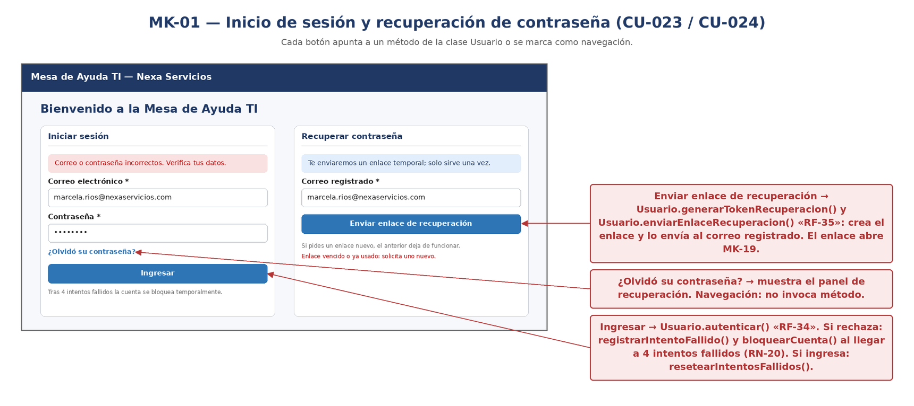

*Finalidad:* muestra la pantalla «Inicio de sesión y recuperación de contraseña», que atiende [CU-023](3-casos-de-uso.md#cu-023), [CU-024](3-casos-de-uso.md#cu-024). Sus campos, botones y reglas visibles se detallan en la ficha siguiente.

*Nota.* Elaboración propia.

**Tabla 196**  
*Mockup MK-01: Inicio de sesión y recuperación de contraseña*

| **Código**               | **MK-01**                                                                                                                |
|--------------------------|--------------------------------------------------------------------------------------------------------------------------|
| **Pantalla**             | Inicio de sesión y recuperación de contraseña                                                                            |
| **Atiende (CU)**         | CU-023 / CU-024                                                                                                          |
| **Campos ↔ Diccionario** | tipo: correo, contrasena_hash (se envía la contraseña, nunca se muestra); recuperación: correo                           |
| **Botones ↔ Eventos**    | Ingresar → autenticar() (RF-34) · Enviar enlace → generar token (RF-35) · ¿Olvidó su contraseña? → panel de recuperación |
| **RN visibles**          | RN-20 (mensaje genérico y bloqueo), RN-22 (enlace temporal y de un solo uso), RN-21                                      |

> **🔗 Trazabilidad de MK-01**
>
> | Relación | Elementos | Fuente en el documento |
> |---|---|---|
> | Casos de uso que atiende | [CU-023](3-casos-de-uso.md#cu-023), [CU-024](3-casos-de-uso.md#cu-024) | Ficha («Atiende (CU)») |
> | Casos de uso que aterrizan aquí | [CU-023](3-casos-de-uso.md#cu-023), [CU-024](3-casos-de-uso.md#cu-024) | Cobertura §4.4 |
> | RF de sus botones | [RF-34](2-reglas-de-negocio-y-requisitos.md#rf-34), [RF-35](2-reglas-de-negocio-y-requisitos.md#rf-35) | Ficha («Botones ↔ Eventos») |
> | RN visibles | [RN-20](2-reglas-de-negocio-y-requisitos.md#rn-20), [RN-21](2-reglas-de-negocio-y-requisitos.md#rn-21), [RN-22](2-reglas-de-negocio-y-requisitos.md#rn-22) | Ficha («RN visibles») |
> | HU | [HU-023](1-historias-de-usuario.md#hu-023), [HU-024](1-historias-de-usuario.md#hu-024) | Matriz §5 |
> | Información almacenada en | [`usuario`](../fase_3/13-script-sql-ddl.md#tabla-usuario) (`contrasena_hash`, `correo`) | Ficha («Campos ↔ Diccionario») → columnas del DDL |

### MK-02 — Reportar un caso

**Figura 3**  
*MK-02: Reportar un caso*

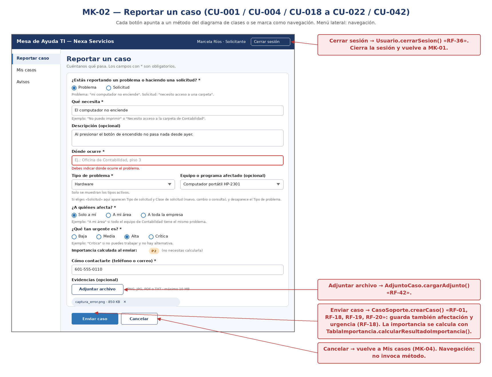

*Finalidad:* muestra la pantalla «Reportar un caso», que atiende [CU-001](3-casos-de-uso.md#cu-001), [CU-004](3-casos-de-uso.md#cu-004), [CU-018](3-casos-de-uso.md#cu-018), [CU-019](3-casos-de-uso.md#cu-019), [CU-020](3-casos-de-uso.md#cu-020), [CU-021](3-casos-de-uso.md#cu-021), [CU-022](3-casos-de-uso.md#cu-022), [CU-042](3-casos-de-uso.md#cu-042). Sus campos, botones y reglas visibles se detallan en la ficha siguiente.

*Nota.* Elaboración propia.

**Tabla 197**  
*Mockup MK-02: Reportar un caso*

| **Código**               | **MK-02**                                                                                                                                                                                                                                                    |
|--------------------------|--------------------------------------------------------------------------------------------------------------------------------------------------------------------------------------------------------------------------------------------------------------|
| **Pantalla**             | Reportar un caso                                                                                                                                                                                                                                             |
| **Atiende (CU)**         | CU-001 / CU-004 / CU-018 a CU-022 / CU-042                                                                                                                                                                                                                   |
| **Campos ↔ Diccionario** | tipo_caso (problema/solicitud), titulo, descripcion, lugar, id_tipo_problema (si es problema), id_tipo_solicitud y clase_solicitud (si es solicitud), id_activo (opcional), afectacion, urgencia, contacto (usuario.telefono/correo, solo lectura), adjuntos |
| **Botones ↔ Eventos**    | Enviar caso → crear caso (RF-01, RF-18, RF-19, RF-20) · Adjuntar archivo → RF-42 · Cancelar → vuelve a Mis casos                                                                                                                                             |
| **RN visibles**          | RN-01 (error de “Dónde ocurre”), RN-03 (problema/solicitud excluyentes), RN-04, RN-05 (importancia), RN-25, RN-27                                                                                                                                            |

> **🔗 Trazabilidad de MK-02**
>
> | Relación | Elementos | Fuente en el documento |
> |---|---|---|
> | Casos de uso que atiende | [CU-001](3-casos-de-uso.md#cu-001), [CU-004](3-casos-de-uso.md#cu-004), [CU-018](3-casos-de-uso.md#cu-018), [CU-019](3-casos-de-uso.md#cu-019), [CU-020](3-casos-de-uso.md#cu-020), [CU-021](3-casos-de-uso.md#cu-021), [CU-022](3-casos-de-uso.md#cu-022), [CU-042](3-casos-de-uso.md#cu-042) | Ficha («Atiende (CU)») |
> | Casos de uso que aterrizan aquí | [CU-001](3-casos-de-uso.md#cu-001), [CU-004](3-casos-de-uso.md#cu-004), [CU-018](3-casos-de-uso.md#cu-018), [CU-019](3-casos-de-uso.md#cu-019), [CU-020](3-casos-de-uso.md#cu-020), [CU-021](3-casos-de-uso.md#cu-021), [CU-022](3-casos-de-uso.md#cu-022), [CU-042](3-casos-de-uso.md#cu-042) | Cobertura §4.4 |
> | RF de sus botones | [RF-01](2-reglas-de-negocio-y-requisitos.md#rf-01), [RF-18](2-reglas-de-negocio-y-requisitos.md#rf-18), [RF-19](2-reglas-de-negocio-y-requisitos.md#rf-19), [RF-20](2-reglas-de-negocio-y-requisitos.md#rf-20), [RF-42](2-reglas-de-negocio-y-requisitos.md#rf-42) | Ficha («Botones ↔ Eventos») |
> | RN visibles | [RN-01](2-reglas-de-negocio-y-requisitos.md#rn-01), [RN-03](2-reglas-de-negocio-y-requisitos.md#rn-03), [RN-04](2-reglas-de-negocio-y-requisitos.md#rn-04), [RN-05](2-reglas-de-negocio-y-requisitos.md#rn-05), [RN-25](2-reglas-de-negocio-y-requisitos.md#rn-25), [RN-27](2-reglas-de-negocio-y-requisitos.md#rn-27) | Ficha («RN visibles») |
> | HU | [HU-001](1-historias-de-usuario.md#hu-001), [HU-004](1-historias-de-usuario.md#hu-004), [HU-018](1-historias-de-usuario.md#hu-018), [HU-019](1-historias-de-usuario.md#hu-019), [HU-020](1-historias-de-usuario.md#hu-020), [HU-021](1-historias-de-usuario.md#hu-021), [HU-022](1-historias-de-usuario.md#hu-022), [HU-042](1-historias-de-usuario.md#hu-042) | Matriz §5 |
> | Información almacenada en | [`usuario`](../fase_3/13-script-sql-ddl.md#tabla-usuario) (`correo`, `telefono`); [`caso_soporte`](../fase_3/13-script-sql-ddl.md#tabla-caso-soporte) (`clase_solicitud`, `id_activo`, `id_tipo_problema`, `id_tipo_solicitud`, `lugar`, `titulo`); [`tabla_importancia`](../fase_3/13-script-sql-ddl.md#tabla-tabla-importancia) (`afectacion`, `urgencia`) | Ficha («Campos ↔ Diccionario») → columnas del DDL |

### MK-03 — Caso registrado (confirmación)

**Figura 4**  
*MK-03: Caso registrado (confirmación)*

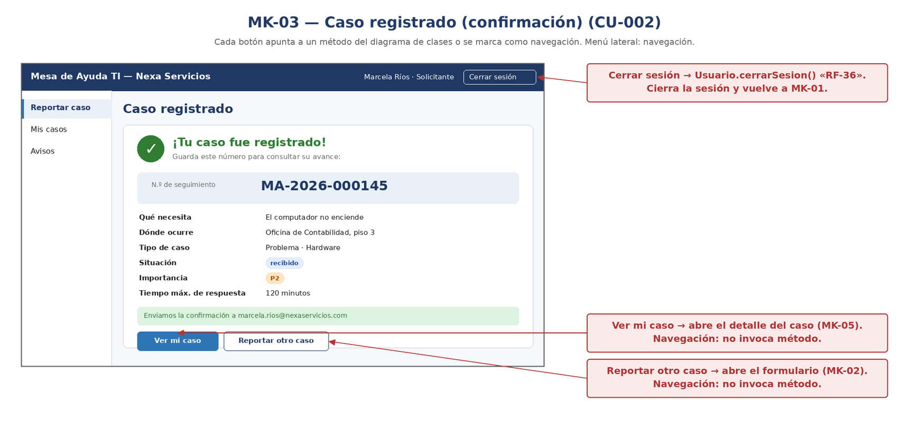

*Finalidad:* muestra la pantalla «Caso registrado (confirmación)», que atiende [CU-002](3-casos-de-uso.md#cu-002). Sus campos, botones y reglas visibles se detallan en la ficha siguiente.

*Nota.* Elaboración propia.

**Tabla 198**  
*Mockup MK-03: Caso registrado (confirmación)*

| **Código**               | **MK-03**                                                                                          |
|--------------------------|----------------------------------------------------------------------------------------------------|
| **Pantalla**             | Caso registrado (confirmación)                                                                     |
| **Atiende (CU)**         | CU-002                                                                                             |
| **Campos ↔ Diccionario** | numero_seguimiento, titulo, lugar, tipo_caso, estado_caso, resultado_importancia, tiempo_respuesta |
| **Botones ↔ Eventos**    | Ver mi caso → MK-05 (RF-13) · Reportar otro caso → MK-02                                           |
| **RN visibles**          | RN-02, RN-16 (el correo se envía aparte)                                                           |

> **🔗 Trazabilidad de MK-03**
>
> | Relación | Elementos | Fuente en el documento |
> |---|---|---|
> | Casos de uso que atiende | [CU-002](3-casos-de-uso.md#cu-002) | Ficha («Atiende (CU)») |
> | Casos de uso que aterrizan aquí | [CU-002](3-casos-de-uso.md#cu-002) | Cobertura §4.4 |
> | RF de sus botones | [RF-13](2-reglas-de-negocio-y-requisitos.md#rf-13) | Ficha («Botones ↔ Eventos») |
> | RN visibles | [RN-02](2-reglas-de-negocio-y-requisitos.md#rn-02), [RN-16](2-reglas-de-negocio-y-requisitos.md#rn-16) | Ficha («RN visibles») |
> | HU | [HU-002](1-historias-de-usuario.md#hu-002) | Matriz §5 |
> | Información almacenada en | [`caso_soporte`](../fase_3/13-script-sql-ddl.md#tabla-caso-soporte) (`estado_caso`, `lugar`, `numero_seguimiento`, `titulo`); [`tabla_importancia`](../fase_3/13-script-sql-ddl.md#tabla-tabla-importancia) (`resultado_importancia`); [`tiempo_atencion_sla`](../fase_3/13-script-sql-ddl.md#tabla-tiempo-atencion-sla) (`tiempo_respuesta`) | Ficha («Campos ↔ Diccionario») → columnas del DDL |

### MK-04 — Mis casos — listado y búsqueda

**Figura 5**  
*MK-04: Mis casos — listado y búsqueda*

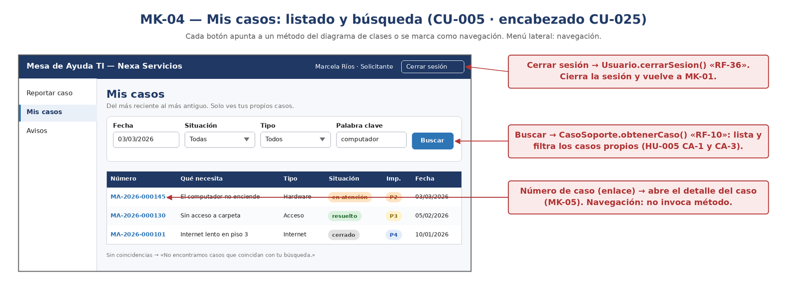

*Finalidad:* muestra la pantalla «Mis casos — listado y búsqueda», que atiende [CU-005](3-casos-de-uso.md#cu-005), [CU-025](3-casos-de-uso.md#cu-025). Sus campos, botones y reglas visibles se detallan en la ficha siguiente.

*Nota.* Elaboración propia.

**Tabla 199**  
*Mockup MK-04: Mis casos — listado y búsqueda*

| **Código**               | **MK-04**                                                                                                                            |
|--------------------------|--------------------------------------------------------------------------------------------------------------------------------------|
| **Pantalla**             | Mis casos — listado y búsqueda                                                                                                       |
| **Atiende (CU)**         | CU-005 (y CU-025 en el encabezado)                                                                                                   |
| **Campos ↔ Diccionario** | numero_seguimiento, titulo, tipo, estado_caso, resultado_importancia, fecha_creacion; filtros: fecha, situación, tipo, palabra clave |
| **Botones ↔ Eventos**    | Buscar → RF-10 · Ver → MK-05 (RF-13) · Cerrar sesión (encabezado) → RF-36                                                            |
| **RN visibles**          | RN-06 (solo casos propios), RN-23                                                                                                    |

> **🔗 Trazabilidad de MK-04**
>
> | Relación | Elementos | Fuente en el documento |
> |---|---|---|
> | Casos de uso que atiende | [CU-005](3-casos-de-uso.md#cu-005), [CU-025](3-casos-de-uso.md#cu-025) | Ficha («Atiende (CU)») |
> | Casos de uso que aterrizan aquí | [CU-005](3-casos-de-uso.md#cu-005), [CU-025](3-casos-de-uso.md#cu-025) | Cobertura §4.4 |
> | RF de sus botones | [RF-10](2-reglas-de-negocio-y-requisitos.md#rf-10), [RF-13](2-reglas-de-negocio-y-requisitos.md#rf-13), [RF-36](2-reglas-de-negocio-y-requisitos.md#rf-36) | Ficha («Botones ↔ Eventos») |
> | RN visibles | [RN-06](2-reglas-de-negocio-y-requisitos.md#rn-06), [RN-23](2-reglas-de-negocio-y-requisitos.md#rn-23) | Ficha («RN visibles») |
> | HU | [HU-005](1-historias-de-usuario.md#hu-005), [HU-025](1-historias-de-usuario.md#hu-025) | Matriz §5 |
> | Información almacenada en | [`caso_soporte`](../fase_3/13-script-sql-ddl.md#tabla-caso-soporte) (`estado_caso`, `numero_seguimiento`, `titulo`); [`tabla_importancia`](../fase_3/13-script-sql-ddl.md#tabla-tabla-importancia) (`resultado_importancia`) | Ficha («Campos ↔ Diccionario») → columnas del DDL |

### MK-05 — Detalle del caso (solicitante)

**Figura 6**  
*MK-05: Detalle del caso (solicitante)*

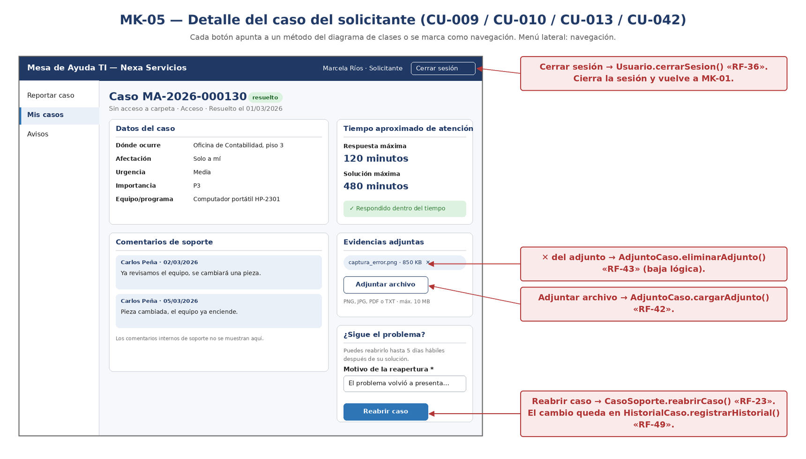

*Finalidad:* muestra la pantalla «Detalle del caso (solicitante)», que atiende [CU-009](3-casos-de-uso.md#cu-009), [CU-010](3-casos-de-uso.md#cu-010), [CU-013](3-casos-de-uso.md#cu-013), [CU-042](3-casos-de-uso.md#cu-042). Sus campos, botones y reglas visibles se detallan en la ficha siguiente.

*Nota.* Elaboración propia.

**Tabla 200**  
*Mockup MK-05: Detalle del caso (solicitante)*

| **Código**               | **MK-05**                                                                                                                    |
|--------------------------|------------------------------------------------------------------------------------------------------------------------------|
| **Pantalla**             | Detalle del caso (solicitante)                                                                                               |
| **Atiende (CU)**         | CU-010 / CU-013 / CU-009 / CU-042                                                                                            |
| **Campos ↔ Diccionario** | lugar, afectacion, urgencia, id_activo, tiempo_respuesta, tiempo_solucion, comentarios visibles, adjuntos, motivo_reapertura |
| **Botones ↔ Eventos**    | Reabrir caso → RF-23 · Adjuntar archivo → RF-42 · ✕ del adjunto → RF-43                                                      |
| **RN visibles**          | RN-11 (plazo de 5 días hábiles y motivo), RN-13, RN-14, RN-10, RN-27                                                         |

> **🔗 Trazabilidad de MK-05**
>
> | Relación | Elementos | Fuente en el documento |
> |---|---|---|
> | Casos de uso que atiende | [CU-009](3-casos-de-uso.md#cu-009), [CU-010](3-casos-de-uso.md#cu-010), [CU-013](3-casos-de-uso.md#cu-013), [CU-042](3-casos-de-uso.md#cu-042) | Ficha («Atiende (CU)») |
> | Casos de uso que aterrizan aquí | [CU-009](3-casos-de-uso.md#cu-009), [CU-010](3-casos-de-uso.md#cu-010), [CU-013](3-casos-de-uso.md#cu-013), [CU-042](3-casos-de-uso.md#cu-042), [CU-S01](3-casos-de-uso.md#cu-s01) | Cobertura §4.4 |
> | RF de sus botones | [RF-23](2-reglas-de-negocio-y-requisitos.md#rf-23), [RF-42](2-reglas-de-negocio-y-requisitos.md#rf-42), [RF-43](2-reglas-de-negocio-y-requisitos.md#rf-43) | Ficha («Botones ↔ Eventos») |
> | RN visibles | [RN-10](2-reglas-de-negocio-y-requisitos.md#rn-10), [RN-11](2-reglas-de-negocio-y-requisitos.md#rn-11), [RN-13](2-reglas-de-negocio-y-requisitos.md#rn-13), [RN-14](2-reglas-de-negocio-y-requisitos.md#rn-14), [RN-27](2-reglas-de-negocio-y-requisitos.md#rn-27) | Ficha («RN visibles») |
> | HU | [HU-007](1-historias-de-usuario.md#hu-007), [HU-009](1-historias-de-usuario.md#hu-009), [HU-010](1-historias-de-usuario.md#hu-010), [HU-013](1-historias-de-usuario.md#hu-013), [HU-042](1-historias-de-usuario.md#hu-042) | Matriz §5 |
> | Información almacenada en | [`caso_soporte`](../fase_3/13-script-sql-ddl.md#tabla-caso-soporte) (`id_activo`, `lugar`, `motivo_reapertura`); [`tabla_importancia`](../fase_3/13-script-sql-ddl.md#tabla-tabla-importancia) (`afectacion`, `urgencia`); [`tiempo_atencion_sla`](../fase_3/13-script-sql-ddl.md#tabla-tiempo-atencion-sla) (`tiempo_respuesta`, `tiempo_solucion`) | Ficha («Campos ↔ Diccionario») → columnas del DDL |

### MK-09 — Avisos

**Figura 7**  
*MK-09: Avisos*

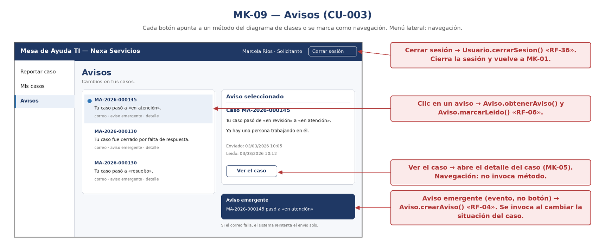

*Finalidad:* muestra la pantalla «Avisos», que atiende [CU-003](3-casos-de-uso.md#cu-003). Sus campos, botones y reglas visibles se detallan en la ficha siguiente.

*Nota.* Elaboración propia.

**Tabla 201**  
*Mockup MK-09: Avisos*

| **Código**               | **MK-09**                                                                |
|--------------------------|--------------------------------------------------------------------------|
| **Pantalla**             | Avisos                                                                   |
| **Atiende (CU)**         | CU-003                                                                   |
| **Campos ↔ Diccionario** | mensaje, canal, fecha_envio, estado_envio, fecha_lectura                 |
| **Botones ↔ Eventos**    | Clic en un aviso → RF-06 · Ver el caso → MK-05 · aviso emergente → RF-04 |
| **RN visibles**          | RN-15 (tres canales y reintento), RN-16                                  |

> **🔗 Trazabilidad de MK-09**
>
> | Relación | Elementos | Fuente en el documento |
> |---|---|---|
> | Casos de uso que atiende | [CU-003](3-casos-de-uso.md#cu-003) | Ficha («Atiende (CU)») |
> | Casos de uso que aterrizan aquí | [CU-003](3-casos-de-uso.md#cu-003), [CU-028](3-casos-de-uso.md#cu-028) | Cobertura §4.4 |
> | RF de sus botones | [RF-04](2-reglas-de-negocio-y-requisitos.md#rf-04), [RF-06](2-reglas-de-negocio-y-requisitos.md#rf-06) | Ficha («Botones ↔ Eventos») |
> | RN visibles | [RN-15](2-reglas-de-negocio-y-requisitos.md#rn-15), [RN-16](2-reglas-de-negocio-y-requisitos.md#rn-16) | Ficha («RN visibles») |
> | HU | [HU-002](1-historias-de-usuario.md#hu-002), [HU-003](1-historias-de-usuario.md#hu-003), [HU-028](1-historias-de-usuario.md#hu-028) | Matriz §5 |
> | Información almacenada en | [`aviso`](../fase_3/13-script-sql-ddl.md#tabla-aviso) (`canal`, `estado_envio`, `fecha_envio`, `fecha_lectura`, `mensaje`) | Ficha («Campos ↔ Diccionario») → columnas del DDL |

### MK-19 — Establecer nueva contraseña

**Figura 8**  
*MK-19: Establecer nueva contraseña (enlace de recuperación)*

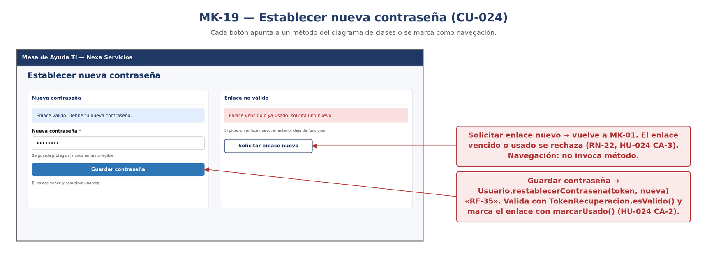

*Finalidad:* muestra la pantalla «Establecer nueva contraseña», que atiende [CU-024](3-casos-de-uso.md#cu-024). Sus campos, botones y reglas visibles se detallan en la ficha siguiente.

*Nota.* Elaboración propia.

**Tabla 202**  
*Mockup MK-19: Establecer nueva contraseña*

| **Código**               | **MK-19**                                                                                                                                   |
|--------------------------|---------------------------------------------------------------------------------------------------------------------------------------------|
| **Pantalla**             | Establecer nueva contraseña                                                                                                                 |
| **Atiende (CU)**         | CU-024                                                                                                                                      |
| **Campos ↔ Diccionario** | contrasena_hash (se envía la nueva contraseña; nunca se muestra); token_recuperacion: token_hash, fecha_expiracion, fecha_uso, estado_token |
| **Botones ↔ Eventos**    | Guardar contraseña → restablecerContrasena() (RF-35) · Solicitar enlace nuevo → MK-01                                                       |
| **RN visibles**          | RN-19 (contraseña protegida), RN-22 (enlace temporal y de un solo uso)                                                                      |

> **🔗 Trazabilidad de MK-19**
>
> | Relación | Elementos | Fuente en el documento |
> |---|---|---|
> | Casos de uso que atiende | [CU-024](3-casos-de-uso.md#cu-024) | Ficha («Atiende (CU)») |
> | RF de sus botones | [RF-35](2-reglas-de-negocio-y-requisitos.md#rf-35) | Ficha («Botones ↔ Eventos») |
> | RN visibles | [RN-19](2-reglas-de-negocio-y-requisitos.md#rn-19), [RN-22](2-reglas-de-negocio-y-requisitos.md#rn-22) | Ficha («RN visibles») |
> | HU | [HU-024](1-historias-de-usuario.md#hu-024) | Matriz §5 |
> | Información almacenada en | [`usuario`](../fase_3/13-script-sql-ddl.md#tabla-usuario) (`contrasena_hash`); [`token_recuperacion`](../fase_3/13-script-sql-ddl.md#tabla-token-recuperacion) (`estado_token`, `fecha_expiracion`, `fecha_uso`, `token_hash`) | Ficha («Campos ↔ Diccionario») → columnas del DDL |

## 4.2 Mockups del personal de soporte y del supervisor

### MK-06 — Gestión del caso (soporte)

**Figura 9**  
*MK-06: Gestión del caso (soporte)*

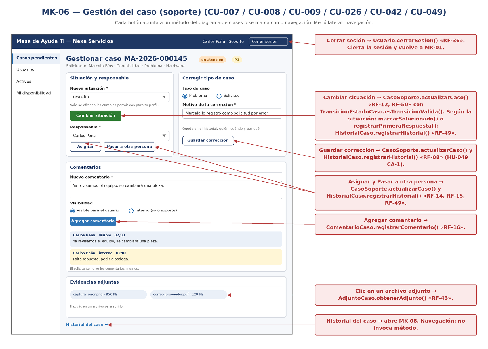

*Finalidad:* muestra la pantalla «Gestión del caso (soporte)», que atiende [CU-007](3-casos-de-uso.md#cu-007), [CU-008](3-casos-de-uso.md#cu-008), [CU-009](3-casos-de-uso.md#cu-009), [CU-026](3-casos-de-uso.md#cu-026), [CU-042](3-casos-de-uso.md#cu-042), [CU-049](3-casos-de-uso.md#cu-049). Sus campos, botones y reglas visibles se detallan en la ficha siguiente.

*Nota.* Elaboración propia.

**Tabla 203**  
*Mockup MK-06: Gestión del caso (soporte)*

| **Código**               | **MK-06**                                                                                                                                                |
|--------------------------|----------------------------------------------------------------------------------------------------------------------------------------------------------|
| **Pantalla**             | Gestión del caso (soporte)                                                                                                                               |
| **Atiende (CU)**         | CU-007 / CU-008 / CU-026 / CU-009 / CU-049 / CU-042                                                                                                      |
| **Campos ↔ Diccionario** | estado_caso, id_personal_asignado, tipo_caso, comentario, visibilidad, adjuntos                                                                          |
| **Botones ↔ Eventos**    | Cambiar situación → RF-12 · Asignar → RF-14 · Pasar a otra persona → RF-15 · Guardar corrección → RF-08 · Agregar comentario → RF-16 · Historial → MK-08 |
| **RN visibles**          | RN-07 (solo cambios permitidos), RN-09, RN-10, RN-03, RN-08                                                                                              |

> **🔗 Trazabilidad de MK-06**
>
> | Relación | Elementos | Fuente en el documento |
> |---|---|---|
> | Casos de uso que atiende | [CU-007](3-casos-de-uso.md#cu-007), [CU-008](3-casos-de-uso.md#cu-008), [CU-009](3-casos-de-uso.md#cu-009), [CU-026](3-casos-de-uso.md#cu-026), [CU-042](3-casos-de-uso.md#cu-042), [CU-049](3-casos-de-uso.md#cu-049) | Ficha («Atiende (CU)») |
> | Casos de uso que aterrizan aquí | [CU-007](3-casos-de-uso.md#cu-007), [CU-008](3-casos-de-uso.md#cu-008), [CU-009](3-casos-de-uso.md#cu-009), [CU-026](3-casos-de-uso.md#cu-026), [CU-042](3-casos-de-uso.md#cu-042), [CU-049](3-casos-de-uso.md#cu-049) | Cobertura §4.4 |
> | RF de sus botones | [RF-08](2-reglas-de-negocio-y-requisitos.md#rf-08), [RF-12](2-reglas-de-negocio-y-requisitos.md#rf-12), [RF-14](2-reglas-de-negocio-y-requisitos.md#rf-14), [RF-15](2-reglas-de-negocio-y-requisitos.md#rf-15), [RF-16](2-reglas-de-negocio-y-requisitos.md#rf-16) | Ficha («Botones ↔ Eventos») |
> | RN visibles | [RN-03](2-reglas-de-negocio-y-requisitos.md#rn-03), [RN-07](2-reglas-de-negocio-y-requisitos.md#rn-07), [RN-08](2-reglas-de-negocio-y-requisitos.md#rn-08), [RN-09](2-reglas-de-negocio-y-requisitos.md#rn-09), [RN-10](2-reglas-de-negocio-y-requisitos.md#rn-10) | Ficha («RN visibles») |
> | HU | [HU-001](1-historias-de-usuario.md#hu-001), [HU-007](1-historias-de-usuario.md#hu-007), [HU-008](1-historias-de-usuario.md#hu-008), [HU-009](1-historias-de-usuario.md#hu-009), [HU-026](1-historias-de-usuario.md#hu-026), [HU-042](1-historias-de-usuario.md#hu-042), [HU-049](1-historias-de-usuario.md#hu-049) | Matriz §5 |
> | Información almacenada en | [`caso_soporte`](../fase_3/13-script-sql-ddl.md#tabla-caso-soporte) (`estado_caso`, `id_personal_asignado`); [`comentario_caso`](../fase_3/13-script-sql-ddl.md#tabla-comentario-caso) (`comentario`, `visibilidad`) | Ficha («Campos ↔ Diccionario») → columnas del DDL |

### MK-07 — Casos pendientes

**Figura 10**  
*MK-07: Casos pendientes*

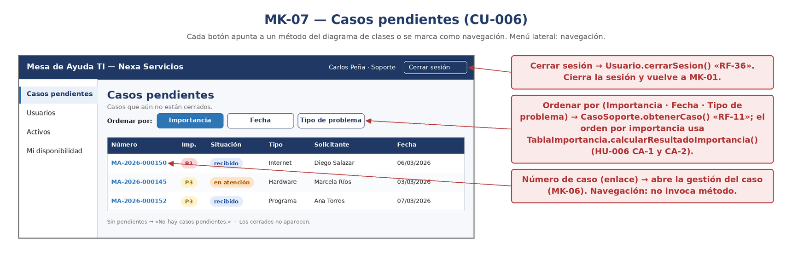

*Finalidad:* muestra la pantalla «Casos pendientes», que atiende [CU-006](3-casos-de-uso.md#cu-006). Sus campos, botones y reglas visibles se detallan en la ficha siguiente.

*Nota.* Elaboración propia.

**Tabla 204**  
*Mockup MK-07: Casos pendientes*

| **Código**               | **MK-07**                                                                                 |
|--------------------------|-------------------------------------------------------------------------------------------|
| **Pantalla**             | Casos pendientes                                                                          |
| **Atiende (CU)**         | CU-006                                                                                    |
| **Campos ↔ Diccionario** | numero_seguimiento, resultado_importancia, estado_caso, tipo, solicitante, fecha_creacion |
| **Botones ↔ Eventos**    | Ordenar por → RF-11 · clic en número → MK-06                                              |
| **RN visibles**          | RN-05 (P1 es la más alta); el mensaje “no hay pendientes” es el CA-4 de la HU-006         |

> **🔗 Trazabilidad de MK-07**
>
> | Relación | Elementos | Fuente en el documento |
> |---|---|---|
> | Casos de uso que atiende | [CU-006](3-casos-de-uso.md#cu-006) | Ficha («Atiende (CU)») |
> | Casos de uso que aterrizan aquí | [CU-006](3-casos-de-uso.md#cu-006) | Cobertura §4.4 |
> | RF de sus botones | [RF-11](2-reglas-de-negocio-y-requisitos.md#rf-11) | Ficha («Botones ↔ Eventos») |
> | RN visibles | [RN-05](2-reglas-de-negocio-y-requisitos.md#rn-05) | Ficha («RN visibles») |
> | HU | [HU-006](1-historias-de-usuario.md#hu-006) | Matriz §5 |
> | Información almacenada en | [`caso_soporte`](../fase_3/13-script-sql-ddl.md#tabla-caso-soporte) (`estado_caso`, `numero_seguimiento`); [`tabla_importancia`](../fase_3/13-script-sql-ddl.md#tabla-tabla-importancia) (`resultado_importancia`) | Ficha («Campos ↔ Diccionario») → columnas del DDL |

### MK-08 — Historial del caso

**Figura 11**  
*MK-08: Historial del caso*

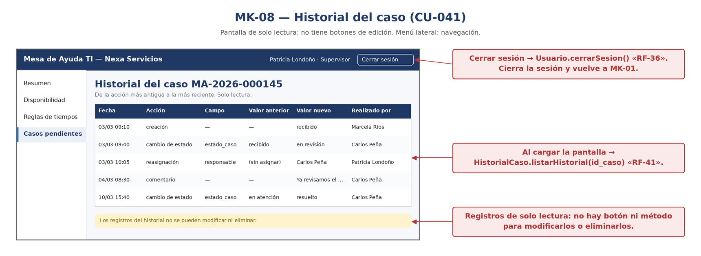

*Finalidad:* muestra la pantalla «Historial del caso», que atiende [CU-041](3-casos-de-uso.md#cu-041). Sus campos, botones y reglas visibles se detallan en la ficha siguiente.

*Nota.* Elaboración propia.

**Tabla 205**  
*Mockup MK-08: Historial del caso*

| **Código**               | **MK-08**                                                                              |
|--------------------------|----------------------------------------------------------------------------------------|
| **Pantalla**             | Historial del caso                                                                     |
| **Atiende (CU)**         | CU-041                                                                                 |
| **Campos ↔ Diccionario** | fecha_accion, accion, campo_modificado, valor_anterior, valor_nuevo, id_usuario_accion |
| **Botones ↔ Eventos**    | Solo lectura: no hay botones de edición (RF-41)                                        |
| **RN visibles**          | RN-08 (historial inmutable)                                                            |

> **🔗 Trazabilidad de MK-08**
>
> | Relación | Elementos | Fuente en el documento |
> |---|---|---|
> | Casos de uso que atiende | [CU-041](3-casos-de-uso.md#cu-041) | Ficha («Atiende (CU)») |
> | Casos de uso que aterrizan aquí | [CU-028](3-casos-de-uso.md#cu-028), [CU-041](3-casos-de-uso.md#cu-041), [CU-S02](3-casos-de-uso.md#cu-s02) | Cobertura §4.4 |
> | RF de sus botones | [RF-41](2-reglas-de-negocio-y-requisitos.md#rf-41) | Ficha («Botones ↔ Eventos») |
> | RN visibles | [RN-08](2-reglas-de-negocio-y-requisitos.md#rn-08) | Ficha («RN visibles») |
> | HU | [HU-041](1-historias-de-usuario.md#hu-041) | Matriz §5 |
> | Información almacenada en | [`historial_caso`](../fase_3/13-script-sql-ddl.md#tabla-historial-caso) (`accion`, `campo_modificado`, `fecha_accion`, `id_usuario_accion`, `valor_anterior`, `valor_nuevo`) | Ficha («Campos ↔ Diccionario») → columnas del DDL |

### MK-10 — Resumen de atención y reportes

**Figura 12**  
*MK-10: Resumen de atención y reportes*

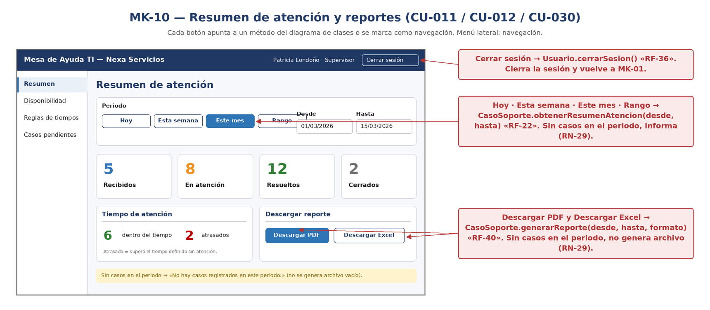

*Finalidad:* muestra la pantalla «Resumen de atención y reportes», que atiende [CU-011](3-casos-de-uso.md#cu-011), [CU-012](3-casos-de-uso.md#cu-012), [CU-030](3-casos-de-uso.md#cu-030). Sus campos, botones y reglas visibles se detallan en la ficha siguiente.

*Nota.* Elaboración propia.

**Tabla 206**  
*Mockup MK-10: Resumen de atención y reportes*

| **Código**               | **MK-10**                                                                       |
|--------------------------|---------------------------------------------------------------------------------|
| **Pantalla**             | Resumen de atención y reportes                                                  |
| **Atiende (CU)**         | CU-011 / CU-012 / CU-030                                                        |
| **Campos ↔ Diccionario** | conteo por estado_caso; cumplimiento del SLA; periodo (hoy, semana, mes, rango) |
| **Botones ↔ Eventos**    | Hoy/Esta semana/Este mes/Rango → RF-22 · Descargar PDF/Excel → RF-40            |
| **RN visibles**          | RN-14 (atrasado), RN-29 (periodo sin casos)                                     |

> **🔗 Trazabilidad de MK-10**
>
> | Relación | Elementos | Fuente en el documento |
> |---|---|---|
> | Casos de uso que atiende | [CU-011](3-casos-de-uso.md#cu-011), [CU-012](3-casos-de-uso.md#cu-012), [CU-030](3-casos-de-uso.md#cu-030) | Ficha («Atiende (CU)») |
> | Casos de uso que aterrizan aquí | [CU-011](3-casos-de-uso.md#cu-011), [CU-012](3-casos-de-uso.md#cu-012), [CU-030](3-casos-de-uso.md#cu-030) | Cobertura §4.4 |
> | RF de sus botones | [RF-22](2-reglas-de-negocio-y-requisitos.md#rf-22), [RF-40](2-reglas-de-negocio-y-requisitos.md#rf-40) | Ficha («Botones ↔ Eventos») |
> | RN visibles | [RN-14](2-reglas-de-negocio-y-requisitos.md#rn-14), [RN-29](2-reglas-de-negocio-y-requisitos.md#rn-29) | Ficha («RN visibles») |
> | HU | [HU-011](1-historias-de-usuario.md#hu-011), [HU-012](1-historias-de-usuario.md#hu-012), [HU-030](1-historias-de-usuario.md#hu-030) | Matriz §5 |
> | Información almacenada en | [`caso_soporte`](../fase_3/13-script-sql-ddl.md#tabla-caso-soporte) (`estado_caso`) | Ficha («Campos ↔ Diccionario») → columnas del DDL |

### MK-11 — Disponibilidad del personal de soporte

**Figura 13**  
*MK-11: Disponibilidad del personal de soporte*

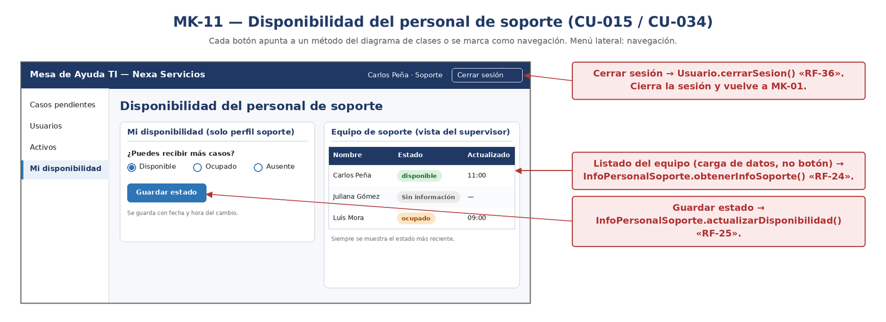

*Finalidad:* muestra la pantalla «Disponibilidad del personal de soporte», que atiende [CU-015](3-casos-de-uso.md#cu-015), [CU-034](3-casos-de-uso.md#cu-034). Sus campos, botones y reglas visibles se detallan en la ficha siguiente.

*Nota.* Elaboración propia.

**Tabla 207**  
*Mockup MK-11: Disponibilidad del personal de soporte*

| **Código**               | **MK-11**                                                        |
|--------------------------|------------------------------------------------------------------|
| **Pantalla**             | Disponibilidad del personal de soporte                           |
| **Atiende (CU)**         | CU-015 / CU-034                                                  |
| **Campos ↔ Diccionario** | disponibilidad (disponible/ocupado/ausente), fecha_actualizacion |
| **Botones ↔ Eventos**    | Guardar estado → RF-25 · listado del equipo → RF-24              |
| **RN visibles**          | RN-28 (estado más reciente; “Sin información”)                   |

> **🔗 Trazabilidad de MK-11**
>
> | Relación | Elementos | Fuente en el documento |
> |---|---|---|
> | Casos de uso que atiende | [CU-015](3-casos-de-uso.md#cu-015), [CU-034](3-casos-de-uso.md#cu-034) | Ficha («Atiende (CU)») |
> | Casos de uso que aterrizan aquí | [CU-015](3-casos-de-uso.md#cu-015), [CU-034](3-casos-de-uso.md#cu-034) | Cobertura §4.4 |
> | RF de sus botones | [RF-24](2-reglas-de-negocio-y-requisitos.md#rf-24), [RF-25](2-reglas-de-negocio-y-requisitos.md#rf-25) | Ficha («Botones ↔ Eventos») |
> | RN visibles | [RN-28](2-reglas-de-negocio-y-requisitos.md#rn-28) | Ficha («RN visibles») |
> | HU | [HU-015](1-historias-de-usuario.md#hu-015), [HU-034](1-historias-de-usuario.md#hu-034) | Matriz §5 |
> | Información almacenada en | [`info_personal_soporte`](../fase_3/13-script-sql-ddl.md#tabla-info-personal-soporte) (`disponibilidad`) | Ficha («Campos ↔ Diccionario») → columnas del DDL |

## 4.3 Mockups del administrador

### MK-12 — Reglas de tiempos de atención

**Figura 14**  
*MK-12: Reglas de tiempos de atención*

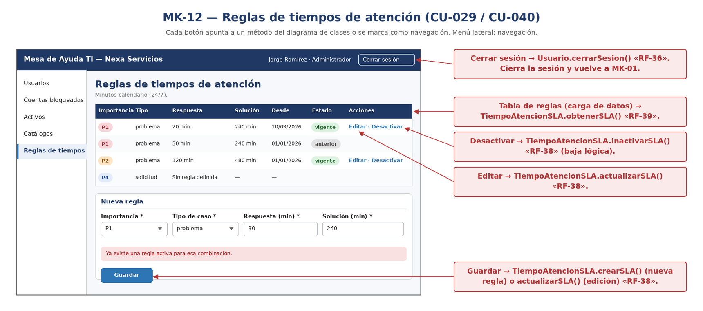

*Finalidad:* muestra la pantalla «Reglas de tiempos de atención», que atiende [CU-029](3-casos-de-uso.md#cu-029), [CU-040](3-casos-de-uso.md#cu-040). Sus campos, botones y reglas visibles se detallan en la ficha siguiente.

*Nota.* Elaboración propia.

**Tabla 208**  
*Mockup MK-12: Reglas de tiempos de atención*

| **Código**               | **MK-12**                                                                                         |
|--------------------------|---------------------------------------------------------------------------------------------------|
| **Pantalla**             | Reglas de tiempos de atención                                                                     |
| **Atiende (CU)**         | CU-029 / CU-040                                                                                   |
| **Campos ↔ Diccionario** | id_tabla_importancia, tipo_caso, tiempo_respuesta, tiempo_solucion, fecha_inicio_vigencia, estado |
| **Botones ↔ Eventos**    | Guardar → RF-38 · Editar/Desactivar → RF-38 · tabla → RF-39                                       |
| **RN visibles**          | RN-13 (una sola regla activa por combinación; versiones anteriores)                               |

> **🔗 Trazabilidad de MK-12**
>
> | Relación | Elementos | Fuente en el documento |
> |---|---|---|
> | Casos de uso que atiende | [CU-029](3-casos-de-uso.md#cu-029), [CU-040](3-casos-de-uso.md#cu-040) | Ficha («Atiende (CU)») |
> | Casos de uso que aterrizan aquí | [CU-029](3-casos-de-uso.md#cu-029), [CU-040](3-casos-de-uso.md#cu-040) | Cobertura §4.4 |
> | RF de sus botones | [RF-38](2-reglas-de-negocio-y-requisitos.md#rf-38), [RF-39](2-reglas-de-negocio-y-requisitos.md#rf-39) | Ficha («Botones ↔ Eventos») |
> | RN visibles | [RN-13](2-reglas-de-negocio-y-requisitos.md#rn-13) | Ficha («RN visibles») |
> | HU | [HU-029](1-historias-de-usuario.md#hu-029), [HU-040](1-historias-de-usuario.md#hu-040) | Matriz §5 |
> | Información almacenada en | [`tiempo_atencion_sla`](../fase_3/13-script-sql-ddl.md#tabla-tiempo-atencion-sla) (`fecha_inicio_vigencia`, `tiempo_respuesta`, `tiempo_solucion`) | Ficha («Campos ↔ Diccionario») → columnas del DDL |

### MK-13 — Usuarios — listado y búsqueda

**Figura 15**  
*MK-13: Usuarios — listado y búsqueda*

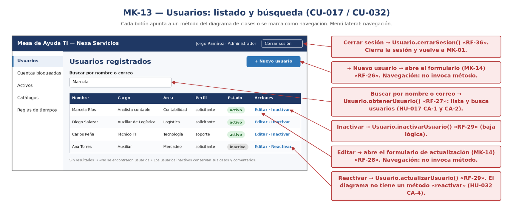

*Finalidad:* muestra la pantalla «Usuarios — listado y búsqueda», que atiende [CU-016](3-casos-de-uso.md#cu-016), [CU-017](3-casos-de-uso.md#cu-017), [CU-031](3-casos-de-uso.md#cu-031), [CU-032](3-casos-de-uso.md#cu-032). Sus campos, botones y reglas visibles se detallan en la ficha siguiente.

*Nota.* Elaboración propia.

**Tabla 209**  
*Mockup MK-13: Usuarios — listado y búsqueda*

| **Código**               | **MK-13**                                                                                               |
|--------------------------|---------------------------------------------------------------------------------------------------------|
| **Pantalla**             | Usuarios — listado y búsqueda                                                                           |
| **Atiende (CU)**         | CU-017 / CU-032 (da entrada a CU-016 y CU-031)                                                          |
| **Campos ↔ Diccionario** | nombre, correo, cargo, área, perfil_acceso, estado_usuario                                              |
| **Botones ↔ Eventos**    | Buscar → RF-27 · + Nuevo usuario → MK-14 (RF-26) · Editar → MK-14 (RF-28) · Inactivar/Reactivar → RF-29 |
| **RN visibles**          | RN-21 (inactivo no ingresa; historia conservada)                                                        |

> **🔗 Trazabilidad de MK-13**
>
> | Relación | Elementos | Fuente en el documento |
> |---|---|---|
> | Casos de uso que atiende | [CU-016](3-casos-de-uso.md#cu-016), [CU-017](3-casos-de-uso.md#cu-017), [CU-031](3-casos-de-uso.md#cu-031), [CU-032](3-casos-de-uso.md#cu-032) | Ficha («Atiende (CU)») |
> | Casos de uso que aterrizan aquí | [CU-017](3-casos-de-uso.md#cu-017), [CU-031](3-casos-de-uso.md#cu-031), [CU-032](3-casos-de-uso.md#cu-032) | Cobertura §4.4 |
> | RF de sus botones | [RF-26](2-reglas-de-negocio-y-requisitos.md#rf-26), [RF-27](2-reglas-de-negocio-y-requisitos.md#rf-27), [RF-28](2-reglas-de-negocio-y-requisitos.md#rf-28), [RF-29](2-reglas-de-negocio-y-requisitos.md#rf-29) | Ficha («Botones ↔ Eventos») |
> | RN visibles | [RN-21](2-reglas-de-negocio-y-requisitos.md#rn-21) | Ficha («RN visibles») |
> | HU | [HU-017](1-historias-de-usuario.md#hu-017), [HU-031](1-historias-de-usuario.md#hu-031), [HU-032](1-historias-de-usuario.md#hu-032) | Matriz §5 |
> | Información almacenada en | [`usuario`](../fase_3/13-script-sql-ddl.md#tabla-usuario) (`correo`, `estado_usuario`, `perfil_acceso`) | Ficha («Campos ↔ Diccionario») → columnas del DDL |

### MK-14 — Registrar / actualizar usuario

**Figura 16**  
*MK-14: Registrar / actualizar usuario*

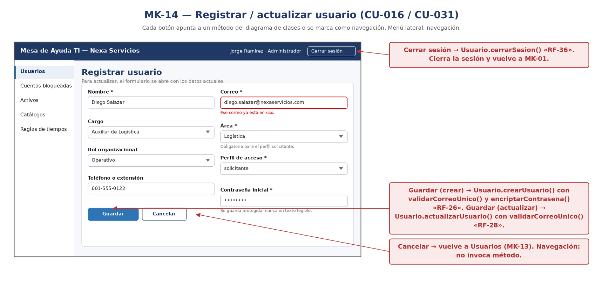

*Finalidad:* muestra la pantalla «Registrar / actualizar usuario», que atiende [CU-016](3-casos-de-uso.md#cu-016), [CU-031](3-casos-de-uso.md#cu-031). Sus campos, botones y reglas visibles se detallan en la ficha siguiente.

*Nota.* Elaboración propia.

**Tabla 210**  
*Mockup MK-14: Registrar / actualizar usuario*

| **Código**               | **MK-14**                                                                                          |
|--------------------------|----------------------------------------------------------------------------------------------------|
| **Pantalla**             | Registrar / actualizar usuario                                                                     |
| **Atiende (CU)**         | CU-016 / CU-031                                                                                    |
| **Campos ↔ Diccionario** | nombre, correo, id_cargo, id_area, id_rol_organizacional, perfil_acceso, telefono, contrasena_hash |
| **Botones ↔ Eventos**    | Guardar → crear usuario (RF-26) o actualizar (RF-28) · Cancelar → MK-13                            |
| **RN visibles**          | RN-17 (correo único), RN-18 (área obligatoria para solicitante), RN-19                             |

> **🔗 Trazabilidad de MK-14**
>
> | Relación | Elementos | Fuente en el documento |
> |---|---|---|
> | Casos de uso que atiende | [CU-016](3-casos-de-uso.md#cu-016), [CU-031](3-casos-de-uso.md#cu-031) | Ficha («Atiende (CU)») |
> | Casos de uso que aterrizan aquí | [CU-016](3-casos-de-uso.md#cu-016), [CU-031](3-casos-de-uso.md#cu-031) | Cobertura §4.4 |
> | RF de sus botones | [RF-26](2-reglas-de-negocio-y-requisitos.md#rf-26), [RF-28](2-reglas-de-negocio-y-requisitos.md#rf-28) | Ficha («Botones ↔ Eventos») |
> | RN visibles | [RN-17](2-reglas-de-negocio-y-requisitos.md#rn-17), [RN-18](2-reglas-de-negocio-y-requisitos.md#rn-18), [RN-19](2-reglas-de-negocio-y-requisitos.md#rn-19) | Ficha («RN visibles») |
> | HU | [HU-016](1-historias-de-usuario.md#hu-016), [HU-031](1-historias-de-usuario.md#hu-031) | Matriz §5 |
> | Información almacenada en | [`usuario`](../fase_3/13-script-sql-ddl.md#tabla-usuario) (`contrasena_hash`, `correo`, `id_cargo`, `id_rol_organizacional`, `perfil_acceso`, `telefono`) | Ficha («Campos ↔ Diccionario») → columnas del DDL |

### MK-15 — Cuentas bloqueadas

**Figura 17**  
*MK-15: Cuentas bloqueadas*

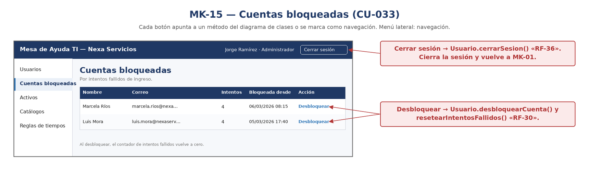

*Finalidad:* muestra la pantalla «Cuentas bloqueadas», que atiende [CU-033](3-casos-de-uso.md#cu-033). Sus campos, botones y reglas visibles se detallan en la ficha siguiente.

*Nota.* Elaboración propia.

**Tabla 211**  
*Mockup MK-15: Cuentas bloqueadas*

| **Código**               | **MK-15**                                        |
|--------------------------|--------------------------------------------------|
| **Pantalla**             | Cuentas bloqueadas                               |
| **Atiende (CU)**         | CU-033                                           |
| **Campos ↔ Diccionario** | nombre, correo, intentos_fallidos, fecha_bloqueo |
| **Botones ↔ Eventos**    | Desbloquear → RF-30                              |
| **RN visibles**          | RN-20                                            |

> **🔗 Trazabilidad de MK-15**
>
> | Relación | Elementos | Fuente en el documento |
> |---|---|---|
> | Casos de uso que atiende | [CU-033](3-casos-de-uso.md#cu-033) | Ficha («Atiende (CU)») |
> | Casos de uso que aterrizan aquí | [CU-033](3-casos-de-uso.md#cu-033) | Cobertura §4.4 |
> | RF de sus botones | [RF-30](2-reglas-de-negocio-y-requisitos.md#rf-30) | Ficha («Botones ↔ Eventos») |
> | RN visibles | [RN-20](2-reglas-de-negocio-y-requisitos.md#rn-20) | Ficha («RN visibles») |
> | HU | [HU-033](1-historias-de-usuario.md#hu-033) | Matriz §5 |
> | Información almacenada en | [`usuario`](../fase_3/13-script-sql-ddl.md#tabla-usuario) (`correo`, `fecha_bloqueo`, `intentos_fallidos`) | Ficha («Campos ↔ Diccionario») → columnas del DDL |

### MK-16 — Activos — listado y búsqueda

**Figura 18**  
*MK-16: Activos — listado y búsqueda*

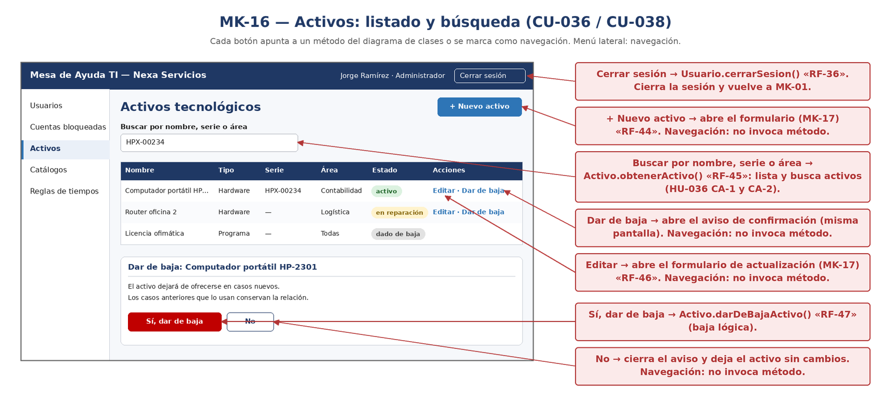

*Finalidad:* muestra la pantalla «Activos — listado y búsqueda», que atiende [CU-035](3-casos-de-uso.md#cu-035), [CU-036](3-casos-de-uso.md#cu-036), [CU-037](3-casos-de-uso.md#cu-037), [CU-038](3-casos-de-uso.md#cu-038). Sus campos, botones y reglas visibles se detallan en la ficha siguiente.

*Nota.* Elaboración propia.

**Tabla 212**  
*Mockup MK-16: Activos — listado y búsqueda*

| **Código**               | **MK-16**                                                                                      |
|--------------------------|------------------------------------------------------------------------------------------------|
| **Pantalla**             | Activos — listado y búsqueda                                                                   |
| **Atiende (CU)**         | CU-036 / CU-038 (da entrada a CU-035 y CU-037)                                                 |
| **Campos ↔ Diccionario** | nombre, tipo_activo, numero_serie, área, estado                                                |
| **Botones ↔ Eventos**    | Buscar → RF-45 · + Nuevo activo → MK-17 (RF-44) · Editar → MK-17 (RF-46) · Dar de baja → RF-47 |
| **RN visibles**          | RN-25 (el aviso explica la consecuencia)                                                       |

> **🔗 Trazabilidad de MK-16**
>
> | Relación | Elementos | Fuente en el documento |
> |---|---|---|
> | Casos de uso que atiende | [CU-035](3-casos-de-uso.md#cu-035), [CU-036](3-casos-de-uso.md#cu-036), [CU-037](3-casos-de-uso.md#cu-037), [CU-038](3-casos-de-uso.md#cu-038) | Ficha («Atiende (CU)») |
> | Casos de uso que aterrizan aquí | [CU-036](3-casos-de-uso.md#cu-036), [CU-037](3-casos-de-uso.md#cu-037), [CU-038](3-casos-de-uso.md#cu-038) | Cobertura §4.4 |
> | RF de sus botones | [RF-44](2-reglas-de-negocio-y-requisitos.md#rf-44), [RF-45](2-reglas-de-negocio-y-requisitos.md#rf-45), [RF-46](2-reglas-de-negocio-y-requisitos.md#rf-46), [RF-47](2-reglas-de-negocio-y-requisitos.md#rf-47) | Ficha («Botones ↔ Eventos») |
> | RN visibles | [RN-25](2-reglas-de-negocio-y-requisitos.md#rn-25) | Ficha («RN visibles») |
> | HU | [HU-036](1-historias-de-usuario.md#hu-036), [HU-037](1-historias-de-usuario.md#hu-037), [HU-038](1-historias-de-usuario.md#hu-038) | Matriz §5 |
> | Información almacenada en | [`activo`](../fase_3/13-script-sql-ddl.md#tabla-activo) (`numero_serie`) | Ficha («Campos ↔ Diccionario») → columnas del DDL |

### MK-17 — Registrar / actualizar activo

**Figura 19**  
*MK-17: Registrar / actualizar activo*

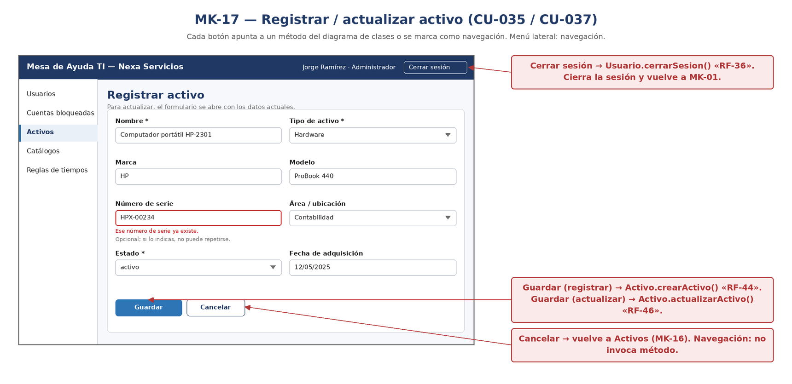

*Finalidad:* muestra la pantalla «Registrar / actualizar activo», que atiende [CU-035](3-casos-de-uso.md#cu-035), [CU-037](3-casos-de-uso.md#cu-037). Sus campos, botones y reglas visibles se detallan en la ficha siguiente.

*Nota.* Elaboración propia.

**Tabla 213**  
*Mockup MK-17: Registrar / actualizar activo*

| **Código**               | **MK-17**                                                                               |
|--------------------------|-----------------------------------------------------------------------------------------|
| **Pantalla**             | Registrar / actualizar activo                                                           |
| **Atiende (CU)**         | CU-035 / CU-037                                                                         |
| **Campos ↔ Diccionario** | nombre, id_tipo_activo, marca, modelo, numero_serie, id_area, estado, fecha_adquisicion |
| **Botones ↔ Eventos**    | Guardar → RF-44 o RF-46 · Cancelar → MK-16                                              |
| **RN visibles**          | RN-24 (serie única; nombre y tipo obligatorios)                                         |

> **🔗 Trazabilidad de MK-17**
>
> | Relación | Elementos | Fuente en el documento |
> |---|---|---|
> | Casos de uso que atiende | [CU-035](3-casos-de-uso.md#cu-035), [CU-037](3-casos-de-uso.md#cu-037) | Ficha («Atiende (CU)») |
> | Casos de uso que aterrizan aquí | [CU-035](3-casos-de-uso.md#cu-035), [CU-037](3-casos-de-uso.md#cu-037) | Cobertura §4.4 |
> | RF de sus botones | [RF-44](2-reglas-de-negocio-y-requisitos.md#rf-44), [RF-46](2-reglas-de-negocio-y-requisitos.md#rf-46) | Ficha («Botones ↔ Eventos») |
> | RN visibles | [RN-24](2-reglas-de-negocio-y-requisitos.md#rn-24) | Ficha («RN visibles») |
> | HU | [HU-035](1-historias-de-usuario.md#hu-035), [HU-037](1-historias-de-usuario.md#hu-037) | Matriz §5 |
> | Información almacenada en | [`activo`](../fase_3/13-script-sql-ddl.md#tabla-activo) (`fecha_adquisicion`, `id_tipo_activo`, `marca`, `modelo`, `numero_serie`) | Ficha («Campos ↔ Diccionario») → columnas del DDL |

### MK-18 — Catálogos de clasificación

**Figura 20**  
*MK-18: Catálogos de clasificación*

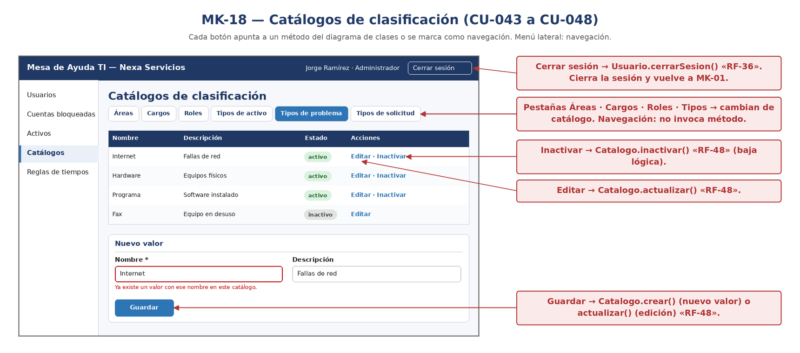

*Finalidad:* muestra la pantalla «Catálogos de clasificación», que atiende [CU-043](3-casos-de-uso.md#cu-043), [CU-044](3-casos-de-uso.md#cu-044), [CU-045](3-casos-de-uso.md#cu-045), [CU-046](3-casos-de-uso.md#cu-046), [CU-047](3-casos-de-uso.md#cu-047), [CU-048](3-casos-de-uso.md#cu-048). Sus campos, botones y reglas visibles se detallan en la ficha siguiente.

*Nota.* Elaboración propia.

**Tabla 214**  
*Mockup MK-18: Catálogos de clasificación*

| **Código**               | **MK-18**                                                                                                                                 |
|--------------------------|-------------------------------------------------------------------------------------------------------------------------------------------|
| **Pantalla**             | Catálogos de clasificación                                                                                                                |
| **Atiende (CU)**         | CU-043 a CU-048                                                                                                                           |
| **Campos ↔ Diccionario** | nombre (nombre_area, nombre_cargo, nombre_rol según el catálogo), estado; descripcion solo en tipos de activo, de problema y de solicitud |
| **Botones ↔ Eventos**    | Guardar → RF-48 · Editar/Inactivar → RF-48                                                                                                |
| **RN visibles**          | RN-26 (nombre único por catálogo), RN-04, RN-30 (inactivación sin perder registros)                                                       |

> **🔗 Trazabilidad de MK-18**
>
> | Relación | Elementos | Fuente en el documento |
> |---|---|---|
> | Casos de uso que atiende | [CU-043](3-casos-de-uso.md#cu-043), [CU-044](3-casos-de-uso.md#cu-044), [CU-045](3-casos-de-uso.md#cu-045), [CU-046](3-casos-de-uso.md#cu-046), [CU-047](3-casos-de-uso.md#cu-047), [CU-048](3-casos-de-uso.md#cu-048) | Ficha («Atiende (CU)») |
> | Casos de uso que aterrizan aquí | [CU-043](3-casos-de-uso.md#cu-043), [CU-044](3-casos-de-uso.md#cu-044), [CU-045](3-casos-de-uso.md#cu-045), [CU-046](3-casos-de-uso.md#cu-046), [CU-047](3-casos-de-uso.md#cu-047), [CU-048](3-casos-de-uso.md#cu-048) | Cobertura §4.4 |
> | RF de sus botones | [RF-48](2-reglas-de-negocio-y-requisitos.md#rf-48) | Ficha («Botones ↔ Eventos») |
> | RN visibles | [RN-04](2-reglas-de-negocio-y-requisitos.md#rn-04), [RN-26](2-reglas-de-negocio-y-requisitos.md#rn-26), [RN-30](2-reglas-de-negocio-y-requisitos.md#rn-30) | Ficha («RN visibles») |
> | HU | [HU-043](1-historias-de-usuario.md#hu-043), [HU-044](1-historias-de-usuario.md#hu-044), [HU-045](1-historias-de-usuario.md#hu-045), [HU-046](1-historias-de-usuario.md#hu-046), [HU-047](1-historias-de-usuario.md#hu-047), [HU-048](1-historias-de-usuario.md#hu-048) | Matriz §5 |
> | Información almacenada en | [`area`](../fase_3/13-script-sql-ddl.md#tabla-area) (`nombre_area`); [`cargo`](../fase_3/13-script-sql-ddl.md#tabla-cargo) (`nombre_cargo`); [`rol_empleado`](../fase_3/13-script-sql-ddl.md#tabla-rol-empleado) (`nombre_rol`) | Ficha («Campos ↔ Diccionario») → columnas del DDL |

## 4.4 Cobertura de los casos de uso

La verificación en reversa: cada caso de uso debe aterrizar en una pantalla o quedar declarado como interno.

**Tabla 215**  
*Cobertura de los casos de uso por mockup*

| **Caso de uso** | **RF**              | **Dónde aterriza**                                                                                   |
|-----------------|---------------------|------------------------------------------------------------------------------------------------------|
| CU-001          | RF-01, RF-02        | MK-02                                                                                                |
| CU-002          | RF-03               | MK-03                                                                                                |
| CU-003          | RF-04, RF-05, RF-06 | MK-09                                                                                                |
| CU-004          | RF-02, RF-07        | MK-02                                                                                                |
| CU-005          | RF-09, RF-10        | MK-04                                                                                                |
| CU-006          | RF-11               | MK-07                                                                                                |
| CU-007          | RF-12, RF-50        | MK-06                                                                                                |
| CU-008          | RF-14               | MK-06                                                                                                |
| CU-009          | RF-16, RF-17        | MK-05, MK-06                                                                                         |
| CU-010          | RF-13               | MK-05                                                                                                |
| CU-011          | RF-21               | MK-10                                                                                                |
| CU-012          | RF-22               | MK-10                                                                                                |
| CU-013          | RF-23               | MK-05                                                                                                |
| CU-015          | RF-24               | MK-11                                                                                                |
| CU-016          | RF-26               | MK-14                                                                                                |
| CU-017          | RF-27               | MK-13                                                                                                |
| CU-018          | RF-31               | MK-02                                                                                                |
| CU-019          | RF-32               | MK-02                                                                                                |
| CU-020          | RF-33               | MK-02                                                                                                |
| CU-021          | RF-18               | MK-02                                                                                                |
| CU-022          | RF-18, RF-19        | MK-02                                                                                                |
| CU-023          | RF-34               | MK-01                                                                                                |
| CU-024          | RF-35               | MK-01                                                                                                |
| CU-025          | RF-36               | MK-04                                                                                                |
| CU-026          | RF-15               | MK-06                                                                                                |
| CU-028          | RF-37               | INTERNO: proceso automático; su resultado se ve en MK-09 (aviso) y MK-08 (historial)                 |
| CU-029          | RF-38               | MK-12                                                                                                |
| CU-030          | RF-40               | MK-10                                                                                                |
| CU-031          | RF-28               | MK-13, MK-14                                                                                         |
| CU-032          | RF-29               | MK-13                                                                                                |
| CU-033          | RF-30               | MK-15                                                                                                |
| CU-034          | RF-25               | MK-11                                                                                                |
| CU-035          | RF-44               | MK-17                                                                                                |
| CU-036          | RF-45               | MK-16                                                                                                |
| CU-037          | RF-46               | MK-16, MK-17                                                                                         |
| CU-038          | RF-47               | MK-16                                                                                                |
| CU-040          | RF-39               | MK-12                                                                                                |
| CU-041          | RF-41               | MK-08                                                                                                |
| CU-042          | RF-42, RF-43        | MK-02, MK-05, MK-06                                                                                  |
| CU-043          | RF-48               | MK-18                                                                                                |
| CU-044          | RF-48               | MK-18                                                                                                |
| CU-045          | RF-48               | MK-18                                                                                                |
| CU-046          | RF-48               | MK-18                                                                                                |
| CU-047          | RF-48               | MK-18                                                                                                |
| CU-048          | RF-48               | MK-18                                                                                                |
| CU-049          | RF-08, RF-49        | MK-06                                                                                                |
| CU-S01          | RF-20               | INTERNO: no necesita pantalla; se dispara dentro de otros casos de uso y su resultado se ve en MK-05 |
| CU-S02          | RF-49               | INTERNO: no necesita pantalla; se dispara dentro de otros casos de uso y su resultado se ve en MK-08 |

***De dónde nace:** ningún caso de uso sin pantalla (salvo los tres declarados internos) y ninguna pantalla sin padre. El cierre de sesión (CU-025) vive en el encabezado, visible en todas las pantallas autenticadas; se representa en MK-04.*

## 4.5 Correspondencia entre botones y métodos

Cada pantalla de 4.1 a 4.3 muestra, en los recuadros de la derecha, la acción que ejecuta cada botón o elemento interactivo y el método del diagrama de clases que la atiende. Esta sección resume esa correspondencia por pantalla, botón, acción, clase y método. Las fuentes son la fila «Botones ↔ Eventos» de cada mockup, la lectura de las imágenes originales y las columnas HU/RF de cada método (Anexo E). Los botones que solo cambian de pantalla se marcan como Navegación. Cuando el diagrama no tiene un método que atienda la acción, se deja constancia como brecha (IN-19) y no se inventa un método.

**Tabla 216**  
*Correspondencia entre botones y métodos*

| **Pantalla**               | **Botón**                                                                                               | **Acción realizada**                                                     | **Clase responsable**             | **Método invocado**                                                                      | **Observaciones**                                                                                                                                                                                                         |
|----------------------------|---------------------------------------------------------------------------------------------------------|--------------------------------------------------------------------------|-----------------------------------|------------------------------------------------------------------------------------------|---------------------------------------------------------------------------------------------------------------------------------------------------------------------------------------------------------------------------|
| MK-01                      | Ingresar                                                                                                | Valida las credenciales y abre la sesión del perfil                      | Usuario                           | autenticar()                                                                             | RF-34. En rechazo se invocan registrarIntentoFallido() y bloquearCuenta() (RN-20); al ingresar, resetearIntentosFallidos().                                                                                               |
| MK-01                      | Enviar enlace de recuperación                                                                           | Genera el enlace temporal de un solo uso y lo envía al correo registrado | Usuario, TokenRecuperacion        | generarTokenRecuperacion(), enviarEnlaceRecuperacion()                                   | RF-35 (HU-024 CA-1, CA-4, RN-22). El enlace abre MK-19 (IN-19).                                                                                                                                                           |
| MK-01                      | ¿Olvidó su contraseña?                                                                                  | Muestra el panel de recuperación                                         | No aplica                         | No aplica (navegación)                                                                   | Navegación dentro de la misma pantalla.                                                                                                                                                                                   |
| Todas                      | Menú lateral (Reportar caso, Mis casos, Avisos, Casos pendientes, Usuarios, Activos, etc. según perfil) | Abre la pantalla elegida                                                 | No aplica                         | No aplica (navegación)                                                                   | Navegación común al encabezado y menú de las pantallas; no se detalla botón por botón en la documentación.                                                                                                                |
| MK-02 a MK-18 (encabezado) | Cerrar sesión                                                                                           | Cierra la sesión del usuario                                             | Usuario                           | cerrarSesion()                                                                           | RF-36 (HU-025, CU-025). Método agregado al diagrama de clases (IN-19).                                                                                                                                                    |
| MK-02                      | Enviar caso                                                                                             | Registra el caso con número de seguimiento y calcula la importancia      | CasoSoporte, TablaImportancia     | crearCaso(), calcularResultadoImportancia()                                              | RF-01, RF-18, RF-19, RF-20. RF-18 (afectación y urgencia) se captura en este formulario y lo registra crearCaso() (HU-001 CA-1; IN-19).                                                                                   |
| MK-02                      | Adjuntar archivo                                                                                        | Carga una evidencia al caso                                              | AdjuntoCaso                       | cargarAdjunto()                                                                          | RF-42.                                                                                                                                                                                                                    |
| MK-02                      | Cancelar                                                                                                | Vuelve a Mis casos sin registrar                                         | No aplica                         | No aplica (navegación)                                                                   | Navegación.                                                                                                                                                                                                               |
| MK-03                      | Ver mi caso                                                                                             | Abre el detalle del caso (MK-05)                                         | No aplica                         | No aplica (navegación)                                                                   | Navegación. La pantalla destino carga el caso con RF-13.                                                                                                                                                                  |
| MK-03                      | Reportar otro caso                                                                                      | Abre el formulario (MK-02)                                               | No aplica                         | No aplica (navegación)                                                                   | Navegación.                                                                                                                                                                                                               |
| MK-04                      | Buscar                                                                                                  | Filtra el listado de casos del solicitante                               | CasoSoporte                       | obtenerCaso()                                                                            | RF-10. Listado y filtro por fecha, situación, tipo y palabra clave: los atiende obtenerCaso() (HU-005 CA-1 y CA-3). Su firma recibe un id; ampliarla con parámetros de filtro queda por confirmar con la docente (IN-19). |
| MK-04                      | Ver                                                                                                     | Abre el detalle del caso (MK-05)                                         | No aplica                         | No aplica (navegación)                                                                   | Navegación.                                                                                                                                                                                                               |
| MK-05                      | Reabrir caso                                                                                            | Reabre un caso resuelto con motivo, dentro del plazo de la RN            | CasoSoporte                       | reabrirCaso()                                                                            | RF-23. El registro del cambio en el historial lo hace registrarHistorial() (RF-49).                                                                                                                                       |
| MK-05                      | Adjuntar archivo                                                                                        | Carga una evidencia al caso                                              | AdjuntoCaso                       | cargarAdjunto()                                                                          | RF-42.                                                                                                                                                                                                                    |
| MK-05                      | ✕ del adjunto                                                                                           | Elimina (baja lógica) el adjunto                                         | AdjuntoCaso                       | eliminarAdjunto()                                                                        | RF-43.                                                                                                                                                                                                                    |
| MK-09                      | Clic en un aviso                                                                                        | Muestra el detalle del aviso y lo marca como leído                       | Aviso                             | obtenerAviso(), marcarLeido()                                                            | RF-06.                                                                                                                                                                                                                    |
| MK-09                      | Ver el caso                                                                                             | Abre el detalle del caso (MK-05)                                         | No aplica                         | No aplica (navegación)                                                                   | Navegación.                                                                                                                                                                                                               |
| MK-09                      | Aviso emergente (no es botón)                                                                           | Aviso generado al cambiar la situación del caso                          | Aviso                             | crearAviso()                                                                             | RF-04. Elemento listado como evento en «Botones ↔ Eventos» de MK-09; se invoca desde CU-007/CU-013/CU-028, no por un clic.                                                                                                |
| MK-19                      | Guardar contraseña                                                                                      | Define la nueva contraseña si el enlace está vigente y sin usar          | Usuario, TokenRecuperacion        | restablecerContrasena(), esValido(), marcarUsado(), encriptarContrasena()                | RF-35 (HU-024 CA-2 y CA-3, RN-19, RN-22).                                                                                                                                                                                 |
| MK-19                      | Solicitar enlace nuevo                                                                                  | Vuelve a MK-01 para pedir otro enlace (enlace vencido o usado)           | No aplica                         | No aplica (navegación)                                                                   | HU-024 CA-3 y CA-4.                                                                                                                                                                                                       |
| MK-06                      | Cambiar situación                                                                                       | Cambia la situación del caso si la transición es válida para el perfil   | CasoSoporte, TransicionEstadoCaso | actualizarCaso(), esTransicionValida(), marcarSolucionado(), registrarPrimeraRespuesta() | RF-12, RF-50. marcarSolucionado() y registrarPrimeraRespuesta() aplican según la nueva situación; registrarHistorial() deja la constancia (RF-49).                                                                        |
| MK-06                      | Asignar                                                                                                 | Asigna al responsable del caso                                           | CasoSoporte, HistorialCaso        | actualizarCaso(), registrarHistorial()                                                   | RF-14, RF-49.                                                                                                                                                                                                             |
| MK-06                      | Pasar a otra persona                                                                                    | Traspasa el caso a otra persona de soporte                               | CasoSoporte, HistorialCaso        | actualizarCaso(), registrarHistorial()                                                   | RF-15, RF-49.                                                                                                                                                                                                             |
| MK-06                      | Guardar corrección                                                                                      | Corrige tipo de caso (problema/solicitud) con motivo                     | CasoSoporte, HistorialCaso        | actualizarCaso(), registrarHistorial()                                                   | RF-08 y RF-49 (HU-049, CU-049). La corrección la atiende actualizarCaso() (RF-08) y la deja en el historial registrarHistorial() (RF-49), como cita HU-049 CA-1.                                                          |
| MK-06                      | Agregar comentario                                                                                      | Registra un comentario visible o interno                                 | ComentarioCaso                    | registrarComentario()                                                                    | RF-16.                                                                                                                                                                                                                    |
| MK-06                      | Clic en un archivo adjunto                                                                              | Abre el archivo adjunto                                                  | AdjuntoCaso                       | obtenerAdjunto()                                                                         | RF-43. El mockup lo muestra («Haz clic en un archivo para abrirlo») pero la fila «Botones ↔ Eventos» de MK-06 no lo lista.                                                                                                |
| MK-06                      | Historial del caso                                                                                      | Abre el historial (MK-08)                                                | No aplica                         | No aplica (navegación)                                                                   | Navegación.                                                                                                                                                                                                               |
| MK-07                      | Ordenar por                                                                                             | Ordena la lista de casos pendientes                                      | CasoSoporte, TablaImportancia     | obtenerCaso(), calcularResultadoImportancia()                                            | RF-11. El listado de pendientes lo atiende obtenerCaso() (HU-006 CA-1); el orden por importancia usa calcularResultadoImportancia() (HU-006 CA-2).                                                                        |
| MK-07                      | Clic en número de caso                                                                                  | Abre la gestión del caso (MK-06)                                         | No aplica                         | No aplica (navegación)                                                                   | Navegación.                                                                                                                                                                                                               |
| MK-08                      | (sin botones: solo lectura)                                                                             | Muestra el historial de cambios del caso                                 | HistorialCaso                     | listarHistorial()                                                                        | RF-41. La carga de la pantalla invoca listarHistorial(id_caso). No hay botones de edición.                                                                                                                                |
| MK-10                      | Hoy / Esta semana / Este mes / Rango                                                                    | Recalcula el resumen para el periodo elegido                             | CasoSoporte                       | obtenerResumenAtencion(desde, hasta)                                                     | RF-22 (HU-012 CA-1 y CA-2, RN-29). Método agregado al diagrama de clases (IN-19).                                                                                                                                         |
| MK-10                      | Descargar PDF / Excel                                                                                   | Genera y descarga el reporte del periodo en PDF o Excel                  | CasoSoporte                       | generarReporte(desde, hasta, formato)                                                    | RF-40 (HU-030 CA-1 y CA-2, RN-29). Método agregado al diagrama de clases (IN-19).                                                                                                                                         |
| MK-11                      | Guardar estado                                                                                          | Guarda la disponibilidad del personal de soporte                         | InfoPersonalSoporte               | actualizarDisponibilidad()                                                               | RF-25.                                                                                                                                                                                                                    |
| MK-11                      | Listado del equipo (no es botón)                                                                        | Muestra la información del personal de soporte                           | InfoPersonalSoporte               | obtenerInfoSoporte()                                                                     | RF-24. Carga de datos, no botón.                                                                                                                                                                                          |
| MK-12                      | Guardar                                                                                                 | Crea o actualiza una regla de tiempos de atención                        | TiempoAtencionSLA                 | crearSLA(), actualizarSLA()                                                              | RF-38.                                                                                                                                                                                                                    |
| MK-12                      | Editar                                                                                                  | Actualiza una regla                                                      | TiempoAtencionSLA                 | actualizarSLA()                                                                          | RF-38.                                                                                                                                                                                                                    |
| MK-12                      | Desactivar                                                                                              | Inactiva una regla                                                       | TiempoAtencionSLA                 | inactivarSLA()                                                                           | RF-38. Baja lógica.                                                                                                                                                                                                       |
| MK-12                      | Tabla de reglas (no es botón)                                                                           | Muestra las reglas configuradas                                          | TiempoAtencionSLA                 | obtenerSLA()                                                                             | RF-39.                                                                                                                                                                                                                    |
| MK-13                      | Buscar                                                                                                  | Filtra el listado de usuarios                                            | Usuario                           | obtenerUsuario()                                                                         | RF-27. Listado y búsqueda por nombre o correo: los atiende obtenerUsuario() (HU-017 CA-1 y CA-2). Su firma recibe un id; ampliarla con filtros queda por confirmar (IN-19).                                               |
| MK-13                      | \+ Nuevo usuario                                                                                        | Abre el formulario (MK-14)                                               | No aplica                         | No aplica (navegación)                                                                   | Navegación (RF-26).                                                                                                                                                                                                       |
| MK-13                      | Editar                                                                                                  | Abre el formulario de actualización (MK-14)                              | No aplica                         | No aplica (navegación)                                                                   | Navegación (RF-28).                                                                                                                                                                                                       |
| MK-13                      | Inactivar                                                                                               | Inactiva al usuario                                                      | Usuario                           | inactivarUsuario()                                                                       | RF-29. Baja lógica.                                                                                                                                                                                                       |
| MK-13                      | Reactivar                                                                                               | Reactiva al usuario                                                      | Usuario                           | actualizarUsuario()                                                                      | RF-29. Anexo E: la reactivación se cubre con actualizarUsuario() (HU-032 CA-4); el diagrama no tiene un método «reactivar».                                                                                               |
| MK-14                      | Guardar (crear)                                                                                         | Crea el usuario                                                          | Usuario                           | crearUsuario(), validarCorreoUnico(), encriptarContrasena()                              | RF-26.                                                                                                                                                                                                                    |
| MK-14                      | Guardar (actualizar)                                                                                    | Actualiza el usuario                                                     | Usuario                           | actualizarUsuario(), validarCorreoUnico()                                                | RF-28.                                                                                                                                                                                                                    |
| MK-14                      | Cancelar                                                                                                | Vuelve a MK-13                                                           | No aplica                         | No aplica (navegación)                                                                   | Navegación.                                                                                                                                                                                                               |
| MK-15                      | Desbloquear                                                                                             | Desbloquea la cuenta y reinicia los intentos fallidos                    | Usuario                           | desbloquearCuenta(), resetearIntentosFallidos()                                          | RF-30.                                                                                                                                                                                                                    |
| MK-16                      | Buscar                                                                                                  | Filtra el listado de activos                                             | Activo                            | obtenerActivo()                                                                          | RF-45. Listado y búsqueda por nombre, número de serie o área: los atiende obtenerActivo() (HU-036 CA-1 y CA-2). Su firma recibe un id; ampliarla con filtros queda por confirmar (IN-19).                                 |
| MK-16                      | \+ Nuevo activo                                                                                         | Abre el formulario (MK-17)                                               | No aplica                         | No aplica (navegación)                                                                   | Navegación (RF-44).                                                                                                                                                                                                       |
| MK-16                      | Editar                                                                                                  | Abre el formulario de actualización (MK-17)                              | No aplica                         | No aplica (navegación)                                                                   | Navegación (RF-46).                                                                                                                                                                                                       |
| MK-16                      | Dar de baja                                                                                             | Abre el aviso de confirmación (misma pantalla)                           | No aplica                         | No aplica (navegación)                                                                   | Navegación (RF-47). La baja la ejecuta «Sí, dar de baja».                                                                                                                                                                 |
| MK-16                      | Sí, dar de baja                                                                                         | Da de baja el activo                                                     | Activo                            | darDeBajaActivo()                                                                        | RF-47. Baja lógica.                                                                                                                                                                                                       |
| MK-16                      | No                                                                                                      | Cierra el aviso y deja el activo sin cambios                             | No aplica                         | No aplica (navegación)                                                                   | Navegación.                                                                                                                                                                                                               |
| MK-17                      | Guardar (registrar)                                                                                     | Crea el activo                                                           | Activo                            | crearActivo()                                                                            | RF-44.                                                                                                                                                                                                                    |
| MK-17                      | Guardar (actualizar)                                                                                    | Actualiza el activo                                                      | Activo                            | actualizarActivo()                                                                       | RF-46.                                                                                                                                                                                                                    |
| MK-17                      | Cancelar                                                                                                | Vuelve a MK-16                                                           | No aplica                         | No aplica (navegación)                                                                   | Navegación.                                                                                                                                                                                                               |
| MK-18                      | Guardar                                                                                                 | Crea o actualiza un elemento de catálogo                                 | Catalogo                          | crear(), actualizar()                                                                    | RF-48. Catálogos: áreas, cargos, roles de empleado, tipos de activo, de problema y de solicitud.                                                                                                                          |
| MK-18                      | Editar                                                                                                  | Actualiza un elemento                                                    | Catalogo                          | actualizar()                                                                             | RF-48.                                                                                                                                                                                                                    |
| MK-18                      | Inactivar                                                                                               | Inactiva un elemento                                                     | Catalogo                          | inactivar()                                                                              | RF-48. Baja lógica.                                                                                                                                                                                                       |
| MK-18                      | Pestañas Áreas · Cargos · Roles · Tipos                                                                 | Cambia el catálogo mostrado                                              | No aplica                         | No aplica (navegación)                                                                   | Navegación.                                                                                                                                                                                                               |

### 4.5.1 Cobertura de los 57 métodos del diagrama de clases

De los 57 métodos, 47 se invocan desde al menos un botón o evento de los mockups y 10 no tienen botón: son operaciones internas o de procesos automáticos (por ejemplo el cierre automático CU-028 y los casos de apoyo CU-S01 y CU-S02, que no tienen pantalla). Su relación con HU y RF se conserva en la columna HU.

**Tabla 217**  
*Cobertura de los 57 métodos del diagrama de clases*

| **Clase**            | **Método**                                                         | **Pantallas desde las que se invoca** | **HU que lo citan**                                                      |
|----------------------|--------------------------------------------------------------------|---------------------------------------|--------------------------------------------------------------------------|
| CasoSoporte          | crearCaso(): boolean                                               | MK-02                                 | HU-001, HU-002, HU-004, HU-020                                           |
| CasoSoporte          | obtenerCaso(id: int): CasoSoporte                                  | MK-04, MK-07                          | HU-005, HU-006, HU-011                                                   |
| CasoSoporte          | actualizarCaso(): boolean                                          | MK-06                                 | HU-007, HU-008, HU-026, HU-049                                           |
| CasoSoporte          | cerrarCaso(): boolean                                              | Sin botón en los mockups              | HU-028                                                                   |
| CasoSoporte          | reabrirCaso(): boolean                                             | MK-05                                 | HU-013                                                                   |
| CasoSoporte          | registrarPrimeraRespuesta(): boolean                               | MK-06                                 | HU-007 (CA-5), HU-011                                                    |
| CasoSoporte          | marcarSolucionado(): boolean                                       | MK-06                                 | HU-007                                                                   |
| CasoSoporte          | cumpleSLA(): boolean                                               | Sin botón en los mockups              | HU-010, HU-011                                                           |
| CasoSoporte          | obtenerResumenAtencion(desde: Date, hasta: Date): List             | MK-10                                 | HU-012                                                                   |
| CasoSoporte          | generarReporte(desde: Date, hasta: Date, formato: String): boolean | MK-10                                 | HU-030                                                                   |
| HistorialCaso        | registrarHistorial(): boolean                                      | MK-06                                 | HU-001, HU-007, HU-008, HU-026, HU-041, HU-049                           |
| HistorialCaso        | listarHistorial(id_caso: int): List                                | MK-08                                 | HU-041                                                                   |
| AdjuntoCaso          | cargarAdjunto(): boolean                                           | MK-02, MK-05                          | HU-042                                                                   |
| AdjuntoCaso          | obtenerAdjunto(): AdjuntoCaso                                      | MK-06                                 | HU-042                                                                   |
| AdjuntoCaso          | listarAdjuntos(id_caso: int): List                                 | Sin botón en los mockups              | HU-042                                                                   |
| AdjuntoCaso          | eliminarAdjunto(): boolean                                         | MK-05                                 | HU-042                                                                   |
| Aviso                | crearAviso(): boolean                                              | MK-09                                 | HU-002, HU-003, HU-028                                                   |
| Aviso                | obtenerAviso(id: int): Aviso                                       | MK-09                                 | HU-003                                                                   |
| Aviso                | actualizarEstadoEnvio(): boolean                                   | Sin botón en los mockups              | HU-002, HU-003                                                           |
| Aviso                | reintentarEnvio(): boolean                                         | Sin botón en los mockups              | HU-002, HU-003                                                           |
| Aviso                | marcarLeido(): boolean                                             | MK-09                                 | HU-003                                                                   |
| ComentarioCaso       | registrarComentario(): boolean                                     | MK-06                                 | HU-009                                                                   |
| ComentarioCaso       | listarComentarios(id_caso: int): List                              | Sin botón en los mockups              | HU-009                                                                   |
| TransicionEstadoCaso | esTransicionValida(origen, destino, perfil): boolean               | MK-06                                 | HU-007                                                                   |
| TablaImportancia     | calcularResultadoImportancia(): ResultadoImportancia               | MK-02, MK-07                          | HU-006, HU-021, HU-022                                                   |
| TiempoAtencionSLA    | crearSLA(): boolean                                                | MK-12                                 | HU-029                                                                   |
| TiempoAtencionSLA    | obtenerSLA(id: int): TiempoAtencionSLA                             | MK-12                                 | HU-001, HU-029, HU-040 (y HU-010)                                        |
| TiempoAtencionSLA    | actualizarSLA(): boolean                                           | MK-12                                 | HU-029                                                                   |
| TiempoAtencionSLA    | inactivarSLA(): boolean                                            | MK-12                                 | HU-029                                                                   |
| Usuario              | autenticar(contrasena: String): boolean                            | MK-01                                 | HU-023                                                                   |
| Usuario              | cerrarSesion(): boolean                                            | Todas (encabezado, MK-02 a MK-18)     | HU-025                                                                   |
| Usuario              | encriptarContrasena(contrasena: String): String                    | MK-14                                 | HU-016, HU-024                                                           |
| Usuario              | registrarIntentoFallido(): void                                    | Sin botón en los mockups              | HU-023                                                                   |
| Usuario              | resetearIntentosFallidos(): void                                   | MK-15                                 | HU-023, HU-033                                                           |
| Usuario              | bloquearCuenta(): boolean                                          | Sin botón en los mockups              | HU-023                                                                   |
| Usuario              | desbloquearCuenta(): boolean                                       | MK-15                                 | HU-033                                                                   |
| Usuario              | generarTokenRecuperacion(): TokenRecuperacion                      | MK-01                                 | HU-024                                                                   |
| Usuario              | enviarEnlaceRecuperacion(): boolean                                | MK-01                                 | HU-024                                                                   |
| Usuario              | restablecerContrasena(token: String, nueva: String): boolean       | MK-19                                 | HU-024                                                                   |
| Usuario              | validarCorreoUnico(correo: String): boolean                        | MK-14                                 | HU-016, HU-031                                                           |
| Usuario              | crearUsuario(): boolean                                            | MK-14                                 | HU-016                                                                   |
| Usuario              | obtenerUsuario(id: int): Usuario                                   | MK-13                                 | HU-017                                                                   |
| Usuario              | actualizarUsuario(): boolean                                       | MK-13, MK-14                          | HU-031 (y HU-032 CA-4, reactivación)                                     |
| Usuario              | inactivarUsuario(): boolean                                        | MK-13                                 | HU-032                                                                   |
| InfoPersonalSoporte  | actualizarDisponibilidad(): boolean                                | MK-11                                 | HU-034                                                                   |
| InfoPersonalSoporte  | obtenerInfoSoporte(id_usuario: int): InfoPersonalSoporte           | MK-11                                 | HU-015                                                                   |
| TokenRecuperacion    | esValido(): boolean                                                | MK-19                                 | HU-024                                                                   |
| TokenRecuperacion    | marcarUsado(): boolean                                             | MK-19                                 | HU-024                                                                   |
| TokenRecuperacion    | revocar(): boolean                                                 | Sin botón en los mockups              | HU-024                                                                   |
| Catalogo             | crear(): boolean                                                   | MK-18                                 | HU-043 a HU-048                                                          |
| Catalogo             | obtener(id: int): Catalogo                                         | Sin botón en los mockups              | HU-043 a HU-048; HU-018, HU-019 (opciones activas); HU-016 (área activa) |
| Catalogo             | actualizar(): boolean                                              | MK-18                                 | HU-043 a HU-048                                                          |
| Catalogo             | inactivar(): boolean                                               | MK-18                                 | HU-043 a HU-048                                                          |
| Activo               | crearActivo(): boolean                                             | MK-17                                 | HU-035                                                                   |
| Activo               | obtenerActivo(id: int): Activo                                     | MK-16                                 | HU-001, HU-036                                                           |
| Activo               | actualizarActivo(): boolean                                        | MK-17                                 | HU-037                                                                   |
| Activo               | darDeBajaActivo(): boolean                                         | MK-16                                 | HU-038                                                                   |
