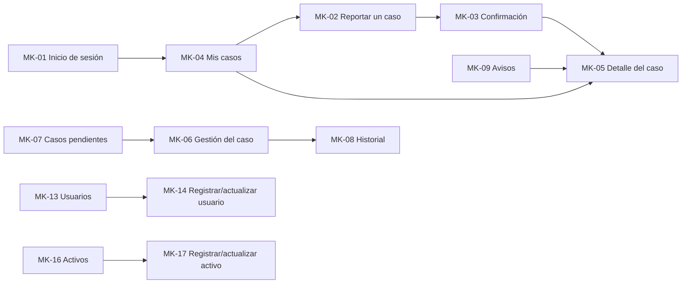

# 4. Mockups: pantallas del sistema web

> **Guía de seguimiento:** Fase 1 — actividad *4. Mockups (UI/UX): el Borde que luego será la Vista*.
>
> **Fuente:** documento Word *Fase 1 — Historias de Usuario y Criterios de Aceptación, Reglas de Negocio, Requisitos Funcionales y No Funcionales, Casos de Uso, Mockups y Matriz de Trazabilidad* (F. J. Motta Quintero y E. Vásquez Valencia · Docente: Lora Patiño Gloria Amparo · Octubre de 2026).

Cada mockup lleva su código MK, declara qué CU atiende, usa los nombres y tipos del diccionario de datos v4, muestra el camino triste (mensajes de rechazo de las RN) y explica la consecuencia en los avisos. Todas las pantallas comparten el mismo encabezado, menú lateral por perfil y estilo visual.

> **Nota de conversión:** las pantallas del documento Word (Figuras 6 a 23) son imágenes. Cada ficha conserva su contenido completo (campos, botones, eventos y reglas visibles). Las imágenes se referencian en [`img/`](img/) con el nombre `MK-XX.png` y se agregan cuando se suba el archivo Word original.

*Navegación entre pantallas tomada de la columna «Botones ↔ Eventos» de cada ficha.*

## 4.1 Mockups del solicitante

### MK-01 — Inicio de sesión y recuperación de contraseña

*Figura 6. MK-01: Inicio de sesión y recuperación de contraseña.*

| Campo | Contenido |
|---|---|
| **Código** | MK-01 |
| **Pantalla** | Inicio de sesión y recuperación de contraseña |
| **Atiende (CU)** | CU-023 / CU-024 |
| **Campos ↔ Diccionario** | tipo: correo, contrasena_hash (se envía la contraseña, nunca se muestra); recuperación: correo |
| **Botones ↔ Eventos** | Ingresar → autenticar() (RF-34) · Enviar enlace → generar token (RF-35) · ¿Olvidó su contraseña? → panel de recuperación |
| **RN visibles** | RN-20 (mensaje genérico y bloqueo), RN-22 (enlace temporal y de un solo uso), RN-21 |

### MK-02 — Reportar un caso

*Figura 7. MK-02: Reportar un caso.*

| Campo | Contenido |
|---|---|
| **Código** | MK-02 |
| **Pantalla** | Reportar un caso |
| **Atiende (CU)** | CU-001 / CU-004 / CU-018 a CU-022 / CU-042 |
| **Campos ↔ Diccionario** | tipo_caso (problema/solicitud), titulo, descripcion, lugar, id_tipo_problema, id_activo (opcional), afectacion, urgencia, contacto (usuario.telefono/correo), adjuntos |
| **Botones ↔ Eventos** | Enviar caso → crear caso (RF-01, RF-18, RF-19, RF-20) · Adjuntar archivo → RF-42 · Cancelar → vuelve a Mis casos |
| **RN visibles** | RN-01 (error de “Dónde ocurre”), RN-03 (problema/solicitud excluyentes), RN-04, RN-05 (importancia), RN-25, RN-27 |

### MK-03 — Caso registrado (confirmación)

*Figura 8. MK-03: Caso registrado (confirmación).*

| Campo | Contenido |
|---|---|
| **Código** | MK-03 |
| **Pantalla** | Caso registrado (confirmación) |
| **Atiende (CU)** | CU-002 |
| **Campos ↔ Diccionario** | numero_seguimiento, titulo, lugar, tipo_caso, estado_caso, resultado_importancia, tiempo_respuesta |
| **Botones ↔ Eventos** | Ver mi caso → MK-05 (RF-13) · Reportar otro caso → MK-02 |
| **RN visibles** | RN-02, RN-16 (el correo se envía aparte) |

### MK-04 — Mis casos — listado y búsqueda

*Figura 9. MK-04: Mis casos — listado y búsqueda.*

| Campo | Contenido |
|---|---|
| **Código** | MK-04 |
| **Pantalla** | Mis casos — listado y búsqueda |
| **Atiende (CU)** | CU-005 (y CU-025 en el encabezado) |
| **Campos ↔ Diccionario** | numero_seguimiento, titulo, tipo, estado_caso, resultado_importancia, fecha_creacion; filtros: fecha, situación, tipo, palabra clave |
| **Botones ↔ Eventos** | Buscar → RF-10 · Ver → MK-05 (RF-13) · Cerrar sesión (encabezado) → RF-36 |
| **RN visibles** | RN-06 (solo casos propios), RN-23 |

### MK-05 — Detalle del caso (solicitante)

*Figura 10. MK-05: Detalle del caso (solicitante).*

| Campo | Contenido |
|---|---|
| **Código** | MK-05 |
| **Pantalla** | Detalle del caso (solicitante) |
| **Atiende (CU)** | CU-010 / CU-013 / CU-009 / CU-042 |
| **Campos ↔ Diccionario** | lugar, afectacion, urgencia, id_activo, tiempo_respuesta, tiempo_solucion, comentarios visibles, adjuntos, motivo_reapertura |
| **Botones ↔ Eventos** | Reabrir caso → RF-23 · Adjuntar archivo → RF-42 · ✕ del adjunto → RF-43 |
| **RN visibles** | RN-11 (plazo de 5 días hábiles y motivo), RN-13, RN-14, RN-10, RN-27 |

### MK-09 — Avisos

*Figura 11. MK-09: Avisos.*

| Campo | Contenido |
|---|---|
| **Código** | MK-09 |
| **Pantalla** | Avisos |
| **Atiende (CU)** | CU-003 |
| **Campos ↔ Diccionario** | mensaje, canal, fecha_envio, estado_envio, fecha_lectura |
| **Botones ↔ Eventos** | Clic en un aviso → RF-06 · Ver el caso → MK-05 · aviso emergente → RF-04 |
| **RN visibles** | RN-15 (tres canales y reintento), RN-16 |

## 4.2 Mockups del personal de soporte y del supervisor

### MK-06 — Gestión del caso (soporte)

*Figura 12. MK-06: Gestión del caso (soporte).*

| Campo | Contenido |
|---|---|
| **Código** | MK-06 |
| **Pantalla** | Gestión del caso (soporte) |
| **Atiende (CU)** | CU-007 / CU-008 / CU-026 / CU-009 / CU-004 / CU-042 |
| **Campos ↔ Diccionario** | estado_caso, id_personal_asignado, tipo_caso, comentario, visibilidad, adjuntos |
| **Botones ↔ Eventos** | Cambiar situación → RF-12 · Asignar → RF-14 · Pasar a otra persona → RF-15 · Guardar corrección → RF-08 · Agregar comentario → RF-16 · Historial → MK-08 |
| **RN visibles** | RN-07 (solo cambios permitidos), RN-09, RN-10, RN-03, RN-08 |

### MK-07 — Casos pendientes

*Figura 13. MK-07: Casos pendientes.*

| Campo | Contenido |
|---|---|
| **Código** | MK-07 |
| **Pantalla** | Casos pendientes |
| **Atiende (CU)** | CU-006 |
| **Campos ↔ Diccionario** | numero_seguimiento, resultado_importancia, estado_caso, tipo, solicitante, fecha_creacion |
| **Botones ↔ Eventos** | Ordenar por → RF-11 · clic en número → MK-06 |
| **RN visibles** | RN-05 (P1 es la más alta); el mensaje “no hay pendientes” es el CA-4 de la HU-006 |

### MK-08 — Historial del caso

*Figura 14. MK-08: Historial del caso.*

| Campo | Contenido |
|---|---|
| **Código** | MK-08 |
| **Pantalla** | Historial del caso |
| **Atiende (CU)** | CU-041 |
| **Campos ↔ Diccionario** | fecha_accion, accion, campo_modificado, valor_anterior, valor_nuevo, id_usuario_accion |
| **Botones ↔ Eventos** | Solo lectura: no hay botones de edición (RF-41) |
| **RN visibles** | RN-08 (historial inmutable) |

### MK-10 — Resumen de atención y reportes

*Figura 15. MK-10: Resumen de atención y reportes.*

| Campo | Contenido |
|---|---|
| **Código** | MK-10 |
| **Pantalla** | Resumen de atención y reportes |
| **Atiende (CU)** | CU-011 / CU-012 / CU-030 |
| **Campos ↔ Diccionario** | conteo por estado_caso; cumplimiento del SLA; periodo (hoy, semana, mes, rango) |
| **Botones ↔ Eventos** | Hoy/Esta semana/Este mes/Rango → RF-22 · Descargar PDF/Excel → RF-40 |
| **RN visibles** | RN-14 (atrasado), RN-29 (periodo sin casos) |

### MK-11 — Disponibilidad del personal de soporte

*Figura 16. MK-11: Disponibilidad del personal de soporte.*

| Campo | Contenido |
|---|---|
| **Código** | MK-11 |
| **Pantalla** | Disponibilidad del personal de soporte |
| **Atiende (CU)** | CU-015 / CU-034 |
| **Campos ↔ Diccionario** | disponibilidad (disponible/ocupado/ausente), fecha_actualizacion |
| **Botones ↔ Eventos** | Guardar estado → RF-25 · listado del equipo → RF-24 |
| **RN visibles** | RN-28 (estado más reciente; “Sin información”) |

## 4.3 Mockups del administrador

### MK-12 — Reglas de tiempos de atención

*Figura 17. MK-12: Reglas de tiempos de atención.*

| Campo | Contenido |
|---|---|
| **Código** | MK-12 |
| **Pantalla** | Reglas de tiempos de atención |
| **Atiende (CU)** | CU-029 / CU-040 |
| **Campos ↔ Diccionario** | id_tabla_importancia, tipo_caso, tiempo_respuesta, tiempo_solucion, fecha_inicio_vigencia, estado |
| **Botones ↔ Eventos** | Guardar → RF-38 · Editar/Desactivar → RF-38 · tabla → RF-39 |
| **RN visibles** | RN-13 (una sola regla activa por combinación; versiones anteriores) |

### MK-13 — Usuarios — listado y búsqueda

*Figura 18. MK-13: Usuarios — listado y búsqueda.*

| Campo | Contenido |
|---|---|
| **Código** | MK-13 |
| **Pantalla** | Usuarios — listado y búsqueda |
| **Atiende (CU)** | CU-017 / CU-032 (da entrada a CU-016 y CU-031) |
| **Campos ↔ Diccionario** | nombre, correo, cargo, área, perfil_acceso, estado_usuario |
| **Botones ↔ Eventos** | Buscar → RF-27 · + Nuevo usuario → MK-14 (RF-26) · Editar → MK-14 (RF-28) · Inactivar/Reactivar → RF-29 |
| **RN visibles** | RN-21 (inactivo no ingresa; historia conservada) |

### MK-14 — Registrar / actualizar usuario

*Figura 19. MK-14: Registrar / actualizar usuario.*

| Campo | Contenido |
|---|---|
| **Código** | MK-14 |
| **Pantalla** | Registrar / actualizar usuario |
| **Atiende (CU)** | CU-016 / CU-031 |
| **Campos ↔ Diccionario** | nombre, correo, id_cargo, id_area, id_rol_organizacional, perfil_acceso, telefono, contrasena_hash |
| **Botones ↔ Eventos** | Guardar → crear usuario (RF-26) o actualizar (RF-28) · Cancelar → MK-13 |
| **RN visibles** | RN-17 (correo único), RN-18 (área obligatoria para solicitante), RN-19 |

### MK-15 — Cuentas bloqueadas

*Figura 20. MK-15: Cuentas bloqueadas.*

| Campo | Contenido |
|---|---|
| **Código** | MK-15 |
| **Pantalla** | Cuentas bloqueadas |
| **Atiende (CU)** | CU-033 |
| **Campos ↔ Diccionario** | nombre, correo, intentos_fallidos, fecha_bloqueo |
| **Botones ↔ Eventos** | Desbloquear → RF-30 |
| **RN visibles** | RN-20 |

### MK-16 — Activos — listado y búsqueda

*Figura 21. MK-16: Activos — listado y búsqueda.*

| Campo | Contenido |
|---|---|
| **Código** | MK-16 |
| **Pantalla** | Activos — listado y búsqueda |
| **Atiende (CU)** | CU-036 / CU-038 (da entrada a CU-035 y CU-037) |
| **Campos ↔ Diccionario** | nombre, tipo_activo, numero_serie, área, estado |
| **Botones ↔ Eventos** | Buscar → RF-45 · + Nuevo activo → MK-17 (RF-44) · Editar → MK-17 (RF-46) · Dar de baja → RF-47 |
| **RN visibles** | RN-25 (el aviso explica la consecuencia) |

### MK-17 — Registrar / actualizar activo

*Figura 22. MK-17: Registrar / actualizar activo.*

| Campo | Contenido |
|---|---|
| **Código** | MK-17 |
| **Pantalla** | Registrar / actualizar activo |
| **Atiende (CU)** | CU-035 / CU-037 |
| **Campos ↔ Diccionario** | nombre, id_tipo_activo, marca, modelo, numero_serie, id_area, estado, fecha_adquisicion |
| **Botones ↔ Eventos** | Guardar → RF-44 o RF-46 · Cancelar → MK-16 |
| **RN visibles** | RN-24 (serie única; nombre y tipo obligatorios) |

### MK-18 — Catálogos de clasificación

*Figura 23. MK-18: Catálogos de clasificación.*

| Campo | Contenido |
|---|---|
| **Código** | MK-18 |
| **Pantalla** | Catálogos de clasificación |
| **Atiende (CU)** | CU-039 |
| **Campos ↔ Diccionario** | nombre, descripcion, estado de cada catálogo |
| **Botones ↔ Eventos** | Guardar → RF-48 · Editar/Inactivar/Reactivar → RF-48 |
| **RN visibles** | RN-26 (nombre único por catálogo), RN-04 |

## 4.4 Cobertura de los casos de uso

La verificación en reversa: cada caso de uso debe aterrizar en una pantalla o quedar declarado como interno.

| Caso de uso | RF | Dónde aterriza |
|---|---|---|
| [CU-001](3-casos-de-uso.md#cu-001) | RF-01, RF-02 | MK-02 |
| [CU-002](3-casos-de-uso.md#cu-002) | RF-03 | MK-03 |
| [CU-003](3-casos-de-uso.md#cu-003) | RF-04, RF-05, RF-06 | MK-09 |
| [CU-004](3-casos-de-uso.md#cu-004) | RF-02, RF-07, RF-08 | MK-02, MK-06 |
| [CU-005](3-casos-de-uso.md#cu-005) | RF-09, RF-10 | MK-04 |
| [CU-006](3-casos-de-uso.md#cu-006) | RF-11 | MK-07 |
| [CU-007](3-casos-de-uso.md#cu-007) | RF-12 | MK-06 |
| [CU-008](3-casos-de-uso.md#cu-008) | RF-14 | MK-06 |
| [CU-009](3-casos-de-uso.md#cu-009) | RF-16, RF-17 | MK-05, MK-06 |
| [CU-010](3-casos-de-uso.md#cu-010) | RF-13 | MK-05 |
| [CU-011](3-casos-de-uso.md#cu-011) | RF-21 | MK-10 |
| [CU-012](3-casos-de-uso.md#cu-012) | RF-22 | MK-10 |
| [CU-013](3-casos-de-uso.md#cu-013) | RF-23 | MK-05 |
| [CU-015](3-casos-de-uso.md#cu-015) | RF-24 | MK-11 |
| [CU-016](3-casos-de-uso.md#cu-016) | RF-26 | MK-14 |
| [CU-017](3-casos-de-uso.md#cu-017) | RF-27 | MK-13 |
| [CU-018](3-casos-de-uso.md#cu-018) | RF-31 | MK-02 |
| [CU-019](3-casos-de-uso.md#cu-019) | RF-32 | MK-02 |
| [CU-020](3-casos-de-uso.md#cu-020) | RF-33 | MK-02 |
| [CU-021](3-casos-de-uso.md#cu-021) | RF-18 | MK-02 |
| [CU-022](3-casos-de-uso.md#cu-022) | RF-18, RF-19 | MK-02 |
| [CU-023](3-casos-de-uso.md#cu-023) | RF-34 | MK-01 |
| [CU-024](3-casos-de-uso.md#cu-024) | RF-35 | MK-01 |
| [CU-025](3-casos-de-uso.md#cu-025) | RF-36 | MK-04 |
| [CU-026](3-casos-de-uso.md#cu-026) | RF-15 | MK-06 |
| [CU-028](3-casos-de-uso.md#cu-028) | RF-37 | INTERNO: proceso automático; su resultado se ve en MK-09 (aviso) y MK-08 (historial) |
| [CU-029](3-casos-de-uso.md#cu-029) | RF-38 | MK-12 |
| [CU-030](3-casos-de-uso.md#cu-030) | RF-40 | MK-10 |
| [CU-031](3-casos-de-uso.md#cu-031) | RF-28 | MK-13, MK-14 |
| [CU-032](3-casos-de-uso.md#cu-032) | RF-29 | MK-13 |
| [CU-033](3-casos-de-uso.md#cu-033) | RF-30 | MK-15 |
| [CU-034](3-casos-de-uso.md#cu-034) | RF-25 | MK-11 |
| [CU-035](3-casos-de-uso.md#cu-035) | RF-44 | MK-17 |
| [CU-036](3-casos-de-uso.md#cu-036) | RF-45 | MK-16 |
| [CU-037](3-casos-de-uso.md#cu-037) | RF-46 | MK-16, MK-17 |
| [CU-038](3-casos-de-uso.md#cu-038) | RF-47 | MK-16 |
| [CU-039](3-casos-de-uso.md#cu-039) | RF-48 | MK-18 |
| [CU-040](3-casos-de-uso.md#cu-040) | RF-39 | MK-12 |
| [CU-041](3-casos-de-uso.md#cu-041) | RF-41 | MK-08 |
| [CU-042](3-casos-de-uso.md#cu-042) | RF-42, RF-43 | MK-02, MK-05, MK-06 |
| [CU-S01](3-casos-de-uso.md#cu-s01) | RF-20 | INTERNO: no necesita pantalla; se dispara dentro de otros casos de uso y su resultado se ve en MK-05 |
| [CU-S02](3-casos-de-uso.md#cu-s02) | RF-49 | INTERNO: no necesita pantalla; se dispara dentro de otros casos de uso y su resultado se ve en MK-08 |

*De dónde nace:* ningún caso de uso sin pantalla (salvo los tres declarados internos) y ninguna pantalla sin padre. El cierre de sesión (CU-025) vive en el encabezado, visible en todas las pantallas autenticadas; se representa en MK-04.
