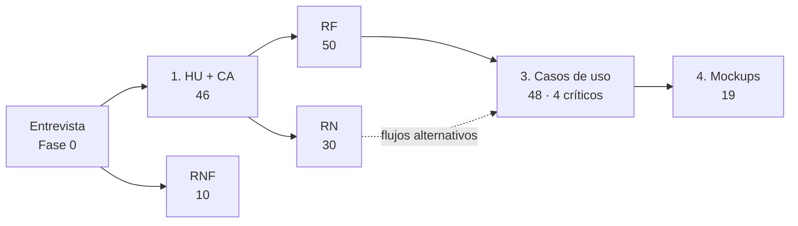

# Fase 1 — Análisis

> *Qué debe hacer el sistema.* Según la guía, esta fase **debería estar completa** (si faltan mockups, se hacen antes del paso 10 de la Fase 2).

**Fuente:** documento Word *Proyecto.docx*, capítulos 1 a 5. Insumo: la [entrevista de la Fase 0](../fase_0/0.4.1-entrevista-resultados.md).

## Trazabilidad con la guía de seguimiento

| Actividad de la guía | Documento | Contenido | Estado |
|---|---|---|:---:|
| 1. HU + Criterios de aceptación | [1-historias-de-usuario.md](1-historias-de-usuario.md) · [1.1-anexos-trazabilidad-hu-rf.md](1.1-anexos-trazabilidad-hu-rf.md) | 46 HU (HU-001 a HU-049, sin HU-014, HU-027 ni HU-039) con criterios de aceptación; Anexos A (justificación), B (HU ↔ RF) y C (RF → HU) | ✅ |
| 2. RF + RN + RNF | [2-reglas-de-negocio-y-requisitos.md](2-reglas-de-negocio-y-requisitos.md) | 30 RN, 50 RF con fichas y 10 RNF | ✅ |
| 3. Casos de uso: general COMPLETO + 4 a 6 críticos documentados | [3-casos-de-uso.md](3-casos-de-uso.md) | 48 CU documentados (46 + CU-S01 y CU-S02) y 4 CU críticos (CU-001, CU-007, CU-016 y CU-029) con su diagrama y fichas | ✅ |
| 4. Mockups (UI/UX): el Borde que luego será la Vista | [4-mockups.md](4-mockups.md) | 19 pantallas (MK-01 a MK-19), cobertura CU → MK y correspondencia de botones con los 57 métodos del diagrama de clases | ✅ |
| Matriz de análisis | [5-matriz-de-trazabilidad-analisis.md](5-matriz-de-trazabilidad-analisis.md) | HU → RF → RN → CU → MK (matriz aprobada) | ✅ |

Las imágenes (diagrama de casos de uso críticos y las 19 pantallas) están en [`img/`](img/). Los cambios aprobados de esta fase se registran en el [CRF-002](../gestion-del-cambio/crf-002-fase-1.md).

## Versión anterior

[`version-anterior/`](version-anterior/) conserva la primera versión del análisis que estaba en el repositorio (otra numeración). Quedó reemplazada por *Proyecto.docx* y se guarda solo como evidencia del trabajo iterativo.
