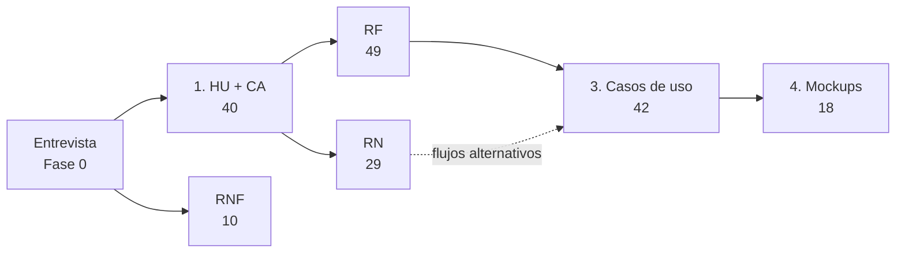

# Fase 1 — Análisis

> *Qué debe hacer el sistema.* Según la guía, esta fase **debería estar completa** (si faltan mockups, se hacen antes del paso 10 de la Fase 2).

**Fuente principal:** documento Word *Fase 1 — Historias de Usuario y Criterios de Aceptación, Reglas de Negocio, Requisitos Funcionales y No Funcionales, Casos de Uso, Mockups y Matriz de Trazabilidad* (Francisco Javier Motta Quintero y Esteban Vásquez Valencia · Docente: Lora Patiño Gloria Amparo · Octubre de 2026). Insumo: la [entrevista de la Fase 0](../fase_0/0.4.1-entrevista-resultados.md).

## Trazabilidad con la guía de seguimiento

| Actividad de la guía | Documento | Contenido | Estado |
|---|---|---|:---:|
| 1. HU + Criterios de aceptación | [1-historias-de-usuario.md](1-historias-de-usuario.md) · [1.1-anexos-trazabilidad-hu-rf.md](1.1-anexos-trazabilidad-hu-rf.md) | 40 HU con criterios en Gherkin; Anexos A (justificación), B (HU → RF) y C (RF → HU) | ✅ |
| 2. RF + RN + RNF | [2.1-reglas-de-negocio.md](2.1-reglas-de-negocio.md) · [2.2-requisitos-funcionales.md](2.2-requisitos-funcionales.md) · [2.3-requisitos-no-funcionales.md](2.3-requisitos-no-funcionales.md) | 29 RN, 49 RF con fichas, 10 RNF medibles | ✅ |
| 3. Casos de uso: general COMPLETO + 4 a 6 críticos documentados | [3-casos-de-uso.md](3-casos-de-uso.md) | 5 diagramas por actor (Mermaid), resumen y 42 CU documentados (40 + CU-S01 y CU-S02) | ✅ (imágenes UML originales pendientes) |
| 4. Mockups (UI/UX): el Borde que luego será la Vista | [4-mockups.md](4-mockups.md) | 18 pantallas MK-01 a MK-18 y cobertura CU → MK | ✅ (imágenes pendientes) |
| Matriz de análisis y validación | [5-matriz-de-trazabilidad-y-validacion.md](5-matriz-de-trazabilidad-y-validacion.md) | HU → RF → RN → CU → MK y 11 verificaciones recalculadas | ✅ |

**Cadena de trazabilidad:** cada elemento cita su padre: HU → RN/RF → CU → MK.

## Pendientes

- **Imágenes:** las figuras 1 a 23 del Word (diagramas UML de casos de uso y mockups) son imágenes. Ver [img/README.md](img/README.md).

## Versión anterior

La carpeta [`version-anterior/`](version-anterior/) conserva la primera versión del análisis que estaba en el repositorio (actores, casos de uso, escenarios, RN, RF, RNF y diagramas de canal), con otra numeración. Quedó reemplazada por los documentos de esta carpeta y se guarda como evidencia del trabajo iterativo.
