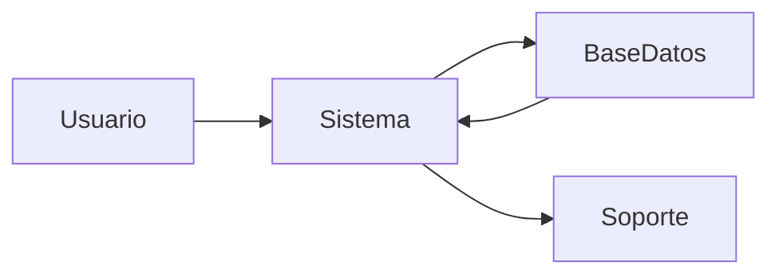
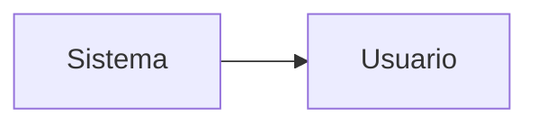
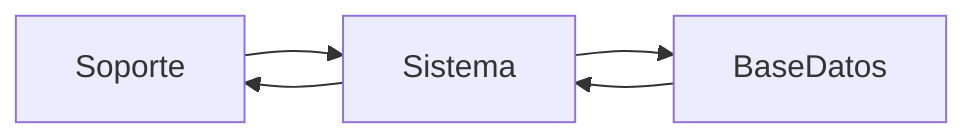
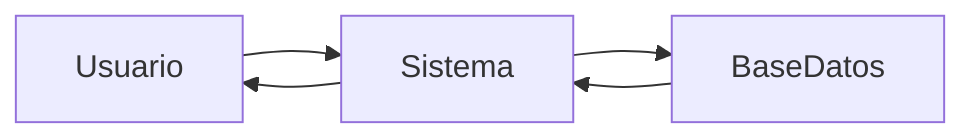
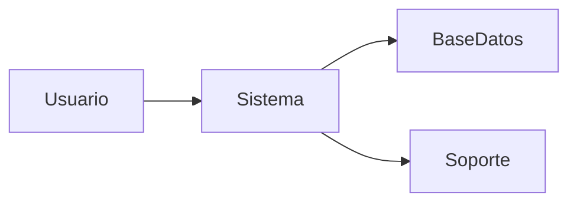
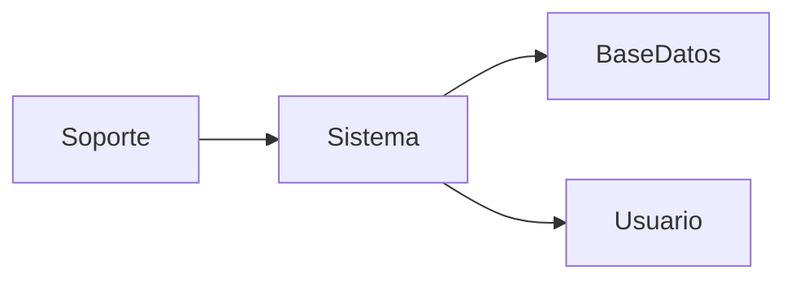
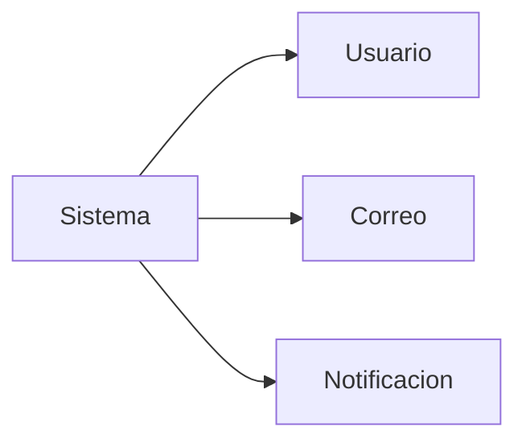

> ⚠️ **Versión anterior.** Este archivo es la primera versión del análisis que estaba en el repositorio (carpeta `docs/3-analisis`). Usa otra numeración y fue reemplazado por la versión del documento Word de la Fase 1. Se conserva solo como evidencia del trabajo iterativo (metodología ágil, ver [0.4](../../fase_0/0.4-recoleccion-de-informacion-y-metodologia.md)). La versión vigente está en [3. Casos de uso](../3-casos-de-uso.md).

# Diagramas de Canal

--- 

## 1. Registro de caso (Usuario → Sistema → Soporte)

--- 

## 2. Confirmación del caso (Sistema → Usuario)

--- 

## 3. Atención del caso (Soporte ↔ Sistema)

--- 

## 4. Consulta del caso (Usuario ↔ Sistema)

--- 

## 5. Reapertura del caso (Usuario → Sistema → Soporte)

--- 

## 6. Cierre del caso (Soporte → Sistema → Usuario)

--- 

## 7. Envío de avisos (Sistema → Usuario)

