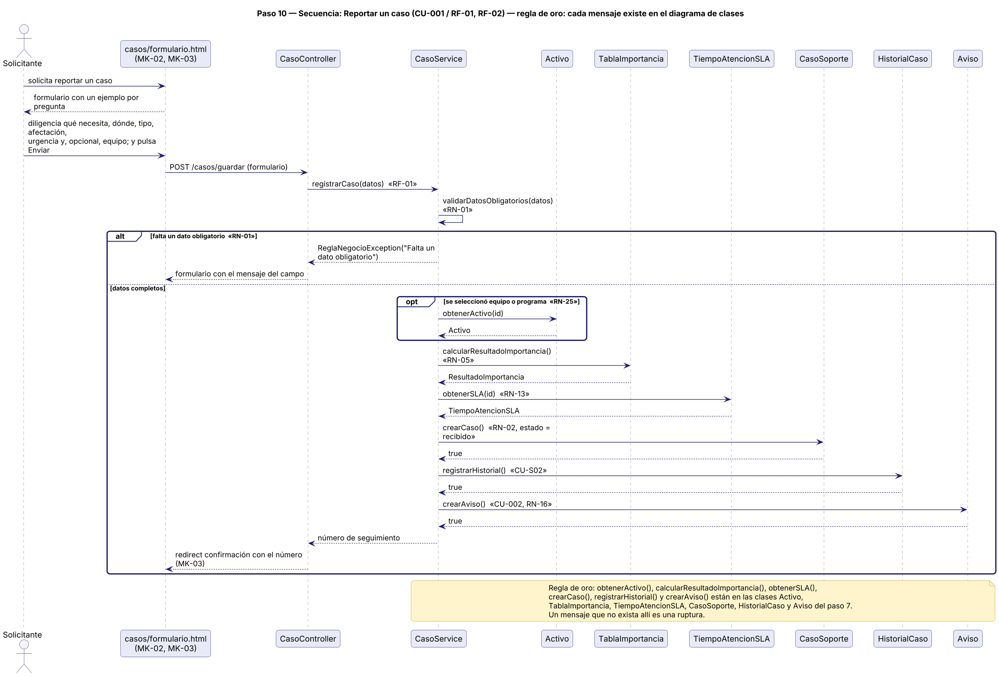
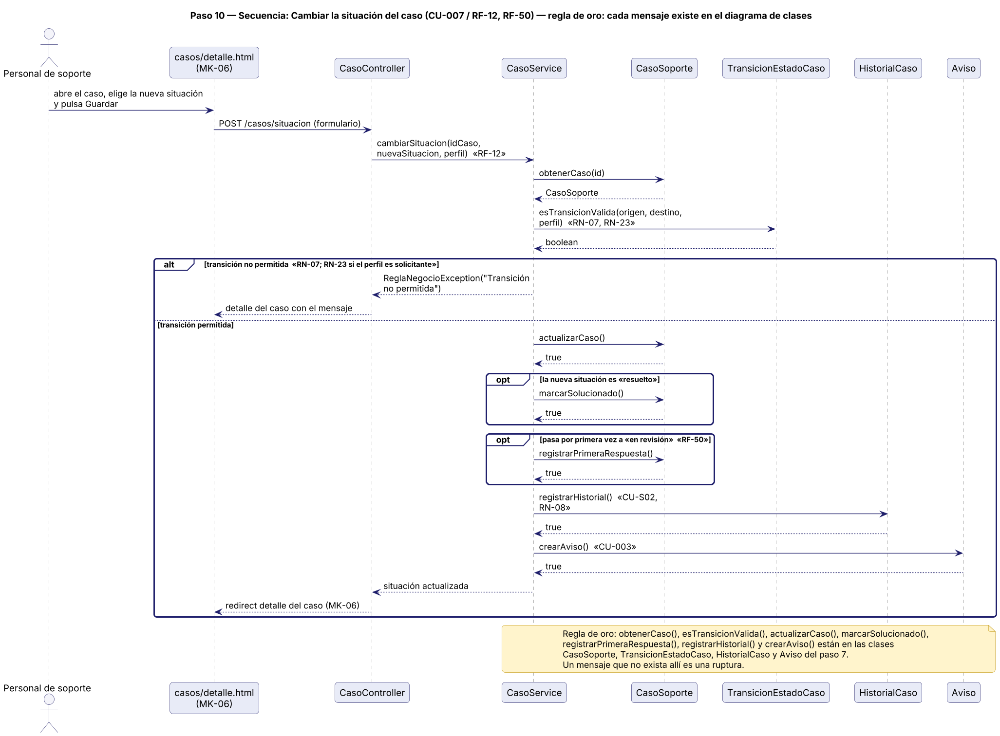
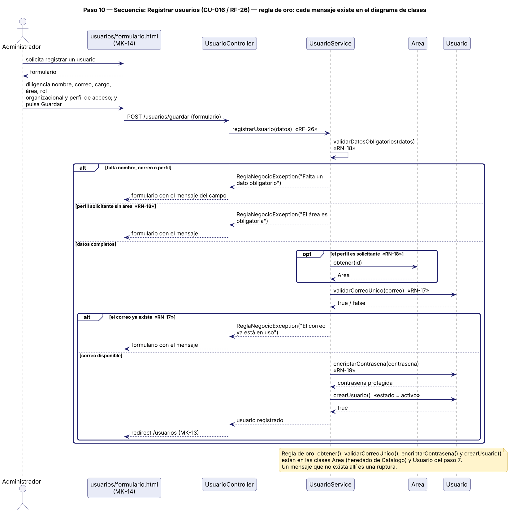
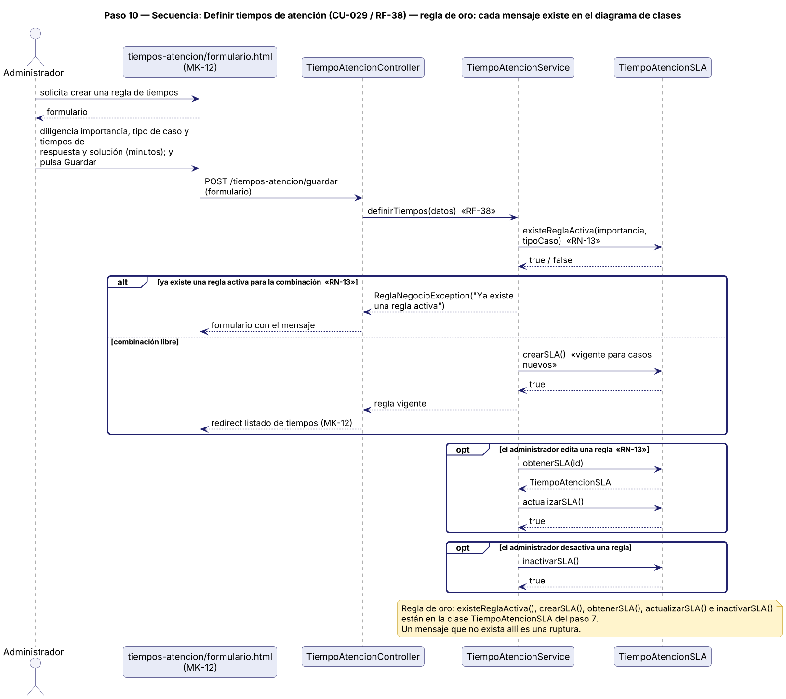

# 12. Diagramas de secuencia de los casos de uso críticos

> **Guía de seguimiento:** Fase 2 — actividad *10. Diagramas de Secuencia: regla de oro, ningún mensaje invoca un método que no exista en clases*.
>
> **Fuente:** documento Word *Proyecto.docx* — «Mesa de Ayuda TI de Nexa Servicios» (F. J. Motta Quintero y E. Vásquez Valencia · Ingeniería de Software II · Docente: Lora Patiño Gloria Amparo · Octubre de 2026), sección 12.

## 12.1 CU-001 Reportar un caso de soporte

> 🔗 Caso de uso: [CU-001](../fase_1/3-casos-de-uso.md#cu-001) · Nace de [HU-001](../fase_1/1-historias-de-usuario.md#hu-001)

**Figura 28**  
*Diagrama de secuencia — Reportar un caso de soporte (CU-001)*

*Nota. Elaboración propia, a partir de los casos de uso de la Fase 1, del DDA y del diagrama de clases. El diagrama incluye Aviso.crearAviso() porque CU-001 incluye CU-002 (confirmación del caso). Los diagramas de secuencia se elaboran solo para los cuatro casos de uso críticos seleccionados (CU-001, CU-007, CU-016 y CU-029); en los demás casos de uso la matriz de trazabilidad marca «N/A: caso no crítico».*

## 12.2 CU-007 Cambiar la situación actual del caso

> 🔗 Caso de uso: [CU-007](../fase_1/3-casos-de-uso.md#cu-007) · Nace de [HU-007](../fase_1/1-historias-de-usuario.md#hu-007)

**Figura 29**  
*Diagrama de secuencia — Cambiar la situación actual del caso (CU-007)*

*Nota. Elaboración propia, a partir de los casos de uso de la Fase 1, del DDA y del diagrama de clases.*

## 12.3 CU-016 Registrar usuarios del sistema

> 🔗 Caso de uso: [CU-016](../fase_1/3-casos-de-uso.md#cu-016) · Nace de [HU-016](../fase_1/1-historias-de-usuario.md#hu-016)

**Figura 30**  
*Diagrama de secuencia — Registrar usuarios del sistema (CU-016)*

*Nota. Elaboración propia, a partir de los casos de uso de la Fase 1, del DDA y del diagrama de clases.*

## 12.4 CU-029 Definir tiempos de atención

> 🔗 Caso de uso: [CU-029](../fase_1/3-casos-de-uso.md#cu-029) · Nace de [HU-029](../fase_1/1-historias-de-usuario.md#hu-029)

**Figura 31**  
*Diagrama de secuencia — Definir tiempos de atención (CU-029)*

*Nota. Elaboración propia, a partir de los casos de uso de la Fase 1, del DDA y del diagrama de clases.*
