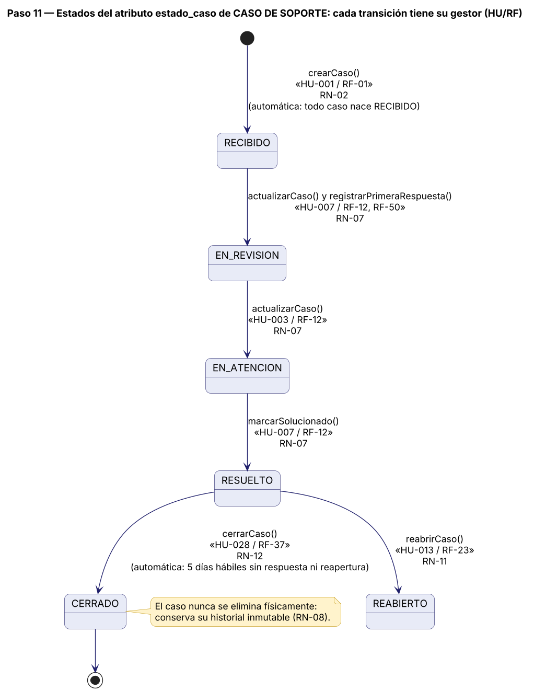
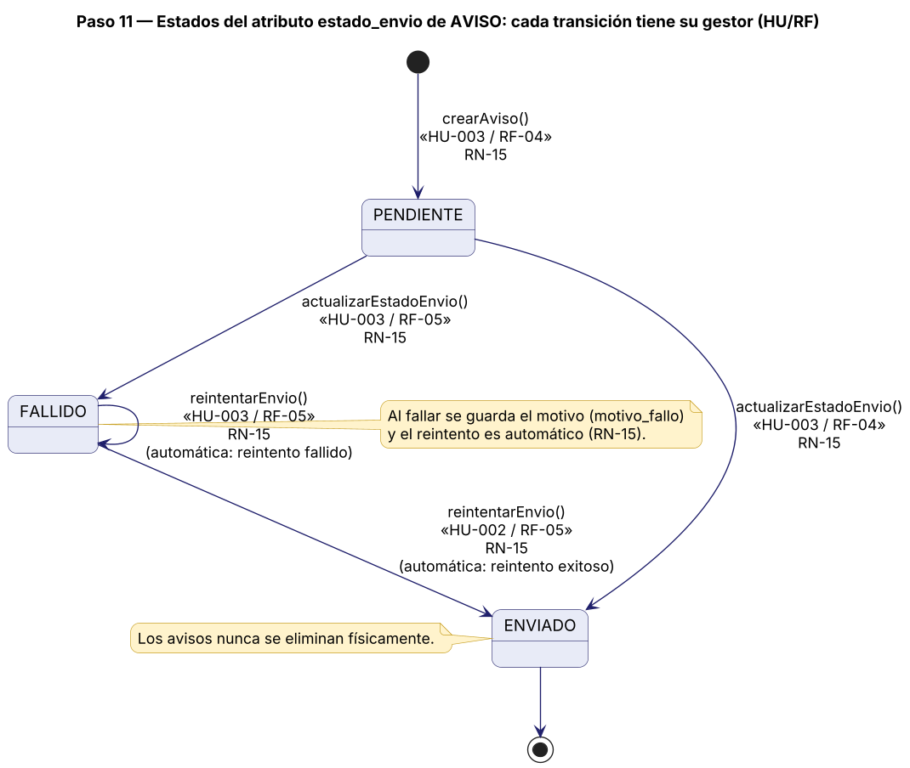
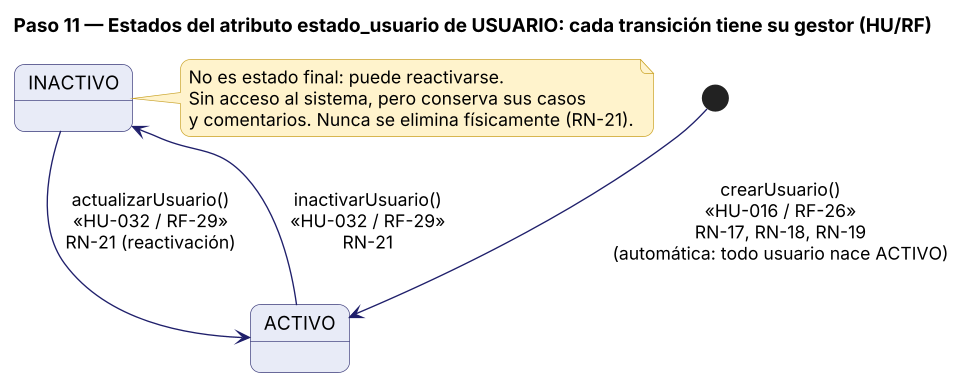
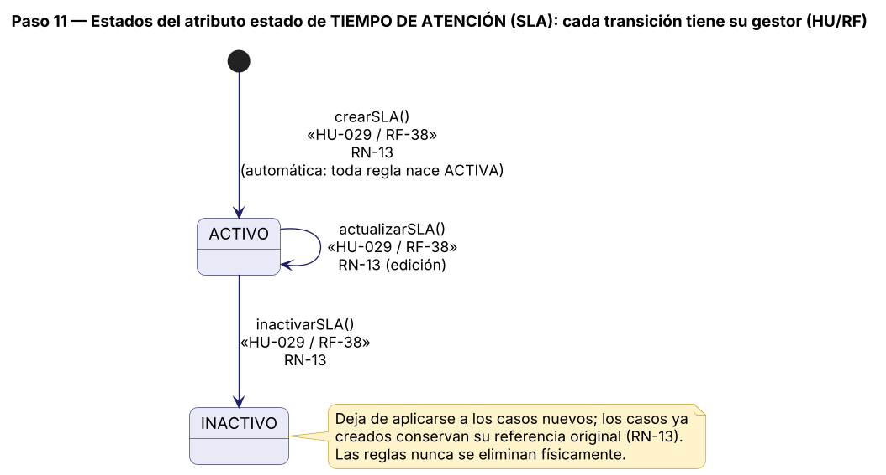

# 13. Diagramas de estados de las entidades críticas

> **Guía de seguimiento:** Fase 2 — actividad *11. Diagrama de Estados: cada transición del ENUM con su gestor*.
>
> **Fuente:** documento Word *Proyecto.docx* — «Mesa de Ayuda TI de Nexa Servicios» (F. J. Motta Quintero y E. Vásquez Valencia · Ingeniería de Software II · Docente: Lora Patiño Gloria Amparo · Octubre de 2026), sección 13.

## 13.1 CasoSoporte (estado_caso)

**Figura 32**  
*Diagrama de estados — CasoSoporte*

*Nota. Elaboración propia, a partir del diccionario de datos, las HU, los RF y las RN. Cada transición indica su respaldo documental.*

## 13.2 Aviso (estado_envio)

**Figura 33**  
*Diagrama de estados — Aviso*

*Nota. Elaboración propia, a partir del diccionario de datos, las HU, los RF y las RN. Cada transición indica su respaldo documental.*

## 13.3 Usuario (estado_usuario)

**Figura 34**  
*Diagrama de estados — Usuario*

*Nota. Elaboración propia, a partir del diccionario de datos, las HU, los RF y las RN. Cada transición indica su respaldo documental.*

## 13.4 TiempoAtencionSLA (estado)

**Figura 35**  
*Diagrama de estados — TiempoAtencionSLA*

*Nota. Elaboración propia, a partir del diccionario de datos, las HU, los RF y las RN. Cada transición indica su respaldo documental.*
