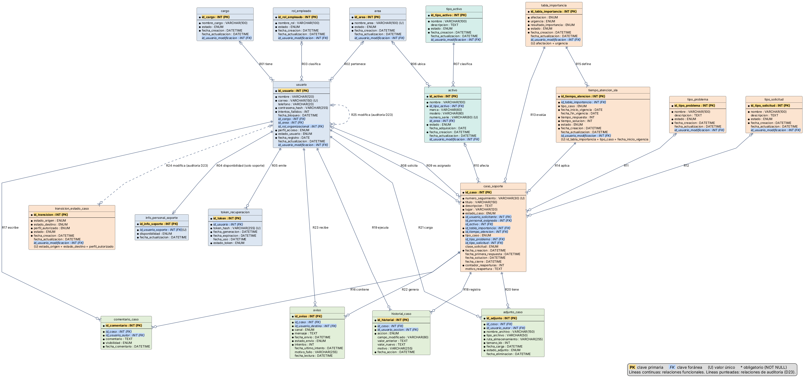

# 8. Modelo entidad-relación (MER)

> **Guía de seguimiento:** Fase 2 — actividad *6. MER / Modelo Relacional (en retroceso: desde el diccionario)*.
>
> **Fuente:** documento Word *Proyecto.docx* — «Mesa de Ayuda TI de Nexa Servicios» (F. J. Motta Quintero y E. Vásquez Valencia · Ingeniería de Software II · Docente: Lora Patiño Gloria Amparo · Octubre de 2026), sección 8.

MER versión 2 en notación de pata de gallo: 18 entidades, 161 atributos y 25 relaciones (R01 a R25). Las relaciones de auditoría R24 y R25 (punteadas) corresponden a id_usuario_modificacion. Los nombres de las entidades son los de las tablas del diccionario; el MER las abrevia con un alias para dibujarlas (por ejemplo «caso» para caso_soporte).

*Consultar Modelo Entidad-Relación completo en HTML (archivo HTML externo, no incluido en las fuentes entregadas).*

**Figura 21**  
*Modelo entidad-relación (MER) de la Mesa de Ayuda TI — versión 2*

*Nota.* Elaboración propia.

**Relaciones del MER**

**Tabla 242**  
*Relaciones del modelo entidad-relación (MER)*

| **ID** | **Entidad padre**   | **Entidad hija**       | **Cardinalidad (padre → hija)**                                           | **Etiqueta en el MER**        |
|--------|---------------------|------------------------|---------------------------------------------------------------------------|-------------------------------|
| R01    | cargo               | usuario                | 1 cargo: cero o una → usuario: cero o muchas                              | tiene                         |
| R02    | area                | usuario                | 1 area: cero o una → usuario: cero o muchas                               | pertenece                     |
| R03    | rol_empleado        | usuario                | 1 rol_empleado: cero o una → usuario: cero o muchas                       | clasifica                     |
| R04    | usuario             | info_personal_soporte  | 1 usuario: exactamente una → info_personal_soporte: cero o una            | disponibilidad (solo soporte) |
| R05    | usuario             | token_recuperacion     | 1 usuario: exactamente una → token_recuperacion: cero o muchas            | emite                         |
| R06    | area                | activo                 | 1 area: cero o una → activo: cero o muchas                                | ubica                         |
| R07    | tipo_activo         | activo                 | 1 tipo_activo: exactamente una → activo: cero o muchas                    | clasifica                     |
| R08    | usuario             | caso_soporte           | 1 usuario: exactamente una → caso_soporte: cero o muchas                  | solicita                      |
| R09    | usuario             | caso_soporte           | 1 usuario: cero o una → caso_soporte: cero o muchas                       | es asignado                   |
| R10    | activo              | caso_soporte           | 1 activo: cero o una → caso_soporte: cero o muchas                        | afecta                        |
| R11    | tipo_problema       | caso_soporte           | 1 tipo_problema: cero o una → caso_soporte: cero o muchas                 |                               |
| R12    | tipo_solicitud      | caso_soporte           | 1 tipo_solicitud: cero o una → caso_soporte: cero o muchas                |                               |
| R13    | tabla_importancia   | caso_soporte           | 1 tabla_importancia: exactamente una → caso_soporte: cero o muchas        | evalúa                        |
| R14    | tiempo_atencion_sla | caso_soporte           | 1 tiempo_atencion_sla: exactamente una → caso_soporte: cero o muchas      | aplica                        |
| R15    | tabla_importancia   | tiempo_atencion_sla    | 1 tabla_importancia: exactamente una → tiempo_atencion_sla: cero o muchas | define                        |
| R16    | caso_soporte        | comentario_caso        | 1 caso_soporte: exactamente una → comentario_caso: cero o muchas          | contiene                      |
| R17    | usuario             | comentario_caso        | 1 usuario: exactamente una → comentario_caso: cero o muchas               | escribe                       |
| R18    | caso_soporte        | historial_caso         | 1 caso_soporte: exactamente una → historial_caso: cero o muchas           | registra                      |
| R19    | usuario             | historial_caso         | 1 usuario: exactamente una → historial_caso: cero o muchas                | ejecuta                       |
| R20    | caso_soporte        | adjunto_caso           | 1 caso_soporte: exactamente una → adjunto_caso: cero o muchas             | tiene                         |
| R21    | usuario             | adjunto_caso           | 1 usuario: exactamente una → adjunto_caso: cero o muchas                  | carga                         |
| R22    | caso_soporte        | aviso                  | 1 caso_soporte: exactamente una → aviso: cero o muchas                    | genera                        |
| R23    | usuario             | aviso                  | 1 usuario: exactamente una → aviso: cero o muchas                         | recibe                        |
| R24    | usuario             | transicion_estado_caso | 1 usuario: cero o una → transicion_estado_caso: cero o muchas             | modifica (auditoría D23)      |
| R25    | usuario             | usuario                | 1 usuario: cero o una → usuario: cero o muchas                            | modifica (auditoría D23)      |
