# 6. MER / Modelo relacional

> **Guía de seguimiento:** Fase 2 — actividad *6. MER / Modelo Relacional (en retroceso: desde el diccionario)*.
>
> **Fuente:** documento *Diccionario de datos + Diagrama de clases UML* (Mesa de Ayuda TI — Nexa Servicios), versión del diccionario normalizado (v4) usada por los mockups de la [Fase 1](../fase_1/4-mockups.md).

> **Cómo se obtuvo:** la guía indica construir el MER **en retroceso, desde el diccionario**. Este modelo se generó directamente de las 18 tablas del [diccionario de datos](5-diccionario-de-datos.md) (campos, PK, FK, UNIQUE) y de su tabla de **Relaciones (D26)**, sin agregar entidades ni relaciones. No había en las fuentes un documento de MER aparte; si el equipo tiene uno propio (imagen), puede agregarse en [`img/`](img/).

## Diagrama entidad-relación

Notación de pata de gallo: `||` exactamente uno, `|o` cero o uno, `o{` cero o muchos.

```mermaid
erDiagram
    cargo |o--o{ usuario : "Asociación"
    area |o--o{ usuario : "Asociación"
    rol_empleado |o--o{ usuario : "Asociación"
    info_personal_soporte |o--o| usuario : "Asociación 1:1"
    usuario ||--o{ token_recuperacion : "Composición"
    area |o--o{ activo : "Asociación"
    tipo_activo ||--o{ activo : "Asociación"
    usuario ||--o{ caso_soporte : "Asociación (solicitante)"
    usuario |o--o{ caso_soporte : "Asociación (asignado)"
    activo |o--o{ caso_soporte : "Asociación"
    tipo_problema |o--o{ caso_soporte : "Asociación"
    tipo_solicitud |o--o{ caso_soporte : "Asociación"
    tabla_importancia ||--o{ caso_soporte : "Asociación"
    tiempo_atencion_sla ||--o{ caso_soporte : "Asociación"
    caso_soporte ||--o{ comentario_caso : "Composición"
    usuario ||--o{ comentario_caso : "Asociación (autor)"
    caso_soporte ||--o{ historial_caso : "Composición"
    usuario ||--o{ historial_caso : "Asociación (responsable)"
    caso_soporte ||--o{ adjunto_caso : "Composición"
    usuario ||--o{ adjunto_caso : "Asociación (autor)"
    caso_soporte ||--o{ aviso : "Composición"
    usuario ||--o{ aviso : "Asociación (destino)"
    tabla_importancia ||--o{ tiempo_atencion_sla : "Asociación"
    usuario |o--o{ transicion_estado_caso : "Asociación de auditoría"
    area {
        INT id_area PK
        VARCHAR_100 nombre_area UK
        ENUM estado
        DATETIME fecha_creacion
        DATETIME fecha_actualizacion
        INT id_usuario_modificacion FK
    }
    cargo {
        INT id_cargo PK
        VARCHAR_100 nombre_cargo
        ENUM estado
        DATETIME fecha_creacion
        DATETIME fecha_actualizacion
        INT id_usuario_modificacion FK
    }
    rol_empleado {
        INT id_rol_empleado PK
        VARCHAR_100 nombre_rol
        ENUM estado
        DATETIME fecha_creacion
        DATETIME fecha_actualizacion
        INT id_usuario_modificacion FK
    }
    usuario {
        INT id_usuario PK
        VARCHAR_120 nombre
        VARCHAR_150 correo UK
        VARCHAR_20 telefono
        VARCHAR_255 contrasena_hash
        INT intentos_fallidos
        DATETIME fecha_bloqueo
        INT id_cargo FK
        INT id_area FK
        INT id_rol_organizacional FK
        ENUM perfil_acceso
        ENUM estado_usuario
        DATE fecha_registro
    }
    token_recuperacion {
        INT id_token PK
        INT id_usuario FK
        VARCHAR_255 token_hash UK
        DATETIME fecha_generacion
        DATETIME fecha_expiracion
        DATETIME fecha_uso
        ENUM estado_token
    }
    activo {
        INT id_activo PK
        VARCHAR_100 nombre
        INT id_tipo_activo FK
        VARCHAR_60 marca
        VARCHAR_60 modelo
        VARCHAR_60 numero_serie UK
        INT id_area FK
        ENUM estado
        DATE fecha_adquisicion
        DATETIME fecha_creacion
        DATETIME fecha_actualizacion
        INT id_usuario_modificacion FK
    }
    tipo_activo {
        INT id_tipo_activo PK
        VARCHAR_100 nombre
        TEXT descripcion
        ENUM estado
        DATETIME fecha_creacion
        DATETIME fecha_actualizacion
        INT id_usuario_modificacion FK
    }
    caso_soporte {
        INT id_caso PK
        VARCHAR_30 numero_seguimiento UK
        VARCHAR_150 titulo
        TEXT descripcion
        VARCHAR_120 lugar
        ENUM estado_caso
        INT id_usuario_solicitante FK
        INT id_personal_asignado FK
        INT id_activo FK
        INT id_tabla_importancia FK
        INT id_tiempo_atencion FK
        ENUM tipo_caso
        INT id_tipo_problema FK
        INT id_tipo_solicitud FK
        ENUM clase_solicitud
        DATETIME fecha_creacion
        DATETIME fecha_primera_respuesta
        DATETIME fecha_solucion
        DATETIME fecha_cierre
        INT contador_reaperturas
        TEXT motivo_reapertura
    }
    tipo_problema {
        INT id_tipo_problema PK
        VARCHAR_100 nombre
        TEXT descripcion
        ENUM estado
        DATETIME fecha_creacion
        DATETIME fecha_actualizacion
        INT id_usuario_modificacion FK
    }
    tipo_solicitud {
        INT id_tipo_solicitud PK
        VARCHAR_100 nombre
        TEXT descripcion
        ENUM estado
        DATETIME fecha_creacion
        DATETIME fecha_actualizacion
        INT id_usuario_modificacion FK
    }
    tabla_importancia {
        INT id_tabla_importancia PK
        ENUM afectacion UK
        ENUM urgencia
        ENUM resultado_importancia
        ENUM estado
        DATETIME fecha_creacion
        DATETIME fecha_actualizacion
        INT id_usuario_modificacion FK
    }
    comentario_caso {
        INT id_comentario PK
        INT id_caso FK
        INT id_usuario_autor FK
        TEXT comentario
        ENUM visibilidad
        DATETIME fecha_comentario
    }
    historial_caso {
        INT id_historial PK
        INT id_caso FK
        INT id_usuario_accion FK
        ENUM accion
        VARCHAR_60 campo_modificado
        TEXT valor_anterior
        TEXT valor_nuevo
        DATETIME fecha_accion
    }
    adjunto_caso {
        INT id_adjunto PK
        INT id_caso FK
        INT id_usuario_autor FK
        VARCHAR_150 nombre_archivo
        VARCHAR_50 tipo_archivo
        VARCHAR_255 ruta_almacenamiento
        INT tamano_kb
        DATETIME fecha_carga
        ENUM estado_adjunto
        DATETIME fecha_eliminacion
    }
    info_personal_soporte {
        INT id_info_soporte PK
        INT id_usuario_soporte FK
        ENUM disponibilidad
        DATETIME fecha_actualizacion
    }
    tiempo_atencion_sla {
        INT id_tiempo_atencion PK
        INT id_tabla_importancia FK
        ENUM tipo_caso
        DATE fecha_inicio_vigencia
        DATE fecha_fin_vigencia
        INT tiempo_respuesta
        INT tiempo_solucion
        ENUM estado
        DATETIME fecha_creacion
        DATETIME fecha_actualizacion
        INT id_usuario_modificacion FK
    }
    aviso {
        INT id_aviso PK
        INT id_caso FK
        INT id_usuario_destino FK
        ENUM canal
        TEXT mensaje
        DATETIME fecha_envio
        ENUM estado_envio
        INT intentos
        DATETIME fecha_ultimo_intento
        VARCHAR_255 motivo_fallo
        DATETIME fecha_lectura
    }
    transicion_estado_caso {
        INT id_transicion PK
        ENUM estado_origen UK
        ENUM estado_destino
        ENUM perfil_autorizado
        ENUM estado
        DATETIME fecha_creacion
        DATETIME fecha_actualizacion
        INT id_usuario_modificacion FK
    }
```

## Modelo relacional (esquema)

PK subrayada como **negrita**, FK en *cursiva* con su destino.

- **area** (**id_area**, nombre_area, estado, fecha_creacion, fecha_actualizacion, *id_usuario_modificacion* → usuario.id_usuario)
- **cargo** (**id_cargo**, nombre_cargo, estado, fecha_creacion, fecha_actualizacion, *id_usuario_modificacion* → usuario.id_usuario)
- **rol_empleado** (**id_rol_empleado**, nombre_rol, estado, fecha_creacion, fecha_actualizacion, *id_usuario_modificacion* → usuario.id_usuario)
- **usuario** (**id_usuario**, nombre, correo, telefono, contrasena_hash, intentos_fallidos, fecha_bloqueo, *id_cargo* → cargo.id_cargo, *id_area* → area.id_area, *id_rol_organizacional* → rol_empleado.id_rol_empleado, perfil_acceso, estado_usuario, fecha_registro)
- **token_recuperacion** (**id_token**, *id_usuario* → usuario.id_usuario, token_hash, fecha_generacion, fecha_expiracion, fecha_uso, estado_token)
- **activo** (**id_activo**, nombre, *id_tipo_activo* → tipo_activo.id_tipo_activo, marca, modelo, numero_serie, *id_area* → area.id_area, estado, fecha_adquisicion, fecha_creacion, fecha_actualizacion, *id_usuario_modificacion* → usuario.id_usuario)
- **tipo_activo** (**id_tipo_activo**, nombre, descripcion, estado, fecha_creacion, fecha_actualizacion, *id_usuario_modificacion* → usuario.id_usuario)
- **caso_soporte** (**id_caso**, numero_seguimiento, titulo, descripcion, lugar, estado_caso, *id_usuario_solicitante* → usuario.id_usuario, *id_personal_asignado* → usuario.id_usuario, *id_activo* → activo.id_activo, *id_tabla_importancia* → tabla_importancia.id_tabla_importancia, *id_tiempo_atencion* → tiempo_atencion_sla.id_tiempo_atencion, tipo_caso, *id_tipo_problema* → tipo_problema.id_tipo_problema, *id_tipo_solicitud* → tipo_solicitud.id_tipo_solicitud, clase_solicitud, fecha_creacion, fecha_primera_respuesta, fecha_solucion, fecha_cierre, contador_reaperturas, motivo_reapertura)
- **tipo_problema** (**id_tipo_problema**, nombre, descripcion, estado, fecha_creacion, fecha_actualizacion, *id_usuario_modificacion* → usuario.id_usuario)
- **tipo_solicitud** (**id_tipo_solicitud**, nombre, descripcion, estado, fecha_creacion, fecha_actualizacion, *id_usuario_modificacion* → usuario.id_usuario)
- **tabla_importancia** (**id_tabla_importancia**, afectacion, urgencia, resultado_importancia, estado, fecha_creacion, fecha_actualizacion, *id_usuario_modificacion* → usuario.id_usuario)
- **comentario_caso** (**id_comentario**, *id_caso* → caso_soporte.id_caso, *id_usuario_autor* → usuario.id_usuario, comentario, visibilidad, fecha_comentario)
- **historial_caso** (**id_historial**, *id_caso* → caso_soporte.id_caso, *id_usuario_accion* → usuario.id_usuario, accion, campo_modificado, valor_anterior, valor_nuevo, fecha_accion)
- **adjunto_caso** (**id_adjunto**, *id_caso* → caso_soporte.id_caso, *id_usuario_autor* → usuario.id_usuario, nombre_archivo, tipo_archivo, ruta_almacenamiento, tamano_kb, fecha_carga, estado_adjunto, fecha_eliminacion)
- **info_personal_soporte** (**id_info_soporte**, *id_usuario_soporte* → usuario.id_usuario, disponibilidad, fecha_actualizacion)
- **tiempo_atencion_sla** (**id_tiempo_atencion**, *id_tabla_importancia* → tabla_importancia.id_tabla_importancia, tipo_caso, fecha_inicio_vigencia, fecha_fin_vigencia, tiempo_respuesta, tiempo_solucion, estado, fecha_creacion, fecha_actualizacion, *id_usuario_modificacion* → usuario.id_usuario)
- **aviso** (**id_aviso**, *id_caso* → caso_soporte.id_caso, *id_usuario_destino* → usuario.id_usuario, canal, mensaje, fecha_envio, estado_envio, intentos, fecha_ultimo_intento, motivo_fallo, fecha_lectura)
- **transicion_estado_caso** (**id_transicion**, estado_origen, estado_destino, perfil_autorizado, estado, fecha_creacion, fecha_actualizacion, *id_usuario_modificacion* → usuario.id_usuario)

## Relaciones y reglas de integridad referencial

| Tabla hija (FK) | Columna | Tabla padre | Regla |
|---|---|---|---|
| area | `id_usuario_modificacion` | usuario.id_usuario | ON DELETE SET NULL ON UPDATE CASCADE |
| cargo | `id_usuario_modificacion` | usuario.id_usuario | ON DELETE SET NULL ON UPDATE CASCADE |
| rol_empleado | `id_usuario_modificacion` | usuario.id_usuario | ON DELETE SET NULL ON UPDATE CASCADE |
| usuario | `id_cargo` | cargo.id_cargo | ON DELETE RESTRICT ON UPDATE CASCADE |
| usuario | `id_area` | area.id_area | ON DELETE RESTRICT ON UPDATE CASCADE |
| usuario | `id_rol_organizacional` | rol_empleado.id_rol_empleado | ON DELETE RESTRICT ON UPDATE CASCADE |
| token_recuperacion | `id_usuario` | usuario.id_usuario | ON DELETE CASCADE ON UPDATE CASCADE |
| activo | `id_tipo_activo` | tipo_activo.id_tipo_activo | ON DELETE RESTRICT ON UPDATE CASCADE |
| activo | `id_area` | area.id_area | ON DELETE RESTRICT ON UPDATE CASCADE |
| activo | `id_usuario_modificacion` | usuario.id_usuario | ON DELETE SET NULL ON UPDATE CASCADE |
| tipo_activo | `id_usuario_modificacion` | usuario.id_usuario | ON DELETE SET NULL ON UPDATE CASCADE |
| caso_soporte | `id_usuario_solicitante` | usuario.id_usuario | ON DELETE RESTRICT ON UPDATE CASCADE |
| caso_soporte | `id_personal_asignado` | usuario.id_usuario | ON DELETE RESTRICT ON UPDATE CASCADE |
| caso_soporte | `id_activo` | activo.id_activo | ON DELETE RESTRICT ON UPDATE CASCADE |
| caso_soporte | `id_tabla_importancia` | tabla_importancia.id_tabla_importancia | ON DELETE RESTRICT ON UPDATE CASCADE |
| caso_soporte | `id_tiempo_atencion` | tiempo_atencion_sla.id_tiempo_atencion | ON DELETE RESTRICT ON UPDATE CASCADE |
| caso_soporte | `id_tipo_problema` | tipo_problema.id_tipo_problema | ON DELETE RESTRICT; CHECK exclusión mutua con id_tipo_solicitud |
| caso_soporte | `id_tipo_solicitud` | tipo_solicitud.id_tipo_solicitud | ON DELETE RESTRICT; CHECK exclusión mutua con id_tipo_problema |
| tipo_problema | `id_usuario_modificacion` | usuario.id_usuario | ON DELETE SET NULL ON UPDATE CASCADE |
| tipo_solicitud | `id_usuario_modificacion` | usuario.id_usuario | ON DELETE SET NULL ON UPDATE CASCADE |
| tabla_importancia | `id_usuario_modificacion` | usuario.id_usuario | ON DELETE SET NULL ON UPDATE CASCADE |
| comentario_caso | `id_caso` | caso_soporte.id_caso | ON DELETE CASCADE ON UPDATE CASCADE |
| comentario_caso | `id_usuario_autor` | usuario.id_usuario | ON DELETE RESTRICT ON UPDATE CASCADE |
| historial_caso | `id_caso` | caso_soporte.id_caso | ON DELETE RESTRICT ON UPDATE CASCADE — protege el historial de un borrado físico del caso |
| historial_caso | `id_usuario_accion` | usuario.id_usuario | ON DELETE RESTRICT ON UPDATE CASCADE |
| adjunto_caso | `id_caso` | caso_soporte.id_caso | ON DELETE CASCADE ON UPDATE CASCADE |
| adjunto_caso | `id_usuario_autor` | usuario.id_usuario | ON DELETE RESTRICT ON UPDATE CASCADE |
| info_personal_soporte | `id_usuario_soporte` | usuario.id_usuario | ON DELETE CASCADE ON UPDATE CASCADE |
| tiempo_atencion_sla | `id_tabla_importancia` | tabla_importancia.id_tabla_importancia | ON DELETE RESTRICT ON UPDATE CASCADE; UNIQUE(id_tabla_importancia, tipo_caso, fecha_inicio_vigencia) |
| tiempo_atencion_sla | `id_usuario_modificacion` | usuario.id_usuario | ON DELETE SET NULL ON UPDATE CASCADE |
| aviso | `id_caso` | caso_soporte.id_caso | ON DELETE CASCADE ON UPDATE CASCADE |
| aviso | `id_usuario_destino` | usuario.id_usuario | ON DELETE RESTRICT ON UPDATE CASCADE |
| transicion_estado_caso | `id_usuario_modificacion` | usuario.id_usuario | ON DELETE SET NULL ON UPDATE CASCADE |
