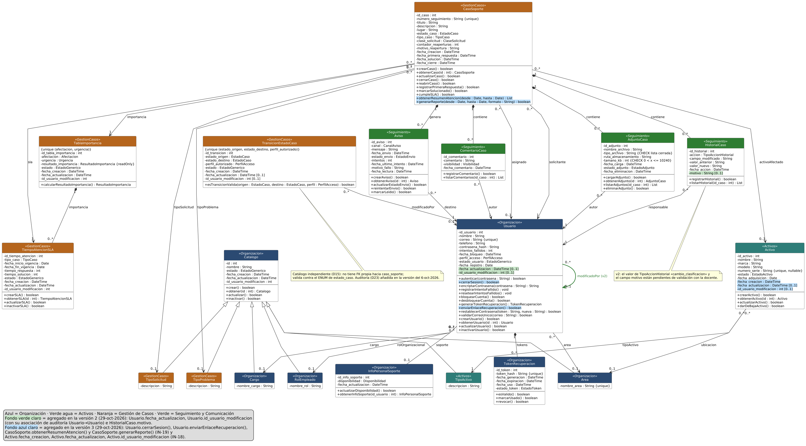

# 9. Diagrama de clases UML (versión 3)

> **Guía de seguimiento:** Fase 2 — actividad *7. Diagrama de Clases*. La sección 9.3 contiene el detalle de la auditoría cruzada (actividad 7b).
>
> **Fuente:** documento Word *Proyecto.docx* — «Mesa de Ayuda TI de Nexa Servicios» (F. J. Motta Quintero y E. Vásquez Valencia · Ingeniería de Software II · Docente: Lora Patiño Gloria Amparo · Octubre de 2026), sección 9.

Diagrama de clases versión 3: 19 clases (una es la clase abstracta Catalogo, de la que heredan seis catálogos), 57 métodos, 25 asociaciones y 6 generalizaciones. Los elementos agregados respecto del diagrama aprobado se dibujan resaltados: en verde los de la versión 2 (CRF-002) y en azul los de la versión 3 (IN-18 e IN-19). Se presenta completo, en una sola vista, en la figura siguiente, y también mediante el enlace a la versión HTML.

*Consultar diagrama de clases UML completo en HTML (archivo HTML externo, no incluido en las fuentes entregadas).*

**Figura 22**  
*Diagrama de clases UML — versión 3 (vista completa)*

*Nota.* Elaboración propia.

## 9.1 Elementos agregados al diagrama y su respaldo

**Tabla 243**  
*Elementos agregados al diagrama de clases y su respaldo*

| **Elemento**                                                                   | **Clase**     | **Versión**  | **Respaldo documental**                                                        | **Diccionario / MER**                                                             |
|--------------------------------------------------------------------------------|---------------|--------------|--------------------------------------------------------------------------------|-----------------------------------------------------------------------------------|
| fecha_actualizacion, id_usuario_modificacion; asociación modificadoPor         | Usuario       | v2 (CRF-002) | Auditoría D23; campos solicitados por la docente (IN-18)                       | usuario.fecha_actualizacion, usuario.id_usuario_modificacion; R25                 |
| motivo                                                                         | HistorialCaso | v2 (CRF-002) | HU-049 CA-1 (motivo de la corrección); campo solicitado por la docente (IN-18) | historial_caso.motivo                                                             |
| fecha_creacion, fecha_actualizacion \[0..1\], id_usuario_modificacion \[0..1\] | Activo        | v3 (IN-18)   | Auditoría D23; campos solicitados por la docente (IN-18)                       | activo.fecha_creacion, activo.fecha_actualizacion, activo.id_usuario_modificacion |
| cerrarSesion()                                                                 | Usuario       | v3 (IN-19)   | RF-36 · HU-025 CA-1 · CU-025 · RN-23                                           | No aplica (no guarda datos)                                                       |
| enviarEnlaceRecuperacion() : boolean                                           | Usuario       | v3 (IN-19)   | RF-35 · HU-024 CA-1 · CU-024 · RN-22                                           | token_recuperacion (token_hash, fecha_expiracion, estado_token)                   |
| obtenerResumenAtencion(desde, hasta) : List                                    | CasoSoporte   | v3 (IN-19)   | RF-22 · HU-012 CA-1 y CA-2 · CU-012 · RN-29                                    | Lee caso_soporte (fecha_creacion, estado_caso, fecha_cierre)                      |
| generarReporte(desde, hasta, formato) : boolean                                | CasoSoporte   | v3 (IN-19)   | RF-40 · HU-030 CA-1 y CA-2 · CU-030 · RN-29                                    | Lee caso_soporte; el archivo PDF o Excel no se guarda en la base                  |

## 9.2 Funcionalidades de IN-19: qué método las atiende

**Tabla 244**  
*Funcionalidades de IN-19 y método que las atiende*

| **Funcionalidad**                                               | **RF**                     | **Decisión**                                                                                              | **Método(s)**                                                               | **Mockup**                                       | **Estado**                                                                                   |
|-----------------------------------------------------------------|----------------------------|-----------------------------------------------------------------------------------------------------------|-----------------------------------------------------------------------------|--------------------------------------------------|----------------------------------------------------------------------------------------------|
| Cierre de sesión                                                | RF-36                      | Método nuevo                                                                                              | Usuario.cerrarSesion()                                                      | Cerrar sesión (MK-02 a MK-18)                    | Resuelto                                                                                     |
| Listados y búsquedas de casos, pendientes, usuarios y activos   | RF-10, RF-11, RF-27, RF-45 | Sin método nuevo: ya existen métodos de consulta; otro método duplicaría la funcionalidad                 | CasoSoporte.obtenerCaso(); Usuario.obtenerUsuario(); Activo.obtenerActivo() | MK-04, MK-07, MK-13, MK-16 (Buscar, Ordenar por) | Parcial: las firmas reciben un id; ampliarlas con filtros se confirma con la docente (IN-19) |
| Selección de periodos del resumen y descarga de reportes        | RF-22, RF-40               | Dos métodos nuevos                                                                                        | CasoSoporte.obtenerResumenAtencion(); CasoSoporte.generarReporte()          | MK-10 (periodos; Descargar PDF / Excel)          | Resuelto                                                                                     |
| Envío del correo de recuperación y pantalla de nueva contraseña | RF-35                      | Método nuevo y pantalla nueva; restablecerContrasena() ya existía                                         | Usuario.enviarEnlaceRecuperacion(); Usuario.restablecerContrasena()         | MK-01 (Enviar enlace) y MK-19 (nueva pantalla)   | Resuelto                                                                                     |
| Reactivación de elementos de catálogo                           | RF-48                      | Descartada: RF-48 y HU-043 a HU-048 solo piden crear, editar e inactivar; no se agrega ni método ni botón | Ninguno (Catalogo.actualizar() sigue atendiendo Editar)                     | MK-18: se retiró el botón Reactivar              | Resuelto                                                                                     |
| Captura de afectación y urgencia                                | RF-18                      | Sin método nuevo: lo registra crearCaso()                                                                 | CasoSoporte.crearCaso()                                                     | MK-02 (Enviar caso)                              | Resuelto                                                                                     |
| Corrección del tipo de caso                                     | RF-08, RF-49               | Sin método nuevo: lo atienden actualizarCaso() y registrarHistorial()                                     | CasoSoporte.actualizarCaso(); HistorialCaso.registrarHistorial()            | MK-06 (Guardar corrección)                       | Resuelto (la relación RF-49 ↔ HU-049 quedó establecida en IN-02)                             |

## 9.3 Auditoría cruzada: diccionario ↔ MER ↔ diagrama de clases

Los tres documentos se compararon por programa, a partir de los archivos vigentes: el diccionario (Word), el MER (fuente PlantUML) y el diagrama de clases (fuente PlantUML). Se comparó nombre por nombre, tipo, tamaño, clave primaria, clave foránea, nulidad, relaciones y métodos. Las diferencias encontradas se registran en 9.3.5 y en el Anexo E.

### 9.3.1 Resumen

**Tabla 245**  
*Auditoría cruzada: resumen*

| **Aspecto**                 | **Diccionario**                          | **MER**                                        | **Diagrama de clases**                                                       | **Resultado**                                                                                      |
|-----------------------------|------------------------------------------|------------------------------------------------|------------------------------------------------------------------------------|----------------------------------------------------------------------------------------------------|
| Tablas / entidades / clases | 18 tablas                                | 18 entidades                                   | 19 clases (18 + la abstracta Catalogo)                                       | Coinciden: cada tabla tiene su entidad y su clase                                                  |
| Atributos                   | 161                                      | 161                                            | 141 (sin las claves foráneas que el diagrama expresa como asociaciones)      | Diccionario = MER en nombre, tipo, tamaño, PK, FK y nulidad (161 de 161). Faltan en el diagrama: 0 |
| Tipo de dato                | VARCHAR, TEXT, INT, DATE, DATETIME, ENUM | Igual al diccionario                           | String, int, Date, DateTime                                                  | 0 diferencias de tipo base. El diagrama no registra tamaños                                        |
| Nulidad                     | 35 atributos propios anulables           | Igual al diccionario                           | Marca \[0..1\] en 4 de 35                                                    | Diferencia de notación (IN-24)                                                                     |
| Relaciones                  | 34 FK: 23 funcionales + 11 de auditoría  | 25 relaciones: 23 funcionales + 2 de auditoría | 25 asociaciones: 23 funcionales + 2 de auditoría (6 generalizaciones aparte) | Funcionales: 23 de 23 en los tres. Una multiplicidad difiere (IN-25). Auditoría: ver IN-26         |
| Métodos                     | No aplica                                | No aplica                                      | 57                                                                           | Los 57 están en 4.5.1 con su pantalla y sus HU                                                     |

### 9.3.2 Tablas, entidades y clases

**Tabla 246**  
*Auditoría cruzada: tablas, entidades y clases*

| **Tabla (diccionario)** | **Alias en el MER** | **Clase del diagrama** | **Atrib. diccionario** | **Atrib. MER** | **Atrib. propios en el diagrama** | **Resultado**                        |
|-------------------------|---------------------|------------------------|------------------------|----------------|-----------------------------------|--------------------------------------|
| area                    | area                | Area                   | 6                      | 6              | 6                                 | Diccionario = MER; diagrama completo |
| cargo                   | cargo               | Cargo                  | 6                      | 6              | 6                                 | Diccionario = MER; diagrama completo |
| rol_empleado            | rol_empleado        | RolEmpleado            | 6                      | 6              | 6                                 | Diccionario = MER; diagrama completo |
| usuario                 | usuario             | Usuario                | 15                     | 15             | 12                                | Diccionario = MER; diagrama completo |
| token_recuperacion      | token               | TokenRecuperacion      | 7                      | 7              | 6                                 | Diccionario = MER; diagrama completo |
| activo                  | activo              | Activo                 | 12                     | 12             | 10                                | Diccionario = MER; diagrama completo |
| tipo_activo             | tipo_activo         | TipoActivo             | 7                      | 7              | 7                                 | Diccionario = MER; diagrama completo |
| caso_soporte            | caso                | CasoSoporte            | 21                     | 21             | 14                                | Diccionario = MER; diagrama completo |
| tipo_problema           | tipo_problema       | TipoProblema           | 7                      | 7              | 7                                 | Diccionario = MER; diagrama completo |
| tipo_solicitud          | tipo_solicitud      | TipoSolicitud          | 7                      | 7              | 7                                 | Diccionario = MER; diagrama completo |
| tabla_importancia       | importancia         | TablaImportancia       | 8                      | 8              | 8                                 | Diccionario = MER; diagrama completo |
| comentario_caso         | comentario          | ComentarioCaso         | 6                      | 6              | 4                                 | Diccionario = MER; diagrama completo |
| historial_caso          | historial           | HistorialCaso          | 9                      | 9              | 7                                 | Diccionario = MER; diagrama completo |
| adjunto_caso            | adjunto             | AdjuntoCaso            | 10                     | 10             | 8                                 | Diccionario = MER; diagrama completo |
| info_personal_soporte   | info                | InfoPersonalSoporte    | 4                      | 4              | 3                                 | Diccionario = MER; diagrama completo |
| tiempo_atencion_sla     | sla                 | TiempoAtencionSLA      | 11                     | 11             | 10                                | Diccionario = MER; diagrama completo |
| aviso                   | aviso               | Aviso                  | 11                     | 11             | 9                                 | Diccionario = MER; diagrama completo |
| transicion_estado_caso  | transicion          | TransicionEstadoCaso   | 8                      | 8              | 8                                 | Diccionario = MER; diagrama completo |

Los atributos propios son los que no son claves foráneas, más id_usuario_modificacion cuando el diagrama lo dibuja como atributo. Las demás claves foráneas se expresan como asociaciones (9.3.3). En los seis catálogos, el diagrama usa los atributos heredados de Catalogo (id, nombre, estado, fecha_creacion, fecha_actualizacion, id_usuario_modificacion).

### 9.3.3 Relaciones

**Tabla 247**  
*Auditoría cruzada: relaciones (claves foráneas)*

| **FK (diccionario)**                                         | **Anulable** | **MER**         | **Diagrama de clases (asociación · multiplicidad del extremo referenciado)** | **Resultado**                                                                           |
|--------------------------------------------------------------|--------------|-----------------|------------------------------------------------------------------------------|-----------------------------------------------------------------------------------------|
| usuario.id_cargo → cargo                                     | Sí           | R01 (\|o--o{)   | Usuario → Cargo (cargo) · 0..1                                               | Coincide                                                                                |
| usuario.id_area → area                                       | Sí           | R02 (\|o--o{)   | Usuario → Area (area) · 0..1                                                 | Coincide                                                                                |
| usuario.id_rol_organizacional → rol_empleado                 | Sí           | R03 (\|o--o{)   | Usuario → RolEmpleado (rolOrganizacional) · 0..1                             | Coincide                                                                                |
| token_recuperacion.id_usuario → usuario                      | No           | R05 (\|\|--o{)  | Usuario → TokenRecuperacion (tokens) · 0..\*                                 | Coincide                                                                                |
| activo.id_tipo_activo → tipo_activo                          | No           | R07 (\|\|--o{)  | Activo → TipoActivo (tipoActivo) · 1                                         | Coincide                                                                                |
| activo.id_area → area                                        | Sí           | R06 (\|o--o{)   | Activo → Area (ubicacion) · 0..1                                             | Coincide                                                                                |
| caso_soporte.id_usuario_solicitante → usuario                | No           | R08 (\|\|--o{)  | CasoSoporte → Usuario (solicitante) · 1                                      | Coincide                                                                                |
| caso_soporte.id_personal_asignado → usuario                  | Sí           | R09 (\|o--o{)   | CasoSoporte → Usuario (asignado) · 0..1                                      | Coincide                                                                                |
| caso_soporte.id_activo → activo                              | Sí           | R10 (\|o--o{)   | CasoSoporte → Activo (activoAfectado) · 0..1                                 | Coincide                                                                                |
| caso_soporte.id_tabla_importancia → tabla_importancia        | No           | R13 (\|\|--o{)  | CasoSoporte → TablaImportancia (importancia) · 1                             | Coincide                                                                                |
| caso_soporte.id_tiempo_atencion → tiempo_atencion_sla        | No           | R14 (\|\|--o{)  | CasoSoporte → TiempoAtencionSLA (sla) · 1                                    | Coincide                                                                                |
| caso_soporte.id_tipo_problema → tipo_problema                | Sí           | R11 (\|o--o{)   | CasoSoporte → TipoProblema (tipoProblema) · 0..1                             | Coincide                                                                                |
| caso_soporte.id_tipo_solicitud → tipo_solicitud              | Sí           | R12 (\|o--o{)   | CasoSoporte → TipoSolicitud (tipoSolicitud) · 0..1                           | Coincide                                                                                |
| comentario_caso.id_caso → caso_soporte                       | No           | R16 (\|\|--o{)  | CasoSoporte → ComentarioCaso (contiene) · 0..\*                              | Coincide                                                                                |
| comentario_caso.id_usuario_autor → usuario                   | No           | R17 (\|\|--o{)  | ComentarioCaso → Usuario (autor) · 1                                         | Coincide                                                                                |
| historial_caso.id_caso → caso_soporte                        | No           | R18 (\|\|--o{)  | CasoSoporte → HistorialCaso (contiene) · 0..\*                               | Coincide                                                                                |
| historial_caso.id_usuario_accion → usuario                   | No           | R19 (\|\|--o{)  | HistorialCaso → Usuario (responsable) · 1                                    | Coincide                                                                                |
| adjunto_caso.id_caso → caso_soporte                          | No           | R20 (\|\|--o{)  | CasoSoporte → AdjuntoCaso (contiene) · 0..\*                                 | Coincide                                                                                |
| adjunto_caso.id_usuario_autor → usuario                      | No           | R21 (\|\|--o{)  | AdjuntoCaso → Usuario (autor) · 1                                            | Coincide                                                                                |
| info_personal_soporte.id_usuario_soporte → usuario           | No           | R04 (\|\|--o\|) | Asociación Usuario – InfoPersonalSoporte (soporte) · 0..1                    | Diferencia (IN-25): en el diagrama el extremo de Usuario es 0..1 y la FK es obligatoria |
| tiempo_atencion_sla.id_tabla_importancia → tabla_importancia | No           | R15 (\|\|--o{)  | TablaImportancia → TiempoAtencionSLA (importancia) · 0..\*                   | Coincide                                                                                |
| aviso.id_caso → caso_soporte                                 | No           | R22 (\|\|--o{)  | CasoSoporte → Aviso (genera) · 0..\*                                         | Coincide                                                                                |
| aviso.id_usuario_destino → usuario                           | No           | R23 (\|\|--o{)  | Aviso → Usuario (destino) · 1                                                | Coincide                                                                                |

**Auditoría (id_usuario_modificacion)**

**Tabla 248**  
*Auditoría cruzada: campos de auditoría*

| **Tabla**              | **En el diccionario (FK → usuario)** | **MER**                            | **Diagrama de clases**           | **Resultado**                                              |
|------------------------|--------------------------------------|------------------------------------|----------------------------------|------------------------------------------------------------|
| area                   | Sí                                   | Sin línea (atributo en la entidad) | Sin línea (atributo en la clase) | Atributo en los tres; sin línea en MER ni diagrama (IN-26) |
| cargo                  | Sí                                   | Sin línea (atributo en la entidad) | Sin línea (atributo en la clase) | Atributo en los tres; sin línea en MER ni diagrama (IN-26) |
| rol_empleado           | Sí                                   | Sin línea (atributo en la entidad) | Sin línea (atributo en la clase) | Atributo en los tres; sin línea en MER ni diagrama (IN-26) |
| usuario                | Sí                                   | R25                                | modificadoPor                    | Coincide                                                   |
| activo                 | Sí                                   | Sin línea (atributo en la entidad) | Sin línea (atributo en la clase) | Atributo en los tres; sin línea en MER ni diagrama (IN-26) |
| tipo_activo            | Sí                                   | Sin línea (atributo en la entidad) | Sin línea (atributo en la clase) | Atributo en los tres; sin línea en MER ni diagrama (IN-26) |
| tipo_problema          | Sí                                   | Sin línea (atributo en la entidad) | Sin línea (atributo en la clase) | Atributo en los tres; sin línea en MER ni diagrama (IN-26) |
| tipo_solicitud         | Sí                                   | Sin línea (atributo en la entidad) | Sin línea (atributo en la clase) | Atributo en los tres; sin línea en MER ni diagrama (IN-26) |
| tabla_importancia      | Sí                                   | Sin línea (atributo en la entidad) | Sin línea (atributo en la clase) | Atributo en los tres; sin línea en MER ni diagrama (IN-26) |
| tiempo_atencion_sla    | Sí                                   | Sin línea (atributo en la entidad) | Sin línea (atributo en la clase) | Atributo en los tres; sin línea en MER ni diagrama (IN-26) |
| transicion_estado_caso | Sí                                   | R24                                | modificadoPor                    | Coincide                                                   |

### 9.3.4 Elementos incorporados recientemente

**Tabla 249**  
*Auditoría cruzada: elementos incorporados recientemente*

| **Elemento**                            | **Diccionario** | **MER**   | **Diagrama**       | **Resultado**                  |
|-----------------------------------------|-----------------|-----------|--------------------|--------------------------------|
| usuario.fecha_actualizacion             | Sí              | Sí        | Sí                 | Coincide                       |
| usuario.id_usuario_modificacion         | Sí              | Sí        | Sí                 | Coincide                       |
| historial_caso.motivo                   | Sí              | Sí        | Sí                 | Coincide                       |
| activo.fecha_creacion                   | Sí              | Sí        | Sí                 | Coincide                       |
| activo.fecha_actualizacion              | Sí              | Sí        | Sí                 | Coincide                       |
| activo.id_usuario_modificacion          | Sí              | Sí        | Sí                 | Coincide                       |
| Relación de auditoría usuario → usuario | Sí (FK)         | Sí (R25)  | Sí (modificadoPor) | Coincide                       |
| Usuario.cerrarSesion()                  | No aplica       | No aplica | Sí                 | Coincide con 4.5.1 y con la HU |
| Usuario.enviarEnlaceRecuperacion()      | No aplica       | No aplica | Sí                 | Coincide con 4.5.1 y con la HU |
| CasoSoporte.obtenerResumenAtencion()    | No aplica       | No aplica | Sí                 | Coincide con 4.5.1 y con la HU |
| CasoSoporte.generarReporte()            | No aplica       | No aplica | Sí                 | Coincide con 4.5.1 y con la HU |

### 9.3.5 Diferencias encontradas

**Tabla 250**  
*Auditoría cruzada: diferencias encontradas*

| **ID** | **Diferencia**                                                                                                                                                                                                                                     | **Dónde**                                          | **Estado**                                                                                                                            |
|--------|----------------------------------------------------------------------------------------------------------------------------------------------------------------------------------------------------------------------------------------------------|----------------------------------------------------|---------------------------------------------------------------------------------------------------------------------------------------|
| IN-23  | Area, Cargo y RolEmpleado declaran nombre_area, nombre_cargo y nombre_rol además de Catalogo.nombre, que heredan; el diccionario y el MER tienen una sola columna de nombre por tabla.                                                             | Diagrama de clases (diseño del 6-oct, sin cambios) | Abierta: se deja como está porque es parte del diagrama aprobado; se propone a la docente conservar solo el atributo heredado.        |
| IN-24  | El diagrama marca \[0..1\] en solo 4 de 35 atributos propios que el diccionario declara anulables.                                                                                                                                                 | Diagrama de clases                                 | Abierta: es una diferencia de notación; no cambia ningún dato ni método. Se marcaría en una próxima versión si la docente lo aprueba. |
| IN-25  | La asociación Usuario – InfoPersonalSoporte tiene multiplicidad 0..1 en ambos extremos; la FK info_personal_soporte.id_usuario_soporte es obligatoria y el MER (R04) la dibuja como uno a cero o uno, así que el extremo de Usuario debería ser 1. | Diagrama de clases                                 | Abierta: se deja como está porque pertenece al diagrama aprobado.                                                                     |
| IN-26  | Las FK id_usuario_modificacion de 9 tablas (los seis catálogos, activo, tabla_importancia y tiempo_atencion_sla) están como atributo pero sin línea de relación; solo usuario (R25) y transicion_estado_caso (R24) la tienen.                      | MER y diagrama de clases                           | Abierta: convención de dibujo D23 para no saturar las figuras; el dato sí está en los tres documentos.                                |
