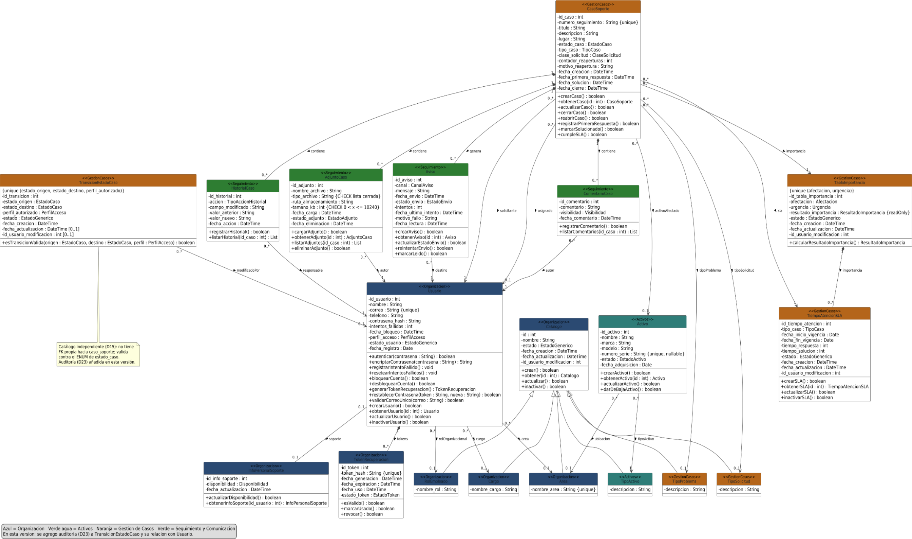

# 7. Diagrama de clases UML

> **Guía de seguimiento:** Fase 2 — actividad *7. Diagrama de Clases* ✓.
>
> **Fuentes:** *Diagrama de clases.pdf* (imagen original) y documento *Diccionario de datos + Diagrama de clases UML* (Mesa de Ayuda TI — Nexa Servicios).

## Diagrama original

**Leyenda de colores (paquetes):** Azul = Organización · Verde agua = Activos · Naranja = Gestión de Casos · Verde = Seguimiento y Comunicación. En verde aparecen los elementos agregados o modificados en esta versión: la clase `TokenRecuperacion`, los campos de borrado lógico de `AdjuntoCaso` y las dos restricciones *unique*. En esta versión se agregó la auditoría (D23) a `TransicionEstadoCaso` y su relación con `Usuario`.

> **Nota del diagrama sobre `TransicionEstadoCaso`:** catálogo independiente (D15): no tiene FK propia hacia `caso_soporte`; valida contra el ENUM de `estado_caso`. Auditoría (D23) añadida en esta versión.

## Versión en Mermaid

Transcripción del diagrama original (clases, atributos, métodos, roles y multiplicidades) para que pueda leerse y versionarse como texto.

```mermaid
classDiagram
    direction TB

    namespace Organizacion {
        class Usuario {
            -id_usuario : int
            -nombre : String
            -correo : String «unique»
            -telefono : String
            -contrasena_hash : String
            -intentos_fallidos : int
            -fecha_bloqueo : DateTime
            -perfil_acceso : PerfilAcceso
            -estado_usuario : EstadoGenerico
            -fecha_registro : Date
            +autenticar(contrasena : String) boolean
            +encriptarContrasena(contrasena : String) String
            +registrarIntentoFallido() void
            +resetearIntentosFallidos() void
            +bloquearCuenta() boolean
            +desbloquearCuenta() boolean
            +generarTokenRecuperacion() TokenRecuperacion
            +restablecerContrasena(token : String, nueva : String) boolean
            +validarCorreoUnico(correo : String) boolean
            +crearUsuario() boolean
            +obtenerUsuario(id : int) Usuario
            +actualizarUsuario() boolean
            +inactivarUsuario() boolean
        }
        class Catalogo {
            <<abstract>>
            -id : int
            -nombre : String
            -estado : EstadoGenerico
            -fecha_creacion : DateTime
            -fecha_actualizacion : DateTime
            -id_usuario_modificacion : int
            +crear() boolean
            +obtener(id : int) Catalogo
            +actualizar() boolean
            +inactivar() boolean
        }
        class RolEmpleado {
            -nombre_rol : String
        }
        class Cargo {
            -nombre_cargo : String
        }
        class Area {
            -nombre_area : String «unique»
        }
        class InfoPersonalSoporte {
            -id_info_soporte : int
            -disponibilidad : Disponibilidad
            -fecha_actualizacion : DateTime
            +actualizarDisponibilidad() boolean
            +obtenerInfoSoporte(id_usuario : int) InfoPersonalSoporte
        }
        class TokenRecuperacion {
            -id_token : int
            -token_hash : String «unique»
            -fecha_generacion : DateTime
            -fecha_expiracion : DateTime
            -fecha_uso : DateTime
            -estado_token : EstadoToken
            +esValido() boolean
            +marcarUsado() boolean
            +revocar() boolean
        }
    }

    namespace Activos {
        class Activo {
            -id_activo : int
            -nombre : String
            -marca : String
            -modelo : String
            -numero_serie : String «unique, nullable»
            -estado : EstadoActivo
            -fecha_adquisicion : Date
            +crearActivo() boolean
            +obtenerActivo(id : int) Activo
            +actualizarActivo() boolean
            +darDeBajaActivo() boolean
        }
        class TipoActivo {
            -descripcion : String
        }
    }

    namespace GestionDeCasos {
        class CasoSoporte {
            -id_caso : int
            -numero_seguimiento : String «unique»
            -titulo : String
            -descripcion : String
            -lugar : String
            -estado_caso : EstadoCaso
            -tipo_caso : TipoCaso
            -clase_solicitud : ClaseSolicitud
            -contador_reaperturas : int
            -motivo_reapertura : String
            -fecha_creacion : DateTime
            -fecha_primera_respuesta : DateTime
            -fecha_solucion : DateTime
            -fecha_cierre : DateTime
            +crearCaso() boolean
            +obtenerCaso(id : int) CasoSoporte
            +actualizarCaso() boolean
            +cerrarCaso() boolean
            +reabrirCaso() boolean
            +registrarPrimeraRespuesta() boolean
            +marcarSolucionado() boolean
            +cumpleSLA() boolean
        }
        class TransicionEstadoCaso {
            «unique(estado_origen, estado_destino, perfil_autorizado)»
            -id_transicion : int
            -estado_origen : EstadoCaso
            -estado_destino : EstadoCaso
            -perfil_autorizado : PerfilAcceso
            -estado : EstadoGenerico
            -fecha_creacion : DateTime
            -fecha_actualizacion : DateTime [0..1]
            -id_usuario_modificacion : int [0..1]
            +esTransicionValida(origen : EstadoCaso, destino : EstadoCaso, perfil : PerfilAcceso) boolean
        }
        class TablaImportancia {
            «unique(afectacion, urgencia)»
            -id_tabla_importancia : int
            -afectacion : Afectacion
            -urgencia : Urgencia
            -resultado_importancia : ResultadoImportancia «readOnly»
            -estado : EstadoGenerico
            -fecha_creacion : DateTime
            -fecha_actualizacion : DateTime
            -id_usuario_modificacion : int
            +calcularResultadoImportancia() ResultadoImportancia
        }
        class TiempoAtencionSLA {
            -id_tiempo_atencion : int
            -tipo_caso : TipoCaso
            -fecha_inicio_vigencia : Date
            -fecha_fin_vigencia : Date
            -tiempo_respuesta : int
            -tiempo_solucion : int
            -estado : EstadoGenerico
            -fecha_creacion : DateTime
            -fecha_actualizacion : DateTime
            -id_usuario_modificacion : int
            +crearSLA() boolean
            +obtenerSLA(id : int) TiempoAtencionSLA
            +actualizarSLA() boolean
            +inactivarSLA() boolean
        }
        class TipoProblema {
            -descripcion : String
        }
        class TipoSolicitud {
            -descripcion : String
        }
    }

    namespace SeguimientoYComunicacion {
        class HistorialCaso {
            -id_historial : int
            -accion : TipoAccionHistorial
            -campo_modificado : String
            -valor_anterior : String
            -valor_nuevo : String
            -fecha_accion : DateTime
            +registrarHistorial() boolean
            +listarHistorial(id_caso : int) List
        }
        class AdjuntoCaso {
            -id_adjunto : int
            -nombre_archivo : String
            -tipo_archivo : String «CHECK lista cerrada»
            -ruta_almacenamiento : String
            -tamano_kb : int «CHECK 0 < x <= 10240»
            -fecha_carga : DateTime
            -estado_adjunto : EstadoAdjunto
            -fecha_eliminacion : DateTime
            +cargarAdjunto() boolean
            +obtenerAdjunto(id : int) AdjuntoCaso
            +listarAdjuntos(id_caso : int) List
            +eliminarAdjunto() boolean
        }
        class Aviso {
            -id_aviso : int
            -canal : CanalAviso
            -mensaje : String
            -fecha_envio : DateTime
            -estado_envio : EstadoEnvio
            -intentos : int
            -fecha_ultimo_intento : DateTime
            -motivo_fallo : String
            -fecha_lectura : DateTime
            +crearAviso() boolean
            +obtenerAviso(id : int) Aviso
            +actualizarEstadoEnvio() boolean
            +reintentarEnvio() boolean
            +marcarLeido() boolean
        }
        class ComentarioCaso {
            -id_comentario : int
            -comentario : String
            -visibilidad : Visibilidad
            -fecha_comentario : DateTime
            +registrarComentario() boolean
            +listarComentarios(id_caso : int) List
        }
    }

    Catalogo <|-- RolEmpleado
    Catalogo <|-- Cargo
    Catalogo <|-- Area
    Catalogo <|-- TipoActivo
    Catalogo <|-- TipoProblema
    Catalogo <|-- TipoSolicitud

    CasoSoporte "1" *-- "0..*" HistorialCaso : contiene
    CasoSoporte "1" *-- "0..*" AdjuntoCaso : contiene
    CasoSoporte "1" *-- "0..*" ComentarioCaso : contiene
    CasoSoporte "1" *-- "0..*" Aviso : genera
    CasoSoporte "0..*" --> "1" Usuario : solicitante
    CasoSoporte "0..*" --> "0..1" Usuario : asignado
    CasoSoporte "0..*" --> "1" TablaImportancia : importancia
    CasoSoporte "0..*" --> "1" TiempoAtencionSLA : sla
    CasoSoporte "0..*" --> "0..1" Activo : activoAfectado
    CasoSoporte "0..*" --> "0..1" TipoProblema : tipoProblema
    CasoSoporte "0..*" --> "0..1" TipoSolicitud : tipoSolicitud
    TiempoAtencionSLA "0..*" --> "1" TablaImportancia : importancia
    HistorialCaso "0..*" --> "1" Usuario : responsable
    AdjuntoCaso "0..*" --> "1" Usuario : autor
    ComentarioCaso "0..*" --> "1" Usuario : autor
    Aviso "0..*" --> "1" Usuario : destino
    TransicionEstadoCaso "0..*" --> "0..1" Usuario : modificadoPor
    Usuario "0..1" -- "0..1" InfoPersonalSoporte : soporte
    Usuario "1" *-- "0..*" TokenRecuperacion : tokens
    Usuario "0..*" --> "0..1" RolEmpleado : rolOrganizacional
    Usuario "0..*" --> "0..1" Cargo : cargo
    Usuario "0..*" --> "0..1" Area : area
    Activo "0..*" --> "0..1" Area : ubicacion
    Activo "0..*" --> "1" TipoActivo : tipoActivo
```

## Enumeraciones del diagrama

> En el documento Word las enumeraciones están como imagen. Sus valores se tomaron de las restricciones `CHECK IN` del [diccionario de datos](5-diccionario-de-datos.md), que es la fuente del diagrama.

| Enumeración | Valores | Origen en el diccionario |
|---|---|---|
| `EstadoCaso` | `recibido`, `en_revision`, `en_atencion`, `resuelto`, `cerrado`, `reabierto` | `caso_soporte.estado_caso` |
| `TipoCaso` | `problema`, `solicitud` | `caso_soporte.tipo_caso` |
| `ClaseSolicitud` | `nuevo`, `cambio`, `consulta` | `caso_soporte.clase_solicitud` |
| `PerfilAcceso` | `solicitante`, `soporte`, `supervisor`, `administrador` | `usuario.perfil_acceso` |
| `EstadoGenerico` | `activo`, `inactivo` | `area.estado` |
| `EstadoActivo` | `activo`, `en_reparacion`, `dado_de_baja` | `activo.estado` |
| `EstadoToken` | `vigente`, `usado`, `revocado` | `token_recuperacion.estado_token` |
| `Afectacion` | `usuario`, `area`, `empresa` | `tabla_importancia.afectacion` |
| `Urgencia` | `baja`, `media`, `alta`, `critica` | `tabla_importancia.urgencia` |
| `ResultadoImportancia` | `P1`, `P2`, `P3`, `P4` | `tabla_importancia.resultado_importancia` |
| `Visibilidad` | `usuario`, `interno_soporte` | `comentario_caso.visibilidad` |
| `TipoAccionHistorial` | `creacion`, `cambio_estado`, `reasignacion`, `comentario`, `adjunto`, `cierre`, `reapertura` | `historial_caso.accion` |
| `EstadoAdjunto` | `activo`, `eliminado` | `adjunto_caso.estado_adjunto` |
| `Disponibilidad` | `disponible`, `ocupado`, `ausente` | `info_personal_soporte.disponibilidad` |
| `CanalAviso` | `correo`, `aviso_emergente`, `detalle_del_caso` | `aviso.canal` |
| `EstadoEnvio` | `enviado`, `pendiente`, `fallido` | `aviso.estado_envio` |

`EstadoGenerico` (`activo`, `inactivo`) lo comparten los catálogos y `estado_usuario`.

## Observaciones resueltas

- Se agregaron los campos `fecha_creacion`, `fecha_actualizacion` e `id_usuario_modificacion` a `transicion_estado_caso`, aplicando la auditoría definida en D23.
- Se conservaron definitivamente los nombres `tipo_problema` y `tipo_solicitud`, por lo que se retiró la indicación pendiente de renombramiento.
- Se conservó `token_hash VARCHAR(255)` como forma protegida de almacenar el código temporal de recuperación, manteniendo coherencia con `contrasena_hash`.
