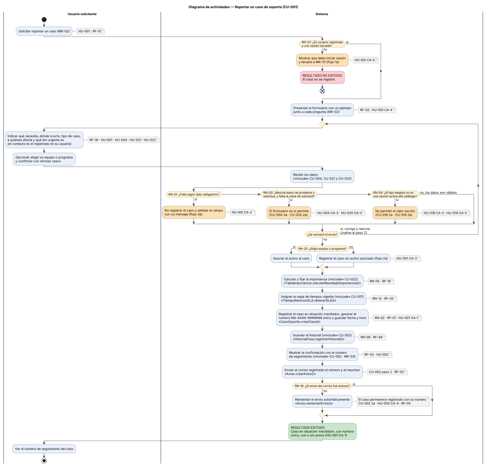
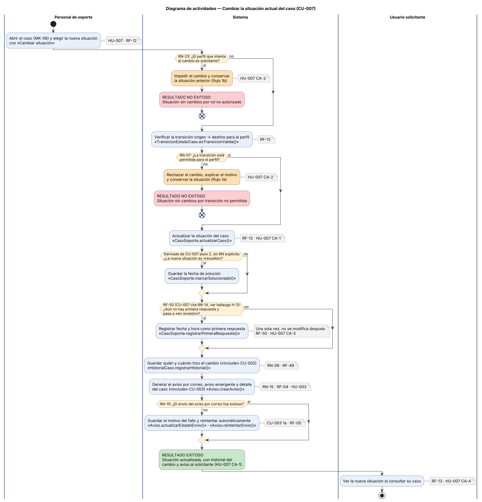
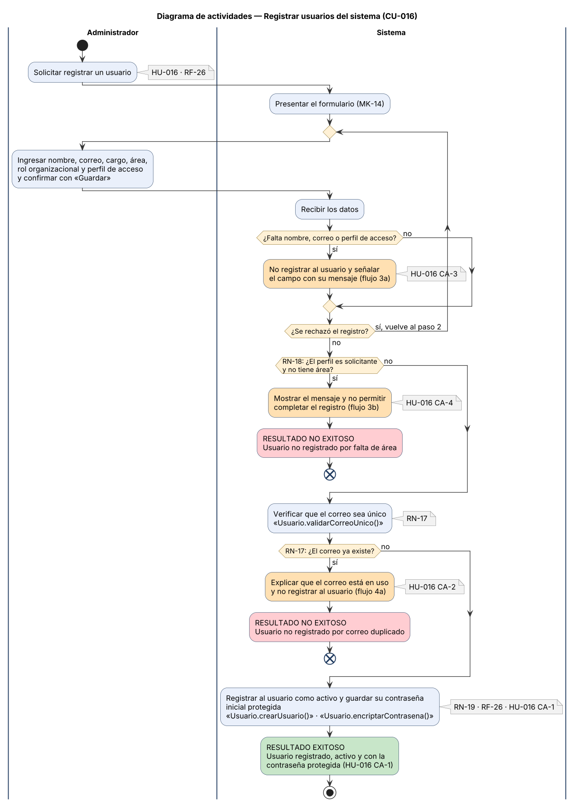
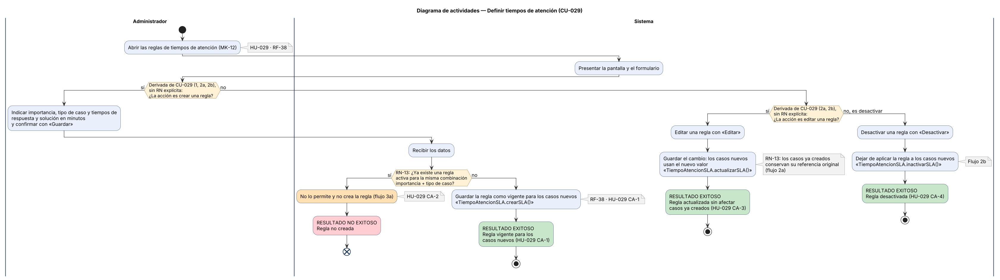

# 10. Diagrama de actividades

> **Guía de seguimiento:** Fase 2 — actividad *8. Diagrama de Actividades: cada rombo cita su RN*.
>
> **Fuente:** documento Word *Proyecto.docx* — «Mesa de Ayuda TI de Nexa Servicios» (F. J. Motta Quintero y E. Vásquez Valencia · Ingeniería de Software II · Docente: Lora Patiño Gloria Amparo · Octubre de 2026), sección 10.

## 10.1 Reportar un caso de soporte (CU-001)

### 10.1.1 Identificación del proceso

**Tabla 251**  
*Identificación del proceso CU-001*

| **Campo**               | **Contenido**                                                                                                                                                                                                                                                                            |
|-------------------------|------------------------------------------------------------------------------------------------------------------------------------------------------------------------------------------------------------------------------------------------------------------------------------------|
| Nombre del proceso      | Reportar un caso de soporte                                                                                                                                                                                                                                                              |
| Caso de uso relacionado | CU-001 (incluye: CU-002, CU-004, CU-021, CU-022, CU-S01, CU-S02)                                                                                                                                                                                                                         |
| Clasificación           | Crítico transaccional                                                                                                                                                                                                                                                                    |
| Justificación           | Es el inicio del ciclo de vida del caso: sin él no hay casos que atender, calificar ni medir. Es transaccional porque crea el caso en situación «recibido», lo deja en el historial y confirma al solicitante. Su selección como crítico está en la sección 3.2 del documento principal. |
| Historias de usuario    | HU-001 (principal), HU-002, HU-004, HU-018, HU-019, HU-020, HU-021, HU-022                                                                                                                                                                                                               |
| Reglas de negocio       | RN-01, RN-02, RN-03, RN-04, RN-05, RN-08, RN-13, RN-16, RN-23, RN-25                                                                                                                                                                                                                     |

*Nota.* Elaboración propia, a partir de CU-001, de su historia de usuario y de la sección 3.2 de este documento.

### 10.1.2 Diagrama de actividades

**Figura 23**  
*Diagrama de actividades — Reportar un caso de soporte (CU-001)*

*Nota.* Elaboración propia, a partir de CU-001, de su historia de usuario y del diagrama de clases versión 3. El código PlantUML está en el archivo A01_CU-001.puml y la imagen en alta resolución en A01_CU-001.png.

## 10.2 Cambiar la situación actual del caso (CU-007)

### 10.2.1 Identificación del proceso

**Tabla 252**  
*Identificación del proceso CU-007*

| **Campo**               | **Contenido**                                                                                                                                                                                                             |
|-------------------------|---------------------------------------------------------------------------------------------------------------------------------------------------------------------------------------------------------------------------|
| Nombre del proceso      | Cambiar la situación actual del caso                                                                                                                                                                                      |
| Caso de uso relacionado | CU-007 (incluye: CU-003, CU-S02)                                                                                                                                                                                          |
| Clasificación           | Crítico transaccional                                                                                                                                                                                                     |
| Justificación           | Hace avanzar el caso por sus situaciones y registra la primera respuesta (RF-50); de él dependen el historial, los avisos y la medición de tiempos. Es transaccional porque ejecuta un evento del ciclo de vida del caso. |
| Historias de usuario    | HU-007 (principal), HU-003                                                                                                                                                                                                |
| Reglas de negocio       | RN-07, RN-08, RN-15, RN-23; RF-50 para la primera respuesta (ver H-3)                                                                                                                                                     |

*Nota.* Elaboración propia, a partir de CU-007, de su historia de usuario y de la sección 3.2 de este documento.

### 10.2.2 Diagrama de actividades

**Figura 24**  
*Diagrama de actividades — Cambiar la situación actual del caso (CU-007)*

*Nota.* Elaboración propia, a partir de CU-007, de su historia de usuario y del diagrama de clases versión 3. El código PlantUML está en el archivo A02_CU-007.puml y la imagen en alta resolución en A02_CU-007.png.

## 10.3 Registrar usuarios del sistema (CU-016)

### 10.3.1 Identificación del proceso

**Tabla 253**  
*Identificación del proceso CU-016*

| **Campo**               | **Contenido**                                                                                                                                                                                 |
|-------------------------|-----------------------------------------------------------------------------------------------------------------------------------------------------------------------------------------------|
| Nombre del proceso      | Registrar usuarios del sistema                                                                                                                                                                |
| Caso de uso relacionado | CU-016 (incluye: Ninguno)                                                                                                                                                                     |
| Clasificación           | Crítico maestro                                                                                                                                                                               |
| Justificación           | Es la única vía de alta de las cuentas que permiten iniciar sesión (RN-23). Es maestro porque crea y mantiene datos de referencia (usuarios) que existen con independencia de cualquier caso. |
| Historias de usuario    | HU-016                                                                                                                                                                                        |
| Reglas de negocio       | RN-17, RN-18, RN-19                                                                                                                                                                           |

*Nota.* Elaboración propia, a partir de CU-016, de su historia de usuario y de la sección 3.2 de este documento.

### 10.3.2 Diagrama de actividades

**Figura 25**  
*Diagrama de actividades — Registrar usuarios del sistema (CU-016)*

*Nota.* Elaboración propia, a partir de CU-016, de su historia de usuario y del diagrama de clases versión 3. El código PlantUML está en el archivo A03_CU-016.puml y la imagen en alta resolución en A03_CU-016.png.

## 10.4 Definir tiempos de atención (CU-029)

### 10.4.1 Identificación del proceso

**Tabla 254**  
*Identificación del proceso CU-029*

| **Campo**               | **Contenido**                                                                                                                                                                             |
|-------------------------|-------------------------------------------------------------------------------------------------------------------------------------------------------------------------------------------|
| Nombre del proceso      | Definir tiempos de atención                                                                                                                                                               |
| Caso de uso relacionado | CU-029 (incluye: Ninguno (sus reglas las consume CU-S01 dentro de CU-001))                                                                                                                |
| Clasificación           | Crítico maestro                                                                                                                                                                           |
| Justificación           | Define las reglas de tiempos que se asignan a cada caso nuevo (CU-S01, RN-13). Es maestro porque crea, edita y desactiva datos de configuración que existen con independencia de un caso. |
| Historias de usuario    | HU-029                                                                                                                                                                                    |
| Reglas de negocio       | RN-13                                                                                                                                                                                     |

*Nota.* Elaboración propia, a partir de CU-029, de su historia de usuario y de la sección 3.2 de este documento.

### 10.4.2 Diagrama de actividades

**Figura 26**  
*Diagrama de actividades — Definir tiempos de atención (CU-029)*

*Nota.* Elaboración propia, a partir de CU-029, de su historia de usuario y del diagrama de clases versión 3. El código PlantUML está en el archivo A04_CU-029.puml y la imagen en alta resolución en A04_CU-029.png.
