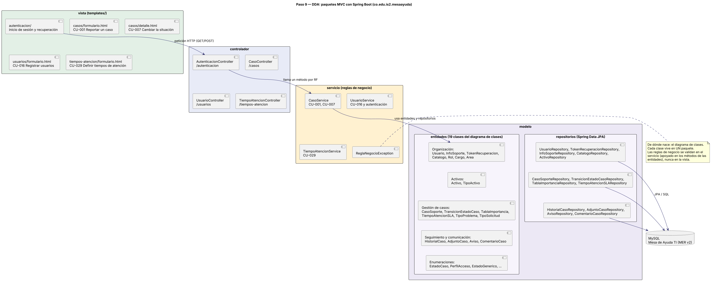

# 11. Diagrama de paquetes del DDA

> **Guía de seguimiento:** Fase 2 — actividad *9. DDA (Documento de Diseño Arquitectónico): MVC + paquetes*.
>
> **Fuente:** documento Word *Proyecto.docx* — «Mesa de Ayuda TI de Nexa Servicios» (F. J. Motta Quintero y E. Vásquez Valencia · Ingeniería de Software II · Docente: Lora Patiño Gloria Amparo · Octubre de 2026), sección 11.

**Figura 27**  
*Diagrama de paquetes MVC con Spring Boot (co.edu.is2.mesaayuda)*

*Nota. Elaboración propia, a partir del diagrama de clases del proyecto.*
