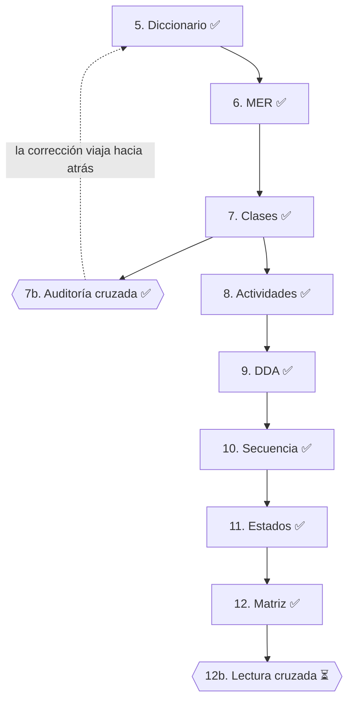

# Fase 2 — Diseño

> *Cómo va a hacerlo* (aquí están sus equipos).

**Fuente:** documento Word *Proyecto.docx*, capítulos 6 a 14.

## Trazabilidad con la guía de seguimiento

| # | Actividad de la guía | Documento | Estado |
|:---:|---|---|:---:|
| 5 | Diccionario de Datos (3FN) | [5-diccionario-de-datos.md](5-diccionario-de-datos.md): 18 entidades | ✅ |
| 6 | MER / Modelo Relacional (en retroceso: desde el diccionario) | [6-mer-modelo-relacional.md](6-mer-modelo-relacional.md): MER versión 2, 18 entidades, 161 atributos y 25 relaciones | ✅ |
| 7 | Diagrama de Clases | [7-diagrama-de-clases.md](7-diagrama-de-clases.md): versión 3, 19 clases y 57 métodos | ✅ |
| 7b | Auditoría cruzada: diccionario ↔ MER ↔ clases | [7b-auditoria-cruzada.md](7b-auditoria-cruzada.md) y detalle en la [sección 9.3](7-diagrama-de-clases.md#93-auditoría-cruzada-diccionario--mer--diagrama-de-clases) | ✅ |
| 8 | Diagrama de Actividades: cada rombo cita su RN | [8-diagrama-de-actividades.md](8-diagrama-de-actividades.md): CU-001, CU-007, CU-016 y CU-029 | ✅ |
| 9 | DDA: MVC + paquetes | [9-dda-diagrama-de-paquetes.md](9-dda-diagrama-de-paquetes.md): paquetes MVC con Spring Boot (`co.edu.is2.mesaayuda`) | ✅ |
| 10 | Diagramas de Secuencia: ningún mensaje invoca un método que no exista en clases | [10-diagramas-de-secuencia.md](10-diagramas-de-secuencia.md): los 4 CU críticos | ✅ |
| 11 | Diagrama de Estados: cada transición del ENUM con su gestor | [11-diagramas-de-estados.md](11-diagramas-de-estados.md): CasoSoporte, Aviso, Usuario y TiempoAtencionSLA | ✅ |
| 12 | Matriz de trazabilidad: HU → RF → entidad → clase.método → CU → mensaje de secuencia → pantalla | [12-matriz-de-trazabilidad.md](12-matriz-de-trazabilidad.md) (incluye además la RN) | ✅ |
| 12b | Lectura cruzada entre equipos (punto de control de lectura) | — | ⏳ no está en el documento |

Todas las figuras (MER, clases, actividades, paquetes, secuencia y estados) están en [`img/`](img/). El documento menciona versiones HTML del MER y del diagrama de clases, pero esos archivos no venían en las fuentes entregadas.

## Versión anterior

[`version-anterior/`](version-anterior/) conserva el diccionario de datos y los diagramas de actividad que estaban antes en el repositorio. Los dos quedaron reemplazados por *Proyecto.docx*.
