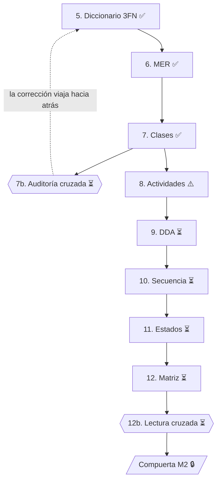

# Fase 2 — Diseño

> *Cómo va a hacerlo* (aquí están sus equipos). Termina en la **Compuerta M2**: sin matriz cerrada y leída, no hay código.

**Fuentes:** documento *Diccionario de datos + Diagrama de clases UML* y *Diagrama de clases.pdf*. El plan de fechas está en el [cronograma de la Fase 0](../fase_0/0.5-cronograma-del-semestre.md).

## Trazabilidad con la guía de seguimiento

| # | Actividad de la guía | Documento | Estado |
|:---:|---|---|:---:|
| 5 | Diccionario de Datos (3FN) ✓ | [5-diccionario-de-datos.md](5-diccionario-de-datos.md): 18 tablas y relaciones (D26) | ✅ |
| 6 | MER / Modelo Relacional (en retroceso: desde el diccionario) | [6-mer-modelo-relacional.md](6-mer-modelo-relacional.md): diagrama ER en Mermaid, esquema relacional e integridad referencial | ✅ generado desde el diccionario |
| 7 | Diagrama de Clases ✓ | [7-diagrama-de-clases.md](7-diagrama-de-clases.md): imagen original, versión en Mermaid y enumeraciones | ✅ |
| 7b | Auditoría cruzada: diccionario ↔ MER ↔ clases (punto de control de lectura) | — | ⏳ pendiente |
| 8 | Diagrama de Actividades: cada rombo cita su RN | [8-diagrama-de-actividades.md](8-diagrama-de-actividades.md) | ⚠️ solo existe la versión anterior |
| 9 | DDA (Documento de Diseño Arquitectónico): MVC + paquetes | — | ⏳ pendiente |
| 10 | Diagramas de Secuencia: ningún mensaje invoca un método que no exista en clases | — | ⏳ pendiente |
| 11 | Diagrama de Estados: cada transición del ENUM con su gestor | — | ⏳ pendiente |
| 12 | Matriz de trazabilidad: HU → RF → entidad → clase.método → CU → mensaje de secuencia → pantalla | — | ⏳ pendiente (existe la de análisis) |
| 12b | Lectura cruzada entre equipos (punto de control de lectura) | — | ⏳ pendiente |
| M2 | **Compuerta M2:** sin matriz cerrada y leída, NO hay código | — | 🔒 cerrada |

## Insumos disponibles para las actividades pendientes

Ninguna fuente contiene todavía estos artefactos. No se inventaron. Estos son los insumos que ya están documentados para construirlos:

**7b. Auditoría cruzada.** El diccionario ya registra correcciones cruzadas con el diagrama de clases (códigos C08 a C13 y D08 a D26) y la sección *Observaciones resueltas* del [diagrama de clases](7-diagrama-de-clases.md#observaciones-resueltas). Falta el documento de auditoría que compare tabla por tabla el diccionario, el MER y las clases.

**9. DDA (MVC + paquetes).** El diagrama de clases ya agrupa las clases en cuatro paquetes (Organización, Activos, Gestión de Casos, Seguimiento y Comunicación). Los [mockups](../fase_1/4-mockups.md) definen el Borde que será la Vista.

**10. Diagramas de secuencia.** Los métodos que pueden invocarse son los del [diagrama de clases](7-diagrama-de-clases.md). Los criterios de aceptación de la Fase 1 ya citan qué método respalda cada escenario (por ejemplo, `TransicionEstadoCaso.esTransicionValida()` → `actualizarCaso()` → `HistorialCaso.registrarHistorial()` en HU-007).

**11. Diagrama de estados.** Los estados son los del ENUM `estado_caso`: `recibido`, `en_revision`, `en_atencion`, `resuelto`, `cerrado`, `reabierto`. Las transiciones permitidas se catalogan en `transicion_estado_caso`. Los criterios ya documentan estas transiciones:
- HU-003 CA-1: recibido → en revisión → en atención → resuelto → cerrado; resuelto → reabierto.
- HU-007 CA-2: recibido → cerrado **no** está permitida.
- HU-007 CA-3: el perfil solicitante no puede cambiar la situación.
- HU-013: la reapertura solo ocurre desde resuelto, dentro de 5 días hábiles.
- HU-028: el cierre es automático desde resuelto a los 5 días hábiles.

**12. Matriz de trazabilidad completa.** Puede partir de la [matriz de análisis de la Fase 1](../fase_1/5-matriz-de-trazabilidad-y-validacion.md) (HU → RF → RN → CU → MK), agregando entidad (diccionario), clase.método (diagrama de clases) y mensaje de secuencia (actividad 10).

## Versión anterior

[`version-anterior/`](version-anterior/) conserva el diccionario de datos y los diagramas de actividad que estaban antes en el repositorio. El diccionario anterior quedó reemplazado por el diccionario normalizado (v4) de esta carpeta.
