# 13. Script SQL (DDL) — Base de datos `mesa_ayuda_ti`

> **Guía de seguimiento:** Fase 3 — actividad *13. Script SQL (DDL): imagen exacta del Modelo Relacional (6)*.
>
> **Fuente:** script [`sql/mesa_ayuda_ti_ddl.sql`](sql/mesa_ayuda_ti_ddl.sql) (archivo completo, versión 1.0 del 2026-11-04). Las cifras de este documento se obtuvieron ejecutando el script en MySQL 8.0.46 y consultando `information_schema`; la evidencia está en [13.1 Pruebas del DDL](13.1-pruebas-ddl.md).

## Introducción

La base de datos `mesa_ayuda_ti` es la implementación física del modelo de datos diseñado en la Fase 2. El script la construye a partir del [MER v2](../fase_2/6-mer-modelo-relacional.md) (relaciones R01–R25) y del [diccionario de datos](../fase_2/5-diccionario-de-datos.md) (18 tablas, 161 atributos), y anota junto a cada restricción la regla de negocio de la Fase 1 que la respalda. Así, cada tabla guarda la información que gestionan las historias de usuario, los casos de uso y las pantallas del sistema, y cada restricción hace cumplir una regla de negocio directamente en la base de datos.

| Aspecto | Valor |
|---|---|
| Base de datos | `mesa_ayuda_ti` (juego de caracteres `utf8mb4`, intercalación `utf8mb4_unicode_ci`) |
| Motor | MySQL 8.0.16 o superior (necesario para que `CHECK` se aplique) · tablas `ENGINE=InnoDB` |
| Origen | MER v2 (R01–R25) y diccionario de datos (cap. 7 y 8 de *Proyecto.docx*) |
| Trazabilidad declarada | Reglas de negocio RN-01 a RN-30 de la Fase 1 (cap. 2.1) |
| Contenido verificado | 18 tablas · 161 columnas · 18 PK · 34 FK · 14 UNIQUE · 43 CHECK · 5 índices · 41 filas semilla |
| Autores | Francisco Javier Motta Quintero, Esteban Vásquez Valencia · Docente: Lora Patiño Gloria Amparo |

### Organización del script

| Sección | Contenido | Líneas |
|---|---|---|
| Encabezado | Historial de versiones, convenciones de nombres, eliminación lógica y notas de trazabilidad N1–N3 | 1–51 |
| 1. Base de datos | `DROP`/`CREATE DATABASE` y `USE` | 53–59 |
| 2. Tablas | 18 `CREATE TABLE` en orden de dependencias, con PK, FK, UNIQUE, CHECK e índices | 63–595 |
| 3. Claves foráneas de auditoría | `ALTER TABLE` para `id_usuario_modificacion` (resuelve la referencia circular usuario ↔ catálogos) | 597–648 |
| 4. Datos semilla | `INSERT` válidos de prueba | 650–765 |
| 5. Verificaciones | 32 `INSERT` inválidos comentados, cada uno con la RN que viola | 767–918 |
| 6. Consultas de verificación | `SELECT` sobre `information_schema` | 920–931 |

### Convenciones y decisiones del script

- **Nombres:** `pk_<tabla>`, `fk_<hija>_<padre|rol>`, `uq_<tabla>_<campos>`, `ck_<tabla>_<regla>`, `idx_<tabla>_<campo>`; cada restricción lleva al lado el comentario `-- RN-xx`.
- **Eliminación lógica:** el script no usa `DELETE`; las bajas se hacen con estados (`activo/inactivo`, `en_reparacion/dado_de_baja`, `vigente/usado/revocado`, `activo/eliminado`). Las acciones `ON DELETE` del diccionario se conservan solo como protección de integridad.
- **N1:** el diccionario declara `UNIQUE(nombre)` solo en `area`; por la [RN-26](../fase_1/2-reglas-de-negocio-y-requisitos.md#rn-26) el script lo agrega también a `cargo`, `rol_empleado`, `tipo_activo`, `tipo_problema` y `tipo_solicitud` (pendiente actualizar el diccionario).
- **N2:** las columnas de auditoría (`fecha_creacion`, `fecha_actualizacion`, `id_usuario_modificacion`) siguen la convención D23 del diccionario.
- **N3:** MySQL no admite funciones no deterministas (`CURRENT_DATE`, `NOW`) dentro de un `CHECK`, ni `CHECK` sobre columnas con FK `CASCADE`/`SET NULL`; esas reglas quedan como comentario «NO IMPLEMENTABLE EN DDL», con la capa donde deben validarse.

## Estructura general del modelo

Las tablas se crean por niveles de dependencia: cada nivel solo referencia tablas de niveles anteriores. Las FK de auditoría hacia `usuario` se agregan al final con `ALTER TABLE`.

| Nivel | Tablas |
|---|---|
| Nivel 0 | [`area`](#tabla-area), [`cargo`](#tabla-cargo), [`rol_empleado`](#tabla-rol-empleado), [`usuario`](#tabla-usuario) |
| Nivel 1 | [`token_recuperacion`](#tabla-token-recuperacion), [`info_personal_soporte`](#tabla-info-personal-soporte), [`tipo_activo`](#tabla-tipo-activo), [`tipo_problema`](#tabla-tipo-problema), [`tipo_solicitud`](#tabla-tipo-solicitud), [`tabla_importancia`](#tabla-tabla-importancia) |
| Nivel 2 | [`activo`](#tabla-activo), [`tiempo_atencion_sla`](#tabla-tiempo-atencion-sla) |
| Nivel 3 | [`caso_soporte`](#tabla-caso-soporte) |
| Nivel 4 | [`comentario_caso`](#tabla-comentario-caso), [`historial_caso`](#tabla-historial-caso), [`adjunto_caso`](#tabla-adjunto-caso), [`aviso`](#tabla-aviso) |
| Aparte | [`transicion_estado_caso`](#tabla-transicion-estado-caso) |

### Diagrama entidad-relación (generado desde la base creada)

Notación: `||` exactamente uno, `|o` cero o uno, `o{` cero o muchos. La cardinalidad se toma de la nulabilidad de la FK; las líneas de auditoría (`id_usuario_modificacion`) se omiten para legibilidad y se listan en cada tabla.

```mermaid
erDiagram
    area |o--o{ usuario : "id_area"
    cargo |o--o{ usuario : "id_cargo"
    rol_empleado |o--o{ usuario : "id_rol_organizacional"
    usuario ||--o{ token_recuperacion : "id_usuario"
    usuario ||--o| info_personal_soporte : "id_usuario_soporte"
    area |o--o{ activo : "id_area"
    tipo_activo ||--o{ activo : "id_tipo_activo"
    tabla_importancia ||--o{ tiempo_atencion_sla : "id_tabla_importancia"
    activo |o--o{ caso_soporte : "id_activo"
    usuario |o--o{ caso_soporte : "id_personal_asignado"
    usuario ||--o{ caso_soporte : "id_usuario_solicitante"
    tabla_importancia ||--o{ caso_soporte : "id_tabla_importancia"
    tiempo_atencion_sla ||--o{ caso_soporte : "id_tiempo_atencion"
    tipo_problema |o--o{ caso_soporte : "id_tipo_problema"
    tipo_solicitud |o--o{ caso_soporte : "id_tipo_solicitud"
    usuario ||--o{ comentario_caso : "id_usuario_autor"
    caso_soporte ||--o{ comentario_caso : "id_caso"
    caso_soporte ||--o{ historial_caso : "id_caso"
    usuario ||--o{ historial_caso : "id_usuario_accion"
    usuario ||--o{ adjunto_caso : "id_usuario_autor"
    caso_soporte ||--o{ adjunto_caso : "id_caso"
    caso_soporte ||--o{ aviso : "id_caso"
    usuario ||--o{ aviso : "id_usuario_destino"
    area {
        int id_area PK
        varchar nombre_area UK
        enum estado
        datetime fecha_creacion
        datetime fecha_actualizacion
        int id_usuario_modificacion FK
    }
    cargo {
        int id_cargo PK
        varchar nombre_cargo UK
        enum estado
        datetime fecha_creacion
        datetime fecha_actualizacion
        int id_usuario_modificacion FK
    }
    rol_empleado {
        int id_rol_empleado PK
        varchar nombre_rol UK
        enum estado
        datetime fecha_creacion
        datetime fecha_actualizacion
        int id_usuario_modificacion FK
    }
    usuario {
        int id_usuario PK
        varchar nombre
        varchar correo UK
        varchar telefono
        varchar contrasena_hash
        int intentos_fallidos
        datetime fecha_bloqueo
        int id_cargo FK
        int id_area FK
        int id_rol_organizacional FK
        enum perfil_acceso
        enum estado_usuario
        date fecha_registro
        datetime fecha_actualizacion
        int id_usuario_modificacion FK
    }
    token_recuperacion {
        int id_token PK
        int id_usuario FK
        varchar token_hash UK
        datetime fecha_generacion
        datetime fecha_expiracion
        datetime fecha_uso
        enum estado_token
    }
    info_personal_soporte {
        int id_info_soporte PK
        int id_usuario_soporte FK
        enum disponibilidad
        datetime fecha_actualizacion
    }
    tipo_activo {
        int id_tipo_activo PK
        varchar nombre UK
        text descripcion
        enum estado
        datetime fecha_creacion
        datetime fecha_actualizacion
        int id_usuario_modificacion FK
    }
    tipo_problema {
        int id_tipo_problema PK
        varchar nombre UK
        text descripcion
        enum estado
        datetime fecha_creacion
        datetime fecha_actualizacion
        int id_usuario_modificacion FK
    }
    tipo_solicitud {
        int id_tipo_solicitud PK
        varchar nombre UK
        text descripcion
        enum estado
        datetime fecha_creacion
        datetime fecha_actualizacion
        int id_usuario_modificacion FK
    }
    tabla_importancia {
        int id_tabla_importancia PK
        enum afectacion
        enum urgencia
        enum resultado_importancia
        enum estado
        datetime fecha_creacion
        datetime fecha_actualizacion
        int id_usuario_modificacion FK
    }
    activo {
        int id_activo PK
        varchar nombre
        int id_tipo_activo FK
        varchar marca
        varchar modelo
        varchar numero_serie UK
        int id_area FK
        enum estado
        date fecha_adquisicion
        datetime fecha_creacion
        datetime fecha_actualizacion
        int id_usuario_modificacion FK
    }
    tiempo_atencion_sla {
        int id_tiempo_atencion PK
        int id_tabla_importancia FK
        enum tipo_caso
        date fecha_inicio_vigencia
        date fecha_fin_vigencia
        int tiempo_respuesta
        int tiempo_solucion
        enum estado
        datetime fecha_creacion
        datetime fecha_actualizacion
        int id_usuario_modificacion FK
    }
    caso_soporte {
        int id_caso PK
        varchar numero_seguimiento UK
        varchar titulo
        text descripcion
        varchar lugar
        enum estado_caso
        int id_usuario_solicitante FK
        int id_personal_asignado FK
        int id_activo FK
        int id_tabla_importancia FK
        int id_tiempo_atencion FK
        enum tipo_caso
        int id_tipo_problema FK
        int id_tipo_solicitud FK
        enum clase_solicitud
        datetime fecha_creacion
        datetime fecha_primera_respuesta
        datetime fecha_solucion
        datetime fecha_cierre
        int contador_reaperturas
        text motivo_reapertura
    }
    comentario_caso {
        int id_comentario PK
        int id_caso FK
        int id_usuario_autor FK
        text comentario
        enum visibilidad
        datetime fecha_comentario
    }
    historial_caso {
        int id_historial PK
        int id_caso FK
        int id_usuario_accion FK
        enum accion
        varchar campo_modificado
        text valor_anterior
        text valor_nuevo
        varchar motivo
        datetime fecha_accion
    }
    adjunto_caso {
        int id_adjunto PK
        int id_caso FK
        int id_usuario_autor FK
        varchar nombre_archivo
        varchar tipo_archivo
        varchar ruta_almacenamiento
        int tamano_kb
        datetime fecha_carga
        enum estado_adjunto
        datetime fecha_eliminacion
    }
    aviso {
        int id_aviso PK
        int id_caso FK
        int id_usuario_destino FK
        enum canal
        text mensaje
        datetime fecha_envio
        enum estado_envio
        int intentos
        datetime fecha_ultimo_intento
        varchar motivo_fallo
        datetime fecha_lectura
    }
    transicion_estado_caso {
        int id_transicion PK
        enum estado_origen
        enum estado_destino
        enum perfil_autorizado
        enum estado
        datetime fecha_creacion
        datetime fecha_actualizacion
        int id_usuario_modificacion FK
    }
```



## Resumen de tablas

| Tabla | Propósito (comentario de la tabla en el DDL) | Diccionario | Clase (Fase 2) | Columnas | FK | CHECK | Filas semilla |
|---|---|---|---|:---:|:---:|:---:|:---:|
| [`area`](#tabla-area) | Catálogo de áreas o departamentos (RN-18, RN-30) | [Tabla 223](../fase_2/5-diccionario-de-datos.md#dic-area) | [`Area`](../fase_2/7-diagrama-de-clases.md) | 6 | 1 | 1 | 2 |
| [`cargo`](#tabla-cargo) | Catálogo de cargos formales (RN-30) | [Tabla 224](../fase_2/5-diccionario-de-datos.md#dic-cargo) | [`Cargo`](../fase_2/7-diagrama-de-clases.md) | 6 | 1 | 1 | 2 |
| [`rol_empleado`](#tabla-rol-empleado) | Clasificación jerárquica del empleado (RN-30) | [Tabla 225](../fase_2/5-diccionario-de-datos.md#dic-rol-empleado) | [`RolEmpleado`](../fase_2/7-diagrama-de-clases.md) | 6 | 1 | 1 | 3 |
| [`usuario`](#tabla-usuario) | Personas que usan el sistema (RN-17 a RN-23) | [Tabla 226](../fase_2/5-diccionario-de-datos.md#dic-usuario) | [`Usuario`](../fase_2/7-diagrama-de-clases.md) | 15 | 4 | 3 | 4 |
| [`token_recuperacion`](#tabla-token-recuperacion) | Tokens de recuperación de contraseña (RN-19, RN-22) | [Tabla 227](../fase_2/5-diccionario-de-datos.md#dic-token-recuperacion) | [`TokenRecuperacion`](../fase_2/7-diagrama-de-clases.md) | 7 | 1 | 3 | 1 |
| [`info_personal_soporte`](#tabla-info-personal-soporte) | Disponibilidad del personal de soporte (RN-28) | [Tabla 237](../fase_2/5-diccionario-de-datos.md#dic-info-personal-soporte) | [`InfoPersonalSoporte`](../fase_2/7-diagrama-de-clases.md) | 4 | 1 | 1 | 1 |
| [`tipo_activo`](#tabla-tipo-activo) | Catálogo de tipos de equipo (RN-24, RN-30) | [Tabla 229](../fase_2/5-diccionario-de-datos.md#dic-tipo-activo) | [`TipoActivo`](../fase_2/7-diagrama-de-clases.md) | 7 | 1 | 1 | 2 |
| [`tipo_problema`](#tabla-tipo-problema) | Catálogo de tipos de problema (RN-04, RN-30) | [Tabla 231](../fase_2/5-diccionario-de-datos.md#dic-tipo-problema) | [`TipoProblema`](../fase_2/7-diagrama-de-clases.md) | 7 | 1 | 1 | 2 |
| [`tipo_solicitud`](#tabla-tipo-solicitud) | Catálogo de tipos de solicitud (RN-04, RN-30) | [Tabla 232](../fase_2/5-diccionario-de-datos.md#dic-tipo-solicitud) | [`TipoSolicitud`](../fase_2/7-diagrama-de-clases.md) | 7 | 1 | 1 | 1 |
| [`tabla_importancia`](#tabla-tabla-importancia) | Matriz de prioridad afectación x urgencia = P1..P4 (RN-05) | [Tabla 233](../fase_2/5-diccionario-de-datos.md#dic-tabla-importancia) | [`TablaImportancia`](../fase_2/7-diagrama-de-clases.md) | 8 | 1 | 4 | 4 |
| [`activo`](#tabla-activo) | Equipos de la empresa (RN-24, RN-25) | [Tabla 228](../fase_2/5-diccionario-de-datos.md#dic-activo) | [`Activo`](../fase_2/7-diagrama-de-clases.md) | 12 | 3 | 1 | 2 |
| [`tiempo_atencion_sla`](#tabla-tiempo-atencion-sla) | Reglas de tiempos de respuesta y solución, versionadas (RN-13, RN-14) | [Tabla 238](../fase_2/5-diccionario-de-datos.md#dic-tiempo-atencion-sla) | [`TiempoAtencionSLA`](../fase_2/7-diagrama-de-clases.md) | 11 | 2 | 3 | 1 |
| [`caso_soporte`](#tabla-caso-soporte) | Caso de soporte, entidad central (RN-01 a RN-14, RN-25) | [Tabla 230](../fase_2/5-diccionario-de-datos.md#dic-caso-soporte) | [`CasoSoporte`](../fase_2/7-diagrama-de-clases.md) | 21 | 7 | 9 | 3 |
| [`comentario_caso`](#tabla-comentario-caso) | Comentarios del caso (RN-06, RN-10) | [Tabla 234](../fase_2/5-diccionario-de-datos.md#dic-comentario-caso) | [`ComentarioCaso`](../fase_2/7-diagrama-de-clases.md) | 6 | 2 | 2 | 2 |
| [`historial_caso`](#tabla-historial-caso) | Bitácora inmutable de cambios del caso (RN-08) | [Tabla 235](../fase_2/5-diccionario-de-datos.md#dic-historial-caso) | [`HistorialCaso`](../fase_2/7-diagrama-de-clases.md) | 9 | 2 | 1 | 3 |
| [`adjunto_caso`](#tabla-adjunto-caso) | Evidencias del caso, borrado lógico (RN-27) | [Tabla 236](../fase_2/5-diccionario-de-datos.md#dic-adjunto-caso) | [`AdjuntoCaso`](../fase_2/7-diagrama-de-clases.md) | 10 | 2 | 4 | 1 |
| [`aviso`](#tabla-aviso) | Avisos por cambios de situación (RN-15, RN-16) | [Tabla 239](../fase_2/5-diccionario-de-datos.md#dic-aviso) | [`Aviso`](../fase_2/7-diagrama-de-clases.md) | 11 | 2 | 2 | 2 |
| [`transicion_estado_caso`](#tabla-transicion-estado-caso) | Transiciones de estado permitidas por perfil (RN-07) | [Tabla 240](../fase_2/5-diccionario-de-datos.md#dic-transicion-estado-caso) | [`TransicionEstadoCaso`](../fase_2/7-diagrama-de-clases.md) | 8 | 1 | 4 | 5 |

## Tablas

<a id="tabla-area"></a>

### `area`

**Propósito.** Catálogo de áreas o departamentos (RN-18, RN-30). En el script: *catálogo de áreas*. Implementa la entidad [Tabla 223](../fase_2/5-diccionario-de-datos.md#dic-area) del diccionario y la clase [`Area`](../fase_2/7-diagrama-de-clases.md) del diagrama de clases (correspondencia de la Tabla 246, §9.3.2).

| Columna | Tipo | Nulo | Por defecto | Clave | Reglas de negocio |
|---|---|:---:|---|:---:|---|
| `id_area` | `int` | No | — (auto_increment) | PK |  |
| `nombre_area` | `varchar(100)` | No | — | UQ |  |
| `estado` | `enum('activo','inactivo')` | No | activo |  |  |
| `fecha_creacion` | `datetime` | No | CURRENT_TIMESTAMP |  |  |
| `fecha_actualizacion` | `datetime` | Sí | — |  |  |
| `id_usuario_modificacion` | `int` | Sí | — | FK |  |

| Restricción | Tipo | Definición | Reglas de negocio |
|---|---|---|---|
| `PRIMARY` | PK | `id_area` | |
| `fk_area_usuario_modificacion` | FK | `id_usuario_modificacion` → [`usuario`](#tabla-usuario).`id_usuario` · ON DELETE SET NULL · ON UPDATE CASCADE | [RN-30](../fase_1/2-reglas-de-negocio-y-requisitos.md#rn-30) |
| `uq_area_nombre_area` | UNIQUE | `(nombre_area)` | [RN-26](../fase_1/2-reglas-de-negocio-y-requisitos.md#rn-26) |
| `ck_area_estado` | CHECK | `(estado in ('activo','inactivo'))` | [RN-30](../fase_1/2-reglas-de-negocio-y-requisitos.md#rn-30) |

> **🔗 Trazabilidad de `area`**
>
> | Relación | Elementos | Fuente |
> |---|---|---|
> | Diccionario de datos | [Tabla 223 — entidad `area`](../fase_2/5-diccionario-de-datos.md#dic-area) | Encabezado de la sección 2 del script |
> | Clase (diagrama de clases) | [`Area`](../fase_2/7-diagrama-de-clases.md) | Tabla 246 (§9.3.2) |
> | Reglas de negocio | [RN-18](../fase_1/2-reglas-de-negocio-y-requisitos.md#rn-18), [RN-26](../fase_1/2-reglas-de-negocio-y-requisitos.md#rn-26), [RN-30](../fase_1/2-reglas-de-negocio-y-requisitos.md#rn-30) | Comentarios `-- RN-xx` del script |
> | Historias de usuario | [HU-043](../fase_1/1-historias-de-usuario.md#hu-043) | Matriz §14 (columna Entidad) |
> | Requisitos funcionales | [RF-48](../fase_1/2-reglas-de-negocio-y-requisitos.md#rf-48) | Matriz §14 (RF de las HU que usan la entidad) |
> | Casos de uso | [CU-043](../fase_1/3-casos-de-uso.md#cu-043) | Matriz §14 |
> | Mockups | [MK-18](../fase_1/4-mockups.md#mk-18) (`nombre_area`) | Fichas de mockup (Campos ↔ Diccionario) |
> | Pruebas | [5.4](13.1-pruebas-ddl.md#prueba-5-4), [5.5](13.1-pruebas-ddl.md#prueba-5-5) | Sección 5 del script, ejecutada en MySQL |

**Relación con las pantallas.** [MK-18](../fase_1/4-mockups.md#mk-18) muestra o captura `nombre_area`.

<a id="tabla-cargo"></a>

### `cargo`

**Propósito.** Catálogo de cargos formales (RN-30). Implementa la entidad [Tabla 224](../fase_2/5-diccionario-de-datos.md#dic-cargo) del diccionario y la clase [`Cargo`](../fase_2/7-diagrama-de-clases.md) del diagrama de clases (correspondencia de la Tabla 246, §9.3.2).

| Columna | Tipo | Nulo | Por defecto | Clave | Reglas de negocio |
|---|---|:---:|---|:---:|---|
| `id_cargo` | `int` | No | — (auto_increment) | PK |  |
| `nombre_cargo` | `varchar(100)` | No | — | UQ |  |
| `estado` | `enum('activo','inactivo')` | No | activo |  |  |
| `fecha_creacion` | `datetime` | No | CURRENT_TIMESTAMP |  |  |
| `fecha_actualizacion` | `datetime` | Sí | — |  |  |
| `id_usuario_modificacion` | `int` | Sí | — | FK |  |

| Restricción | Tipo | Definición | Reglas de negocio |
|---|---|---|---|
| `PRIMARY` | PK | `id_cargo` | |
| `fk_cargo_usuario_modificacion` | FK | `id_usuario_modificacion` → [`usuario`](#tabla-usuario).`id_usuario` · ON DELETE SET NULL · ON UPDATE CASCADE | [RN-30](../fase_1/2-reglas-de-negocio-y-requisitos.md#rn-30) |
| `uq_cargo_nombre_cargo` | UNIQUE | `(nombre_cargo)` | [RN-26](../fase_1/2-reglas-de-negocio-y-requisitos.md#rn-26) |
| `ck_cargo_estado` | CHECK | `(estado in ('activo','inactivo'))` | [RN-30](../fase_1/2-reglas-de-negocio-y-requisitos.md#rn-30) |

> **🔗 Trazabilidad de `cargo`**
>
> | Relación | Elementos | Fuente |
> |---|---|---|
> | Diccionario de datos | [Tabla 224 — entidad `cargo`](../fase_2/5-diccionario-de-datos.md#dic-cargo) | Encabezado de la sección 2 del script |
> | Clase (diagrama de clases) | [`Cargo`](../fase_2/7-diagrama-de-clases.md) | Tabla 246 (§9.3.2) |
> | Reglas de negocio | [RN-26](../fase_1/2-reglas-de-negocio-y-requisitos.md#rn-26), [RN-30](../fase_1/2-reglas-de-negocio-y-requisitos.md#rn-30) | Comentarios `-- RN-xx` del script |
> | Historias de usuario | [HU-044](../fase_1/1-historias-de-usuario.md#hu-044) | Matriz §14 (columna Entidad) |
> | Requisitos funcionales | [RF-48](../fase_1/2-reglas-de-negocio-y-requisitos.md#rf-48) | Matriz §14 (RF de las HU que usan la entidad) |
> | Casos de uso | [CU-044](../fase_1/3-casos-de-uso.md#cu-044) | Matriz §14 |
> | Mockups | [MK-18](../fase_1/4-mockups.md#mk-18) (`nombre_cargo`) | Fichas de mockup (Campos ↔ Diccionario) |

**Relación con las pantallas.** [MK-18](../fase_1/4-mockups.md#mk-18) muestra o captura `nombre_cargo`.

<a id="tabla-rol-empleado"></a>

### `rol_empleado`

**Propósito.** Clasificación jerárquica del empleado (RN-30). Implementa la entidad [Tabla 225](../fase_2/5-diccionario-de-datos.md#dic-rol-empleado) del diccionario y la clase [`RolEmpleado`](../fase_2/7-diagrama-de-clases.md) del diagrama de clases (correspondencia de la Tabla 246, §9.3.2).

| Columna | Tipo | Nulo | Por defecto | Clave | Reglas de negocio |
|---|---|:---:|---|:---:|---|
| `id_rol_empleado` | `int` | No | — (auto_increment) | PK |  |
| `nombre_rol` | `varchar(100)` | No | — | UQ |  |
| `estado` | `enum('activo','inactivo')` | No | activo |  |  |
| `fecha_creacion` | `datetime` | No | CURRENT_TIMESTAMP |  |  |
| `fecha_actualizacion` | `datetime` | Sí | — |  |  |
| `id_usuario_modificacion` | `int` | Sí | — | FK |  |

| Restricción | Tipo | Definición | Reglas de negocio |
|---|---|---|---|
| `PRIMARY` | PK | `id_rol_empleado` | |
| `fk_rol_empleado_usuario_modificacion` | FK | `id_usuario_modificacion` → [`usuario`](#tabla-usuario).`id_usuario` · ON DELETE SET NULL · ON UPDATE CASCADE | [RN-30](../fase_1/2-reglas-de-negocio-y-requisitos.md#rn-30) |
| `uq_rol_empleado_nombre_rol` | UNIQUE | `(nombre_rol)` | [RN-26](../fase_1/2-reglas-de-negocio-y-requisitos.md#rn-26) |
| `ck_rol_empleado_estado` | CHECK | `(estado in ('activo','inactivo'))` | [RN-30](../fase_1/2-reglas-de-negocio-y-requisitos.md#rn-30) |

> **🔗 Trazabilidad de `rol_empleado`**
>
> | Relación | Elementos | Fuente |
> |---|---|---|
> | Diccionario de datos | [Tabla 225 — entidad `rol_empleado`](../fase_2/5-diccionario-de-datos.md#dic-rol-empleado) | Encabezado de la sección 2 del script |
> | Clase (diagrama de clases) | [`RolEmpleado`](../fase_2/7-diagrama-de-clases.md) | Tabla 246 (§9.3.2) |
> | Reglas de negocio | [RN-26](../fase_1/2-reglas-de-negocio-y-requisitos.md#rn-26), [RN-30](../fase_1/2-reglas-de-negocio-y-requisitos.md#rn-30) | Comentarios `-- RN-xx` del script |
> | Historias de usuario | [HU-045](../fase_1/1-historias-de-usuario.md#hu-045) | Matriz §14 (columna Entidad) |
> | Requisitos funcionales | [RF-48](../fase_1/2-reglas-de-negocio-y-requisitos.md#rf-48) | Matriz §14 (RF de las HU que usan la entidad) |
> | Casos de uso | [CU-045](../fase_1/3-casos-de-uso.md#cu-045) | Matriz §14 |
> | Mockups | [MK-18](../fase_1/4-mockups.md#mk-18) (`nombre_rol`) | Fichas de mockup (Campos ↔ Diccionario) |

**Relación con las pantallas.** [MK-18](../fase_1/4-mockups.md#mk-18) muestra o captura `nombre_rol`.

<a id="tabla-usuario"></a>

### `usuario`

**Propósito.** Personas que usan el sistema (RN-17 a RN-23). En el script: *identidad y credenciales*. Implementa la entidad [Tabla 226](../fase_2/5-diccionario-de-datos.md#dic-usuario) del diccionario y la clase [`Usuario`](../fase_2/7-diagrama-de-clases.md) del diagrama de clases (correspondencia de la Tabla 246, §9.3.2).

| Columna | Tipo | Nulo | Por defecto | Clave | Reglas de negocio |
|---|---|:---:|---|:---:|---|
| `id_usuario` | `int` | No | — (auto_increment) | PK |  |
| `nombre` | `varchar(120)` | No | — |  |  |
| `correo` | `varchar(150)` | No | — | UQ |  |
| `telefono` | `varchar(20)` | Sí | — |  | [RN-01](../fase_1/2-reglas-de-negocio-y-requisitos.md#rn-01) |
| `contrasena_hash` | `varchar(255)` | No | — |  | [RN-19](../fase_1/2-reglas-de-negocio-y-requisitos.md#rn-19) |
| `intentos_fallidos` | `int` | No | 0 |  | [RN-20](../fase_1/2-reglas-de-negocio-y-requisitos.md#rn-20) |
| `fecha_bloqueo` | `datetime` | Sí | — |  | [RN-20](../fase_1/2-reglas-de-negocio-y-requisitos.md#rn-20) |
| `id_cargo` | `int` | Sí | — | FK |  |
| `id_area` | `int` | Sí | — | FK | [RN-18](../fase_1/2-reglas-de-negocio-y-requisitos.md#rn-18) |
| `id_rol_organizacional` | `int` | Sí | — | FK |  |
| `perfil_acceso` | `enum('solicitante','soporte','supervisor','administrador')` | No | — |  | [RN-23](../fase_1/2-reglas-de-negocio-y-requisitos.md#rn-23) |
| `estado_usuario` | `enum('activo','inactivo')` | No | activo |  | [RN-21](../fase_1/2-reglas-de-negocio-y-requisitos.md#rn-21) |
| `fecha_registro` | `date` | No | curdate() |  |  |
| `fecha_actualizacion` | `datetime` | Sí | — |  |  |
| `id_usuario_modificacion` | `int` | Sí | — | FK |  |

| Restricción | Tipo | Definición | Reglas de negocio |
|---|---|---|---|
| `PRIMARY` | PK | `id_usuario` | |
| `fk_usuario_area` | FK | `id_area` → [`area`](#tabla-area).`id_area` · ON DELETE RESTRICT · ON UPDATE CASCADE | [RN-18](../fase_1/2-reglas-de-negocio-y-requisitos.md#rn-18) |
| `fk_usuario_cargo` | FK | `id_cargo` → [`cargo`](#tabla-cargo).`id_cargo` · ON DELETE RESTRICT · ON UPDATE CASCADE | [RN-30](../fase_1/2-reglas-de-negocio-y-requisitos.md#rn-30) |
| `fk_usuario_rol_empleado` | FK | `id_rol_organizacional` → [`rol_empleado`](#tabla-rol-empleado).`id_rol_empleado` · ON DELETE RESTRICT · ON UPDATE CASCADE | [RN-30](../fase_1/2-reglas-de-negocio-y-requisitos.md#rn-30) |
| `fk_usuario_usuario_modificacion` | FK | `id_usuario_modificacion` → [`usuario`](#tabla-usuario).`id_usuario` · ON DELETE SET NULL · ON UPDATE CASCADE | [RN-21](../fase_1/2-reglas-de-negocio-y-requisitos.md#rn-21) |
| `uq_usuario_correo` | UNIQUE | `(correo)` | [RN-17](../fase_1/2-reglas-de-negocio-y-requisitos.md#rn-17) |
| `ck_usuario_correo_formato` | CHECK | `(correo like '%@%.%')` | [RN-17](../fase_1/2-reglas-de-negocio-y-requisitos.md#rn-17) |
| `ck_usuario_estado_usuario` | CHECK | `(estado_usuario in ('activo','inactivo'))` | [RN-21](../fase_1/2-reglas-de-negocio-y-requisitos.md#rn-21) |
| `ck_usuario_perfil_acceso` | CHECK | `(perfil_acceso in ('solicitante','soporte','supervisor','administrador'))` | [RN-23](../fase_1/2-reglas-de-negocio-y-requisitos.md#rn-23) |

> **🔗 Trazabilidad de `usuario`**
>
> | Relación | Elementos | Fuente |
> |---|---|---|
> | Diccionario de datos | [Tabla 226 — entidad `usuario`](../fase_2/5-diccionario-de-datos.md#dic-usuario) | Encabezado de la sección 2 del script |
> | Clase (diagrama de clases) | [`Usuario`](../fase_2/7-diagrama-de-clases.md) | Tabla 246 (§9.3.2) |
> | Reglas de negocio | [RN-01](../fase_1/2-reglas-de-negocio-y-requisitos.md#rn-01), [RN-17](../fase_1/2-reglas-de-negocio-y-requisitos.md#rn-17), [RN-18](../fase_1/2-reglas-de-negocio-y-requisitos.md#rn-18), [RN-19](../fase_1/2-reglas-de-negocio-y-requisitos.md#rn-19), [RN-20](../fase_1/2-reglas-de-negocio-y-requisitos.md#rn-20), [RN-21](../fase_1/2-reglas-de-negocio-y-requisitos.md#rn-21), [RN-22](../fase_1/2-reglas-de-negocio-y-requisitos.md#rn-22), [RN-23](../fase_1/2-reglas-de-negocio-y-requisitos.md#rn-23), [RN-30](../fase_1/2-reglas-de-negocio-y-requisitos.md#rn-30) | Comentarios `-- RN-xx` del script |
> | Historias de usuario | [HU-016](../fase_1/1-historias-de-usuario.md#hu-016), [HU-017](../fase_1/1-historias-de-usuario.md#hu-017), [HU-023](../fase_1/1-historias-de-usuario.md#hu-023), [HU-024](../fase_1/1-historias-de-usuario.md#hu-024), [HU-025](../fase_1/1-historias-de-usuario.md#hu-025), [HU-031](../fase_1/1-historias-de-usuario.md#hu-031), [HU-032](../fase_1/1-historias-de-usuario.md#hu-032), [HU-033](../fase_1/1-historias-de-usuario.md#hu-033) | Matriz §14 (columna Entidad) |
> | Requisitos funcionales | [RF-26](../fase_1/2-reglas-de-negocio-y-requisitos.md#rf-26), [RF-27](../fase_1/2-reglas-de-negocio-y-requisitos.md#rf-27), [RF-28](../fase_1/2-reglas-de-negocio-y-requisitos.md#rf-28), [RF-29](../fase_1/2-reglas-de-negocio-y-requisitos.md#rf-29), [RF-30](../fase_1/2-reglas-de-negocio-y-requisitos.md#rf-30), [RF-34](../fase_1/2-reglas-de-negocio-y-requisitos.md#rf-34), [RF-35](../fase_1/2-reglas-de-negocio-y-requisitos.md#rf-35), [RF-36](../fase_1/2-reglas-de-negocio-y-requisitos.md#rf-36) | Matriz §14 (RF de las HU que usan la entidad) |
> | Casos de uso | [CU-016](../fase_1/3-casos-de-uso.md#cu-016), [CU-017](../fase_1/3-casos-de-uso.md#cu-017), [CU-023](../fase_1/3-casos-de-uso.md#cu-023), [CU-024](../fase_1/3-casos-de-uso.md#cu-024), [CU-025](../fase_1/3-casos-de-uso.md#cu-025), [CU-031](../fase_1/3-casos-de-uso.md#cu-031), [CU-032](../fase_1/3-casos-de-uso.md#cu-032), [CU-033](../fase_1/3-casos-de-uso.md#cu-033) | Matriz §14 |
> | Casos de uso críticos | [CU-016](../fase_1/3-casos-de-uso.md#cu-016) mediante `Usuario.crearUsuario()`, `Usuario.encriptarContrasena()`, `Usuario.validarCorreoUnico()` ([secuencia](../fase_2/10-diagramas-de-secuencia.md#seq-cu-016)) | Mensajes de secuencia de la matriz §14 |
> | Mockups | [MK-01](../fase_1/4-mockups.md#mk-01) (`contrasena_hash, correo`); [MK-02](../fase_1/4-mockups.md#mk-02) (`correo, telefono`); [MK-13](../fase_1/4-mockups.md#mk-13) (`correo, estado_usuario, perfil_acceso`); [MK-14](../fase_1/4-mockups.md#mk-14) (`contrasena_hash, correo, id_cargo, id_rol_organizacional, perfil_acceso, telefono`); [MK-15](../fase_1/4-mockups.md#mk-15) (`correo, fecha_bloqueo, intentos_fallidos`); [MK-19](../fase_1/4-mockups.md#mk-19) (`contrasena_hash`) | Fichas de mockup (Campos ↔ Diccionario) |
> | Pruebas | [5.1](13.1-pruebas-ddl.md#prueba-5-1), [5.2](13.1-pruebas-ddl.md#prueba-5-2), [5.3](13.1-pruebas-ddl.md#prueba-5-3) | Sección 5 del script, ejecutada en MySQL |

**Participación en los casos de uso críticos.** En [CU-016](../fase_1/3-casos-de-uso.md#cu-016), el diagrama de secuencia invoca `Usuario.crearUsuario()`, `Usuario.encriptarContrasena()`, `Usuario.validarCorreoUnico()` sobre la clase `Usuario`, cuyos datos persisten en esta tabla.

**Relación con las pantallas.** [MK-01](../fase_1/4-mockups.md#mk-01) muestra o captura `contrasena_hash`, `correo`. [MK-02](../fase_1/4-mockups.md#mk-02) muestra o captura `correo`, `telefono`. [MK-13](../fase_1/4-mockups.md#mk-13) muestra o captura `correo`, `estado_usuario`, `perfil_acceso`. [MK-14](../fase_1/4-mockups.md#mk-14) muestra o captura `contrasena_hash`, `correo`, `id_cargo`, `id_rol_organizacional`, `perfil_acceso`, `telefono`. [MK-15](../fase_1/4-mockups.md#mk-15) muestra o captura `correo`, `fecha_bloqueo`, `intentos_fallidos`. [MK-19](../fase_1/4-mockups.md#mk-19) muestra o captura `contrasena_hash`.

<a id="tabla-token-recuperacion"></a>

### `token_recuperacion`

**Propósito.** Tokens de recuperación de contraseña (RN-19, RN-22). En el script: *nueva en C12*. Implementa la entidad [Tabla 227](../fase_2/5-diccionario-de-datos.md#dic-token-recuperacion) del diccionario y la clase [`TokenRecuperacion`](../fase_2/7-diagrama-de-clases.md) del diagrama de clases (correspondencia de la Tabla 246, §9.3.2).

| Columna | Tipo | Nulo | Por defecto | Clave | Reglas de negocio |
|---|---|:---:|---|:---:|---|
| `id_token` | `int` | No | — (auto_increment) | PK |  |
| `id_usuario` | `int` | No | — | FK |  |
| `token_hash` | `varchar(255)` | No | — | UQ | [RN-19](../fase_1/2-reglas-de-negocio-y-requisitos.md#rn-19) |
| `fecha_generacion` | `datetime` | No | CURRENT_TIMESTAMP |  |  |
| `fecha_expiracion` | `datetime` | No | — |  |  |
| `fecha_uso` | `datetime` | Sí | — |  |  |
| `estado_token` | `enum('vigente','usado','revocado')` | No | vigente |  |  |

| Restricción | Tipo | Definición | Reglas de negocio |
|---|---|---|---|
| `PRIMARY` | PK | `id_token` | |
| `fk_token_usuario` | FK | `id_usuario` → [`usuario`](#tabla-usuario).`id_usuario` · ON DELETE CASCADE · ON UPDATE CASCADE | [RN-22](../fase_1/2-reglas-de-negocio-y-requisitos.md#rn-22) |
| `uq_token_recuperacion_token_hash` | UNIQUE | `(token_hash)` | [RN-19](../fase_1/2-reglas-de-negocio-y-requisitos.md#rn-19), [RN-22](../fase_1/2-reglas-de-negocio-y-requisitos.md#rn-22) |
| `ck_token_estado` | CHECK | `(estado_token in ('vigente','usado','revocado'))` | [RN-22](../fase_1/2-reglas-de-negocio-y-requisitos.md#rn-22) |
| `ck_token_expiracion` | CHECK | `(fecha_expiracion > fecha_generacion)` | [RN-22](../fase_1/2-reglas-de-negocio-y-requisitos.md#rn-22) |
| `ck_token_fecha_uso` | CHECK | `((fecha_uso is null) or (fecha_uso >= fecha_generacion))` | [RN-22](../fase_1/2-reglas-de-negocio-y-requisitos.md#rn-22) |
| `idx_token_usuario` | Índice | `(id_usuario)` | |

> **🔗 Trazabilidad de `token_recuperacion`**
>
> | Relación | Elementos | Fuente |
> |---|---|---|
> | Diccionario de datos | [Tabla 227 — entidad `token_recuperacion`](../fase_2/5-diccionario-de-datos.md#dic-token-recuperacion) | Encabezado de la sección 2 del script |
> | Clase (diagrama de clases) | [`TokenRecuperacion`](../fase_2/7-diagrama-de-clases.md) | Tabla 246 (§9.3.2) |
> | Reglas de negocio | [RN-19](../fase_1/2-reglas-de-negocio-y-requisitos.md#rn-19), [RN-22](../fase_1/2-reglas-de-negocio-y-requisitos.md#rn-22) | Comentarios `-- RN-xx` del script |
> | Historias de usuario | [HU-024](../fase_1/1-historias-de-usuario.md#hu-024) | Matriz §14 (columna Entidad) |
> | Requisitos funcionales | [RF-35](../fase_1/2-reglas-de-negocio-y-requisitos.md#rf-35) | Matriz §14 (RF de las HU que usan la entidad) |
> | Casos de uso | [CU-024](../fase_1/3-casos-de-uso.md#cu-024) | Matriz §14 |
> | Mockups | [MK-19](../fase_1/4-mockups.md#mk-19) (`estado_token, fecha_expiracion, fecha_uso, token_hash`) | Fichas de mockup (Campos ↔ Diccionario) |
> | Requisito no funcional | [RNF-10](../fase_1/2-reglas-de-negocio-y-requisitos.md#rnf-10): vencimiento del enlace en máximo 30 minutos (no implementable en DDL; se valida en servicio) | Notas del script |
> | Pruebas | [5.25](13.1-pruebas-ddl.md#prueba-5-25), [5.26](13.1-pruebas-ddl.md#prueba-5-26) | Sección 5 del script, ejecutada en MySQL |

**Relación con las pantallas.** [MK-19](../fase_1/4-mockups.md#mk-19) muestra o captura `estado_token`, `fecha_expiracion`, `fecha_uso`, `token_hash`.

<a id="tabla-info-personal-soporte"></a>

### `info_personal_soporte`

**Propósito.** Disponibilidad del personal de soporte (RN-28). En el script: *extensión 1:1 de usuario*. Implementa la entidad [Tabla 237](../fase_2/5-diccionario-de-datos.md#dic-info-personal-soporte) del diccionario y la clase [`InfoPersonalSoporte`](../fase_2/7-diagrama-de-clases.md) del diagrama de clases (correspondencia de la Tabla 246, §9.3.2).

| Columna | Tipo | Nulo | Por defecto | Clave | Reglas de negocio |
|---|---|:---:|---|:---:|---|
| `id_info_soporte` | `int` | No | — (auto_increment) | PK |  |
| `id_usuario_soporte` | `int` | No | — | FK |  |
| `disponibilidad` | `enum('disponible','ocupado','ausente')` | No | — |  |  |
| `fecha_actualizacion` | `datetime` | No | CURRENT_TIMESTAMP |  |  |

| Restricción | Tipo | Definición | Reglas de negocio |
|---|---|---|---|
| `PRIMARY` | PK | `id_info_soporte` | |
| `fk_info_soporte_usuario` | FK | `id_usuario_soporte` → [`usuario`](#tabla-usuario).`id_usuario` · ON DELETE CASCADE · ON UPDATE CASCADE | [RN-28](../fase_1/2-reglas-de-negocio-y-requisitos.md#rn-28) |
| `uq_info_soporte_usuario` | UNIQUE | `(id_usuario_soporte)` | [RN-28](../fase_1/2-reglas-de-negocio-y-requisitos.md#rn-28) |
| `ck_info_soporte_disponibilidad` | CHECK | `(disponibilidad in ('disponible','ocupado','ausente'))` | [RN-28](../fase_1/2-reglas-de-negocio-y-requisitos.md#rn-28) |

> **🔗 Trazabilidad de `info_personal_soporte`**
>
> | Relación | Elementos | Fuente |
> |---|---|---|
> | Diccionario de datos | [Tabla 237 — entidad `info_personal_soporte`](../fase_2/5-diccionario-de-datos.md#dic-info-personal-soporte) | Encabezado de la sección 2 del script |
> | Clase (diagrama de clases) | [`InfoPersonalSoporte`](../fase_2/7-diagrama-de-clases.md) | Tabla 246 (§9.3.2) |
> | Reglas de negocio | [RN-28](../fase_1/2-reglas-de-negocio-y-requisitos.md#rn-28) | Comentarios `-- RN-xx` del script |
> | Historias de usuario | [HU-015](../fase_1/1-historias-de-usuario.md#hu-015), [HU-034](../fase_1/1-historias-de-usuario.md#hu-034) | Matriz §14 (columna Entidad) |
> | Requisitos funcionales | [RF-24](../fase_1/2-reglas-de-negocio-y-requisitos.md#rf-24), [RF-25](../fase_1/2-reglas-de-negocio-y-requisitos.md#rf-25) | Matriz §14 (RF de las HU que usan la entidad) |
> | Casos de uso | [CU-015](../fase_1/3-casos-de-uso.md#cu-015), [CU-034](../fase_1/3-casos-de-uso.md#cu-034) | Matriz §14 |
> | Mockups | [MK-11](../fase_1/4-mockups.md#mk-11) (`disponibilidad`) | Fichas de mockup (Campos ↔ Diccionario) |
> | Pruebas | [5.27](13.1-pruebas-ddl.md#prueba-5-27), [5.28](13.1-pruebas-ddl.md#prueba-5-28) | Sección 5 del script, ejecutada en MySQL |

**Relación con las pantallas.** [MK-11](../fase_1/4-mockups.md#mk-11) muestra o captura `disponibilidad`.

<a id="tabla-tipo-activo"></a>

### `tipo_activo`

**Propósito.** Catálogo de tipos de equipo (RN-24, RN-30). Implementa la entidad [Tabla 229](../fase_2/5-diccionario-de-datos.md#dic-tipo-activo) del diccionario y la clase [`TipoActivo`](../fase_2/7-diagrama-de-clases.md) del diagrama de clases (correspondencia de la Tabla 246, §9.3.2).

| Columna | Tipo | Nulo | Por defecto | Clave | Reglas de negocio |
|---|---|:---:|---|:---:|---|
| `id_tipo_activo` | `int` | No | — (auto_increment) | PK |  |
| `nombre` | `varchar(100)` | No | — | UQ | [RN-24](../fase_1/2-reglas-de-negocio-y-requisitos.md#rn-24) |
| `descripcion` | `text` | Sí | — |  |  |
| `estado` | `enum('activo','inactivo')` | No | activo |  |  |
| `fecha_creacion` | `datetime` | No | CURRENT_TIMESTAMP |  |  |
| `fecha_actualizacion` | `datetime` | Sí | — |  |  |
| `id_usuario_modificacion` | `int` | Sí | — | FK |  |

| Restricción | Tipo | Definición | Reglas de negocio |
|---|---|---|---|
| `PRIMARY` | PK | `id_tipo_activo` | |
| `fk_tipo_activo_usuario_modificacion` | FK | `id_usuario_modificacion` → [`usuario`](#tabla-usuario).`id_usuario` · ON DELETE SET NULL · ON UPDATE CASCADE | [RN-30](../fase_1/2-reglas-de-negocio-y-requisitos.md#rn-30) |
| `uq_tipo_activo_nombre` | UNIQUE | `(nombre)` | [RN-26](../fase_1/2-reglas-de-negocio-y-requisitos.md#rn-26) |
| `ck_tipo_activo_estado` | CHECK | `(estado in ('activo','inactivo'))` | [RN-30](../fase_1/2-reglas-de-negocio-y-requisitos.md#rn-30) |

> **🔗 Trazabilidad de `tipo_activo`**
>
> | Relación | Elementos | Fuente |
> |---|---|---|
> | Diccionario de datos | [Tabla 229 — entidad `tipo_activo`](../fase_2/5-diccionario-de-datos.md#dic-tipo-activo) | Encabezado de la sección 2 del script |
> | Clase (diagrama de clases) | [`TipoActivo`](../fase_2/7-diagrama-de-clases.md) | Tabla 246 (§9.3.2) |
> | Reglas de negocio | [RN-24](../fase_1/2-reglas-de-negocio-y-requisitos.md#rn-24), [RN-26](../fase_1/2-reglas-de-negocio-y-requisitos.md#rn-26), [RN-30](../fase_1/2-reglas-de-negocio-y-requisitos.md#rn-30) | Comentarios `-- RN-xx` del script |
> | Historias de usuario | [HU-046](../fase_1/1-historias-de-usuario.md#hu-046) | Matriz §14 (columna Entidad) |
> | Requisitos funcionales | [RF-48](../fase_1/2-reglas-de-negocio-y-requisitos.md#rf-48) | Matriz §14 (RF de las HU que usan la entidad) |
> | Casos de uso | [CU-046](../fase_1/3-casos-de-uso.md#cu-046) | Matriz §14 |

<a id="tabla-tipo-problema"></a>

### `tipo_problema`

**Propósito.** Catálogo de tipos de problema (RN-04, RN-30). Implementa la entidad [Tabla 231](../fase_2/5-diccionario-de-datos.md#dic-tipo-problema) del diccionario y la clase [`TipoProblema`](../fase_2/7-diagrama-de-clases.md) del diagrama de clases (correspondencia de la Tabla 246, §9.3.2).

| Columna | Tipo | Nulo | Por defecto | Clave | Reglas de negocio |
|---|---|:---:|---|:---:|---|
| `id_tipo_problema` | `int` | No | — (auto_increment) | PK |  |
| `nombre` | `varchar(100)` | No | — | UQ |  |
| `descripcion` | `text` | Sí | — |  |  |
| `estado` | `enum('activo','inactivo')` | No | activo |  |  |
| `fecha_creacion` | `datetime` | No | CURRENT_TIMESTAMP |  |  |
| `fecha_actualizacion` | `datetime` | Sí | — |  |  |
| `id_usuario_modificacion` | `int` | Sí | — | FK |  |

| Restricción | Tipo | Definición | Reglas de negocio |
|---|---|---|---|
| `PRIMARY` | PK | `id_tipo_problema` | |
| `fk_tipo_problema_usuario_modificacion` | FK | `id_usuario_modificacion` → [`usuario`](#tabla-usuario).`id_usuario` · ON DELETE SET NULL · ON UPDATE CASCADE | [RN-30](../fase_1/2-reglas-de-negocio-y-requisitos.md#rn-30) |
| `uq_tipo_problema_nombre` | UNIQUE | `(nombre)` | [RN-26](../fase_1/2-reglas-de-negocio-y-requisitos.md#rn-26) |
| `ck_tipo_problema_estado` | CHECK | `(estado in ('activo','inactivo'))` | [RN-04](../fase_1/2-reglas-de-negocio-y-requisitos.md#rn-04), [RN-30](../fase_1/2-reglas-de-negocio-y-requisitos.md#rn-30) |

> **🔗 Trazabilidad de `tipo_problema`**
>
> | Relación | Elementos | Fuente |
> |---|---|---|
> | Diccionario de datos | [Tabla 231 — entidad `tipo_problema`](../fase_2/5-diccionario-de-datos.md#dic-tipo-problema) | Encabezado de la sección 2 del script |
> | Clase (diagrama de clases) | [`TipoProblema`](../fase_2/7-diagrama-de-clases.md) | Tabla 246 (§9.3.2) |
> | Reglas de negocio | [RN-04](../fase_1/2-reglas-de-negocio-y-requisitos.md#rn-04), [RN-26](../fase_1/2-reglas-de-negocio-y-requisitos.md#rn-26), [RN-30](../fase_1/2-reglas-de-negocio-y-requisitos.md#rn-30) | Comentarios `-- RN-xx` del script |
> | Historias de usuario | [HU-018](../fase_1/1-historias-de-usuario.md#hu-018), [HU-047](../fase_1/1-historias-de-usuario.md#hu-047) | Matriz §14 (columna Entidad) |
> | Requisitos funcionales | [RF-31](../fase_1/2-reglas-de-negocio-y-requisitos.md#rf-31), [RF-48](../fase_1/2-reglas-de-negocio-y-requisitos.md#rf-48) | Matriz §14 (RF de las HU que usan la entidad) |
> | Casos de uso | [CU-018](../fase_1/3-casos-de-uso.md#cu-018), [CU-047](../fase_1/3-casos-de-uso.md#cu-047) | Matriz §14 |

<a id="tabla-tipo-solicitud"></a>

### `tipo_solicitud`

**Propósito.** Catálogo de tipos de solicitud (RN-04, RN-30). Implementa la entidad [Tabla 232](../fase_2/5-diccionario-de-datos.md#dic-tipo-solicitud) del diccionario y la clase [`TipoSolicitud`](../fase_2/7-diagrama-de-clases.md) del diagrama de clases (correspondencia de la Tabla 246, §9.3.2).

| Columna | Tipo | Nulo | Por defecto | Clave | Reglas de negocio |
|---|---|:---:|---|:---:|---|
| `id_tipo_solicitud` | `int` | No | — (auto_increment) | PK |  |
| `nombre` | `varchar(100)` | No | — | UQ |  |
| `descripcion` | `text` | Sí | — |  |  |
| `estado` | `enum('activo','inactivo')` | No | activo |  |  |
| `fecha_creacion` | `datetime` | No | CURRENT_TIMESTAMP |  |  |
| `fecha_actualizacion` | `datetime` | Sí | — |  |  |
| `id_usuario_modificacion` | `int` | Sí | — | FK |  |

| Restricción | Tipo | Definición | Reglas de negocio |
|---|---|---|---|
| `PRIMARY` | PK | `id_tipo_solicitud` | |
| `fk_tipo_solicitud_usuario_modificacion` | FK | `id_usuario_modificacion` → [`usuario`](#tabla-usuario).`id_usuario` · ON DELETE SET NULL · ON UPDATE CASCADE | [RN-30](../fase_1/2-reglas-de-negocio-y-requisitos.md#rn-30) |
| `uq_tipo_solicitud_nombre` | UNIQUE | `(nombre)` | [RN-26](../fase_1/2-reglas-de-negocio-y-requisitos.md#rn-26) |
| `ck_tipo_solicitud_estado` | CHECK | `(estado in ('activo','inactivo'))` | [RN-04](../fase_1/2-reglas-de-negocio-y-requisitos.md#rn-04), [RN-30](../fase_1/2-reglas-de-negocio-y-requisitos.md#rn-30) |

> **🔗 Trazabilidad de `tipo_solicitud`**
>
> | Relación | Elementos | Fuente |
> |---|---|---|
> | Diccionario de datos | [Tabla 232 — entidad `tipo_solicitud`](../fase_2/5-diccionario-de-datos.md#dic-tipo-solicitud) | Encabezado de la sección 2 del script |
> | Clase (diagrama de clases) | [`TipoSolicitud`](../fase_2/7-diagrama-de-clases.md) | Tabla 246 (§9.3.2) |
> | Reglas de negocio | [RN-04](../fase_1/2-reglas-de-negocio-y-requisitos.md#rn-04), [RN-26](../fase_1/2-reglas-de-negocio-y-requisitos.md#rn-26), [RN-30](../fase_1/2-reglas-de-negocio-y-requisitos.md#rn-30) | Comentarios `-- RN-xx` del script |
> | Historias de usuario | [HU-019](../fase_1/1-historias-de-usuario.md#hu-019), [HU-048](../fase_1/1-historias-de-usuario.md#hu-048) | Matriz §14 (columna Entidad) |
> | Requisitos funcionales | [RF-32](../fase_1/2-reglas-de-negocio-y-requisitos.md#rf-32), [RF-48](../fase_1/2-reglas-de-negocio-y-requisitos.md#rf-48) | Matriz §14 (RF de las HU que usan la entidad) |
> | Casos de uso | [CU-019](../fase_1/3-casos-de-uso.md#cu-019), [CU-048](../fase_1/3-casos-de-uso.md#cu-048) | Matriz §14 |

<a id="tabla-tabla-importancia"></a>

### `tabla_importancia`

**Propósito.** Matriz de prioridad afectación x urgencia = P1..P4 (RN-05). En el script: *matriz de prioridad*. Implementa la entidad [Tabla 233](../fase_2/5-diccionario-de-datos.md#dic-tabla-importancia) del diccionario y la clase [`TablaImportancia`](../fase_2/7-diagrama-de-clases.md) del diagrama de clases (correspondencia de la Tabla 246, §9.3.2).

| Columna | Tipo | Nulo | Por defecto | Clave | Reglas de negocio |
|---|---|:---:|---|:---:|---|
| `id_tabla_importancia` | `int` | No | — (auto_increment) | PK |  |
| `afectacion` | `enum('usuario','area','empresa')` | No | — |  |  |
| `urgencia` | `enum('baja','media','alta','critica')` | No | — |  |  |
| `resultado_importancia` | `enum('P1','P2','P3','P4')` | No | — |  |  |
| `estado` | `enum('activo','inactivo')` | No | activo |  |  |
| `fecha_creacion` | `datetime` | No | CURRENT_TIMESTAMP |  |  |
| `fecha_actualizacion` | `datetime` | Sí | — |  |  |
| `id_usuario_modificacion` | `int` | Sí | — | FK |  |

| Restricción | Tipo | Definición | Reglas de negocio |
|---|---|---|---|
| `PRIMARY` | PK | `id_tabla_importancia` | |
| `fk_tabla_importancia_usuario_modificacion` | FK | `id_usuario_modificacion` → [`usuario`](#tabla-usuario).`id_usuario` · ON DELETE SET NULL · ON UPDATE CASCADE | [RN-05](../fase_1/2-reglas-de-negocio-y-requisitos.md#rn-05) |
| `uq_tabla_importancia_afectacion_urgencia` | UNIQUE | `(afectacion,urgencia)` | [RN-05](../fase_1/2-reglas-de-negocio-y-requisitos.md#rn-05) |
| `ck_tabla_importancia_afectacion` | CHECK | `(afectacion in ('usuario','area','empresa'))` | [RN-05](../fase_1/2-reglas-de-negocio-y-requisitos.md#rn-05) |
| `ck_tabla_importancia_estado` | CHECK | `(estado in ('activo','inactivo'))` | [RN-05](../fase_1/2-reglas-de-negocio-y-requisitos.md#rn-05) |
| `ck_tabla_importancia_resultado` | CHECK | `(resultado_importancia in ('P1','P2','P3','P4'))` | [RN-05](../fase_1/2-reglas-de-negocio-y-requisitos.md#rn-05) |
| `ck_tabla_importancia_urgencia` | CHECK | `(urgencia in ('baja','media','alta','critica'))` | [RN-05](../fase_1/2-reglas-de-negocio-y-requisitos.md#rn-05) |

> **🔗 Trazabilidad de `tabla_importancia`**
>
> | Relación | Elementos | Fuente |
> |---|---|---|
> | Diccionario de datos | [Tabla 233 — entidad `tabla_importancia`](../fase_2/5-diccionario-de-datos.md#dic-tabla-importancia) | Encabezado de la sección 2 del script |
> | Clase (diagrama de clases) | [`TablaImportancia`](../fase_2/7-diagrama-de-clases.md) | Tabla 246 (§9.3.2) |
> | Reglas de negocio | [RN-05](../fase_1/2-reglas-de-negocio-y-requisitos.md#rn-05) | Comentarios `-- RN-xx` del script |
> | Historias de usuario | [HU-006](../fase_1/1-historias-de-usuario.md#hu-006), [HU-021](../fase_1/1-historias-de-usuario.md#hu-021), [HU-022](../fase_1/1-historias-de-usuario.md#hu-022) | Matriz §14 (columna Entidad) |
> | Requisitos funcionales | [RF-11](../fase_1/2-reglas-de-negocio-y-requisitos.md#rf-11), [RF-18](../fase_1/2-reglas-de-negocio-y-requisitos.md#rf-18), [RF-19](../fase_1/2-reglas-de-negocio-y-requisitos.md#rf-19) | Matriz §14 (RF de las HU que usan la entidad) |
> | Casos de uso | [CU-006](../fase_1/3-casos-de-uso.md#cu-006), [CU-021](../fase_1/3-casos-de-uso.md#cu-021), [CU-022](../fase_1/3-casos-de-uso.md#cu-022) | Matriz §14 |
> | Casos de uso críticos | [CU-001](../fase_1/3-casos-de-uso.md#cu-001) mediante `TablaImportancia.calcularResultadoImportancia()` ([secuencia](../fase_2/10-diagramas-de-secuencia.md#seq-cu-001)) | Mensajes de secuencia de la matriz §14 |
> | Mockups | [MK-02](../fase_1/4-mockups.md#mk-02) (`afectacion, urgencia`); [MK-03](../fase_1/4-mockups.md#mk-03) (`resultado_importancia`); [MK-04](../fase_1/4-mockups.md#mk-04) (`resultado_importancia`); [MK-05](../fase_1/4-mockups.md#mk-05) (`afectacion, urgencia`); [MK-07](../fase_1/4-mockups.md#mk-07) (`resultado_importancia`) | Fichas de mockup (Campos ↔ Diccionario) |
> | Pruebas | [5.17](13.1-pruebas-ddl.md#prueba-5-17) | Sección 5 del script, ejecutada en MySQL |

**Participación en los casos de uso críticos.** En [CU-001](../fase_1/3-casos-de-uso.md#cu-001), el diagrama de secuencia invoca `TablaImportancia.calcularResultadoImportancia()` sobre la clase `TablaImportancia`, cuyos datos persisten en esta tabla.

**Relación con las pantallas.** [MK-02](../fase_1/4-mockups.md#mk-02) muestra o captura `afectacion`, `urgencia`. [MK-03](../fase_1/4-mockups.md#mk-03) muestra o captura `resultado_importancia`. [MK-04](../fase_1/4-mockups.md#mk-04) muestra o captura `resultado_importancia`. [MK-05](../fase_1/4-mockups.md#mk-05) muestra o captura `afectacion`, `urgencia`. [MK-07](../fase_1/4-mockups.md#mk-07) muestra o captura `resultado_importancia`.

<a id="tabla-activo"></a>

### `activo`

**Propósito.** Equipos de la empresa (RN-24, RN-25). Implementa la entidad [Tabla 228](../fase_2/5-diccionario-de-datos.md#dic-activo) del diccionario y la clase [`Activo`](../fase_2/7-diagrama-de-clases.md) del diagrama de clases (correspondencia de la Tabla 246, §9.3.2).

| Columna | Tipo | Nulo | Por defecto | Clave | Reglas de negocio |
|---|---|:---:|---|:---:|---|
| `id_activo` | `int` | No | — (auto_increment) | PK |  |
| `nombre` | `varchar(100)` | No | — |  | [RN-24](../fase_1/2-reglas-de-negocio-y-requisitos.md#rn-24) |
| `id_tipo_activo` | `int` | No | — | FK | [RN-24](../fase_1/2-reglas-de-negocio-y-requisitos.md#rn-24) |
| `marca` | `varchar(60)` | Sí | — |  |  |
| `modelo` | `varchar(60)` | Sí | — |  |  |
| `numero_serie` | `varchar(60)` | Sí | — | UQ |  |
| `id_area` | `int` | Sí | — | FK |  |
| `estado` | `enum('activo','en_reparacion','dado_de_baja')` | No | activo |  |  |
| `fecha_adquisicion` | `date` | Sí | — |  |  |
| `fecha_creacion` | `datetime` | No | CURRENT_TIMESTAMP |  |  |
| `fecha_actualizacion` | `datetime` | Sí | — |  |  |
| `id_usuario_modificacion` | `int` | Sí | — | FK |  |

| Restricción | Tipo | Definición | Reglas de negocio |
|---|---|---|---|
| `PRIMARY` | PK | `id_activo` | |
| `fk_activo_area` | FK | `id_area` → [`area`](#tabla-area).`id_area` · ON DELETE RESTRICT · ON UPDATE CASCADE | [RN-24](../fase_1/2-reglas-de-negocio-y-requisitos.md#rn-24) |
| `fk_activo_tipo_activo` | FK | `id_tipo_activo` → [`tipo_activo`](#tabla-tipo-activo).`id_tipo_activo` · ON DELETE RESTRICT · ON UPDATE CASCADE | [RN-24](../fase_1/2-reglas-de-negocio-y-requisitos.md#rn-24) |
| `fk_activo_usuario_modificacion` | FK | `id_usuario_modificacion` → [`usuario`](#tabla-usuario).`id_usuario` · ON DELETE SET NULL · ON UPDATE CASCADE | [RN-24](../fase_1/2-reglas-de-negocio-y-requisitos.md#rn-24) |
| `uq_activo_numero_serie` | UNIQUE | `(numero_serie)` | [RN-24](../fase_1/2-reglas-de-negocio-y-requisitos.md#rn-24) |
| `ck_activo_estado` | CHECK | `(estado in ('activo','en_reparacion','dado_de_baja'))` | [RN-25](../fase_1/2-reglas-de-negocio-y-requisitos.md#rn-25) |

> **🔗 Trazabilidad de `activo`**
>
> | Relación | Elementos | Fuente |
> |---|---|---|
> | Diccionario de datos | [Tabla 228 — entidad `activo`](../fase_2/5-diccionario-de-datos.md#dic-activo) | Encabezado de la sección 2 del script |
> | Clase (diagrama de clases) | [`Activo`](../fase_2/7-diagrama-de-clases.md) | Tabla 246 (§9.3.2) |
> | Reglas de negocio | [RN-24](../fase_1/2-reglas-de-negocio-y-requisitos.md#rn-24), [RN-25](../fase_1/2-reglas-de-negocio-y-requisitos.md#rn-25) | Comentarios `-- RN-xx` del script |
> | Historias de usuario | [HU-001](../fase_1/1-historias-de-usuario.md#hu-001), [HU-035](../fase_1/1-historias-de-usuario.md#hu-035), [HU-036](../fase_1/1-historias-de-usuario.md#hu-036), [HU-037](../fase_1/1-historias-de-usuario.md#hu-037), [HU-038](../fase_1/1-historias-de-usuario.md#hu-038) | Matriz §14 (columna Entidad) |
> | Requisitos funcionales | [RF-01](../fase_1/2-reglas-de-negocio-y-requisitos.md#rf-01), [RF-02](../fase_1/2-reglas-de-negocio-y-requisitos.md#rf-02), [RF-18](../fase_1/2-reglas-de-negocio-y-requisitos.md#rf-18), [RF-44](../fase_1/2-reglas-de-negocio-y-requisitos.md#rf-44), [RF-45](../fase_1/2-reglas-de-negocio-y-requisitos.md#rf-45), [RF-46](../fase_1/2-reglas-de-negocio-y-requisitos.md#rf-46), [RF-47](../fase_1/2-reglas-de-negocio-y-requisitos.md#rf-47) | Matriz §14 (RF de las HU que usan la entidad) |
> | Casos de uso | [CU-001](../fase_1/3-casos-de-uso.md#cu-001), [CU-004](../fase_1/3-casos-de-uso.md#cu-004), [CU-021](../fase_1/3-casos-de-uso.md#cu-021), [CU-022](../fase_1/3-casos-de-uso.md#cu-022), [CU-035](../fase_1/3-casos-de-uso.md#cu-035), [CU-036](../fase_1/3-casos-de-uso.md#cu-036), [CU-037](../fase_1/3-casos-de-uso.md#cu-037), [CU-038](../fase_1/3-casos-de-uso.md#cu-038), [CU-S01](../fase_1/3-casos-de-uso.md#cu-s01), [CU-S02](../fase_1/3-casos-de-uso.md#cu-s02) | Matriz §14 |
> | Casos de uso críticos | [CU-001](../fase_1/3-casos-de-uso.md#cu-001) mediante `Activo.obtenerActivo()` ([secuencia](../fase_2/10-diagramas-de-secuencia.md#seq-cu-001)) | Mensajes de secuencia de la matriz §14 |
> | Mockups | [MK-16](../fase_1/4-mockups.md#mk-16) (`numero_serie`); [MK-17](../fase_1/4-mockups.md#mk-17) (`fecha_adquisicion, id_tipo_activo, marca, modelo, numero_serie`) | Fichas de mockup (Campos ↔ Diccionario) |
> | Pruebas | [5.6](13.1-pruebas-ddl.md#prueba-5-6), [5.7](13.1-pruebas-ddl.md#prueba-5-7), [5.8](13.1-pruebas-ddl.md#prueba-5-8) | Sección 5 del script, ejecutada en MySQL |

**Participación en los casos de uso críticos.** En [CU-001](../fase_1/3-casos-de-uso.md#cu-001), el diagrama de secuencia invoca `Activo.obtenerActivo()` sobre la clase `Activo`, cuyos datos persisten en esta tabla.

**Relación con las pantallas.** [MK-16](../fase_1/4-mockups.md#mk-16) muestra o captura `numero_serie`. [MK-17](../fase_1/4-mockups.md#mk-17) muestra o captura `fecha_adquisicion`, `id_tipo_activo`, `marca`, `modelo`, `numero_serie`.

<a id="tabla-tiempo-atencion-sla"></a>

### `tiempo_atencion_sla`

**Propósito.** Reglas de tiempos de respuesta y solución, versionadas (RN-13, RN-14). Implementa la entidad [Tabla 238](../fase_2/5-diccionario-de-datos.md#dic-tiempo-atencion-sla) del diccionario y la clase [`TiempoAtencionSLA`](../fase_2/7-diagrama-de-clases.md) del diagrama de clases (correspondencia de la Tabla 246, §9.3.2).

| Columna | Tipo | Nulo | Por defecto | Clave | Reglas de negocio |
|---|---|:---:|---|:---:|---|
| `id_tiempo_atencion` | `int` | No | — (auto_increment) | PK |  |
| `id_tabla_importancia` | `int` | No | — | FK |  |
| `tipo_caso` | `enum('problema','solicitud')` | No | — |  |  |
| `fecha_inicio_vigencia` | `date` | No | curdate() |  |  |
| `fecha_fin_vigencia` | `date` | Sí | — |  |  |
| `tiempo_respuesta` | `int` | No | — |  | [RN-13](../fase_1/2-reglas-de-negocio-y-requisitos.md#rn-13) |
| `tiempo_solucion` | `int` | No | — |  | [RN-13](../fase_1/2-reglas-de-negocio-y-requisitos.md#rn-13) |
| `estado` | `enum('activo','inactivo')` | No | activo |  |  |
| `fecha_creacion` | `datetime` | No | CURRENT_TIMESTAMP |  |  |
| `fecha_actualizacion` | `datetime` | Sí | — |  |  |
| `id_usuario_modificacion` | `int` | Sí | — | FK |  |

| Restricción | Tipo | Definición | Reglas de negocio |
|---|---|---|---|
| `PRIMARY` | PK | `id_tiempo_atencion` | |
| `fk_sla_tabla_importancia` | FK | `id_tabla_importancia` → [`tabla_importancia`](#tabla-tabla-importancia).`id_tabla_importancia` · ON DELETE RESTRICT · ON UPDATE CASCADE | [RN-13](../fase_1/2-reglas-de-negocio-y-requisitos.md#rn-13) |
| `fk_sla_usuario_modificacion` | FK | `id_usuario_modificacion` → [`usuario`](#tabla-usuario).`id_usuario` · ON DELETE SET NULL · ON UPDATE CASCADE | [RN-13](../fase_1/2-reglas-de-negocio-y-requisitos.md#rn-13) |
| `uq_sla_importancia_tipo_vigencia` | UNIQUE | `(id_tabla_importancia,tipo_caso,fecha_inicio_vigencia)` | [RN-13](../fase_1/2-reglas-de-negocio-y-requisitos.md#rn-13) |
| `ck_sla_estado` | CHECK | `(estado in ('activo','inactivo'))` | [RN-13](../fase_1/2-reglas-de-negocio-y-requisitos.md#rn-13) |
| `ck_sla_tipo_caso` | CHECK | `(tipo_caso in ('problema','solicitud'))` | [RN-13](../fase_1/2-reglas-de-negocio-y-requisitos.md#rn-13) |
| `ck_sla_vigencia` | CHECK | `((fecha_fin_vigencia is null) or (fecha_fin_vigencia > fecha_inicio_vigencia))` | [RN-13](../fase_1/2-reglas-de-negocio-y-requisitos.md#rn-13) |

> **🔗 Trazabilidad de `tiempo_atencion_sla`**
>
> | Relación | Elementos | Fuente |
> |---|---|---|
> | Diccionario de datos | [Tabla 238 — entidad `tiempo_atencion_sla`](../fase_2/5-diccionario-de-datos.md#dic-tiempo-atencion-sla) | Encabezado de la sección 2 del script |
> | Clase (diagrama de clases) | [`TiempoAtencionSLA`](../fase_2/7-diagrama-de-clases.md) | Tabla 246 (§9.3.2) |
> | Reglas de negocio | [RN-13](../fase_1/2-reglas-de-negocio-y-requisitos.md#rn-13), [RN-14](../fase_1/2-reglas-de-negocio-y-requisitos.md#rn-14) | Comentarios `-- RN-xx` del script |
> | Historias de usuario | [HU-001](../fase_1/1-historias-de-usuario.md#hu-001), [HU-010](../fase_1/1-historias-de-usuario.md#hu-010), [HU-029](../fase_1/1-historias-de-usuario.md#hu-029), [HU-040](../fase_1/1-historias-de-usuario.md#hu-040) | Matriz §14 (columna Entidad) |
> | Requisitos funcionales | [RF-01](../fase_1/2-reglas-de-negocio-y-requisitos.md#rf-01), [RF-02](../fase_1/2-reglas-de-negocio-y-requisitos.md#rf-02), [RF-13](../fase_1/2-reglas-de-negocio-y-requisitos.md#rf-13), [RF-18](../fase_1/2-reglas-de-negocio-y-requisitos.md#rf-18), [RF-20](../fase_1/2-reglas-de-negocio-y-requisitos.md#rf-20), [RF-38](../fase_1/2-reglas-de-negocio-y-requisitos.md#rf-38), [RF-39](../fase_1/2-reglas-de-negocio-y-requisitos.md#rf-39) | Matriz §14 (RF de las HU que usan la entidad) |
> | Casos de uso | [CU-001](../fase_1/3-casos-de-uso.md#cu-001), [CU-004](../fase_1/3-casos-de-uso.md#cu-004), [CU-010](../fase_1/3-casos-de-uso.md#cu-010), [CU-021](../fase_1/3-casos-de-uso.md#cu-021), [CU-022](../fase_1/3-casos-de-uso.md#cu-022), [CU-029](../fase_1/3-casos-de-uso.md#cu-029), [CU-040](../fase_1/3-casos-de-uso.md#cu-040), [CU-S01](../fase_1/3-casos-de-uso.md#cu-s01), [CU-S02](../fase_1/3-casos-de-uso.md#cu-s02) | Matriz §14 |
> | Casos de uso críticos | [CU-001](../fase_1/3-casos-de-uso.md#cu-001) mediante `TiempoAtencionSLA.obtenerSLA()` ([secuencia](../fase_2/10-diagramas-de-secuencia.md#seq-cu-001)); [CU-029](../fase_1/3-casos-de-uso.md#cu-029) mediante `TiempoAtencionSLA.actualizarSLA()`, `TiempoAtencionSLA.crearSLA()`, `TiempoAtencionSLA.inactivarSLA()`, `TiempoAtencionSLA.obtenerSLA()` ([secuencia](../fase_2/10-diagramas-de-secuencia.md#seq-cu-029)) | Mensajes de secuencia de la matriz §14 |
> | Mockups | [MK-03](../fase_1/4-mockups.md#mk-03) (`tiempo_respuesta`); [MK-05](../fase_1/4-mockups.md#mk-05) (`tiempo_respuesta, tiempo_solucion`); [MK-12](../fase_1/4-mockups.md#mk-12) (`fecha_inicio_vigencia, tiempo_respuesta, tiempo_solucion`) | Fichas de mockup (Campos ↔ Diccionario) |
> | Pruebas | [5.18](13.1-pruebas-ddl.md#prueba-5-18), [5.19](13.1-pruebas-ddl.md#prueba-5-19) | Sección 5 del script, ejecutada en MySQL |

**Participación en los casos de uso críticos.** En [CU-001](../fase_1/3-casos-de-uso.md#cu-001), el diagrama de secuencia invoca `TiempoAtencionSLA.obtenerSLA()` sobre la clase `TiempoAtencionSLA`, cuyos datos persisten en esta tabla. En [CU-029](../fase_1/3-casos-de-uso.md#cu-029), el diagrama de secuencia invoca `TiempoAtencionSLA.actualizarSLA()`, `TiempoAtencionSLA.crearSLA()`, `TiempoAtencionSLA.inactivarSLA()`, `TiempoAtencionSLA.obtenerSLA()` sobre la clase `TiempoAtencionSLA`, cuyos datos persisten en esta tabla.

**Relación con las pantallas.** [MK-03](../fase_1/4-mockups.md#mk-03) muestra o captura `tiempo_respuesta`. [MK-05](../fase_1/4-mockups.md#mk-05) muestra o captura `tiempo_respuesta`, `tiempo_solucion`. [MK-12](../fase_1/4-mockups.md#mk-12) muestra o captura `fecha_inicio_vigencia`, `tiempo_respuesta`, `tiempo_solucion`.

<a id="tabla-caso-soporte"></a>

### `caso_soporte`

**Propósito.** Caso de soporte, entidad central (RN-01 a RN-14, RN-25). En el script: *entidad central*. Implementa la entidad [Tabla 230](../fase_2/5-diccionario-de-datos.md#dic-caso-soporte) del diccionario y la clase [`CasoSoporte`](../fase_2/7-diagrama-de-clases.md) del diagrama de clases (correspondencia de la Tabla 246, §9.3.2).

| Columna | Tipo | Nulo | Por defecto | Clave | Reglas de negocio |
|---|---|:---:|---|:---:|---|
| `id_caso` | `int` | No | — (auto_increment) | PK |  |
| `numero_seguimiento` | `varchar(30)` | No | — | UQ | [RN-02](../fase_1/2-reglas-de-negocio-y-requisitos.md#rn-02) |
| `titulo` | `varchar(150)` | No | — |  | [RN-01](../fase_1/2-reglas-de-negocio-y-requisitos.md#rn-01) |
| `descripcion` | `text` | No | — |  | [RN-01](../fase_1/2-reglas-de-negocio-y-requisitos.md#rn-01) |
| `lugar` | `varchar(120)` | No | — |  | [RN-01](../fase_1/2-reglas-de-negocio-y-requisitos.md#rn-01) |
| `estado_caso` | `enum('recibido','en_revision','en_atencion','resuelto','cerrado','reabierto')` | No | recibido |  |  |
| `id_usuario_solicitante` | `int` | No | — | FK | [RN-06](../fase_1/2-reglas-de-negocio-y-requisitos.md#rn-06) |
| `id_personal_asignado` | `int` | Sí | — | FK | [RN-09](../fase_1/2-reglas-de-negocio-y-requisitos.md#rn-09) |
| `id_activo` | `int` | Sí | — | FK | [RN-25](../fase_1/2-reglas-de-negocio-y-requisitos.md#rn-25) |
| `id_tabla_importancia` | `int` | No | — | FK | [RN-01](../fase_1/2-reglas-de-negocio-y-requisitos.md#rn-01), [RN-05](../fase_1/2-reglas-de-negocio-y-requisitos.md#rn-05) |
| `id_tiempo_atencion` | `int` | No | — | FK | [RN-13](../fase_1/2-reglas-de-negocio-y-requisitos.md#rn-13) |
| `tipo_caso` | `enum('problema','solicitud')` | No | — |  | [RN-03](../fase_1/2-reglas-de-negocio-y-requisitos.md#rn-03) |
| `id_tipo_problema` | `int` | Sí | — | FK | [RN-03](../fase_1/2-reglas-de-negocio-y-requisitos.md#rn-03) |
| `id_tipo_solicitud` | `int` | Sí | — | FK | [RN-03](../fase_1/2-reglas-de-negocio-y-requisitos.md#rn-03) |
| `clase_solicitud` | `enum('nuevo','cambio','consulta')` | Sí | — |  | [RN-03](../fase_1/2-reglas-de-negocio-y-requisitos.md#rn-03) |
| `fecha_creacion` | `datetime` | No | CURRENT_TIMESTAMP |  |  |
| `fecha_primera_respuesta` | `datetime` | Sí | — |  |  |
| `fecha_solucion` | `datetime` | Sí | — |  |  |
| `fecha_cierre` | `datetime` | Sí | — |  |  |
| `contador_reaperturas` | `int` | No | 0 |  | [RN-11](../fase_1/2-reglas-de-negocio-y-requisitos.md#rn-11) |
| `motivo_reapertura` | `text` | Sí | — |  | [RN-11](../fase_1/2-reglas-de-negocio-y-requisitos.md#rn-11) |

| Restricción | Tipo | Definición | Reglas de negocio |
|---|---|---|---|
| `PRIMARY` | PK | `id_caso` | |
| `fk_caso_activo` | FK | `id_activo` → [`activo`](#tabla-activo).`id_activo` · ON DELETE RESTRICT · ON UPDATE CASCADE | [RN-25](../fase_1/2-reglas-de-negocio-y-requisitos.md#rn-25) |
| `fk_caso_asignado` | FK | `id_personal_asignado` → [`usuario`](#tabla-usuario).`id_usuario` · ON DELETE RESTRICT · ON UPDATE CASCADE | [RN-09](../fase_1/2-reglas-de-negocio-y-requisitos.md#rn-09) |
| `fk_caso_solicitante` | FK | `id_usuario_solicitante` → [`usuario`](#tabla-usuario).`id_usuario` · ON DELETE RESTRICT · ON UPDATE CASCADE | [RN-06](../fase_1/2-reglas-de-negocio-y-requisitos.md#rn-06) |
| `fk_caso_tabla_importancia` | FK | `id_tabla_importancia` → [`tabla_importancia`](#tabla-tabla-importancia).`id_tabla_importancia` · ON DELETE RESTRICT · ON UPDATE CASCADE | [RN-05](../fase_1/2-reglas-de-negocio-y-requisitos.md#rn-05) |
| `fk_caso_tiempo_atencion` | FK | `id_tiempo_atencion` → [`tiempo_atencion_sla`](#tabla-tiempo-atencion-sla).`id_tiempo_atencion` · ON DELETE RESTRICT · ON UPDATE CASCADE | [RN-13](../fase_1/2-reglas-de-negocio-y-requisitos.md#rn-13) |
| `fk_caso_tipo_problema` | FK | `id_tipo_problema` → [`tipo_problema`](#tabla-tipo-problema).`id_tipo_problema` · ON DELETE RESTRICT · ON UPDATE NO ACTION | [RN-04](../fase_1/2-reglas-de-negocio-y-requisitos.md#rn-04) |
| `fk_caso_tipo_solicitud` | FK | `id_tipo_solicitud` → [`tipo_solicitud`](#tabla-tipo-solicitud).`id_tipo_solicitud` · ON DELETE RESTRICT · ON UPDATE NO ACTION | [RN-04](../fase_1/2-reglas-de-negocio-y-requisitos.md#rn-04) |
| `uq_caso_numero_seguimiento` | UNIQUE | `(numero_seguimiento)` | [RN-02](../fase_1/2-reglas-de-negocio-y-requisitos.md#rn-02) |
| `ck_caso_clase_solicitud` | CHECK | `(clase_solicitud in ('nuevo','cambio','consulta'))` | [RN-03](../fase_1/2-reglas-de-negocio-y-requisitos.md#rn-03) |
| `ck_caso_clasificacion_exclusiva` | CHECK | `(((tipo_caso = 'problema') and (id_tipo_problema is not null) and (id_tipo_solicitud is null) and (clase_solicitud is null)) or ((tipo_caso = 'solicitud') and (id_tipo_solicitud is not null) and (clase_solicitud is not null) and (id_tipo_problema is null)))` | [RN-03](../fase_1/2-reglas-de-negocio-y-requisitos.md#rn-03) |
| `ck_caso_contador_reaperturas` | CHECK | `(contador_reaperturas >= 0)` | [RN-11](../fase_1/2-reglas-de-negocio-y-requisitos.md#rn-11) |
| `ck_caso_estado_caso` | CHECK | `(estado_caso in ('recibido','en_revision','en_atencion','resuelto','cerrado','reabierto'))` | [RN-07](../fase_1/2-reglas-de-negocio-y-requisitos.md#rn-07) |
| `ck_caso_fecha_cierre` | CHECK | `(fecha_cierre >= fecha_solucion)` | [RN-12](../fase_1/2-reglas-de-negocio-y-requisitos.md#rn-12) |
| `ck_caso_fecha_solucion` | CHECK | `(fecha_solucion >= fecha_primera_respuesta)` | [RN-14](../fase_1/2-reglas-de-negocio-y-requisitos.md#rn-14) |
| `ck_caso_numero_seguimiento_formato` | CHECK | `regexp_like(numero_seguimiento,'^MA-[0-9]{4}-[0-9]{6}$')` | [RN-02](../fase_1/2-reglas-de-negocio-y-requisitos.md#rn-02) |
| `ck_caso_primera_respuesta` | CHECK | `(fecha_primera_respuesta >= fecha_creacion)` | [RN-14](../fase_1/2-reglas-de-negocio-y-requisitos.md#rn-14) |
| `ck_caso_tipo_caso` | CHECK | `(tipo_caso in ('problema','solicitud'))` | [RN-03](../fase_1/2-reglas-de-negocio-y-requisitos.md#rn-03) |
| `idx_caso_estado_caso` | Índice | `(estado_caso)` | |
| `idx_caso_fecha_creacion` | Índice | `(fecha_creacion)` | |
| `idx_caso_personal_asignado` | Índice | `(id_personal_asignado)` | |
| `idx_caso_solicitante` | Índice | `(id_usuario_solicitante)` | |

> **🔗 Trazabilidad de `caso_soporte`**
>
> | Relación | Elementos | Fuente |
> |---|---|---|
> | Diccionario de datos | [Tabla 230 — entidad `caso_soporte`](../fase_2/5-diccionario-de-datos.md#dic-caso-soporte) | Encabezado de la sección 2 del script |
> | Clase (diagrama de clases) | [`CasoSoporte`](../fase_2/7-diagrama-de-clases.md) | Tabla 246 (§9.3.2) |
> | Reglas de negocio | [RN-01](../fase_1/2-reglas-de-negocio-y-requisitos.md#rn-01), [RN-02](../fase_1/2-reglas-de-negocio-y-requisitos.md#rn-02), [RN-03](../fase_1/2-reglas-de-negocio-y-requisitos.md#rn-03), [RN-04](../fase_1/2-reglas-de-negocio-y-requisitos.md#rn-04), [RN-05](../fase_1/2-reglas-de-negocio-y-requisitos.md#rn-05), [RN-06](../fase_1/2-reglas-de-negocio-y-requisitos.md#rn-06), [RN-07](../fase_1/2-reglas-de-negocio-y-requisitos.md#rn-07), [RN-08](../fase_1/2-reglas-de-negocio-y-requisitos.md#rn-08), [RN-09](../fase_1/2-reglas-de-negocio-y-requisitos.md#rn-09), [RN-10](../fase_1/2-reglas-de-negocio-y-requisitos.md#rn-10), [RN-11](../fase_1/2-reglas-de-negocio-y-requisitos.md#rn-11), [RN-12](../fase_1/2-reglas-de-negocio-y-requisitos.md#rn-12), [RN-13](../fase_1/2-reglas-de-negocio-y-requisitos.md#rn-13), [RN-14](../fase_1/2-reglas-de-negocio-y-requisitos.md#rn-14), [RN-25](../fase_1/2-reglas-de-negocio-y-requisitos.md#rn-25) | Comentarios `-- RN-xx` del script |
> | Historias de usuario | [HU-001](../fase_1/1-historias-de-usuario.md#hu-001), [HU-002](../fase_1/1-historias-de-usuario.md#hu-002), [HU-004](../fase_1/1-historias-de-usuario.md#hu-004), [HU-005](../fase_1/1-historias-de-usuario.md#hu-005), [HU-006](../fase_1/1-historias-de-usuario.md#hu-006), [HU-007](../fase_1/1-historias-de-usuario.md#hu-007), [HU-008](../fase_1/1-historias-de-usuario.md#hu-008), [HU-010](../fase_1/1-historias-de-usuario.md#hu-010), [HU-011](../fase_1/1-historias-de-usuario.md#hu-011), [HU-012](../fase_1/1-historias-de-usuario.md#hu-012), [HU-013](../fase_1/1-historias-de-usuario.md#hu-013), [HU-026](../fase_1/1-historias-de-usuario.md#hu-026), [HU-028](../fase_1/1-historias-de-usuario.md#hu-028), [HU-030](../fase_1/1-historias-de-usuario.md#hu-030), [HU-049](../fase_1/1-historias-de-usuario.md#hu-049) | Matriz §14 (columna Entidad) |
> | Requisitos funcionales | [RF-01](../fase_1/2-reglas-de-negocio-y-requisitos.md#rf-01), [RF-02](../fase_1/2-reglas-de-negocio-y-requisitos.md#rf-02), [RF-03](../fase_1/2-reglas-de-negocio-y-requisitos.md#rf-03), [RF-05](../fase_1/2-reglas-de-negocio-y-requisitos.md#rf-05), [RF-07](../fase_1/2-reglas-de-negocio-y-requisitos.md#rf-07), [RF-08](../fase_1/2-reglas-de-negocio-y-requisitos.md#rf-08), [RF-09](../fase_1/2-reglas-de-negocio-y-requisitos.md#rf-09), [RF-10](../fase_1/2-reglas-de-negocio-y-requisitos.md#rf-10), [RF-11](../fase_1/2-reglas-de-negocio-y-requisitos.md#rf-11), [RF-12](../fase_1/2-reglas-de-negocio-y-requisitos.md#rf-12), [RF-13](../fase_1/2-reglas-de-negocio-y-requisitos.md#rf-13), [RF-14](../fase_1/2-reglas-de-negocio-y-requisitos.md#rf-14), [RF-15](../fase_1/2-reglas-de-negocio-y-requisitos.md#rf-15), [RF-18](../fase_1/2-reglas-de-negocio-y-requisitos.md#rf-18), [RF-20](../fase_1/2-reglas-de-negocio-y-requisitos.md#rf-20), [RF-21](../fase_1/2-reglas-de-negocio-y-requisitos.md#rf-21), [RF-22](../fase_1/2-reglas-de-negocio-y-requisitos.md#rf-22), [RF-23](../fase_1/2-reglas-de-negocio-y-requisitos.md#rf-23), [RF-37](../fase_1/2-reglas-de-negocio-y-requisitos.md#rf-37), [RF-40](../fase_1/2-reglas-de-negocio-y-requisitos.md#rf-40), [RF-49](../fase_1/2-reglas-de-negocio-y-requisitos.md#rf-49), [RF-50](../fase_1/2-reglas-de-negocio-y-requisitos.md#rf-50) | Matriz §14 (RF de las HU que usan la entidad) |
> | Casos de uso | [CU-001](../fase_1/3-casos-de-uso.md#cu-001), [CU-002](../fase_1/3-casos-de-uso.md#cu-002), [CU-003](../fase_1/3-casos-de-uso.md#cu-003), [CU-004](../fase_1/3-casos-de-uso.md#cu-004), [CU-005](../fase_1/3-casos-de-uso.md#cu-005), [CU-006](../fase_1/3-casos-de-uso.md#cu-006), [CU-007](../fase_1/3-casos-de-uso.md#cu-007), [CU-008](../fase_1/3-casos-de-uso.md#cu-008), [CU-010](../fase_1/3-casos-de-uso.md#cu-010), [CU-011](../fase_1/3-casos-de-uso.md#cu-011), [CU-012](../fase_1/3-casos-de-uso.md#cu-012), [CU-013](../fase_1/3-casos-de-uso.md#cu-013), [CU-021](../fase_1/3-casos-de-uso.md#cu-021), [CU-022](../fase_1/3-casos-de-uso.md#cu-022), [CU-026](../fase_1/3-casos-de-uso.md#cu-026), [CU-028](../fase_1/3-casos-de-uso.md#cu-028), [CU-030](../fase_1/3-casos-de-uso.md#cu-030), [CU-049](../fase_1/3-casos-de-uso.md#cu-049), [CU-S01](../fase_1/3-casos-de-uso.md#cu-s01), [CU-S02](../fase_1/3-casos-de-uso.md#cu-s02) | Matriz §14 |
> | Casos de uso críticos | [CU-001](../fase_1/3-casos-de-uso.md#cu-001) mediante `CasoSoporte.crearCaso()` ([secuencia](../fase_2/10-diagramas-de-secuencia.md#seq-cu-001)); [CU-007](../fase_1/3-casos-de-uso.md#cu-007) mediante `CasoSoporte.actualizarCaso()`, `CasoSoporte.marcarSolucionado()`, `CasoSoporte.registrarPrimeraRespuesta()` ([secuencia](../fase_2/10-diagramas-de-secuencia.md#seq-cu-007)) | Mensajes de secuencia de la matriz §14 |
> | Mockups | [MK-02](../fase_1/4-mockups.md#mk-02) (`clase_solicitud, id_activo, id_tipo_problema, id_tipo_solicitud, lugar, titulo`); [MK-03](../fase_1/4-mockups.md#mk-03) (`estado_caso, lugar, numero_seguimiento, titulo`); [MK-04](../fase_1/4-mockups.md#mk-04) (`estado_caso, numero_seguimiento, titulo`); [MK-05](../fase_1/4-mockups.md#mk-05) (`id_activo, lugar, motivo_reapertura`); [MK-06](../fase_1/4-mockups.md#mk-06) (`estado_caso, id_personal_asignado`); [MK-07](../fase_1/4-mockups.md#mk-07) (`estado_caso, numero_seguimiento`); [MK-10](../fase_1/4-mockups.md#mk-10) (`estado_caso`) | Fichas de mockup (Campos ↔ Diccionario) |
> | Pruebas | [5.9](13.1-pruebas-ddl.md#prueba-5-9), [5.10](13.1-pruebas-ddl.md#prueba-5-10), [5.11](13.1-pruebas-ddl.md#prueba-5-11), [5.12](13.1-pruebas-ddl.md#prueba-5-12), [5.13](13.1-pruebas-ddl.md#prueba-5-13), [5.14](13.1-pruebas-ddl.md#prueba-5-14), [5.15](13.1-pruebas-ddl.md#prueba-5-15), [5.16](13.1-pruebas-ddl.md#prueba-5-16), [5.31](13.1-pruebas-ddl.md#prueba-5-31) | Sección 5 del script, ejecutada en MySQL |

**Participación en los casos de uso críticos.** En [CU-001](../fase_1/3-casos-de-uso.md#cu-001), el diagrama de secuencia invoca `CasoSoporte.crearCaso()` sobre la clase `CasoSoporte`, cuyos datos persisten en esta tabla. En [CU-007](../fase_1/3-casos-de-uso.md#cu-007), el diagrama de secuencia invoca `CasoSoporte.actualizarCaso()`, `CasoSoporte.marcarSolucionado()`, `CasoSoporte.registrarPrimeraRespuesta()` sobre la clase `CasoSoporte`, cuyos datos persisten en esta tabla.

**Relación con las pantallas.** [MK-02](../fase_1/4-mockups.md#mk-02) muestra o captura `clase_solicitud`, `id_activo`, `id_tipo_problema`, `id_tipo_solicitud`, `lugar`, `titulo`. [MK-03](../fase_1/4-mockups.md#mk-03) muestra o captura `estado_caso`, `lugar`, `numero_seguimiento`, `titulo`. [MK-04](../fase_1/4-mockups.md#mk-04) muestra o captura `estado_caso`, `numero_seguimiento`, `titulo`. [MK-05](../fase_1/4-mockups.md#mk-05) muestra o captura `id_activo`, `lugar`, `motivo_reapertura`. [MK-06](../fase_1/4-mockups.md#mk-06) muestra o captura `estado_caso`, `id_personal_asignado`. [MK-07](../fase_1/4-mockups.md#mk-07) muestra o captura `estado_caso`, `numero_seguimiento`. [MK-10](../fase_1/4-mockups.md#mk-10) muestra o captura `estado_caso`.

<a id="tabla-comentario-caso"></a>

### `comentario_caso`

**Propósito.** Comentarios del caso (RN-06, RN-10). Implementa la entidad [Tabla 234](../fase_2/5-diccionario-de-datos.md#dic-comentario-caso) del diccionario y la clase [`ComentarioCaso`](../fase_2/7-diagrama-de-clases.md) del diagrama de clases (correspondencia de la Tabla 246, §9.3.2).

| Columna | Tipo | Nulo | Por defecto | Clave | Reglas de negocio |
|---|---|:---:|---|:---:|---|
| `id_comentario` | `int` | No | — (auto_increment) | PK |  |
| `id_caso` | `int` | No | — | FK |  |
| `id_usuario_autor` | `int` | No | — | FK |  |
| `comentario` | `text` | No | — |  |  |
| `visibilidad` | `enum('usuario','interno_soporte')` | No | — |  |  |
| `fecha_comentario` | `datetime` | No | CURRENT_TIMESTAMP |  |  |

| Restricción | Tipo | Definición | Reglas de negocio |
|---|---|---|---|
| `PRIMARY` | PK | `id_comentario` | |
| `fk_comentario_autor` | FK | `id_usuario_autor` → [`usuario`](#tabla-usuario).`id_usuario` · ON DELETE RESTRICT · ON UPDATE CASCADE | [RN-10](../fase_1/2-reglas-de-negocio-y-requisitos.md#rn-10) |
| `fk_comentario_caso` | FK | `id_caso` → [`caso_soporte`](#tabla-caso-soporte).`id_caso` · ON DELETE CASCADE · ON UPDATE CASCADE | [RN-10](../fase_1/2-reglas-de-negocio-y-requisitos.md#rn-10) |
| `ck_comentario_no_vacio` | CHECK | `(trim(comentario) <> '')` | [RN-10](../fase_1/2-reglas-de-negocio-y-requisitos.md#rn-10) |
| `ck_comentario_visibilidad` | CHECK | `(visibilidad in ('usuario','interno_soporte'))` | [RN-06](../fase_1/2-reglas-de-negocio-y-requisitos.md#rn-06), [RN-10](../fase_1/2-reglas-de-negocio-y-requisitos.md#rn-10) |

> **🔗 Trazabilidad de `comentario_caso`**
>
> | Relación | Elementos | Fuente |
> |---|---|---|
> | Diccionario de datos | [Tabla 234 — entidad `comentario_caso`](../fase_2/5-diccionario-de-datos.md#dic-comentario-caso) | Encabezado de la sección 2 del script |
> | Clase (diagrama de clases) | [`ComentarioCaso`](../fase_2/7-diagrama-de-clases.md) | Tabla 246 (§9.3.2) |
> | Reglas de negocio | [RN-06](../fase_1/2-reglas-de-negocio-y-requisitos.md#rn-06), [RN-10](../fase_1/2-reglas-de-negocio-y-requisitos.md#rn-10) | Comentarios `-- RN-xx` del script |
> | Historias de usuario | [HU-009](../fase_1/1-historias-de-usuario.md#hu-009) | Matriz §14 (columna Entidad) |
> | Requisitos funcionales | [RF-16](../fase_1/2-reglas-de-negocio-y-requisitos.md#rf-16), [RF-17](../fase_1/2-reglas-de-negocio-y-requisitos.md#rf-17) | Matriz §14 (RF de las HU que usan la entidad) |
> | Casos de uso | [CU-009](../fase_1/3-casos-de-uso.md#cu-009) | Matriz §14 |
> | Mockups | [MK-06](../fase_1/4-mockups.md#mk-06) (`comentario, visibilidad`) | Fichas de mockup (Campos ↔ Diccionario) |
> | Pruebas | [5.20](13.1-pruebas-ddl.md#prueba-5-20), [5.21](13.1-pruebas-ddl.md#prueba-5-21) | Sección 5 del script, ejecutada en MySQL |

**Relación con las pantallas.** [MK-06](../fase_1/4-mockups.md#mk-06) muestra o captura `comentario`, `visibilidad`.

<a id="tabla-historial-caso"></a>

### `historial_caso`

**Propósito.** Bitácora inmutable de cambios del caso (RN-08). En el script: *bitácora inmutable*. Implementa la entidad [Tabla 235](../fase_2/5-diccionario-de-datos.md#dic-historial-caso) del diccionario y la clase [`HistorialCaso`](../fase_2/7-diagrama-de-clases.md) del diagrama de clases (correspondencia de la Tabla 246, §9.3.2).

| Columna | Tipo | Nulo | Por defecto | Clave | Reglas de negocio |
|---|---|:---:|---|:---:|---|
| `id_historial` | `int` | No | — (auto_increment) | PK |  |
| `id_caso` | `int` | No | — | FK |  |
| `id_usuario_accion` | `int` | No | — | FK |  |
| `accion` | `enum('creacion','cambio_estado','reasignacion','comentario','adjunto','cierre','reapertura','cambio_clasificacion')` | No | — |  |  |
| `campo_modificado` | `varchar(60)` | Sí | — |  |  |
| `valor_anterior` | `text` | Sí | — |  |  |
| `valor_nuevo` | `text` | Sí | — |  |  |
| `motivo` | `varchar(255)` | Sí | — |  |  |
| `fecha_accion` | `datetime` | No | CURRENT_TIMESTAMP |  |  |

| Restricción | Tipo | Definición | Reglas de negocio |
|---|---|---|---|
| `PRIMARY` | PK | `id_historial` | |
| `fk_historial_caso` | FK | `id_caso` → [`caso_soporte`](#tabla-caso-soporte).`id_caso` · ON DELETE RESTRICT · ON UPDATE CASCADE | [RN-08](../fase_1/2-reglas-de-negocio-y-requisitos.md#rn-08) |
| `fk_historial_usuario_accion` | FK | `id_usuario_accion` → [`usuario`](#tabla-usuario).`id_usuario` · ON DELETE RESTRICT · ON UPDATE CASCADE | [RN-08](../fase_1/2-reglas-de-negocio-y-requisitos.md#rn-08) |
| `ck_historial_accion` | CHECK | `(accion in ('creacion','cambio_estado','reasignacion','comentario','adjunto','cierre','reapertura','cambio_clasificacion'))` |  |

> **🔗 Trazabilidad de `historial_caso`**
>
> | Relación | Elementos | Fuente |
> |---|---|---|
> | Diccionario de datos | [Tabla 235 — entidad `historial_caso`](../fase_2/5-diccionario-de-datos.md#dic-historial-caso) | Encabezado de la sección 2 del script |
> | Clase (diagrama de clases) | [`HistorialCaso`](../fase_2/7-diagrama-de-clases.md) | Tabla 246 (§9.3.2) |
> | Reglas de negocio | [RN-08](../fase_1/2-reglas-de-negocio-y-requisitos.md#rn-08) | Comentarios `-- RN-xx` del script |
> | Historias de usuario | [HU-001](../fase_1/1-historias-de-usuario.md#hu-001), [HU-007](../fase_1/1-historias-de-usuario.md#hu-007), [HU-008](../fase_1/1-historias-de-usuario.md#hu-008), [HU-026](../fase_1/1-historias-de-usuario.md#hu-026), [HU-041](../fase_1/1-historias-de-usuario.md#hu-041), [HU-049](../fase_1/1-historias-de-usuario.md#hu-049) | Matriz §14 (columna Entidad) |
> | Requisitos funcionales | [RF-01](../fase_1/2-reglas-de-negocio-y-requisitos.md#rf-01), [RF-02](../fase_1/2-reglas-de-negocio-y-requisitos.md#rf-02), [RF-08](../fase_1/2-reglas-de-negocio-y-requisitos.md#rf-08), [RF-12](../fase_1/2-reglas-de-negocio-y-requisitos.md#rf-12), [RF-13](../fase_1/2-reglas-de-negocio-y-requisitos.md#rf-13), [RF-14](../fase_1/2-reglas-de-negocio-y-requisitos.md#rf-14), [RF-15](../fase_1/2-reglas-de-negocio-y-requisitos.md#rf-15), [RF-18](../fase_1/2-reglas-de-negocio-y-requisitos.md#rf-18), [RF-41](../fase_1/2-reglas-de-negocio-y-requisitos.md#rf-41), [RF-49](../fase_1/2-reglas-de-negocio-y-requisitos.md#rf-49), [RF-50](../fase_1/2-reglas-de-negocio-y-requisitos.md#rf-50) | Matriz §14 (RF de las HU que usan la entidad) |
> | Casos de uso | [CU-001](../fase_1/3-casos-de-uso.md#cu-001), [CU-003](../fase_1/3-casos-de-uso.md#cu-003), [CU-004](../fase_1/3-casos-de-uso.md#cu-004), [CU-007](../fase_1/3-casos-de-uso.md#cu-007), [CU-008](../fase_1/3-casos-de-uso.md#cu-008), [CU-010](../fase_1/3-casos-de-uso.md#cu-010), [CU-021](../fase_1/3-casos-de-uso.md#cu-021), [CU-022](../fase_1/3-casos-de-uso.md#cu-022), [CU-026](../fase_1/3-casos-de-uso.md#cu-026), [CU-041](../fase_1/3-casos-de-uso.md#cu-041), [CU-049](../fase_1/3-casos-de-uso.md#cu-049), [CU-S01](../fase_1/3-casos-de-uso.md#cu-s01), [CU-S02](../fase_1/3-casos-de-uso.md#cu-s02) | Matriz §14 |
> | Casos de uso críticos | [CU-001](../fase_1/3-casos-de-uso.md#cu-001) mediante `HistorialCaso.registrarHistorial()` ([secuencia](../fase_2/10-diagramas-de-secuencia.md#seq-cu-001)); [CU-007](../fase_1/3-casos-de-uso.md#cu-007) mediante `HistorialCaso.registrarHistorial()` ([secuencia](../fase_2/10-diagramas-de-secuencia.md#seq-cu-007)) | Mensajes de secuencia de la matriz §14 |
> | Mockups | [MK-08](../fase_1/4-mockups.md#mk-08) (`accion, campo_modificado, fecha_accion, id_usuario_accion, valor_anterior, valor_nuevo`) | Fichas de mockup (Campos ↔ Diccionario) |
> | Pruebas | [5.22](13.1-pruebas-ddl.md#prueba-5-22) | Sección 5 del script, ejecutada en MySQL |

**Participación en los casos de uso críticos.** En [CU-001](../fase_1/3-casos-de-uso.md#cu-001), el diagrama de secuencia invoca `HistorialCaso.registrarHistorial()` sobre la clase `HistorialCaso`, cuyos datos persisten en esta tabla. En [CU-007](../fase_1/3-casos-de-uso.md#cu-007), el diagrama de secuencia invoca `HistorialCaso.registrarHistorial()` sobre la clase `HistorialCaso`, cuyos datos persisten en esta tabla.

**Relación con las pantallas.** [MK-08](../fase_1/4-mockups.md#mk-08) muestra o captura `accion`, `campo_modificado`, `fecha_accion`, `id_usuario_accion`, `valor_anterior`, `valor_nuevo`.

<a id="tabla-adjunto-caso"></a>

### `adjunto_caso`

**Propósito.** Evidencias del caso, borrado lógico (RN-27). En el script: *con borrado lógico (C09)*. Implementa la entidad [Tabla 236](../fase_2/5-diccionario-de-datos.md#dic-adjunto-caso) del diccionario y la clase [`AdjuntoCaso`](../fase_2/7-diagrama-de-clases.md) del diagrama de clases (correspondencia de la Tabla 246, §9.3.2).

| Columna | Tipo | Nulo | Por defecto | Clave | Reglas de negocio |
|---|---|:---:|---|:---:|---|
| `id_adjunto` | `int` | No | — (auto_increment) | PK |  |
| `id_caso` | `int` | No | — | FK |  |
| `id_usuario_autor` | `int` | No | — | FK |  |
| `nombre_archivo` | `varchar(150)` | No | — |  |  |
| `tipo_archivo` | `varchar(50)` | No | — |  |  |
| `ruta_almacenamiento` | `varchar(255)` | No | — |  |  |
| `tamano_kb` | `int` | No | — |  |  |
| `fecha_carga` | `datetime` | No | CURRENT_TIMESTAMP |  |  |
| `estado_adjunto` | `enum('activo','eliminado')` | No | activo |  |  |
| `fecha_eliminacion` | `datetime` | Sí | — |  |  |

| Restricción | Tipo | Definición | Reglas de negocio |
|---|---|---|---|
| `PRIMARY` | PK | `id_adjunto` | |
| `fk_adjunto_autor` | FK | `id_usuario_autor` → [`usuario`](#tabla-usuario).`id_usuario` · ON DELETE RESTRICT · ON UPDATE CASCADE | [RN-27](../fase_1/2-reglas-de-negocio-y-requisitos.md#rn-27) |
| `fk_adjunto_caso` | FK | `id_caso` → [`caso_soporte`](#tabla-caso-soporte).`id_caso` · ON DELETE CASCADE · ON UPDATE CASCADE | [RN-27](../fase_1/2-reglas-de-negocio-y-requisitos.md#rn-27) |
| `ck_adjunto_tipo_archivo` | CHECK | `(tipo_archivo in ('image/png','image/jpeg','application/pdf','text/plain'))` | [RN-27](../fase_1/2-reglas-de-negocio-y-requisitos.md#rn-27) |
| `ck_adjunto_tamano` | CHECK | `((tamano_kb > 0) and (tamano_kb <= 10240))` | [RN-27](../fase_1/2-reglas-de-negocio-y-requisitos.md#rn-27) |
| `ck_adjunto_estado` | CHECK | `(estado_adjunto in ('activo','eliminado'))` | [RN-27](../fase_1/2-reglas-de-negocio-y-requisitos.md#rn-27) |
| `ck_adjunto_fecha_eliminacion` | CHECK | `((fecha_eliminacion is null) or (fecha_eliminacion >= fecha_carga))` | [RN-27](../fase_1/2-reglas-de-negocio-y-requisitos.md#rn-27) |

> **🔗 Trazabilidad de `adjunto_caso`**
>
> | Relación | Elementos | Fuente |
> |---|---|---|
> | Diccionario de datos | [Tabla 236 — entidad `adjunto_caso`](../fase_2/5-diccionario-de-datos.md#dic-adjunto-caso) | Encabezado de la sección 2 del script |
> | Clase (diagrama de clases) | [`AdjuntoCaso`](../fase_2/7-diagrama-de-clases.md) | Tabla 246 (§9.3.2) |
> | Reglas de negocio | [RN-27](../fase_1/2-reglas-de-negocio-y-requisitos.md#rn-27) | Comentarios `-- RN-xx` del script |
> | Historias de usuario | [HU-042](../fase_1/1-historias-de-usuario.md#hu-042) | Matriz §14 (columna Entidad) |
> | Requisitos funcionales | [RF-42](../fase_1/2-reglas-de-negocio-y-requisitos.md#rf-42), [RF-43](../fase_1/2-reglas-de-negocio-y-requisitos.md#rf-43) | Matriz §14 (RF de las HU que usan la entidad) |
> | Casos de uso | [CU-042](../fase_1/3-casos-de-uso.md#cu-042) | Matriz §14 |
> | Pruebas | [5.23](13.1-pruebas-ddl.md#prueba-5-23), [5.24](13.1-pruebas-ddl.md#prueba-5-24) | Sección 5 del script, ejecutada en MySQL |

<a id="tabla-aviso"></a>

### `aviso`

**Propósito.** Avisos por cambios de situación (RN-15, RN-16). Implementa la entidad [Tabla 239](../fase_2/5-diccionario-de-datos.md#dic-aviso) del diccionario y la clase [`Aviso`](../fase_2/7-diagrama-de-clases.md) del diagrama de clases (correspondencia de la Tabla 246, §9.3.2).

| Columna | Tipo | Nulo | Por defecto | Clave | Reglas de negocio |
|---|---|:---:|---|:---:|---|
| `id_aviso` | `int` | No | — (auto_increment) | PK |  |
| `id_caso` | `int` | No | — | FK |  |
| `id_usuario_destino` | `int` | No | — | FK |  |
| `canal` | `enum('correo','aviso_emergente','detalle_del_caso')` | No | — |  |  |
| `mensaje` | `text` | No | — |  |  |
| `fecha_envio` | `datetime` | No | CURRENT_TIMESTAMP |  |  |
| `estado_envio` | `enum('enviado','pendiente','fallido')` | No | — |  |  |
| `intentos` | `int` | No | 0 |  | [RN-15](../fase_1/2-reglas-de-negocio-y-requisitos.md#rn-15) |
| `fecha_ultimo_intento` | `datetime` | Sí | — |  | [RN-15](../fase_1/2-reglas-de-negocio-y-requisitos.md#rn-15) |
| `motivo_fallo` | `varchar(255)` | Sí | — |  | [RN-15](../fase_1/2-reglas-de-negocio-y-requisitos.md#rn-15) |
| `fecha_lectura` | `datetime` | Sí | — |  |  |

| Restricción | Tipo | Definición | Reglas de negocio |
|---|---|---|---|
| `PRIMARY` | PK | `id_aviso` | |
| `fk_aviso_caso` | FK | `id_caso` → [`caso_soporte`](#tabla-caso-soporte).`id_caso` · ON DELETE CASCADE · ON UPDATE CASCADE | [RN-15](../fase_1/2-reglas-de-negocio-y-requisitos.md#rn-15) |
| `fk_aviso_usuario_destino` | FK | `id_usuario_destino` → [`usuario`](#tabla-usuario).`id_usuario` · ON DELETE RESTRICT · ON UPDATE CASCADE | [RN-15](../fase_1/2-reglas-de-negocio-y-requisitos.md#rn-15) |
| `ck_aviso_canal` | CHECK | `(canal in ('correo','aviso_emergente','detalle_del_caso'))` | [RN-15](../fase_1/2-reglas-de-negocio-y-requisitos.md#rn-15) |
| `ck_aviso_estado_envio` | CHECK | `(estado_envio in ('enviado','pendiente','fallido'))` | [RN-15](../fase_1/2-reglas-de-negocio-y-requisitos.md#rn-15) |

> **🔗 Trazabilidad de `aviso`**
>
> | Relación | Elementos | Fuente |
> |---|---|---|
> | Diccionario de datos | [Tabla 239 — entidad `aviso`](../fase_2/5-diccionario-de-datos.md#dic-aviso) | Encabezado de la sección 2 del script |
> | Clase (diagrama de clases) | [`Aviso`](../fase_2/7-diagrama-de-clases.md) | Tabla 246 (§9.3.2) |
> | Reglas de negocio | [RN-15](../fase_1/2-reglas-de-negocio-y-requisitos.md#rn-15), [RN-16](../fase_1/2-reglas-de-negocio-y-requisitos.md#rn-16) | Comentarios `-- RN-xx` del script |
> | Historias de usuario | [HU-002](../fase_1/1-historias-de-usuario.md#hu-002), [HU-003](../fase_1/1-historias-de-usuario.md#hu-003), [HU-028](../fase_1/1-historias-de-usuario.md#hu-028) | Matriz §14 (columna Entidad) |
> | Requisitos funcionales | [RF-01](../fase_1/2-reglas-de-negocio-y-requisitos.md#rf-01), [RF-03](../fase_1/2-reglas-de-negocio-y-requisitos.md#rf-03), [RF-04](../fase_1/2-reglas-de-negocio-y-requisitos.md#rf-04), [RF-05](../fase_1/2-reglas-de-negocio-y-requisitos.md#rf-05), [RF-06](../fase_1/2-reglas-de-negocio-y-requisitos.md#rf-06), [RF-37](../fase_1/2-reglas-de-negocio-y-requisitos.md#rf-37) | Matriz §14 (RF de las HU que usan la entidad) |
> | Casos de uso | [CU-002](../fase_1/3-casos-de-uso.md#cu-002), [CU-003](../fase_1/3-casos-de-uso.md#cu-003), [CU-028](../fase_1/3-casos-de-uso.md#cu-028) | Matriz §14 |
> | Casos de uso críticos | [CU-007](../fase_1/3-casos-de-uso.md#cu-007) mediante `Aviso.crearAviso()` ([secuencia](../fase_2/10-diagramas-de-secuencia.md#seq-cu-007)) | Mensajes de secuencia de la matriz §14 |
> | Mockups | [MK-09](../fase_1/4-mockups.md#mk-09) (`canal, estado_envio, fecha_envio, fecha_lectura, mensaje`) | Fichas de mockup (Campos ↔ Diccionario) |
> | Requisito no funcional | [RNF-06](../fase_1/2-reglas-de-negocio-y-requisitos.md#rnf-06): hasta 3 reintentos con 5 minutos entre intentos (no implementable en DDL; se valida en servicio) | Notas del script |
> | Pruebas | [5.29](13.1-pruebas-ddl.md#prueba-5-29) | Sección 5 del script, ejecutada en MySQL |

**Participación en los casos de uso críticos.** En [CU-007](../fase_1/3-casos-de-uso.md#cu-007), el diagrama de secuencia invoca `Aviso.crearAviso()` sobre la clase `Aviso`, cuyos datos persisten en esta tabla.

**Relación con las pantallas.** [MK-09](../fase_1/4-mockups.md#mk-09) muestra o captura `canal`, `estado_envio`, `fecha_envio`, `fecha_lectura`, `mensaje`.

<a id="tabla-transicion-estado-caso"></a>

### `transicion_estado_caso`

**Propósito.** Transiciones de estado permitidas por perfil (RN-07). En el script: *nueva en D15*. Implementa la entidad [Tabla 240](../fase_2/5-diccionario-de-datos.md#dic-transicion-estado-caso) del diccionario y la clase [`TransicionEstadoCaso`](../fase_2/7-diagrama-de-clases.md) del diagrama de clases (correspondencia de la Tabla 246, §9.3.2).

| Columna | Tipo | Nulo | Por defecto | Clave | Reglas de negocio |
|---|---|:---:|---|:---:|---|
| `id_transicion` | `int` | No | — (auto_increment) | PK |  |
| `estado_origen` | `enum('recibido','en_revision','en_atencion','resuelto','cerrado','reabierto')` | No | — |  |  |
| `estado_destino` | `enum('recibido','en_revision','en_atencion','resuelto','cerrado','reabierto')` | No | — |  |  |
| `perfil_autorizado` | `enum('solicitante','soporte','supervisor','administrador')` | No | — |  |  |
| `estado` | `enum('activo','inactivo')` | No | activo |  |  |
| `fecha_creacion` | `datetime` | No | CURRENT_TIMESTAMP |  |  |
| `fecha_actualizacion` | `datetime` | Sí | — |  |  |
| `id_usuario_modificacion` | `int` | Sí | — | FK |  |

| Restricción | Tipo | Definición | Reglas de negocio |
|---|---|---|---|
| `PRIMARY` | PK | `id_transicion` | |
| `fk_transicion_usuario_modificacion` | FK | `id_usuario_modificacion` → [`usuario`](#tabla-usuario).`id_usuario` · ON DELETE SET NULL · ON UPDATE CASCADE | [RN-07](../fase_1/2-reglas-de-negocio-y-requisitos.md#rn-07) |
| `uq_transicion_origen_destino_perfil` | UNIQUE | `(estado_origen,estado_destino,perfil_autorizado)` | [RN-07](../fase_1/2-reglas-de-negocio-y-requisitos.md#rn-07) |
| `ck_transicion_estado` | CHECK | `(estado in ('activo','inactivo'))` | [RN-07](../fase_1/2-reglas-de-negocio-y-requisitos.md#rn-07) |
| `ck_transicion_estado_destino` | CHECK | `(estado_destino in ('recibido','en_revision','en_atencion','resuelto','cerrado','reabierto'))` | [RN-07](../fase_1/2-reglas-de-negocio-y-requisitos.md#rn-07) |
| `ck_transicion_estado_origen` | CHECK | `(estado_origen in ('recibido','en_revision','en_atencion','resuelto','cerrado','reabierto'))` | [RN-07](../fase_1/2-reglas-de-negocio-y-requisitos.md#rn-07) |
| `ck_transicion_perfil` | CHECK | `(perfil_autorizado in ('solicitante','soporte','supervisor','administrador'))` | [RN-07](../fase_1/2-reglas-de-negocio-y-requisitos.md#rn-07) |

> **🔗 Trazabilidad de `transicion_estado_caso`**
>
> | Relación | Elementos | Fuente |
> |---|---|---|
> | Diccionario de datos | [Tabla 240 — entidad `transicion_estado_caso`](../fase_2/5-diccionario-de-datos.md#dic-transicion-estado-caso) | Encabezado de la sección 2 del script |
> | Clase (diagrama de clases) | [`TransicionEstadoCaso`](../fase_2/7-diagrama-de-clases.md) | Tabla 246 (§9.3.2) |
> | Reglas de negocio | [RN-07](../fase_1/2-reglas-de-negocio-y-requisitos.md#rn-07) | Comentarios `-- RN-xx` del script |
> | Historias de usuario | [HU-007](../fase_1/1-historias-de-usuario.md#hu-007) | Matriz §14 (columna Entidad) |
> | Requisitos funcionales | [RF-12](../fase_1/2-reglas-de-negocio-y-requisitos.md#rf-12), [RF-13](../fase_1/2-reglas-de-negocio-y-requisitos.md#rf-13), [RF-49](../fase_1/2-reglas-de-negocio-y-requisitos.md#rf-49), [RF-50](../fase_1/2-reglas-de-negocio-y-requisitos.md#rf-50) | Matriz §14 (RF de las HU que usan la entidad) |
> | Casos de uso | [CU-003](../fase_1/3-casos-de-uso.md#cu-003), [CU-007](../fase_1/3-casos-de-uso.md#cu-007), [CU-010](../fase_1/3-casos-de-uso.md#cu-010), [CU-S02](../fase_1/3-casos-de-uso.md#cu-s02) | Matriz §14 |
> | Casos de uso críticos | [CU-007](../fase_1/3-casos-de-uso.md#cu-007) mediante `TransicionEstadoCaso.esTransicionValida()` ([secuencia](../fase_2/10-diagramas-de-secuencia.md#seq-cu-007)) | Mensajes de secuencia de la matriz §14 |
> | Pruebas | [5.30](13.1-pruebas-ddl.md#prueba-5-30) | Sección 5 del script, ejecutada en MySQL |

**Participación en los casos de uso críticos.** En [CU-007](../fase_1/3-casos-de-uso.md#cu-007), el diagrama de secuencia invoca `TransicionEstadoCaso.esTransicionValida()` sobre la clase `TransicionEstadoCaso`, cuyos datos persisten en esta tabla.

## Fragmentos representativos

**Entidad central con reglas de negocio en restricciones** — `caso_soporte` ([líneas 359–427](sql/mesa_ayuda_ti_ddl.sql#L359-L427)):

```sql
CREATE TABLE caso_soporte (
    id_caso                 INT          NOT NULL AUTO_INCREMENT,
    numero_seguimiento      VARCHAR(30)  NOT NULL,                             -- RN-02
    titulo                  VARCHAR(150) NOT NULL,                             -- RN-01
    descripcion             TEXT         NOT NULL,                             -- RN-01
    lugar                   VARCHAR(120) NOT NULL,                             -- RN-01
    estado_caso             ENUM('recibido','en_revision','en_atencion','resuelto','cerrado','reabierto')
                            NOT NULL DEFAULT 'recibido',                       -- RN-07
    id_usuario_solicitante  INT          NOT NULL,                             -- RN-06
    id_personal_asignado    INT          NULL,                                 -- RN-09
    id_activo               INT          NULL,                                 -- RN-25 (opcional)
    id_tabla_importancia    INT          NOT NULL,                             -- RN-01, RN-05
    id_tiempo_atencion      INT          NOT NULL,                             -- RN-13
    tipo_caso               ENUM('problema','solicitud') NOT NULL,             -- RN-03
    id_tipo_problema        INT          NULL,                                 -- RN-03
    id_tipo_solicitud       INT          NULL,                                 -- RN-03
    clase_solicitud         ENUM('nuevo','cambio','consulta') NULL,            -- RN-03
    fecha_creacion          DATETIME     NOT NULL DEFAULT CURRENT_TIMESTAMP,
    fecha_primera_respuesta DATETIME     NULL,
    fecha_solucion          DATETIME     NULL,
    fecha_cierre            DATETIME     NULL,
    contador_reaperturas    INT          NOT NULL DEFAULT 0,                   -- RN-11
    motivo_reapertura       TEXT         NULL,                                 -- RN-11
    CONSTRAINT pk_caso_soporte PRIMARY KEY (id_caso),
    CONSTRAINT uq_caso_numero_seguimiento UNIQUE (numero_seguimiento),         -- RN-02
    CONSTRAINT ck_caso_numero_seguimiento_formato
        CHECK (numero_seguimiento REGEXP '^MA-[0-9]{4}-[0-9]{6}$'),            -- RN-02 (formato MA-AAAA-NNNNNN)
    CONSTRAINT ck_caso_estado_caso
        CHECK (estado_caso IN ('recibido','en_revision','en_atencion','resuelto','cerrado','reabierto')),  -- RN-07
    CONSTRAINT ck_caso_tipo_caso CHECK (tipo_caso IN ('problema','solicitud')),                       -- RN-03
    CONSTRAINT ck_caso_clase_solicitud
        CHECK (clase_solicitud IN ('nuevo','cambio','consulta')),              -- RN-03
    CONSTRAINT ck_caso_clasificacion_exclusiva
        CHECK (   (tipo_caso = 'problema'
                   AND id_tipo_problema  IS NOT NULL
                   AND id_tipo_solicitud IS NULL
                   AND clase_solicitud   IS NULL)
               OR (tipo_caso = 'solicitud'
                   AND id_tipo_solicitud IS NOT NULL
                   AND clase_solicitud   IS NOT NULL
                   AND id_tipo_problema  IS NULL)),                            -- RN-03 (problema o solicitud, nunca ambos)
    CONSTRAINT ck_caso_primera_respuesta
        CHECK (fecha_primera_respuesta >= fecha_creacion),                     -- RN-14
    CONSTRAINT ck_caso_fecha_solucion
        CHECK (fecha_solucion >= fecha_primera_respuesta),                     -- RN-14
    CONSTRAINT ck_caso_fecha_cierre CHECK (fecha_cierre >= fecha_solucion),    -- RN-12
    CONSTRAINT ck_caso_contador_reaperturas CHECK (contador_reaperturas >= 0), -- RN-11
    CONSTRAINT fk_caso_solicitante
        FOREIGN KEY (id_usuario_solicitante) REFERENCES usuario (id_usuario)
        ON DELETE RESTRICT ON UPDATE CASCADE,                                  -- R08 · RN-06
    CONSTRAINT fk_caso_asignado
        FOREIGN KEY (id_personal_asignado) REFERENCES usuario (id_usuario)
        ON DELETE RESTRICT ON UPDATE CASCADE,                                  -- R09 · RN-09
    CONSTRAINT fk_caso_activo
        FOREIGN KEY (id_activo) REFERENCES activo (id_activo)
        ON DELETE RESTRICT ON UPDATE CASCADE,                                  -- R10 · RN-25
    CONSTRAINT fk_caso_tabla_importancia
        FOREIGN KEY (id_tabla_importancia) REFERENCES tabla_importancia (id_tabla_importancia)
        ON DELETE RESTRICT ON UPDATE CASCADE,                                  -- R13 · RN-05
    CONSTRAINT fk_caso_tiempo_atencion
        FOREIGN KEY (id_tiempo_atencion) REFERENCES tiempo_atencion_sla (id_tiempo_atencion)
        ON DELETE RESTRICT ON UPDATE CASCADE,                                  -- R14 · RN-13
    CONSTRAINT fk_caso_tipo_problema
        FOREIGN KEY (id_tipo_problema) REFERENCES tipo_problema (id_tipo_problema)
        ON DELETE RESTRICT,                                                    -- R11 · RN-04
    CONSTRAINT fk_caso_tipo_solicitud
        FOREIGN KEY (id_tipo_solicitud) REFERENCES tipo_solicitud (id_tipo_solicitud)
        ON DELETE RESTRICT                                                     -- R12 · RN-04
) ENGINE=InnoDB COMMENT='Caso de soporte, entidad central (RN-01 a RN-14, RN-25)';
```

**Resolución de la referencia circular con `ALTER TABLE`** ([líneas 603–606](sql/mesa_ayuda_ti_ddl.sql)):

```sql
ALTER TABLE usuario
    ADD CONSTRAINT fk_usuario_usuario_modificacion
    FOREIGN KEY (id_usuario_modificacion) REFERENCES usuario (id_usuario)
    ON DELETE SET NULL ON UPDATE CASCADE;                                      -- R25 · RN-21
```

**Datos semilla coherentes con las historias de usuario** ([línea 720](sql/mesa_ayuda_ti_ddl.sql)):

```sql
INSERT INTO caso_soporte (id_caso, numero_seguimiento, titulo, descripcion, lugar, estado_caso,
                          id_usuario_solicitante, id_personal_asignado, id_activo,
                          id_tabla_importancia, id_tiempo_atencion, tipo_caso, id_tipo_problema,
                          fecha_creacion, fecha_primera_respuesta) VALUES
    (1, 'MA-2026-000145', 'Sin internet en contabilidad',
        'El computador no se conecta a la red desde la mañana.', 'Oficina de contabilidad',
        'en_atencion', 3, 2, 1, 1, 1, 'problema', 1,
        '2026-03-10 08:00:00', '2026-03-10 08:20:00');
```

**Verificación de una regla de negocio** ([línea 812](sql/mesa_ayuda_ti_ddl.sql)):

```sql
-- 5.11 Debe fallar por RN-03 (problema con tipo de solicitud, ck_caso_clasificacion_exclusiva)
-- INSERT INTO caso_soporte (numero_seguimiento, titulo, descripcion, lugar, id_usuario_solicitante,
--                           id_tabla_importancia, id_tiempo_atencion, tipo_caso, id_tipo_problema,
--                           id_tipo_solicitud, clase_solicitud)
--     VALUES ('MA-2026-000160', 'Mezcla', 'x', 'x', 3, 1, 1, 'problema', 1, 1, 'nuevo');
```

El script completo está en [`sql/mesa_ayuda_ti_ddl.sql`](sql/mesa_ayuda_ti_ddl.sql).
