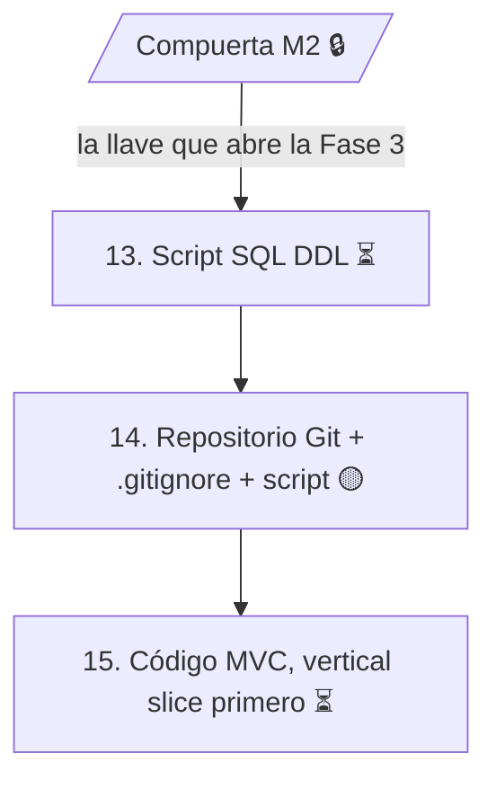

# Fase 3 — Construcción

> *Solo se abre con la compuerta.* La llave que abre esta fase es la **Compuerta M2** (matriz de trazabilidad cerrada y leída). Según el estado de la [Fase 2](../fase_2/README.md), la compuerta todavía está cerrada.

## Trazabilidad con la guía de seguimiento

| # | Actividad de la guía | Fechas planeadas | Estado |
|:---:|---|---|:---:|
| — | Compuerta M2: sin matriz cerrada y leída, NO hay código | 10/11/2026 | 🔒 cerrada |
| 13 | Script SQL (DDL): imagen exacta del Modelo Relacional (actividad 6) | 11/11/2026 – 13/11/2026 | ⏳ pendiente |
| 14 | Repositorio Git + `.gitignore` + script en la raíz (GCS) | 13/11/2026 – 16/11/2026 | 🟡 parcial |
| 15 | Código MVC: vertical slice primero | 17/11/2026 – 20/11/2026 | ⏳ pendiente |

## Estado de cada actividad

**13. Script SQL (DDL).** Ninguna fuente contiene el script. Su insumo directo es el [MER / modelo relacional](../fase_2/6-mer-modelo-relacional.md) y el [diccionario de datos](../fase_2/5-diccionario-de-datos.md), que ya definen las 18 tablas con tipos, tamaños, PK, FK, reglas `ON DELETE` / `ON UPDATE`, `CHECK`, `UNIQUE` y valores por defecto. La guía exige que el script sea su **imagen exacta**.

**14. Repositorio Git + `.gitignore` + script en la raíz.**
- ✅ El repositorio Git existe: [estebanvasquez0204-cyber/Mesa-TI-Solicitud-e-Incidente-](https://github.com/estebanvasquez0204-cyber/Mesa-TI-Solicitud-e-Incidente-), con la documentación organizada por fases en `docs/`.
- ⏳ Falta el archivo `.gitignore`.
- ⏳ Falta el script SQL en la raíz del repositorio (depende de la actividad 13).

**15. Código MVC (vertical slice primero).** No hay código en las fuentes. La arquitectura MVC y sus paquetes se definen en el DDA (actividad 9 de la Fase 2, pendiente), y la Vista parte de los [mockups](../fase_1/4-mockups.md).

## Gestión del cambio y de la configuración (transversal)

La guía la aplica a toda la ruta y tiene peso especial en esta fase:

- Todo cambio entra por **CRF** (el Cambio DECIDE).
- Cabeceras de historial y control de versiones (la Configuración REGISTRA).
- Las **Líneas Base** congelan el trabajo y son la puerta.
- En Git, cada commit cita su CRF y el **tag** es la línea base.
