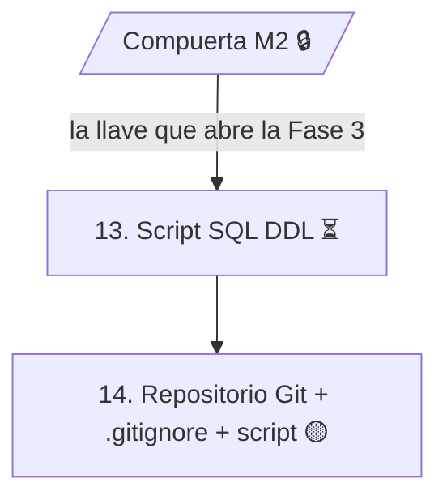

# Fase 3 — Construcción

> **Alcance en este proyecto:** la Fase 3 comprende solo las actividades **13. Script SQL (DDL)** y **14. Repositorio Git + `.gitignore` + script en la raíz**.

> *Solo se abre con la compuerta.* La llave que abre esta fase es la **Compuerta M2** (matriz de trazabilidad cerrada y leída). La matriz de trazabilidad ya está documentada ([actividad 12](../fase_2/12-matriz-de-trazabilidad.md)), pero en las fuentes no hay registro de la lectura cruzada entre equipos (12b), así que la compuerta se marca como pendiente de esa lectura.

## Trazabilidad con la guía de seguimiento

| # | Actividad de la guía | Fechas planeadas | Estado |
|:---:|---|---|:---:|
| — | Compuerta M2: sin matriz cerrada y leída, NO hay código | 10/11/2026 | 🔒 cerrada |
| 13 | Script SQL (DDL): imagen exacta del Modelo Relacional (actividad 6) | 11/11/2026 – 13/11/2026 | ⏳ pendiente |
| 14 | Repositorio Git + `.gitignore` + script en la raíz (GCS) | 13/11/2026 – 16/11/2026 | 🟡 parcial |

## Estado de cada actividad

**13. Script SQL (DDL).** Ninguna fuente contiene el script. Su insumo directo es el [MER versión 2](../fase_2/6-mer-modelo-relacional.md) (18 entidades, 161 atributos, 25 relaciones) y el [diccionario de datos](../fase_2/5-diccionario-de-datos.md). La guía exige que el script sea su **imagen exacta**.

**14. Repositorio Git + `.gitignore` + script en la raíz.**
- ✅ El repositorio Git existe: [estebanvasquez0204-cyber/Mesa-TI-Solicitud-e-Incidente-](https://github.com/estebanvasquez0204-cyber/Mesa-TI-Solicitud-e-Incidente-), con la documentación organizada por fases en `docs/`.
- ⏳ Falta el archivo `.gitignore`.
- ⏳ Falta el script SQL en la raíz del repositorio (depende de la actividad 13).

## Gestión del cambio y de la configuración (transversal)

La guía la aplica a toda la ruta y tiene peso especial en esta fase:

- Todo cambio entra por **CRF** (el Cambio DECIDE). Documentados: [CRF-001](../gestion-del-cambio/crf-001-historias-de-usuario.md) y [CRF-002](../gestion-del-cambio/crf-002-fase-1.md).
- Cabeceras de historial y control de versiones (la Configuración REGISTRA).
- Las **Líneas Base** congelan el trabajo y son la puerta.
- En Git, cada commit cita su CRF y el **tag** es la línea base.
