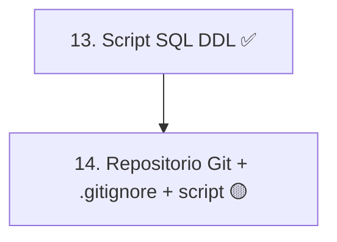

# Fase 3 — Construcción

> **Alcance en este proyecto:** la Fase 3 comprende solo las actividades **13. Script SQL (DDL)** y **14. Repositorio Git + `.gitignore` + script en la raíz**.

## Trazabilidad con la guía de seguimiento

| # | Actividad de la guía | Fechas planeadas | Estado |
|:---:|---|---|:---:|
| 13 | Script SQL (DDL): imagen exacta del Modelo Relacional (actividad 6) | 11/11/2026 – 13/11/2026 | ✅ [13-script-sql-ddl.md](13-script-sql-ddl.md) · [pruebas](13.1-pruebas-ddl.md) · [`sql/mesa_ayuda_ti_ddl.sql`](sql/mesa_ayuda_ti_ddl.sql) |
| 14 | Repositorio Git + `.gitignore` + script en la raíz (GCS) | 13/11/2026 – 16/11/2026 | 🟡 parcial |

## Estado de cada actividad

**13. Script SQL (DDL).** El script [`sql/mesa_ayuda_ti_ddl.sql`](sql/mesa_ayuda_ti_ddl.sql) crea la base `mesa_ayuda_ti` (MySQL 8.0.16 o superior) con 18 tablas y 161 columnas, igual que el [MER v2](../fase_2/6-mer-modelo-relacional.md) y el [diccionario](../fase_2/5-diccionario-de-datos.md). Cada restricción está anotada con su RN. La documentación técnica, con diagrama ER, una ficha por tabla, fragmentos del script y trazabilidad con HU, RF, RN, CU y mockups, está en [13-script-sql-ddl.md](13-script-sql-ddl.md). La ejecución en MySQL 8.0.46 y las 31 verificaciones de la sección 5 del script están en [13.1-pruebas-ddl.md](13.1-pruebas-ddl.md).

**14. Repositorio Git + `.gitignore` + script en la raíz.**
- ✅ El repositorio Git existe: [estebanvasquez0204-cyber/Mesa-TI-Solicitud-e-Incidente-](https://github.com/estebanvasquez0204-cyber/Mesa-TI-Solicitud-e-Incidente-), con la documentación organizada por fases en `docs/`.
- ⏳ Falta el archivo `.gitignore`.
- 🟡 El script SQL ya está en el repositorio, en [`docs/fase_3/sql/`](sql/mesa_ayuda_ti_ddl.sql). La guía pide ubicarlo en la raíz del repositorio.

## Gestión del cambio y de la configuración (transversal)

La guía la aplica a toda la ruta y tiene peso especial en esta fase:

- Todo cambio entra por **CRF** (el Cambio DECIDE). Documentados: [CRF-001](../gestion-del-cambio/crf-001-historias-de-usuario.md) y [CRF-002](../gestion-del-cambio/crf-002-fase-1.md).
- Cabeceras de historial y control de versiones (la Configuración REGISTRA).
- Las **Líneas Base** congelan el trabajo y son la puerta.
- En Git, cada commit cita su CRF y el **tag** es la línea base.
