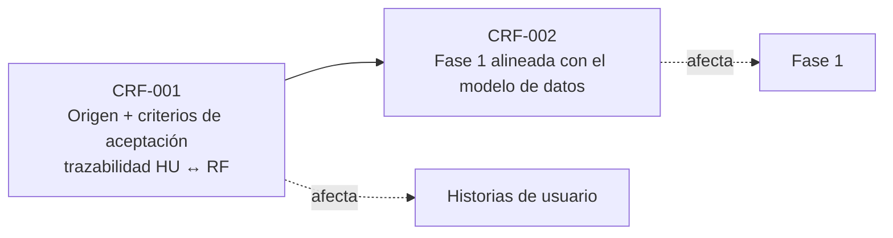

# Gestión del cambio y de la configuración

> **Guía de seguimiento:** transversal a toda la ruta. Todo cambio entra por CRF (el Cambio DECIDE) · cabeceras de historial y control de versiones (la Configuración REGISTRA) · las Líneas Base congelan y son la puerta · en Git, cada commit cita su CRF y el tag es la línea base.

| CRF | Fecha | Elemento afectado | Estado | Documento |
|---|---|---|---|---|
| CRF-001 | 7 de octubre de 2026 | Historias de usuario y criterios de aceptación (40 HU) | Aprobado | [crf-001-historias-de-usuario.md](crf-001-historias-de-usuario.md) |
| CRF-002 | 26 de octubre de 2026 | Fase 1 (46 HU, 50 RF; actualiza las cifras del CRF-001) | Propuesto — pendiente de revisión y aprobación de la docente | [crf-002-fase-1.md](crf-002-fase-1.md) |

